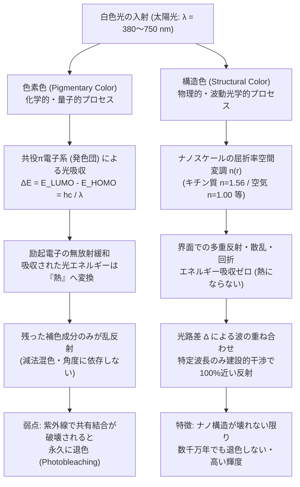

中南米の熱帯雨林を舞う<strong>モルフォ蝶（*Morpho rhetenor* や *Morpho didius*）</strong>の翅（はね）は、数キロメートル離れた小型飛行機の上空からでも視認できるほど強烈で金属的なコバルトブルーの輝きを放つ。また、日本の法隆寺に伝わる飛鳥時代の国宝「玉虫厨子（たまむしのずし）」には、幾千匹もの<strong>ヤマトタマムシ（*Chrysochroa fulgidissima*）</strong>の鞘翅（さやばね）が装飾として敷き詰められているが、制作から約1400年が経過した現在でも、その翅はエメラルドグリーンと赤紫が織りなす妖艶な光沢を失っていない。さらにドイツのメッセル採石場（Messel Pit）から発掘された約4700万年前（始新世）の甲虫の化石に至っては、地層の中で有機分子の大半が変質しているにもかかわらず、掘り出された瞬間に鮮やかなメタリックグリーンの輝きを放つことが知られている。

通常の絵画の絵の具や衣服の染料、あるいは植物の花びらや紅葉の色は、太陽光（特に紫外線）にさらされれば数ヶ月から数年で色あせ（光退色）、やがて灰色や茶褐色へと朽ちていく。にもかかわらず、なぜモルフォ蝶やタマムシ、クジャクの羽、ネオンテトラの体表は、これほどまでに鮮烈で、しかも何千年・何千万年という時間を超えて輝き続けることができるのだろうか？

ここに、自然界の色彩に関する最も劇的な実験がある。
あの目を射るような青い輝きを放つモルフォ蝶の翅を乳鉢に入れ、細かくすり潰して粉末にしてみよう。すると驚くべきことに、<strong>青い粉は一粒も得られず、後にはただの泥のような暗い茶褐色の粉末だけが残る</strong>のである。あるいは、翅を傷つけずにそのまま無水エタノールやアセトン（屈折率 $n \approx 1.36$）を一滴垂らしてみるだけでもよい。液体が翅の表面に染み込んだ瞬間、鮮やかな青色は魔法が解けたかのように消え失せ、黒っぽい茶色や緑がかった色へと変貌する。そして液体が蒸発して乾くと、再び元の眩いばかりのコバルトブルーが蘇るのだ。

つまり、モルフォ蝶の翅には<strong>「青色の色素（Pigment）」など最初から1ミリグラムも含まれていない</strong>のである。彼らがまとっているのは、物質の化学組成による色ではなく、可視光の波長（$\lambda \approx 380\text{–}750\,\text{nm}$）と同スケールの微細なナノ空間構造が電磁波を直接操ることで生み出す物理現象——すなわち<strong>構造色（Structural Coloration）</strong>である。

本稿では、化学的な「色素色」と物理的な「構造色」の本質的な違いを量子力学・電磁気学の視点から対比した上で、自然界が進化の過程で発明した4つの光学アーキテクチャ（<strong>単層薄膜干渉</strong>、<strong>一次元多層膜ブラッグ反射</strong>、<strong>モルフォ蝶の「秩序と乱れ」が解く回折パラドックス</strong>、そして<strong>2次元・3次元フォトニック結晶とアモルファス構造色</strong>）を、フレネルの反射公式やマクスウェル方程式から厳密に導出し、その全貌を解き明かす。

---

## 1. 自然界における「色」の二大原理：色素色（化学的吸収） vs. 構造色（物理的干渉）

私たちが物体に「色」を感じるのは、光源（太陽光など）から放たれた白色光（あらゆる波長の電磁波の混合）が物体と相互作用し、特定の波長成分だけが目の網膜（錐体細胞）に届くからである。自然界がこの波長選択性を実現する方法は、根本的に異なる2つの物理原理に大別される。

### 1.1 色素色（Pigmentary Color）：$\pi$電子共役系による光子の選択的吸収と熱散逸

植物の葉の緑（クロロフィル）、ニンジンやフラミンゴの橙赤（カロテノイド）、ベリーや紅葉の赤紫（アントシアニン）、そして動物の体毛や瞳の黒褐色（メラニン）は、すべて<strong>色素（Pigment）</strong>や<strong>染料（Dye）</strong>と呼ばれる有機分子（または遷移金属錯体）がもたらす<strong>色素色</strong>である。

色素分子の共通点は、分子内に単結合と二重結合が交互に連なる<strong>共役$\pi$電子系（Conjugated $\pi$-electron system）</strong>という発色団（Chromophore）を持っていることだ。量子力学において、分子内の電子は離散的なエネルギー準位（分子軌道）を占有している。基底状態において電子が詰まっている最もエネルギーの高い軌道を <strong>HOMO（最高被占軌道：Highest Occupied Molecular Orbital）</strong>、電子が入っていない最もエネルギーの低い軌道を <strong>LUMO（最低空軌道：Lowest Unoccupied Molecular Orbital）</strong> と呼ぶ。

通常の飽和炭化水素（$\sigma$結合のみ）では、HOMOとLUMOのエネルギー差 $\Delta E = E_{\text{LUMO}} - E_{\text{HOMO}}$ が大きく、紫外線領域（$\lambda < 300\,\text{nm}$）の光子しか吸収しないため、人間の目には無色透明または白く見える。しかし、共役二重結合が長くなると、$\pi$電子が分子全体に非局在化（一次元井戸型ポテンシャルの幅 $L$ が拡大）するため、軌道間のエネルギーギャップ $\Delta E$ が縮小し、可視光領域（$\lambda \approx 380\text{–}750\,\text{nm}$、エネルギーにして約 $1.65\text{–}3.26\,\text{eV}$）に一致するようになる。

$$
\Delta E = E_{\text{LUMO}} - E_{\text{HOMO}} = h\nu = \frac{hc}{\lambda_{\text{abs}}}
$$

ここで $h$ はプランク定数、$c$ は真空中の光速、$\nu$ は光の振動数である。この条件を満たす波長 $\lambda_{\text{abs}}$ の光子が入射すると、電子は光子を吸収して HOMO から LUMO（励起状態 $\pi^*$）へと遷移する。励起された電子は、蛍光物質でない限り、ピコ秒（$10^{-12}\,\text{s}$）オーダーの極めて短い時間で分子振動（無放射緩和）を通じてエネルギーを<strong>熱（赤外線・格子振動）</strong>へと変換し、基底状態に戻る。

結果として、私たちの目には<strong>「吸収されずに残った補色（Complementary Color）の乱反射光」</strong>が届く。たとえば青いジーンズ（インディゴ染料）が青く見えるのは、インディゴ分子がオレンジ〜赤色の波長（$\lambda \approx 600\text{–}660\,\text{nm}$）の光子を吸収して熱に変え、吸収できなかった青色の波長だけを散乱しているからである。

このメカニズムには、宿命的な弱点が2つある。
1. <strong>光退色（Photobleaching / 経年劣化）</strong>：太陽光に含まれる高エネルギーの紫外線（UV）光子が共役二重結合に衝突し続けると、ある確率でフリーラジカル反応や光酸化反応が起き、共有結合そのものが切断される。共役系が壊れれば $\Delta E$ は可視光領域から外れ、色は永久に失われる。
2. <strong>エネルギー損失と暗さ</strong>：色素色は「不要な波長を吸収して捨てる（減法混色）」ことで色を作るため、入射光のエネルギーの大半が熱として失われ、原理的に反射率のピークや彩度・輝度に限界がある。

### 1.2 構造色（Structural Color）：屈折率の空間変調による電磁波の干渉と回折

これに対し、<strong>構造色</strong>は分子軌道の電子遷移（光吸収）を一切伴わない。構造色を生み出す物質そのものは、可視光に対してほぼ透明な生体高分子——昆虫の翅や外骨格を作る<strong>キチン質（Chitin, 屈折率 $n \approx 1.56$）</strong>、鳥の羽毛を作る<strong>$\beta$-ケラチン（Keratin, $n \approx 1.54\text{–}1.58$）</strong>、植物の細胞壁を作る<strong>セルロース（Cellulose, $n \approx 1.53$）</strong>、魚類の鱗に含まれる<strong>グアニン結晶（Guanine, $n \approx 1.83$）</strong>——と、その隙間を満たす<strong>空気（Air, $n = 1.00$）</strong>や<strong>細胞質・水（Cytoplasm, $n \approx 1.33\text{–}1.35$）</strong>の組み合わせである。

これらの物質は単独では無色透明（または白い散乱体）にすぎない。しかし、屈折率の異なる2つ以上の媒質が、可視光の波長（数百ナノメートル）と同程度の空間スケールで周期的あるいは準周期的に配置されると、光（電磁波）は各界面で反射・散乱を繰り返す。その際、波の重ね合わせの原理によって、<strong>特定の波長 $\lambda$ の光だけ位相が揃って強め合い（Constructive Interference：建設的干渉）、それ以外の波長の光は位相が反転して打ち消し合う（Destructive Interference：相殺的干渉）</strong>。

構造色の歴史的発見は、17世紀の科学革命にまで遡る。1665年、ロバート・フック（Robert Hooke）は顕微鏡観察の名著『ミクログラフィア（*Micrographia*）』の中で、クジャクの羽やシミ（銀色の微小昆虫）の鱗粉を観察し、「水で濡らすとその鮮やかな色彩が瞬時に消える」ことを発見した。フックは、色が色素ではなく薄い板状構造の重なりから生じていると洞察した。続いて1704年、アイザック・ニュートン（Isaac Newton）は著書『光学（*Opticks*）』において、シャボン玉やガラス板の隙間にできる空気層（ニュートンリング）の干渉色とクジャクの羽の色が同じ光学的起源を持つことを指摘した。そして19世紀初頭のトマス・ヤング（Thomas Young）とオーギュスタン・ジャン・フレネル（Augustin-Jean Fresnel）による光の波動説の確立を経て、1917年にレイリー卿（Lord Rayleigh）が周期的多層膜による反射理論を定式化し、構造色の物理学の基礎が完成したのである。

冒頭で述べた「モルフォ蝶の翅にアセトンやエタノールを垂らすと青色が消える」理由も、これで完全に説明できる。本来、翅のナノ構造はキチン質（$n_H \approx 1.56$）と空気（$n_L = 1.00$）という大きな屈折率差（$\Delta n = 0.56$）によって強い干渉反射を起こしている。ここにアセトンやエタノール（$n \approx 1.36\text{–}1.38$）、あるいは屈折率整合液（$n \approx 1.55$）が毛細管現象で入り込むと、空気の隙間が液体に置き換わり、屈折率差 $\Delta n$ がほぼゼロに激減する。すると界面でのフレネル反射が消滅し、ナノ構造は光学的に「透明」になって、一番奥の基底層にある<strong>メラニン色素の茶褐色</strong>だけがむき出しになって見えるのである。

---

## 2. アーキテクチャ I：単層薄膜干渉（Single Thin-Film Interference）の波動光学

自然界における最も基本的な構造色は、シャボン玉、濡れたアスファルトに浮いた油膜、ハトの首元の羽、そして一部の甲虫やハエの透明な翅に見られる<strong>単層薄膜干渉（Thin-Film Interference）</strong>である。なぜ無色透明な石鹸水の膜やキチン質の薄膜が、見る角度によって虹色に変化する（<strong>構造色の角度依存性：Iridescence / 玉虫色</strong>）のか、電磁気学の境界条件から厳密に導出しよう。

### 2.1 光路差（Optical Path Difference）の幾何学的導出

屈折率 $n_0$ の媒質（通常は空気 $n_0 = 1.00$）から、厚さ $d$、屈折率 $n_1$（$n_1 > n_0$）の平行平板薄膜へ、入射角 $\theta_0$ で単色平面波（真空中の波長 $\lambda$）が入射する状況を考える。薄膜の下側の媒質の屈折率を $n_2$ とする（シャボン玉なら空気なので $n_2 = n_0 = 1.00$）。

入射光の一部は薄膜の上面（界面1：$n_0 \to n_1$）で反射されて反射波 $R_1$ となり、残りは屈折角 $\theta_1$ で薄膜内部へ進入し、下面（界面2：$n_1 \to n_2$）で反射されたのち、再び上面から空気中へ出て反射波 $R_2$ となる。スネルの法則（Snell's Law）より、

$$
n_0 \sin\theta_0 = n_1 \sin\theta_1
$$

が成り立つ。ここで、波面が揃う基準面から見た $R_1$ と $R_2$ の<strong>幾何学的な光路差 $\Delta_{\text{geom}}$</strong> を計算しよう。
薄膜内部を進む光が上面の点 $A$ で屈折し、下面の点 $B$ で反射し、上面の点 $C$ から空気中へ出るとする。薄膜の厚さが $d$ であるから、線分 $AB$ および $BC$ の長さはともに $\frac{d}{\cos\theta_1}$ であり、薄膜内部での幾何学的距離は $AB + BC = \frac{2d}{\cos\theta_1}$ となる。これに薄膜の屈折率 $n_1$ を掛けたものが薄膜内の光学的距離（光路長） $L_2 = \frac{2 n_1 d}{\cos\theta_1}$ である。

一方、その間に上面の点 $A$ で直接反射した波 $R_1$ は、空気中（屈折率 $n_0$）を点 $C$ から下ろした垂線の足 $D$ まで進んでいる。間隔 $AC = 2d \tan\theta_1$ であるから、空気中での距離 $AD$ は

$$
AD = AC \sin\theta_0 = 2d \tan\theta_1 \sin\theta_0
$$

となる。これに空気の屈折率 $n_0$ を掛け、スネルの法則 $n_0 \sin\theta_0 = n_1 \sin\theta_1$ を代入すると、$R_1$ の光路長 $L_1$ は

$$
L_1 = n_0 AD = 2d \tan\theta_1 (n_1 \sin\theta_1) = 2 n_1 d \frac{\sin^2\theta_1}{\cos\theta_1}
$$

と求まる。したがって、2つの波の純粋な空間的（幾何学的）光路差 $\Delta_{\text{geom}} = L_2 - L_1$ は、三角関数の基本恒等式 $1 - \sin^2\theta_1 = \cos^2\theta_1$ によって劇的に簡約される。

$$
\Delta_{\text{geom}} = L_2 - L_1 = \frac{2 n_1 d}{\cos\theta_1} \left(1 - \sin^2\theta_1\right) = 2 n_1 d \cos\theta_1
$$

### 2.2 フレネルの反射係数と境界における位相シフト（$\pi$ の反転）

しかし、波の干渉条件を決めるのは $\Delta_{\text{geom}}$ だけではない。電磁波が屈折率の異なる界面で反射する際、<strong>反射に伴う位相の飛び（Phase Shift）</strong>が発生するからである。
マクスウェル方程式から導かれる<strong>フレネルの反射係数（Fresnel reflection coefficients）</strong>を、入射面に垂直な電場成分（$s$偏光 / TE波）について書くと、媒質 $i$ から媒質 $j$ への反射係数 $r_{ij}^{(s)}$ は次式で与えられる。

$$
r_{ij}^{(s)} = \frac{n_i \cos\theta_i - n_j \cos\theta_j}{n_i \cos\theta_i + n_j \cos\theta_j}
$$

特に垂直入射付近（$\theta_i \approx 0$）では、

$$
r_{ij} = \frac{n_i - n_j}{n_i + n_j}
$$

となる。この符号に注目しよう。
* <strong>疎な媒質から密な媒質への反射（$n_i < n_j$）</strong>：分子が負（$r_{ij} < 0$）となる。複素振幅においてマイナス1を掛けることは、オイラーの公式 $e^{i\pi} = -1$ より、<strong>位相が $\pi$ ラジアン（半波長 $\frac{\lambda}{2}$ 分）だけ反転する（固定端反射）</strong>ことを意味する。
* <strong>密な媒質から疎な媒質への反射（$n_i > n_j$）</strong>：分子が正（$r_{ij} > 0$）となるため、<strong>位相の変化は $0$（自由端反射）</strong>である。

シャボン玉のように空気中に浮かぶ薄膜（$n_0 = 1.00 < n_1 \approx 1.33 > n_2 = 1.00$）や、空気層を挟んだキチン質の単層板では、上面（$n_0 \to n_1$）の反射で位相が $\pi$（光路長換算で $+\frac{\lambda}{2}$）ずれ、下面（$n_1 \to n_2$）の反射では位相がずれない。したがって、実効的な総光路差 $\Delta_{\text{total}}$ は次式となる。

$$
\Delta_{\text{total}} = 2 n_1 d \cos\theta_1 + \frac{\lambda}{2}
$$

これより、反射光が強め合う<strong>建設的干渉（Constructive Interference）</strong>と、弱め合う<strong>相殺的干渉（Destructive Interference）</strong>の条件式（$n_0 < n_1 > n_2$ の場合）が導かれる。

$$
\begin{aligned}
\text{強め合い（明条件）}: \quad 2 n_1 d \cos\theta_1 &= \left(m - \frac{1}{2}\right)\lambda \quad &(m = 1, 2, 3, \dots) \\
\text{弱め合い（暗条件）}: \quad 2 n_1 d \cos\theta_1 &= m\lambda \quad &(m = 0, 1, 2, \dots)
\end{aligned}
$$

（※なお、もし薄膜の下にさらに屈折率の高い基板がある場合 $n_0 < n_1 < n_2$ には、上面と下面の両方で位相が $\pi$ ずれて相殺されるため、強め合いと弱め合いの条件式が逆転し、無反射コーティング $2 n_1 d = \frac{\lambda}{2} \implies d = \frac{\lambda}{4n_1}$ の原理となる。）

### 2.3 シャボン玉の「黒膜（Black Film）」と角度によるブルーシフト

この方程式は、日常の2つの不思議な現象を見事に説明する。
第一に、シャボン玉が割れる直前、重力と表面張力によって頂上付近の膜厚 $d$ が極限まで薄くなり（$d \approx 5\text{–}10\,\text{nm} \ll \lambda$）、突然その部分が<strong>真っ黒（透明で反射がまったくない状態）</strong>になる現象（<strong>ニュートンの黒膜：Newton black film</strong>）である。$d \to 0$ の極限をとると、幾何学的光路差 $2 n_1 d \cos\theta_1 \to 0$ となるが、上面反射の位相シフト $\frac{\lambda}{2}$ が残るため、あらゆる可視波長 $\lambda$ に対して $m=0$ の弱め合い条件（完全な逆位相干渉）が成立し、反射光が完全に消滅するのである。

第二に、<strong>見る角度 $\theta_0$（したがって屈折角 $\theta_1$）を大きくしていくと、構造色が必ず短波長側（青・紫側）へとシフトする（Blue-shift with increasing angle）</strong>という普遍的な法則である。
$m=1$ の基本モードについて、強め合うピーク波長 $\lambda_{\text{peak}}(\theta_1)$ を解くと、

$$
\lambda_{\text{peak}}(\theta_1) = 4 n_1 d \cos\theta_1 = \lambda_{\text{peak}}(0) \cos\theta_1
$$

となる。真正面（$\theta_1 = 0, \cos\theta_1 = 1$）から見たときに赤色（$\lambda_{\text{peak}}(0) = 650\,\text{nm}$）に輝いていた薄膜を、斜め方向（たとえば $\theta_1 = 35^\circ, \cos 35^\circ \approx 0.82$）から覗き込むと、強め合う波長は $\lambda_{\text{peak}}(35^\circ) \approx 650 \times 0.82 = 533\,\text{nm}$（鮮やかな緑色）へと移動し、さらに浅い角度（$\theta_1 = 50^\circ, \cos 50^\circ \approx 0.64$）から見ると $\lambda_{\text{peak}}(50^\circ) \approx 416\,\text{nm}$（青紫色）へと変化する。これが「玉虫色（Iridescence）」の正体である。

---

## 3. アーキテクチャ II：一次元多層膜ブラッグ反射（1D Multilayer Bragg Reflectors）

単層薄膜によるフレネル反射率は、生体物質（キチン質 $n \approx 1.56$）と空気（$n = 1.00$）の界面1つあたり $R = \left(\frac{1.56 - 1.00}{1.56 + 1.00}\right)^2 \approx 4.8\%$、上下2面が干渉して強め合っても最大で約 $18\%$ 程度にとどまる。残りの $80\%$ 以上の光はそのまま透過してしまうため、単層膜だけではタマムシやモルフォ蝶、あるいはタチウオの鱗のような<strong>金属鏡にも匹敵する反射率（$80\% \sim 99\%$）</strong>を実現することはできない。

そこで生物が進化させた第2のアーキテクチャが、高屈折率層（$n_H$, 厚さ $d_H$）と低屈折率層（$n_L$, 厚さ $d_L$）を交互に何層も積み重ねた<strong>一次元多層膜干渉（1D Multilayer Interference）</strong>——光学工学で言うところの<strong>分布ブラッグ反射器（DBR: Distributed Bragg Reflector）</strong>あるいは<strong>誘電体多層膜ミラー</strong>である。

### 3.1 多層膜のブラッグ・スネル条件と「1/4波長スタック（Quarter-Wave Stack）」

高屈折率層 $H$（屈折率 $n_H$, 厚さ $d_H$, 屈折角 $\theta_H$）と低屈折率層 $L$（屈折率 $n_L$, 厚さ $d_L$, 屈折角 $\theta_L$）が交互に $N$ 周期積層された構造を考えよう。
1周期（$H$層＋$L$層のペア）を通過して反射してくる波と、表面で反射した波の間の光路差がちょうど波長 $\lambda$ の整数倍 $m\lambda$ になるとき、すべての周期からの反射波の位相が揃って建設的干渉を起こす。これが<strong>多層膜のブラッグ・スネルの法則（Multilayer Bragg-Snell Law）</strong>である。

$$
m \lambda_{\text{Bragg}} = 2 \left( n_H d_H \cos\theta_H + n_L d_L \cos\theta_L \right) \quad (m = 1, 2, 3, \dots)
$$

スネルの法則 $n_0 \sin\theta_0 = n_H \sin\theta_H = n_L \sin\theta_L$ を用いて外部の入射角 $\theta_0$（空気中なら $n_0 = 1$）で書き直せば、

$$
m \lambda_{\text{Bragg}}(\theta_0) = 2 \left( d_H \sqrt{n_H^2 - \sin^2\theta_0} + d_L \sqrt{n_L^2 - \sin^2\theta_0} \right)
$$

となる。さらに、多層膜の中の<strong>すべての単一界面（$L \to H$ 界面だけでなく $H \to L$ 界面も含む）</strong>からの反射波が一切無駄なく同位相で強め合うための最適設計条件が存在する。それが、垂直入射（$\theta_0 = 0$）において各層の光学的膜厚（Optical Thickness: $n d$）をターゲット波長 $\lambda_0$ のちょうど <strong>4分の1</strong> に揃える<strong>1/4波長多層膜（Quarter-Wave Stack）</strong>である。

$$
n_H d_H = n_L d_L = \frac{\lambda_0}{4} \implies \lambda_0 = 2(n_H d_H + n_L d_L)
$$

なぜ $n d = \frac{\lambda_0}{4}$ なのか確認しよう。
1. 上側の $L \to H$ 界面で反射する波は、低屈折率から高屈折率への反射なので位相が $\pi$ ずれる。
2. $H$ 層を通り抜けて下側の $H \to L$ 界面で反射する波は、高屈折率から低屈折率への反射なので反射自体の位相ずれは $0$ だが、厚さ $d_H$ の層を往復する間に $2 n_H d_H = 2 \left(\frac{\lambda_0}{4}\right) = \frac{\lambda_0}{2}$（位相にして $\pi$）だけ遅れる。
3. さらにその下の $L \to H$ 界面で反射する波は、往復の光路長 $2(n_H d_H + n_L d_L) = \lambda_0$（位相 $2\pi$）に加えて反射時の位相ずれ $\pi$ を受けるため、合計 $3\pi \equiv \pi \pmod{2\pi}$ となる。

驚いたことに、<strong>$2N$ 個あるすべての界面からの反射波が、例外なくすべて位相 $\pi$ で完全に一致し、コヒーレントに足し合わされる</strong>のである！

### 3.2 転送行列法によるピーク反射率 $R_N$ の導出と生物の驚異的反射率

電磁波の境界条件を記述する転送行列法（Transfer-Matrix Method: TMM）を用いると、入射媒質 $n_0$ と基板 $n_s$ の間に、高屈折率層 $n_H$ と低屈折率層 $n_L$ の1/4波長ペアを $N$ 周期（合計 $2N$ 層）挟んだときの中心波長 $\lambda_0$ における電力反射率 $R_N$ は、次の厳密な解析解で与えられる。

$$
R_N = \left[ \frac{n_0 \left(\frac{n_H}{n_L}\right)^{2N} - n_s}{n_0 \left(\frac{n_H}{n_L}\right)^{2N} + n_s} \right]^2
$$

この式が持つ威力は圧倒的である。たとえ1つの界面での屈折率比 $\frac{n_H}{n_L}$ が小さくても、指数 $2N$ によって $\left(\frac{n_H}{n_L}\right)^{2N}$ は爆発的に増大し、$N$ が増えるにつれて反射率 $R_N$ は急速に $100\%$（$R_N \to 1$）へと漸近する。実際の生物の例で数値計算してみよう。

* <strong>ヤマトタマムシ（*Chrysochroa fulgidissima*）の鞘翅</strong>：
  タマムシの外骨格の表皮（クチクラ）断面を透過型電子顕微鏡（TEM）で観察すると、メラニン顆粒を高密度に含むキチン層（$n_H \approx 1.68$, $d_H \approx 90\,\text{nm}$）と、メラニンが少ないキチン層（$n_L \approx 1.55$, $d_L \approx 100\,\text{nm}$）が約 $N = 15\text{–}20$ 層にわたって極めて規則正しく積層している。
  中心波長は $\lambda_0 = 2(1.68 \times 90 + 1.55 \times 100) \approx 612\,\text{nm}$（黄金〜緑赤色）となり、メラニン層が余分な透過光を吸収しつつ、多層膜干渉によって金属のような輝きを放つ。しかもこの多層構造は硬化したキチン質そのものの周期構造であるため、法隆寺の玉虫厨子のように1400年経過しても層間隔 $d_H, d_L$ が変化せず、色が不滅なのである。
* <strong>魚類の銀色の鱗（イワシ・タチウオ・サンマ）</strong>：
  水中には金属が存在しないにもかかわらず、なぜイワシやタチウオの腹部は磨き上げた銀のナイフのようにギラギラと輝くのか？彼らの皮膚にある虹色素胞（Iridophore）には、プリン塩基の一種である<strong>グアニン結晶の小板（Guanine platelets, $n_H = 1.83$）</strong>と<strong>細胞質の水溶液（Cytoplasm, $n_L = 1.33$）</strong>が交互に重なっている。
  屈折率比は $\frac{n_H}{n_L} = \frac{1.83}{1.33} \approx 1.376$ である。わずか $N = 5$ 周期（10層）重なるだけで、$\left(1.376\right)^{10} \approx 24.3$ となり、上式に代入すると反射率は $R_5 \approx 85\%$ に達する。さらに層厚 $d_H, d_L$ を深さ方向に少しずつ変化させた「チャープ多層膜（Chirped Multilayer）」を形成することで、可視光全域（$400\text{–}700\,\text{nm}$）を等しく高効率で反射し、完全な「金属の銀色（広帯域ミラー）」を作り出している。これにより、魚は水中で周囲の背景光をそのまま鏡のように反射し、捕食者から姿を隠す光学迷彩（カモフラージュ）を実現しているのだ。
* <strong>ネオンテトラ（*Paracheirodon innesi*）の動的構造色変化</strong>：
  熱帯魚ネオンテトラの体側を走る鮮やかな青緑色のストライプも、グアニン結晶板と細胞質の多層膜干渉である。驚くべきことに、ネオンテトラは夜間やストレスを感じたとき、自分の色を「青緑」から「深い藍色〜紫色」へと自発的に変化させる。木下修一らの研究により、これはグアニン結晶板の傾き角が神経・ホルモン制御によって「ブラインドの羽根（Venetian blind）」のように変化し、結晶板同士の面間隔 $d_L$ が変化することでブラッグ波長 $\lambda_{\text{Bragg}}$ がシフトするためであることが解明されている。

---

## 4. アーキテクチャ III：モルフォ蝶のパラドックス——なぜ虹色にならず広角で青いのか？

ここで私たちは、構造色の物理学における最大の謎——<strong>「モルフォ蝶のパラドックス（The Morpho Butterfly Paradox）」</strong>に直面する。

前節で見たように、単層薄膜であれ一次元多層膜（DBR）であれ、平坦な層状構造が引き起こす干渉色は $\lambda_{\text{Bragg}}(\theta_0) \propto \cos\theta$ に従うため、<strong>見る角度によって色が大きく変化する（玉虫色になる）</strong>し、また鏡面反射（Specular reflection：入射角＝反射角の方向）でしか強い光が返ってこないはずである。
一方、もし翅の表面に周期 $D \approx 700\,\text{nm}$ の規則的な溝（回折格子：Diffraction Grating）が並んでいるだけなら、コンパクトディスク（CDやDVD）の裏面と同じように、回折格子の方程式

$$
D (\sin\theta_i + \sin\theta_m) = m\lambda \quad (m = 0, \pm 1, \pm 2, \dots)
$$

に従って、見る角度 $\theta_m$ ごとに赤・黄・緑・青へと<strong>虹色に分光</strong>されてしまうはずである。

ところが、本物のモルフォ蝶（*Morpho didius* や *Morpho rhetenor*）の翅を観察すると、<strong>正面から見ても、斜め $40^\circ\text{–}50^\circ$（全体で $100^\circ$ 近い広い視野角）から見ても、虹色に分かれることなく、ほぼ一様に鮮やかなコバルトブルーに輝き続ける</strong>のである！「光の干渉を使って特定の青色だけを作り出しながら、干渉の宿命である角度依存性や回折格子の虹色分光だけをどうやって消し去っているのか？」——この長年の謎を完全に解き明かしたのが、大阪大学の木下修一・吉岡伸也らの研究グループによる一連の精緻な光学解析であった。

### 4.1 鱗粉のナノ階層構造：「クリスマスツリー（棚構造）」の発見

```mermaid
flowchart TD
    Incident["白色光の入射 (あらゆる波長を含む太陽光)"] --> Scale["モルフォ蝶の鱗粉表面 (リッジ間隔 D ≈ 700〜800 nm)"]

    Scale --> Mech1["① 縦方向の『規則性』 (1本のリッジ内部の多層ラメラ)<br/>キチン層 (n=1.56, d_H≈70nm) と空気層 (n=1.00, d_L≈115nm) が8〜12段積層"]
    Scale --> Mech2["② 横方向の『微小幅』 (各リッジの幅 w ≈ 300 nm < λ)<br/>波長より狭い単スリット開口として機能"]
    Scale --> Mech3["③ 隣り合うリッジ間の『不規則性』 (ランダムな高さのズレ ±Δz)<br/>各ツリーの基準高さが 0〜200 nm の範囲でランダムに変動"]

    Mech1 --> Out1["2(n_H d_H + n_L d_L) ≈ 450 nm<br/>青色波長のみを多層膜ブラッグ干渉で強力に選択反射！"]
    Mech2 --> Out2["単スリット回折効果 (Δθ ≈ λ / w)<br/>選択された青色光を ±50° 以上の広い角度範囲へ拡散！"]
    Mech3 --> Out3["リッジ間の位相差 Δφ = 4πΔz/λ がランダム化<br/>CDのような回折格子の『虹色の干渉縞』を完全に破壊・平滑化！"]

    Out1 & Out2 & Out3 --> Final["結果：どの角度 (100°以上の広視野角) から見ても<br/>虹色にならず、均一で強烈なメタリックブルーに輝く！"]
    Final --> Melanin["④ 基底層のメラニン顆粒が透過した緑・赤色光を吸収し、青の彩度を極限まで高める"]
```

走査型電子顕微鏡（SEM）および透過型電子顕微鏡（TEM）でモルフォ蝶の青い鱗粉（Scale、大きさ約 $100\,\mu\text{m} \times 200\,\mu\text{m}$）を拡大すると、鱗粉の表面には長手方向に沿って無数の平行な畝（<strong>リッジ：Ridge</strong>）が約 $0.7\text{–}0.8\,\mu\text{m}$（$700\text{–}800\,\text{nm}$）の間隔で並んでいる。
そして、このリッジを垂直に輪切りにした断面を見ると、信じられないほど精巧な構造が現れる。1本1本のリッジが、断面において<strong>「クリスマスツリー」あるいは「多段の棚（Lamellae / ラメラ構造）」</strong>の形をしており、キチン質の薄いひさし（ラメラ）が空気の隙間を挟んで縦方向に <strong>6層から12層</strong> も重なっているのである！

この「クリスマスツリー型ナノ構造」には、物理学的に完璧に計算し尽くされた <strong>4つの巧妙な仕掛け</strong> が組み込まれている。

#### 仕掛け①：縦方向の「厳密な規則性」による青色の選択的ブラッグ反射
1本のリッジ（クリスマスツリー）の内部では、キチン質のラメラ（$n_H = 1.56$, 厚さ $d_H \approx 70\text{–}75\,\text{nm}$）と空気層（$n_L = 1.00$, 厚さ $d_L \approx 110\text{–}115\,\text{nm}$）が極めて正確な周期で縦に積み重なっている。
1/4波長スタックに近いこの多層膜のブラッグ波長を計算すると、

$$
\lambda_{\text{Bragg}} = 2 (n_H d_H + n_L d_L) \approx 2 (1.56 \times 72 + 1.00 \times 113) = 2 (112.3 + 113) \approx 450\,\text{nm}
$$

となり、ちょうど<strong>純粋な青色（$\lambda \approx 450\,\text{nm}$）</strong>だけをほぼ $100\%$ に近い効率で反射する多層膜ミラーになっている。

#### 仕掛け②：横方向の「サブ波長幅」による単スリット広角回折
もしこの多層膜が横に広く繋がった平坦なシートであれば、青色の光は鏡面反射の狭い角度にしか返らない。しかしモルフォ蝶は、この多層膜を横幅わずか <strong>$w \approx 300\,\text{nm}$</strong> という、可視光の波長（$450\,\text{nm}$）よりも狭い短冊状のリッジに細切れにしている！
波動光学において、波長 $\lambda$ と同程度かそれより狭い幅 $w$ の開口（スリット）で反射・透過した波は、ホイヘンス・フレネルの原理により横方向へ大きく広がる（<strong>単スリット回折：Single-slit diffraction</strong>）。角度 $\theta$ 方向への回折強度分布 $I_{\text{single}}(\theta)$ は sinc 関数の2乗で与えられ、

$$
I_{\text{single}}(\theta) \propto \operatorname{sinc}^2\left(\frac{\pi w \sin\theta}{\lambda}\right) = \left[ \frac{\sin\left(\frac{\pi w \sin\theta}{\lambda}\right)}{\frac{\pi w \sin\theta}{\lambda}} \right]^2
$$

その広がり角の目安は $\sin\theta \sim \frac{\lambda}{w}$ となる。$w \approx 300\,\text{nm} < \lambda = 450\,\text{nm}$ であるため、1本のリッジで生成された青色の干渉光は、鏡面方向だけでなく<strong>横方向へ $\pm 50^\circ$ 以上の極めて広い角度範囲へと一様に回折・拡散</strong>されるのである。

#### 仕掛け③：隣り合うリッジ間の「絶妙な乱れ（ランダムな高さのズレ $\pm\Delta z$）」
しかし、ここで新たな問題が生じる。幅 $w \approx 300\,\text{nm}$ のリッジが一定の間隔 $D \approx 700\,\text{nm}$ で何百本も規則正しく並んでいるなら、今度は「多数のスリット間の干渉（多スリット回折格子）」が働いてしまい、特定の離散的な回折角にしか光が出ず、しかも波長ごとに角度が分かれてCDのような虹色の縞模様になってしまうはずだ。

モルフォ蝶がこの回折格子効果をどうやって消しているのかを調べた木下・吉岡らは、TEM断面像から驚くべき事実を発見した。<strong>隣り合うクリスマスツリー（リッジ）の背の高さ（基準面の $z$ 座標）が、揃っておらず、半波長程度（$\Delta z \sim 0\text{–}200\,\text{nm}$）の範囲でランダムにガタガタにずれている</strong>のである！
$N_{\text{ridge}}$ 本のリッジからの反射電場を重ね合わせた全体の強度 $I_{\text{total}}(\theta)$ は、単一リッジの強度 $I_{\text{single}}(\theta)$ に構造因子（干渉項）を掛けたものになる。

$$
I_{\text{total}}(\theta) = I_{\text{single}}(\theta) \left| \sum_{j=1}^{N_{\text{ridge}}} \exp\left[ i k \left( j D \sin\theta + 2 \Delta z_j \cos\theta \right) \right] \right|^2
$$

もしすべてのリッジの高さが揃っていれば（$\Delta z_j = 0$）、この和は回折格子の鋭いデルタ関数的なピーク（虹色の干渉縞）を生む。しかし、各リッジの高さ変動 $\Delta z_j$ がランダムであるため、往復光路差によるランダムな位相シフト $\Delta\phi_j = \frac{4\pi \Delta z_j \cos\theta}{\lambda}$ が $-\pi$ から $+\pi$ まで一様にばらつき、異なるリッジ間の干渉項（クロスターム $j \neq l$）のアンサンブル平均がゼロに打ち消し合う！

$$
\left\langle \left| \sum_{j=1}^{N_{\text{ridge}}} e^{i \phi_j} \right|^2 \right\rangle = N_{\text{ridge}} + \sum_{j \neq l} \langle e^{i(\phi_j - \phi_l)} \rangle \approx N_{\text{ridge}} \implies I_{\text{total}}(\theta) \approx N_{\text{ridge}} \, I_{\text{single}}(\theta)
$$

これこそがモルフォ蝶の光学設計の真髄である。
* <strong>縦方向には「厳密な周期的秩序（Order）」</strong>を持たせることで、$\lambda \approx 450\,\text{nm}$ の青色だけを多層膜干渉で生み出す。
* <strong>横方向（隣のリッジとの高さ関係）には「制御された乱れ（Disorder / Randomness）」</strong>を導入することで、回折格子としての虹色の干渉縞を完全に破壊し、広角にわたって滑らかで均一な青色の輝きだけを残す。

さらに、*Morpho didius* などの種では、この青色を発する「基底鱗粉（Ground scales）」の上に、透明でガラスのような「覆鱗粉（Cover scales）」がもう1層重なっており、これが光拡散板（ディフューザー）として働くことで、青色の視野角をさらに広げる二段構えの構造になっている。

#### 仕掛け④：基底層のメラニン色素によるコントラスト増強
そして最後に、鱗粉の土台（基底膜）には黒褐色の<strong>メラニン色素</strong>が敷き詰められている。クリスマスツリーの多層膜で反射されずに下へ通り抜けた緑色・黄色・赤色の光（$\lambda > 500\,\text{nm}$）は、このメラニン層によって吸収され、熱に変換される。もしこのメラニン層がなければ、透過した長波長の光が裏側の組織で乱反射（白色散乱）を起こし、青い構造色に白い光が混ざって淡い水色に白ぼけ（彩度低下）してしまう。モルフォ蝶は<strong>「物理的な構造色（青の生成）」と「化学的な色素（不要波長の吸収）」を完璧に分業・融合</strong>させることで、あの吸い込まれるような深いコバルトブルーを実現しているのである。

---

## 5. アーキテクチャ IV：2次元・3次元フォトニック結晶とアモルファス構造色

これまで見てきた薄膜（0次元的な単一界面ペア）や多層膜（1次元周期構造）では、屈折率 $n(z)$ が深さ方向 $z$ の1次元にしか周期性を持っていなかった。では、屈折率の周期的変調が平面内の2方向 $n(x, y)$、あるいは空間のすべての方向 $n(x, y, z)$ に広がったら何が起きるだろうか？

1987年、イライ・ヤブロノビッチ（Eli Yablonovitch）とサジーヴ・ジョン（Sajeev John）はそれぞれ独立に、誘電率（屈折率の2乗 $\varepsilon = n^2$）が光の波長スケールで3次元的に周期変化する人工結晶を作れば、半導体結晶が電子に対して「エネルギーバンドギャップ」を作って特定のエネルギーの電子の存在を禁じるのとまったく同じように、<strong>光子（電磁波）に対して「フォトニックバンドギャップ（Photonic Band Gap: PBG）」が形成され、特定の波長帯の光がどの方向にも一切進行できなくなる</strong>ことを理論的に予言した。これが<strong>フォトニック結晶（Photonic Crystal）</strong>の誕生である。

驚くべきことに、人間が1987年に理論化し、その後のナノ加工技術でようやく作製に成功したこのフォトニック結晶を、地球の生物（クジャク、ウミケムシ、カタゾウムシ、シジミチョウなど）は<strong>5億年前のカンブリア紀からすでに自らの体表に自己組織化によって構築していた</strong>のである。

### 5.1 マクスウェル方程式からのフォトニックバンドギャップ（PBG）の厳密導出

非磁性（透磁率 $\mu = \mu_0$）、無損失、電荷・電流のない不均一誘電体媒質（位置 $\mathbf{r}$ に依存する比誘電率 $\varepsilon(\mathbf{r}) = n(\mathbf{r})^2$ が格子ベクトル $\mathbf{R}$ の周期性 $\varepsilon(\mathbf{r} + \mathbf{R}) = \varepsilon(\mathbf{r})$ を持つ）の中を伝播する電磁波のマクスウェル方程式は次式で与えられる。

$$
\begin{aligned}
\nabla \cdot \left[\varepsilon_0 \varepsilon(\mathbf{r}) \mathbf{E}(\mathbf{r}, t)\right] &= 0, & \nabla \cdot \mathbf{H}(\mathbf{r}, t) &= 0 \\
\nabla \times \mathbf{E}(\mathbf{r}, t) &= -\mu_0 \frac{\partial \mathbf{H}(\mathbf{r}, t)}{\partial t}, & \nabla \times \mathbf{H}(\mathbf{r}, t) &= \varepsilon_0 \varepsilon(\mathbf{r}) \frac{\partial \mathbf{E}(\mathbf{r}, t)}{\partial t}
\end{aligned}
$$

電場と磁場が角振動数 $\omega$ で調和振動する定常モード $\mathbf{E}(\mathbf{r}, t) = \mathbf{E}(\mathbf{r}) e^{-i\omega t}$, $\mathbf{H}(\mathbf{r}, t) = \mathbf{H}(\mathbf{r}) e^{-i\omega t}$ を仮定すると、下の2つの回転（curl）方程式は

$$
\nabla \times \mathbf{E}(\mathbf{r}) = i\omega\mu_0 \mathbf{H}(\mathbf{r}), \qquad \nabla \times \mathbf{H}(\mathbf{r}) = -i\omega\varepsilon_0 \varepsilon(\mathbf{r}) \mathbf{E}(\mathbf{r})
$$

となる。第2式を $\varepsilon(\mathbf{r})$ で割ってから両辺の回転（$\nabla \times$）をとり、第1式を代入して電場 $\mathbf{E}(\mathbf{r})$ を消去すると、真空中の光速 $c = \frac{1}{\sqrt{\varepsilon_0 \mu_0}}$ を用いて、磁場 $\mathbf{H}(\mathbf{r})$ に関する<strong>フォトニック結晶のマスター方程式（固有値方程式）</strong>が得られる。

$$
\hat{\Theta} \mathbf{H}(\mathbf{r}) \equiv \nabla \times \left( \frac{1}{\varepsilon(\mathbf{r})} \nabla \times \mathbf{H}(\mathbf{r}) \right) = \left(\frac{\omega}{c}\right)^2 \mathbf{H}(\mathbf{r})
$$

ここで微分演算子 $\hat{\Theta} = \nabla \times \frac{1}{\varepsilon(\mathbf{r})} \nabla \times$ はエルミート演算子（自己随伴演算子）であり、量子力学におけるハミルトニアン $\hat{H} = -\frac{\hbar^2}{2m}\nabla^2 + V(\mathbf{r})$ と完全に数学的構造が対応している（逆誘電率 $\frac{1}{\varepsilon(\mathbf{r})}$ が周期ポテンシャル $V(\mathbf{r})$、固有値 $(\omega/c)^2$ がエネルギー固有値 $E$ に対応する）。

$\varepsilon(\mathbf{r})$ が周期関数であるため、固体物理の<strong>ブロッホ・フロケの定理（Bloch-Floquet Theorem）</strong>がそのまま適用でき、固有モードは波数ベクトル $\mathbf{k}$（ブリルアンゾーン内）と周期関数 $\mathbf{u}_{\mathbf{k}}(\mathbf{r}) = \mathbf{u}_{\mathbf{k}}(\mathbf{r} + \mathbf{R})$ の積で表される。

$$
\mathbf{H}_{\mathbf{k}}(\mathbf{r}) = e^{i \mathbf{k} \cdot \mathbf{r}} \mathbf{u}_{\mathbf{k}}(\mathbf{r})
$$

なぜブリルアンゾーンの境界（周期 $a$ に対して $k = \pm \frac{\pi}{a}$）でバンドギャップ $\Delta\omega$ が開くのか？その物理的理由は極めて明快である。
$k = \frac{\pi}{a}$ では、前進波 $e^{i\pi x / a}$ とブラッグ反射された後退波 $e^{-i\pi x / a}$ が結合し、2種類の定在波モード $\cos(\pi x / a)$ と $\sin(\pi x / a)$ を形成する。
1. <strong>誘電体バンド（Dielectric Band, 低周波側 $\omega_-$）</strong>：電場強度の腹（ピーク $|\mathbf{E}|^2$）が<strong>高誘電率（高屈折率 $\varepsilon_H$）の領域</strong>に集中する定在波モード。電磁場の変分原理により、エネルギーは $\omega^2 \propto \frac{\int \frac{1}{\varepsilon(\mathbf{r})} |\mathbf{D}|^2 d^3r}{\int |\mathbf{H}|^2 d^3r}$ に比例するため、大きな $\varepsilon_H$ の場所に電場が集中すると、固有振動数 $\omega_-$ はぐっと引き下げられる。
2. <strong>空気バンド（Air Band, 高周波側 $\omega_+$）</strong>：電場強度の腹が<strong>低誘電率（空気などの低屈折率 $\varepsilon_L$）の領域</strong>に集中する定在波モード。こちらは小さな $\varepsilon_L$ の場所に電場が集中するため、固有振動数 $\omega_+$ は高く保たれる。

結果として、$\omega_-$ と $\omega_+$ の間には、実数の波数ベクトル $\mathbf{k}$ を持つ解（伝播モード）が1つも存在しない周波数領域——<strong>フォトニックバンドギャップ（PBG） $\omega \in (\omega_-, \omega_+)$</strong> が出現する！この周波数帯の光子が外部から結晶に入射すると、結晶内部では波数が複素数（エバネッセント波 $e^{-\kappa x}$）となって指数関数的に減衰するため、内部へ侵入することが原理的に不可能となり、<strong>エネルギー損失ゼロで100%外部へ反射される</strong>のである。

### 5.2 自然界の2次元・3次元フォトニック結晶：クジャク、オパール、カタゾウムシのジャイロイド

生物たちは、この2次元・3次元のフォトニック結晶を驚くほど多様な形で実装している。

* <strong>2次元フォトニック結晶：クジャクの羽（*Pavo cristatus*）とウミケムシ（*Aphrodita aculeata*）</strong>
  クジャクの雄が広げる尾羽（上尾筒）の「目玉模様（アイスポット）」は、中心から外側に向かって青・ターコイズグリーン・黄・茶褐色へと鮮やかに色が変化する。復旦大学の資剣（Jian Zi）らが2003年に解明したところによれば、クジャクの小羽枝（Barbule）の表皮下には、直径約 $110\text{–}140\,\text{nm}$ のメラニンロッド（棒状粒子, $n \approx 2.0$）がケラチン質（$n \approx 1.54$）と空気穴の中に<strong>2次元の正方格子・長方格子状に規則配列</strong>した「2次元フォトニック結晶」が形成されている。
  クジャクは、メラニンというたった1種類の黒い色素ロッドの<strong>格子定数 $a$（ロッド間の距離：青では $a \approx 140\,\text{nm}$、緑では $a \approx 150\,\text{nm}$、黄色では $a \approx 165\,\text{nm}$）と積層数</strong>を場所ごとに少しずつ変えるだけで、部分フォトニックバンドギャップの位置を自在にチューニングし、あの絢爛豪華な多色模様を描き出しているのである！
* <strong>3次元フォトニック結晶：天然オパールとカタゾウムシ・シジミチョウの「ジャイロイド結晶」</strong>
  鉱物界の代表である宝石の<strong>オパール（Opal）</strong>は、直径 $150\text{–}300\,\text{nm}$ の均一な非晶質シリカ（$\text{SiO}_2, n \approx 1.45$）のナノ球が、面心立方格子（FCC）や六方最密充填（HCP）で3次元的に規則配列した3次元フォトニック結晶である。
  一方、生物界で最も驚異的な3次元フォトニック結晶を持つのが、宝石のように輝く<strong>カタゾウムシ類（*Pachyrhynchus argus* やブラジルのダイヤモンドゾウムシ *Entimus imperialis*）</strong>、およびグリーンの翅を持つシジミチョウ（*Callophrys rubi*）やアゲハチョウ（*Parides sesostris*）である。彼らの鱗粉の内部を満たしているのは、単純な球の集まりではなく、微分幾何学における三重周期極小曲面（Triply Periodic Minimal Surface: TPMS）の一種である<strong>3次元ジャイロイド構造（Gyroid Network）</strong>である！
  ジャイロイド曲面は、空間座標 $(x, y, z)$ と格子定数 $a$ を用いて次の超越方程式で近似される、自己交差のない連続な3次元迷路構造である。

$$
\sin\left(\frac{2\pi x}{a}\right)\cos\left(\frac{2\pi y}{a}\right) + \sin\left(\frac{2\pi y}{a}\right)\cos\left(\frac{2\pi z}{a}\right) + \sin\left(\frac{2\pi z}{a}\right)\cos\left(\frac{2\pi x}{a}\right) = t
$$

（ここでパラメータ $t$ はキチン質の体積充填率 $\phi$ を決定する定数）。蝶やゾウムシの蛹（さなぎ）の細胞は、細胞内の滑面小胞体（Smooth Endoplasmic Reticulum: SER）の生体膜を自己組織化によってまず3次元ジャイロイド型に折りたたみ、その片側のチャンネルにキチン質を流し込んで硬化させた後、細胞死（アポトーシス）によって膜と水分を蒸発させることで、格子定数 $a \approx 300\,\text{nm}$ の完璧なキチン・空気の3次元ジャイロイド・フォトニック結晶をテンプレート合成しているのである。

### 5.3 アモルファス構造色（準秩序構造）：なぜアオカケスやカワセミの青は角度によって変わらないのか？

ここでさらなる疑問が湧く。北米の<strong>アオカケス（Blue Jay, *Cyanocitta cristata*）</strong>、<strong>ルリツグミ（Eastern Bluebird）</strong>、<strong>コンゴウインコ（Macaw）</strong>、あるいは日本の<strong>カワセミ（Kingfisher）</strong>や<strong>ルリビタキ</strong>の青い羽毛にも、実は青色の色素は一切含まれていない（鳥類は進化の過程で青色色素を合成する生化学経路をほとんど獲得しなかったため、青い鳥のほぼすべてが構造色である）。
しかし、カワセミやアオカケスの羽をどの角度から眺めても、タマムシのように色が赤や紫に変わったり（Iridescence）せず、まるで青い絵の具で塗ったかのように<strong>どの方向から見ても同じマットな青色（角度非依存の構造色：Non-iridescent Structural Color）</strong>に見える。これはなぜだろうか？

かつて19世紀〜20世紀中頃には、これは空が青いのと同じ「レイリー散乱（Rayleigh Scattering：波長よりはるかに小さい独立な微粒子による $\lambda^{-4}$ に比例する散乱）」や「チンダル現象」によるものだと誤解されていた。しかし1998年以降、イェール大学のリチャード・プラム（Richard O. Prum）らが羽毛のナノ構造の2次元フーリエ変換（空間パワースペクトル解析）を行ったことで、長年の定説が覆された。

アオカケスやルリツグミの羽毛（羽枝の海綿状髄質層：Spongy medullary layer）の内部には、直径約 $150\text{–}200\,\text{nm}$ のケラチン質の網目または球状構造と空気の空胞が詰まっている。この構造は、結晶のような長距離秩序（Long-range periodic order）は持たないが、完全にバラバラなランダム配置でもなく、<strong>「隣り合う空胞同士の中心間距離 $d_0$ だけはほぼ一定（$d_0 \approx 180\,\text{nm}$）に保たれている」という短距離秩序（Short-range order / 準秩序構造：Quasi-ordered or Amorphous Photonic Structure）</strong>を持っているのである。

この構造はどうやって作られるのか？羽毛の細胞が成熟する際、細胞質内で重合していく$\beta$-ケラチンタンパク質と水分の混合物が、熱力学的な不安定領域に入って<strong>スピノーダル分解（Spinodal Decomposition：合金や高分子ブレンドが自発的に一定波長の網目状に相分離する現象）</strong>を起こし、相分離が途中で凍結（固化）したのちに水分が抜けることで、全方向に等方的な空間相関長 $d_0$ を持つスポンジ状ナノ構造が自動的に出来上がるのである。

誘電率分布 $\varepsilon(\mathbf{r})$ のフーリエ変換 $\tilde{\varepsilon}(\mathbf{q})$ のパワースペクトル（構造因子 $S(\mathbf{q}) \propto |\tilde{\varepsilon}(\mathbf{q})|^2$）を計算すると、
* <strong>完全結晶（オパール等）</strong>では、逆格子空間の特定の方向ベクトル $\mathbf{G}_{hkl}$ に鋭いブラッグピーク（輝点）が立つため、特定の角度でしか強い反射が起きず、見る角度によって色が変わる（玉虫色）。
* <strong>アモルファス・準秩序構造（アオカケスの羽）</strong>では、方向による違いがないため、逆空間において原点を中心とした半径 $|\mathbf{q}| = q_0 \approx \frac{2\pi}{d_0}$ の<strong>球殻（2次元断面では均一なリング）</strong>の上に散乱強度が一様に分布する。

したがって、どの方向から光が入射し、どの角度から観察しても、運動量保存則 $|\mathbf{q}| = 2 k \sin(\theta_s / 2) = q_0$ を満たす同じ波長 $\lambda_{\text{peak}} \approx 2 n_{\text{eff}} d_0$（青色）ばかりが等方的に強め合って散乱（<strong>コヒーレント散乱：Coherent Scattering</strong>）される。これが、色素を使わずに「角度に依存しないマットな青色」を生み出すアモルファス構造色の物理メカニズムである。

---

## 6. 4つの構造色アーキテクチャの総括と色素色との比較

ここまでの議論を整理するため、自然界における「色素色」と「構造色」の比較、および構造色の4大アーキテクチャの物理的特性を以下の2つの表にまとめる。

### 表1：色素色（Pigmentary Color）と構造色（Structural Color）の徹底比較

| 比較項目 | 色素色（Pigmentary Color） | 構造色（Structural Color） |
| :--- | :--- | :--- |
| <strong>発色の基本原理</strong> | 共役$\pi$電子系による特定波長光子の<strong>化学的・量子的吸収</strong>（$\Delta E = E_{\text{LUMO}} - E_{\text{HOMO}} = hc/\lambda$）と補色の乱反射 | 可視光波長スケール（$100\text{–}400\,\text{nm}$）の屈折率空間変調 $n(\mathbf{r})$ による電磁波の<strong>干渉・回折・コヒーレント散乱</strong> |
| <strong>エネルギー収支</strong> | 吸収された波長の光エネルギーは分子振動（<strong>熱</strong>）に変換されて失われる（減法混色） | 光吸収を伴わないためエネルギー損失がほぼゼロ（対象波長を最大 <strong>$100\%$ 近く無損失反射</strong>） |
| <strong>視覚的特徴・輝度</strong> | マット（拡散反射）で落ち着いた色合い。金属光沢は出せない | 極めて高い彩度と輝度、金属光沢（メタリック感）や蛍光のような眩い輝き |
| <strong>角度依存性</strong> | なし（どの角度から見ても同じ色） | 周期構造では強い<strong>角度依存性（Iridescence / ブルーシフト）</strong>あり。ただしモルフォ構造やアモルファス構造では広角化・角度非依存化が可能 |
| <strong>粉砕・屈折率整合</strong> | 粉末にすり潰しても、溶媒に浸しても分子が壊れない限り色は残る | ナノ構造をすり潰すと色が消滅。アルコールやアセトン（$n \approx 1.36$）に浸すと屈折率差 $\Delta n$ が減少し<strong>瞬時に色が消える・変化する</strong> |
| <strong>耐久性・退色（寿命）</strong> | 紫外線（UV）による共有結合の切断（光酸化）で数年〜数十年で<strong>光退色（Photobleaching）</strong>する | ナノ空間構造が物理的に破壊されない限り永久不滅（<strong>1400年前の玉虫厨子や4700万年前の化石でも退色しない</strong>） |

### 表2：自然界における構造色の4大光学アーキテクチャ

| アーキテクチャ | 空間次元と秩序 | 支配方程式・条件 | 光学的特徴（視野角・反射率） | 自然界の代表的な具体例 |
| :--- | :--- | :--- | :--- | :--- |
| <strong>I. 単層薄膜干渉</strong> (Single Thin Film) | 1次元（単一膜厚 $d$） | $2 n_1 d \cos\theta_1 = \left(m - \frac{1}{2}\right)\lambda$ （上面で位相 $\pi$ 反転時） | 反射率は低め（$\sim 15\%$）。角度 $\theta_1$ の増大に伴い短波長へブルーシフト | シャボン玉、水面の油膜、ハトの首の羽、ハエ・ハチの透明な翅の虹色 |
| <strong>II. 一次元多層膜ブラッグ反射</strong> (1D Multilayer / DBR) | 1次元周期積層 $(n_H, d_H)$ と $(n_L, d_L)$ | $m\lambda_{\text{Bragg}} = 2(n_H d_H \cos\theta_H + n_L d_L \cos\theta_L)$ 最適条件：$n_H d_H = n_L d_L = \frac{\lambda_0}{4}$ | $N \ge 10$ 層で反射率 $R_N \to 95\text{–}99\%$ の金属鏡面反射。強い玉虫色（角度依存性） | ヤマトタマムシの鞘翅、タチウオ・イワシの銀鱗（グアニン結晶）、ネオンテトラ、ハンミョウ |
| <strong>III. モルフォ型階層構造</strong> (Order + Disorder Grating) | 縦：規則的多層ラメラ 横：サブ波長幅＋ランダム高さ $\pm\Delta z$ | 縦：$2(n_H d_H + n_L d_L) \approx 450\,\text{nm}$ 横：$I(\theta) \approx N_{\text{ridge}} \operatorname{sinc}^2\left(\frac{\pi w \sin\theta}{\lambda}\right)$ | 回折格子の虹色縞をランダム位相で消去し、<strong>$\pm 50^\circ$ 以上の広視野角で均一な高輝度ブルー</strong> | モルフォ蝶（*Morpho rhetenor*, *Morpho didius*, *Morpho menelaus*） |
| <strong>IV-a. 2D/3D フォトニック結晶</strong> (Ordered Photonic Crystal) | 2次元または3次元の長距離周期格子 $\varepsilon(\mathbf{r}+\mathbf{R})=\varepsilon(\mathbf{r})$ | $\nabla \times \left(\frac{1}{\varepsilon(\mathbf{r})}\nabla \times \mathbf{H}\right) = \left(\frac{\omega}{c}\right)^2 \mathbf{H}$ （フォトニックバンドギャップ PBG） | PBG内の周波数では状態密度 $\rho(\omega)=0$ となり全反射。結晶方位に応じた鮮やかな構造色 | クジャクの羽（2Dメラニンロッド格子）、ウミケムシ（2D）、オパール（3D球充填）、カタゾウムシ・シジミチョウ（3Dジャイロイド） |
| <strong>IV-b. アモルファス構造色</strong> (Quasi-Ordered / Short-Range) | 3次元等方的・短距離秩序のみ（スピノーダル相分離） | フーリエ空間 $|\tilde{\varepsilon}(\mathbf{q})|^2$ が半径 $q_0 \approx \frac{2\pi}{d_0}$ の等方的球殻状に分布 | <strong>角度依存性なし（Non-iridescent）</strong>。どの角度から見ても均一で鮮やかな色（コヒーレント散乱） | アオカケス、ルリツグミ、カワセミ、コンゴウインコの青い羽毛、一部のカエルの皮膚 |

---

## 7. 4700万年前の化石が放つ輝きと、バイオミメティクス（生物模倣）産業応用

### 7.1 地質学的時間を超える構造色：メッセル採石場の甲虫化石

構造色が「分子の電子状態」ではなく「サブミクロンの幾何学的形状」に宿るという事実は、古生物学に革命をもたらした。
2011年、イェール大学のマリア・マクナマラ（Maria E. McNamara）らの研究チームは、ドイツのメッセル採石場（Messel Pit）やアメリカのグリーンリバー累層から発掘された、約1500万〜4700万年前（新生代始新世〜中新世）の甲虫（ゾウムシやタマムシの仲間）の化石を電子顕微鏡と顕微分光器で調査した。

これらの化石は、何千万年も地下深くで圧力と熱にさらされた結果、元のキチン質やタンパク質はすでに炭化・続成作用を受けて別の有機高分子へと化学変化していた。もし彼らの色が色素によるものであったなら、数千年も経たないうちに完全に分解して黒炭色になっていたはずである。ところが、化石のクチクラ内部にあった厚さ約 $70\text{–}120\,\text{nm}$ の一次元多層膜構造や3次元フォトニック結晶の<strong>空間的な周期形状そのもの</strong>は、そのままの寸法で化石化して保存されていたのである！その結果、4700万年前の甲虫の化石は、現代の太陽光を浴びた瞬間、太古の森で生きていたときとほぼ同じエメラルドグリーンや藍色の構造色を鮮やかに蘇らせた（ただし化石化に伴う有機物の屈折率変化により、生前よりわずかに長波長側へレッドシフトしていることまで定量的に計算できる）。

現在では、約1億5000万年前のジュラ紀の始祖鳥や羽毛恐竜（ミクロラプトル *Microraptor* など）の化石に残されたメラノソーム（メラニン顆粒）のサイズと空間配列をSEMで測定し、多層膜干渉モデルに代入することで、<strong>「絶滅した恐竜がどんな構造色の玉虫色に輝いていたか」</strong>を物理学的に復元する研究（古色彩学：Paleocolor）が最前線の科学として確立されている。

### 7.2 構造色のバイオミメティクス（生物模倣技術）と最先端産業応用

「有害な重金属顔料や有機染料を一切使わず、単一の無害なポリマーや酸化物のナノ構造だけで、絶対に色あせない究極の色彩と光学制御を実現する」——生物が5億年かけて洗練させた構造色の物理は、いま現代の材料工学・ディスプレイ・環境エネルギー技術に計り知れないインパクトを与えている。

#### ① 染色廃水をゼロにする無染色構造発色繊維「モルフォテックス（Morfotex）」
アパレル・繊維産業における染色工程は、世界の産業廃水の約20%を占め、大量の化学染料と水資源を消費する環境負荷の極めて高いプロセスである。日本の帝人（Teijin）と日産自動車、田中貴金属などの共同研究によって開発された世界初の構造発色繊維<strong>「モルフォテックス（Morfotex）」</strong>は、まさにモルフォ蝶の多層ラメラ構造をナノテクノロジーで再現したものだ。
染料を一切使わず、屈折率の異なる2種類の汎用透明ポリマー——<strong>ポリエステル（ポリエチレンテレフタレート PET, $n_H \approx 1.63$）</strong>と<strong>ナイロン（ポリアミド6, $n_L \approx 1.53$）</strong>——を、1層の厚さわずか $70\text{–}90\,\text{nm}$ で交互に <strong>61層</strong> 積層した扁平断面フィラメントを溶融紡糸する。層の厚みを数ナノメートル変えるだけで、同じ透明なプラスチックから青、緑、赤の鮮やかな金属光沢繊維が生まれ、どれだけ日光に当てても永久に色あせることがない。

#### ② 究極の自動車塗装「レクサス Structural Blue（構造発色顔料）」
従来の青色塗料（顔料）は、入射した太陽光の95%以上を吸収・散乱ロスしてしまい、目に戻る青色光はわずか5%未満であった。レクサス（トヨタ自動車）が15年の歳月をかけて開発した特別塗装色<strong>「ストラクチュラルブルー（Structural Blue）」</strong>は、モルフォ蝶のナノ構造を模倣した超微小な多層膜フレーク顔料を採用している。
本来、無機多層膜でモルフォ蝶と同じ発色を得るには約40層の積層が必要とされたが、薄膜蒸着と微細加工の最適化によりわずか <strong>7層</strong> のナノ積層フレークで同等の干渉特性を実現。入射した光のほぼ <strong>100%近い青色成分</strong> を反射し、かつモルフォ蝶と同様に広い視野角で深いコバルトブルーの輝きと圧倒的な明暗コントラストを生み出すことに成功した。

#### ③ 太陽光下で輝く超低消費電力MEMSディスプレイ（IMOD / Mirasol）
液晶（LCD）や有機EL（OLED）ディスプレイは、自らバックライトや発光素子を光らせるため、真夏の直射日光下では画面が暗くて見えなくなり、かつバッテリーを激しく消費する。これに対し、クアルコム（Qualcomm）などが開発した<strong>干渉変調ディスプレイ（IMOD: Interferometric Modulator Display / Mirasol）</strong>は、シャボン玉やタマムシの薄膜干渉をマイクロ電気機械システム（MEMS）で電子制御する反射型ディスプレイである。
各サブピクセルは、上部の半透過薄膜と、静電気力で上下に可動する下部反射メンブレンの間の<strong>空気層の厚さ（ギャップ $d$）</strong>で構成される。電圧をかけてギャップ $d$ を変化させると、強め合う干渉波長 $\lambda = 2 d$ が瞬時に切り替わり、またメンブレンを完全に密着させて $d \to 0$（シャボン玉の「黒膜」状態）にすれば、全波長が逆位相で打ち消し合って完全な「黒」になる。周囲の太陽光が強ければ強いほど画面が鮮やかに輝き、静止画表示中の消費電力はほぼゼロという究極の省エネ特性を持つ。

#### ④ 偽造不可能なセキュリティ印刷と構造色バイオセンサー
紙幣（日本銀行券やユーロ紙幣など）やパスポートのホログラム、および角度を変えると緑からマゼンタへ色が劇的に変化する<strong>光学的可変インキ（OVI: Optically Variable Ink）</strong>は、一次元多層膜干渉フレークの角度依存性（$\lambda \propto \cos\theta$）を応用したものである。カラーコピー機やスキャナは特定の1方向からの反射光しか読み取れないため、角度による波長シフトを持つ構造色インキを複製することは物理的に不可能である。
さらに医療・化学分野では、ハイドロゲル（水を含むと膨潤する高分子網目）の内部にオパール型の3次元フォトニック結晶を構築した<strong>「構造色センサー（Photonic Crystal Hydrogel Sensors）」</strong>が実用化されつつある。涙や汗に含まれるグルコース（血糖）濃度、pH、あるいは有害ガス分子に反応してハイドロゲルが膨潤・収縮すると、結晶の格子定数 $a$ が変化し、電源も回路も一切使わずに<strong>「センサーの色が青から緑、赤へと肉眼で見える形で変化する」</strong>ため、次世代のウェアラブル診断パッチとして大きな注目を集めている。

#### ⑤ 電力ゼロで建物を冷やす「放射冷却フォトニックメタマテリアル」
そして現在、地球温暖化対策の切り札として世界中で激しい開発競争が繰り広げられているのが、構造色の原理を太陽光から中赤外線領域へと拡張した<strong>「日中の受動的放射冷却（Daytime Passive Radiative Cooling）」</strong>である。
サハラ砂漠の灼熱の太陽（地表温度 $70^\circ\text{C}$）の下で活動する<strong>サハラ銀アリ（*Cataglyphis bombycina*）</strong>は、断面が三角形の微細な毛（ミクロ構造）で体表を覆うことで、可視光〜近赤外線の太陽光（波長 $0.3\text{–}2.5\,\mu\text{m}$）をミー散乱と全反射によって $96\%$ 以上跳ね返し、同時に自らの体温から出る中赤外線の熱ふく射（波長 $8\text{–}13\,\mu\text{m}$：地球の大気が透明になる「大気の窓」領域）を効率よく宇宙空間（絶対温度 $3\,\text{K}$）へと放射して体温を下げている。
スタンフォード大学のファン（Shanhui Fan）教授らのグループは、この原理を応用し、$\text{SiO}_2$ と $\text{HfO}_2$ の多層フォトニック構造や多孔質ポリマー構造を用いることで、<strong>真夏の直射日光が照りつける屋外において、電力を1ワットも使わずに周囲の気温より $5^\circ\text{C}\text{–}10^\circ\text{C}$ も低温になる構造発色・放射冷却塗料やフィルム</strong>を実現した。

---

## 8. 結論：光と物質が織りなすナノ空間の交響曲

モルフォ蝶の翅をすり潰したときに残る一握りの茶色い粉は、私たちに自然界の深遠な真理を教えてくれる。
あの熱帯雨林を切り裂くようなコバルトブルーも、1400年の時を超えた玉虫厨子の輝きも、クジャクの羽の優雅なアイスポットも、物質の「化学的な色」ではなかった。それは、無色透明なキチン質やケラチンと空気というありふれた素材を、数百ナノメートルという光の波長のスケールで彫刻し、<strong>マクスウェル方程式と波の重ね合わせの原理を極限まで操ることで生み出された「空間の幾何学そのものの輝き」</strong>だったのである。

* 単層薄膜では、表と裏のわずか2つの界面が位相 $\pi$ の反転を伴って干渉し、角度とともに移ろう虹色のグラデーションを生む。
* 多層膜（DBR）では、1/4波長に揃えられた数十の層がコヒーレントに共鳴し、金属を一切使わずに99%の鏡面反射を生み出す。
* モルフォ蝶のクリスマスツリー構造では、縦方向の「厳密な周期的秩序」が青色を選び出し、横方向の「サブ波長スリット」と「ランダムな高さの乱れ」が回折格子の虹色を消し去って、100度を超える広角の青を実現する。
* そして3次元フォトニック結晶とアモルファス構造は、空間のあらゆる方向に向かってフォトニックバンドギャップや等方的コヒーレント散乱を開き、光を自在に閉じ込め、あるいは解き放つ。

次にあなたが街角でシャボン玉の渦巻く虹色を見かけたとき、あるいは博物館でモルフォ蝶やタマムシの標本を覗き込んだとき、そこに見えているのは単なる「色」ではない。数百ナノメートルの微細な建築物の間で、毎秒数百兆回も振動する電磁波の波頭が一斉に歩調を合わせ、位相を揃えてあなたの瞳へと飛び込んでくる、壮大な<strong>波動光学の交響曲（シンフォニー）</strong>そのものなのである。
