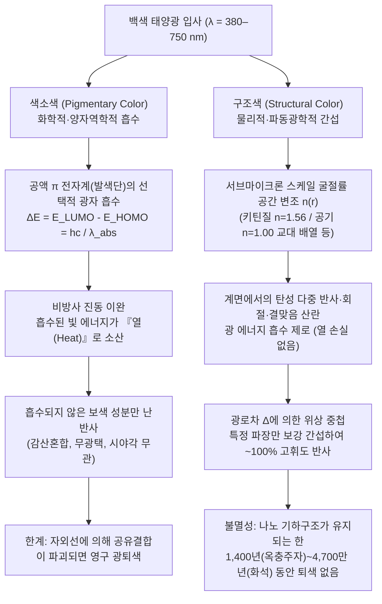
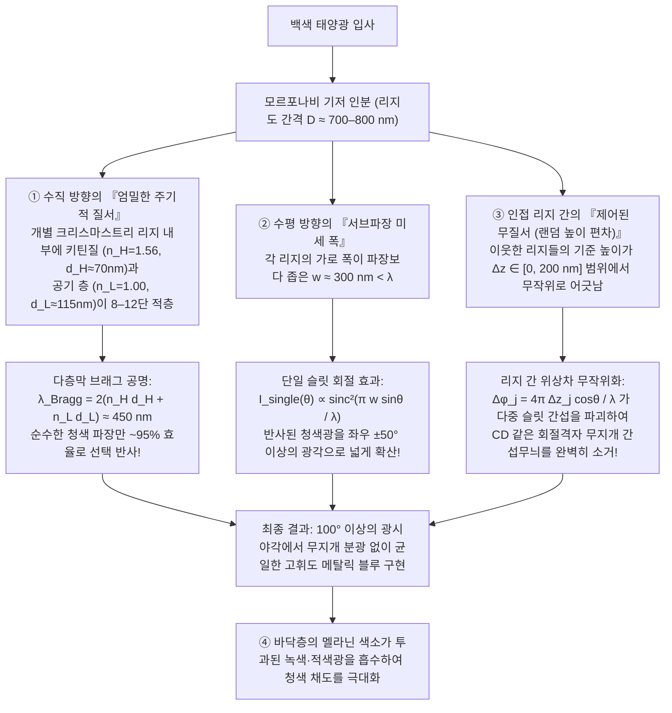

중남미 열대우림의 수관층을 날아다니는 <strong>모르포나비(*Morpho rhetenor*, *Morpho menelaus*, *Morpho didius*)</strong>의 날개는 1킬로미터 상공을 비행하는 경비행기 조종사의 눈에도 선명히 포착될 만큼 강렬하고 금속성인 코발트블루 빛을 뿜어낸다. 또한 한국 경주 황남대총의 신라 시대 말다래 장식이나 일본 호류지(法隆寺)의 7세기 국보 '옥충주자(玉蟲厨子)'에는 수천 마리의 <strong>비단벌레(*Chrysochroa fulgidissima*)</strong> 딱지날개(초시)가 장식되어 있는데, 무려 1,400여 년의 세월이 흐른 오늘날에도 에메랄드빛 녹색과 자줏빛 금색이 어우러진 영롱한 광택을 그대로 간직하고 있다. 더욱 놀라운 사실은 독일 <strong>메셀 채석장(Messel Pit)</strong>의 약 <strong>4,700만 년 전(에오세)</strong> 지층에서 발굴된 딱정벌레 화석조차 원래의 생체 고분자가 속성 작용으로 변질되었음에도 불구하고, 발굴되어 햇빛을 받는 순간 찬란한 메탈릭 그린과 블루의 빛을 발한다는 점이다.

일반적인 물감이나 섬유 염료, 꽃잎과 단풍잎의 색은 태양 자외선(UV)에 노출되면 수개월에서 수년 내에 광화학적 표백(변색·퇴색)을 일으키며 빛을 잃는다. 그런데 왜 모르포나비의 날개, 비단벌레의 껍질, 공작(*Pavo cristatus*) 깃털의 눈알 무늬, 그리고 네온테트라(*Paracheirodon innesi*)의 줄무늬는 합성 안료를 압도하는 고휘도를 자랑하며 수천만 년의 지질학적 시간을 초월해 빛날 수 있는 것일까?

그 비밀을 폭로하는 극적인 실험이 있다. 눈이 시릴 만큼 푸른 모르포나비의 날개를 마노 유발(막자사발)에 넣고 곱게 갈아 가루로 만들어 보자. 놀랍게도 <strong>파란색 가루는 단 한 톨도 나오지 않으며, 사발 안에는 오직 진흙처럼 칙칙한 암갈색 먼지만 남는다</strong>! 혹은 날개를 손상시키지 않은 채 표면에 무수 에탄올이나 아세톤(굴절률 $n \approx 1.36$)을 한 방울 떨어뜨려 보자. 액체가 미세한 인분(비늘) 틈새로 스며드는 순간, 찬란하던 파란색은 마법이 풀린 듯 즉시 사라져 검은 갈색이나 탁한 녹색으로 변하고, 액체가 증발해 마르면 다시 원래의 눈부신 코발트블루가 완벽하게 되살아난다.

결론은 명백하다. <strong>모르포나비의 날개에는 '파란색 색소(Pigment)'가 단 1밀리그램도 들어 있지 않다.</strong> 이들이 띠는 색은 화학 발색단에 의한 광자 흡수가 아니라, 가시광선 파장($\lambda \approx 380\text{–}750\,\text{nm}$)과 동일한 스케일의 서브마이크론 유전체 나노구조가 전자기파를 직접 제어하여 만들어내는 물리 현상——즉 <strong>구조색(Structural Coloration)</strong>이다. 본고에서는 양자화학적 '색소색'과 파동광학적 '구조색'을 대비하고, 자연계가 진화를 통해 발명한 4대 광학 아키텍처(<strong>단층 박막 간섭</strong>, <strong>1차원 다층막 브래그 반사기</strong>, <strong>모르포나비의 '질서와 무질서' 역설</strong>, <strong>2차원·3차원 광결정 및 비정질 결맞음 산란</strong>)를 프레넬 방정식과 맥스웰 방정식으로부터 엄밀하게 유도한다.

---

## 1. 자연계 색채의 양대 물리 패러다임: 색소색(화학적 흡수) vs. 구조색(물리적 간섭)

### 1.1 색소색(Pigmentary Color): 공액 $\pi$ 전자계에 의한 광자 흡수와 열 소산

식물 잎의 엽록소(녹색), 당근과 홍학의 카로티노이드(주황·적색), 베리류의 안토시아닌(적자색), 동물의 털과 피부에 존재하는 멜라닌(흑갈색)은 모두 분자 양자역학이 지배하는 <strong>색소색</strong>이다.

색소 분자의 공통점은 단일결합($\sigma$)과 이중결합($\sigma + \pi$)이 교대로 이어진 <strong>공액 $\pi$ 전자계(Conjugated $\pi$-electron system)</strong> 발색단(Chromophore)을 가진다는 것이다. 분자궤도함수 이론에서 공액 사슬의 길이 $L$이 길어질수록 $\pi$ 전자가 비편재화되면서 <strong>최고 피점유 분자궤도(HOMO)</strong>와 <strong>최저 비점유 분자궤도(LUMO)</strong> 사이의 에너지 간격 $\Delta E$가 좁아져 가시광선 영역($1.65\text{–}3.26\,\text{eV}$)에 도달한다:

$$
\Delta E = E_{\text{LUMO}} - E_{\text{HOMO}} = h\nu = \frac{hc}{\lambda_{\text{abs}}}
$$

여기서 $h$는 플랑크 상수, $c$는 진공 중의 광속, $\nu$는 빛의 진동수다. $\lambda_{\text{abs}}$ 파장의 광자가 입사하면 전자가 에너지를 흡수해 HOMO에서 LUMO($\pi^*$)로 전이한 뒤, 피코초($10^{-12}\,\text{s}$) 이내에 비방사 진동 이완을 거쳐 에너지를 <strong>분자 진동(열)</strong>으로 변환한다. 따라서 우리 눈에는 <strong>흡수되지 않고 남은 보색(Complementary Color)의 난반사광</strong>이 들어온다.

이 메커니즘에는 두 가지 치명적 한계가 있다.
1. <strong>광퇴색(Photobleaching)</strong>: 태양광의 고에너지 자외선(UV) 광자가 공액 이중결합의 공유결합을 끊어버리면 $\Delta E$가 다시 자외선 영역으로 이동하여 색이 영구히 사라진다.
2. <strong>에너지 손실과 휘도 한계</strong>: 불필요한 파장을 흡수해 열로 버리는 감산혼합 방식이므로 금속성 고휘도를 낼 수 없다.

### 1.2 구조색(Structural Color): 굴절률 공간 변조 $n(\mathbf{r})$에 의한 전자기파의 간섭과 회절

반면 <strong>구조색</strong>은 전자 전이에 의한 광 흡수를 전혀 동반하지 않는다. 구조색을 구성하는 물질 자체는 가시광선에 대해 투명한 생체 고분자——곤충 표피와 인분을 이루는 <strong>키틴질(Chitin, 굴절률 $n \approx 1.56$)</strong>, 조류 깃털의 <strong>$\beta$-케라틴(Keratin, $n \approx 1.54\text{–}1.58$)</strong>, 식물의 <strong>셀룰로오스(Cellulose, $n \approx 1.53$)</strong>, 어류 비늘의 <strong>구아닌 결정(Guanine, $n \approx 1.83$)</strong>——과 그 틈새를 채우는 <strong>공기(Air, $n = 1.00$)</strong> 또는 <strong>세포질 수용액(Cytoplasm, $n \approx 1.33$)</strong>의 조합이다.

굴절률이 다른 두 매질이 수백 나노미터 주기로 배치되면, 각 계면에서 반사·산란된 전자기파가 중첩 원리에 따라 특정 파장 $\lambda$에서만 위상이 일치하여 <strong>보강 간섭(Constructive Interference, 최대 100%에 육박하는 무손실 반사)</strong>을 일으키고, 나머지 파장은 <strong>상쇄 간섭(Destructive Interference)</strong>으로 투과된다.

1665년 로버트 훅(Robert Hooke)이 『마이크로그래피아(*Micrographia*)』에서 공작 깃털을 물에 적시면 색이 사라진다는 사실을 발견한 이래, 1704년 아이작 뉴턴(Isaac Newton)의 박막 간섭 연구와 토머스 영, 오귀스탱 프레넬, 그리고 1917년 레일리 경(Lord Rayleigh)의 주기적 다층막 반사 이론을 거쳐 구조색의 물리학이 확립되었다. 모르포나비 날개에 아세톤($n = 1.36$)을 떨어뜨렸을 때 파란색이 사라지는 이유 역시, 공기 층($n_L = 1.00$)이 아세톤으로 치환되면서 키틴질($n_H = 1.56$)과의 굴절률 차이 $\Delta n$이 급감하여 프레넬 반사가 소멸하고 바닥의 암갈색 멜라닌 색소가 그대로 드러나기 때문이다.

---

## 2. 아키텍처 I: 단층 박막 간섭(Single Thin-Film Interference)과 무지개빛 청색 편이

비눗방울, 젖은 아스팔트 위의 기름막, 비둘기 목 깃털, 파리와 벌의 투명한 날개는 가장 기본적인 <strong>단층 박막 간섭</strong>을 보여준다.

### 2.1 광로차(OPD)의 기하학적 유도와 프레넬 반사 위상 반전($\pi$)

굴절률 $n_0$인 공기($n_0 = 1.00$)에서 두께 $d$, 굴절률 $n_1$($n_1 > n_0$)인 평행 박막으로 단색 평면파(진공 파장 $\lambda$)가 입사각 $\theta_0$로 입사할 때, <strong>스넬의 법칙(Snell's Law)</strong> $n_0 \sin\theta_0 = n_1 \sin\theta_1$이 성립한다.
상부 계면에서 반사된 파동 $R_1$과 박막 내부를 왕복한 뒤 방출된 파동 $R_2$ 사이의 <strong>기하학적 광로차 $\Delta_{\text{geom}}$</strong>는 삼각함수 항등식 $1 - \sin^2\theta_1 = \cos^2\theta_1$에 의해 다음과 같이 유도된다:

$$
\Delta_{\text{geom}} = L_2 - L_1 = \frac{2 n_1 d}{\cos\theta_1} - \frac{2 n_1 d \sin^2\theta_1}{\cos\theta_1} = 2 n_1 d \cos\theta_1
$$

여기에 맥스웰 경계조건에서 도출되는 수직 입사 부근의 <strong>프레넬 반사계수(Fresnel reflection coefficient)</strong> $r_{ij} = \frac{n_i - n_j}{n_i + n_j}$를 적용하면:
* <strong>소(疎)한 매질에서 밀(密)한 매질로의 반사($n_i < n_j$)</strong>: $r_{ij} < 0$이므로 오일러 공식 $e^{i\pi} = -1$에 의해 <strong>위상이 $\pi$ 라디안(반파장 $\frac{\lambda}{2}$)만큼 반전</strong>된다.
* <strong>밀한 매질에서 소한 매질로의 반사($n_i > n_j$)</strong>: $r_{ij} > 0$이므로 <strong>위상 변화가 $0$</strong>이다.

공기 중에 떠 있는 비누막이나 키틴질 단일 판($n_0 = 1.00 < n_1 > n_2 = 1.00$)에서는 상부 계면($n_0 \to n_1$)에서만 $\pi$ 위상 반전이 일어나므로, <strong>총 유효 광로차 $\Delta_{\text{total}}$</strong>와 간섭 조건은 다음과 같다:

$$
\Delta_{\text{total}} = 2 n_1 d \cos\theta_1 + \frac{\lambda}{2}
$$

$$
\begin{aligned}
\text{보강 간섭(극대 / 밝은 조건)}: \quad 2 n_1 d \cos\theta_1 &= \left(m - \frac{1}{2}\right)\lambda \quad &(m = 1, 2, 3, \dots) \\
\text{상쇄 간섭(극소 / 어두운 조건)}: \quad 2 n_1 d \cos\theta_1 &= m\lambda \quad &(m = 0, 1, 2, \dots)
\end{aligned}
$$

이 식은 두 가지 핵심 현상을 명쾌하게 설명한다.
1. <strong>뉴턴의 흑막(Newton's Black Film)</strong>: 비눗방울이 터지기 직전 꼭대기 두께가 $d \approx 5\,\text{nm} \ll \lambda$($d \to 0$)로 얇아지면, 기하학적 광로차 $2 n_1 d \cos\theta_1 \to 0$이 되지만 상부 계면의 $\frac{\lambda}{2}$ 위상 반전이 남아 모든 가시광 파장에서 $m=0$ 상쇄 간섭이 일어나 완전히 검게 보인다!
2. <strong>시야각에 따른 청색 편이(Iridescence / Blue-shift)</strong>: $m=1$ 보강 간섭 파장 $\lambda_{\text{peak}}(\theta_1) = 4 n_1 d \cos\theta_1 = \lambda_{\text{peak}}(0)\cos\theta_1$에서 시야각 $\theta_1$이 커질수록 $\cos\theta_1$이 감소하므로, <strong>비스듬한 각도에서 볼수록 반사색은 반드시 단파장(청·자색) 쪽으로 이동</strong>한다.

---

## 3. 아키텍처 II: 1차원 다층막 브래그 반사기(DBR)와 1/4 파장 스택

단일 계면의 프레넬 반사율은 약 $4.8\%$에 불과하다. 비단벌레나 갈치 비늘처럼 <strong>금속 거울에 버금가는 반사율($R > 90\%\text{–}99\%$)</strong>을 얻기 위해 생물은 고굴절률 층($n_H, d_H$)과 저굴절률 층($n_L, d_L$)을 $N$ 주기 교대로 쌓은 <strong>분포 브래그 반사기(DBR: Distributed Bragg Reflector)</strong>를 진화시켰다.

다층막의 보강 간섭 조건인 <strong>브래그-스넬 법칙(Multilayer Bragg–Snell Law)</strong>은 다음과 같다:

$$
m \lambda_{\text{Bragg}} = 2 \left( n_H d_H \cos\theta_H + n_L d_L \cos\theta_L \right) = 2 \left( d_H \sqrt{n_H^2 - \sin^2\theta_0} + d_L \sqrt{n_L^2 - \sin^2\theta_0} \right)
$$

특히 각 층의 광학적 두께 $n d$를 중심 파장 $\lambda_0$의 정확히 <strong>1/4</strong>로 맞춘 <strong>1/4 파장 다층막(Quarter-Wave Stack)</strong>:

$$
n_H d_H = n_L d_L = \frac{\lambda_0}{4} \implies \lambda_0 = 2(n_H d_H + n_L d_L)
$$

에서는 모든 $L \to H$ 계면과 $H \to L$ 계면에서 반사된 파동이 위상 $\pi$로 완벽히 정렬된다. <strong>전달행렬법(Transfer-Matrix Method, TMM)</strong>으로 유도한 $N$ 주기 다층막의 피크 반사율 $R_N$은 다음과 같다:

$$
R_N = \left[ \frac{n_0 \left(\frac{n_H}{n_L}\right)^{2N} - n_s}{n_0 \left(\frac{n_H}{n_L}\right)^{2N} + n_s} \right]^2
$$

* <strong>비단벌레(*Chrysochroa fulgidissima*)의 초시</strong>: 멜라닌이 풍부한 키틴 층($n_H \approx 1.68, d_H \approx 90\,\text{nm}$)과 멜라닌이 적은 키틴 층($n_L \approx 1.55, d_L \approx 100\,\text{nm}$)이 $N \approx 15\text{–}20$ 주기 적층되어 $\lambda_0 \approx 612\,\text{nm}$ 부근의 황금빛 녹색을 강하게 반사하며, 고체 키틴질 구조이므로 1,400년이 지나도 변색되지 않는다.
* <strong>어류의 은빛 비늘과 네온테트라(*Paracheirodon innesi*)의 능동 변색</strong>: 청어와 갈치의 홍색소포(Iridophores)는 <strong>구아닌 결정판($n_H = 1.83$)</strong>과 <strong>세포질($n_L = 1.33$)</strong>을 교대로 쌓아 $N = 6$ 주기만으로 $90\%$ 이상의 반사율을 달성하며, 두께가 연속적으로 변하는 처프 다층막(Chirped Multilayer)으로 가시광 전 대역을 반사해 금속 은빛 위장을 구현한다. 네온테트라와 카멜레온은 구아닌 결정판의 기울기나 간격 $d_L$을 조절해 실시간으로 색을 바꾼다.

---

## 4. 아키텍처 III: 모르포나비의 역설 — 질서와 무질서는 어떻게 무지개 분광을 지우는가?

만약 모르포나비 날개가 평평한 다층막이라면 거울 반사 각도에서만 빛나고 각도에 따라 색이 급변해야 하며, 반대로 간격 $D \approx 700\,\text{nm}$의 규칙적인 홈(회절격자)만 있다면 CD 뒷면처럼 회절격자 방정식 $D(\sin\theta_i + \sin\theta_m) = m\lambda$에 따라 무지개색으로 갈라져야 한다. 그러나 실제 모르포나비는 <strong>$\pm 50^\circ$ 이상(총 $100^\circ$ 이상)의 넓은 시야각에서 무지개 분광 없이 균일하고 강렬한 코발트블루</strong>로 빛난다!

오사카 대학의 기노시타 슈이치(Shuichi Kinoshita)와 요시오카 신야(Shinya Yoshioka) 연구팀은 모르포나비 인분의 단면이 보여주는 <strong>'크리스마스트리(선반형 라멜라)' 나노구조</strong>에서 4가지 광학 설계의 비밀을 밝혀냈다:

1. <strong>수직 방향의 엄밀한 주기성(청색 브래그 반사)</strong>: 리지 하나 내부에 적층된 키틴질 라멜라($n_H=1.56, d_H\approx 72\,\text{nm}$)와 공기 층($n_L=1.00, d_L\approx 113\,\text{nm}$)이 $\lambda_{\text{Bragg}} = 2(n_H d_H + n_L d_L) \approx 450\,\text{nm}$의 순수한 파란색만 선택적으로 반사한다.
2. <strong>수평 방향의 서브파장 폭(단일 슬릿 광각 회절)</strong>: 각 리지의 폭이 <strong>$w \approx 300\,\text{nm} < \lambda$</strong>로 매우 좁아 단일 슬릿 회절 포락선 $I_{\text{single}}(\theta) \propto \operatorname{sinc}^2\left(\frac{\pi w \sin\theta}{\lambda}\right)$에 의해 청색광을 $\pm 50^\circ$ 이상의 넓은 각도로 퍼뜨린다.
3. <strong>인접 리지 간의 랜덤 높이 편차 $\pm\Delta z_j$(무지개 간섭무늬 파괴)</strong>: 이웃한 크리스마스트리 리지들의 높이가 $\Delta z_j \sim 0\text{–}200\,\text{nm}$ 범위에서 불규칙하게 어긋나 있다. 이로 인해 리지 간 위상차 $\phi_j = \frac{4\pi \Delta z_j \cos\theta}{\lambda}$가 무작위화되어 다중 슬릿 교차 간섭항이 평균적으로 $0$이 된다:
   $$
   I_{\text{total}}(\theta) = I_{\text{single}}(\theta) \left\langle \left| \sum_{j=1}^{N_{\text{ridge}}} \exp\left[ i k \left( j D \sin\theta + 2 \Delta z_j \cos\theta \right) \right] \right|^2 \right\rangle \approx N_{\text{ridge}} \, I_{\text{single}}(\theta)
   $$
   즉, <strong>수직 방향의 '질서'로 파란색을 만들고, 수평 방향의 '무질서'로 회절격자의 무지개 간섭을 지워버린 것</strong>이다!
4. <strong>기저 멜라닌 층의 대비 강화</strong>: 인분 바닥의 멜라닌 과립이 투과된 녹색·적색광($\lambda > 500\,\text{nm}$)을 흡수하여 백색 산란에 의한 채도 저하를 방지한다.

---

## 5. 아키텍처 IV: 2차원·3차원 광결정(Photonic Crystals)과 비정질 결맞음 산란

유전율 $\varepsilon(\mathbf{r}) = n(\mathbf{r})^2$이 2차원 또는 3차원 공간에서 주기적으로 변조($\varepsilon(\mathbf{r} + \mathbf{R}) = \varepsilon(\mathbf{r})$)될 때, 엘리 야블로노비치(Eli Yablonovitch)와 사지브 존(Sajeev John)은 1987년 <strong>광밴드갭(Photonic Band Gap, PBG)</strong>의 존재를 증명했다.

### 5.1 맥스웰 마스터 고유값 방정식과 광밴드갭

비자성 무손실 주기 유전체에서 맥스웰 회전(curl) 방정식으로부터 전기장 $\mathbf{E}$를 소거하면 자기장 $\mathbf{H}(\mathbf{r})$에 대한 <strong>에르미트(Hermitian) 마스터 고유값 방정식</strong>을 얻는다:

$$
\hat{\Theta} \mathbf{H}(\mathbf{r}) \equiv \nabla \times \left( \frac{1}{\varepsilon(\mathbf{r})} \nabla \times \mathbf{H}(\mathbf{r}) \right) = \left(\frac{\omega}{c}\right)^2 \mathbf{H}(\mathbf{r})
$$

<strong>블로흐 정리(Bloch's Theorem)</strong>에 의해 브릴루앙 영역 경계($k = \pm\frac{\pi}{a}$)에서 정상파 모드는 전기장 에너지 $|\mathbf{E}|^2$이 고굴절률 영역($\varepsilon_H$)에 집중되는 <strong>유전체 밴드(Dielectric Band, $\omega_-$)</strong>와 저굴절률 공기 영역($\varepsilon_L$)에 집중되는 <strong>공기 밴드(Air Band, $\omega_+$)</strong>로 갈라진다. 두 밴드 사이의 금지대 $\omega \in (\omega_-, \omega_+)$에서는 광자 상태밀도 $\rho(\omega) = 0$이 되어 빛이 침투하지 못하고 <strong>100% 전반사</strong>된다.

* <strong>공작 깃털의 2차원 광결정</strong>: 공작 깃털의 눈알 무늬는 멜라닌 나노막대($n \approx 2.0$)가 케라틴 기질($n \approx 1.54$) 내에 2차원 정방 격자로 배열된 광결정이며, 격자 상수 $a$($140\text{–}165\,\text{nm}$)만 조절하여 청·녹·황색을 구현한다.
* <strong>오팔과 보석바구미·초록부전나비의 3차원 자이로이드(Gyroid) 광결정</strong>: 보석바구미(*Pachyrhynchus argus*, *Entimus imperialis*)와 초록부전나비(*Callophrys rubi*)의 인분 내부는 삼중 주기 극소 곡면(TPMS)인 <strong>3차원 자이로이드 네트워크</strong>로 채워져 있다:
  $$
  \sin\left(\frac{2\pi x}{a}\right)\cos\left(\frac{2\pi y}{a}\right) + \sin\left(\frac{2\pi y}{a}\right)\cos\left(\frac{2\pi z}{a}\right) + \sin\left(\frac{2\pi z}{a}\right)\cos\left(\frac{2\pi x}{a}\right) = t
  $$
* <strong>비정질(준질서) 광구조와 어치·물총새의 무지개빛 없는 파란색</strong>: 북미 <strong>푸른어치(Blue Jay, *Cyanocitta cristata*)</strong>나 <strong>물총새</strong>의 파란 깃털은 왜 보는 각도에 따라 색이 변하지 않을까? 리처드 프럼(Richard Prum)의 연구에 따르면, 깃털 내부의 $\beta$-케라틴과 공기 기공이 열역학적 <strong>스피노달 분해(Spinodal Decomposition)</strong> 상분리를 통해 단거리 질서(기공 간격 $d_0 \approx 180\,\text{nm}$)만 가진 등방성 나노 스펀지를 형성한다. 푸리에 공간의 구조 인자 $|\tilde{\varepsilon}(\mathbf{q})|^2$이 반지름 $|\mathbf{q}| = q_0 \approx \frac{2\pi}{d_0}$인 등방적 구각(링) 형태를 띠므로, 모든 방향으로 동일한 청색 파장을 <strong>등방성 결맞음 산란(Coherent Scattering)</strong>시키는 것이다.

---

## 6. 색소색 vs. 구조색 및 4대 광학 아키텍처 비교 요약

### 표 1: 색소색(Pigmentary Color)과 구조색(Structural Color)의 근본적 차이

| 비교 항목 | 색소색 (Pigmentary Color) | 구조색 (Structural Color) |
| :--- | :--- | :--- |
| <strong>발색의 물리적 원리</strong> | 공액 $\pi$ 전자계 발색단에 의한 특정 파장 광자의 <strong>양자역학적 흡수</strong>($\Delta E = E_{\text{LUMO}} - E_{\text{HOMO}} = hc/\lambda$)와 보색 산란 | 가시광 파장 스케일($100\text{–}400\,\text{nm}$)의 굴절률 공간 변조 $n(\mathbf{r})$에 의한 전자기파의 <strong>간섭·회절·결맞음 산란</strong> |
| <strong>열역학적 에너지 수지</strong> | 흡수된 빛 에너지는 분자 진동(<strong>열</strong>)으로 소산됨 (감산혼합) | 광 흡수가 없는 <strong>무손실 탄성 산란</strong> (표적 파장 최대 $95\%\text{–}99.9\%$ 반사) |
| <strong>시야각 의존성</strong> | 없음 (어느 각도에서나 동일한 무광택 색상) | 주기 구조에서는 강한 <strong>무지개빛 청색 편이(Iridescence)</strong> 발생; 모르포 및 비정질 구조는 광각·비의존성 구현 |
| <strong>분쇄 및 용매 침지 반응</strong> | 가루로 갈거나 용매에 적셔도 분자가 파괴되지 않는 한 색 유지 | <strong>가루로 갈면 나노구조가 파괴되어 갈색 멜라닌만 남음</strong>; 아세톤($n \approx 1.36$) 침지 시 굴절률 차 감소로 즉시 색 소멸 |
| <strong>수명 및 내광성</strong> | 자외선(UV)에 의한 공유결합 파괴로 수년 내에 <strong>광퇴색(Photobleaching)</strong> 발생 | 나노 기하구조가 유지되는 한 영구 불멸 (<strong>1,400년 전 옥충주자 및 4,700만 년 전 메셀 화석에서도 불변</strong>) |

### 표 2: 자연계 구조색의 4대 광학 아키텍처

| 아키텍처 | 공간 차원 및 질서도 | 지배 방정식 및 공명 조건 | 광학적 특성 | 대표적 생물 및 자연물 |
| :--- | :--- | :--- | :--- | :--- |
| <strong>I. 단층 박막 간섭</strong> | 1D 단일 박막 (두께 $d$) | $2 n_1 d \cos\theta_1 = \left(m - \frac{1}{2}\right)\lambda$ (단일 계면 $\pi$ 위상 반전 포함) | 반사율 낮음($\sim 15\%$); 각도 증가 시 청색 편이; $d \to 0$에서 뉴턴 흑막 형성 | 비눗방울, 기름막, 비둘기 목 깃털, 파리·벌의 투명 날개 |
| <strong>II. 1차원 다층막 브래그 반사기 (DBR)</strong> | 1D 주기 적층 $(n_H, d_H)$ 및 $(n_L, d_L)$ | $m\lambda_{\text{Bragg}} = 2(n_H d_H \cos\theta_H + n_L d_L \cos\theta_L)$ 1/4 파장 조건: $n_H d_H = n_L d_L = \frac{\lambda_0}{4}$ | $R_N = \left[\frac{n_0(n_H/n_L)^{2N}-n_s}{n_0(n_H/n_L)^{2N}+n_s}\right]^2 \to 100\%$; 금속 거울 광택 | 비단벌레 초시, 갈치·청어 은빛 비늘(구아닌 결정), 네온테트라 |
| <strong>III. 모르포 계층형 리지 배열</strong> | 수직: 다층 라멜라 질서 수평: 서브파장 폭 $w$ + 랜덤 높이 $\pm\Delta z$ | 수직: $2(n_H d_H + n_L d_L) \approx 450\,\text{nm}$ 수평: $I(\theta) \approx N_{\text{ridge}} \operatorname{sinc}^2\left(\frac{\pi w\sin\theta}{\lambda}\right)$ | 랜덤 높이 편차가 회절격자 무지개 간섭을 제거하고 <strong>$>100^\circ$ 광각 균일 코발트블루</strong> 구현 | 모르포나비 (*Morpho rhetenor*, *Morpho didius*, *Morpho menelaus*) |
| <strong>IV-a. 2D/3D 광결정</strong> | 2D·3D 주기 격자 $\varepsilon(\mathbf{r}+\mathbf{R})=\varepsilon(\mathbf{r})$ | $\nabla \times \left(\frac{1}{\varepsilon(\mathbf{r})}\nabla \times \mathbf{H}\right) = \left(\frac{\omega}{c}\right)^2 \mathbf{H}$ (광밴드갭 PBG 내 상태밀도 $\rho(\omega)=0$) | 밴드갭 주파수 100% 전반사; 3D 자이로이드의 원편광 선택 반사 | 공작 깃털(2D 멜라닌 격자), 천연 오팔(3D), 보석바구미·초록부전나비(3D 자이로이드) |
| <strong>IV-b. 비정질 준질서 광구조</strong> | 3D 등방성 단거리 질서 (스피노달 상분리) | 푸리에 공간 스펙트럼 $|\tilde{\varepsilon}(\mathbf{q})|^2$이 반지름 $q_0 \approx \frac{2\pi}{d_0}$ 구각 형성 | <strong>시야각 무관(Non-iridescent)</strong> 등방성 결맞음 산란 | 푸른어치(*Cyanocitta cristata*), 물총새, 파란딱새, 금강앵무 깃털 |

---

## 7. 4,700만 년 전 화석의 빛과 생체모방(Biomimetics) 산업 응용

독일 <strong>메셀 채석장(Messel Pit)</strong>에서 출토된 4,700만 년 전 에오세 딱정벌레 화석이나 1억 5천만 년 전 쥐라기 공룡(<strong>미크로랍토르 *Microraptor</strong>*) 화석의 멜라노솜 나노 배열이 오늘날까지 구조색을 보존하고 있다는 사실은, 나노 기하학이 화학 결합보다 훨씬 영원함을 증명한다. 현대 공학은 이 원리를 다양한 산업에 응용하고 있다:
1. <strong>무염색 구조발색 섬유 '모르포텍스(Morfotex)'</strong>: 일본 데이진(Teijin)이 개발한 섬유로, 폴리에스테르($n_H=1.63$)와 나일론($n_L=1.53$)을 $70\text{–}90\,\text{nm}$ 두께로 <strong>61층</strong> 교대 적층하여 염료와 폐수 없이 영구히 바래지 않는 금속성 색채를 구현했다.
2. <strong>렉서스(Lexus) '스트럭처럴 블루(Structural Blue)' 도료</strong>: 모르포나비를 모방한 7층 나노 플레이크 안료로 입사 청색광의 거의 <strong>100%</strong>를 반사한다.
3. <strong>퀄컴 미라솔(Mirasol / IMOD) 반사형 MEMS 디스플레이</strong>: 정전기력으로 공기 간격 $d$를 조절해 직사광선 아래에서도 백라이트 없이 선명한 색과 완벽한 흑색($d \to 0$ 뉴턴 흑막)을 구현한다.
4. <strong>위조 방지 지폐 잉크(OVI) 및 하이드로겔 광결정 바이오센서</strong>: 각도에 따라 색이 변하는 다층막 잉크로 지폐 위조를 막고, 포도당이나 pH에 반응해 팽창하는 3D 오팔 하이드로겔로 무전원 진단 패치를 만든다.
5. <strong>무전력 주간 복사냉각(Daytime Radiative Cooling) 메타물질</strong>: 사하라 은개미(*Cataglyphis bombycina*)의 프리즘형 털 구조를 모방하여 태양광($0.3\text{–}2.5\,\mu\text{m}$)은 $96\%$ 이상 반사하고 중적외선 대기의 창($8\text{–}13\,\mu\text{m}$)으로 열을 우주 공간에 방출함으로써 전력 소비 없이 건물 온도를 주변 기온보다 <strong>$5^\circ\text{C}\text{–}10^\circ\text{C}$</strong> 낮춘다.

모르포나비 날개를 갈았을 때 남는 한 줌의 갈색 가루는, 자연계에서 가장 눈부신 색채가 화학 물질이 아니라 빛의 파장 스케일로 조각된 <strong>나노 공간 기하학과 맥스웰 파동 방정식의 교향곡</strong>임을 일깨워준다.
