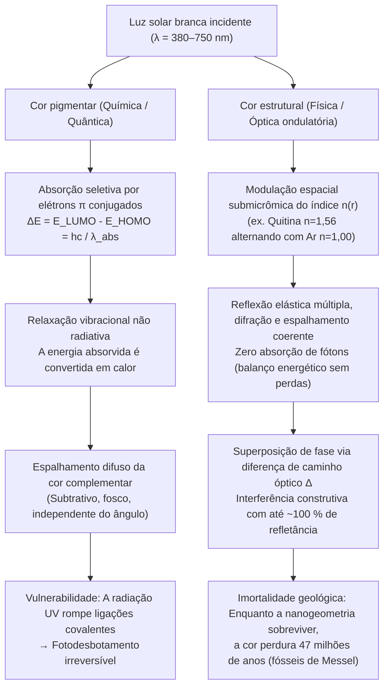
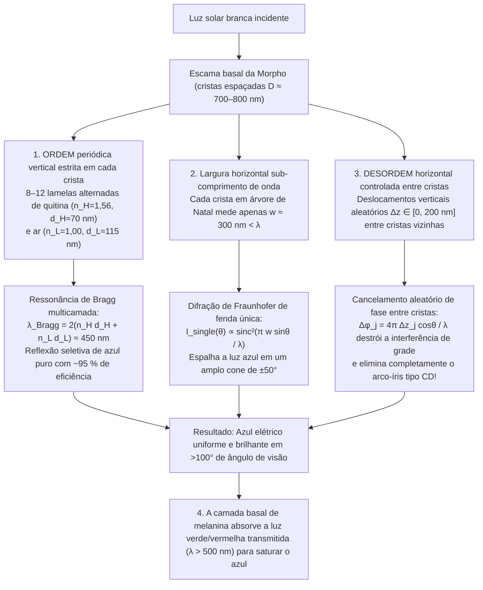

Ao planar pelo dossel iluminado das florestas neotropicais, a <strong>borboleta Morpho (*Morpho rhetenor*, *Morpho menelaus* e *Morpho didius*)</strong> exibe um brilho azul-cobalto metálico e elétrico tão intenso que pilotos de pequenas aeronaves conseguem avistá-lo a mais de um quilômetro de distância. Em Nara, no Japão, o tesouro nacional do século VII conhecido como <strong>Santuário Tamamushi (玉虫厨子)</strong>, no templo Hōryū-ji, é adornado com os élitros de milhares de <strong>besouros-joia (*Chrysochroa fulgidissima*)</strong>; quase 1.400 anos após sua criação, essas asas de besouro continuam reluzindo com um verde-esmeralda e púrpura-dourado intactos. Mais impressionante ainda: besouros fossilizados escavados nos <strong>folhelhos betuminosos do Eoceno de Messel (Alemanha), com 47 milhões de anos</strong>, brilham em verde e azul metálicos vibrantes no instante em que são expostos à luz, mesmo após a diagênese ter alterado quimicamente suas biomoléculas originais.

Tintas comuns, corantes têxteis, pétalas de flores e folhas de outono desbotam inexoravelmente sob a radiação ultravioleta (UV) solar em poucos meses ou anos devido ao fotobranqueamento. Por que, então, as asas de uma *Morpho*, a carapaça de um besouro-joia, o ocelo de uma pena de pavão (*Pavo cristatus*) ou a faixa lateral de um tetra-neon (*Paracheirodon innesi*) brilham com uma intensidade que supera qualquer pigmento sintético e desafia o tempo geológico?

Um experimento clássico de laboratório revela a resposta. Se colocarmos uma asa radiante de *Morpho rhetenor* em um almofariz de ágata e a triturarmos até virar um pó fino, <strong>não restará um único grão de pó azul: no fundo do almofariz sobrará apenas uma poeira opaca de cor marrom-escura</strong>! Ou então, mantendo a asa intacta, basta pingar uma gota de acetona ou etanol puro (índice de refração $n \approx 1{,}36$) sobre sua superfície: no instante em que o líquido penetra nas escamas microscópicas, o azul-elétrico desaparece como num passe de mágica, tornando-se marrom-escuro ou verde-fosco — apenas para ressuscitar em todo o seu esplendor azul-cobalto assim que o solvente evapora.

A conclusão é irrefutável: <strong>a asa da borboleta *Morpho* não contém nem um miligrama de pigmento azul</strong>. Sua cor não nasce da absorção química de fótons, mas da pura eletrodinâmica maxwelliana — a <strong>coloração estrutural (Structural Coloration)</strong> —, gerada quando biopolímeros transparentes modulam espacialmente o índice de refração $n(\mathbf{r})$ na escala do comprimento de onda da luz visível ($\lambda \approx 380\text{–}750\,\text{nm}$). Neste artigo, deduzimos a partir dos primeiros princípios as quatro arquiteturas ópticas fundamentais da natureza: <strong>(I) Interferência de filme fino único</strong>, <strong>(II) Refletores de Bragg distribuídos multicamadas 1D (DBR)</strong>, <strong>(III) O paradoxo da borboleta *Morpho* (como a ordem vertical e a desordem horizontal eliminam o arco-íris de difração)</strong> e <strong>(IV) Cristais fotônicos 2D/3D e espalhamento coerente amorfo</strong>.

---

## 1. Cor pigmentar (Absorção química) vs. Cor estrutural (Interferência física)

### 1.1 Cor pigmentar: Cromóforos de elétrons $\pi$ conjugados e dissipação térmica

O verde da clorofila, o vermelho-alaranjado dos carotenoides, o púrpura das antocianinas e o marrom-escuro da eumelanina são <strong>cores pigmentares</strong> regidas pela mecânica quântica molecular. Seu traço estrutural comum é um <strong>sistema de elétrons $\pi$ conjugados</strong> com ligações simples ($\sigma$) e duplas ($\sigma + \pi$) alternadas. À medida que o comprimento de conjugação $L$ aumenta, a deslocalização eletrônica estreita o gap de energia $\Delta E$ entre o <strong>orbital molecular ocupado mais alto (HOMO)</strong> e o <strong>orbital molecular desocupado mais baixo (LUMO)</strong> até o espectro visível ($1{,}65\text{–}3{,}26\,\text{eV}$):

$$
\Delta E = E_{\text{LUMO}} - E_{\text{HOMO}} = h\nu = \frac{hc}{\lambda_{\text{abs}}}
$$

Os fótons de comprimento de onda $\lambda_{\text{abs}}$ são absorvidos e sua energia é dissipada em picossegundos ($10^{-12}\,\text{s}$) na forma de <strong>calor (vibrações moleculares)</strong>. Nosso olho percebe apenas o <strong>comprimento de onda complementar</strong> espalhado difusamente. Esse mecanismo subtrativo sofre de <strong>fotobranqueamento (desbotamento)</strong> quando fótons UV quebram as ligações covalentes, além de desperdiçar a maior parte da energia luminosa como calor.

### 1.2 Cor estrutural: Modulação submicrômica do índice de refração $n(\mathbf{r})$

Em contrapartida, a <strong>cor estrutural</strong> não envolve absorção eletrônica. Ela é construída com biomateriais transparentes e incolores — <strong>quitina ($n \approx 1{,}56$)</strong> em insetos, <strong>$\beta$-queratina ($n \approx 1{,}54\text{–}1{,}58$)</strong> em penas de aves, <strong>celulose ($n \approx 1{,}53$)</strong> em plantas ou <strong>cristais de guanina ($n \approx 1{,}83$)</strong> em escamas de peixes — alternados com cavidades de <strong>ar ($n = 1{,}00$)</strong> ou <strong>citoplasma aquoso ($n \approx 1{,}33$)</strong>. As ondas eletromagnéticas refletidas em cada interface se superpõem produzindo <strong>interferência construtiva</strong> (reflexão sem perdas de até $\sim 100\,\%$) para comprimentos de onda específicos e <strong>interferência destrutiva</strong> para os demais.

Descoberto por <strong>Robert Hooke (1665)</strong> em *Micrographia* ao molhar penas de pavão, conectado aos anéis de interferência por <strong>Isaac Newton (1704)</strong> em *Opticks*, e formalizado por <strong>Thomas Young</strong>, <strong>Augustin-Jean Fresnel</strong> e <strong>Lord Rayleigh (1917)</strong>, esse princípio explica por que a acetona ($n = 1{,}36$) apaga o azul da *Morpho*: ao substituir o ar ($n = 1{,}00$), elimina o contraste de índice $\Delta n$ em relação à quitina ($n = 1{,}56$), anulando a reflexão de Fresnel e expondo o fundo marrom de melanina.

---

## 2. Arquitetura I: Interferência de filme fino único e iridescência

Bolhas de sabão, manchas de óleo no asfalto molhado e asas transparentes de moscas e vespas regem-se pela interferência em um filme fino de espessura $d$ e índice $n_1$ cercado por ar ($n_0 = n_2 = 1{,}00$).

### 2.1 Dedução da diferença de caminho óptico e inversão de fase de $\pi$

Pela <strong>lei de Snell</strong> $n_0 \sin\theta_0 = n_1 \sin\theta_1$, a diferença de caminho óptico puramente geométrica entre o raio $R_2$ (refratado com ângulo interno $\theta_1$ e refletido na face inferior) e o raio $R_1$ (refletido na face superior) é:

$$
\Delta_{\text{geom}} = L_2 - L_1 = \frac{2 n_1 d}{\cos\theta_1}\left(1 - \sin^2\theta_1\right) = 2 n_1 d \cos\theta_1
$$

Pelos <strong>coeficientes de reflexão de Fresnel</strong> próximo à incidência normal, $r_{ij} = \frac{n_i - n_j}{n_i + n_j}$, a reflexão de um meio de menor índice para um de maior índice ($n_0 < n_1 \implies r_{01} < 0$) introduz uma <strong>inversão de fase de $\pi$ radianos (meio comprimento de onda $\frac{\lambda}{2}$)</strong>, enquanto a reflexão inferior ($n_1 > n_2 \implies r_{12} > 0$) ocorre sem mudança de fase. A <strong>diferença de caminho óptico efetiva total</strong> é:

$$
\Delta_{\text{total}} = 2 n_1 d \cos\theta_1 + \frac{\lambda}{2}
$$

Resultando nas condições de interferência (para $n_0 < n_1 > n_2$):

$$
\begin{aligned}
\text{Interferência construtiva (Máximos)}: \quad 2 n_1 d \cos\theta_1 &= \left(m - \frac{1}{2}\right)\lambda \quad &(m = 1, 2, 3, \dots) \\
\text{Interferência destrutiva (Mínimos)}: \quad 2 n_1 d \cos\theta_1 &= m\lambda \quad &(m = 0, 1, 2, \dots)
\end{aligned}
$$

Isso explica tanto o <strong>filme negro de Newton</strong> instantes antes de uma bolha de sabão estourar ($d \to 0 \implies \Delta_{\text{geom}} \to 0$, onde a defasagem $\frac{\lambda}{2}$ gera interferência destrutiva total $m=0$ em todo o espectro visível) quanto a <strong>iridescência (deslocamento para o azul / blue-shift com o ângulo)</strong>: como $\lambda_{\text{peak}}(\theta_1) = 4 n_1 d \cos\theta_1 = \lambda_{\text{peak}}(0)\cos\theta_1$, inclinar o ângulo de visão ($\theta_1 \uparrow \implies \cos\theta_1 \downarrow$) desloca inevitavelmente a cor refletida para comprimentos de onda mais curtos (azul/violeta).

---

## 3. Arquitetura II: Refletores de Bragg multicamadas 1D (DBR) e pilhas de quarto de onda

Como uma única interface quitina-ar reflete apenas $R_1 \approx 4{,}8\,\%$, os besouros-joia (*Chrysochroa*) e os peixes prateados empilham $N$ bicamadas alternadas de alto índice ($n_H, d_H$) e baixo índice ($n_L, d_L$) formando um <strong>Refletor de Bragg Distribuído (DBR)</strong> regido pela <strong>lei de Bragg-Snell</strong>:

$$
m \lambda_{\text{Bragg}} = 2 \left( n_H d_H \cos\theta_H + n_L d_L \cos\theta_L \right) = 2 \left( d_H \sqrt{n_H^2 - \sin^2\theta_0} + d_L \sqrt{n_L^2 - \sin^2\theta_0} \right)
$$

Na condição ideal de <strong>pilha de quarto de onda (Quarter-Wave Stack)</strong>, $n_H d_H = n_L d_L = \frac{\lambda_0}{4}$, as reflexões de todas as $2N$ interfaces somam-se em fase, e o método da matriz de transferência (TMM) fornece a refletância de pico $R_N(\lambda_0)$:

$$
R_N = \left[ \frac{n_0 \left(\frac{n_H}{n_L}\right)^{2N} - n_s}{n_0 \left(\frac{n_H}{n_L}\right)^{2N} + n_s} \right]^2 \xrightarrow{N \gg 1} 100\,\%
$$

* <strong>Cutícula do besouro-joia (*Chrysochroa fulgidissima*)</strong>: $N \approx 15\text{–}20$ bicamadas de quitina com diferentes concentrações de melanina ($n_H \approx 1{,}68, n_L \approx 1{,}55$) produzem um brilho metálico verde-dourado inalterado por 1.400 anos (Santuário Tamamushi).
* <strong>Escamas prateadas de peixes e mudança dinâmica no tetra-neon</strong>: Os iridóforos de peixes empilham <strong>plaquetas de guanina ($n_H = 1{,}83$)</strong> e <strong>citoplasma ($n_L = 1{,}33$)</strong>, atingindo $R > 90\,\%$ com apenas 6 períodos. O tetra-neon (*Paracheirodon innesi*) e o camaleão-pantera (*Furcifer pardalis*) ajustam ativamente o espaçamento $d_L$ ou a inclinação de seus cristais de guanina para deslocar $\lambda_{\text{Bragg}}$ em tempo real.

---

## 4. Arquitetura III: O paradoxo da borboleta Morpho — Ordem vertical e desordem horizontal

Uma multicamada plana reflete apenas especularmente e muda de cor com o ângulo; por outro lado, uma grade de difração periódica com sulcos espaçados por $D \approx 700\,\text{nm}$ deveria dispersar a luz branca em um arco-íris segundo $D(\sin\theta_i + \sin\theta_m) = m\lambda$, como um CD. No entanto, a asa da *Morpho* irradia um <strong>azul-cobalto uniforme ao longo de um cone visual superior a $100^\circ$ ($\pm 50^\circ$) sem se decompor em arco-íris</strong>!

<strong>Shuichi Kinoshita e Shinya Yoshioka</strong> (Universidade de Osaka) descobriram que as cristas (ridges) das escamas da *Morpho*, cuja seção transversal lembra uma <strong>«árvore de Natal» nanométrica</strong>, combinam quatro mecanismos ópticos:

1. <strong>Periodicidade vertical</strong>: 6 a 12 lamelas de quitina ($n_H=1{,}56, d_H\approx 72\,\text{nm}$) e ar ($n_L=1{,}00, d_L\approx 113\,\text{nm}$) selecionam $\lambda_{\text{Bragg}} = 2(n_H d_H + n_L d_L) \approx 450\,\text{nm}$ (azul puro).
2. <strong>Difração de fenda única por largura sub-comprimento de onda</strong>: Cada crista de largura <strong>$w \approx 300\,\text{nm} < \lambda$</strong> difrata o azul segundo $I_{\text{single}}(\theta) \propto \operatorname{sinc}^2\left(\frac{\pi w \sin\theta}{\lambda}\right)$ ao longo de mais de $\pm 50^\circ$.
3. <strong>Desordem aleatória de altura $\pm\Delta z_j$</strong>: As cristas vizinhas possuem desníveis verticais aleatórios $\Delta z_j \in [0, \lambda/2]$, o que randomiza a fase $\phi_j = \frac{4\pi \Delta z_j \cos\theta}{\lambda}$ e anula os picos de interferência de grade:
   $$
   I_{\text{total}}(\theta) = I_{\text{single}}(\theta) \left\langle \left| \sum_{j=1}^{N_{\text{ridge}}} \exp\left[ i k \left( j D \sin\theta + 2 \Delta z_j \cos\theta \right) \right] \right|^2 \right\rangle \approx N_{\text{ridge}} \, I_{\text{single}}(\theta)
   $$
4. <strong>Absorção basal de melanina</strong>: Os grânulos de melanina na base absorvem a luz verde e vermelha transmitida ($\lambda > 500\,\text{nm}$), evitando a dessaturação por retroespalhamento branco.

---

## 5. Arquitetura IV: Cristais fotônicos 2D/3D e espalhamento coerente amorfo

Quando a permissividade dielétrica $\varepsilon(\mathbf{r}) = n(\mathbf{r})^2$ varia periodicamente em 2D ou 3D ($\varepsilon(\mathbf{r} + \mathbf{R}) = \varepsilon(\mathbf{r})$), as equações de Maxwell levam à <strong>equação mestra de autovalores hermitiana</strong> para o campo magnético $\mathbf{H}(\mathbf{r})$ (<strong>Eli Yablonovitch e Sajeev John, 1987</strong>):

$$
\hat{\Theta} \mathbf{H}(\mathbf{r}) \equiv \nabla \times \left( \frac{1}{\varepsilon(\mathbf{r})} \nabla \times \mathbf{H}(\mathbf{r}) \right) = \left(\frac{\omega}{c}\right)^2 \mathbf{H}(\mathbf{r})
$$

Pelo <strong>teorema de Bloch</strong> $\mathbf{H}_{\mathbf{k}}(\mathbf{r}) = e^{i\mathbf{k}\cdot\mathbf{r}} \mathbf{u}_{\mathbf{k}}(\mathbf{r})$, a separação entre a <strong>banda dielétrica ($\omega_-$)</strong> e a <strong>banda de ar ($\omega_+$)</strong> na borda da zona de Brillouin ($k = \pm\frac{\pi}{a}$) abre um <strong>Band Gap Fotônico (Photonic Band Gap, PBG)</strong> onde a densidade de estados fotônicos é $\rho(\omega) = 0$ e a luz é refletida em $100\,\%$.

* <strong>Cristais 2D em penas de pavão (*Pavo cristatus*)</strong>: Uma rede 2D de bastonetes de melanina ($n \approx 2{,}0$) em queratina ($n \approx 1{,}54$) gera azul, verde, amarelo e marrom variando a constante de rede $a \approx 140\text{–}165\,\text{nm}$.
* <strong>Cristais giroides 3D em gorgulhos-joia (*Pachyrhynchus*, *Entimus*) e borboletas (*Callophrys rubi*)</strong>: Suas escamas contêm uma rede 3D bicontínua <strong>giroide</strong> ($a \approx 300\,\text{nm}$) automontada pelas membranas do retículo endoplasmático liso (REL):
  $$
  \sin\left(\frac{2\pi x}{a}\right)\cos\left(\frac{2\pi y}{a}\right) + \sin\left(\frac{2\pi y}{a}\right)\cos\left(\frac{2\pi z}{a}\right) + \sin\left(\frac{2\pi z}{a}\right)\cos\left(\frac{2\pi x}{a}\right) = t
  $$
* <strong>Estruturas fotônicas amorfas no gaio-azul (*Cyanocitta cristata*) e no martim-pescador</strong>: Richard Prum demonstrou que a <strong>decomposição espinodal</strong> da $\beta$-queratina gera uma esponja nanoporosa isotrópica com ordem de curto alcance ($d_0 \approx 180\,\text{nm}$), cujo espectro de Fourier $|\tilde{\varepsilon}(\mathbf{q})|^2$ forma uma casca esférica uniforme de raio $|\mathbf{q}| = q_0 \approx \frac{2\pi}{d_0}$, produzindo um <strong>azul estrutural não iridescente (independente do ângulo)</strong> por espalhamento coerente.

---

## 6. Tabelas comparativas: Cor pigmentar vs. estrutural e as 4 arquiteturas

### Tabela 1: Comparação entre cor pigmentar e cor estrutural

| Propriedade física | Cor pigmentar (Absorção química) | Cor estrutural (Óptica ondulatória) |
| :--- | :--- | :--- |
| <strong>Mecanismo primário</strong> | Absorção seletiva de fótons ($\Delta E = E_{\text{LUMO}} - E_{\text{HOMO}} = hc/\lambda$) em elétrons $\pi$ conjugados | Interferência, reflexão de Bragg, difração e espalhamento coerente por modulação de $n(\mathbf{r})$ |
| <strong>Balanço energético</strong> | A energia absorvida é dissipada em <strong>calor</strong> (subtrativo) | <strong>Reflexão elástica sem perdas</strong> de até $99{,}9\,\%$ |
| <strong>Dependência angular</strong> | Independente do ângulo (fosco difuso) | <strong>Iridescente (deslocamento para o azul)</strong> em estruturas periódicas; grande angular ou não iridescente em *Morpho* e estruturas amorfas |
| <strong>Trituração / Solventes</strong> | A cor persiste em pó ou em solventes | <strong>Ao triturar a cor desaparece (resta melanina marrom)</strong>; a acetona ($n \approx 1{,}36$) apaga a cor instantaneamente |
| <strong>Durabilidade</strong> | <strong>Fotodesbotamento (UV)</strong> em meses ou anos | <strong>Geologicamente imortal</strong> (1.400 anos em Hōryū-ji; fósseis de Messel de 47 milhões de anos) |

### Tabela 2: As quatro arquiteturas ópticas da cor estrutural

| Arquitetura | Dimensão e ordem | Equação / Condição de ressonância | Comportamento óptico | Exemplos biológicos |
| :--- | :--- | :--- | :--- | :--- |
| <strong>I. Filme fino único</strong> | 1D monocamada (espessura $d$) | $2 n_1 d \cos\theta_1 = \left(m - \frac{1}{2}\right)\lambda$ | Refletância $\sim 15\,\%$; iridescência; filme negro de Newton para $d \to 0$ | Bolhas de sabão, manchas de óleo, pescoço de pombo, asas de moscas |
| <strong>II. Multicamada de Bragg (DBR)</strong> | 1D periódico ($N$ bicamadas $H/L$) | $m\lambda_{\text{Bragg}} = 2(n_H d_H \cos\theta_H + n_L d_L \cos\theta_L)$ Quarto de onda: $n_H d_H = n_L d_L = \frac{\lambda_0}{4}$ | $R_N = \left[\frac{n_0(n_H/n_L)^{2N}-n_s}{n_0(n_H/n_L)^{2N}+n_s}\right]^2 \to 100\,\%$; brilho metálico | Besouro-joia (*Chrysochroa*), escamas de peixes (guanina), tetra-neon |
| <strong>III. Grade hierárquica *Morpho</strong>* | Vertical: lamelas ordenadas Horizontal: $w < \lambda$ + altura aleatória $\pm\Delta z$ | Vertical: $2(n_H d_H + n_L d_L) \approx 450\,\text{nm}$ Horizontal: $I(\theta) \approx N_{\text{ridge}} \operatorname{sinc}^2\left(\frac{\pi w\sin\theta}{\lambda}\right)$ | A desordem $\Delta z_j$ elimina o arco-íris de grade; <strong>azul uniforme em $>100^\circ$</strong> | *Morpho rhetenor*, *Morpho didius*, *Morpho menelaus* |
| <strong>IV-a. Cristais fotônicos 2D/3D</strong> | Rede 2D/3D $\varepsilon(\mathbf{r}+\mathbf{R})=\varepsilon(\mathbf{r})$ | $\nabla \times \left(\frac{1}{\varepsilon(\mathbf{r})}\nabla \times \mathbf{H}\right) = \left(\frac{\omega}{c}\right)^2 \mathbf{H}$ | Band gap fotônico ($\rho(\omega)=0$); polarização circular em giroides | Pena de pavão (2D), opala (3D), gorgulhos e *Callophrys rubi* (giroide 3D) |
| <strong>IV-b. Fotônica amorfa</strong> | 3D isotrópico de curto alcance (espinodal) | Casca esférica no espaço de Fourier $|\mathbf{q}| = q_0 \approx \frac{2\pi}{d_0}$ | <strong>Não iridescente (independente do ângulo)</strong> por espalhamento coerente | Gaio-azul (*Cyanocitta cristata*), martim-pescador, arara-canindé |

---

## 7. Fósseis de 47 milhões de anos e aplicações biomiméticas industriais

Os estudos de <strong>Maria E. McNamara</strong> (2011) sobre besouros fósseis de <strong>47 milhões de anos de Messel</strong> demonstraram que a geometria multicamada sobrevive à fossilização, permitindo inclusive reconstruir a plumagem iridescente de dinossauros jurássicos como o <strong>*Microraptor</strong>*. Hoje, essa física impulsiona tecnologias revolucionárias:
1. <strong>Fibras têxteis sem tingimento *Morfotex</strong>* (Teijin): 61 nanocamadas alternadas de poliéster ($n_H=1{,}63$) e náilon ($n_L=1{,}53$) produzem tecidos brilhantes sem corantes nem efluentes.
2. <strong>Pintura automotiva *Structural Blue* da Lexus</strong>: Nanoflocos de 7 camadas que refletem quase $100\,\%$ da luz azul contra $<5\,\%$ dos pigmentos convencionais.
3. <strong>Telas MEMS *Mirasol* (IMOD) da Qualcomm</strong>: Cavidades de ar Fabry-Pérot ajustáveis eletrostaticamente que refletem a luz solar direta sem backlight e atingem preto puro em $d \to 0$ (filme negro de Newton).
4. <strong>Tintas antifalsificação em cédulas (OVI) e biossensores de hidrogel</strong>: O deslocamento angular $\lambda \propto \cos\theta$ impede a falsificação de dinheiro, enquanto hidrogéis fotônicos 3D mudam de cor diante de glicose ou pH sem usar bateria.
5. <strong>Resfriamento radiativo passivo diurno (Daytime Radiative Cooling)</strong>: Inspirados nos pelos triangulares da <strong>formiga-prateada-do-Saara (*Cataglyphis bombycina*)</strong>, metamateriais fotônicos refletem $96\,\%$ da radiação solar ($0{,}3\text{–}2{,}5\,\mu\text{m}$) e emitem calor através da janela infravermelha atmosférica ($8\text{–}13\,\mu\text{m}$) para o espaço sideral a $3\,\text{K}$, resfriando edifícios de <strong>$5\text{ a }10\,^\circ\text{C}$ abaixo da temperatura ambiente sob sol pleno sem eletricidade</strong>.
