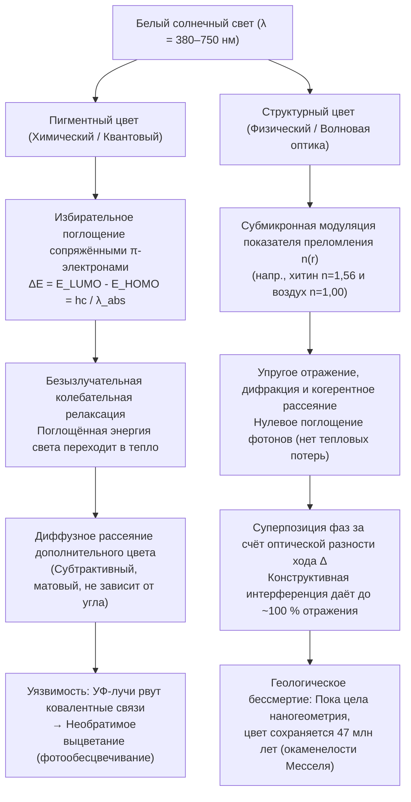
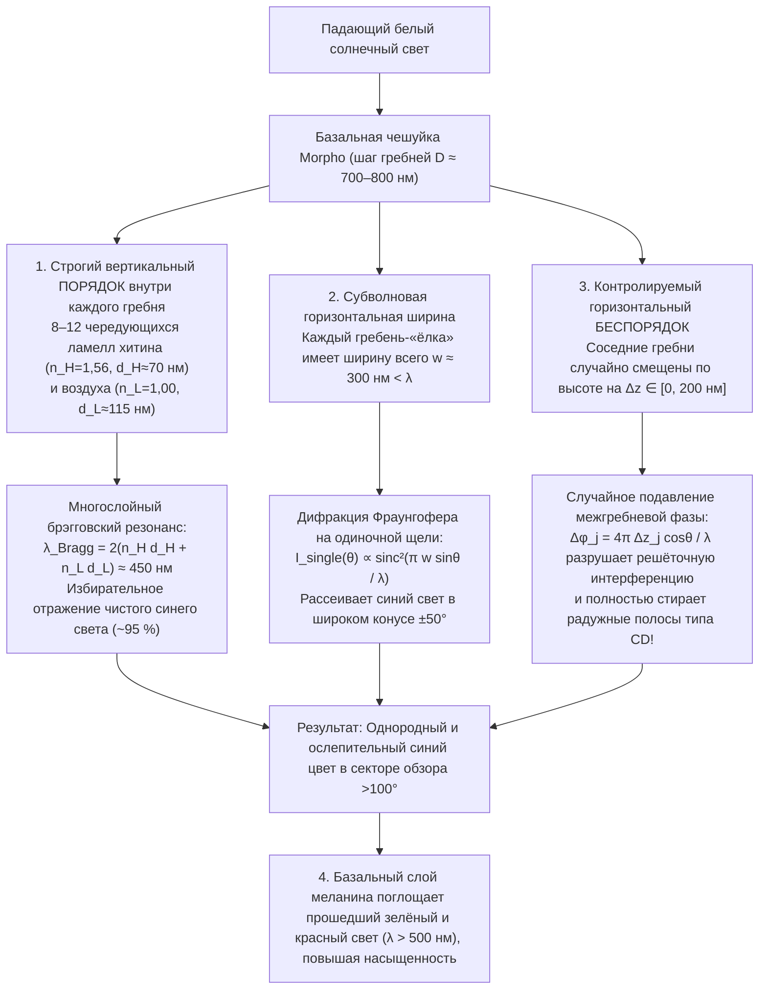

Парящая под солнечным пологом неотропических лесов <strong>бабочка Морфо (*Morpho rhetenor*, *Morpho menelaus* и *Morpho didius*)</strong> сверкает настолько ослепительным металлическим кобальтово-синим светом, что пилоты легкомоторных самолётов замечают её вспышки с расстояния более километра. В японском храме Хорюдзи в Наре хранится национальное сокровище VII века — <strong>ковчег Тамамуси (玉虫厨子)</strong>, инкрустированный надкрыльями тысяч <strong>жуков-златок (*Chrysochroa fulgidissima*)</strong>: спустя почти 1400 лет эти надкрылья всё так же переливаются изумрудно-зелёным и пурпурно-золотым блеском. Ещё удивительнее то, что <strong>окаменелые жуки возрастом 47 миллионов лет (эоцен) из карьера Мессель (Messel Pit)</strong> в Германии в момент извлечения на солнечный свет вспыхивают ярким металлическим зелёным и синим светом, хотя диагенез давно изменил химический состав их исходных биополимеров.

Обычные краски, текстильные красители, лепестки цветов и осенние листья неизбежно выцветают под действием солнечного ультрафиолета (УФ) за считанные месяцы или годы. Почему же крылья *Morpho*, панцирь златки, «глазок» павлиньего пера (*Pavo cristatus*) или неоновая полоса голубого неона (*Paracheirodon innesi*) превосходят по яркости любые синтетические пигменты и не тускнеют миллионы лет?

Классический лабораторный опыт даёт поразительный ответ. Если поместить сияющее крыло *Morpho rhetenor* в агатовую ступку и растереть его в мелкий порошок, <strong>в ступке не останется ни единой синей пылинки — лишь тусклая, грязно-бурая пыль</strong>! Или же, не повреждая крыло, капнем на него чистым ацетоном или этанолом (показатель преломления $n \approx 1{,}36$): как только жидкость заполнит микроскопические чешуйки, электрический синий цвет мгновенно исчезнет, сменившись тёмно-бурым или тускло-зелёным, но стоит растворителю испариться, как ослепительная лазурь вернётся вновь.

Вывод однозначен: <strong>в крыле бабочки *Morpho* нет ни одного миллиграмма синего пигмента</strong>. Её окраска порождается не химическим поглощением фотонов, а чистой максвелловской электродинамикой — <strong>структурной окраской (Structural Coloration)</strong>, возникающей благодаря пространственной модуляции показателя преломления $n(\mathbf{r})$ прозрачных биополимеров на масштабе длины волны видимого света ($\lambda \approx 380\text{–}750\,\text{нм}$). В этой статье мы строго выведем четыре фундаментальные оптические архитектуры живой природы: <strong>(I) однослойную тонкоплёночную интерференцию</strong>, <strong>(II) одномерные многослойные брэгговские отражатели (DBR)</strong>, <strong>(III) парадокс бабочки *Morpho* (симбиоз вертикального порядка и горизонтального беспорядка)</strong> и <strong>(IV) двумерные и трёхмерные фотонные кристаллы и аморфное когерентное рассеяние</strong>.

---

## 1. Пигментный цвет (химическое поглощение) против структурного цвета (физическая интерференция)

### 1.1 Пигментный цвет: Сопряжённые $\pi$-электронные хромофоры и тепловая релаксация

Зелёный цвет хлорофилла, оранжево-красный каротиноидов, пурпурный антоцианов и тёмно-коричневый эумеланина — это <strong>пигментные цвета</strong>, описываемые молекулярной квантовой механикой. Их основой служит <strong>система сопряжённых $\pi$-электронов</strong> с чередующимися одинарными ($\sigma$) и двойными ($\sigma + \pi$) связями. С ростом длины сопряжения $L$ делокализация электронов сужает энергетическую щель $\Delta E$ между <strong>высшей занятой молекулярной орбиталью (HOMO)</strong> и <strong>низшей свободной молекулярной орбиталью (LUMO)</strong> до видимого диапазона ($1{,}65\text{–}3{,}26\,\text{эВ}$):

$$
\Delta E = E_{\text{LUMO}} - E_{\text{HOMO}} = h\nu = \frac{hc}{\lambda_{\text{abs}}}
$$

Фотоны с длиной волны $\lambda_{\text{abs}}$ поглощаются, а их энергия за пикосекунды ($10^{-12}\,\text{с}$) безызлучательно переходит в <strong>тепло (колебания молекул)</strong>. Глаз воспринимает лишь рассеянный <strong>дополнительный цвет</strong>. Такой субтрактивный механизм подвержен <strong>фотообесцвечиванию (выцветанию)</strong> из-за разрыва ковалентных связей УФ-фотонами и теряет большую часть энергии света в виде тепла.

### 1.2 Структурный цвет: Наномасштабная модуляция показателя преломления $n(\mathbf{r})$

Напротив, <strong>структурный цвет</strong> не связан с электронным поглощением. Он создаётся прозрачными и бесцветными биоматериалами — <strong>хитином ($n \approx 1{,}56$)</strong> насекомых, <strong>$\beta$-кератином ($n \approx 1{,}54\text{–}1{,}58$)</strong> перьев птиц, <strong>целлюлозой ($n \approx 1{,}53$)</strong> растений или <strong>кристаллами гуанина ($n \approx 1{,}83$)</strong> рыбьей чешуи, чередующимися с полостями <strong>воздуха ($n = 1{,}00$)</strong> или <strong>цитоплазмы ($n \approx 1{,}33$)</strong>. Отражённые от границ раздела электромагнитные волны складываются, образуя <strong>конструктивную интерференцию</strong> (отражение без потерь до $\sim 100\,\%$) для одних длин волн и <strong>деструктивную интерференцию</strong> для других.

Открытый <strong>Робертом Гуком (1665)</strong> в *Micrographia*, связанный с кольцами интерференции <strong>Исааком Ньютоном (1704)</strong> в *Opticks* и строго описанный <strong>Томасом Юнгом</strong>, <strong>Огюстеном Френелем</strong> и <strong>лордом Рэлеем (1917)</strong>, этот механизм объясняет опыт с ацетоном ($n = 1{,}36$): вытесняя воздух ($n = 1{,}00$) из нанополостей крыла *Morpho*, жидкость уничтожает контраст показателей преломления $\Delta n$ с хитином ($n = 1{,}56$), гасит френелевское отражение и обнажает тёмно-бурую подложку из меланина.

---

## 2. Архитектура I: Однослойная тонкоплёночная интерференция и иризация

Мыльные пузыри, масляные плёнки на мокром асфальте и прозрачные крылья мух и ос работают за счёт интерференции в тонкой диэлектрической плёнке толщиной $d$ с показателем преломления $n_1$, окружённой воздухом ($n_0 = n_2 = 1{,}00$).

### 2.1 Вывод оптической разности хода и фазового сдвига на $\pi$

По <strong>закону Снеллиуса</strong> $n_0 \sin\theta_0 = n_1 \sin\theta_1$, геометрическая оптическая разность хода между лучом $R_2$ (преломлённым под углом $\theta_1$ и отражённым от нижней границы) и лучом $R_1$ (отражённым от верхней границы) равна:

$$
\Delta_{\text{geom}} = L_2 - L_1 = \frac{2 n_1 d}{\cos\theta_1}\left(1 - \sin^2\theta_1\right) = 2 n_1 d \cos\theta_1
$$

Согласно <strong>формулам Френеля</strong> при почти нормальном падении, $r_{ij} = \frac{n_i - n_j}{n_i + n_j}$, отражение от оптически более плотной среды ($n_0 < n_1 \implies r_{01} < 0$) сопровождается <strong>скачком фазы на $\pi$ радиан (потеря полуволны $\frac{\lambda}{2}$)</strong>, тогда как на нижней границе ($n_1 > n_2 \implies r_{12} > 0$) сдвига фазы нет. <strong>Полная эффективная разность хода</strong> составляет:

$$
\Delta_{\text{total}} = 2 n_1 d \cos\theta_1 + \frac{\lambda}{2}
$$

Отсюда следуют условия интерференции (при $n_0 < n_1 > n_2$):

$$
\begin{aligned}
\text{Конструктивная интерференция (Максимумы)}: \quad 2 n_1 d \cos\theta_1 &= \left(m - \frac{1}{2}\right)\lambda \quad &(m = 1, 2, 3, \dots) \\
\text{Деструктивная интерференция (Минимумы)}: \quad 2 n_1 d \cos\theta_1 &= m\lambda \quad &(m = 0, 1, 2, \dots)
\end{aligned}
$$

Это объясняет как <strong>чёрную плёнку Ньютона</strong> перед разрывом мыльного пузыря ($d \to 0 \implies \Delta_{\text{geom}} \to 0$, когда полуволновой сдвиг $\frac{\lambda}{2}$ вызывает полное гашение $m=0$ во всём видимом спектре), так и <strong>иризацию (коротковолновый синий сдвиг при увеличении угла обзора)</strong>: поскольку $\lambda_{\text{peak}}(\theta_1) = 4 n_1 d \cos\theta_1 = \lambda_{\text{peak}}(0)\cos\theta_1$, при наклоне ($\theta_1 \uparrow \implies \cos\theta_1 \downarrow$) цвет смещается от красного к зелёному и сине-фиолетовому.

---

## 3. Архитектура II: Одномерные брэгговские отражатели (DBR) и четвертьволновые стопки

Так как одна граница хитин–воздух отражает лишь $R_1 \approx 4{,}8\,\%$, жуки-златки (*Chrysochroa*) и серебристые рыбы чередуют $N$ пар слоёв с высоким ($n_H, d_H$) и низким ($n_L, d_L$) показателями преломления, формируя <strong>распределённый брэгговский отражатель (DBR)</strong>, подчиняющийся <strong>закону Брэгга–Снеллиуса</strong>:

$$
m \lambda_{\text{Bragg}} = 2 \left( n_H d_H \cos\theta_H + n_L d_L \cos\theta_L \right) = 2 \left( d_H \sqrt{n_H^2 - \sin^2\theta_0} + d_L \sqrt{n_L^2 - \sin^2\theta_0} \right)
$$

В режиме <strong>четвертьволновой стопки (Quarter-Wave Stack)</strong>, $n_H d_H = n_L d_L = \frac{\lambda_0}{4}$, волны от всех $2N$ границ складываются строго в фазе, а метод матриц переноса (TMM) даёт пиковый коэффициент отражения $R_N(\lambda_0)$:

$$
R_N = \left[ \frac{n_0 \left(\frac{n_H}{n_L}\right)^{2N} - n_s}{n_0 \left(\frac{n_H}{n_L}\right)^{2N} + n_s} \right]^2 \xrightarrow{N \gg 1} 100\,\%
$$

* <strong>Кутикула жука-златки (*Chrysochroa fulgidissima*)</strong>: $N \approx 15\text{–}20$ пар слоёв хитина с разной концентрацией меланина ($n_H \approx 1{,}68, n_L \approx 1{,}55$) создают металлический золотисто-зелёный блеск, не тускнеющий 1400 лет (ковчег Тамамуси).
* <strong>Серебристая чешуя рыб и динамическая окраска голубого неона</strong>: Иридофоры сельди и сабли-рыбы чередуют <strong>кристаллы гуанина ($n_H = 1{,}83$)</strong> и <strong>цитоплазму ($n_L = 1{,}33$)</strong>, достигая $R > 90\,\%$ уже при 6 периодах. Голубой неон (*Paracheirodon innesi*) и пантеровый хамелеон (*Furcifer pardalis*) активно меняют угол наклона или расстояние $d_L$ между пластинками гуанина, перестраивая $\lambda_{\text{Bragg}}$ в реальном времени!

---

## 4. Архитектура III: Парадокс бабочки Морфо — Как порядок и беспорядок побеждают радугу

Плоское многослойное зеркало отражает только под зеркальным углом и сильно меняет цвет при наклоне; регулярная же дифракционная решётка с периодом $D \approx 700\,\text{нм}$ должна раскладывать белый свет в радугу согласно $D(\sin\theta_i + \sin\theta_m) = m\lambda$, подобно компакт-диску (CD). Однако крыло *Morpho* сияет <strong>однородным кобальтово-синим цветом в гигантском конусе углов свыше $100^\circ$ ($\pm 50^\circ$) без радужного расщепления</strong>!

Физики <strong>Сюити Киносита и Синъя Йосиока</strong> (Осакский университет) показали, что гребни (ridges) чешуек *Morpho*, имеющие в поперечном сечении форму наноразмерной <strong>«рождественской ёлки»</strong>, объединяют четыре оптических механизма:

1. <strong>Вертикальная периодичность</strong>: 6–12 ламелл хитина ($n_H=1{,}56, d_H\approx 72\,\text{нм}$) и воздуха ($n_L=1{,}00, d_L\approx 113\,\text{нм}$) выделяют $\lambda_{\text{Bragg}} = 2(n_H d_H + n_L d_L) \approx 450\,\text{нм}$ (чистый синий).
2. <strong>Широкоугольная дифракция на субволновой ширине</strong>: Каждый гребень шириной <strong>$w \approx 300\,\text{нм} < \lambda$</strong> дифрагирует синий свет по закону $I_{\text{single}}(\theta) \propto \operatorname{sinc}^2\left(\frac{\pi w \sin\theta}{\lambda}\right)$ на угол свыше $\pm 50^\circ$.
3. <strong>Случайный разброс высот $\pm\Delta z_j$</strong>: Соседние гребни смещены по вертикали на случайные величины $\Delta z_j \in [0, \lambda/2]$, что хаотизирует фазу $\phi_j = \frac{4\pi \Delta z_j \cos\theta}{\lambda}$ и обнуляет перекрёстные члены решёточной интерференции:
   $$
   I_{\text{total}}(\theta) = I_{\text{single}}(\theta) \left\langle \left| \sum_{j=1}^{N_{\text{ridge}}} \exp\left[ i k \left( j D \sin\theta + 2 \Delta z_j \cos\theta \right) \right] \right|^2 \right\rangle \approx N_{\text{ridge}} \, I_{\text{single}}(\theta)
   $$
4. <strong>Поглощение меланином в основании</strong>: Гранулы меланина на дне чешуйки поглощают прошедший зелёный и красный свет ($\lambda > 500\,\text{нм}$), устраняя белую засветку.

---

## 5. Архитектура IV: 2D/3D фотонные кристаллы и аморфное когерентное рассеяние

Когда диэлектрическая проницаемость $\varepsilon(\mathbf{r}) = n(\mathbf{r})^2$ периодически модулирована в 2D или 3D ($\varepsilon(\mathbf{r} + \mathbf{R}) = \varepsilon(\mathbf{r})$), из уравнений Максвелла выводится эрмитово <strong>главное уравнение на собственные значения</strong> для магнитного поля $\mathbf{H}(\mathbf{r})$ (<strong>Эли Яблонович и Саджив Джон, 1987</strong>):

$$
\hat{\Theta} \mathbf{H}(\mathbf{r}) \equiv \nabla \times \left( \frac{1}{\varepsilon(\mathbf{r})} \nabla \times \mathbf{H}(\mathbf{r}) \right) = \left(\frac{\omega}{c}\right)^2 \mathbf{H}(\mathbf{r})
$$

По <strong>теореме Блоха</strong> $\mathbf{H}_{\mathbf{k}}(\mathbf{r}) = e^{i\mathbf{k}\cdot\mathbf{r}} \mathbf{u}_{\mathbf{k}}(\mathbf{r})$ расщепление между <strong>диэлектрической зоной ($\omega_-$)</strong> и <strong>воздушной зоной ($\omega_+$)</strong> на границе зоны Бриллюэна ($k = \pm\frac{\pi}{a}$) формирует <strong>фотонную запрещённую зону (Photonic Band Gap, PBG)</strong>, где плотность фотонных состояний $\rho(\omega) = 0$ и свет отражается на $100\,\%$.

* <strong>2D фотонные кристаллы в перьях павлина (*Pavo cristatus*)</strong>: Двумерная решётка меланиновых стержней ($n \approx 2{,}0$) в кератине ($n \approx 1{,}54$) создаёт синий, зелёный, жёлтый и бурый цвета при изменении постоянной решётки $a \approx 140\text{–}165\,\text{нм}$.
* <strong>3D гироидные кристаллы долгоносиков (*Pachyrhynchus*, *Entimus*) и голубянки (*Callophrys rubi*)</strong>: Внутри их чешуек находится трёхмерная биконтинуальная <strong>гироидная сеть</strong> ($a \approx 300\,\text{нм}$), самособирающаяся на мембранах гладкого эндоплазматического ретикулума:
  $$
  \sin\left(\frac{2\pi x}{a}\right)\cos\left(\frac{2\pi y}{a}\right) + \sin\left(\frac{2\pi y}{a}\right)\cos\left(\frac{2\pi z}{a}\right) + \sin\left(\frac{2\pi z}{a}\right)\cos\left(\frac{2\pi x}{a}\right) = t
  $$
* <strong>Аморфные фотонные структуры голубой сойки (*Cyanocitta cristata*) и зимородка</strong>: Ричард Прум доказал, что <strong>спинодальный распад</strong> $\beta$-кератина формирует изотропную наногубку с ближним порядком ($d_0 \approx 180\,\text{нм}$), чей фурье-спектр $|\tilde{\varepsilon}(\mathbf{q})|^2$ образует однородную сферическую оболочку радиуса $|\mathbf{q}| = q_0 \approx \frac{2\pi}{d_0}$, обеспечивая <strong>неиризирующий (не зависящий от угла) синий цвет</strong> за счёт когерентного рассеяния.

---

## 6. Сравнительные таблицы: Пигментный и структурный цвет и 4 архитектуры

### Таблица 1: Сравнение пигментного и структурного цвета

| Физическое свойство | Пигментный цвет (Химическое поглощение) | Структурный цвет (Волновая оптика) |
| :--- | :--- | :--- |
| <strong>Основной механизм</strong> | Избирательное поглощение фотонов ($\Delta E = E_{\text{LUMO}} - E_{\text{HOMO}} = hc/\lambda$) сопряжёнными $\pi$-электронами | Интерференция, брэгговское отражение, дифракция и когерентное рассеяние на неоднородностях $n(\mathbf{r})$ |
| <strong>Энергетический баланс</strong> | Поглощённая энергия переходит в <strong>тепло</strong> (субтрактивный цвет) | <strong>Упругое отражение без потерь</strong> до $99{,}9\,\%$ |
| <strong>Угловая зависимость</strong> | Не зависит от угла (матовый диффузный) | <strong>Иризация (синий сдвиг)</strong> в периодических средах; широкоугольный или неиризирующий в *Morpho* и аморфных структурах |
| <strong>Растирание / Растворители</strong> | Цвет сохраняется в порошке и растворителях | <strong>При растирании цвет исчезает (остаётся бурый меланин)</strong>; ацетон ($n \approx 1{,}36$) мгновенно гасит цвет |
| <strong>Долговечность</strong> | <strong>Фотообесцвечивание (УФ)</strong> за месяцы или годы | <strong>Геологически вечен</strong> (1400 лет ковчегу Тамамуси; 47 млн лет окаменелостям Месселя) |

### Таблица 2: Четыре оптические архитектуры структурного цвета

| Архитектура | Размерность и порядок | Уравнение / Условие резонанса | Оптическое поведение | Биологические примеры |
| :--- | :--- | :--- | :--- | :--- |
| <strong>I. Одиночная тонкая плёнка</strong> | 1D монослой (толщина $d$) | $2 n_1 d \cos\theta_1 = \left(m - \frac{1}{2}\right)\lambda$ | Отражение $\sim 15\,\%$; иризация; чёрная плёнка Ньютона при $d \to 0$ | Мыльные пузыри, масляные плёнки, перья голубя, крылья мух |
| <strong>II. Многослойный отражатель Брэгга (DBR)</strong> | 1D периодический ($N$ бислоёв $H/L$) | $m\lambda_{\text{Bragg}} = 2(n_H d_H \cos\theta_H + n_L d_L \cos\theta_L)$ Четверть волны: $n_H d_H = n_L d_L = \frac{\lambda_0}{4}$ | $R_N = \left[\frac{n_0(n_H/n_L)^{2N}-n_s}{n_0(n_H/n_L)^{2N}+n_s}\right]^2 \to 100\,\%$; металлический блеск | Жук-златка (*Chrysochroa*), чешуя рыб (гуанин), голубой неон |
| <strong>III. Иерархическая решётка *Morpho</strong>* | Вертикаль: порядок ламелл Горизонталь: $w < \lambda$ + случайная высота $\pm\Delta z$ | Вертикаль: $2(n_H d_H + n_L d_L) \approx 450\,\text{нм}$ Горизонталь: $I(\theta) \approx N_{\text{ridge}} \operatorname{sinc}^2\left(\frac{\pi w\sin\theta}{\lambda}\right)$ | Разброс высот $\Delta z_j$ гасит радугу решётки; <strong>равномерный синий в секторе $>100^\circ$</strong> | *Morpho rhetenor*, *Morpho didius*, *Morpho menelaus* |
| <strong>IV-a. 2D/3D фотонные кристаллы</strong> | 2D/3D решётка $\varepsilon(\mathbf{r}+\mathbf{R})=\varepsilon(\mathbf{r})$ | $\nabla \times \left(\frac{1}{\varepsilon(\mathbf{r})}\nabla \times \mathbf{H}\right) = \left(\frac{\omega}{c}\right)^2 \mathbf{H}$ | Фотонная запрещённая зона ($\rho(\omega)=0$); круговая поляризация в гироидах | Перо павлина (2D), опал (3D), долгоносики и *Callophrys rubi* (3D гироид) |
| <strong>IV-b. Аморфная фотоника</strong> | 3D изотропный ближний порядок (спинодаль) | Сферическая оболочка в фурье-пространстве $|\mathbf{q}| = q_0 \approx \frac{2\pi}{d_0}$ | <strong>Неиризирующий (не зависящий от угла)</strong> когерентный цвет | Голубая сойка (*Cyanocitta cristata*), зимородок, сине-жёлтый ара |

---

## 7. Окаменелости возрастом 47 миллионов лет и биомиметические технологии

Исследования <strong>Марии Макнамары (Maria E. McNamara, 2011)</strong> ископаемых жуков возрастом <strong>47 миллионов лет из карьера Мессель</strong> доказали, что многослойная наногеометрия переживает фоссилизацию, позволяя реконструировать даже радужное оперение юрских динозавров, таких как <strong>*Microraptor</strong>*. В современной технике структурный цвет породил прорывные инновации:
1. <strong>Неокрашенные структурно-цветные волокна *Morfotex</strong>* (Teijin): 61 чередующийся нанослой полиэстера ($n_H=1{,}63$) и нейлона ($n_L=1{,}53$) дают яркие ткани без капли красителя и сточных вод.
2. <strong>Автомобильная эмаль *Structural Blue* от Lexus</strong>: 7-слойные наночешуйки отражают почти $100\,\%$ синего света против $<5\,\%$ у обычных пигментов.
3. <strong>Дисплеи MEMS *Mirasol* (IMOD) от Qualcomm</strong>: Перестраиваемые электростатикой воздушные резонаторы Фабри–Перо отражают прямой солнечный свет без подсветки и дают идеальный чёрный цвет при $d \to 0$ (чёрная плёнка Ньютона).
4. <strong>Защитные краски банкнот (OVI) и гидрогелевые биосенсоры</strong>: Угловой сдвиг $\lambda \propto \cos\theta$ защищает купюры от копирования, а 3D фотонные гидрогели меняют цвет в ответ на уровень глюкозы или pH без батареек.
5. <strong>Пассивное дневное радиационное охлаждение (Daytime Radiative Cooling)</strong>: По образцу треугольных волосков <strong>сахарского серебряного муравья (*Cataglyphis bombycina*)</strong> фотонные метаматериалы отражают $96\,\%$ солнечного спектра ($0{,}3\text{–}2{,}5\,\text{мкм}$) и сбрасывают тепло через инфракрасное окно прозрачности атмосферы ($8\text{–}13\,\text{мкм}$) в холодный космос ($3\,\text{К}$), охлаждая здания на <strong>$5\text{–}10\,^\circ\text{C}$ ниже температуры воздуха под прямым солнцем без затрат электроэнергии</strong>.
