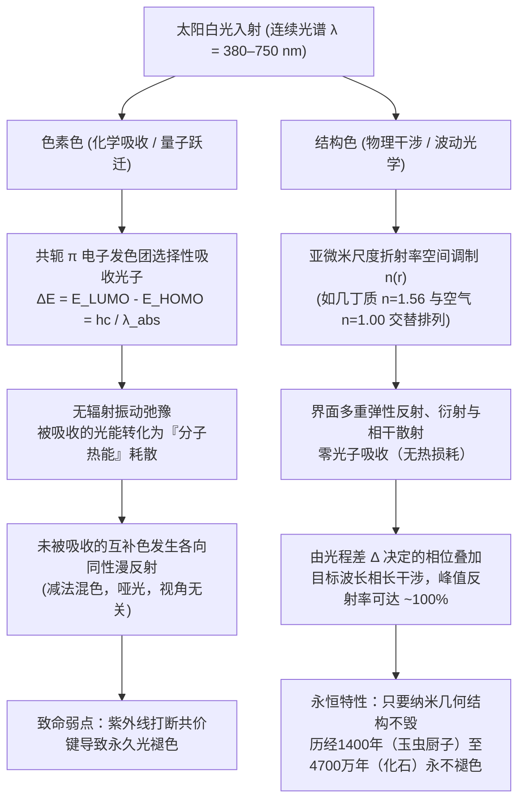
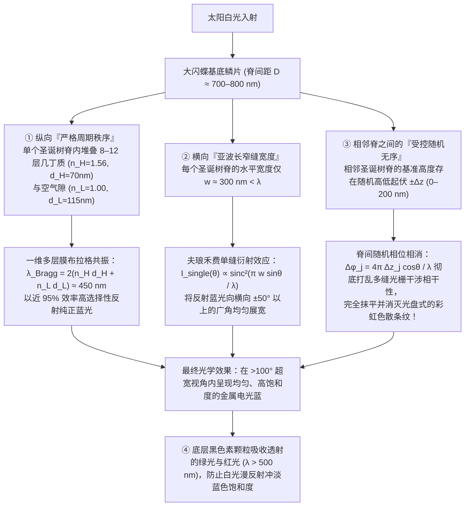

飞舞在中南美洲热带雨林树冠层的<strong>大闪蝶（*Morpho rhetenor*、*Morpho menelaus* 与 *Morpho didius*）</strong>，其双翅闪烁着令人目眩的金属电光蓝，甚至连一公里外低空飞行的飞机驾驶员都能清晰捕捉到那一抹蓝光。在日本奈良法隆寺珍藏的公元7世纪飞鸟时代国宝“玉虫厨子”上，镶嵌着数千只<strong>日本吉丁虫（*Chrysochroa fulgidissima*，日语称“玉虫”）</strong>的鞘翅；历经近1400年岁月洗礼，这些甲虫鞘翅依然散发着翡翠绿与紫金交织的璀璨光泽。更令人惊叹的是，从德国<strong>梅塞尔化石坑（Messel Pit）</strong>发掘出的距今约<strong>4700万年前（始新世）</strong>的甲虫化石，尽管原有的生物大分子早已被地质成岩作用改变，但在出土接触阳光的瞬间，依然闪烁着耀眼的金属绿与深蓝色光芒。

普通的绘画颜料、纺织染料、花瓣与秋叶在太阳紫外线（UV）照射下，短短数月或数年内就会发生光化学漂白（褪色）。为什么大闪蝶的翅膀、吉丁虫的鞘翅、孔雀（*Pavo cristatus*）尾羽的眼斑，以及霓虹脂鲤（*Paracheirodon innesi*，红绿灯鱼）体侧的亮带，能够拥有远超人工合成颜料的金属亮度，甚至跨越数千万年的地质时间而不朽？

我们可以通过一个极具视觉冲击力的经典实验来揭开谜底：取一片闪耀着电光蓝的*Morpho rhetenor*闪蝶翅膀，放入玛瑙研钵中彻底研磨成细粉。令人震惊的是，<strong>研钵中找不到一粒蓝色的粉末，剩下的只有泥土般暗淡的黑褐色粉尘</strong>！或者，保持翅膀完好无损，只需在翅膀表面滴上一滴无水乙醇或丙酮（折射率 $n \approx 1.36$）。当液体渗入微米级鳞片间隙的瞬间，耀眼的钴蓝色如同魔法解除般立刻消失，变成暗褐色或暗绿色；而当丙酮挥发干燥后，璀璨的电光蓝又毫发无损地重新浮现。

结论只有一个：<strong>大闪蝶的翅膀中根本不含一毫克蓝色色素（Pigment）</strong>。它的色彩并非源于化学发色团对光子的选择性吸收，而是源于可见光波长尺度（$\lambda \approx 380\text{–}750\,\text{nm}$）的亚微米介电纳米结构对电磁波的直接操控——即<strong>结构色（Structural Coloration）</strong>。本文将从量子化学与麦克斯韦电动力学的双重视角出发，严格推导自然界演化出的四大结构色光学架构：<strong>（I）单层薄膜干涉</strong>、<strong>（II）一维多层膜布拉格反射器（DBR）</strong>、<strong>（III）破解闪蝶悖论的“垂直秩序与水平随机无序”协同机制</strong>，以及<strong>（IV）二维/三维光子晶体与非晶态相干散射</strong>。

---

## 1. 自然界色彩的两大物理范式：色素色（化学吸收）vs. 结构色（物理干涉）

当包含全部可见光波长（$\lambda \approx 380\text{–}750\,\text{nm}$）的太阳白光照射到物体表面时，人类视网膜的视锥细胞之所以能感知色彩，是因为特定波段的电磁波被选择性地分离并送入人眼。自然界通过两种截然不同的物理机制实现这种光谱滤波。

### 1.1 色素色（Pigmentary Color）：共轭 $\pi$ 电子发色团的光子吸收与热耗散

树叶的叶绿素（绿）、胡萝卜与火烈鸟羽毛的类胡萝卜素（橙红）、花青素（紫红）以及动物毛发与皮肤中的真黑素（黑褐），均属于由分子量子力学支配的<strong>色素色</strong>。

有机色素与染料分子的核心结构是由单键（$\sigma$）与双键（$\sigma + \pi$）交替排列构成的<strong>共轭 $\pi$ 电子体系（Conjugated $\pi$-electron system）</strong>。根据分子轨道理论，$\pi$ 电子在长度为 $L$ 的共轭骨架上非定域化（离域）。正如同宽度为 $L$ 的一维无限深势阱中的量子粒子（能级 $E_n = \frac{n^2 h^2}{8 m_e L^2}$），共轭链越长，<strong>最高占据分子轨道（HOMO）</strong>与<strong>最低未占分子轨道（LUMO）</strong>之间的能隙 $\Delta E$ 就越窄。当共轭双键达到7至11个时，能隙 $\Delta E$ 恰好落入可见光能量范围（$1.65\text{–}3.26\,\text{eV}$）：

$$
\Delta E = E_{\text{LUMO}} - E_{\text{HOMO}} = h\nu = \frac{hc}{\lambda_{\text{abs}}}
$$

其中 $h$ 为普朗克常数，$c$ 为真空光速，$\nu$ 为光频率。当波长为 $\lambda_{\text{abs}}$ 的光子入射时，电子吸收光子能量从 HOMO 跃迁至激发态 $\pi^*$（LUMO），随后在皮秒（$10^{-12}\,\text{s}$）量级的时间内通过非辐射振动弛豫将能量转化为<strong>分子热运动（热量）</strong>耗散掉。因此，人眼看到的是<strong>未被吸收的互补色（Complementary Color）的漫反射光</strong>。

这种化学吸收机制存在两个致命缺陷：
1. <strong>光化学漂白（Photobleaching / 褪色）</strong>：阳光中的高能紫外光子（$E > 3.5\,\text{eV}$）会引发自由基反应或单线态氧光氧化，打断共轭碳链的共价键。一旦共轭体系受损，$\Delta E$ 重新移回紫外区，颜色便永久消失。
2. <strong>能量损耗与亮度上限</strong>：由于通过“吸收并销毁不需要的波长（减法混色）”来显色，大部分入射光能量变成了热，无法产生金属般的镜面高亮度。

### 1.2 结构色（Structural Color）：折射率空间调制 $n(\mathbf{r})$ 引发的电磁波干涉

相反，<strong>结构色</strong>完全不涉及分子轨道的电子跃迁吸收。构成生物结构色的材料本身通常是无色透明的生物高分子或生物矿物：昆虫外骨骼与鳞片的<strong>几丁质（甲壳素 Chitin, $n \approx 1.56$）</strong>、鸟类羽毛的 <strong>$\beta$-角蛋白（Keratin, $n \approx 1.54\text{–}1.58$）</strong>、植物细胞壁的<strong>纤维素（Cellulose, $n \approx 1.53$）</strong>、鱼鳞中的<strong>鸟嘌呤晶体（Guanine, $n \approx 1.83$）</strong>，以及填充在其纳米孔隙中的<strong>空气（Air, $n = 1.00$）</strong>或<strong>细胞质水相（Cytoplasm, $n \approx 1.33$）</strong>。

当这些高低折射率介质以数百纳米的空间周期排列时，入射白光在各个介电界面发生弹性反射与散射。根据波的线性叠加原理，满足特定光程差条件的波长发生<strong>相长干涉（Constructive Interference，接近100%无损反射）</strong>，其余波长则发生<strong>相消干涉（Destructive Interference）</strong>而透射。

从1665年罗伯特·胡克（Robert Hooke）在《显微图谱》（*Micrographia*）中发现孔雀羽毛浸水失色，到1704年艾萨克·牛顿（Isaac Newton）在《光学》（*Opticks*）中用空气劈尖干涉（牛顿环）解释肥皂泡与孔雀羽色，再到托马斯·杨（Thomas Young）、菲涅耳（Fresnel）以及1917年瑞利勋爵（Lord Rayleigh）建立周期层状介质反射理论，物理学彻底揭开了结构色之谜。当我们在闪蝶翅膀上滴加丙酮（$n = 1.36$）时，液体取代了纳米槽中的空气（$n = 1.00$），使几丁质（$n = 1.56$）与周围介质的折射率差 $\Delta n$ 急剧缩小，界面菲涅耳反射消失，纳米结构变得透明，从而直接暴露出底层暗褐色的黑色素（Melanin）基底！

---

## 2. 架构 I：单层薄膜干涉（Single Thin-Film Interference）与虹彩蓝移定律

肥皂泡、潮湿路面上的油膜、鸽子颈部的羽毛以及吉丁虫的表皮层，都属于最基础的<strong>单层薄膜干涉</strong>。

### 2.1 光程差（OPD）的严格几何推导与菲涅耳半波损失

设单色平面波（真空波长 $\lambda$）从折射率为 $n_0$ 的空气（$n_0 = 1.00$）以入射角 $\theta_0$ 射向厚度为 $d$、折射率为 $n_1$（$n_1 > n_0$）的平行薄膜，薄膜下方介质折射率为 $n_2$。根据<strong>斯涅耳折射定律（Snell's Law）</strong>：

$$
n_0 \sin\theta_0 = n_1 \sin\theta_1
$$

一部分光在上表面反射形成光束 $R_1$，另一部分折射入薄膜内（折射角 $\theta_1$），在下表面反射后从上表面射出形成平行光束 $R_2$。通过几何光学计算，光束 $R_2$ 在薄膜内走过的光程为 $L_2 = \frac{2 n_1 d}{\cos\theta_1}$，而光束 $R_1$ 在空气中走过的投射光程为 $L_1 = 2 d \tan\theta_1 (n_0 \sin\theta_0) = \frac{2 n_1 d \sin^2\theta_1}{\cos\theta_1}$。利用三角恒等式 $1 - \sin^2\theta_1 = \cos^2\theta_1$，两束光的<strong>几何光程差 $\Delta_{\text{geom}}$</strong> 为：

$$
\Delta_{\text{geom}} = L_2 - L_1 = \frac{2 n_1 d}{\cos\theta_1}\left(1 - \sin^2\theta_1\right) = 2 n_1 d \cos\theta_1
$$

然而，电磁波在界面反射时还会发生相位突变。由麦克斯韦方程组导出的正入射附近<strong>菲涅耳振幅反射系数（Fresnel reflection coefficient）</strong>为：

$$
r_{ij} = \frac{n_i - n_j}{n_i + n_j}
$$

* 当光从<strong>光疏介质射向光密介质（$n_i < n_j$）</strong>时，$r_{ij} < 0$（即乘以 $e^{i\pi} = -1$），反射波发生 <strong>$\pi$ 弧度的相位反转（半波损失，相当于额外增加 $\frac{\lambda}{2}$ 的光程）</strong>。
* 当光从<strong>光密介质射向光疏介质（$n_i > n_j$）</strong>时，$r_{ij} > 0$，反射相位不变（$\delta = 0$）。

对于悬浮在空气中的肥皂膜或几丁质薄片（$n_0 = 1.00 < n_1 > n_2 = 1.00$），上表面反射产生 $\pi$ 相位跳变，下表面无相位跳变。因此<strong>总有效光程差 $\Delta_{\text{total}}$</strong> 与干涉极值条件为：

$$
\Delta_{\text{total}} = 2 n_1 d \cos\theta_1 + \frac{\lambda}{2}
$$

$$
\begin{aligned}
\text{相长干涉（明纹 / 反射峰值）}: \quad 2 n_1 d \cos\theta_1 &= \left(m - \frac{1}{2}\right)\lambda \quad &(m = 1, 2, 3, \dots) \\
\text{相消干涉（暗纹 / 反射谷值）}: \quad 2 n_1 d \cos\theta_1 &= m\lambda \quad &(m = 0, 1, 2, \dots)
\end{aligned}
$$

这一公式完美解释了两个著名现象：
1. <strong>牛顿黑膜（Newton's Black Film）</strong>：肥皂泡破裂前夕，顶部膜厚因重力排液缩减至 $d \approx 5\,\text{nm} \ll \lambda$（$d \to 0$）。此时几何光程差 $2 n_1 d \cos\theta_1 \to 0$，但上表面反射的 $\frac{\lambda}{2}$ 半波损失依然存在，导致所有可见光波长同时满足 $m = 0$ 的完全相消干涉条件，肥皂膜顶部瞬间变成毫无反射的纯黑色！
2. <strong>随视角增大的虹彩蓝移定律（Iridescence / Blue-Shift）</strong>：由一阶相长干涉（$m=1$）解出峰值波长 $\lambda_{\text{peak}}(\theta_1) = 4 n_1 d \cos\theta_1 = \lambda_{\text{peak}}(0)\cos\theta_1$。当观察视角 $\theta_0$（及折射角 $\theta_1$）增大时，$\cos\theta_1$ 单调递减，因此<strong>倾斜观察任何薄膜或周期性多层膜时，反射颜色必然向短波方向移动（红 $\to$ 黄 $\to$ 绿 $\to$ 蓝 $\to$ 紫，即蓝移）</strong>。

---

## 3. 架构 II：一维多层膜布拉格反射器（1D Multilayer Bragg Reflectors）与四分之一波长堆叠

单层几丁质薄膜（$n_1 = 1.56$）在空气中的单界面反射率仅为 $R_1 = \left(\frac{1.56-1}{1.56+1}\right)^2 \approx 4.8\%$。为了实现吉丁虫、闪蝶或带鱼鳞片那样媲美纯银金属镜的超高反射率（$R > 90\%\text{–}99\%$），生物演化出了<strong>一维周期性多层膜——分布式布拉格反射器（DBR: Distributed Bragg Reflector）</strong>。

将高折射率层 $H$（折射率 $n_H$，厚度 $d_H$）与低折射率层 $L$（折射率 $n_L$，厚度 $d_L$）交替堆叠 $N$ 个周期，当相邻周期的反射波光程差为波长整数倍时，满足<strong>多层膜布拉格-斯涅耳定律（Multilayer Bragg–Snell Law）</strong>：

$$
m \lambda_{\text{Bragg}} = 2 \left( n_H d_H \cos\theta_H + n_L d_L \cos\theta_L \right) = 2 \left( d_H \sqrt{n_H^2 - \sin^2\theta_0} + d_L \sqrt{n_L^2 - \sin^2\theta_0} \right)
$$

特别地，当每一层的光学厚度恰好等于设计波长 $\lambda_0$ 的<strong>四分之一</strong>（<strong>四分之一波长堆叠 / Quarter-Wave Stack</strong>）时：

$$
n_H d_H = n_L d_L = \frac{\lambda_0}{4} \implies \lambda_0 = 2(n_H d_H + n_L d_L)
$$

所有 $L \to H$ 界面（反射相移 $\pi$）与所有 $H \to L$ 界面（反射相移 $0$，加上往返一层厚度 $2 n_H d_H = \frac{\lambda_0}{2}$ 带来的延迟 $\pi$）的反射波在表面达到<strong>严格的同相叠加</strong>！利用电磁场<strong>传输矩阵法（Transfer-Matrix Method, TMM）</strong>，可严格导出 $N$ 个周期四分之一波长多层膜在中心波长 $\lambda_0$ 处的峰值功率反射率 $R_N$：

$$
R_N = \left[ \frac{n_0 \left(\frac{n_H}{n_L}\right)^{2N} - n_s}{n_0 \left(\frac{n_H}{n_L}\right)^{2N} + n_s} \right]^2
$$

指数项 $\left(\frac{n_H}{n_L}\right)^{2N}$ 赋予了生物惊人的光学放大能力：
* <strong>日本吉丁虫（*Chrysochroa fulgidissima*）</strong>：外骨骼表皮内交替排列着富含黑色素的几丁质层（$n_H \approx 1.68, d_H \approx 90\,\text{nm}$）与贫黑色素层（$n_L \approx 1.55, d_L \approx 100\,\text{nm}$），共叠加 $N \approx 15\text{–}20$ 层，不仅产生强烈的金绿色金属光泽，而且由于是固态交联几丁质结构，历经1400年（法隆寺玉虫厨子）依然丝毫不褪色。
* <strong>鱼类银鳞与红绿灯鱼（*Paracheirodon innesi*）的动态变色</strong>：鲱鱼与带鱼的虹彩细胞（Iridophores）内含有<strong>鸟嘌呤晶体薄片（$n_H = 1.83$）</strong>与<strong>细胞质水层（$n_L = 1.33$）</strong>。仅需 $N = 6$ 个周期，反射率即突破 $90\%$；通过沿深度方向连续改变层厚（啾频多层膜 Chirped Multilayer），鱼鳞得以在整个可见光谱实现宽带镜面反射，呈现完美的“金属银色”伪装。而红绿灯鱼与变色龙则能通过神经与渗透压调节鸟嘌呤纳米晶体的倾角或层间距 $d_L$，像百叶窗一样实时移动 $\lambda_{\text{Bragg}}$，在蓝绿与深紫之间动态切换体色！

---

## 4. 架构 III：大闪蝶悖论（The Morpho Paradox）——秩序与无序如何联手消灭彩虹色散？

这里隐藏着结构色物理学中最著名的悖论——<strong>大闪蝶悖论</strong>。
如果闪蝶翅膀只是平整的多层膜，它应当只在镜面反射方向发光，且随视角增大迅速发生蓝移变色；反之，如果翅膀表面排列着间距 $D \approx 700\text{–}800\,\text{nm}$ 的周期性沟槽（衍射光栅），那么根据光栅方程 $D(\sin\theta_i + \sin\theta_m) = m\lambda$，它应当像光盘（CD/DVD）背面一样将白光分解成随角度变化的<strong>七彩彩虹</strong>。然而，真正的大闪蝶（*Morpho didius*、*Morpho rhetenor*）在<strong>超过 $\pm 50^\circ$（总视角逾 $100^\circ$）的极宽视角范围内，始终呈现出均匀、纯粹的电光钴蓝色，既没有变成彩虹，也没有丧失亮度</strong>！

大阪大学木下修一（Shuichi Kinoshita）与吉冈伸也（Shinya Yoshioka）团队通过透射电镜（TEM）与波动光学建模，彻底解开了这一自然界纳米工程的巅峰之作。闪蝶鳞片表面纵向排列着间距 $D \approx 700\,\text{nm}$ 的脊（Ridge），每个脊的横截面都呈现出精妙绝伦的<strong>“圣诞树形（多层架状拉梅拉 Lamellae）”纳米结构</strong>，融合了四大物理机制：

1. <strong>纵向严格周期性（选择性蓝光反射）</strong>：在单个脊内部，6至12层几丁质薄片（$n_H = 1.56, d_H \approx 72\,\text{nm}$）与空气层（$n_L = 1.00, d_L \approx 113\,\text{nm}$）严格按四分之一波长周期垂直堆叠，满足 $\lambda_{\text{Bragg}} = 2(n_H d_H + n_L d_L) \approx 450\,\text{nm}$，只高效反射纯正蓝光。
2. <strong>横向亚波长宽度（单缝广角衍射）</strong>：每个脊的横向宽度仅为 <strong>$w \approx 300\,\text{nm} < \lambda$</strong>。根据夫琅禾费单缝衍射理论，亚波长反射窄带的角分布包络为 $I_{\text{single}}(\theta) \propto \operatorname{sinc}^2\left(\frac{\pi w \sin\theta}{\lambda}\right)$，将原本局限于镜面方向的蓝光横向展宽至 $\Delta\theta \sim \pm 50^\circ$ 以上的广阔空间角。
3. <strong>相邻脊间的随机高度起伏 $\pm\Delta z_j$（消灭光栅彩虹）</strong>：为了阻止成百上千个周期性排列的脊产生多缝光栅干涉条纹，<strong>闪蝶让相邻圣诞树脊的垂直基准高度发生 $\Delta z_j \in [0, \lambda/2]$ 的随机错位</strong>！$N_{\text{ridge}}$ 个脊的合成远场光强为：
   $$
   I_{\text{total}}(\theta) = I_{\text{single}}(\theta) \left| \sum_{j=1}^{N_{\text{ridge}}} \exp\left[ i \frac{2\pi}{\lambda} \left( j D \sin\theta + 2 \Delta z_j \cos\theta \right) \right] \right|^2
   $$
   由于随机高度差引入的往返相位 $\phi_j = \frac{4\pi \Delta z_j \cos\theta}{\lambda}$ 在 $[-\pi, \pi]$ 上均匀随机分布，不同脊之间的交叉干涉项 $\langle e^{i(\phi_j - \phi_l)} \rangle \to 0$ 被彻底抹平，总光强退化为各单脊衍射包络的非相干叠加 $I_{\text{total}}(\theta) \approx N_{\text{ridge}} I_{\text{single}}(\theta)$！
4. <strong>覆鳞片漫射与基底黑色素吸收</strong>：透明的上层覆鳞片（Cover scales）充当光学匀光扩散板，而鳞片底部的<strong>黑色素（Melanin）</strong>完全吸收透射的绿、黄、红光（$\lambda > 500\,\text{nm}$），杜绝了背散射白光对蓝色的冲淡。

---

## 5. 架构 IV：二维/三维光子晶体（Photonic Crystals）与非晶态相干散射

当介电常数 $\varepsilon(\mathbf{r}) = n(\mathbf{r})^2$ 在二维平面 $\varepsilon(x, y)$ 或三维空间 $\varepsilon(x, y, z)$ 呈周期性调制 $\varepsilon(\mathbf{r} + \mathbf{R}) = \varepsilon(\mathbf{r})$ 时，1987年伊莱·亚布罗诺维奇（Eli Yablonovitch）与萨吉夫·约翰（Sajeev John）证明：正如半导体晶格周期势对电子形成能带隙一样，三维周期介电晶格会对光子形成<strong>光子带隙（Photonic Band Gap, PBG）</strong>。

### 5.1 麦克斯韦主本征方程与光子带隙的形成机理

在无源、非磁性（$\mu = \mu_0$）、无损周期介电介质中，将简谐电磁场 $\mathbf{H}(\mathbf{r}, t) = \mathbf{H}(\mathbf{r})e^{-i\omega t}$ 代入麦克斯韦旋度方程并消去电场 $\mathbf{E}(\mathbf{r})$，即可导出<strong>光子晶体的厄米主本征方程（Master Eigenvalue Equation）</strong>：

$$
\hat{\Theta} \mathbf{H}(\mathbf{r}) \equiv \nabla \times \left( \frac{1}{\varepsilon(\mathbf{r})} \nabla \times \mathbf{H}(\mathbf{r}) \right) = \left(\frac{\omega}{c}\right)^2 \mathbf{H}(\mathbf{r})
$$

根据<strong>布洛赫定理（Bloch's Theorem）</strong>，本征模具有形式 $\mathbf{H}_{n,\mathbf{k}}(\mathbf{r}) = e^{i\mathbf{k}\cdot\mathbf{r}} \mathbf{u}_{n,\mathbf{k}}(\mathbf{r})$。在布里渊区边界（$k = \pm\frac{\pi}{a}$），前进波与布拉格反射波耦合成两种驻波：将电场能量 $|\mathbf{E}|^2$ 集中于高介电常数区（$\varepsilon_H$）的低频模形成<strong>电介质带（Dielectric Band, $\omega_-$）</strong>，而将电场能量集中于低介电常数空气区（$\varepsilon_L$）的高频模形成<strong>空气带（Air Band, $\omega_+$）</strong>。两带之间的频率禁带 $\omega \in (\omega_-, \omega_+)$ 内光子态密度（DOS） $\rho(\omega) = 0$，该频段的光子无法在晶体内部传播，发生 <strong>100% 全方向反射</strong>。

* <strong>孔雀尾羽的二维光子晶体</strong>：复旦大学资剑团队发现，孔雀羽小枝表皮下排列着由黑色素纳米棒（$n \approx 2.0$）、角蛋白基质（$n \approx 1.54$）与空气孔构成的二维正方/矩形光子晶体。仅通过微调晶格常数 $a$（蓝区 $140\,\text{nm}$、绿区 $150\,\text{nm}$、黄区 $165\,\text{nm}$），孔雀便用单一黑色素材料绘制出绚丽的眼斑。
* <strong>宝石象鼻虫与绿灰蝶的三维陀螺仪（Gyroid）光子晶体</strong>：矿物蛋白石（Opal）是由二氧化硅纳米球构成的 FCC 三维光子晶体；而球背象鼻虫（*Pachyrhynchus argus*）、巴西钻石象鼻虫（*Entimus imperialis*）与绿灰蝶（*Callophrys rubi*）鳞片内部则是更为精密的<strong>三维双连续陀螺仪极小曲面（Bicontinuous Gyroid Network）</strong>，其曲面方程为：
  $$
  \sin\left(\frac{2\pi x}{a}\right)\cos\left(\frac{2\pi y}{a}\right) + \sin\left(\frac{2\pi y}{a}\right)\cos\left(\frac{2\pi z}{a}\right) + \sin\left(\frac{2\pi z}{a}\right)\cos\left(\frac{2\pi x}{a}\right) = t
  $$
  昆虫蛹期细胞利用滑面内质网（SER）生物膜自组装成陀螺仪模板，注入几丁质硬化后退化干燥，形成具有手性圆偏振反射特性的三维光子晶体（$a \approx 300\,\text{nm}$）。
* <strong>非晶态（准有序）光子结构与冠蓝鸦的非虹彩色</strong>：为什么北美洲<strong>冠蓝鸦（Blue Jay, *Cyanocitta cristata*）</strong>、翠鸟与金刚鹦鹉的羽毛不含任何蓝色色素，却像涂了颜料一样<strong>从任何角度观察都不会变色（非虹彩结构色 Non-iridescent Structural Color）</strong>？耶鲁大学理查德·普鲁姆（Richard Prum）证明，羽枝海绵状髓质层中的 $\beta$-角蛋白在细胞成熟时发生热力学<strong>旋节线分解（Spinodal Decomposition，相分离）</strong>，形成仅具有短程有序（特征孔距 $d_0 \approx 180\,\text{nm}$）而无长程晶格取向的各向同性纳米海绵。其三维傅里叶功率谱 $|\tilde{\varepsilon}(\mathbf{q})|^2$ 在倒易空间呈半径 $|\mathbf{q}| = q_0 \approx \frac{2\pi}{d_0}$ 的<strong>均匀球壳</strong>分布，从而向所有方向发生波长一致的<strong>各向同性相干散射（Coherent Scattering）</strong>。

---

## 6. 色素色与结构色及四大光学架构综合对比表

### 表1：色素色（化学吸收）与结构色（物理干涉）的本质对比

| 物理特性维度 | 色素色（Pigmentary Color） | 结构色（Structural Color） |
| :--- | :--- | :--- |
| <strong>核心物理机制</strong> | 共轭 $\pi$ 电子发色团对特定波长光子的<strong>量子跃迁吸收</strong>（$\Delta E = E_{\text{LUMO}} - E_{\text{HOMO}} = hc/\lambda$）与互补色漫反射 | 亚微米尺度折射率调制 $n(\mathbf{r})$ 引发的电磁波<strong>薄膜干涉、布拉格反射、衍射与相干散射</strong> |
| <strong>热力学能量转化</strong> | 被吸收波段的光能通过振动弛豫转化为<strong>热能</strong>（减法混色，存在能量损耗） | 纯弹性散射，<strong>零光子吸收损耗</strong>，目标波段反射率可达 $95\%\text{–}99.9\%$ |
| <strong>视觉光泽与角度依赖</strong> | 哑光漫反射，与观察视角无关 | 周期结构具强烈<strong>虹彩效应（随视角增大发生蓝移）</strong>；闪蝶结构与非晶态结构可实现广角或全向均匀色彩 |
| <strong>研磨或有机溶剂浸润</strong> | 研磨成粉或浸入溶剂后只要分子未分解，颜色保持不变 | <strong>研磨成粉后纳米结构破坏，颜色消失（仅余褐色黑色素）</strong>；浸入丙酮/乙醇（$n \approx 1.36$）瞬间失色或变色 |
| <strong>时间寿命与耐候性</strong> | 易受紫外线（UV）光氧化打断共价键，数年至数十年内发生<strong>光漂白褪色</strong> | 只要亚微米几何形貌留存即<strong>永久不朽</strong>（1400年玉虫厨子、4700万年梅塞尔甲虫化石） |

### 表2：生物结构色的四大基础光学架构

| 光学架构 | 空间维度与有序度 | 核心控制方程 / 共振条件 | 光学特性（反射率与视角分布） | 自然界典型代表生物 |
| :--- | :--- | :--- | :--- | :--- |
| <strong>I. 单层薄膜干涉</strong> | 1D 单层均匀介质膜（厚度 $d$） | $2 n_1 d \cos\theta_1 = \left(m - \frac{1}{2}\right)\lambda$ （含单界面 $\pi$ 半波损失） | 反射率较低（$\sim 15\%$）；随视角增大连续蓝移；$d \to 0$ 时形成牛顿黑膜 | 肥皂泡、水面油膜、鸽子颈羽、苍蝇与胡蜂的透明翅膀 |
| <strong>II. 一维多层膜布拉格反射器 (DBR)</strong> | 1D 周期性交替堆叠 $N$ 组 $(n_H, d_H)$ 与 $(n_L, d_L)$ | $m\lambda_{\text{Bragg}} = 2(n_H d_H \cos\theta_H + n_L d_L \cos\theta_L)$ 四分之一波长条件：$n_H d_H = n_L d_L = \frac{\lambda_0}{4}$ | 峰值反射率 $R_N = \left[\frac{n_0(n_H/n_L)^{2N}-n_s}{n_0(n_H/n_L)^{2N}+n_s}\right]^2 \to 100\%$；类金属镜面光泽 | 日本吉丁虫鞘翅、带鱼/鲱鱼鸟嘌呤银鳞、红绿灯鱼动态条纹 |
| <strong>III. 大闪蝶分级脊状结构</strong> | 纵向：周期多层拉梅拉 横向：亚波长窄缝 $w$ + 随机高度差 $\pm\Delta z$ | 纵向：$2(n_H d_H + n_L d_L) \approx 450\,\text{nm}$ 横向：$I(\theta) \approx N_{\text{ridge}} \operatorname{sinc}^2\left(\frac{\pi w\sin\theta}{\lambda}\right)$ | 随机高度差 $\Delta z_j$ 消除光栅彩虹干涉峰，单缝衍射实现 <strong>$>100^\circ$ 超广角均匀电光蓝</strong> | 大闪蝶属（*Morpho rhetenor*, *Morpho didius*, *Morpho menelaus*） |
| <strong>IV-a. 二维/三维有序光子晶体</strong> | 2D 或 3D 布拉维晶格周期介电分布 $\varepsilon(\mathbf{r}+\mathbf{R})=\varepsilon(\mathbf{r})$ | $\nabla \times \left(\frac{1}{\varepsilon(\mathbf{r})}\nabla \times \mathbf{H}\right) = \left(\frac{\omega}{c}\right)^2 \mathbf{H}$ （光子带隙 PBG 内态密度 $\rho(\omega)=0$） | 带隙频段全反射；三维陀螺仪结构兼具手性圆偏振选择性 | 孔雀尾羽眼斑（2D黑色素棒晶格）、海鼠刚毛（2D）、天然蛋白石（3D）、球背象鼻虫与绿灰蝶（3D Gyroid） |
| <strong>IV-b. 非晶态准有序光子结构</strong> | 3D 各向同性短程有序（旋节线分解相分离） | 倒易空间功率谱 $|\tilde{\varepsilon}(\mathbf{q})|^2$ 呈半径 $q_0 \approx \frac{2\pi}{d_0}$ 的均匀球壳 | <strong>无虹彩效应（视角无关）</strong>；全方向各向同性相干散射 | 冠蓝鸦（*Cyanocitta cristata*）、翠鸟、东蓝鸲、蓝黄金刚鹦鹉羽毛 |

---

## 7. 跨越4700万年的化石微光与仿生光子学工业革命

### 7.1 古生物色彩重建（Paleocolor）：为何4700万年前的梅塞尔甲虫化石依然闪耀？

2011年，耶鲁大学玛丽亚·麦克纳马拉（Maria E. McNamara）团队对德国<strong>梅塞尔化石坑（Messel Pit，距今约4700万年中始新世）</strong>出土的甲虫化石进行了透射电镜与微区光谱分析。尽管漫长的地质成岩作用已将原有的几丁质大分子炭化转变为干酪根类地质聚合物，但外骨骼内部厚度约 $80\text{–}120\,\text{nm}$ 的一维多层膜与三维光子晶体<strong>纳米空间几何结构却原封不动地保存了下来</strong>！只要纳米周期与折射率对比度尚存，麦克斯韦方程组就会在4700万年后的今天忠实地重现始新世森林中的金属绿光。科学家甚至利用化石中黑素体（Melanosomes）的纳米阵列排布，成功还原了1.5亿年前侏罗纪带羽恐龙（如小盗龙 *Microraptor* 与彩虹龙 *Caihong juji*）生前绚丽的金属虹彩羽毛。

### 7.2 现代工业仿生应用：从无染纺织到零能耗日间辐射制冷

1. <strong>零废水无染结构色纤维“Morfotex（摩佛特克斯）”</strong>：日本帝人（Teijin）与日产汽车模仿大闪蝶研发出全球首款结构色纤维 <strong>Morfotex</strong>，在单根扁平纤维内部将聚酯（PET, $n_H = 1.63$）与尼龙-6（$n_L = 1.53$）以 $70\text{–}90\,\text{nm}$ 厚度交替共挤出 <strong>61层</strong>。无需一滴化学染料、零印染废水排放，即可织出永不褪色的绚丽织物。
2. <strong>雷克萨斯 Structural Blue（结构蓝）汽车涂料</strong>：传统蓝色车漆吸收掉95%以上的阳光，仅反射不足5%的蓝光。雷克萨斯耗时15年研发的仿生“结构蓝”纳米多层微片涂料，用精简优化的 <strong>7层</strong> 纳米核壳结构实现了近 <strong>100% 的蓝光反射率</strong>与超广角金属深邃感。
3. <strong>高通 Mirasol 干涉调制显示器（IMOD MEMS）</strong>：模仿肥皂泡与红绿灯鱼的可调谐薄膜干涉，每个微机电（MEMS）像素通过静电力调节半透膜与反射膜之间的空气隙厚度 $d$，在阳光直射下无背光反射出红、绿、蓝三原色，或闭合至 $d \to 0$（牛顿黑膜状态）呈现纯黑，静态功耗几乎为零。
4. <strong>防伪钞票光学可变油墨（OVI）与水凝胶光子晶体生物传感器</strong>：钞票上的变色油墨利用多层膜随倾角蓝移（$\lambda \propto \cos\theta$）的物理特性，令彩色复印机无法仿造；而嵌入三维蛋白石光子晶体的智能水凝胶在接触汗液葡萄糖或特定 pH 时发生纳米级溶胀，改变晶格常数 $a$，无需电源即可通过肉眼可见的颜色变化进行无创医疗诊断。
5. <strong>零能耗日间被动辐射制冷（Daytime Radiative Cooling）</strong>：撒哈拉银蚁（*Cataglyphis bombycina*）体表的三角形几丁质微毛能反射 $96\%$ 的太阳辐射（$0.3\text{–}2.5\,\mu\text{m}$），同时通过中红外大气透明窗口（$8\text{–}13\,\mu\text{m}$）向 $3\,\text{K}$ 的外太空高效辐射热量。斯坦福大学范汕洄（Shanhui Fan）团队据此研发的多层光子超材料与纳米多孔聚合物涂层，在正午烈日直射下无需消耗一度电，即可使建筑物表面温度比环境气温降低 <strong>$5^\circ\text{C}\text{–}10^\circ\text{C}$</strong>。

大闪蝶翅膀在研钵中化作的一撮褐土告诉我们：自然界最极致、最永恒的绚丽色彩，从来不是靠脆弱的化学分子染就的，而是生命在纳米尺度上用透明介质与空气雕琢出的<strong>麦克斯韦电磁波交响曲</strong>。
