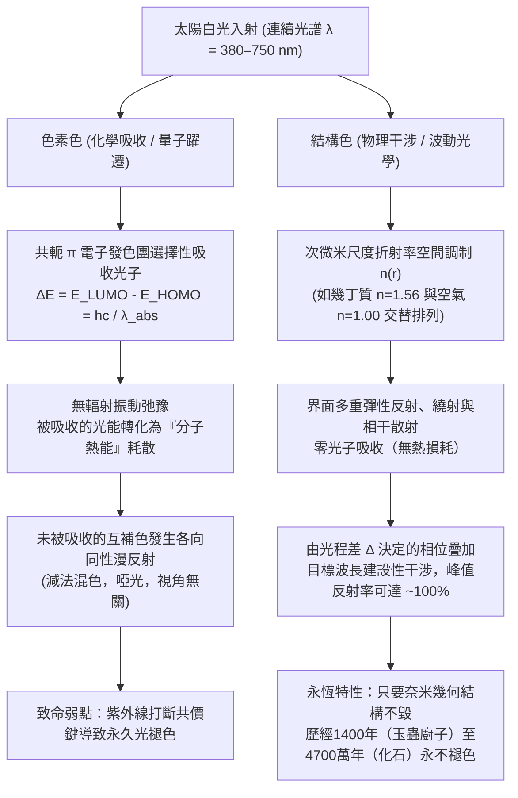
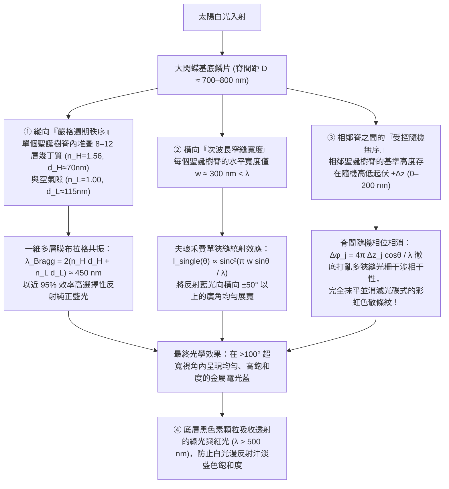

飛舞在中南美洲熱帶雨林樹冠層的<strong>摩爾福蝶（大閃蝶，*Morpho rhetenor*、*Morpho menelaus* 與 *Morpho didius*）</strong>，其雙翅閃爍著令人目眩的金屬電光藍，甚至連一公里外低空飛行的飛機駕駛員都能清晰捕捉到那一抹藍光。在日本奈良法隆寺珍藏的西元7世紀飛鳥時代國寶「玉蟲廚子」上，鑲嵌著數千隻<strong>日本吉丁蟲（*Chrysochroa fulgidissima*，日語稱「玉蟲」）</strong>的鞘翅；歷經近1400年歲月洗禮，這些甲蟲鞘翅依然散發著翡翠綠與紫金交織的璀璨光澤。更令人驚嘆的是，從德國<strong>梅塞爾化石坑（Messel Pit）</strong>發掘出的距今約<strong>4700萬年前（始新世）</strong>的甲蟲化石，儘管原有的生物大分子早已被地質成岩作用改變，但在出土接觸陽光的瞬間，依然閃爍著耀眼的金屬綠與深藍色光芒。

普通的繪畫顏料、紡織染料、花瓣與秋葉在太陽紫外線（UV）照射下，短短數月或數年內就會發生光化學漂白（褪色）。為什麼大閃蝶的翅膀、吉丁蟲的鞘翅、孔雀（*Pavo cristatus*）尾羽的眼斑，以及霓虹脂鯉（*Paracheirodon innesi*，日光燈魚）體側的亮帶，能夠擁有遠超人工合成顏料的金屬亮度，甚至跨越數千萬年的地質時間而不朽？

我們可以透過一個極具視覺衝擊力的經典實驗來揭開謎底：取一片閃耀著電光藍的 *Morpho rhetenor* 閃蝶翅膀，放入瑪瑙研缽中徹底研磨成細粉。令人震驚的是，<strong>研缽中找不到一粒藍色的粉末，剩下的只有泥土般暗淡的黑褐色粉塵</strong>！或者，保持翅膀完好無損，只需在翅膀表面滴上一滴無水乙醇或丙酮（折射率 $n \approx 1.36$）。當液體滲入微米級鱗片間隙的瞬間，耀眼的鈷藍色如同魔法解除般立刻消失，變成暗褐色或暗綠色；而當丙酮揮發乾燥後，璀璨的電光藍又毫髮無損地重新浮現。

結論只有一個：<strong>大閃蝶的翅膀中根本不含一毫克藍色色素（Pigment）</strong>。它的色彩並非源於化學發色團對光子的選擇性吸收，而是源於可見光波長尺度（$\lambda \approx 380\text{–}750\,\text{nm}$）的次微米介電奈米結構對電磁波的直接操控——即<strong>結構色（Structural Coloration）</strong>。本文將從量子化學與馬克士威電動力學的雙重視角出發，嚴格推導自然界演化出的四大結構色光學架構：<strong>（I）單層薄膜干涉</strong>、<strong>（II）一維多層膜布拉格反射器（DBR）</strong>、<strong>（III）破解閃蝶悖論的「垂直秩序與水平隨機無序」協同機制</strong>，以及<strong>（IV）二維/三維光子晶體與非晶態相干散射</strong>。

---

## 1. 自然界色彩的兩大物理範式：色素色（化學吸收）vs. 結構色（物理干涉）

當包含全部可見光波長（$\lambda \approx 380\text{–}750\,\text{nm}$）的太陽白光照射到物體表面時，人類視網膜的視錐細胞之所以能感知色彩，是因為特定波段的電磁波被選擇性地分離並送入人眼。自然界透過兩種截然不同的物理機制實現這種光譜濾波。

### 1.1 色素色（Pigmentary Color）：共軛 $\pi$ 電子發色團的光子吸收與熱耗散

樹葉的葉綠素（綠）、胡蘿蔔與紅鶴羽毛的類胡蘿蔔素（橙紅）、花青素（紫紅）以及動物毛髮與皮膚中的真黑素（黑褐），均屬於由分子量子力學支配的<strong>色素色</strong>。

有機色素與染料分子的核心結構是由單鍵（$\sigma$）與雙鍵（$\sigma + \pi$）交替排列構成的<strong>共軛 $\pi$ 電子體系（Conjugated $\pi$-electron system）</strong>。根據分子軌域理論，$\pi$ 電子在長度為 $L$ 的共軛骨架上非定域化（離域）。正如同寬度為 $L$ 的一維無限深位能井中的量子粒子（能階 $E_n = \frac{n^2 h^2}{8 m_e L^2}$），共軛鏈越長，<strong>最高佔據分子軌域（HOMO）</strong>與<strong>最低未佔分子軌域（LUMO）</strong>之間的能隙 $\Delta E$ 就越窄。當共軛雙鍵達到7至11個時，能隙 $\Delta E$ 恰好落入可見光能量範圍（$1.65\text{–}3.26\,\text{eV}$）：

$$
\Delta E = E_{\text{LUMO}} - E_{\text{HOMO}} = h\nu = \frac{hc}{\lambda_{\text{abs}}}
$$

其中 $h$ 為普朗克常數，$c$ 為真空光速，$\nu$ 為光頻率。當波長為 $\lambda_{\text{abs}}$ 的光子入射時，電子吸收光子能量從 HOMO 躍遷至激發態 $\pi^*$（LUMO），隨後在皮秒（$10^{-12}\,\text{s}$）量級的時間內透過非輻射振動弛豫將能量轉化為<strong>分子熱運動（熱量）</strong>耗散掉。因此，人眼看到的是<strong>未被吸收的互補色（Complementary Color）的漫反射光</strong>。

這種化學吸收機制存在兩個致命缺陷：
1. <strong>光化學漂白（Photobleaching / 褪色）</strong>：陽光中的高能紫外光子（$E > 3.5\,\text{eV}$）會引發自由基反應或單重態氧光氧化，打斷共軛碳鏈的共價鍵。一旦共軛體系受損，$\Delta E$ 重新移回紫外區，顏色便永久消失。
2. <strong>能量損耗與亮度上限</strong>：由於透過「吸收並銷毀不需要的波長（減法混色）」來顯色，大部分入射光能量變成了熱，無法產生金屬般的鏡面高亮度。

### 1.2 結構色（Structural Color）：折射率空間調制 $n(\mathbf{r})$ 引發的電磁波干涉

相反，<strong>結構色</strong>完全不涉及分子軌域的電子躍遷吸收。構成生物結構色的材料本身通常是無色透明的生物高分子或生物礦物：昆蟲外骨骼與鱗片的<strong>幾丁質（甲殼素 Chitin, $n \approx 1.56$）</strong>、鳥類羽毛的 <strong>$\beta$-角蛋白（Keratin, $n \approx 1.54\text{–}1.58$）</strong>、植物細胞壁的<strong>纖維素（Cellulose, $n \approx 1.53$）</strong>、魚鱗中的<strong>鳥糞嘌呤晶體（Guanine, $n \approx 1.83$）</strong>，以及填充在其奈米孔隙中的<strong>空氣（Air, $n = 1.00$）</strong>或<strong>細胞質水相（Cytoplasm, $n \approx 1.33$）</strong>。

當這些高低折射率介質以數百奈米的空間週期排列時，入射白光在各個介電界面發生彈性反射與散射。根據波的線性疊加原理，滿足特定光程差條件的波長發生<strong>建設性干涉（Constructive Interference，接近100%無損反射）</strong>，其餘波長則發生<strong>破壞性干涉（Destructive Interference）</strong>而透射。

從1665年羅伯特·虎克（Robert Hooke）在《微物圖誌》（*Micrographia*）中發現孔雀羽毛浸水失色，到1704年艾薩克·牛頓（Isaac Newton）在《光學》（*Opticks*）中用空氣劈尖干涉（牛頓環）解釋肥皂泡與孔雀羽色，再到湯瑪斯·楊（Thomas Young）、菲涅耳（Fresnel）以及1917年瑞利勳爵（Lord Rayleigh）建立週期層狀介質反射理論，物理學徹底揭開了結構色之謎。當我們在閃蝶翅膀上滴加丙酮（$n = 1.36$）時，液體取代了奈米槽中的空氣（$n = 1.00$），使幾丁質（$n = 1.56$）與周圍介質的折射率差 $\Delta n$ 急劇縮小，界面菲涅耳反射消失，奈米結構變得透明，從而直接暴露出底層暗褐色的黑色素（Melanin）基底！

---

## 2. 架構 I：單層薄膜干涉（Single Thin-Film Interference）與虹彩藍移定律

肥皂泡、潮濕路面上的油膜、鴿子頸部的羽毛以及吉丁蟲的表皮層，都屬於最基礎的<strong>單層薄膜干涉</strong>。

### 2.1 光程差（OPD）的嚴格幾何推導與菲涅耳半波損失

設單色平面波（真空波長 $\lambda$）從折射率為 $n_0$ 的空氣（$n_0 = 1.00$）以入射角 $\theta_0$ 射向厚度為 $d$、折射率為 $n_1$（$n_1 > n_0$）的平行薄膜，薄膜下方介質折射率為 $n_2$。根據<strong>司乃耳折射定律（Snell's Law）</strong>：

$$
n_0 \sin\theta_0 = n_1 \sin\theta_1
$$

一部分光在上表面反射形成光束 $R_1$，另一部分折射入薄膜內（折射角 $\theta_1$），在下表面反射後從上表面射出形成平行光束 $R_2$。透過幾何光學計算，光束 $R_2$ 在薄膜內走過的光程為 $L_2 = \frac{2 n_1 d}{\cos\theta_1}$，而光束 $R_1$ 在空氣中走過的投射光程為 $L_1 = 2 d \tan\theta_1 (n_0 \sin\theta_0) = \frac{2 n_1 d \sin^2\theta_1}{\cos\theta_1}$。利用三角恆等式 $1 - \sin^2\theta_1 = \cos^2\theta_1$，兩束光的<strong>幾何光程差 $\Delta_{\text{geom}}$</strong> 為：

$$
\Delta_{\text{geom}} = L_2 - L_1 = \frac{2 n_1 d}{\cos\theta_1}\left(1 - \sin^2\theta_1\right) = 2 n_1 d \cos\theta_1
$$

然而，電磁波在界面反射時還會發生相位突變。由馬克士威方程組導出的正入射附近<strong>菲涅耳振幅反射係數（Fresnel reflection coefficient）</strong>為：

$$
r_{ij} = \frac{n_i - n_j}{n_i + n_j}
$$

* 當光從<strong>光疏介質射向光密介質（$n_i < n_j$）</strong>時，$r_{ij} < 0$（即乘以 $e^{i\pi} = -1$），反射波發生 <strong>$\pi$ 弳度的相位反轉（半波損失，相當於額外增加 $\frac{\lambda}{2}$ 的光程）</strong>。
* 當光從<strong>光密介質射向光疏介質（$n_i > n_j$）</strong>時，$r_{ij} > 0$，反射相位不變（$\delta = 0$）。

對於懸浮在空氣中的肥皂膜或幾丁質薄片（$n_0 = 1.00 < n_1 > n_2 = 1.00$），上表面反射產生 $\pi$ 相位跳變，下表面無相位跳變。因此<strong>總有效光程差 $\Delta_{\text{total}}$</strong> 與干涉極值條件為：

$$
\Delta_{\text{total}} = 2 n_1 d \cos\theta_1 + \frac{\lambda}{2}
$$

$$
\begin{aligned}
\text{建設性干涉（明紋 / 反射峰值）}: \quad 2 n_1 d \cos\theta_1 &= \left(m - \frac{1}{2}\right)\lambda \quad &(m = 1, 2, 3, \dots) \\
\text{破壞性干涉（暗紋 / 反射谷值）}: \quad 2 n_1 d \cos\theta_1 &= m\lambda \quad &(m = 0, 1, 2, \dots)
\end{aligned}
$$

這一公式完美解釋了兩個著名現象：
1. <strong>牛頓黑膜（Newton's Black Film）</strong>：肥皂泡破裂前夕，頂部膜厚因重力排液縮減至 $d \approx 5\,\text{nm} \ll \lambda$（$d \to 0$）。此時幾何光程差 $2 n_1 d \cos\theta_1 \to 0$，但上表面反射的 $\frac{\lambda}{2}$ 半波損失依然存在，導致所有可見光波長同時滿足 $m = 0$ 的完全破壞性干涉條件，肥皂膜頂部瞬間變成毫無反射的純黑色！
2. <strong>隨視角增大的虹彩藍移定律（Iridescence / Blue-Shift）</strong>：由一階建設性干涉（$m=1$）解出峰值波長 $\lambda_{\text{peak}}(\theta_1) = 4 n_1 d \cos\theta_1 = \lambda_{\text{peak}}(0)\cos\theta_1$。當觀察視角 $\theta_0$（及折射角 $\theta_1$）增大時，$\cos\theta_1$ 單調遞減，因此<strong>傾斜觀察任何薄膜或週期性多層膜時，反射顏色必然向短波方向移動（紅 $\to$ 黃 $\to$ 綠 $\to$ 藍 $\to$ 紫，即藍移）</strong>。

---

## 3. 架構 II：一維多層膜布拉格反射器（1D Multilayer Bragg Reflectors）與四分之一波長堆疊

單層幾丁質薄膜（$n_1 = 1.56$）在空氣中的單界面反射率僅為 $R_1 = \left(\frac{1.56-1}{1.56+1}\right)^2 \approx 4.8\%$。為了實現吉丁蟲、閃蝶或白帶魚鱗片那樣媲美純銀金屬鏡的超高反射率（$R > 90\%\text{–}99\%$），生物演化出了<strong>一維週期性多層膜——分佈式布拉格反射器（DBR: Distributed Bragg Reflector）</strong>。

將高折射率層 $H$（折射率 $n_H$，厚度 $d_H$）與低折射率層 $L$（折射率 $n_L$，厚度 $d_L$）交替堆疊 $N$ 個週期，當相鄰週期的反射波光程差為波長整數倍時，滿足<strong>多層膜布拉格-司乃耳定律（Multilayer Bragg–Snell Law）</strong>：

$$
m \lambda_{\text{Bragg}} = 2 \left( n_H d_H \cos\theta_H + n_L d_L \cos\theta_L \right) = 2 \left( d_H \sqrt{n_H^2 - \sin^2\theta_0} + d_L \sqrt{n_L^2 - \sin^2\theta_0} \right)
$$

特別地，當每一層的光學厚度恰好等於設計波長 $\lambda_0$ 的<strong>四分之一</strong>（<strong>四分之一波長堆疊 / Quarter-Wave Stack</strong>）時：

$$
n_H d_H = n_L d_L = \frac{\lambda_0}{4} \implies \lambda_0 = 2(n_H d_H + n_L d_L)
$$

所有 $L \to H$ 界面（反射相移 $\pi$）與所有 $H \to L$ 界面（反射相移 $0$，加上往返一層厚度 $2 n_H d_H = \frac{\lambda_0}{2}$ 帶來的延遲 $\pi$）的反射波在表面達到<strong>嚴格的同相疊加</strong>！利用電磁場<strong>傳輸矩陣法（Transfer-Matrix Method, TMM）</strong>，可嚴格導出 $N$ 個週期四分之一波長多層膜在中心波長 $\lambda_0$ 處的峰值功率反射率 $R_N$：

$$
R_N = \left[ \frac{n_0 \left(\frac{n_H}{n_L}\right)^{2N} - n_s}{n_0 \left(\frac{n_H}{n_L}\right)^{2N} + n_s} \right]^2
$$

指數項 $\left(\frac{n_H}{n_L}\right)^{2N}$ 賦予了生物驚人的光學放大能力：
* <strong>日本吉丁蟲（*Chrysochroa fulgidissima*）</strong>：外骨骼表皮內交替排列著富含黑色素的幾丁質層（$n_H \approx 1.68, d_H \approx 90\,\text{nm}$）與貧黑色素層（$n_L \approx 1.55, d_L \approx 100\,\text{nm}$），共疊加 $N \approx 15\text{–}20$ 層，不僅產生強烈的金綠色金屬光澤，而且由於是固態交聯幾丁質結構，歷經1400年（法隆寺玉蟲廚子）依然絲毫不褪色。
* <strong>魚類銀鱗與日光燈魚（*Paracheirodon innesi*）的動態變色</strong>：鯡魚與白帶魚的虹彩細胞（Iridophores）內含有<strong>鳥糞嘌呤晶體薄片（$n_H = 1.83$）</strong>與<strong>細胞質水層（$n_L = 1.33$）</strong>。僅需 $N = 6$ 個週期，反射率即突破 $90\%$；透過沿深度方向連續改變層厚（啾頻多層膜 Chirped Multilayer），魚鱗得以在整個可見光譜實現寬頻鏡面反射，呈現完美的「金屬銀色」偽裝。而日光燈魚與變色龍則能透過神經與滲透壓調節鳥糞嘌呤奈米晶體的傾角或層間距 $d_L$，像百葉窗一樣即時移動 $\lambda_{\text{Bragg}}$，在藍綠與深紫之間動態切換體色！

---

## 4. 架構 III：大閃蝶悖論（The Morpho Paradox）——秩序與無序如何聯手消滅彩虹色散？

這裡隱藏著結構色物理學中最著名的悖論——<strong>大閃蝶悖論</strong>。
如果閃蝶翅膀只是平整的多層膜，它應當只在鏡面反射方向發光，且隨視角增大迅速發生藍移變色；反之，如果翅膀表面排列著間距 $D \approx 700\text{–}800\,\text{nm}$ 的週期性溝槽（繞射光柵），那麼根據光柵方程 $D(\sin\theta_i + \sin\theta_m) = m\lambda$，它應當像光碟（CD/DVD）背面一樣將白光分解成隨角度變化的<strong>七彩彩虹</strong>。然而，真正的大閃蝶（*Morpho didius*、*Morpho rhetenor*）在<strong>超過 $\pm 50^\circ$（總視角逾 $100^\circ$）的極寬視角範圍內，始終呈現出均勻、純粹的電光鈷藍色，既沒有變成彩虹，也沒有喪失亮度</strong>！

大阪大學木下修一（Shuichi Kinoshita）與吉岡伸也（Shinya Yoshioka）團隊透過穿透式電子顯微鏡（TEM）與波動光學建模，徹底解開了這一自然界奈米工程的巔峰之作。閃蝶鱗片表面縱向排列著間距 $D \approx 700\,\text{nm}$ 的脊（Ridge），每個脊的橫截面都呈現出精妙絕倫的<strong>「聖誕樹形（多層架狀拉梅拉 Lamellae）」奈米結構</strong>，融合了四大物理機制：

1. <strong>縱向嚴格週期性（選擇性藍光反射）</strong>：在單個脊內部，6至12層幾丁質薄片（$n_H = 1.56, d_H \approx 72\,\text{nm}$）與空氣層（$n_L = 1.00, d_L \approx 113\,\text{nm}$）嚴格按四分之一波長週期垂直堆疊，滿足 $\lambda_{\text{Bragg}} = 2(n_H d_H + n_L d_L) \approx 450\,\text{nm}$，只高效反射純正藍光。
2. <strong>橫向次波長寬度（單狹縫廣角繞射）</strong>：每個脊的橫向寬度僅為 <strong>$w \approx 300\,\text{nm} < \lambda$</strong>。根據夫琅禾費單狹縫繞射理論，次波長反射窄帶的角分佈包絡為 $I_{\text{single}}(\theta) \propto \operatorname{sinc}^2\left(\frac{\pi w \sin\theta}{\lambda}\right)$，將原本局限於鏡面方向的藍光橫向展寬至 $\Delta\theta \sim \pm 50^\circ$ 以上的廣闊空間角。
3. <strong>相鄰脊間的隨機高度起伏 $\pm\Delta z_j$（消滅光柵彩虹）</strong>：為了阻止成百上千個週期性排列的脊產生多狹縫光柵干涉條紋，<strong>閃蝶讓相鄰聖誕樹脊的垂直基準高度發生 $\Delta z_j \in [0, \lambda/2]$ 的隨機錯位</strong>！$N_{\text{ridge}}$ 個脊的合成遠場光強為：
   $$
   I_{\text{total}}(\theta) = I_{\text{single}}(\theta) \left| \sum_{j=1}^{N_{\text{ridge}}} \exp\left[ i \frac{2\pi}{\lambda} \left( j D \sin\theta + 2 \Delta z_j \cos\theta \right) \right] \right|^2
   $$
   由於隨機高度差引入的往返相位 $\phi_j = \frac{4\pi \Delta z_j \cos\theta}{\lambda}$ 在 $[-\pi, \pi]$ 上均勻隨機分佈，不同脊之間的交叉干涉項 $\langle e^{i(\phi_j - \phi_l)} \rangle \to 0$ 被徹底抹平，總光強退化為各單脊繞射包絡的非相干疊加 $I_{\text{total}}(\theta) \approx N_{\text{ridge}} I_{\text{single}}(\theta)$！
4. <strong>覆鱗片漫射與基底黑色素吸收</strong>：透明的上層覆鱗片（Cover scales）充當光學勻光擴散板，而鱗片底部的<strong>黑色素（Melanin）</strong>完全吸收透射的綠、黃、紅光（$\lambda > 500\,\text{nm}$），杜絕了背散射白光對藍色的沖淡。

---

## 5. 架構 IV：二維/三維光子晶體（Photonic Crystals）與非晶態相干散射

當介電常數 $\varepsilon(\mathbf{r}) = n(\mathbf{r})^2$ 在二維平面 $\varepsilon(x, y)$ 或三維空間 $\varepsilon(x, y, z)$ 呈週期性調制 $\varepsilon(\mathbf{r} + \mathbf{R}) = \varepsilon(\mathbf{r})$ 時，1987年伊萊·亞布羅諾維奇（Eli Yablonovitch）與薩吉夫·約翰（Sajeev John）證明：正如半導體晶格週期勢對電子形成能帶隙一樣，三維週期介電晶格會對光子形成<strong>光子能隙（Photonic Band Gap, PBG）</strong>。

### 5.1 馬克士威主本徵方程與光子能隙的形成機理

在無源、非磁性（$\mu = \mu_0$）、無損週期介電介質中，將簡諧電磁場 $\mathbf{H}(\mathbf{r}, t) = \mathbf{H}(\mathbf{r})e^{-i\omega t}$ 代入馬克士威旋度方程並消去電場 $\mathbf{E}(\mathbf{r})$，即可導出<strong>光子晶體的厄米主本徵方程（Master Eigenvalue Equation）</strong>：

$$
\hat{\Theta} \mathbf{H}(\mathbf{r}) \equiv \nabla \times \left( \frac{1}{\varepsilon(\mathbf{r})} \nabla \times \mathbf{H}(\mathbf{r}) \right) = \left(\frac{\omega}{c}\right)^2 \mathbf{H}(\mathbf{r})
$$

根據<strong>布洛赫定理（Bloch's Theorem）</strong>，本徵模具有形式 $\mathbf{H}_{n,\mathbf{k}}(\mathbf{r}) = e^{i\mathbf{k}\cdot\mathbf{r}} \mathbf{u}_{n,\mathbf{k}}(\mathbf{r})$。在布里淵區邊界（$k = \pm\frac{\pi}{a}$），前進波與布拉格反射波耦合成兩種駐波：將電場能量 $|\mathbf{E}|^2$ 集中於高介電常數區（$\varepsilon_H$）的低頻模形成<strong>電介質帶（Dielectric Band, $\omega_-$）</strong>，而將電場能量集中於低介電常數空氣區（$\varepsilon_L$）的高頻模形成<strong>空氣帶（Air Band, $\omega_+$）</strong>。兩帶之間的頻率禁帶 $\omega \in (\omega_-, \omega_+)$ 內光子態密度（DOS） $\rho(\omega) = 0$，該頻段的光子無法在晶體內部傳播，發生 <strong>100% 全方向反射</strong>。

* <strong>孔雀尾羽的二維光子晶體</strong>：復旦大學資劍團隊發現，孔雀羽小枝表皮下排列著由黑色素奈米棒（$n \approx 2.0$）、角蛋白基質（$n \approx 1.54$）與空氣孔構成的二維正方/矩形光子晶體。僅透過微調晶格常數 $a$（藍區 $140\,\text{nm}$、綠區 $150\,\text{nm}$、黃區 $165\,\text{nm}$），孔雀便用單一黑色素材料繪製出絢麗的眼斑。
* <strong>寶石象鼻蟲與綠灰蝶的三維陀螺儀（Gyroid）光子晶體</strong>：礦物蛋白石（Opal）是由二氧化矽奈米球構成的 FCC 三維光子晶體；而球背象鼻蟲（*Pachyrhynchus argus*）、巴西鑽石象鼻蟲（*Entimus imperialis*）與綠灰蝶（*Callophrys rubi*）鱗片內部則是更為精密的<strong>三維雙連續陀螺儀極小曲面（Bicontinuous Gyroid Network）</strong>，其曲面方程為：
  $$
  \sin\left(\frac{2\pi x}{a}\right)\cos\left(\frac{2\pi y}{a}\right) + \sin\left(\frac{2\pi y}{a}\right)\cos\left(\frac{2\pi z}{a}\right) + \sin\left(\frac{2\pi z}{a}\right)\cos\left(\frac{2\pi x}{a}\right) = t
  $$
  昆蟲蛹期細胞利用滑面內質網（SER）生物膜自組裝成陀螺儀模板，注入幾丁質硬化後退化乾燥，形成具有手性圓偏振反射特性的三維光子晶體（$a \approx 300\,\text{nm}$）。
* <strong>非晶態（準有序）光子結構與冠藍鴉的非虹彩色</strong>：為什麼北美洲<strong>冠藍鴉（Blue Jay, *Cyanocitta cristata*）</strong>、翠鳥與金剛鸚鵡的羽毛不含任何藍色色素，卻像塗了顏料一樣<strong>從任何角度觀察都不會變色（非虹彩結構色 Non-iridescent Structural Color）</strong>？耶魯大學理查德·普魯姆（Richard Prum）證明，羽枝海綿狀髓質層中的 $\beta$-角蛋白在細胞成熟時發生熱力學<strong>旋節線分解（Spinodal Decomposition，相分離）</strong>，形成僅具有短程有序（特徵孔距 $d_0 \approx 180\,\text{nm}$）而無長程晶格取向的各向同性奈米海綿。其三維傅立葉功率譜 $|\tilde{\varepsilon}(\mathbf{q})|^2$ 在倒易空間呈半徑 $|\mathbf{q}| = q_0 \approx \frac{2\pi}{d_0}$ 的<strong>均勻球殼</strong>分佈，從而向所有方向發生波長一致的<strong>各向同性相干散射（Coherent Scattering）</strong>。

---

## 6. 色素色與結構色及四大光學架構綜合對比表

### 表1：色素色（化學吸收）與結構色（物理干涉）的本質對比

| 物理特性維度 | 色素色（Pigmentary Color） | 結構色（Structural Color） |
| :--- | :--- | :--- |
| <strong>核心物理機制</strong> | 共軛 $\pi$ 電子發色團對特定波長光子的<strong>量子躍遷吸收</strong>（$\Delta E = E_{\text{LUMO}} - E_{\text{HOMO}} = hc/\lambda$）與互補色漫反射 | 次微米尺度折射率調制 $n(\mathbf{r})$ 引發的電磁波<strong>薄膜干涉、布拉格反射、繞射與相干散射</strong> |
| <strong>熱力學能量轉化</strong> | 被吸收波段的光能透過振動弛豫轉化為<strong>熱能</strong>（減法混色，存在能量損耗） | 純彈性散射，<strong>零光子吸收損耗</strong>，目標波段反射率可達 $95\%\text{–}99.9\%$ |
| <strong>視覺光澤與角度依賴</strong> | 啞光漫反射，與觀察視角無關 | 週期結構具強烈<strong>虹彩效應（隨視角增大發生藍移）</strong>；閃蝶結構與非晶態結構可實現廣角或全向均勻色彩 |
| <strong>研磨或有機溶劑浸潤</strong> | 研磨成粉或浸入溶劑後只要分子未分解，顏色保持不變 | <strong>研磨成粉後奈米結構破壞，顏色消失（僅餘褐色黑色素）</strong>；浸入丙酮/乙醇（$n \approx 1.36$）瞬間失色或變色 |
| <strong>時間壽命與耐候性</strong> | 易受紫外線（UV）光氧化打斷共價鍵，數年至數十年內發生<strong>光漂白褪色</strong> | 只要次微米幾何形貌留存即<strong>永久不朽</strong>（1400年玉蟲廚子、4700萬年梅塞爾甲蟲化石） |

### 表2：生物結構色的四大基礎光學架構

| 光學架構 | 空間維度與有序度 | 核心控制方程 / 共振條件 | 光學特性（反射率與視角分佈） | 自然界典型代表生物 |
| :--- | :--- | :--- | :--- | :--- |
| <strong>I. 單層薄膜干涉</strong> | 1D 單層均勻介質膜（厚度 $d$） | $2 n_1 d \cos\theta_1 = \left(m - \frac{1}{2}\right)\lambda$ （含單界面 $\pi$ 半波損失） | 反射率較低（$\sim 15\%$）；隨視角增大連續藍移；$d \to 0$ 時形成牛頓黑膜 | 肥皂泡、水面油膜、鴿子頸羽、蒼蠅與胡蜂的透明翅膀 |
| <strong>II. 一維多層膜布拉格反射器 (DBR)</strong> | 1D 週期性交替堆疊 $N$ 組 $(n_H, d_H)$ 與 $(n_L, d_L)$ | $m\lambda_{\text{Bragg}} = 2(n_H d_H \cos\theta_H + n_L d_L \cos\theta_L)$ 四分之一波長條件：$n_H d_H = n_L d_L = \frac{\lambda_0}{4}$ | 峰值反射率 $R_N = \left[\frac{n_0(n_H/n_L)^{2N}-n_s}{n_0(n_H/n_L)^{2N}+n_s}\right]^2 \to 100\%$；類金屬鏡面光澤 | 日本吉丁蟲鞘翅、白帶魚/鯡魚鳥糞嘌呤銀鱗、日光燈魚動態條紋 |
| <strong>III. 大閃蝶分級脊狀結構</strong> | 縱向：週期多層拉梅拉 橫向：次波長窄縫 $w$ + 隨機高度差 $\pm\Delta z$ | 縱向：$2(n_H d_H + n_L d_L) \approx 450\,\text{nm}$ 橫向：$I(\theta) \approx N_{\text{ridge}} \operatorname{sinc}^2\left(\frac{\pi w\sin\theta}{\lambda}\right)$ | 隨機高度差 $\Delta z_j$ 消除光柵彩虹干涉峰，單狹縫繞射實現 <strong>$>100^\circ$ 超廣角均勻電光藍</strong> | 大閃蝶屬（*Morpho rhetenor*, *Morpho didius*, *Morpho menelaus*） |
| <strong>IV-a. 二維/三維有序光子晶體</strong> | 2D 或 3D 布拉維晶格週期介電分佈 $\varepsilon(\mathbf{r}+\mathbf{R})=\varepsilon(\mathbf{r})$ | $\nabla \times \left(\frac{1}{\varepsilon(\mathbf{r})}\nabla \times \mathbf{H}\right) = \left(\frac{\omega}{c}\right)^2 \mathbf{H}$ （光子能隙 PBG 內態密度 $\rho(\omega)=0$） | 能隙頻段全反射；三維陀螺儀結構兼具手性圓偏振選擇性 | 孔雀尾羽眼斑（2D黑色素棒晶格）、海鼠剛毛（2D）、天然蛋白石（3D）、球背象鼻蟲與綠灰蝶（3D Gyroid） |
| <strong>IV-b. 非晶態準有序光子結構</strong> | 3D 各向同性短程有序（旋節線分解相分離） | 倒易空間功率譜 $|\tilde{\varepsilon}(\mathbf{q})|^2$ 呈半徑 $q_0 \approx \frac{2\pi}{d_0}$ 的均勻球殼 | <strong>無虹彩效應（視角無關）</strong>；全方向各向同性相干散射 | 冠藍鴉（*Cyanocitta cristata*）、翠鳥、東藍鴝、藍黃金剛鸚鵡羽毛 |

---

## 7. 跨越4700萬年的化石微光與仿生光子學工業革命

### 7.1 古生物色彩重建（Paleocolor）：為何4700萬年前的梅塞爾甲蟲化石依然閃耀？

2011年，耶魯大學瑪麗亞·麥克納馬拉（Maria E. McNamara）團隊對德國<strong>梅塞爾化石坑（Messel Pit，距今約4700萬年中始新世）</strong>出土的甲蟲化石進行了穿透式電鏡與微區光譜分析。儘管漫長的地質成岩作用已將原有的幾丁質大分子炭化轉變為乾酪根類地質聚合物，但外骨骼內部厚度約 $80\text{–}120\,\text{nm}$ 的一維多層膜與三維光子晶體<strong>奈米空間幾何結構卻原封不動地保存了下來</strong>！只要奈米週期與折射率對比度尚存，馬克士威方程組就會在4700萬年後的今天忠實地重現始新世森林中的金屬綠光。科學家甚至利用化石中黑素體（Melanosomes）的奈米陣列排布，成功還原了1.5億年前侏羅紀帶羽恐龍（如小盜龍 *Microraptor* 與彩虹龍 *Caihong juji*）生前絢麗的金屬虹彩羽毛。

### 7.2 現代工業仿生應用：從無染紡織到零能耗日間輻射製冷

1. <strong>零廢水無染結構色纖維「Morfotex」</strong>：日本帝人（Teijin）與日產汽車模仿大閃蝶研發出全球首款結構色纖維 <strong>Morfotex</strong>，在單根扁平纖維內部將聚酯（PET, $n_H = 1.63$）與尼龍-6（$n_L = 1.53$）以 $70\text{–}90\,\text{nm}$ 厚度交替共擠出 <strong>61層</strong>。無需一滴化學染料、零印染廢水排放，即可織出永不褪色的絢麗織物。
2. <strong>凌志（Lexus）Structural Blue（結構藍）汽車塗料</strong>：傳統藍色車漆吸收掉95%以上的陽光，僅反射不足5%的藍光。Lexus 耗時15年研發的仿生「結構藍」奈米多層微片塗料，用精簡優化的 <strong>7層</strong> 奈米核殼結構實現了近 <strong>100% 的藍光反射率</strong>與超廣角金屬深邃感。
3. <strong>高通 Mirasol 干涉調制顯示器（IMOD MEMS）</strong>：模仿肥皂泡與日光燈魚的可調諧薄膜干涉，每個微機電（MEMS）像素透過靜電力調節半透膜與反射膜之間的空氣隙厚度 $d$，在陽光直射下無背光反射出紅、綠、藍三原色，或閉合至 $d \to 0$（牛頓黑膜狀態）呈現純黑，靜態功耗幾乎為零。
4. <strong>防偽鈔票光學可變油墨（OVI）與水凝膠光子晶體生物感測器</strong>：鈔票上的變色油墨利用多層膜隨傾角藍移（$\lambda \propto \cos\theta$）的物理特性，令彩色影印機無法仿造；而嵌入三維蛋白石光子晶體的智慧水凝膠在接觸汗液葡萄糖或特定 pH 時發生奈米級膨潤，改變晶格常數 $a$，無需電源即可透過肉眼可見的顏色變化進行無創醫療診斷。
5. <strong>零能耗日間被動輻射製冷（Daytime Radiative Cooling）</strong>：撒哈拉銀蟻（*Cataglyphis bombycina*）體表的三角形幾丁質微毛能反射 $96\%$ 的太陽輻射（$0.3\text{–}2.5\,\mu\text{m}$），同時透過中紅外大氣透明窗口（$8\text{–}13\,\mu\text{m}$）向 $3\,\text{K}$ 的外太空高效輻射熱量。史丹佛大學范汕洄（Shanhui Fan）團隊據此研發的多層光子超材料與奈米多孔聚合物塗層，在正午烈日直射下無需消耗一度電，即可使建築物表面溫度比環境氣溫降低 <strong>$5^\circ\text{C}\text{–}10^\circ\text{C}$</strong>。

大閃蝶翅膀在研缽中化作的一撮褐土告訴我們：自然界最極致、最永恆的絢麗色彩，從來不是靠脆弱的化學分子染就的，而是生命在奈米尺度上用透明介質與空氣雕琢出的<strong>馬克士威電磁波交響曲</strong>。
