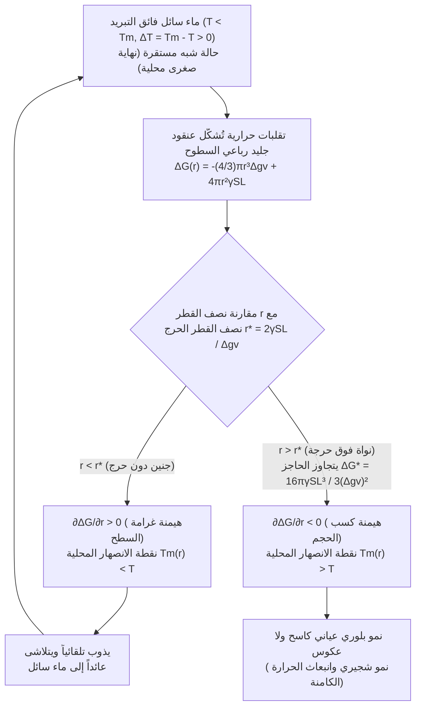
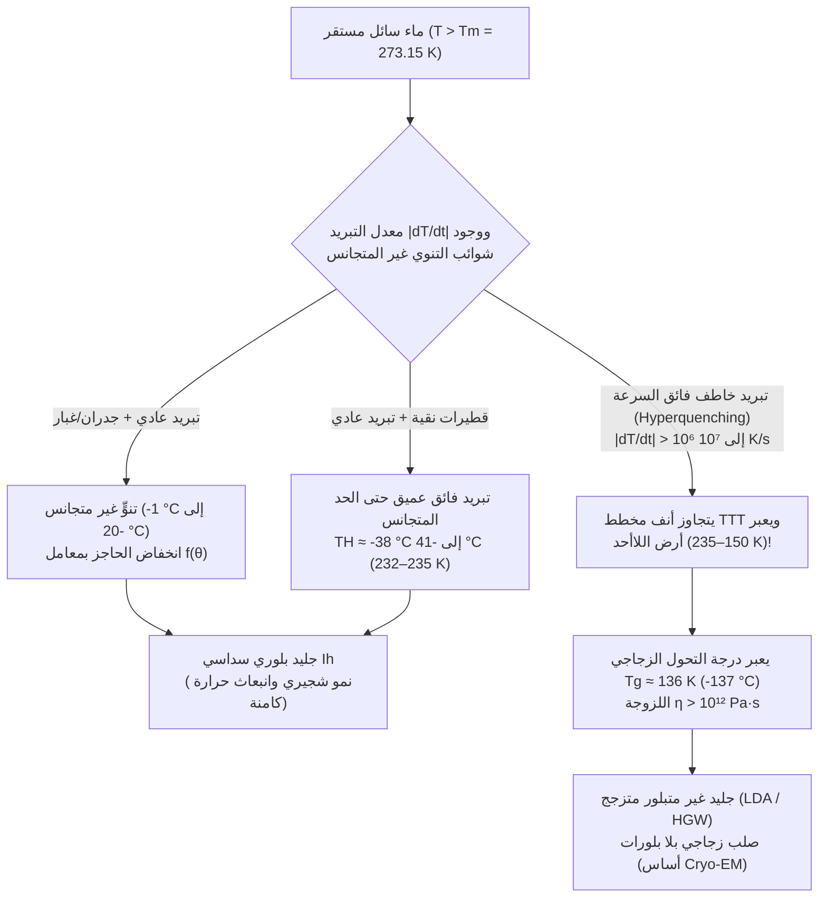

تخيَّل أنك أخرجتَ بحذر زجاجة بلاستيكية محكمة الإغلاق من الماء النقي من المجمد: يشير مقياس الحرارة بوضوح إلى $-8^\circ\text{C}$ ($265.15\,\text{K}$)، ومع ذلك يظل الماء بداخلها شفافاً وسائلاً تماماً. ولكن في اللحظة التي تطرق فيها قاع الزجاجة برفق على الطاولة — أو تصبّ الخيط المائي البارد فوق شظية صغيرة من الجليد — تنطلق شبكة بيضاء خاطفة من الإبر البلورية عبر السائل بسرعة عدة سنتيمترات في الثانية، محوِّلةً الزجاجة بأكملها إلى كتلة من الجليد الطري (Slush) في غضون ثانيتين فقط.

نتعلم في الفيزياء المدرسية أن الماء عند الضغط الجوي القياسي ($1\,\text{atm} = 101.325\,\text{kPa}$) يتجمد عند $0^\circ\text{C}$ ($273.15\,\text{K}$). غير أنه من المنظور الدقيق للديناميكا الحرارية الإحصائية وفيزياء المادة المكثفة، فإن $0^\circ\text{C}$ هي تحديداً <strong>درجة حرارة الانصهار التوازنية ($T_m$)</strong> حيث يتساوى الجهد الكيميائي للجليد السداسي العياني ($\text{I}_h$) والماء السائل ($\mu_{\text{L}}(P, T_m) = \mu_{\text{S}}(P, T_m)$)، ولكنها <strong>ليست درجة الحرارة التي يتبلور عندها الماء السائل تلقائياً</strong>.

في الواقع، عند عزل الماء فائق النقاء عن الغبار وخدوش الجدران، فإنه يظل سائلاً عند $-15^\circ\text{C}$ و$-25^\circ\text{C}$ وحتى الوصول إلى <strong>حد التنوي المتجانس ($T_H \approx -38^\circ\text{C}$ إلى $-41^\circ\text{C}$، أو $232\text{--}235\,\text{K}$)</strong> كما أثبتت تجارب حيود ليزر الإلكترونات الحرة للأشعة السينية (XFEL). فما هو الحاجز المجهري الذي يمنع الماء من التجمد فور نزوله تحت $0^\circ\text{C}$؟

---

## الفصل الأول: الديناميكا الحرارية للحالة شبه المستقرة (Metastability)

عند ثبات درجة الحرارة $T$ والضغط $P$، يخضع استقرار الأطوار لطاقة غيبس الحرة $G = H - TS$ (أو الجهد الكيميائي المولي $\mu$). وبما أن الإنتروبيا المولية للماء السائل أكبر من إنتروبيا الجليد البلوري ($s_{\text{L}} > s_{\text{S}} > 0$)، فإن العلاقة $\left(\frac{\partial \mu}{\partial T}\right)_P = -s$ تضمن أنه لكل $T < T_m$ يمتلك الجليد جهداً كيميائياً أقل ($\mu_{\text{S}}(T) < \mu_{\text{L}}(T)$) ويمثل <strong>النهاية الصغرى الشاملة (Global Minimum)</strong>.

ومع ذلك، بين $0^\circ\text{C}$ و$-38^\circ\text{C}$، يظل <strong>الماء فائق التبريد (Supercooled Water)</strong> محتجزاً في <strong>حالة شبه مستقرة (Metastable State — نهاية صغرى محلية)</strong> في مشهد الطاقة الحرة $G(\eta)$:

$$\frac{\partial G}{\partial \eta} = 0, \qquad \frac{\partial^2 G}{\partial \eta^2} > 0$$

نظراً لأن المشتقة الثانية بالنسبة لمعامل الانتظام $\eta$ موجبة تماماً، فإن أي تقلب حراري متناهي الصغر يرفع الطاقة الحرة فيتلاشى فوراً. وللهروب نحو النهاية الصغرى الشاملة للجليد، يحتاج النظام إلى تقلب موضعي ذي سعة محدودة قادر على عبور <strong>حاجز طاقة التنشيط الحرة $\Delta G^* > 0$</strong>، وهو ما يُعرف بعملية <strong>التنوي (Nucleation)</strong>. في المقابل، عند تسخين الجليد إلى $0^\circ\text{C}$، توجد على سطحه مسبقاً طبقة شبه سائلة نانومترية (Premelting Layer)، مما يلغي حاجز التنوي السطحي ويجعل الجليد ينصهر فوراً عند $0^\circ\text{C}$.

---

## الفصل الثاني: نظرية التنوي الكلاسيكية (CNT) — صراع كسب الحجم وغرامة السطح

### 2.1 الاشتقاق الرياضي الدقيق لـ $\Delta G(r)$ ونصف القطر الحرج $r^*$ والحاجز $\Delta G^*$

تُعبِّر <strong>نظرية التنوي الكلاسيكية (CNT)</strong>، التي طوّرها فولمر وفيبر وبيكر ودورينغ ووسّعها ديفيد تيرنبول وجون فيشر (1949) لتشمل انتقالات السائل إلى الصلب، عن تغير طاقة غيبس الحرة $\Delta G(r)$ عند تكوُّن جنين جليدي كروي نصف قطره $r$ داخل ماء فائق التبريد بمقدار $\Delta T \equiv T_m - T > 0$:

$$\Delta G(r) = -\frac{4}{3}\pi r^3 \Delta g_v + 4\pi r^2 \gamma_{\text{SL}}$$

حيث $\Delta g_v = \Delta H_f - T\Delta S_f \approx \frac{\Delta H_f \cdot \Delta T}{T_m}$ هي القوة الدافعة الحجمية (مع حرارة الانصهار الكامنة الحجمية $\Delta H_f \approx 3.06 \times 10^8\,\text{J/m}^3$ أو $L_f = 333.5\,\text{J/g}$)، و$\gamma_{\text{SL}} \approx 28\text{--}32\,\text{mJ/m}^2$ هو التوتر السطحي بين الجليد والماء.

عند أنصاف الأقطار الصغيرة جداً ($r \to 0$)، يهيمن حد السطح التربيعي ($\propto r^2$) على حد الحجم التكعيبي ($\propto -r^3$). وبمساواة المشتقة الأولى بالصفر $\frac{\partial \Delta G(r)}{\partial r} = -4\pi r^2 \Delta g_v + 8\pi r \gamma_{\text{SL}} = 0$، نحصل على <strong>نصف القطر الحرج للنواة ($r^*$)</strong> و<strong>حاجز الطاقة الحرة للتنوي ($\Delta G^*$)</strong>:

$$r^* = \frac{2\gamma_{\text{SL}}}{\Delta g_v} = \frac{2\gamma_{\text{SL}} T_m}{\Delta H_f \Delta T}, \qquad \Delta G^* = \Delta G(r^*) = \frac{16\pi \gamma_{\text{SL}}^3}{3(\Delta g_v)^2} = \frac{16\pi \gamma_{\text{SL}}^3 T_m^2}{3(\Delta H_f)^2 (\Delta T)^2}$$

* <strong>التجمعات دون الحرجة ($r < r^*$، «الأجنّة / Embryos»)</strong>: $\frac{\partial \Delta G}{\partial r} > 0$. بسبب تأثير غيبس-طومسون، تكون نقطة انصهارها المحلية $T_m(r) = T_m(1 - \frac{2\gamma_{\text{SL}}}{\Delta H_f r})$ أقل من درجة حرارة الماء $T$، فتذوب تلقائياً وتعود ماءً سائلاً.
* <strong>التجمعات فوق الحرجة ($r > r^*$، «النوى / Nuclei»)</strong>: $\frac{\partial \Delta G}{\partial r} < 0$. كل جزيء ماء إضافي يخفض $\Delta G$، مما يطلق نمواً بلورياً عيانياً لا رجعة فيه.

| درجة الحرارة $T$ ($^\circ\text{C}$) | التبريد الفائق $\Delta T$ ($\text{K}$) | نصف القطر الحرج $r^*$ ($\text{nm}$) | عدد الجزيئات $N^*$ | الحاجز المختزل $\Delta G^* / (k_B T)$ | معامل بولتزمان $\exp(-\Delta G^* / k_B T)$ | إمكانية التنوي المتجانس |
| :--- | :--- | :--- | :--- | :--- | :--- | :--- |
| <strong>$-1.0^\circ\text{C}$</strong> | $1.0$ | $53.6\,\text{nm}$ | $\approx 1.98 \times 10^7$ | $\approx 2.88 \times 10^6$ | $10^{-1\,250\,000}$ | مستحيل إحصائياً (صفر مطلق) |
| <strong>$-5.0^\circ\text{C}$</strong> | $5.0$ | $10.7\,\text{nm}$ | $\approx 158\,000$ | $\approx 1.17 \times 10^5$ | $10^{-50\,800}$ | مستحيل خلال عمر الكون |
| <strong>$-15.0^\circ\text{C}$</strong> | $15.0$ | $3.57\,\text{nm}$ | $\approx 5\,860$ | $\approx 1.35 \times 10^4$ | $10^{-5\,860}$ | لا يزال ممنوعاً تماماً |
| <strong>$-40.0^\circ\text{C}$</strong> ($\approx T_H$) | $40.0$ | $\approx 1.10\,\text{nm}$ | $\approx 180\text{--}250$ | $\approx 55\text{--}70$ | $\approx 10^{-25}\text{--}10^{-30}$ | <strong>تجمد تلقائي فوري خلال ثانية!</strong> |

---

## الفصل الثالث: التنوي المتجانس مقابل غير المتجانس — معامل التبلل لتيرنبول $f(\theta)$

يتجمد ماء الصنبور العادي بين $-2^\circ\text{C}$ و$-5^\circ\text{C}$ بفضل <strong>التنوي غير المتجانس (Heterogeneous Nucleation)</strong> على جدران الوعاء أو ذرات الغبار. وفي نموذج القبعة الكروية لتيرنبول، عندما يتشكل جنين الجليد بزاوية تلامس $\theta$ ($\cos\theta = \frac{\gamma_{\text{sub,L}} - \gamma_{\text{sub,S}}}{\gamma_{\text{SL}}}$ وفق معادلة يونغ)، يظل نصف قطر الانحناء الحرج $r^*$ ثابتاً، لكن حاجز الطاقة ينخفض بمقدار <strong>معامل التبلل الهندسي $f(\theta)$</strong>:

$$\Delta G_{\text{het}}^* = \Delta G_{\text{hom}}^* \cdot f(\theta), \qquad f(\theta) = \frac{(2 + \cos\theta)(1 - \cos\theta)^2}{4} \in [0, 1]$$

عند $\theta = 30^\circ$ تكون $f(30^\circ) \approx 0.013$ (ينخفض الحاجز إلى $1.3\%$)؛ وعند $\theta = 10^\circ$ تصبح $f(10^\circ) \approx 1.7 \times 10^{-4}$! ومن أبرز التطبيقات:
1. <strong>يوديد الفضة ($\beta\text{-AgI}$) في استمطار السحب</strong> (برنارد فونيغوت، 1947): ثوابت شبكته السداسية ($a = 4.580\,\text{\AA}, c = 7.494\,\text{\AA}$) تتطابق مع الجليد $\text{I}_h$ ($a = 4.518\,\text{\AA}, c = 7.356\,\text{\AA}$) بفارق لا يتجاوز $1.4\%$، مما يحفز التجمد عند $-3^\circ\text{C}$.
2. <strong>بروتينات تنوي الجليد (INPs، جين `inaZ`) في بكتيريا *Pseudomonas syringae*</strong>: ترتب جزيئات الماء على غرار شبكة الجليد وتطلق التجمد عند <strong>$-1.5^\circ\text{C}$ إلى $-2.0^\circ\text{C}$</strong> (تُستخدم في مدافع الثلج الصناعي).

---

## الفصل الرابع: التجمد الفوري بالصدمة، وتشعبات مولينز-سيكيركا، وقانون الـ 10%

عند طرق زجاجة ماء فائق التبريد عند $-8^\circ\text{C}$، تُحدث الموجة الصوتية <strong>تكهفاً صوتياً (Acoustic Cavitation)</strong>: تنهار الفقاعات المجهرية وفق معادلة رايلي-بليسيت مولِّدةً نبضات ضغط موضعية تصل إلى غيغاباسكال ($\sim\text{GPa}$) يتبعها تمدد كظوم يكسر الحاجز $\Delta G^*$ فوراً.

ومع نمو البلورة، تُطلق حرارة الانصهار الكامنة ($L_f = 333.5\,\text{J/g}$) فترتفع حرارة السطح البيني إلى $0^\circ\text{C}$. وبفعل <strong>عدم استقرار مولينز-سيكيركا الشكلي (1963)</strong>، تواجه أي نتوءات بارزة نحو الماء البارد ($-8^\circ\text{C}$) تدرجاً حرارياً $|\nabla T|$ أكثر حدة، فتبدد الحرارة أسرع وتنطلق كإبر متفرعة — <strong>بلورات شجيرية (Dendrites)</strong> — بسرعة $5\text{--}10\,\text{cm/s}$.

ولأن العملية تستغرق نحو ثانيتين فقط، فهي <strong>عملية كظومة (Adiabatic, $\Delta H_{\text{total}} = 0$)</strong>: الحرارة الكامنة المنبعثة من تجمد الكسر الكتلي $f_{\text{ice}}$ ترفع حرارة المزيج بأكمله إلى $T_m = 0^\circ\text{C}$، حيث يتوقف التجمد تماماً:

$$M \, f_{\text{ice}} \, L_f = M \, c_{p,\text{L}} \, \Delta T \quad \Longrightarrow \quad f_{\text{ice}} = \frac{c_{p,\text{L}} \Delta T}{L_f} \equiv \text{Ste} = \frac{4.21 \times 8.0}{333.5} \approx 0.101 \quad (\mathbf{10.1\%})$$

<strong>أي أن $10.1\%$ فقط من الماء يتحول فعلياً إلى جليد!</strong> وتشكل هذه النسبة شبكة شجيرية ثلاثية الأبعاد تحبس الـ $89.9\%$ المتبقية من الماء السائل عند $0^\circ\text{C}$ كالإسفنجة، مكوِّنةً ثلجاً طرياً (ولكي يتجمد $100\%$ كظوماً في لحظة واحدة، يلزم تبريد فائق قدره $\Delta T_{\text{hyp}} = L_f / c_{p,\text{L}} \approx 79.2\,\text{K}$، وهو مستحيل عند ضغط $1\,\text{atm}$).

---

## الفصل الخامس: التسخين الفائق، وفيزياء السحب، والتحول الزجاجي ($T_g$)

1. <strong>التسخين الفائق (Superheating) وغرفة الفقاعات لغليزر</strong>: في كوب أملس يُسخَّن بالميكروويف فوق $100^\circ\text{C}$، يسحق <strong>الضغط الشعري ليونغ-لابلاس $\Delta P = \frac{2\gamma_{\text{LV}}}{r}$</strong> أي فقاعة بخار أصغر من نصف القطر الحرج $r_b^* = \frac{2\gamma_{\text{LV}}}{P_{\text{V}}(T) - P_{\text{L}}} \approx \frac{2\gamma_{\text{LV}} T_b}{\rho_{\text{V}} L_v \Delta T_{\text{sh}}}$. وإضافة مسحوق القهوة أو السكر توفر مواقع تنوٍّ وتفجر غلياناً عنيفاً (<strong>Bumping</strong>). وفي عام 1952، استثمر دونالد غليزر (نوبل الفيزياء 1960) الهيدروجين السائل فائق التسخين في <strong>غرفة الفقاعات (Bubble Chamber)</strong> لتصوير مسارات الجسيمات دون الذرية.
2. <strong>عملية فيغنر-بيرجيرون-فيندايزن والبروتينات المضادة للتجمد (AFPs)</strong>: تحت $0^\circ\text{C}$ يكون ضغط البخار المشبع فوق الجليد أقل منه فوق الماء فائق التبريد ($e_s^{\text{ice}}(T) < e_s^{\text{water}}(T)$)، فتنمو بلورات الثلج على حساب تبخر القطيرات السائلة؛ وفي الطيران يؤدي اصطدام القطرات الكبيرة فائقة التبريد (SLD) بجناح الطائرة إلى تجمد الكسر $f_{\text{ice}} = c_p\Delta T/L_f$ فقط لحظة الاصطدام بينما ينساب الباقي مكوناً <strong>الجليد الشفاف الخطير (Glaze Ice)</strong>. أما الأسماك القطبية فتفرز <strong>بروتينات مضادة للتجمد (AFPs)</strong> ترتبط بسطح الجليد بمسافات فاصلة $d$، فارضةً انحناءً $r \approx d/2$ يخفض نقطة التجمد عبر تأثير غيبس-طومسون ($\Delta T_{\text{TH}} = \frac{4\gamma_{\text{SL}} T_m}{\Delta H_f d}$).
3. <strong>التزجج (Vitrification) و«أرض اللاأحد» (No-Man's Land)</strong>: في معادلة معدل التنوي $J(T) \propto \exp(-\Delta G_{\text{diff}}/k_B T)\exp(-\Delta G^*/k_B T)$، يؤدي الارتفاع الهائل للزوجة $\eta(T)$ عند درجات الحرارة المنخفضة إلى رسم «أنف» منحني على مخطط <strong>الزمن-الحرارة-التحول (TTT)</strong>.

وعند تبريد الماء بمعدل يتجاوز السرعة الحرجة $\dot{T}_c > 10^6\,\text{K/s}$ (تقنية الغمر في الإيثان السائل التي ابتكرها جاك دوبوشيه، الحائز على جائزة نوبل في الكيمياء لعام 2017 عن <strong>المجهر الإلكتروني فائق التبريد Cryo-EM</strong>)، يتفادى الماء التبلور عبر «أرض اللاأحد» ($150\text{--}235\,\text{K}$) ويتصلب تحت <strong>درجة التحول الزجاجي $T_g \approx 136\,\text{K}$ ($-137^\circ\text{C}$)</strong> على هيئة <strong>جليد غير متبلور منخفض الكثافة (LDA)</strong>.
