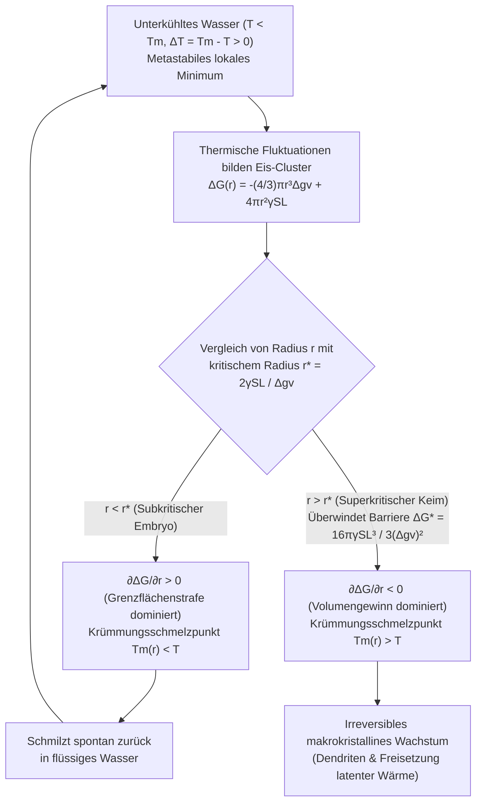
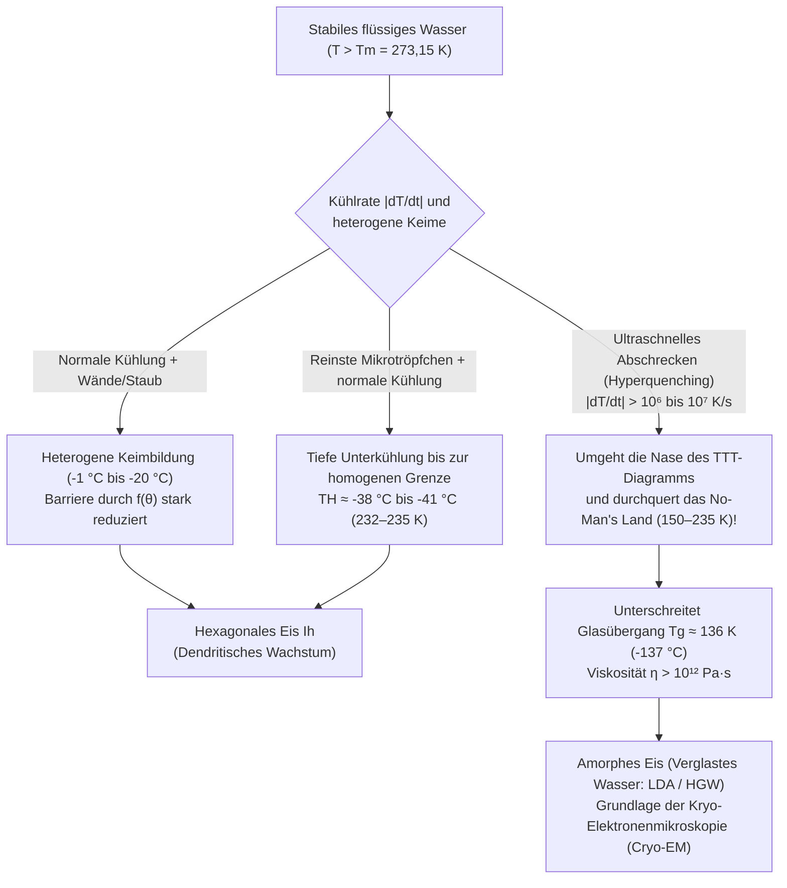

Man nehme vorsichtig eine verschlossene Kunststoffflasche mit destilliertem Wasser aus dem Gefrierschrank: Das Thermometer zeigt $-8^\circ\text{C}$ ($265{,}15\,\text{K}$), doch das Wasser in der Flasche ist vollkommen durchsichtig und flüssig. Schlägt man die Flasche nun leicht auf den Tisch oder gießt den kalten Strahl auf einen winzigen Eiskristall, schießt binnen Sekundenbruchteilen ein weißes Geflecht nadelförmiger Kristalle mit mehreren Zentimetern pro Sekunde durch die Flüssigkeit und verwandelt den gesamten Inhalt in einen opaken Eisbrei (Slush).

In der Schule lernt man, dass Wasser bei Normaldruck ($1\,\text{atm} = 101{,}325\,\text{kPa}$) bei $0^\circ\text{C}$ ($273{,}15\,\text{K}$) gefriert. Aus Sicht der statistischen Thermodynamik und der Physik der kondensierten Materie ist $0^\circ\text{C}$ jedoch streng genommen die <strong>Gleichgewichtsschmelztemperatur ($T_m$)</strong>, bei der makroskopisches hexagonales Eis ($\text{I}_h$) und flüssiges Wasser dasselbe chemische Potenzial besitzen ($\mu_{\text{L}}(P, T_m) = \mu_{\text{S}}(P, T_m)$) – <strong>nicht</strong> aber die Temperatur, bei der flüssiges Wasser spontan kristallisiert.

Tatsächlich bleibt hochreines Wasser in Abwesenheit von Staubpartikeln und Gefäßkratzern bis weit unter den Gefrierpunkt flüssig. Moderne Experimente mit Femtosekunden-Röntgen-Freie-Elektronen-Lasern (XFEL) belegen, dass die <strong>homogene Keimbildungsgrenze (Homogeneous Nucleation Limit, $T_H$)</strong> von reinem Wasser bei $1\,\text{atm}$ erst bei <strong>ca. $-38^\circ\text{C}$ bis $-41^\circ\text{C}$ ($232\text{--}235\,\text{K}$)</strong> erreicht wird. Warum verharrt Wasser fast vierzig Grad unter seinem Schmelzpunkt im flüssigen Zustand, obwohl Eis die thermodynamisch stabilere Phase ist?

---

## Kapitel 1: Thermodynamik der Metastabilität

Bei konstanter Temperatur $T$ und konstantem Druck $P$ strebt ein thermodynamisches System dem Minimum der freien Enthalpie (Gibbs-Energie) $G = H - TS$ entgegen. Da flüssiges Wasser eine höhere molare Entropie als kristallines Eis aufweist ($s_{\text{L}} > s_{\text{S}} > 0$) und $\left(\frac{\partial \mu}{\partial T}\right)_P = -s$ gilt, besitzt Eis für alle $T < T_m$ das niedrigere chemische Potenzial ($\mu_{\text{S}}(T) < \mu_{\text{L}}(T)$) und bildet das <strong>globale Minimum</strong>.

Dennoch befindet sich <strong>unterkühltes Wasser (Supercooled Water)</strong> zwischen $0^\circ\text{C}$ und $-38^\circ\text{C}$ in einem <strong>metastabilen Zustand (lokales Minimum)</strong> der freien Energielandschaft $G(\eta)$:

$$\frac{\partial G}{\partial \eta} = 0, \qquad \frac{\partial^2 G}{\partial \eta^2} > 0$$

Weil die lokale Krümmung (zweite Ableitung nach dem Ordnungsparameter $\eta$) strikt positiv ist, erhöhen infinitesimale thermische Fluktuationen die freie Energie und klingen sofort wieder ab. Um das globale Minimum des Eises zu erreichen, muss das System durch eine endliche, lokalisierte Fluktuation eine <strong>freie Energiebarriere $\Delta G^* > 0$</strong> überwinden – den Prozess der <strong>Keimbildung (Nukleation)</strong>. Beim Schmelzen von Eis ($T > T_m$) existiert hingegen bereits eine nanometerdicke quasi-flüssige Oberflächenschicht (Premelting Layer), sodass Eis ohne Energiebarriere exakt bei $0^\circ\text{C}$ schmilzt.

---

## Kapitel 2: Klassische Keimbildungstheorie (CNT) — Volumenantrieb gegen Grenzflächenstrafe

### 2.1 Herleitung von $\Delta G(r)$, $r^*$ und $\Delta G^*$

Die von Volmer, Weber, Becker und Döring begründete und von David Turnbull sowie John C. Fisher (1949) auf kondensierte Phasen übertragene <strong>Klassische Keimbildungstheorie (CNT)</strong> beschreibt die freie Energieänderung $\Delta G(r)$ bei der Bildung eines kugelförmigen Eiskeims vom Radius $r$ in unterkühltem Wasser der Unterkühlung $\Delta T \equiv T_m - T > 0$:

$$\Delta G(r) = -\frac{4}{3}\pi r^3 \Delta g_v + 4\pi r^2 \gamma_{\text{SL}}$$

Hierbei ist $\Delta g_v = \Delta H_f - T\Delta S_f \approx \frac{\Delta H_f \cdot \Delta T}{T_m}$ die volumetrische freie Energiedifferenz (mit der Schmelzenthalpie $\Delta H_f \approx 3{,}06 \times 10^8\,\text{J/m}^3$ bzw. $L_f = 333{,}5\,\text{J/g}$) und $\gamma_{\text{SL}} \approx 28\text{--}32\,\text{mJ/m}^2$ die fest-flüssige Grenzflächenspannung.

Da für kleine Radien ($r \to 0$) der quadratische Oberflächenterm ($\propto r^2$) über den kubischen Volumenterm ($\propto -r^3$) dominiert, steigt $\Delta G(r)$ zunächst bis zu einem Maximum an. Die Bedingung $\frac{\partial \Delta G(r)}{\partial r} = -4\pi r^2 \Delta g_v + 8\pi r \gamma_{\text{SL}} = 0$ liefert den <strong>kritischen Keimradius ($r^*$)</strong> und die <strong>Keimbildungsbarriere ($\Delta G^*$)</strong>:

$$r^* = \frac{2\gamma_{\text{SL}}}{\Delta g_v} = \frac{2\gamma_{\text{SL}} T_m}{\Delta H_f \Delta T}, \qquad \Delta G^* = \Delta G(r^*) = \frac{16\pi \gamma_{\text{SL}}^3}{3(\Delta g_v)^2} = \frac{16\pi \gamma_{\text{SL}}^3 T_m^2}{3(\Delta H_f)^2 (\Delta T)^2}$$

* <strong>Subkritische Cluster ($r < r^*$, „Embryonen“)</strong>: Hier gilt $\frac{\partial \Delta G}{\partial r} > 0$. Aufgrund der starken Krümmung liegt ihr effektiver Schmelzpunkt nach der Gibbs-Thomson-Gleichung $T_m(r) = T_m(1 - \frac{2\gamma_{\text{SL}}}{\Delta H_f r})$ unterhalb der Wassertemperatur $T$; sie zerfallen spontan wieder zu flüssigem Wasser.
* <strong>Superkritische Cluster ($r > r^*$, „Keime / Nuclei“)</strong>: Sobald ein Cluster $r^*$ überschreitet, gilt $\frac{\partial \Delta G}{\partial r} < 0$, und es setzt ein irreversibles, katastrophales Kristallwachstum ein.

| Temperatur $T$ ($^\circ\text{C}$) | Unterkühlung $\Delta T$ ($\text{K}$) | Kritischer Radius $r^*$ ($\text{nm}$) | Molekülanzahl im Keim $N^*$ | Reduzierte Barriere $\Delta G^* / (k_B T)$ | Boltzmann-Faktor $\exp(-\Delta G^* / k_B T)$ | Homogene Nukleation |
| :--- | :--- | :--- | :--- | :--- | :--- | :--- |
| <strong>$-1{,}0^\circ\text{C}$</strong> | $1{,}0$ | $53{,}6\,\text{nm}$ | $\approx 1{,}98 \times 10^7$ | $\approx 2{,}88 \times 10^6$ | $10^{-1.250.000}$ | Physikalisch völlig ausgeschlossen |
| <strong>$-5{,}0^\circ\text{C}$</strong> | $5{,}0$ | $10{,}7\,\text{nm}$ | $\approx 158.000$ | $\approx 1{,}17 \times 10^5$ | $10^{-50.800}$ | Unmöglich im Alter des Universums |
| <strong>$-15{,}0^\circ\text{C}$</strong> | $15{,}0$ | $3{,}57\,\text{nm}$ | $\approx 5.860$ | $\approx 1{,}35 \times 10^4$ | $10^{-5.860}$ | Homogen weiterhin unmöglich |
| <strong>$-40{,}0^\circ\text{C}$</strong> ($\approx T_H$) | $40{,}0$ | $\approx 1{,}10\,\text{nm}$ | $\approx 180\text{--}250$ | $\approx 55\text{--}70$ | $\approx 10^{-25}\text{--}10^{-30}$ | <strong>Sofortiges spontanes Gefrieren!</strong> |

---

## Kapitel 3: Homogene vs. Heterogene Keimbildung — Turnbulls Benetzungsfaktor $f(\theta)$

Dass Leitungswasser im Gefrierfach bereits bei $-2^\circ\text{C}$ bis $-5^\circ\text{C}$ gefriert, beruht auf <strong>heterogener Keimbildung</strong> an Gefäßwänden oder Schwebstoffen. Bildet der Eiskeim auf einem Substrat eine Kugelkappe mit dem Kontaktwinkel $\theta$ ($\cos\theta = \frac{\gamma_{\text{sub,L}} - \gamma_{\text{sub,S}}}{\gamma_{\text{SL}}}$ nach der Young-Gleichung), bleibt der kritische Krümmungsradius $r^*$ gleich, aber die Energiebarriere reduziert sich um den <strong>Turnbull-Faktor $f(\theta)$</strong>:

$$\Delta G_{\text{het}}^* = \Delta G_{\text{hom}}^* \cdot f(\theta), \qquad f(\theta) = \frac{(2 + \cos\theta)(1 - \cos\theta)^2}{4} \in [0, 1]$$

Für $\theta = 30^\circ$ sinkt die Barriere auf $f(30^\circ) \approx 1{,}3\%$, für $\theta = 10^\circ$ auf $1{,}7 \times 10^{-4}$! Zwei herausragende Beispiele der Epitaxie sind:
1. <strong>Silberiodid ($\beta\text{-AgI}$) zur Wolkenimpfung</strong> (Bernard Vonnegut, 1947): Die hexagonalen Gitterkonstanten von $\beta\text{-AgI}$ ($a = 4{,}580\,\text{\AA}, c = 7{,}494\,\text{\AA}$) weichen nur um $1{,}4\%$ von Eis $\text{I}_h$ ($a = 4{,}518\,\text{\AA}, c = 7{,}356\,\text{\AA}$) ab und lösen Eisbildung schon bei $-3^\circ\text{C}$ bis $-4^\circ\text{C}$ aus.
2. <strong>Eiskeimbildende Proteine (INPs, Gen `inaZ`) von *Pseudomonas syringae*</strong>: $\beta$-helikale Tandem-Repeats auf der Bakterienmembran ordnen Wassermoleküle so präzise an, dass Wasser bereits bei <strong>$-1{,}5^\circ\text{C}$ bis $-2{,}0^\circ\text{C}$</strong> gefriert (technisch genutzt in Schneekanonen).

---

## Kapitel 4: Schockgefrieren, Mullins-Sekerka-Dendriten und die 10%-Slush-Bilanz

Ein Schlag auf eine unterkühlte Wasserflasche bei $-8^\circ\text{C}$ erzeugt akustische Druckwellen. Durch <strong>akustische Kavitation</strong> dehnen sich Mikrobläschen in der Zugphase aus und kollabieren in der Druckphase nach der Rayleigh-Plesset-Gleichung unter Erzeugung lokaler Gigapascal-Druckspitzen ($\sim\text{GPa}$) und adiabatischer Entspannungskühlung, was die Barriere $\Delta G^*$ augenblicklich durchbricht.

Beim anschließenden Kristallwachstum wird an der Grenzfläche Schmelzwärme ($L_f = 333{,}5\,\text{J/g}$) frei, die die Grenzfläche auf $0^\circ\text{C}$ erwärmt. Nach der <strong>Mullins-Sekerka-Instabilität (1963)</strong> erfahren vorstehende Spitzen im $-8^\circ\text{C}$ kalten Wasser einen steileren Temperaturgradienten $|\nabla T|$, geben Wärme schneller ab und schießen als verzweigte <strong>Dendriten</strong> mit $5\text{--}10\,\text{cm/s}$ durch die Flasche.

Da dieser Prozess in $\sim 2\,\text{s}$ nahezu <strong>adiabatisch ($\Delta H_{\text{total}} = 0$)</strong> abläuft, erwärmt die freiwerdende latente Wärme das Gemisch exakt bis auf $T_m = 0^\circ\text{C}$, woraufhin das Gefrieren sofort stoppt. Der gefrierende Massenanteil $f_{\text{ice}}$ (die <strong>Stefan-Zahl $\text{Ste}$</strong>) beträgt bei $\Delta T = 8{,}0\,\text{K}$ und $c_{p,\text{L}} \approx 4{,}21\,\text{J/(g}\cdot\text{K)}$:

$$M \, f_{\text{ice}} \, L_f = M \, c_{p,\text{L}} \, \Delta T \quad \Longrightarrow \quad f_{\text{ice}} = \frac{c_{p,\text{L}} \Delta T}{L_f} = \frac{4{,}21 \times 8{,}0}{333{,}5} \approx 0{,}101 \quad (\mathbf{10{,}1\%})$$

Es gefrieren also <strong>nur rund $10{,}1\%$ des Wassers zu Eis</strong>, die als dreidimensionales dendritisches Netzwerk die verbleibenden $89{,}9\%$ flüssiges Wasser bei $0^\circ\text{C}$ wie ein Schwamm einschließen! (Für eine $100\%$-ige adiabatische Durchfrierung wäre die Hyperkühlungsgrenze $\Delta T_{\text{hyp}} = L_f / c_{p,\text{L}} \approx 79{,}2\,\text{K}$ nötig, was unterhalb von $T_H \approx -38^\circ\text{C}$ liegt.)

---

## Kapitel 5: Überhitzung (Siedeverzug), Wolkenphysik und Glasübergang ($T_g$)

1. <strong>Überhitzung (Superheating) und Glasers Blasenkammer</strong>: In glatten Gefäßen im Mikrowellenherd kann Wasser weit über $100^\circ\text{C}$ erhitzt werden, da der <strong>Young-Laplace-Kapillardruck $\Delta P = \frac{2\gamma_{\text{LV}}}{r}$</strong> winzige Dampfblasen unterhalb des kritischen Radius $r_b^* = \frac{2\gamma_{\text{LV}}}{P_{\text{V}}(T) - P_{\text{L}}} \approx \frac{2\gamma_{\text{LV}} T_b}{\rho_{\text{V}} L_v \Delta T_{\text{sh}}}$ sofort zerquetscht. Das Einbringen von Kaffeepulver führt zum explosiven <strong>Siedeverzug (Bumping)</strong>. Donald Glaser nutzte 1952 überhitzten flüssigen Wasserstoff in der <strong>Blasenkammer</strong> (Nobelpreis 1960), in der ionisierende Elementarteilchen lokale Dampfblasenketten entlang ihrer Flugbahn auslösen.
2. <strong>Wegener-Bergeron-Findeisen-Prozess und Antifreeze-Proteine (AFPs)</strong>: Da der Sättigungsdampfdruck über Eis unter $0^\circ\text{C}$ stets kleiner ist als über unterkühltem Wasser ($e_s^{\text{ice}}(T) < e_s^{\text{water}}(T)$), wachsen Eiskristalle in Mischphasenwolken auf Kosten verdunstender unterkühlter Tröpfchen; beim Aufprall großer unterkühlter Tropfen (SLD) auf Flugzeugtragflächen gefriert nur der Bruchteil $f_{\text{ice}} = c_p\Delta T/L_f$ sofort, während der Rest als gefährliches <strong>Klareis (Glaze Ice)</strong> nach hinten fließt. Polare Fische schützen sich durch <strong>Antifreeze-Glykoproteine (AFGPs)</strong>, die sich im Abstand $d$ an Eiskristalle heften und über den Gibbs-Thomson-Krümmungseffekt ($\Delta T_{\text{TH}} = \frac{4\gamma_{\text{SL}} T_m}{\Delta H_f d}$) das Eiswachstum blockieren.
3. <strong>Verglasung (Vitrifikation) und „No-Man's Land“</strong>: Die Keimbildungsrate $J(T) \propto \exp(-\Delta G_{\text{diff}}/k_B T)\exp(-\Delta G^*/k_B T)$ bildet im <strong>Zeit-Temperatur-Umwandlungs-Diagramm (ZTU / TTT)</strong> eine charakteristische „Nase“, da bei tiefen Temperaturen die Viskosität $\eta(T)$ nach dem Vogel-Fulcher-Tammann-Gesetz divergiert.

Mit extremen Kühlraten $\dot{T}_c > 10^6\,\text{K/s}$ lässt sich das „No-Man's Land“ ($150\text{--}235\,\text{K}$) überwinden, sodass Wasser unterhalb der <strong>Glasübergangstemperatur $T_g \approx 136\,\text{K}$ ($-137^\circ\text{C}$)</strong> ohne jede Kristallbildung zu <strong>amorphem Eis (LDA)</strong> erstarrt – die von Jacques Dubochet entwickelte Grundlage der <strong>Kryo-Elektronenmikroskopie (Cryo-EM, Chemie-Nobelpreis 2017)</strong>.
