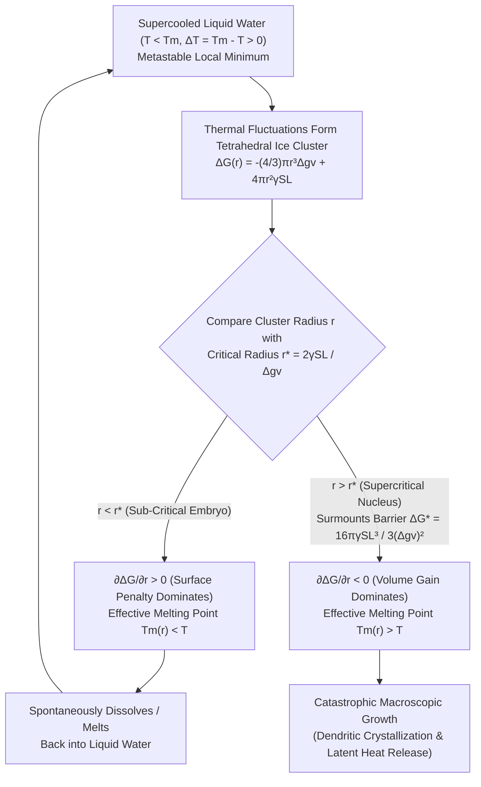
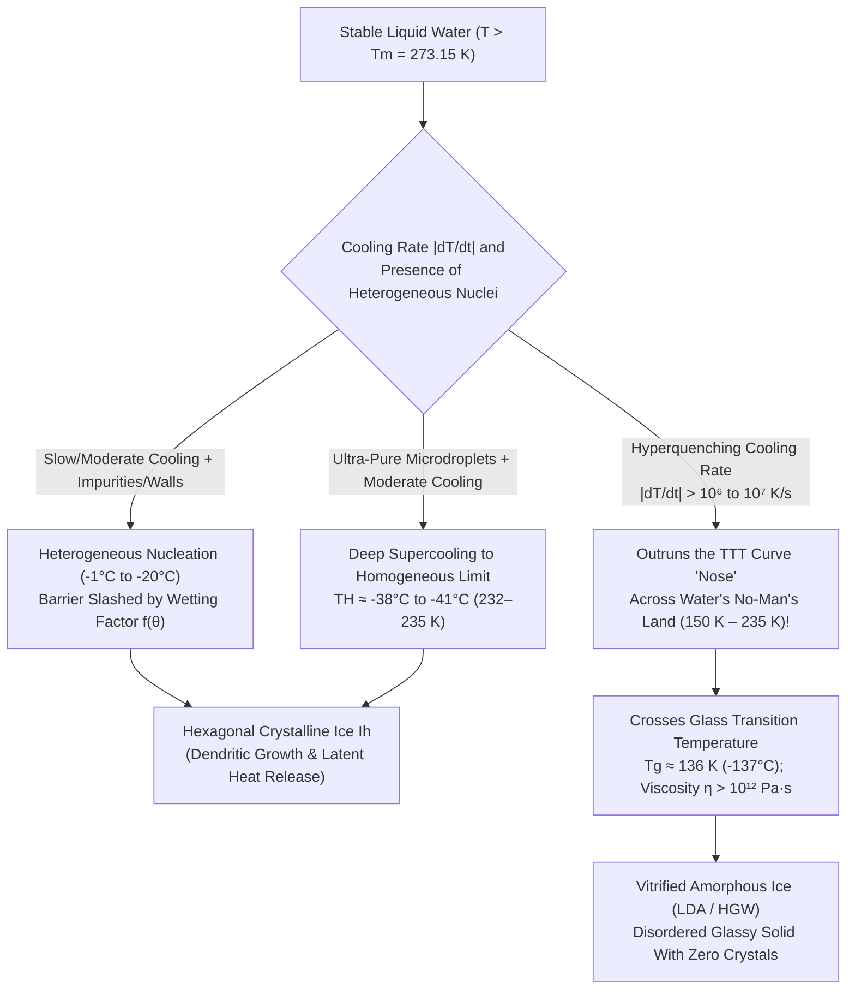

Imagine carefully removing a sealed plastic bottle of purified water from a freezer. A calibrated thermometer reads $-8^\circ\text{C}$ ($265.15\,\text{K}$), well below the textbook freezing point, yet the contents remain completely transparent, fluid liquid water. Then, in a fraction of a second, you tap the bottom of the bottle sharply against a table—or pour the cold stream onto a single shard of ice. Instantly, a blinding white web of needle-like crystals shoots through the liquid at several centimeters per second, transforming the entire bottle into an opaque, slushy mass before your eyes.

In elementary science, we are taught a deceptively simple rule: at standard atmospheric pressure ($1\,\text{atm} = 101.325\,\text{kPa}$), water freezes at $0^\circ\text{C}$ ($273.15\,\text{K}$) and boils at $100^\circ\text{C}$ ($373.15\,\text{K}$). From the standpoint of rigorous statistical mechanics and condensed matter physics, however, this statement is fundamentally incomplete. Strictly speaking, $0^\circ\text{C}$ is the <strong>equilibrium melting temperature ($T_m$)</strong>—the exact thermodynamic boundary where macroscopic hexagonal ice ($\text{I}_h$) and bulk liquid water share identical chemical potentials ($\mu_{\text{liquid}} = \mu_{\text{solid}}$) and can coexist indefinitely. It is <strong>not</strong> the temperature at which liquid water automatically or spontaneously crystallizes.

In fact, if ultra-pure water is isolated from dust, foreign surfaces, and container scratches—for example, levitated as micrometer-sized droplets in a clean chamber or injected into a vacuum—it passes right through $0^\circ\text{C}$ without freezing. It remains liquid at $-10^\circ\text{C}$, at $-20^\circ\text{C}$, and even at $-35^\circ\text{C}$. Modern femtosecond X-ray Free-Electron Laser (XFEL) diffraction experiments have confirmed that at $1\,\text{atm}$, pure bulk liquid water does not undergo spontaneous, intrinsic freezing until it reaches the <strong>Homogeneous Nucleation Limit ($T_H \approx -38^\circ\text{C}$ to $-41^\circ\text{C}$, or $232\text{--}235\,\text{K}$)</strong>, with evaporative microdroplets surviving briefly down to $-42.55^\circ\text{C}$ ($230.6\,\text{K}$).

Why does liquid water stubbornly resist freezing across an nearly forty-degree span below $0^\circ\text{C}$, even though the crystalline solid phase has a strictly lower bulk Gibbs free energy? What microscopic barrier stands in the way of the very first ice crystal? Why do silver iodide crystals and plant-pathogenic bacteria shatter that barrier at $-2^\circ\text{C}$? And when a mechanical shock finally triggers crystallization in a bottle at $-8^\circ\text{C}$, why does thermodynamics forbid the bottle from freezing into $100\%$ solid ice, forcing it instead to form an exact, predictable fraction of slush at $0.0^\circ\text{C}$?

In this comprehensive treatise, we will build the physics of phase transitions from the ground up: starting from the statistical thermodynamics of <strong>metastable states</strong>, deriving the exact equations of <strong>Classical Nucleation Theory (CNT)</strong> for the <strong>critical nucleus radius ($r^*$)</strong> and <strong>free energy activation barrier ($\Delta G^*$)</strong>, analyzing <strong>heterogeneous nucleation and Turnbull's wetting factor $f(\theta)$</strong>, dissecting <strong>acoustic cavitation and Mullins-Sekerka dendritic growth</strong>, exploring the mirror phenomenon of <strong>superheating, bumping, and Donald Glaser's bubble chamber</strong>, and culminating in <strong>atmospheric cloud microphysics, biological antifreeze proteins, and vitrification across water's enigmatic "No-Man's Land."</strong>

---

## Chapter 1: Demystifying $0^\circ\text{C}$ and the Thermodynamics of Metastability

### 1.1 Fahrenheit's 1724 Discovery and Chemical Potential Crossing

The scientific study of <strong>supercooling</strong> (also termed <strong>undercooling</strong>) began in 1724 with Daniel Gabriel Fahrenheit, the pioneer of precision thermometry. Having sealed boiled water inside a glass bulb to exclude air, Fahrenheit left the vessel outdoors in sub-freezing weather. To his astonishment, the water remained entirely fluid well below $32^\circ\text{F}$ ($0^\circ\text{C}$). Only when he snapped off the glass tip—introducing a mechanical disturbance—did radiant spicules of ice dart instantaneously through the bulb, while a thermometer immersed in the slush jumped immediately back up to $32^\circ\text{F}$.

To understand why a liquid can persist below its freezing point, we must examine the thermodynamic potential that governs systems at constant temperature $T$ and pressure $P$: the <strong>Gibbs free energy</strong>,

$$G(P, T) = H - TS = U + PV - TS$$

where $H = U + PV$ is the enthalpy, $U$ is the internal energy, and $S$ is the entropy. Per mole (or per molecule), the Gibbs free energy is the <strong>chemical potential $\mu(P, T)$</strong>. From the fundamental thermodynamic relation $d\mu = -s\,dT + v\,dP$, the slope of the chemical potential with respect to temperature at constant pressure is the negative molar entropy:

$$\left(\frac{\partial \mu}{\partial T}\right)_P = -s < 0$$

Because molecules in liquid water (subscript $\text{L}$) possess far greater translational, rotational, and configurational freedom than molecules locked into the periodic tetrahedral lattice of hexagonal ice $\text{I}_h$ (subscript $\text{S}$), the molar entropy of liquid water is strictly greater than that of ice: $s_{\text{L}} > s_{\text{S}} > 0$. Consequently, on a plot of $\mu$ versus $T$, the liquid curve $\mu_{\text{L}}(T)$ descends more steeply with increasing temperature than the solid curve $\mu_{\text{S}}(T)$.

The unique temperature where these two curves intersect is the <strong>equilibrium melting point $T_m = 273.15\,\text{K}$ ($0^\circ\text{C}$ at $1\,\text{atm}$)</strong>:

* For $T > T_m$: $\mu_{\text{L}}(T) < \mu_{\text{S}}(T)$, so liquid water is the globally stable equilibrium phase.
* At $T = T_m$: $\mu_{\text{L}}(T_m) = \mu_{\text{S}}(T_m)$, so macroscopic ice and macroscopic liquid water coexist in neutral thermodynamic equilibrium.
* For $T < T_m$: $\mu_{\text{S}}(T) < \mu_{\text{L}}(T)$, so crystalline ice has the lower bulk chemical potential and is the true <strong>global thermodynamic minimum</strong>.

Why, then, does bulk chemical potential alone fail to dictate immediate freezing as soon as $T$ drops below $T_m$? Because $\mu_{\text{S}}(T)$ and $\mu_{\text{L}}(T)$ describe <em>infinite, homogeneous bulk phases</em>, completely ignoring the microscopic pathway required to create a new phase inside an existing one.

### 1.2 Stable, Metastable, and Spinodal Regimes

In statistical physics, states of matter are classified by the local curvature of the free energy landscape $G(\eta)$ with respect to a collective order parameter $\eta$ (such as local tetrahedral crystallinity or density):

1. <strong>Thermodynamically Stable Equilibrium (Global Minimum)</strong>: The system resides in the deepest valley of $G(\eta)$, satisfying $\frac{\partial G}{\partial \eta} = 0$ and $\frac{\partial^2 G}{\partial \eta^2} > 0$, with no lower free-energy state available anywhere in configuration space. Below $0^\circ\text{C}$, hexagonal ice $\text{I}_h$ occupies this global minimum.
2. <strong>Metastable State (Local Minimum)</strong>: The system is trapped in a shallow basin of attraction that lies higher in energy than the global minimum, yet is locally concave upward:
   $$\frac{\partial G}{\partial \eta} = 0 \quad \text{and} \quad \frac{\partial^2 G}{\partial \eta^2} > 0$$
   Because the second derivative (stiffness/susceptibility inverse) is strictly positive, any <em>infinitesimal</em> thermal fluctuation $\delta\eta$ raises the total free energy ($\delta G = \frac{1}{2}\frac{\partial^2 G}{\partial \eta^2}(\delta\eta)^2 > 0$). Thermodynamic restoring forces immediately damp out small perturbations and pull the system back to the metastable basin! To escape a metastable state and reach the global minimum, the system must undergo a rare, <strong>localized, finite-amplitude fluctuation</strong> large enough to surmount a free energy activation barrier $\Delta G^* > 0$. This barrier-crossing process is <strong>nucleation</strong>, and supercooled water between $0^\circ\text{C}$ and $-38^\circ\text{C}$ is the quintessential example of a metastable liquid.
3. <strong>Thermodynamically Unstable State (Spinodal Region)</strong>: The system sits on a downward-curving ridge where the local curvature is negative:
   $$\frac{\partial^2 G}{\partial \eta^2} < 0$$
   Here the activation barrier vanishes ($\Delta G^* = 0$). Even an infinitesimal, long-wavelength thermal fluctuation lowers the free energy and grows exponentially without bound—a barrierless phase separation known as <strong>spinodal decomposition</strong>. The locus of points where $\frac{\partial^2 G}{\partial \eta^2} = 0$ defines the <strong>spinodal line</strong>, the absolute thermodynamic limit of metastability.

Notice the profound asymmetry between melting and freezing. When a crystal of ice is warmed up to $0^\circ\text{C}$, its outer surface in contact with air already possesses a disordered, nanometer-thick <strong>quasi-liquid premelting layer</strong> (first proposed by Michael Faraday in 1850), which acts as a pre-existing liquid nucleus with zero interfacial activation barrier. Hence, ice begins melting immediately at $0.0^\circ\text{C}$ without superheating (unless heated internally by lasers while keeping its surface cold). Conversely, when cooling liquid water below $0^\circ\text{C}$, no pre-existing crystalline template exists inside the disordered liquid. To freeze, water must forge a brand-new solid-liquid interface from scratch—and paying the energy tax for that interface is what locks water into metastability.

---

## Chapter 2: Classical Nucleation Theory (CNT) — The Battle Between Volume Gain and Surface Penalty

### 2.1 Formulating the Gibbs Free Energy of an Ice Embryo $\Delta G(r)$

The quantitative framework that explains how a metastable phase decays via thermal fluctuations is <strong>Classical Nucleation Theory (CNT)</strong>. Pioneered for vapor condensation by Max Volmer and Adolf Weber (1926), Leo Farkas (1927), and Richard Becker and Werner Döring (1935), and extended to condensed liquid-to-crystal phase transitions by David Turnbull and John C. Fisher (1949), CNT models the birth of a crystal as a microscopic tug-of-war between <strong>volumetric stabilization</strong> and <strong>interfacial destabilization</strong>.

Consider bulk liquid water held at constant pressure $P = 1\,\text{atm}$ and temperature $T < T_m$, corresponding to a positive <strong>undercooling (degree of supercooling) $\Delta T \equiv T_m - T > 0$</strong>. Suppose that random thermal motion transiently arranges a small group of water molecules into a spherical crystalline cluster of ice (an <strong>embryo</strong>) of radius $r$. Under the <em>capillarity approximation</em> (which treats the embryo as having bulk ice properties inside radius $r$ and a sharp boundary characterized by macroscopic interfacial tension $\gamma_{\text{SL}}$), the change in Gibbs free energy $\Delta G(r)$ required to form this sphere is:

$$\Delta G(r) = -\frac{4}{3}\pi r^3 \Delta g_v + 4\pi r^2 \gamma_{\text{SL}}$$

Let us examine both competing terms in rigorous physical detail.

#### (1) The Volumetric Free Energy Driving Force $\Delta g_v$
In the first term, $\frac{4}{3}\pi r^3$ is the volume of the spherical ice cluster, and $\Delta g_v \equiv g_{\text{L}}(T) - g_{\text{S}}(T) > 0$ is the difference in Gibbs free energy per unit volume between supercooled liquid water and crystalline ice at temperature $T$.
Let $\Delta H_f > 0$ denote the volumetric latent heat (enthalpy) of fusion (for ice $\text{I}_h$, $\Delta H_f = \rho_{\text{ice}} L_f \approx 917\,\text{kg/m}^3 \times 3.335 \times 10^5\,\text{J/kg} \approx 3.06 \times 10^8\,\text{J/m}^3$, or $6.01\,\text{kJ/mol}$), and let $\Delta S_f > 0$ denote the volumetric entropy of fusion.

At the equilibrium melting temperature $T = T_m$, the volumetric free energy difference vanishes:

$$\Delta g_v(T_m) = \Delta H_f - T_m \Delta S_f = 0 \quad \Longrightarrow \quad \Delta S_f = \frac{\Delta H_f}{T_m}$$

For temperatures $T < T_m$, expanding $\Delta g_v(T) = \Delta H_f(T) - T\Delta S_f(T)$ to leading order in $\Delta T = T_m - T$ (the Turnbull approximation, which treats $\Delta H_f$ and $\Delta S_f$ as approximately constant over moderate undercoolings by neglecting the heat capacity difference $\Delta c_p = c_{p,\text{L}} - c_{p,\text{S}}$) yields:

$$\Delta g_v(T) \approx \Delta H_f - T\left(\frac{\Delta H_f}{T_m}\right) = \frac{\Delta H_f (T_m - T)}{T_m} = \frac{\Delta H_f \cdot \Delta T}{T_m}$$

*(Note: For deep supercooling approaching $-40^\circ\text{C}$, the anomalously rising heat capacity $c_{p,\text{L}}(T)$ of supercooled water reduces the entropy difference according to $\Delta g_v(T) = \frac{\Delta H_f \Delta T}{T_m} - \int_T^{T_m} \Delta c_p(T')\,dT' + T\int_T^{T_m} \frac{\Delta c_p(T')}{T'}\,dT'$, often approximated by Hoffman's formula $\Delta g_v \approx \frac{\Delta H_f \Delta T}{T_m}\frac{T}{T_m}$.)*

Crucially, because $\Delta T > 0$ below $0^\circ\text{C}$, the volumetric term $-\frac{4}{3}\pi r^3 \Delta g_v$ is <strong>negative</strong>: every water molecule that joins the interior of the ice lattice lowers the system's Gibbs free energy, and this thermodynamic reward grows directly proportional to the undercooling $\Delta T$.

#### (2) The Solid-Liquid Interfacial Free Energy Penalty $\gamma_{\text{SL}}$
In the second term, $4\pi r^2$ is the surface area of the spherical embryo, and $\gamma_{\text{SL}} > 0$ is the <strong>solid-liquid interfacial free energy (interfacial tension)</strong> per unit area, which for the ice-water interface has a measured value of approximately $\gamma_{\text{SL}} \approx 28\text{--}32\,\text{mJ/m}^2$ ($0.028\text{--}0.032\,\text{J/m}^2$) near $0^\circ\text{C}$ (gradually decreasing to $\sim 22\text{--}24\,\text{mJ/m}^2$ near $-40^\circ\text{C}$).

Physically, why does $\gamma_{\text{SL}} > 0$ exist? Inside bulk ice, water molecules achieve low enthalpy by forming four optimal, linear hydrogen bonds in a rigid tetrahedral lattice. Inside bulk liquid water, molecules sacrifice some bond enthalpy in exchange for high translational and orientational entropy. At the <strong>solid-liquid interface</strong>, however, water molecules suffer the worst of both worlds: the adjacent crystal lattice forces interfacial liquid molecules into partially ordered orientations—stripping them of configurational entropy (an effect quantified by Turnbull's empirical rule $\gamma_{\text{SL}} \approx \alpha \frac{\Delta H_f}{N_A^{1/3} V_m^{2/3}}$ with $\alpha \approx 0.32$ for water)—without granting them the full enthalpic stabilization of a complete crystalline environment. Thus, creating surface area $4\pi r^2$ always inflicts a <strong>positive free energy penalty</strong>.

### 2.2 Deriving the Critical Nucleus Radius ($r^*$) and Activation Barrier ($\Delta G^*$)

Look closely at the functional dependence of $\Delta G(r)$ on the cluster radius $r$:

$$\Delta G(r) = -\underbrace{\frac{4}{3}\pi r^3 \left(\frac{\Delta H_f \Delta T}{T_m}\right)}_{\text{Volume Gain }\propto\, -r^3} + \underbrace{4\pi r^2 \gamma_{\text{SL}}}_{\text{Surface Penalty }\propto\, +r^2}$$

Here lies one of the most consequential geometric competitions in all of physics: <strong>the scaling war between an area ($r^2$) and a volume ($r^3$)</strong>.
When a cluster is newly formed and its radius $r$ is tiny ($r \to 0$), the quadratic surface penalty $r^2$ completely dominates the cubic volume gain $r^3$ (just as $0.01^2 = 10^{-4} \gg 0.01^3 = 10^{-6}$). Therefore, for small $r$, $\Delta G(r)$ rises sharply as $r$ increases! Only when $r$ becomes large enough does the negative $-r^3$ term overtake the $+r^2$ term and bend the curve downward toward $-\infty$.

To find the exact peak of this energy mountain—the saddle point separating transient fluctuations from macroscopic phase change—we differentiate $\Delta G(r)$ with respect to $r$ and set the derivative to zero:

$$\frac{\partial \Delta G(r)}{\partial r} = -4\pi r^2 \Delta g_v + 8\pi r \gamma_{\text{SL}} = 4\pi r \left( -r\Delta g_v + 2\gamma_{\text{SL}} \right) = 0$$

Solving for the non-trivial extremum ($r > 0$) yields the <strong>Critical Nucleus Radius ($r^*$)</strong>:

$$r^* = \frac{2\gamma_{\text{SL}}}{\Delta g_v} = \frac{2\gamma_{\text{SL}} T_m}{\Delta H_f \Delta T}$$

Notice further that at $r = r^*$, the second derivative is strictly negative:

$$\left.\frac{\partial^2 \Delta G(r)}{\partial r^2}\right|_{r=r^*} = -8\pi r^* \Delta g_v + 8\pi \gamma_{\text{SL}} = -8\pi \gamma_{\text{SL}} < 0$$

confirming that $r^*$ is an <strong>unstable maximum (a thermodynamic watershed)</strong>.
Substituting $r = r^*$ back into $\Delta G(r)$ yields the height of the peak—the <strong>Free Energy Nucleation Barrier ($\Delta G^*$)</strong>:

$$\begin{aligned}
\Delta G^* \equiv \Delta G(r^*) &= -\frac{4}{3}\pi \left(\frac{2\gamma_{\text{SL}}}{\Delta g_v}\right)^3 \Delta g_v + 4\pi \left(\frac{2\gamma_{\text{SL}}}{\Delta g_v}\right)^2 \gamma_{\text{SL}} \\
&= -\frac{32\pi \gamma_{\text{SL}}^3}{3(\Delta g_v)^2} + \frac{48\pi \gamma_{\text{SL}}^3}{3(\Delta g_v)^2} \\
&= \frac{16\pi \gamma_{\text{SL}}^3}{3(\Delta g_v)^2} = \frac{16\pi \gamma_{\text{SL}}^3 T_m^2}{3 (\Delta H_f)^2 (\Delta T)^2}
\end{aligned}$$

Notice also the celebrated Gibbs identity relating the barrier height $\Delta G^*$ to the total interfacial energy $A^* \gamma_{\text{SL}} = 4\pi (r^*)^2 \gamma_{\text{SL}}$ of the critical nucleus:

$$\Delta G^* = \frac{1}{3}\left(4\pi (r^*)^2 \gamma_{\text{SL}}\right) = \frac{1}{2} V^* \Delta g_v$$

At the critical radius, the volumetric energy gain covers exactly two-thirds of the surface energy cost, leaving the remaining one-third of the surface energy to be supplied by thermal fluctuations!

### 2.3 Physical Fate of Sub-Critical Embryos ($r < r^*$) vs. Supercritical Nuclei ($r > r^*$)

The critical radius $r^*$ partitions the population of microscopic ice clusters into two diametrically opposed destinies:

* <strong>Sub-Critical Clusters ($r < r^*$, "Embryos")</strong>:
  For any cluster smaller than $r^*$, the slope of the free energy curve is positive: $\frac{\partial \Delta G}{\partial r} > 0$. Geometrically, the incremental surface-to-volume ratio $\frac{dA}{dV} = \frac{8\pi r\,dr}{4\pi r^2\,dr} = \frac{2}{r}$ is greater than $\frac{2}{r^*}$. Consequently, attaching one more water molecule to an embryo <em>increases</em> the total Gibbs free energy of the system, whereas detaching a molecule lowers $\Delta G$. Thus, <strong>sub-critical embryos are thermodynamically unstable against growth and spontaneously dissolve back into liquid water</strong>! Throughout a glass of supercooled water at $-5^\circ\text{C}$, billions of fleeting tetrahedral ice embryos flicker into existence every picosecond via thermal fluctuations, only to be ruthlessly melted back down the $\Delta G(r)$ slope because they cannot reach $r^*$.
* <strong>The Critical Cluster ($r = r^*$) and the Gibbs-Thomson Effect</strong>:
  Exactly at $r = r^*$, $\frac{\partial \Delta G}{\partial r} = 0$. Rearranging the formula for $r^*$ gives the <strong>Gibbs-Thomson Equation</strong> for the melting point depression of a curved crystal of radius $r$:
  $$T_m(r) = T_m^\infty \left( 1 - \frac{2\gamma_{\text{SL}}}{\Delta H_f r} \right)$$
  Because a strongly curved solid sphere of radius $r$ has a high fraction of frustrated surface molecules, its equilibrium melting temperature $T_m(r)$ is depressed below the flat-interface bulk melting point $T_m^\infty = 273.15\,\text{K}$. A sub-critical embryo ($r < r^*$) has an effective melting point $T_m(r) < T$, so to the surrounding water at temperature $T$, the embryo is literally <em>too warm to stay frozen</em> and melts! Only when a cluster exceeds $r^*$ does its size-dependent melting point $T_m(r)$ rise above the ambient water temperature $T$, allowing it to freeze.
* <strong>Supercritical Clusters ($r > r^*$, "Nuclei")</strong>:
  Once a rare thermal fluctuation pushes a cluster past the summit $r > r^*$, the derivative turns negative: $\frac{\partial \Delta G}{\partial r} < 0$. Now the volume term dominates: every additional water molecule captured by the lattice lowers $\Delta G$ further, releasing free energy and accelerating growth in an irreversible, catastrophic avalanche that transforms the macroscopic liquid!

### 2.4 Quantitative Scaling: Why Homogeneous Nucleation Is Impossible at $-5^\circ\text{C}$

Let us evaluate the exact numbers predicted by CNT for water ($T_m = 273.15\,\text{K}$, $\Delta H_f = 3.06 \times 10^8\,\text{J/m}^3$, $\gamma_{\text{SL}} \approx 0.030\,\text{J/m}^2$ near $0^\circ\text{C}$ tapering to $\sim 0.0235\,\text{J/m}^2$ at $-40^\circ\text{C}$, and molecular volume in ice $v_m \approx 3.26 \times 10^{-29}\,\text{m}^3$, so the number of molecules in the critical sphere is $N^* = \frac{4\pi (r^*)^3}{3 v_m}$):

| Temperature $T$ ($^\circ\text{C}$) | Undercooling $\Delta T$ ($\text{K}$) | Driving Force $\Delta g_v$ ($\text{MJ/m}^3$) | Critical Radius $r^*$ ($\text{nm}$) | Molecules in Critical Nucleus $N^*$ | Reduced Barrier $\Delta G^* / (k_B T)$ | Boltzmann Factor $\exp(-\Delta G^* / k_B T)$ | Homogeneous Nucleation Feasibility |
| :--- | :--- | :--- | :--- | :--- | :--- | :--- | :--- |
| <strong>$-0.1^\circ\text{C}$</strong> | $0.1$ | $0.112$ | $536\,\text{nm}$ | $\approx 1.98 \times 10^{10}$ | $\approx 2.87 \times 10^8$ | $10^{-124,000,000}$ | Utterly impossible across eternity |
| <strong>$-1.0^\circ\text{C}$</strong> | $1.0$ | $1.12$ | $53.6\,\text{nm}$ | $\approx 1.98 \times 10^7$ | $\approx 2.88 \times 10^6$ | $10^{-1,250,000}$ | Zero probability in observable universe |
| <strong>$-5.0^\circ\text{C}$</strong> | $5.0$ | $5.60$ | $10.7\,\text{nm}$ | $\approx 158,000$ | $\approx 1.17 \times 10^5$ | $10^{-50,800}$ | Strictly impossible homogeneously |
| <strong>$-15.0^\circ\text{C}$</strong> | $15.0$ | $16.8$ | $3.57\,\text{nm}$ | $\approx 5,860$ | $\approx 1.35 \times 10^4$ | $10^{-5,860}$ | Still completely prohibited |
| <strong>$-30.0^\circ\text{C}$</strong> | $30.0$ | $33.6$ | $1.79\,\text{nm}$ | $\approx 730$ | $\approx 3.58 \times 10^3$ | $10^{-1,550}$ | Waiting time exceeds age of universe |
| <strong>$-40.0^\circ\text{C}$</strong> ($\approx T_H$) | $40.0$ | $44.8$ | $\approx 1.10\,\text{nm}$ | $\approx 170\text{--}240$ | $\approx 55\text{--}70$ | $\approx 10^{-25}\text{--}10^{-30}$ | <strong>Instantaneous spontaneous freezing!</strong> |

Notice the ferocious inverse power-law scaling:
* The critical radius scales as $r^* \propto (\Delta T)^{-1}$.
* The free energy barrier scales as $\Delta G^* \propto (\Delta T)^{-2}$.
* The number of water molecules required to assemble a critical nucleus scales as $N^* \propto (\Delta T)^{-3}$.

In the Becker-Döring / Turnbull-Fisher kinetic theory, the steady-state homogeneous nucleation rate $J_{\text{hom}}(T)$ (the number of supercritical nuclei formed per unit volume per unit time, $\text{m}^{-3}\text{s}^{-1}$) is given by:

$$J_{\text{hom}}(T) = n_{\text{L}} \, Z \, \left(\frac{k_B T}{h}\right) \exp\left(-\frac{\Delta G_{\text{diff}}(T)}{k_B T}\right) \exp\left(-\frac{\Delta G^*(T)}{k_B T}\right) \equiv J_0(T) \exp\left(-\frac{\Delta G^*(T)}{k_B T}\right)$$

where $n_{\text{L}} \approx 3.34 \times 10^{28}\,\text{m}^{-3}$ is the number density of liquid water molecules, $h$ is Planck's constant, $\Delta G_{\text{diff}}(T)$ is the activation energy for a water molecule to diffuse across the liquid-ice interface, and $Z = \sqrt{\frac{\Delta G^*}{3\pi k_B T (N^*)^2}} \sim 10^{-2}$ is the <strong>Zeldovich non-equilibrium factor</strong> (which accounts for the fact that Brownian fluctuations in cluster-size space cause half of the clusters sitting right at $r = r^*$ to dissolve backward rather than grow forward).

Because the pre-exponential kinetic attempt frequency per cubic centimeter is roughly $J_0 \sim 10^{32}\text{--}10^{35}\,\text{cm}^{-3}\text{s}^{-1}$, observing $J_{\text{hom}} \sim 1\,\text{cm}^{-3}\text{s}^{-1}$ requires $\exp\left(-\frac{\Delta G^*}{k_B T}\right) \sim 10^{-33}$, or $\frac{\Delta G^*}{k_B T} \approx 60\text{--}75$. At $-5^\circ\text{C}$, assembling $158,000$ water molecules simultaneously by random thermal agitation carries a barrier of $\frac{\Delta G^*}{k_B T} \approx 117,000$, yielding a waiting time of $10^{50,765}$ seconds (whereas the age of our universe is a mere $4.35 \times 10^{17}$ seconds!). Only when water cools down to $T_H \approx -38^\circ\text{C}$ to $-41^\circ\text{C}$ does the critical nucleus shrink to just $\sim 200$ molecules ($r^* \approx 1.1\,\text{nm}$), lowering $\frac{\Delta G^*}{k_B T}$ to $\sim 65$ and unleashing spontaneous homogeneous crystallization.

---

## Chapter 3: Homogeneous vs. Heterogeneous Nucleation — Geometry of the Wetting Catalyst

### 3.1 Derivation of Turnbull's Spherical Cap Factor $f(\theta)$

If homogeneous nucleation cannot occur above $-38^\circ\text{C}$, why do lakes, puddles, and tap water in household freezers routinely freeze between $-1^\circ\text{C}$ and $-10^\circ\text{C}$?
Because almost all freezing in nature and everyday life occurs via <strong>Heterogeneous Nucleation</strong>—nucleation catalyzed by a foreign solid surface (container walls, microscopic crevices, suspended mineral dust such as feldspar or kaolinite, soot, or biological macromolecules).

To see how a foreign substrate slashes the nucleation barrier without altering the bulk thermodynamics, let us derive <strong>David Turnbull's Spherical Cap Model</strong>. Suppose an ice embryo (solid $\text{S}$) forms not in the middle of bulk liquid ($\text{L}$), but on a flat foreign substrate ($\text{sub}$), making a <strong>contact angle $\theta \in [0, \pi]$</strong> with the substrate surface.

At the three-phase contact circle where substrate, ice, and liquid water meet, horizontal mechanical equilibrium among the three interfacial tensions—substrate-liquid ($\gamma_{\text{sub,L}}$), substrate-solid ($\gamma_{\text{sub,S}}$), and solid-liquid ($\gamma_{\text{SL}}$)—is governed by <strong>Young's Equation</strong>:

$$\gamma_{\text{sub,L}} = \gamma_{\text{sub,S}} + \gamma_{\text{SL}} \cos\theta \quad \Longrightarrow \quad \cos\theta = \frac{\gamma_{\text{sub,L}} - \gamma_{\text{sub,S}}}{\gamma_{\text{SL}}}$$

For a spherical cap of curvature radius $r$ and contact angle $\theta$ (so the height of the cap is $h = r(1 - \cos\theta)$ and the base radius is $a = r\sin\theta$), elementary integral calculus gives the cap volume $V_{\text{cap}}$, the curved ice-liquid surface area $A_{\text{SL}}$, and the circular base area $A_{\text{base}}$:

$$\begin{aligned}
V_{\text{cap}}(r, \theta) &= \int_{r\cos\theta}^{r} \pi (r^2 - z^2)\,dz = \frac{4}{3}\pi r^3 \left[ \frac{(2 + \cos\theta)(1 - \cos\theta)^2}{4} \right] \\
A_{\text{SL}}(r, \theta) &= 2\pi r h = 2\pi r^2 (1 - \cos\theta) \\
A_{\text{base}}(r, \theta) &= \pi a^2 = \pi r^2 \sin^2\theta = \pi r^2 (1 - \cos\theta)(1 + \cos\theta)
\end{aligned}$$

The total Gibbs free energy change $\Delta G_{\text{het}}(r, \theta)$ upon forming this spherical cap is the volumetric gain minus the old substrate-liquid interface eliminated, plus the new curved ice-liquid interface and new substrate-ice interface created:

$$\Delta G_{\text{het}}(r, \theta) = -V_{\text{cap}}(r, \theta)\Delta g_v + A_{\text{SL}}(r, \theta)\gamma_{\text{SL}} + A_{\text{base}}(r, \theta)\left(\gamma_{\text{sub,S}} - \gamma_{\text{sub,L}}\right)$$

Substituting Young's relation $\gamma_{\text{sub,S}} - \gamma_{\text{sub,L}} = -\gamma_{\text{SL}}\cos\theta$ into the surface terms produces a remarkable algebraic factorization:

$$\begin{aligned}
\Delta G_{\text{surf}}(r, \theta) &= 2\pi r^2 (1 - \cos\theta)\gamma_{\text{SL}} - \pi r^2 (1 - \cos\theta)(1 + \cos\theta)\gamma_{\text{SL}}\cos\theta \\
&= \pi r^2 \gamma_{\text{SL}} (1 - \cos\theta)\left(2 - \cos\theta - \cos^2\theta\right) \\
&= 4\pi r^2 \gamma_{\text{SL}} \left[ \frac{(2 + \cos\theta)(1 - \cos\theta)^2}{4} \right]
\end{aligned}$$

The identical angular factor multiplies both the volume term and the net surface term! Defining <strong>Turnbull's Wetting (Shape) Factor $f(\theta)$</strong> as:

$$f(\theta) \equiv \frac{(2 + \cos\theta)(1 - \cos\theta)^2}{4} = \frac{2 - 3\cos\theta + \cos^3\theta}{4} \quad \in [0, 1]$$

we obtain the exact relation between heterogeneous and homogeneous nucleation at every radius $r$:

$$\Delta G_{\text{het}}(r, \theta) = \left( -\frac{4}{3}\pi r^3 \Delta g_v + 4\pi r^2 \gamma_{\text{SL}} \right) f(\theta) = \Delta G_{\text{hom}}(r) \cdot f(\theta)$$

Differentiating with respect to $r$ ($\frac{\partial \Delta G_{\text{het}}}{\partial r} = f(\theta)\frac{\partial \Delta G_{\text{hom}}}{\partial r} = 0$) reveals two profound physical truths:
1. <strong>The critical radius of curvature is unchanged</strong>: $r_{\text{het}}^* = r_{\text{hom}}^* = \frac{2\gamma_{\text{SL}}}{\Delta g_v}$.
2. <strong>Both the volume of ice required to achieve that curvature and the free energy activation barrier are slashed by the factor $f(\theta)$</strong>:
   $$\Delta G_{\text{het}}^* = \Delta G_{\text{hom}}^* \cdot f(\theta) = \frac{16\pi \gamma_{\text{SL}}^3 T_m^2}{3(\Delta H_f)^2 (\Delta T)^2} \cdot \frac{(2 + \cos\theta)(1 - \cos\theta)^2}{4}$$

Consider the physical intuition behind this equation. What stabilizes an ice crystal against melting is having a gentle surface curvature whose radius of curvature exceeds $r^* = \frac{2\gamma_{\text{SL}}}{\Delta g_v}$. In the middle of bulk liquid water (homogeneous nucleation), the only way to build a surface with radius of curvature $r^* = 20\,\text{nm}$ is to construct an entire solid sphere of radius $20\,\text{nm}$ containing hundreds of thousands of molecules. On a favorable substrate where the contact angle $\theta$ is small, however, a tiny, pancake-thin spherical cap containing only a few hundred molecules already possesses a top surface whose radius of curvature is $r^* = 20\,\text{nm}$!

Let us examine the limiting regimes of $f(\theta)$:
* <strong>Non-wetting / Ice-phobic substrate ($\theta = 180^\circ$)</strong>: $\cos\theta = -1 \implies f(180^\circ) = 1$. The substrate offers zero catalytic assistance; $\Delta G_{\text{het}}^* = \Delta G_{\text{hom}}^*$.
* <strong>Neutral wetting ($\theta = 90^\circ$)</strong>: $\cos\theta = 0 \implies f(90^\circ) = 0.5$. A hemispherical cap requires half the molecules and half the activation energy of a full sphere.
* <strong>Moderate wetting ($\theta = 30^\circ$)</strong>: $\cos 30^\circ = \frac{\sqrt{3}}{2} \implies f(30^\circ) \approx 0.0129$. The barrier is cut to <strong>$1.3\%$</strong> of its homogeneous value!
* <strong>Strong epitaxial matching ($\theta = 10^\circ$)</strong>: $\cos 10^\circ \approx 0.9848 \implies f(10^\circ) \approx 1.7 \times 10^{-4}$ (barrier reduced by a factor of <strong>$5,800$</strong>).
* <strong>Complete wetting ($\theta = 0^\circ$)</strong>: $\cos 0^\circ = 1 \implies f(0^\circ) = 0 \implies \Delta G_{\text{het}}^* = 0$. The activation barrier vanishes completely! When does $\theta = 0^\circ$ occur in perfection? When the "substrate" is <strong>an existing crystal of ice</strong>! That is why pouring a stream of supercooled water onto a single cube of ice triggers instantaneous crystallization at the point of contact with zero delay.

### 3.2 Epitaxial Champions: Silver Iodide ($\text{AgI}$) and *Pseudomonas syringae* Ice-Nucleating Proteins

What makes a material achieve a near-zero contact angle ($\theta \to 0$) with ice? The answer is <strong>epitaxial crystallographic matching</strong>—presenting a two-dimensional surface lattice whose atomic spacing and symmetry closely mirror the hexagonal basal or prism planes of ice $\text{I}_h$.

#### (1) Silver Iodide ($\text{AgI}$) Cloud Seeding
In November 1946, while investigating aircraft icing at the General Electric Research Laboratory under Irving Langmuir, Vincent Schaefer discovered that dropping dry ice pellets ($-78.5^\circ\text{C}$) into a supercooled cloud chamber cooled air locally below the homogeneous limit $T_H \approx -39^\circ\text{C}$, generating millions of ice crystals. Immediately afterward, atmospheric physicist <strong>Bernard Vonnegut</strong> (older brother of novelist Kurt Vonnegut) asked whether one could nucleate ice at much warmer temperatures using <em>heterogeneous epitaxy</em> instead of brute-force cooling.

Scanning crystallographic tables in the *Handbook of Chemistry and Physics* for substances sharing the hexagonal symmetry of ice $\text{I}_h$ (space group $P6_3/mmc$, unit cell parameters $a = 4.518\,\text{\AA}$ and $c = 7.356\,\text{\AA}$), Vonnegut identified <strong>$\beta$-Silver Iodide ($\beta\text{-AgI}$)</strong>, a wurtzite-structure hexagonal crystal (space group $P6_3mc$) with lattice constants:

$$a_{\text{AgI}} = 4.580\,\text{\AA}, \qquad c_{\text{AgI}} = 7.494\,\text{\AA}$$

The lattice mismatch $\delta = \frac{a_{\text{AgI}} - a_{\text{ice}}}{a_{\text{ice}}}$ between $\beta\text{-AgI}$ and hexagonal ice is a staggering <strong>$1.37\%$ along the $a$-axis and $1.88\%$ along the $c$-axis</strong>! Because of this near-perfect geometric Registry, water molecules adsorbing onto an $\text{AgI}$ smoke particle lock into a hexagonal ice-like bilayer with minimal elastic strain energy, driving $\theta$ down so dramatically that $\text{AgI}$ aerosols nucleate ice in supercooled clouds at temperatures as warm as <strong>$-3^\circ\text{C}$ to $-4^\circ\text{C}$</strong>.

#### (2) Nature's Ultimate Nucleator: *Pseudomonas syringae* (`inaZ`)
Remarkably, biological evolution surpassed human materials science millions of years ago. The foliar plant-pathogenic bacterium <strong>*Pseudomonas syringae*</strong> expresses specialized outer-membrane <strong>Ice-Nucleating Proteins (INPs)</strong> encoded by the `inaZ` gene family. Each INP monomer consists of a central domain of contiguous 16-amino-acid tandem repeats folded into a flat, rigid $\beta$-helical resonator. Along the flat face of this $\beta$-helix, threonine-X-threonine (`TXT`) motifs expose arrays of hydroxyl ($-\text{OH}$) and carbonyl groups whose intermolecular distances match the oxygen-oxygen spacing of the prism plane of hexagonal ice ($4.5\,\text{\AA} \times 7.35\,\text{\AA}$).

Even more ingeniously, *P. syringae* aggregates dozens of these INP monomers on its outer membrane into massive supramolecular patches spanning tens of nanometers—physically matching the critical radius $r^*$ required at just $1\text{--}2\,\text{K}$ of undercooling! As a result, *P. syringae* initiates freezing at <strong>$-1.2^\circ\text{C}$ to $-2.0^\circ\text{C}$</strong>, making it the most potent ice nucleator known to science. In nature, the bacterium uses this ability as a weapon to induce frost injury in host plant leaves at mild sub-zero temperatures, rupturing plant cell walls to harvest nutrients; in commerce, sterilized freeze-dried *P. syringae* proteins (such as *Snomax*) are added to water in ski-resort snowguns around the world to guarantee efficient snow crystallization even on marginal $-2^\circ\text{C}$ nights.

---

## Chapter 4: Shock-Induced Freezing, Mullins-Sekerka Dendrites, and Why Only ~10% Actually Freezes

### 4.1 Acoustic Cavitation and Tribonucleation: How a Mechanical Tap Crosses $\Delta G^*$

Let us now return to our plastic bottle of purified water resting quietly in a metastable supercooled state at $T_i = -8^\circ\text{C}$ ($\Delta T = 8\,\text{K}$). The inner walls of smooth polyethylene terephthalate (PET) are hydrophobic (large $\theta$), and any dust particles present have high contact angles whose activation barriers $\Delta G_{\text{het}}^*$ are still too large to cross thermally at $-8^\circ\text{C}$.

Then you strike the bottle against the table. Why does a macroscopic mechanical shock—whose acoustic frequencies ($10^2\text{--}10^4\,\text{Hz}$) are ten orders of magnitude slower than molecular thermal vibrations ($10^{13}\,\text{Hz}$)—instantly trigger ice nucleation?

High-speed shadowgraphy and hydrophone experiments have revealed that the true physical catalyst is <strong>acoustic cavitation (the expansion and violent collapse of microscopic gas bubbles)</strong> coupled with <strong>tribonucleation</strong> at solid-liquid-gas interfaces:

1. <strong>Tensile Wave Expansion and Dynamic Wetting Line Motion</strong>:
   Striking the bottle launches a longitudinal pressure wave through the liquid. When the wave reflects off the free water-air surface or traverses microscopic gas pockets trapped on the plastic wall, its rarefaction (tensile / negative-pressure) phase rapidly expands sub-micron gas bubbles. The rapid motion of the three-phase contact line (solid-liquid-gas) generates intense local shear and electrostatic alignment of water dipoles.
2. <strong>Inertial Rayleigh-Plesset Bubble Collapse and Gigapascal Pressure Spikes</strong>:
   Immediately following rarefaction, the compressive phase drives the expanded microbubbles into a violent, asymmetric inertial collapse governed by the Rayleigh-Plesset equation. At the final nanosecond of collapse, the converging liquid hammers the bubble core, generating localized <strong>shock waves with peak pressures reaching $0.5\text{--}2.0\,\text{GPa}$ ($5,000\text{--}20,000\,\text{atm}$)</strong>.
   Under gigapascal pressures, high-density polymorphs of ice (such as ice $\text{VI}$ or ice $\text{V}$) have equilibrium melting points well above $0^\circ\text{C}$; simultaneously, the ultra-fast <strong>adiabatic decompression</strong> immediately trailing the shock wave plunges the local water pocket into extreme effective undercooling below $-40^\circ\text{C}$ ($T_H$), while micro-jets fragment the nascent crystal into thousands of secondary nuclei!

### 4.2 The Mullins-Sekerka Instability and Rapid Dendritic Growth

Once the first supercritical ice nucleus ($r > r^*$) is born, how does crystallization propagate across a $20\,\text{cm}$ bottle in just two seconds? And why does it grow not as an expanding smooth sphere, but as a dazzling forest of six-fold branching needles and fern-like plates—<strong>dendrites</strong>?

The governing physics is the <strong>Mullins-Sekerka Morphological Instability</strong> (discovered by William W. Mullins and Robert F. Sekerka in 1963), driven by the need to evacuate <strong>latent heat of fusion ($L_f = 333.5\,\text{J/g}$)</strong> away from the advancing solid-liquid interface.

When an ice crystal grows inside supercooled water at $T_\infty = -8^\circ\text{C}$, the phase transition releases latent heat directly at the solid-liquid interface, raising the interfacial temperature back up to the local equilibrium melting point $T_i \approx T_m = 0^\circ\text{C}$. Notice the inverted thermal geometry compared to ordinary freezing in a tray:
* In a normal freezer tray cooled from the outside walls, the solid ice is <em>colder</em> than the liquid water, so latent heat conducts calmly through the solid ice toward the cold wall, stabilizing a flat, smooth freezing front.
* Inside a bulk supercooled liquid, however, the crystal is at $0^\circ\text{C}$ while the surrounding liquid bath is at $-8^\circ\text{C}$! Thus, the temperature gradient in the liquid points <em>into</em> the liquid ($\nabla T_{\text{L}} \cdot \mathbf{n} < 0$), and the crystal can grow only as fast as it can dump its latent heat forward into the surrounding supercooled water according to the <strong>Stefan Boundary Condition</strong>:
  $$\rho_{\text{S}} L_f v_n = -k_{\text{L}} (\nabla T_{\text{L}} \cdot \mathbf{n}) + k_{\text{S}} (\nabla T_{\text{S}} \cdot \mathbf{n})$$

Now imagine that a tiny sinusoidal bump (a spatial perturbation of wavelength $\lambda$) protrudes slightly from a spherical ice crystal out into the colder $-8^\circ\text{C}$ liquid. Because the isotherms ($0^\circ\text{C}$ at the crystal surface, $-8^\circ\text{C}$ far away) are compressed tightly in front of a protruding tip—the exact thermal analog of electric field lines crowding around a sharp lightning rod (the <strong>Point Effect of Diffusion</strong>)—the temperature gradient $|\nabla T_{\text{L}}|$ at the tip of the bump is significantly steeper than on the flat or recessed parts of the crystal!

By Fourier's law of heat conduction ($\mathbf{q} = -k_{\text{L}} \nabla T_{\text{L}}$), a steeper temperature gradient means <strong>the protruding tip sheds its latent heat much faster into the cold liquid than the rest of the crystal</strong>. Shedding heat faster allows the tip to freeze faster, causing it to shoot even further ahead into fresh $-8^\circ\text{C}$ water!
Only at extremely short wavelengths ($\lambda < \lambda_s = 2\pi \sqrt{d_0 l_T}$, where $d_0 = \frac{\gamma_{\text{SL}} T_m c_{p,\text{L}}}{\Delta H_f^2}$ is the capillary length and $l_T = \frac{D_T}{v}$ is the thermal diffusion length) does the Gibbs-Thomson curvature penalty stabilize the surface. For all wavelengths $\lambda > \lambda_s$, any bump explodes into a runaway needle—a <strong>dendrite</strong>—whose tip radius $\rho_{\text{tip}}$ and growth velocity $v_{\text{tip}}$ are uniquely selected by the interplay of thermal diffusion (Ivantsov's paraboloid solution) and crystalline anisotropy of $\gamma_{\text{SL}}$ (microscopic solvability theory). At $\Delta T = 8\,\text{K}$, ice dendrites race through supercooled water at $v_{\text{tip}} \approx 5\text{--}10\,\text{cm/s}$, filling the bottle with a fine, interlocking 3D crystalline scaffold in less than three seconds!

### 4.3 Adiabatic Calorimetry and the Stefan Number: Proof That Only 10.1% Freezes into Slush

Here we arrive at one of the most counterintuitive and delightful calculations in thermodynamics. When the white dendritic flash finishes racing from the top to the bottom of the $-8^\circ\text{C}$ bottle, observers watching viral videos often assume the water has frozen into a solid block of ice. Yet if you squeeze the bottle immediately afterward, it yields like soft snow; if you pour it out, it is a wet slush; and if you insert a thermometer, the temperature of the entire bottle has jumped instantaneously from $-8.0^\circ\text{C}$ to <strong>$0.0^\circ\text{C}$</strong>!

Why didn't the water freeze completely solid, and why did its temperature jump by eight degrees in two seconds?

Because the dendritic flash takes only $\tau_{\text{flash}} \sim 2\,\text{s}$, whereas thermal conduction across the insulating plastic bottle wall into the room air takes hundreds of seconds ($\tau_{\text{wall}} \sim \frac{R^2}{\alpha} \gg \tau_{\text{flash}}$). Therefore, on the timescale of crystallization, the bottle is a <strong>closed, adiabatic system ($\delta Q_{\text{ext}} = 0 \implies \Delta H_{\text{total}} = 0$)</strong>!

Let us perform an exact enthalpy balance on a total mass $M$ of supercooled water initially at temperature $T_i = T_m - \Delta T$ (with $\Delta T = 8.0\,\text{K}$).
As a mass fraction $f_{\text{ice}} \equiv \frac{M_{\text{ice}}}{M}$ of the water crystallizes into ice, it releases a total latent heat $Q_{\text{released}} = M \, f_{\text{ice}} \, L_f$. Since no heat can escape the bottle in two seconds, $100\%$ of this released latent heat is absorbed internally as sensible heat $Q_{\text{absorbed}} = M \, c_{p,\text{L}} \, (T_f - T_i)$, warming the water-ice mixture up!
How far can the temperature rise? As soon as the mixture warms all the way up to the equilibrium melting point $T_f = T_m = 0.0^\circ\text{C}$, the undercooling vanishes ($\Delta T_{\text{remaining}} = 0$), the chemical potentials of ice and water become equal ($\mu_{\text{S}} = \mu_{\text{L}}$), and <strong>all further crystallization halts immediately</strong>!

Equating the latent heat released by freezing the fraction $f_{\text{ice}}$ to the sensible heat required to warm the total mass $M$ by $\Delta T = T_m - T_i$ yields:

$$M \cdot f_{\text{ice}} \cdot L_f = M \cdot c_{p,\text{L}} \cdot \Delta T$$

Dividing both sides by $M L_f$ gives the exact <strong>Adiabatic Ice Fraction ($f_{\text{ice}}$)</strong>, which in heat-transfer physics is known as the dimensionless <strong>Stefan Number ($\text{Ste}$)</strong>:

$$f_{\text{ice}} = \frac{c_{p,\text{L}} \cdot \Delta T}{L_f} \equiv \text{Ste}$$

Let us plug in the physical constants for supercooled water between $-8^\circ\text{C}$ and $0^\circ\text{C}$: specific heat capacity $c_{p,\text{L}} \approx 4.21\,\text{J/(g}\cdot\text{K)}$, latent heat of fusion $L_f = 333.5\,\text{J/g}$, and initial undercooling $\Delta T = 8.0\,\text{K}$:

$$f_{\text{ice}} = \frac{4.21\,\text{J/(g}\cdot\text{K)} \times 8.0\,\text{K}}{333.5\,\text{J/g}} = \frac{33.68}{333.5} \approx 0.1010 \quad (\mathbf{10.1\%})$$

<strong>Only $10.1\%$ of the water in the bottle actually freezes!</strong> The remaining $89.9\%$ is still liquid water at $0.0^\circ\text{C}$!
The reason the entire bottle appears to turn "solid" is purely structural: that $10.1\%$ of ice does not form a compact lump at the bottom, but rather a space-filling, three-dimensional percolating network of microscopic dendritic needles that spans the entire volume of the bottle, trapping the remaining $89.9\%$ liquid water inside its capillary pores like water inside a rigid sponge! (Only if you put the bottle *back* into the freezer for another hour to slowly conduct the remaining $90\%$ of the latent heat through the plastic wall into the freezer air will the slush finally freeze into a hard, solid block of ice.)

What initial undercooling $\Delta T_{\text{hyp}}$ would be required for a supercooled liquid to freeze $100\%$ solid ($f_{\text{ice}} = 1.0$) adiabatically in a single flash? Setting $f_{\text{ice}} = 1$ defines the <strong>Hypercooling Limit</strong>:

$$\Delta T_{\text{hyp}} = \frac{L_f}{c_{p,\text{L}}} \approx \frac{333.5\,\text{J/g}}{4.21\,\text{J/(g}\cdot\text{K)}} \approx 79.2\,\text{K} \quad (T_i = -79.2^\circ\text{C})$$

Because pure liquid water at $1\,\text{atm}$ cannot be supercooled below the homogeneous nucleation limit $T_H \approx -38^\circ\text{C}$ to $-41^\circ\text{C}$ ($\Delta T_{\max} \approx 41\,\text{K}$, corresponding to a maximum possible adiabatic ice fraction of $f_{\text{ice}}^{\max} \approx \frac{4.21 \times 41}{333.5} \approx 51.8\%$), <strong>bulk water at atmospheric pressure can never reach the hypercooled regime</strong>. Every shock-frozen bottle of water is thermodynamically guaranteed to be a slush!

---

## Chapter 5: The Mirror Phenomenon — Superheating, Explosive Bumping, and the Bubble Chamber

### 5.1 Young-Laplace Capillary Pressure and the Critical Vapor Bubble Radius $r_b^*$

The physics of metastability and nucleation barriers is completely symmetric across first-order phase transitions. Just as a liquid cooled below its melting point $T_m$ enters a metastable <strong>supercooled</strong> state because creating a solid-liquid interface costs $\gamma_{\text{SL}}$, a liquid heated above its boiling point $T_b$ ($100.0^\circ\text{C} = 373.15\,\text{K}$ at $1\,\text{atm}$) enters a metastable <strong>superheated</strong> state because creating a vapor-liquid interface costs the surface tension $\gamma_{\text{LV}}$!

Consider a spherical vapor bubble of radius $r$ attempting to nucleate inside liquid water at ambient pressure $P_{\text{L}} = 1\,\text{atm}$ and temperature $T > T_b$ (with superheating $\Delta T_{\text{sh}} \equiv T - T_b > 0$). Inside the bubble, the water vapor pressure is approximately the equilibrium saturation vapor pressure $P_{\text{V}}(T) > P_{\text{L}}$. The Gibbs free energy change $\Delta G_{\text{bubble}}(r)$ required to form this vapor bubble is:

$$\Delta G_{\text{bubble}}(r) = -\frac{4}{3}\pi r^3 \left( P_{\text{V}}(T) - P_{\text{L}} \right) + 4\pi r^2 \gamma_{\text{LV}}$$

Setting $\frac{\partial \Delta G_{\text{bubble}}}{\partial r} = -4\pi r^2 (P_{\text{V}}(T) - P_{\text{L}}) + 8\pi r \gamma_{\text{LV}} = 0$ yields the <strong>Critical Vapor Bubble Radius ($r_b^*$)</strong> and the <strong>Cavitation / Boiling Activation Barrier ($\Delta G_{\text{bubble}}^*$)</strong>:

$$r_b^* = \frac{2\gamma_{\text{LV}}}{P_{\text{V}}(T) - P_{\text{L}}}, \qquad \Delta G_{\text{bubble}}^* = \frac{16\pi \gamma_{\text{LV}}^3}{3\left(P_{\text{V}}(T) - P_{\text{L}}\right)^2}$$

Notice that rearranging the expression for $r_b^*$ gives the celebrated <strong>Young-Laplace Equation</strong> for mechanical equilibrium across a curved fluid interface:

$$P_{\text{V}}(T) = P_{\text{L}} + \frac{2\gamma_{\text{LV}}}{r_b^*}$$

Physically, surface tension acts like a taut elastic skin wrapping the bubble, exerting an inward compressive <strong>Laplace capillary pressure $\Delta P_{\text{Laplace}} = \frac{2\gamma_{\text{LV}}}{r}$</strong>.
At $100^\circ\text{C}$, the surface tension of water is $\gamma_{\text{LV}} \approx 0.0589\,\text{N/m}$. If a tiny vapor embryo of radius $r = 50\,\text{nm}$ ($5 \times 10^{-8}\,\text{m}$) forms by thermal fluctuation, the inward Laplace squeezing pressure is:

$$\Delta P_{\text{Laplace}} = \frac{2 \times 0.0589\,\text{N/m}}{5 \times 10^{-8}\,\text{m}} = 2.356 \times 10^6\,\text{Pa} \approx \mathbf{23.3\,\text{atm}!}$$

At $100.0^\circ\text{C}$, the vapor pressure inside the bubble is only $P_{\text{V}}(100^\circ\text{C}) = 1.0\,\text{atm}$, whereas the surrounding liquid plus surface tension crushes the bubble inward with $1.0 + 23.3 = 24.3\,\text{atm}$ of pressure! Consequently, any nanoscopic vapor bubble formed at $100^\circ\text{C}$ is instantaneously crushed back into liquid water!

Applying the linearized <strong>Clausius-Clapeyron relation</strong> $P_{\text{V}}(T) - P_{\text{L}} \approx \frac{\rho_{\text{V}} L_v \Delta T_{\text{sh}}}{T_b}$ (where $\rho_{\text{V}} \approx 0.598\,\text{kg/m}^3$ is the steam density and $L_v \approx 2.257 \times 10^6\,\text{J/kg}$ is the latent heat of vaporization) expresses $r_b^*$ directly in terms of the degree of superheating $\Delta T_{\text{sh}} = T - T_b$:

$$r_b^* \approx \frac{2\gamma_{\text{LV}} T_b}{\rho_{\text{V}} L_v \Delta T_{\text{sh}}}$$

Why does water in a metal saucepan on a stove boil steadily near $100^\circ\text{C}$? Because the scratched metal bottom contains thousands of microscopic pits and crevices (radii $r_{\text{pit}} \sim 5\text{--}50\,\mu\text{m}$) that trap pre-existing pockets of air and vapor! For a $10\,\mu\text{m}$ gas pocket, the Laplace pressure is only $\frac{2\gamma_{\text{LV}}}{10\,\mu\text{m}} \approx 0.11\,\text{atm}$, which is overcome at just $\Delta T_{\text{sh}} \approx 3\,\text{K}$ ($103^\circ\text{C}$) right against the hot bottom wall.

In a <strong>microwave oven</strong>, however, two dangerous conditions converge:
1. Smooth glazed ceramic mugs or Pyrex glass vessels lack microscopic crevice nucleation sites (or wet them completely, expelling trapped air).
2. The $2.45\,\text{GHz}$ electromagnetic field heats the water volumetrically throughout the bulk rather than from a hot bottom plate, suppressing convective mixing.

As a result, water in a microwave easily superheats quietly to $105^\circ\text{C}\text{--}110^\circ\text{C}$ without a single bubble. The moment the user removes the mug and drops in instant coffee powder, a teabag, sugar crystals, or a stirred spoon, millions of rough air-carrying nucleation sites plunge into the superheated liquid simultaneously. The stored sensible heat $M c_{p,\text{L}} \Delta T_{\text{sh}}$ flashes instantaneously into steam—a violent phase explosion known as <strong>bumping (突沸)</strong>! Because $1\,\text{g}$ of liquid water expands by a factor of $\frac{\rho_{\text{L}}}{\rho_{\text{V}}} \approx \mathbf{1,670}$ when converted to steam at $1\,\text{atm}$, converting even $1\%$ of the superheated water into vapor (which requires only $\Delta T_{\text{sh}} \approx 5.4\,\text{K}$) generates enough steam volume to violently eject the entire scalding contents of the mug into the air! (In laboratory settings free of all gas nuclei, pure water at $1\,\text{atm}$ can be superheated all the way to its homogeneous cavitation limit at <strong>$T \approx 280^\circ\text{C}\text{--}302^\circ\text{C}$</strong> before exploding via homogeneous bubble nucleation.)

### 5.2 Donald Glaser's Bubble Chamber: Turning Metastability into a Quantum Microscope

In 1952, a 25-year-old physicist at the University of Michigan named <strong>Donald A. Glaser</strong> realized that the precarious metastability of a superheated liquid could be harnessed to solve one of the greatest challenges in high-energy physics: visualizing the tracks of relativistic subatomic particles.

In Glaser's <strong>Bubble Chamber</strong> (which earned him the 1960 Nobel Prize in Physics), a chamber filled with liquid hydrogen (or liquid propane/freon) is held under high pressure just below its boiling point. Milliseconds before a beam of high-energy particles from an accelerator enters the chamber, a mechanical piston rapidly expands the chamber volume, dropping the liquid pressure $P_{\text{L}}$ far below the vapor pressure $P_{\text{V}}(T)$. The entire tank of liquid hydrogen is now uniformly poised in a deeply <strong>superheated metastable state</strong>.

As an ionizing charged particle (such as a proton, pion, or kaon) streaks through the superheated liquid inside a strong magnetic field, it ionizes atoms along its trajectory via Coulomb collisions, knocking out energetic $\delta$-ray electrons that deposit intense, localized thermal spikes along a nanometer-wide cylinder. Each local thermal spike supplies the activation energy $\Delta G_{\text{bubble}}^*$ needed to vaporize a supercritical bubble of radius $r > r_b^*$! Within a few milliseconds, a trail of microscopic bubbles grows along the exact path of the quantum particle; high-speed stereo cameras photograph the curved bubble tracks (whose radius of curvature $R = \frac{p}{qB}$ reveals the particle's momentum), and the piston immediately recompresses the liquid before bulk boiling can occur.

---

## Chapter 6: Supercooled Clouds, Biological Cryoprotection, and Vitrification Across Water's "No-Man's Land"

### 6.1 Atmospheric Physics: The Wegener-Bergeron-Findeisen Process and Aircraft Icing

On a planetary scale, the most important laboratory of supercooled water is Earth's atmosphere. Because a typical cloud droplet has a diameter of only $10\text{--}20\,\mu\text{m}$ (a volume of $\sim 10^{-9}\,\text{cm}^3$), dividing cloud water into trillions of isolated microdroplets quarantines dust particles into a tiny fraction of droplets. Consequently, <strong>the vast majority of clouds in Earth's troposphere between $0^\circ\text{C}$ and $-35^\circ\text{C}$ consist primarily of liquid supercooled water droplets</strong>!

This coexistence of abundant supercooled liquid droplets with a sparse population of ice crystals drives the primary mechanism of mid-latitude precipitation: the <strong>Wegener-Bergeron-Findeisen (WBF) Process</strong> (formulated by Alfred Wegener in 1911, Tor Bergeron in 1933, and Walter Findeisen in 1938).

By integrating the Clausius-Clapeyron equation $\frac{de_s}{dT} = \frac{L \, e_s}{R_v T^2}$ below $T_m = 273.15\,\text{K}$—using the latent heat of vaporization $L_v \approx 2.50 \times 10^6\,\text{J/kg}$ for supercooled liquid water and the larger <strong>latent heat of sublimation</strong> $L_{\text{sub}} = L_v + L_f \approx 2.834 \times 10^6\,\text{J/kg}$ for hexagonal ice—we obtain the ratio of saturation vapor pressures over supercooled water ($e_s^{\text{water}}$) and over ice ($e_s^{\text{ice}}$):

$$\ln\left(\frac{e_s^{\text{water}}(T)}{e_s^{\text{ice}}(T)}\right) \approx \frac{L_f}{R_v}\left(\frac{1}{T} - \frac{1}{T_m}\right) > 0 \quad \Longrightarrow \quad e_s^{\text{ice}}(T) < e_s^{\text{water}}(T) \quad (\text{for all } T < 273.15\,\text{K})$$

Because molecules are bound more tightly in the crystal lattice of ice than in liquid water, <strong>the equilibrium saturation vapor pressure over ice is strictly lower than over supercooled liquid water at the same sub-zero temperature</strong> (with the absolute pressure difference $e_s^{\text{water}}(T) - e_s^{\text{ice}}(T)$ peaking around $-12^\circ\text{C}$ to $-15^\circ\text{C}$, where air saturated at $100\%$ relative humidity with respect to liquid water is <strong>$113\%\text{--}115\%$ supersaturated with respect to ice</strong>!).

When even a few ice crystals nucleate inside a cloud of supercooled droplets, a relentless thermodynamic pump switches on: ambient water vapor deposits rapidly onto the ice crystals (lowering the ambient vapor pressure $e$ below $e_s^{\text{water}}$), which forces the surrounding supercooled liquid droplets to evaporate continuously to replenish the vapor! Thus, the ice crystals grow rapidly at the expense of the shrinking supercooled droplets until they become heavy enough to fall as snow or melt into rain.

When an aircraft flies through a cloud of <strong>Supercooled Large Droplets (SLDs)</strong> at $-2^\circ\text{C}$ to $-15^\circ\text{C}$, however, those metastable droplets become a lethal aerodynamic hazard:
* <strong>Rime Icing</strong>: At colder temperatures ($-15^\circ\text{C}$ to $-30^\circ\text{C}$) and small droplet sizes, droplets freeze almost completely upon striking the wing leading edge, trapping air pockets to form brittle, opaque white rime ice.
* <strong>Glaze (Clear) Icing</strong>: At warmer sub-zero temperatures ($-2^\circ\text{C}$ to $-10^\circ\text{C}$) with large droplets, our adiabatic Stefan equation $f_{\text{ice}} = \frac{c_{p,\text{L}}\Delta T}{L_f}$ dictates that <strong>only $3\%\text{--}12\%$ of each droplet freezes on impact</strong>! The remaining $\sim 90\%$ liquid water at $0^\circ\text{C}$ spreads backward along the airfoil as a continuous liquid sheet behind the wing's thermal de-icing boots, where convective heat transfer to the cold slipstream freezes it into a dense, transparent ridge of <strong>clear/glaze ice</strong> that severely disrupts boundary-layer airflow and causes catastrophic aerodynamic stall.

### 6.2 Cryobiology: How Antifreeze Proteins (AFPs) Pin the Kelvin Curvature Barrier

Living organisms inhabiting polar oceans and sub-arctic forests face the same existential threat: intracellular ice nucleation is almost universally fatal because dendritic crystals mechanically puncture lipid bilayers while freeze-concentration of solutes causes lethal osmotic dehydration.

Nature has evolved two diametrically opposed biophysical strategies grounded in nucleation theory:
1. <strong>Controlled Extracellular Freezing (Freeze-Tolerant Species)</strong>: The North American wood frog (*Rana sylvatica*) synthesizes blood-borne ice-nucleating proteins that deliberately trigger gentle heterogeneous nucleation in its <em>extracellular</em> fluid at just $-1^\circ\text{C}$ to $-2^\circ\text{C}$ (preventing the violent dendritic shock of deep supercooling), while flooding the <em>interior</em> of its cells with massive concentrations of glucose and urea to depress the intracellular freezing point and vitrify the cytoplasm!
2. <strong>Kinetic Ice Growth Inhibition via Antifreeze Proteins (Freeze-Avoiding Species)</strong>: Polar marine teleost fishes such as the Antarctic toothfish (*Dissostichus mawsoni*) live in seawater at $-1.9^\circ\text{C}$, roughly $1^\circ\text{C}$ colder than the colligative equilibrium melting point of their blood ($\approx -0.8^\circ\text{C}$). They survive in a lifelong supercooled state by secreting <strong>Antifreeze Proteins (AFPs)</strong> and <strong>Antifreeze Glycoproteins (AFGPs)</strong>.

Rather than lowering the equilibrium melting point colligatively (which would require impossible molar concentrations), AFPs operate at micromolar concentrations via the <strong>Raymond-DeVries Adsorption-Inhibition (Kelvin Pinning) Mechanism</strong>. AFP molecules bind irreversibly to specific prism or basal planes of any microscopic ice crystal that enters the fish's body, forming an array of immovable molecular "posts" spaced by a nanoscale distance $d \sim 5\text{--}10\,\text{nm}$. For the ice crystal to grow further, the advancing solid-liquid interface must bulge outward like a mattress squeezed through a wire fence between adjacent AFP molecules.

As the ice front bulges through a gap of width $d$, its local radius of curvature is forced down to a minimum value $r_{\min} = \frac{d}{2}$! By the <strong>Gibbs-Thomson (Kelvin) Equation</strong> derived in Chapter 2, forcing an ice interface to adopt a tiny radius of curvature $r_{\min} = d/2$ depresses its local freezing temperature by the <strong>Thermal Hysteresis gap ($\Delta T_{\text{TH}}$)</strong>:

$$\Delta T_{\text{TH}} = T_m^\infty - T_f(d) = \frac{2\gamma_{\text{SL}} T_m^\infty}{\Delta H_f (d/2)} = \frac{4\gamma_{\text{SL}} T_m^\infty}{\Delta H_f d}$$

Thus, while the crystal's melting point remains near $-0.8^\circ\text{C}$, the ice crystal is physically barred from growing until the temperature drops below $-2.2^\circ\text{C}$ to $-5^\circ\text{C}$! Evolution literally weaponized the $4\pi r^2 \gamma_{\text{SL}}$ surface penalty of Classical Nucleation Theory to arrest phase transitions at the nanoscale.

### 6.3 Outrunning the TTT "Nose": Vitrification, Cryo-EM, and Water's "No-Man's Land"

Let us ask one final, profound question: <strong>Can liquid water be cooled all the way to absolute zero without *ever* crystallizing into ice?</strong>

Return to the complete Turnbull-Fisher steady-state nucleation rate equation from Chapter 2:

$$J(T) = J_0 \exp\left(-\frac{\Delta G_{\text{diff}}(T)}{k_B T}\right) \exp\left(-\frac{\Delta G^*(T)}{k_B T}\right)$$

Notice that $J(T)$ is governed by the product of two exponential factors that vary in <em>opposite directions</em> with temperature:
1. <strong>The Thermodynamic Driving Factor $\exp\left(-\frac{\Delta G^*(T)}{k_B T}\right)$</strong>: Near $T_m$, $\Delta G^* \propto (T_m - T)^{-2} \to \infty$, so $J(T_m) = 0$. As temperature drops, $\Delta G^*$ shrinks rapidly, causing this factor to climb steeply toward $1$.
2. <strong>The Kinetic Mobility / Diffusion Factor $\exp\left(-\frac{\Delta G_{\text{diff}}(T)}{k_B T}\right) \propto D(T) \propto \frac{T}{\eta(T)}$</strong>: As a supercooled liquid is cooled deeply toward its <strong>Glass Transition Temperature ($T_g$)</strong>, its shear viscosity $\eta(T)$ skyrockets by more than 15 orders of magnitude according to the super-Arrhenius <strong>Vogel-Fulcher-Tammann (VFT) Law</strong>:
   $$\eta(T) = \eta_0 \exp\left(\frac{B T_0}{T - T_0}\right)$$
   Consequently, molecular translational and rotational diffusion $D(T)$ grinds to a halt, causing $\exp\left(-\frac{\Delta G_{\text{diff}}(T)}{k_B T}\right) \to 0$ at very low temperatures!

Because $J(T)$ vanishes both at high temperatures ($T \to T_m$, where there is no thermodynamic motivation to nucleate) and at ultra-low temperatures ($T \to T_g$, where molecules are too viscous and sluggish to rearrange into a lattice), <strong>the nucleation rate $J(T)$ reaches a sharp maximum—and the time required to crystallize $\tau_{\text{xtal}}(T) \propto [J(T) u(T)^3]^{-1/4}$ reaches a sharp minimum—at an intermediate temperature!</strong>

When plotted on a <strong>Time-Temperature-Transformation (TTT) Diagram</strong> ($T$ on the vertical axis versus $\log t$ on the horizontal axis), the locus of crystallization forms a famous C-shaped curve whose leftmost protrusion is called the <strong>"Nose" of the TTT diagram</strong>.

If we cool a liquid at a cooling rate $\dot{T} = |dT/dt|$ faster than the <strong>Critical Cooling Rate $\dot{T}_c \approx \frac{\Delta T_{\text{nose}}}{\tau_{\text{nose}}}$</strong>, the cooling trajectory on the TTT diagram passes completely to the left of the nose! The liquid plunges below its <strong>Glass Transition Temperature ($T_g$)</strong>—defined conventionally as the temperature where viscosity reaches $\eta(T_g) = 10^{12}\,\text{Pa}\cdot\text{s}$ and the structural relaxation time $\tau_\alpha$ exceeds $\sim 100\,\text{s}$—before a single crystal can nucleate. The result is <strong>Vitrification</strong>: the liquid freezes in disorder into a non-crystalline, amorphous solid—<strong>a glass</strong>!

For silica ($\text{SiO}_2$) or window glass, the tangled covalent network makes viscosity so enormous near $T_m$ that the TTT nose sits at hundreds of seconds ($\dot{T}_c \sim 10^{-1}\,\text{K/s}$); window glass vitrifies effortlessly upon ordinary air cooling. For pure water ($\text{H}_2\text{O}$), however, small molecular size and picosecond hydrogen-bond switching place the TTT nose at <strong>microseconds</strong>! Between the homogeneous nucleation limit $T_H \approx 235\,\text{K}$ ($-38^\circ\text{C}$) upon cooling and the spontaneous crystallization temperature of amorphous ice $T_x \approx 150\,\text{K}$ ($-123^\circ\text{C}$) upon warming lies an $85\,\text{K}$-wide temperature gap where bulk liquid water crystallizes almost instantaneously—a forbidden zone christened by Eugene Stanley as <strong>Water's "No-Man's Land" ($150\,\text{K} < T < 235\,\text{K}$)</strong>.

To outrun the TTT nose across No-Man's Land and vitrify pure water into <strong>Hyperquenched Glassy Water (HGW) / Low-Density Amorphous Ice (LDA)</strong> below water's glass transition at <strong>$T_g \approx 136\,\text{K}$ ($-137^\circ\text{C}$)</strong> requires a breathtaking critical cooling rate of:

$$\dot{T}_c = \left|\frac{dT}{dt}\right|_c \sim 10^6 \text{ to } 10^7\,\text{K/s}$$

In the early 1980s, Swiss biophysicist <strong>Jacques Dubochet</strong> achieved this exact feat by plunge-freezing nanometer-thin aqueous films of biological macromolecules into liquid ethane cooled by liquid nitrogen ($\sim 88\,\text{K}$). Because liquid ethane does not boil into an insulating Leidenfrost gas layer at $88\,\text{K}$, it extracts heat at $> 10^6\,\text{K/s}$, locking proteins, viruses, and ribosomes inside crystal-clear, vitrified amorphous water without a single destructive ice crystal! This triumph of nucleation kinetics—<strong>Cryo-Electron Microscopy (Cryo-EM)</strong>—revolutionized structural biology and earned Dubochet, Joachim Frank, and Richard Henderson the <strong>2017 Nobel Prize in Chemistry</strong>.

Even deeper inside No-Man's Land lies one of the greatest unsolved mysteries of condensed matter physics: the <strong>Liquid-Liquid Critical Point (LLCP) Hypothesis</strong> proposed in 1992 by Peter Poole, Francesco Sciortino, Ulrich Essmann, and H. Eugene Stanley. In the supercooled regime, water's thermodynamic response functions—isothermal compressibility $\kappa_T = -\frac{1}{V}\left(\frac{\partial V}{\partial P}\right)_T$, isobaric heat capacity $C_P = T\left(\frac{\partial S}{\partial T}\right)_P$, and thermal expansion coefficient $\alpha_P$—all exhibit dramatic power-law divergences pointing toward an apparent singular temperature $T_s \approx 228\,\text{K}$ ($-45^\circ\text{C}$) at $1\,\text{atm}$. The LLCP theory reveals that supercooled water is actually a fluctuating mixture of two distinct liquid structures: an entropically favored <strong>High-Density Liquid (HDL)</strong> with collapsed second-shell neighbors, and an enthalpically favored, open tetrahedral <strong>Low-Density Liquid (LDL)</strong> that serves as the structural precursor to ice nucleation—with a genuine liquid-liquid phase transition line terminating at a second critical point inside No-Man's Land!

---

## Chapter 7: Synthesis — The Unified Phase Transition Landscape of Water

Let us summarize the entire thermodynamic and kinetic architecture governing metastable water, crystallization, cavitation, and vitrification across temperature and time scales:

| Regime / Phenomenon | Temperature Range ($1\,\text{atm}$, Pure Water) | Governing Thermodynamic / Kinetic Law | Characteristic Critical Scale | Real-World & Technological Manifestations |
| :--- | :--- | :--- | :--- | :--- |
| <strong>Equilibrium Melting Point ($T_m$)</strong> | $T_m = 0.0^\circ\text{C}$ ($273.15\,\text{K}$) | $\mu_{\text{L}}(P, T_m) = \mu_{\text{S}}(P, T_m)$ $\Delta g_v(T_m) = 0$ | $r^* \to \infty$, $\Delta G^* \to \infty$ | Onset of melting of macroscopic ice $\text{I}_h$ (zero nucleation barrier via premelting layer) |
| <strong>Heterogeneous Nucleation</strong> | $-1^\circ\text{C}$ to $-25^\circ\text{C}$ | $\Delta G_{\text{het}}^* = \Delta G_{\text{hom}}^* \cdot f(\theta)$ $f(\theta) = \frac{(2+\cos\theta)(1-\cos\theta)^2}{4}$ | $r_{\text{het}}^* = r_{\text{hom}}^*$; barrier slashed by $10^{-2}\text{--}10^{-4}$ for small $\theta$ | Household freezer ice, $\beta\text{-AgI}$ cloud seeding ($-3^\circ\text{C}$), *P. syringae* INPs ($-1.5^\circ\text{C}$) |
| <strong>Shock Freezing & Dendritic Slush</strong> | Any supercooled $T < 0^\circ\text{C}$ (e.g., $-8^\circ\text{C}$) | Acoustic cavitation + Mullins-Sekerka instability + Adiabatic enthalpy balance | Adiabatic ice fraction $f_{\text{ice}} = \frac{c_p \Delta T}{L_f} = \text{Ste}$ ($\approx 10.1\%$ at $-8^\circ\text{C}$) | Instant slush in struck water bottles, clear/glaze aircraft wing icing |
| <strong>Homogeneous Nucleation Limit ($T_H$)</strong> | $T_H \approx -38^\circ\text{C}$ to $-41^\circ\text{C}$ ($232\text{--}235\,\text{K}$) | $\Delta G^* = \frac{16\pi \gamma_{\text{SL}}^3 T_m^2}{3(\Delta H_f)^2 (\Delta T)^2} \approx 65\,k_B T$ | $r^* \approx 1.1\,\text{nm}$ ($N^* \approx 180\text{--}250$ molecules) | Spontaneous freezing of high-altitude cirrus clouds, upper boundary of No-Man's Land |
| <strong>Vitrification / Glass Transition ($T_g$)</strong> | $T_g \approx -137^\circ\text{C}$ ($136\,\text{K}$) (Requires $\dot{T} > 10^6\,\text{K/s}$) | VFT viscosity divergence $\eta(T) \to 10^{12}\,\text{Pa}\cdot\text{s}$ outruns TTT nose | Translational diffusion arrested before $r^*$ can form | Cryo-EM structural biology (Dubochet), oocyte/embryo cryopreservation |
| <strong>Superheating & Bumping</strong> | $T > 100^\circ\text{C}$ (up to $\sim 300^\circ\text{C}$ spinodal) | Young-Laplace barrier $r_b^* = \frac{2\gamma_{\text{LV}}}{P_{\text{V}}(T) - P_{\text{L}}}$ | $\Delta P_{\text{Laplace}} > 20\,\text{atm}$ crushes nanobubbles in smooth vessels | Microwave water bumping explosions, Donald Glaser's particle bubble chamber |

Behind the everyday observation that water freezes in winter lies an extraordinary symphony of statistical physics: the cubic-versus-quadratic competition of Classical Nucleation Theory, the geometric elegance of Turnbull's spherical cap, the morphological instability that sculpts every snowflake and dendrite, the first-law enthalpy balance that dictates why a supercooled bottle freezes into a $10\%$ slush, and the race against the TTT clock that turns liquid water into biological glass. Every drop of cold water is a miniature arena where thermodynamics and kinetics battle over the birth of order from chaos.
