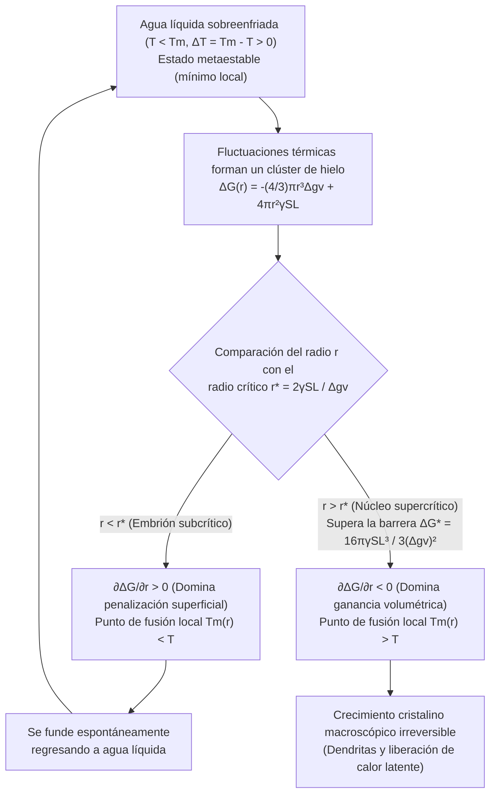
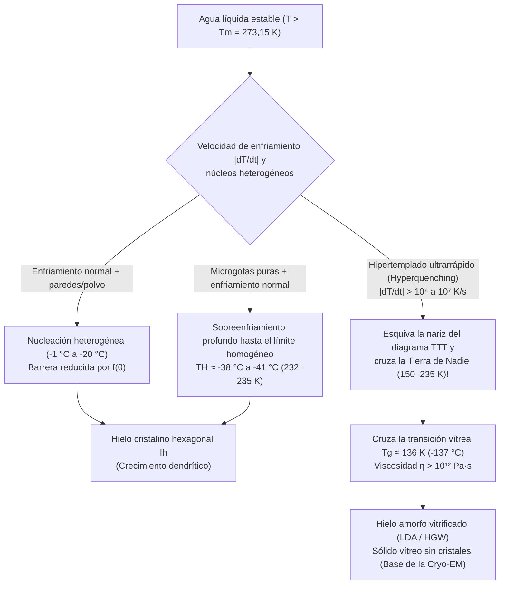

Imagina sacar con cuidado del congelador una botella de plástico sellada con agua purificada: el termómetro marca $-8^\circ\text{C}$ ($265{,}15\,\text{K}$), pero el interior sigue siendo agua líquida completamente transparente. Sin embargo, en el instante en que golpeas suavemente la base de la botella contra la mesa —o viertes el chorro frío sobre una esquirla de hielo—, una deslumbrante red blanca de agujas cristalinas recorre el líquido a varios centímetros por segundo, transformando toda la botella en una masa de granizado (slush) en apenas dos segundos.

En la escuela aprendemos que a presión atmosférica estándar ($1\,\text{atm} = 101{,}325\,\text{kPa}$) el agua se congela a $0^\circ\text{C}$ ($273{,}15\,\text{K}$). No obstante, desde la termodinámica estadística rigurosa, $0^\circ\text{C}$ es estrictamente la <strong>temperatura de fusión de equilibrio ($T_m$)</strong>, donde el hielo hexagonal macroscópico ($\text{I}_h$) y el agua líquida igualan sus potenciales químicos ($\mu_{\text{L}}(P, T_m) = \mu_{\text{S}}(P, T_m)$), pero <strong>no es la temperatura a la cual el agua líquida cristaliza de forma espontánea</strong>.

Libre de polvo e imperfecciones superficiales, el agua ultrapura sobrevive en estado líquido a $-15^\circ\text{C}$, $-25^\circ\text{C}$ e incluso hasta el <strong>límite de nucleación homogénea ($T_H \approx -38^\circ\text{C}$ a $-41^\circ\text{C}$, o $232\text{--}235\,\text{K}$)</strong>, según han demostrado experimentos de difracción con láseres de electrones libres de rayos X (XFEL) de femtosegundos. ¿Qué barrera microscópica impide que el agua se congele inmediatamente al bajar de $0^\circ\text{C}$?

---

## Capítulo 1: Termodinámica de la Metaestabilidad

A temperatura $T$ y presión $P$ constantes, el equilibrio de fases está gobernado por la energía libre de Gibbs $G = H - TS$ (o potencial químico molar $\mu$). Como la entropía molar del agua líquida es mayor que la del hielo cristalino ($s_{\text{L}} > s_{\text{S}} > 0$), la relación $\left(\frac{\partial \mu}{\partial T}\right)_P = -s$ garantiza que para todo $T < T_m$ el hielo posee menor potencial químico ($\mu_{\text{S}}(T) < \mu_{\text{L}}(T)$) y constituye el <strong>mínimo global</strong>.

Sin embargo, entre $0^\circ\text{C}$ y $-38^\circ\text{C}$, el <strong>agua sobreenfriada (Supercooled Water)</strong> queda atrapada en un <strong>estado metaestable (mínimo local)</strong> del paisaje de energía libre $G(\eta)$:

$$\frac{\partial G}{\partial \eta} = 0, \qquad \frac{\partial^2 G}{\partial \eta^2} > 0$$

Al ser positiva la segunda derivada respecto al parámetro de orden $\eta$, cualquier fluctuación térmica infinitesimal eleva la energía libre y se extingue espontáneamente. Para escapar hacia el mínimo global del hielo, el sistema necesita una fluctuación localizada de amplitud finita capaz de superar una <strong>barrera de energía libre de activación $\Delta G^* > 0$</strong>: el proceso de <strong>nucleación</strong>. Por el contrario, cuando el hielo se calienta a $T_m = 0^\circ\text{C}$, su superficie ya cuenta con una capa cuasi-líquida nanométrica de prefusión (Premelting Layer), eliminando la barrera interfacial para la fusión.

---

## Capítulo 2: Teoría Clásica de la Nucleación (CNT) — Ganancia Volumétrica frente a Penalización Superficial

### 2.1 Derivación exacta de $\Delta G(r)$, el radio crítico $r^*$ y la barrera $\Delta G^*$

Formulada por Volmer, Weber, Becker y Döring y extendida a transiciones líquido-sólido por David Turnbull y John C. Fisher (1949), la <strong>Teoría Clásica de la Nucleación (CNT)</strong> expresa el cambio de energía libre de Gibbs $\Delta G(r)$ al formarse un embrión esférico de hielo de radio $r$ dentro de agua sobreenfriada con subenfriamiento $\Delta T \equiv T_m - T > 0$:

$$\Delta G(r) = -\frac{4}{3}\pi r^3 \Delta g_v + 4\pi r^2 \gamma_{\text{SL}}$$

donde $\Delta g_v = \Delta H_f - T\Delta S_f \approx \frac{\Delta H_f \cdot \Delta T}{T_m}$ es la fuerza impulsora volumétrica (con el calor latente volumétrico de fusión $\Delta H_f \approx 3{,}06 \times 10^8\,\text{J/m}^3$, o $L_f = 333{,}5\,\text{J/g}$) y $\gamma_{\text{SL}} \approx 28\text{--}32\,\text{mJ/m}^2$ es la tensión interfacial sólido-líquido.

Para radios muy pequeños ($r \to 0$), el término superficial cuadrático ($\propto r^2$) domina sobre el término volumétrico cúbico ($\propto -r^3$). Igualando a cero la derivada $\frac{\partial \Delta G(r)}{\partial r} = -4\pi r^2 \Delta g_v + 8\pi r \gamma_{\text{SL}} = 0$, obtenemos el <strong>radio crítico del núcleo ($r^*$)</strong> y la <strong>barrera de energía libre de nucleación ($\Delta G^*$)</strong>:

$$r^* = \frac{2\gamma_{\text{SL}}}{\Delta g_v} = \frac{2\gamma_{\text{SL}} T_m}{\Delta H_f \Delta T}, \qquad \Delta G^* = \Delta G(r^*) = \frac{16\pi \gamma_{\text{SL}}^3}{3(\Delta g_v)^2} = \frac{16\pi \gamma_{\text{SL}}^3 T_m^2}{3(\Delta H_f)^2 (\Delta T)^2}$$

* <strong>Clústeres subcríticos ($r < r^*$, «embriones»)</strong>: $\frac{\partial \Delta G}{\partial r} > 0$. Por el efecto Gibbs-Thomson, su punto de fusión deprimido por la curvatura $T_m(r) = T_m(1 - \frac{2\gamma_{\text{SL}}}{\Delta H_f r})$ es menor que $T$, por lo que se disuelven espontáneamente.
* <strong>Clústeres supercríticos ($r > r^*$, «núcleos»)</strong>: $\frac{\partial \Delta G}{\partial r} < 0$. Cada molécula adicional reduce $\Delta G$, desatando un crecimiento cristalino catastrófico e irreversible.

| Temperatura $T$ ($^\circ\text{C}$) | Subenfriamiento $\Delta T$ ($\text{K}$) | Radio crítico $r^*$ ($\text{nm}$) | Moléculas en el núcleo $N^*$ | Barrera reducida $\Delta G^* / (k_B T)$ | Factor de Boltzmann $\exp(-\Delta G^* / k_B T)$ | Nucleación homogénea |
| :--- | :--- | :--- | :--- | :--- | :--- | :--- |
| <strong>$-1{,}0^\circ\text{C}$</strong> | $1{,}0$ | $53{,}6\,\text{nm}$ | $\approx 1{,}98 \times 10^7$ | $\approx 2{,}88 \times 10^6$ | $10^{-1\,250\,000}$ | Estadísticamente cero |
| <strong>$-5{,}0^\circ\text{C}$</strong> | $5{,}0$ | $10{,}7\,\text{nm}$ | $\approx 158\,000$ | $\approx 1{,}17 \times 10^5$ | $10^{-50\,800}$ | Imposible en la edad del universo |
| <strong>$-15{,}0^\circ\text{C}$</strong> | $15{,}0$ | $3{,}57\,\text{nm}$ | $\approx 5\,860$ | $\approx 1{,}35 \times 10^4$ | $10^{-5\,860}$ | Aún prohibida homogéneamente |
| <strong>$-40{,}0^\circ\text{C}$</strong> ($\approx T_H$) | $40{,}0$ | $\approx 1{,}10\,\text{nm}$ | $\approx 180\text{--}250$ | $\approx 55\text{--}70$ | $\approx 10^{-25}\text{--}10^{-30}$ | <strong>¡Congelación espontánea instantánea!</strong> |

---

## Capítulo 3: Nucleación Homogénea vs. Heterogénea — Factor de Mojado de Turnbull $f(\theta)$

El agua corriente se congela entre $-2^\circ\text{C}$ y $-5^\circ\text{C}$ gracias a la <strong>nucleación heterogénea</strong> sobre paredes o partículas de polvo. En el modelo de casquete esférico de Turnbull, un embrión con ángulo de contacto $\theta$ ($\cos\theta = \frac{\gamma_{\text{sub,L}} - \gamma_{\text{sub,S}}}{\gamma_{\text{SL}}}$ por la ecuación de Young) mantiene el mismo radio de curvatura crítico $r^*$, pero reduce su barrera de energía libre según el <strong>factor de forma $f(\theta)$</strong>:

$$\Delta G_{\text{het}}^* = \Delta G_{\text{hom}}^* \cdot f(\theta), \qquad f(\theta) = \frac{(2 + \cos\theta)(1 - \cos\theta)^2}{4} \in [0, 1]$$

Para $\theta = 30^\circ$, $f(30^\circ) \approx 0{,}013$ (barrera reducida al $1{,}3\%$); para $\theta = 10^\circ$, $f(10^\circ) \approx 1{,}7 \times 10^{-4}$. Dos ejemplos magistrales de epitaxia cristalina son:
1. <strong>Yoduro de plata ($\beta\text{-AgI}$) en siembra de nubes</strong> (Bernard Vonnegut, 1947): sus parámetros de red hexagonal ($a = 4{,}580\,\text{\AA}, c = 7{,}494\,\text{\AA}$) difieren en solo $1{,}4\%$ del hielo $\text{I}_h$ ($a = 4{,}518\,\text{\AA}, c = 7{,}356\,\text{\AA}$), induciendo congelación a $-3^\circ\text{C}$.
2. <strong>Proteínas nucleadoras de hielo (INPs, gen `inaZ`) de *Pseudomonas syringae*</strong>: repeticiones $\beta$-helicoidales en la membrana bacteriana ordenan las moléculas de agua y congelan gotas a <strong>$-1{,}5^\circ\text{C}$ a $-2{,}0^\circ\text{C}$</strong> (empleadas en cañones de nieve artificial).

---

## Capítulo 4: Congelación por Impacto, Dendritas de Mullins-Sekerka y la Fracción del 10%

Al golpear una botella de agua sobreenfriada a $-8^\circ\text{C}$, la onda de choque acústica desencadena <strong>cavitación acústica</strong>: el colapso inercial de microburbujas (ecuación de Rayleigh-Plesset) genera picos locales de presión de gigapascales ($\sim\text{GPa}$) y descompresión adiabática que superan instantáneamente $\Delta G^*$.

Al crecer el cristal, la liberación del calor latente de fusión ($L_f = 333{,}5\,\text{J/g}$) calienta la interfaz a $0^\circ\text{C}$. Por la <strong>inestabilidad morfológica de Mullins-Sekerka (1963)</strong>, cualquier protuberancia que avance hacia el agua fría a $-8^\circ\text{C}$ experimenta un gradiente térmico $|\nabla T|$ más pronunciado, disipa calor más rápido y se dispara formando agujas ramificadas —<strong>dendritas</strong>— a $5\text{--}10\,\text{cm/s}$.

Como el proceso dura $\sim 2\,\text{s}$, es <strong>adiabático ($\Delta H_{\text{total}} = 0$)</strong>: el calor latente liberado al congelarse una fracción de masa $f_{\text{ice}}$ calienta toda la mezcla hasta $T_m = 0^\circ\text{C}$, deteniendo la cristalización:

$$M \, f_{\text{ice}} \, L_f = M \, c_{p,\text{L}} \, \Delta T \quad \Longrightarrow \quad f_{\text{ice}} = \frac{c_{p,\text{L}} \Delta T}{L_f} \equiv \text{Ste} = \frac{4{,}21 \times 8{,}0}{333{,}5} \approx 0{,}101 \quad (\mathbf{10{,}1\%})$$

<strong>¡Solo el $10{,}1\%$ del agua se congela realmente!</strong> Esa red dendrítica tridimensional atrapa el $89{,}9\%$ restante de agua líquida a $0^\circ\text{C}$ como una esponja, creando un granizado blando (congelar el $100\%$ adiabáticamente requeriría el límite de hiperenfriamiento $\Delta T_{\text{hyp}} = L_f / c_{p,\text{L}} \approx 79{,}2\,\text{K}$, imposible a $1\,\text{atm}$).

---

## Capítulo 5: Sobrecalentamiento, Física de Nubes y Transición Vítrea ($T_g$)

1. <strong>Sobrecalentamiento (Superheating) y cámara de burbujas de Glaser</strong>: En una taza lisa calentada en microondas por encima de $100^\circ\text{C}$, la <strong>presión capilar de Young-Laplace $\Delta P = \frac{2\gamma_{\text{LV}}}{r}$</strong> aplasta cualquier burbuja menor que el radio crítico $r_b^* = \frac{2\gamma_{\text{LV}}}{P_{\text{V}}(T) - P_{\text{L}}} \approx \frac{2\gamma_{\text{LV}} T_b}{\rho_{\text{V}} L_v \Delta T_{\text{sh}}}$. Añadir café o azúcar introduce sitios de nucleación y provoca una ebullición explosiva (<strong>bumping</strong>). En 1952, Donald Glaser (Nobel de Física 1960) aprovechó el hidrógeno líquido sobrecalentado en su <strong>cámara de burbujas</strong> para fotografiar trayectorias de partículas subatómicas.
2. <strong>Proceso Wegener-Bergeron-Findeisen y proteínas anticongelantes (AFPs)</strong>: Bajo $0^\circ\text{C}$, la presión de vapor de saturación sobre el hielo es menor que sobre el agua sobreenfriada ($e_s^{\text{ice}}(T) < e_s^{\text{water}}(T)$), haciendo crecer los cristales de nieve a expensas de las gotitas líquidas; en aviación, el impacto de grandes gotas sobreenfriadas (SLD) congela solo la fracción $f_{\text{ice}} = c_p\Delta T/L_f$ al instante y el resto fluye formando peligroso <strong>hielo claro (Glaze Ice)</strong>. Los peces polares utilizan <strong>glicoproteínas anticongelantes (AFGPs)</strong> que se adhieren al hielo con espaciamiento $d$, forzando una curvatura $r \approx d/2$ que deprime el punto de congelación por efecto Gibbs-Thomson ($\Delta T_{\text{TH}} = \frac{4\gamma_{\text{SL}} T_m}{\Delta H_f d}$).
3. <strong>Vitrificación y la «Tierra de Nadie» (No-Man's Land)</strong>: En la tasa de nucleación $J(T) \propto \exp(-\Delta G_{\text{diff}}/k_B T)\exp(-\Delta G^*/k_B T)$, el aumento extremo de la viscosidad $\eta(T)$ a bajas temperaturas dibuja una «nariz» en el diagrama <strong>Tiempo-Temperatura-Transformación (TTT)</strong>.

Si enfriamos el agua a una velocidad superior a $\dot{T}_c > 10^6\,\text{K/s}$ (técnica de inmersión en etano líquido de Jacques Dubochet, Premio Nobel de Química 2017 por la <strong>criomicroscopía electrónica, Cryo-EM</strong>), esquivamos la cristalización en la «Tierra de Nadie» ($150\text{--}235\,\text{K}$) y solidificamos el agua por debajo de su <strong>temperatura de transición vítrea $T_g \approx 136\,\text{K}$ ($-137^\circ\text{C}$)</strong> como <strong>hielo amorfo vitrificado (LDA)</strong>.
