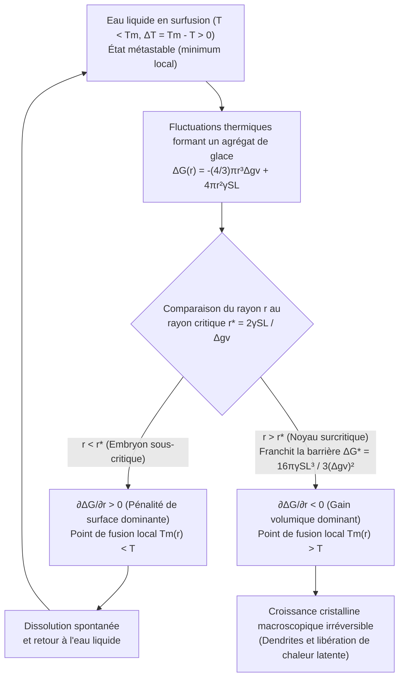
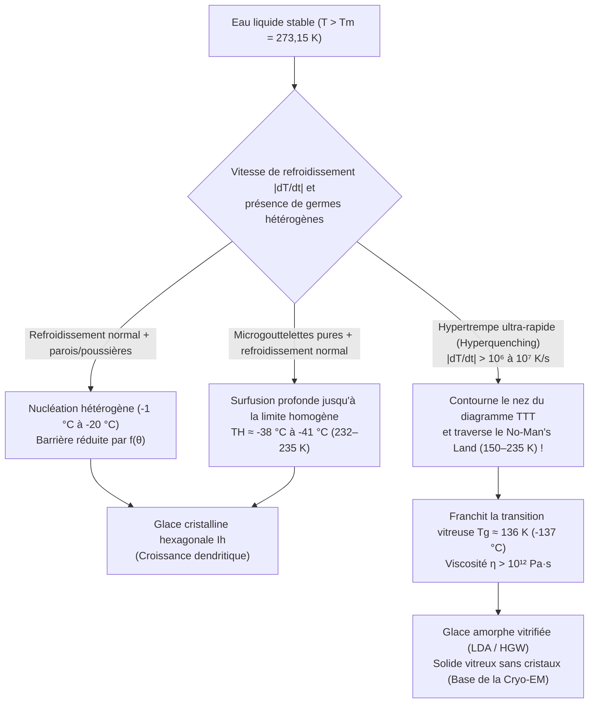

Sortez délicatement une bouteille en plastique d'eau purifiée du congélateur : le thermomètre indique $-8^\circ\text{C}$ ($265{,}15\,\text{K}$), et pourtant l'eau reste parfaitement limpide et liquide. Mais dès que vous frappez légèrement le fond de la bouteille contre une table — ou que vous versez ce filet d'eau sur un minuscule éclat de glace —, un réseau blanc aveuglant d'aiguilles cristallines traverse le liquide à plusieurs centimètres par seconde, transformant toute la bouteille en une neige fondante (slush) en moins de deux secondes.

On enseigne souvent qu'à pression atmosphérique normale ($1\,\text{atm} = 101{,}325\,\text{kPa}$), l'eau gèle à $0^\circ\text{C}$ ($273{,}15\,\text{K}$). Du point de vue rigoureux de la thermodynamique statistique, $0^\circ\text{C}$ est en réalité la <strong>température de fusion d'équilibre ($T_m$)</strong> où la glace hexagonale macroscopique ($\text{I}_h$) et l'eau liquide partagent le même potentiel chimique ($\mu_{\text{L}}(P, T_m) = \mu_{\text{S}}(P, T_m)$), mais <strong>ce n'est pas la température à laquelle l'eau liquide cristallise spontanément</strong>.

Isolée de toute poussière et d'aspérités de paroi, l'eau ultra-pure reste liquide à $-15^\circ\text{C}$, $-25^\circ\text{C}$ et jusqu'à la <strong>limite de nucléation homogène ($T_H \approx -38^\circ\text{C}$ à $-41^\circ\text{C}$, soit $232\text{--}235\,\text{K}$)</strong>, comme l'ont confirmé les expériences de diffraction par laser à électrons libres dans le domaine des rayons X (XFEL). Quelle barrière microscopique empêche donc l'eau de geler dès qu'elle franchit $0^\circ\text{C}$ ?

---

## Chapitre 1 : Thermodynamique de l'état métastable

À température $T$ et pression $P$ constantes, l'évolution d'un système est gouvernée par l'enthalpie libre de Gibbs $G = H - TS$ (ou le potentiel chimique molaire $\mu$). L'entropie molaire de l'eau liquide étant supérieure à celle du cristal de glace ($s_{\text{L}} > s_{\text{S}} > 0$), la relation $\left(\frac{\partial \mu}{\partial T}\right)_P = -s$ implique que pour tout $T < T_m$, la glace possède un potentiel chimique inférieur ($\mu_{\text{S}}(T) < \mu_{\text{L}}(T)$) et constitue le <strong>minimum global</strong>.

Cependant, entre $0^\circ\text{C}$ et $-38^\circ\text{C}$, l'<strong>eau en surfusion (Supercooled Water)</strong> demeure piégée dans un <strong>état métastable (minimum local)</strong> du paysage d'énergie libre $G(\eta)$ :

$$\frac{\partial G}{\partial \eta} = 0, \qquad \frac{\partial^2 G}{\partial \eta^2} > 0$$

La courbure locale étant strictement positive, toute fluctuation thermique infinitésimale augmente l'énergie libre et se résorbe aussitôt. Pour basculer vers l'état cristallin stable, le système doit produire une fluctuation localisée d'amplitude finie capable de franchir une <strong>barrière d'activation $\Delta G^* > 0$</strong> : c'est la <strong>nucléation</strong>. À l'inverse, lors de la fusion ($T > T_m$), la glace possède déjà à sa surface une couche quasi-liquide nanométrique (couche de préfusion de Faraday), ce qui supprime toute barrière énergétique et explique pourquoi la glace fond exactement à $0^\circ\text{C}$.

---

## Chapitre 2 : Théorie Classique de la Nucléation (CNT) — Gain volumique contre pénalité interfaciale

### 2.1 Dérivation exacte de $\Delta G(r)$, du rayon critique $r^*$ et de la barrière $\Delta G^*$

Développée par Volmer, Weber, Becker et Döring puis étendue aux transitions liquide-solide par David Turnbull et John C. Fisher (1949), la <strong>Théorie Classique de la Nucléation (CNT)</strong> exprime la variation d'enthalpie libre de Gibbs $\Delta G(r)$ associée à la formation d'un embryon sphérique de glace de rayon $r$ au sein d'une eau en surfusion de degré $\Delta T \equiv T_m - T > 0$ :

$$\Delta G(r) = -\frac{4}{3}\pi r^3 \Delta g_v + 4\pi r^2 \gamma_{\text{SL}}$$

où $\Delta g_v = \Delta H_f - T\Delta S_f \approx \frac{\Delta H_f \cdot \Delta T}{T_m}$ est la force motrice volumique (avec la chaleur latente volumique de fusion $\Delta H_f \approx 3{,}06 \times 10^8\,\text{J/m}^3$, soit $L_f = 333{,}5\,\text{J/g}$) et $\gamma_{\text{SL}} \approx 28\text{--}32\,\text{mJ/m}^2$ est la tension interfaciale solide-liquide.

Aux faibles rayons ($r \to 0$), le terme de surface quadratique ($\propto r^2$) l'emporte sur le terme de volume cubique ($\propto -r^3$). En annulant la dérivée première $\frac{\partial \Delta G(r)}{\partial r} = -4\pi r^2 \Delta g_v + 8\pi r \gamma_{\text{SL}} = 0$, on obtient le <strong>rayon critique de nucléation ($r^*$)</strong> et la <strong>barrière d'énergie libre ($\Delta G^*$)</strong> :

$$r^* = \frac{2\gamma_{\text{SL}}}{\Delta g_v} = \frac{2\gamma_{\text{SL}} T_m}{\Delta H_f \Delta T}, \qquad \Delta G^* = \Delta G(r^*) = \frac{16\pi \gamma_{\text{SL}}^3}{3(\Delta g_v)^2} = \frac{16\pi \gamma_{\text{SL}}^3 T_m^2}{3(\Delta H_f)^2 (\Delta T)^2}$$

* <strong>Agrégats sous-critiques ($r < r^*$, « embryons »)</strong> : $\frac{\partial \Delta G}{\partial r} > 0$. En vertu de l'effet Gibbs-Thomson, leur point de fusion abaissé par la courbure $T_m(r) = T_m(1 - \frac{2\gamma_{\text{SL}}}{\Delta H_f r})$ est inférieur à $T$ ; ils se dissolvent spontanément.
* <strong>Agrégats surcritiques ($r > r^*$, « germes / noyaux »)</strong> : $\frac{\partial \Delta G}{\partial r} < 0$. L'addition de molécules d'eau abaisse désormais $\Delta G$, déclenchant une croissance cristalline irréversible et catastrophique.

| Température $T$ ($^\circ\text{C}$) | Surfusion $\Delta T$ ($\text{K}$) | Rayon critique $r^*$ ($\text{nm}$) | Molécules dans le germe $N^*$ | Barrière réduite $\Delta G^* / (k_B T)$ | Facteur de Boltzmann $\exp(-\Delta G^* / k_B T)$ | Nucléation homogène |
| :--- | :--- | :--- | :--- | :--- | :--- | :--- |
| <strong>$-1{,}0^\circ\text{C}$</strong> | $1{,}0$ | $53{,}6\,\text{nm}$ | $\approx 1{,}98 \times 10^7$ | $\approx 2{,}88 \times 10^6$ | $10^{-1\,250\,000}$ | Strictement impossible |
| <strong>$-5{,}0^\circ\text{C}$</strong> | $5{,}0$ | $10{,}7\,\text{nm}$ | $\approx 158\,000$ | $\approx 1{,}17 \times 10^5$ | $10^{-50\,800}$ | Impossible sur l'âge de l'Univers |
| <strong>$-15{,}0^\circ\text{C}$</strong> | $15{,}0$ | $3{,}57\,\text{nm}$ | $\approx 5\,860$ | $\approx 1{,}35 \times 10^4$ | $10^{-5\,860}$ | Toujours prohibée en volume |
| <strong>$-40{,}0^\circ\text{C}$</strong> ($\approx T_H$) | $40{,}0$ | $\approx 1{,}10\,\text{nm}$ | $\approx 180\text{--}250$ | $\approx 55\text{--}70$ | $\approx 10^{-25}\text{--}10^{-30}$ | <strong>Congélation spontanée immédiate !</strong> |

---

## Chapitre 3 : Nucléation homogène vs hétérogène — Le facteur de mouillage de Turnbull $f(\theta)$

Dans la nature et nos congélateurs, l'eau gèle dès $-2^\circ\text{C}$ à $-5^\circ\text{C}$ par <strong>nucléation hétérogène</strong> sur les parois ou les poussières. Selon le modèle de la calotte sphérique de Turnbull, lorsqu'un embryon de glace se forme sur un substrat solide avec un angle de contact $\theta$ donné par la loi de Young ($\cos\theta = \frac{\gamma_{\text{sub,L}} - \gamma_{\text{sub,S}}}{\gamma_{\text{SL}}}$), le rayon de courbure critique $r^*$ reste inchangé, mais la barrière énergétique est multipliée par le <strong>facteur géométrique de mouillage $f(\theta)$</strong> :

$$\Delta G_{\text{het}}^* = \Delta G_{\text{hom}}^* \cdot f(\theta), \qquad f(\theta) = \frac{(2 + \cos\theta)(1 - \cos\theta)^2}{4} \in [0, 1]$$

Pour $\theta = 30^\circ$, $f(30^\circ) \approx 0{,}013$ (barrière réduite de $98{,}7\%$) ; pour $\theta = 10^\circ$, $f(10^\circ) \approx 1{,}7 \times 10^{-4}$ ! Deux exemples célèbres d'épitaxie :
1. <strong>L'iodure d'argent ($\beta\text{-AgI}$) pour l'ensemencement des nuages</strong> (Bernard Vonnegut, 1947) : ses paramètres de maille hexagonale ($a = 4{,}580\,\text{\AA}, c = 7{,}494\,\text{\AA}$) ne diffèrent que de $1{,}4\%$ de ceux de la glace $\text{I}_h$ ($a = 4{,}518\,\text{\AA}, c = 7{,}356\,\text{\AA}$), déclenchant la congélation dès $-3^\circ\text{C}$.
2. <strong>Les protéines glaçogènes (INPs, gène `inaZ`) de *Pseudomonas syringae*</strong> : ces répétitions $\beta$-hélicoïdales membranaires alignent les molécules d'eau et provoquent le gel dès <strong>$-1{,}5^\circ\text{C}$ à $-2{,}0^\circ\text{C}$</strong> (utilisées pour la neige de culture en station de ski).

---

## Chapitre 4 : Congélation par choc, dendrites de Mullins-Sekerka et fraction de glace de 10 %

Lorsqu'on frappe une bouteille d'eau en surfusion à $-8^\circ\text{C}$, l'onde acoustique provoque la <strong>cavitation acoustique</strong> : les microbulles se dilatent puis implosent violemment selon l'équation de Rayleigh-Plesset, générant des pics de pression de l'ordre du gigapascal ($\sim\text{GPa}$) suivis d'une décompression adiabatique qui franchit instantanément $\Delta G^*$.

La croissance cristalline libère alors la chaleur latente de fusion ($L_f = 333{,}5\,\text{J/g}$), réchauffant l'interface à $0^\circ\text{C}$. Par l'<strong>instabilité morphologique de Mullins-Sekerka (1963)</strong>, toute pointe faisant saillie dans le liquide froid à $-8^\circ\text{C}$ rencontre un gradient thermique $|\nabla T|$ plus raide, évacue plus vite sa chaleur latente et croît en aiguilles ramifiées — les <strong>dendrites</strong> — à $5\text{--}10\,\text{cm/s}$.

Ce flash durant moins de $2\,\text{s}$, la transformation est <strong>adiabatique ($\Delta H_{\text{total}} = 0$)</strong>. La chaleur latente libérée par la fraction massique gelée $f_{\text{ice}}$ réchauffe l'ensemble de l'eau jusqu'à $T_m = 0^\circ\text{C}$, où le gel s'arrête net :

$$M \, f_{\text{ice}} \, L_f = M \, c_{p,\text{L}} \, \Delta T \quad \Longrightarrow \quad f_{\text{ice}} = \frac{c_{p,\text{L}} \Delta T}{L_f} \equiv \text{Ste} = \frac{4{,}21 \times 8{,}0}{333{,}5} \approx 0{,}101 \quad (\mathbf{10{,}1\%})$$

<strong>Seuls $10{,}1\%$ de l'eau gèlent réellement !</strong> Ce réseau dendritique percolant emprisonne les $89{,}9\%$ d'eau liquide restants à $0^\circ\text{C}$, formant un granité mou (pour geler $100\%$ adiabatiquement, il faudrait atteindre la limite d'hyper-refroidissement $\Delta T_{\text{hyp}} = L_f / c_{p,\text{L}} \approx 79{,}2\,\text{K}$, impossible sous $1\,\text{atm}$).

---

## Chapitre 5 : Surchauffe, physique des nuages et transition vitreuse ($T_g$)

1. <strong>Surchauffe (Superheating) et chambre à bulles de Glaser</strong> : Dans une tasse lisse chauffée au four à micro-ondes au-delà de $100^\circ\text{C}$, la <strong>pression capillaire de Young-Laplace $\Delta P = \frac{2\gamma_{\text{LV}}}{r}$</strong> écrase toute bulle de vapeur inférieure au rayon critique $r_b^* = \frac{2\gamma_{\text{LV}}}{P_{\text{V}}(T) - P_{\text{L}}} \approx \frac{2\gamma_{\text{LV}} T_b}{\rho_{\text{V}} L_v \Delta T_{\text{sh}}}$. L'ajout de café ou d'une cuillère déclenche une ébullition explosive (<strong>soubresaut / bumping</strong>). En 1952, Donald Glaser (prix Nobel 1960) utilisa l'hydrogène liquide surchauffé dans sa <strong>chambre à bulles</strong> pour visualiser les trajectoires des particules subatomiques ionisantes.
2. <strong>Effet Bergeron-Findeisen, givrage aéronautique et protéines antigel (AFPs)</strong> : Sous $0^\circ\text{C}$, la pression de vapeur saturante sur la glace étant inférieure à celle sur l'eau surfondue ($e_s^{\text{ice}}(T) < e_s^{\text{water}}(T)$), les cristaux de glace dans les nuages croissent aux dépens des gouttelettes surfondues. En aéronautique, l'impact de grosses gouttelettes surfondues (SLD) sur une aile ne gèle instantanément que la fraction $f_{\text{ice}} = c_p\Delta T/L_f$, le reste s'écoulant pour former du <strong>givre transparent (Glaze Ice)</strong> redoutable. Les poissons polaires synthétisent des <strong>protéines antigel (AFPs)</strong> qui s'adsorbent sur la glace avec un espacement $d$, imposant une courbure $r \approx d/2$ qui abaisse le point de congélation par effet Gibbs-Thomson ($\Delta T_{\text{TH}} = \frac{4\gamma_{\text{SL}} T_m}{\Delta H_f d}$).
3. <strong>Vitrification et « No-Man's Land » de l'eau</strong> : Dans le taux de nucléation $J(T) \propto \exp(-\Delta G_{\text{diff}}/k_B T)\exp(-\Delta G^*/k_B T)$, l'explosion de la viscosité $\eta(T)$ à basse température crée un « nez » sur le diagramme <strong>Temps-Température-Transformation (TTT)</strong>.

En refroidissant l'eau à une vitesse critique $\dot{T}_c > 10^6\,\text{K/s}$ (hypertrempe dans l'éthane liquide mise au point par Jacques Dubochet, prix Nobel de chimie 2017 pour la <strong>cryo-microscopie électronique, Cryo-EM</strong>), on devance la cristallisation à travers le « No-Man's Land » ($150\text{--}235\,\text{K}$) pour figer l'eau sous sa <strong>température de transition vitreuse $T_g \approx 136\,\text{K}$ ($-137^\circ\text{C}$)</strong> sous forme de <strong>glace amorphe vitrifiée (LDA)</strong>.
