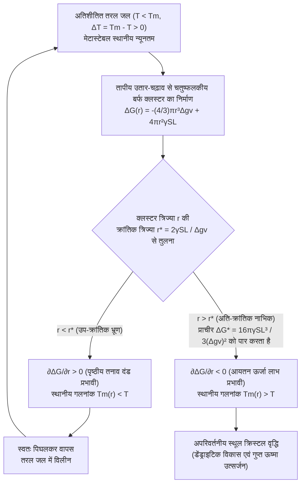
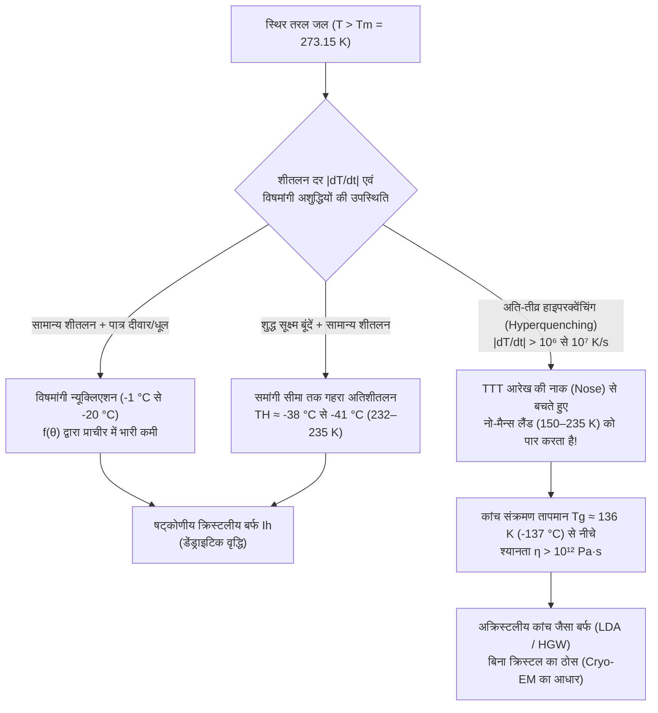

कल्पना कीजिए कि आप फ्रीज़र से शुद्ध पानी की एक सीलबंद प्लास्टिक बोतल सावधानी से निकालते हैं: थर्मामीटर स्पष्ट रूप से $-8^\circ\text{C}$ ($265.15\,\text{K}$) दिखा रहा है, फिर भी बोतल के भीतर का पानी पूरी तरह पारदर्शी और तरल है। लेकिन अगले ही पल, जैसे ही आप बोतल की तली को मेज पर हल्के से थपथपाते हैं — या बर्फ के एक छोटे से टुकड़े पर ठंडी धार डालते हैं — सुई जैसे क्रिस्टलों का एक चकाचौंध कर देने वाला सफेद जाल कई सेंटीमीटर प्रति सेकंड की गति से तरल को चीरता हुआ निकल जाता है, और मात्र दो सेकंड में पूरी बोतल बर्फ के नरम गोले (स्लश / Slush) में बदल जाती है।

स्कूल में हमें पढ़ाया जाता है कि मानक वायुमंडलीय दाब ($1\,\text{atm} = 101.325\,\text{kPa}$) पर पानी $0^\circ\text{C}$ ($273.15\,\text{K}$) पर जमता है। किंतु सांख्यिकीय ऊष्मागतिकी (Statistical Thermodynamics) और संघनित पदार्थ भौतिकी के सख्त दृष्टिकोण से, $0^\circ\text{C}$ वास्तव में <strong>साम्यावस्था गलनांक (Equilibrium Melting Temperature, $T_m$)</strong> है जहाँ स्थूल षट्कोणीय बर्फ ($\text{I}_h$) और तरल पानी का रासायनिक विभव बराबर होता है ($\mu_{\text{L}}(P, T_m) = \mu_{\text{S}}(P, T_m)$), लेकिन <strong>यह वह तापमान नहीं है जिस पर तरल पानी स्वतः ही क्रिस्टलीकृत होने लगे</strong>।

वास्तव में, धूल के कणों और पात्र की खरोंचों से मुक्त अति-शुद्ध पानी की सूक्ष्म बूंदें $-15^\circ\text{C}$, $-25^\circ\text{C}$ और यहाँ तक कि <strong>समांगी न्यूक्लिएशन सीमा (Homogeneous Nucleation Limit, $T_H \approx -38^\circ\text{C}$ से $-41^\circ\text{C}$, या $232\text{--}235\,\text{K}$)</strong> तक तरल बनी रहती हैं, जैसा कि फेम्टोसेकंड एक्स-रे मुक्त-इलेक्ट्रॉन लेजर (XFEL) विवर्तन प्रयोगों से प्रमाणित हुआ है। आखिर वह कौन-सी सूक्ष्म ऊर्जा दीवार है जो पानी को $0^\circ\text{C}$ के नीचे तुरंत जमने से रोकती है?

---

## अध्याय 1: मेटास्टेबल अवस्था (Metastable State) की ऊष्मागतिकी

स्थिर तापमान $T$ और दाब $P$ पर किसी तंत्र की प्रावस्था का स्थायित्व गिब्स मुक्त ऊर्जा $G = H - TS$ (अथवा मोलर रासायनिक विभव $\mu$) द्वारा निर्धारित होता है। चूंकि तरल पानी की मोलर एन्ट्रॉपी क्रिस्टलीय बर्फ से अधिक होती है ($s_{\text{L}} > s_{\text{S}} > 0$), इसलिए $\left(\frac{\partial \mu}{\partial T}\right)_P = -s$ संबंध के अनुसार सभी $T < T_m$ के लिए बर्फ का रासायनिक विभव तरल पानी से कम होता है ($\mu_{\text{S}}(T) < \mu_{\text{L}}(T)$) और बर्फ <strong>वैश्विक न्यूनतम (Global Minimum)</strong> होती है।

फिर भी, $0^\circ\text{C}$ और $-38^\circ\text{C}$ के बीच <strong>अतिशीतित जल (Supercooled Water)</strong> मुक्त ऊर्जा परिदृश्य $G(\eta)$ के एक उथले गड्ढे यानी <strong>मेटास्टेबल अवस्था (स्थानीय न्यूनतम / Local Minimum)</strong> में फँसा रहता है:

$$\frac{\partial G}{\partial \eta} = 0, \qquad \frac{\partial^2 G}{\partial \eta^2} > 0$$

चूंकि ऑर्डर पैरामीटर $\eta$ के सापेक्ष द्वितीय अवकलज (वक्रता) धनात्मक है, इसलिए कोई भी अतिसूक्ष्म तापीय उतार-चढ़ाव मुक्त ऊर्जा को बढ़ाता है और तुरंत समाप्त हो जाता है। इस मेटास्टेबल घाटी से निकलकर बर्फ के वैश्विक न्यूनतम तक पहुँचने के लिए तंत्र को एक परिमित आयाम के स्थानीय उतार-चढ़ाव द्वारा <strong>सक्रियण ऊर्जा प्राचीर $\Delta G^* > 0$</strong> को पार करना पड़ता है — जिसे <strong>न्यूक्लिएशन (Nucleation / नाभिकन)</strong> कहते हैं। इसके विपरीत, जब बर्फ को $0^\circ\text{C}$ तक गर्म किया जाता है, तो उसकी सतह पर पहले से ही नैनोमीटर मोटी अर्ध-तरल परत (Premelting Layer) मौजूद होती है, जिससे बिना किसी ऊर्जा अवरोध के बर्फ ठीक $0^\circ\text{C}$ पर पिघलने लगती है।

---

## अध्याय 2: क्लासिकल न्यूक्लिएशन थ्योरी (CNT) — आयतन लाभ बनाम अंतरापृष्ठ दंड

### 2.1 $\Delta G(r)$, क्रांतिक त्रिज्या $r^*$ और ऊर्जा प्राचीर $\Delta G^*$ की व्युत्पत्ति

वोल्मर, वेबर, बेकर और डोरिंग द्वारा विकसित तथा डेविड टर्नबुल और जॉन फिशर (1949) द्वारा तरल-ठोस प्रावस्था संक्रमणों पर लागू <strong>क्लासिकल न्यूक्लिएशन थ्योरी (CNT)</strong> के अनुसार, $\Delta T \equiv T_m - T > 0$ अतिशीतलन वाले पानी में $r$ त्रिज्या के गोलाकार बर्फ भ्रूण (Embryo) के बनने पर गिब्स मुक्त ऊर्जा में परिवर्तन $\Delta G(r)$ निम्नलिखित है:

$$\Delta G(r) = -\frac{4}{3}\pi r^3 \Delta g_v + 4\pi r^2 \gamma_{\text{SL}}$$

यहाँ $\Delta g_v = \Delta H_f - T\Delta S_f \approx \frac{\Delta H_f \cdot \Delta T}{T_m}$ प्रति इकाई आयतन मुक्त ऊर्जा प्रेरक बल है (जहाँ $\Delta H_f \approx 3.06 \times 10^8\,\text{J/m}^3$ या $L_f = 333.5\,\text{J/g}$ गलन की गुप्त ऊष्मा है), और $\gamma_{\text{SL}} \approx 28\text{--}32\,\text{mJ/m}^2$ ठोस-तरल अंतरापृष्ठ तनाव (Interfacial Tension) है।

अतिसूक्ष्म त्रिज्या ($r \to 0$) पर पृष्ठीय दंड ($\propto r^2$) आयतन लाभ ($\propto -r^3$) पर हावी रहता है। $\frac{\partial \Delta G(r)}{\partial r} = -4\pi r^2 \Delta g_v + 8\pi r \gamma_{\text{SL}} = 0$ रखने पर हमें <strong>क्रांतिक नाभिक त्रिज्या ($r^*$)</strong> और <strong>न्यूक्लिएशन मुक्त ऊर्जा प्राचीर ($\Delta G^*$)</strong> प्राप्त होते हैं:

$$r^* = \frac{2\gamma_{\text{SL}}}{\Delta g_v} = \frac{2\gamma_{\text{SL}} T_m}{\Delta H_f \Delta T}, \qquad \Delta G^* = \Delta G(r^*) = \frac{16\pi \gamma_{\text{SL}}^3}{3(\Delta g_v)^2} = \frac{16\pi \gamma_{\text{SL}}^3 T_m^2}{3(\Delta H_f)^2 (\Delta T)^2}$$

* <strong>उप-क्रांतिक क्लस्टर ($r < r^*$, "भ्रूण / Embryos")</strong>: $\frac{\partial \Delta G}{\partial r} > 0$. गिब्स-थॉमसन प्रभाव के कारण इनका वक्रता-अवनमित गलनांक $T_m(r) = T_m(1 - \frac{2\gamma_{\text{SL}}}{\Delta H_f r})$ पानी के तापमान $T$ से कम होता है, इसलिए ये स्वतः ही पिघलकर नष्ट हो जाते हैं।
* <strong>अति-क्रांतिक क्लस्टर ($r > r^*$, "नाभिक / Nuclei")</strong>: $\frac{\partial \Delta G}{\partial r} < 0$. अब प्रत्येक जुड़ने वाला जल अणु $\Delta G$ को घटाता है, जिससे अपरिवर्तनीय और विस्फोटक क्रिस्टल वृद्धि शुरू होती है।

| तापमान $T$ ($^\circ\text{C}$) | अतिशीतलन $\Delta T$ ($\text{K}$) | क्रांतिक त्रिज्या $r^*$ ($\text{nm}$) | नाभिक में अणु संख्या $N^*$ | विमाहीन प्राचीर $\Delta G^* / (k_B T)$ | बोल्ट्ज़मान गुणांक $\exp(-\Delta G^* / k_B T)$ | समांगी न्यूक्लिएशन की संभावना |
| :--- | :--- | :--- | :--- | :--- | :--- | :--- |
| <strong>$-1.0^\circ\text{C}$</strong> | $1.0$ | $53.6\,\text{nm}$ | $\approx 1.98 \times 10^7$ | $\approx 2.88 \times 10^6$ | $10^{-1\,250\,000}$ | सांख्यिकीय रूप से शून्य |
| <strong>$-5.0^\circ\text{C}$</strong> | $5.0$ | $10.7\,\text{nm}$ | $\approx 158\,000$ | $\approx 1.17 \times 10^5$ | $10^{-50\,800}$ | ब्रह्मांड की आयु में असंभव |
| <strong>$-15.0^\circ\text{C}$</strong> | $15.0$ | $3.57\,\text{nm}$ | $\approx 5\,860$ | $\approx 1.35 \times 10^4$ | $10^{-5\,860}$ | अभी भी पूर्णतः असंभव |
| <strong>$-40.0^\circ\text{C}$</strong> ($\approx T_H$) | $40.0$ | $\approx 1.10\,\text{nm}$ | $\approx 180\text{--}250$ | $\approx 55\text{--}70$ | $\approx 10^{-25}\text{--}10^{-30}$ | <strong>1 सेकंड के भीतर स्वतः हिमीकरण!</strong> |

---

## अध्याय 3: समांगी बनाम विषमांगी न्यूक्लिएशन — टर्नबुल का वेटिंग गुणांक $f(\theta)$

साधारण नल का पानी $-2^\circ\text{C}$ से $-5^\circ\text{C}$ पर ही जम जाता है क्योंकि पात्र की दीवारें और धूल के कण <strong>विषमांगी न्यूक्लिएशन (Heterogeneous Nucleation)</strong> के लिए आधार प्रदान करते हैं। टर्नबुल के गोलाकार टोपी (Spherical Cap) मॉडल के अनुसार, जब कोई बर्फ भ्रूण किसी ठोस सतह पर संपर्क कोण $\theta$ (यंग समीकरण $\cos\theta = \frac{\gamma_{\text{sub,L}} - \gamma_{\text{sub,S}}}{\gamma_{\text{SL}}}$) बनाता है, तो क्रांतिक वक्रता त्रिज्या $r^*$ वही रहती है, किंतु ऊर्जा प्राचीर <strong>वेटिंग गुणांक $f(\theta)$</strong> से गुणा होकर घट जाती है:

$$\Delta G_{\text{het}}^* = \Delta G_{\text{hom}}^* \cdot f(\theta), \qquad f(\theta) = \frac{(2 + \cos\theta)(1 - \cos\theta)^2}{4} \in [0, 1]$$

$\theta = 30^\circ$ के लिए $f(30^\circ) \approx 0.013$ (प्राचीर घटकर $1.3\%$ रह जाती है); और $\theta = 10^\circ$ के लिए $f(10^\circ) \approx 1.7 \times 10^{-4}$! एपिटैक्सियल मिलान के दो प्रसिद्ध उदाहरण:
1. <strong>कृत्रिम वर्षा में सिल्वर आयोडाइड ($\beta\text{-AgI}$)</strong> (बर्नार्ड वोनगुट, 1947): इसके षट्कोणीय जालक स्थिरांक ($a = 4.580\,\text{\AA}, c = 7.494\,\text{\AA}$) बर्फ $\text{I}_h$ ($a = 4.518\,\text{\AA}, c = 7.356\,\text{\AA}$) से केवल $1.4\%$ भिन्न होते हैं, जिससे $-3^\circ\text{C}$ पर ही बादल की बूंदें जम जाती हैं।
2. <strong>*Pseudomonas syringae* जीवाणु के आइस-न्यूक्लिएटिंग प्रोटीन (INPs, जीन `inaZ`)</strong>: इसकी बाहरी झिल्ली पर मौजूद $\beta$-हेलिकल संरचनाएं जल अणुओं को बर्फ के समान पंक्तिबद्ध करके <strong>$-1.5^\circ\text{C}$ से $-2.0^\circ\text{C}$</strong> पर ही बर्फ जमा देती हैं (स्की रिसॉर्ट्स में कृत्रिम बर्फ बनाने में प्रयुक्त)।

---

## अध्याय 4: आघात से तुरंत जमने की प्रक्रिया, मुलिन्स-सेकेरका डेंड्राइट्स और 10% स्लश नियम

जब $-8^\circ\text{C}$ की अतिशीतित पानी की बोतल को पटका जाता है, तो ध्वनि तरंग <strong>ध्वनिक गुहिकायन (Acoustic Cavitation)</strong> उत्पन्न करती है: सूक्ष्म बुलबुलों का रेले-प्लेसेट (Rayleigh-Plesset) पतन गीगापास्कल ($\sim\text{GPa}$) स्तर के स्थानीय दाब शिखर और रुद्धोष्म (Adiabatic) शीतलन पैदा करता है जो तुरंत $\Delta G^*$ को पार कर लेता है।

जब क्रिस्टल बढ़ता है, तो गलन की गुप्त ऊष्मा ($L_f = 333.5\,\text{J/g}$) निकलने से अंतरापृष्ठ का तापमान $0^\circ\text{C}$ तक बढ़ जाता है। <strong>मुलिन्स-सेकेरका रूपात्मक अस्थिरता (Mullins-Sekerka Instability, 1963)</strong> के कारण, ठंडे पानी ($-8^\circ\text{C}$) की ओर निकला कोई भी सूक्ष्म उभार अधिक तीव्र तापमान प्रवणता $|\nabla T|$ का अनुभव करता है, तेजी से ऊष्मा छोड़ता है, और शाखित सुइयों — <strong>डेंड्राइट्स (Dendrites)</strong> — के रूप में $5\text{--}10\,\text{cm/s}$ की गति से पूरी बोतल में फैल जाता है।

चूंकि यह प्रक्रिया मात्र $\sim 2\,\text{सेकंड}$ में पूरी होती है, यह एक <strong>रुद्धोष्म एन्थैल्पी संरक्षण प्रक्रिया ($\Delta H_{\text{total}} = 0$)</strong> है: जमे हुए द्रव्यमान अंश $f_{\text{ice}}$ द्वारा छोड़ी गई गुप्त ऊष्मा पूरे मिश्रण को $T_m = 0^\circ\text{C}$ तक गर्म कर देती है, जिसके बाद जमना तुरंत रुक जाता है:

$$M \, f_{\text{ice}} \, L_f = M \, c_{p,\text{L}} \, \Delta T \quad \Longrightarrow \quad f_{\text{ice}} = \frac{c_{p,\text{L}} \Delta T}{L_f} \equiv \text{Ste} = \frac{4.21 \times 8.0}{333.5} \approx 0.101 \quad (\mathbf{10.1\%})$$

<strong>वास्तव में केवल $10.1\%$ पानी ही बर्फ में बदलता है!</strong> यह त्रि-आयामी डेंड्राइटिक जाल शेष $89.9\%$ तरल पानी ($0^\circ\text{C}$ पर) को स्पंज की तरह अपने सूक्ष्म छिद्रों में कैद कर लेता है, जिससे नरम स्लश बनता है (एक ही बार में रुद्धोष्म रूप से $100\%$ जमाने के लिए हाइपरकूलिंग सीमा $\Delta T_{\text{hyp}} = L_f / c_{p,\text{L}} \approx 79.2\,\text{K}$ आवश्यक होगी, जो $1\,\text{atm}$ पर असंभव है)।

---

## अध्याय 5: अतितापन (Superheating), बादलों का भौतिकी और कांच संक्रमण ($T_g$)

1. <strong>अतितापन (Superheating) और ग्लेज़र का बबल चैम्बर</strong>: चिकने मग में माइक्रोवेव द्वारा $100^\circ\text{C}$ से ऊपर गर्म किए गए पानी में <strong>यंग-लाप्लास केशिका दाब $\Delta P = \frac{2\gamma_{\text{LV}}}{r}$</strong> क्रांतिक त्रिज्या $r_b^* = \frac{2\gamma_{\text{LV}}}{P_{\text{V}}(T) - P_{\text{L}}} \approx \frac{2\gamma_{\text{LV}} T_b}{\rho_{\text{V}} L_v \Delta T_{\text{sh}}}$ से छोटे किसी भी भाप के बुलबुले को कुचल देता है। कॉफी पाउडर या चम्मच डालते ही विस्फोटक उबाल (<strong>Bumping</strong>) आता है। 1952 में डोनाल्ड ग्लेज़र (भौतिकी नोबेल 1960) ने अतितापित तरल हाइड्रोजन का उपयोग करके <strong>बबल चैम्बर (Bubble Chamber)</strong> बनाया जिससे उप-परमाण्विक कणों के पथ की तस्वीरें ली जा सकीं।
2. <strong>वेगेनर-बर्जेरॉन-फिंडाइज़ेन प्रक्रिया और एंटीफ्रीज़ प्रोटीन (AFPs)</strong>: $0^\circ\text{C}$ के नीचे बर्फ के ऊपर संतृप्त वाष्प दाब अतिशीतित पानी की तुलना में कम होता है ($e_s^{\text{ice}}(T) < e_s^{\text{water}}(T)$), जिससे बादलों में बर्फ के क्रिस्टल तरल बूंदों के वाष्पीकरण की कीमत पर बढ़ते हैं; विमानन में, बड़ी अतिशीतित बूंदों (SLD) के पंख से टकराने पर केवल $f_{\text{ice}} = c_p\Delta T/L_f$ अंश तुरंत जमता है और शेष पानी पीछे बहकर खतरनाक <strong>पारदर्शी बर्फ (Glaze Ice)</strong> बनाता है। ध्रुवीय मछलियाँ <strong>एंटीफ्रीज़ ग्लाइकोप्रोटीन (AFGPs)</strong> बनाती हैं जो बर्फ की सतह पर $d$ दूरी पर चिपककर $r \approx d/2$ वक्रता थोपती हैं और गिब्स-थॉमसन प्रभाव ($\Delta T_{\text{TH}} = \frac{4\gamma_{\text{SL}} T_m}{\Delta H_f d}$) द्वारा बर्फ की वृद्धि को रोकती हैं।
3. <strong>कांच संक्रमण (Vitrification) और पानी का "नो-मैन्स लैंड" (No-Man's Land)</strong>: न्यूक्लिएशन दर $J(T) \propto \exp(-\Delta G_{\text{diff}}/k_B T)\exp(-\Delta G^*/k_B T)$ में निम्न तापमान पर श्यानता $\eta(T)$ के तीव्र उछाल के कारण <strong>TTT आरेख (Time-Temperature-Transformation)</strong> पर एक C-आकार की "नाक (Nose)" बनती है।

यदि पानी को क्रांतिक शीतलन दर $\dot{T}_c > 10^6\,\text{K/s}$ से अधिक तेजी से ठंडा किया जाए (जैक्स डुबोशे द्वारा विकसित तरल ईथेन प्लंज-फ्रीजिंग तकनीक, जिन्हें <strong>क्रायो-इलेक्ट्रॉन माइक्रोस्कोपी, Cryo-EM</strong> के लिए 2017 का रसायन विज्ञान नोबेल पुरस्कार मिला), तो पानी "नो-मैन्स लैंड" ($150\text{--}235\,\text{K}$) में क्रिस्टलीकरण से बच निकलता है और <strong>कांच संक्रमण तापमान $T_g \approx 136\,\text{K}$ ($-137^\circ\text{C}$)</strong> के नीचे बिना किसी क्रिस्टल के <strong>अक्रिस्टलीय बर्फ (Amorphous Ice, LDA)</strong> में बदल जाता है।
