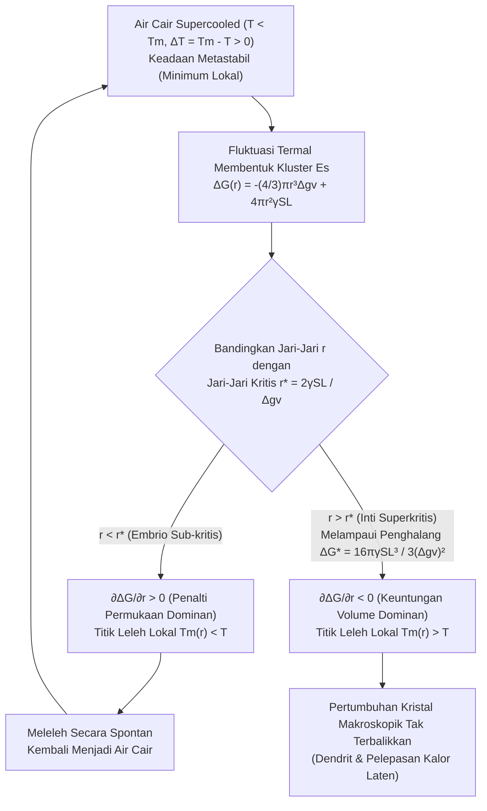
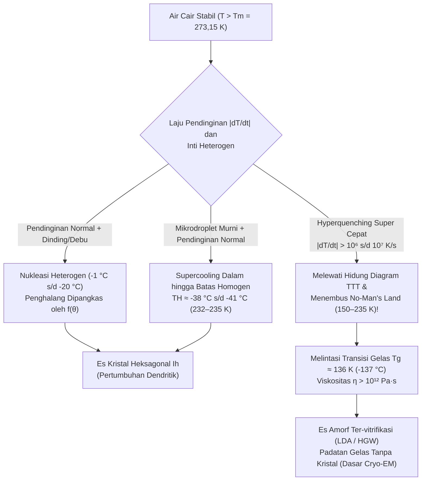

Bayangkan mengeluarkan sebotol plastik air murni yang tersegel rapat dari dalam *freezer* dengan hati-hati: termometer menunjukkan suhu $-8^\circ\text{C}$ ($265{,}15\,\text{K}$), namun air di dalamnya tetap bening dan cair sepenuhnya. Akan tetapi, begitu Anda mengetukkan dasar botol ke meja — atau menuangkan aliran air dingin itu ke atas sebutir kristal es kecil — jaring-jaring kristal putih berbentuk jarum langsung menyambar ke seluruh cairan dengan kecepatan beberapa sentimeter per detik, mengubah seluruh isi botol menjadi bubur es (*slush*) hanya dalam waktu dua detik.

Di bangku sekolah, kita mempelajari bahwa pada tekanan atmosfer standar ($1\,\text{atm} = 101{,}325\,\text{kPa}$), air membeku pada $0^\circ\text{C}$ ($273{,}15\,\text{K}$). Namun dari sudut pandang termodinamika statistik dan fisika materi terkondensasi yang ketat, $0^\circ\text{C}$ sebenarnya adalah <strong>suhu leleh kesetimbangan ($T_m$)</strong> di mana es heksagonal makroskopik ($\text{I}_h$) dan air cair memiliki potensial kimia yang identik ($\mu_{\text{L}}(P, T_m) = \mu_{\text{S}}(P, T_m)$), dan <strong>bukan suhu di mana air cair secara otomatis mengkristal</strong>.

Tanpa debu atau goresan dinding wadah, tetesan air ultramurni tetap cair pada $-15^\circ\text{C}$, $-25^\circ\text{C}$, hingga mencapai <strong>Batas Nukleasi Homogen ($T_H \approx -38^\circ\text{C}$ hingga $-41^\circ\text{C}$, atau $232\text{--}235\,\text{K}$)</strong> sebagaimana dibuktikan oleh eksperimen difraksi laser elektron bebas sinar-X (XFEL) femtodetik. Penghalang mikroskopis apa yang menahan air agar tidak langsung membeku di bawah $0^\circ\text{C}$?

---

## Bab 1: Termodinamika Keadaan Metastabil

Pada suhu $T$ dan tekanan $P$ konstan, arah transisi fase ditentukan oleh energi bebas Gibbs $G = H - TS$ (atau potensial kimia molar $\mu$). Karena entropi molar air cair lebih besar daripada es kristal ($s_{\text{L}} > s_{\text{S}} > 0$), hubungan $\left(\frac{\partial \mu}{\partial T}\right)_P = -s$ memastikan bahwa untuk seluruh $T < T_m$, es memiliki potensial kimia lebih rendah ($\mu_{\text{S}}(T) < \mu_{\text{L}}(T)$) dan merupakan <strong>minimum global</strong>.

Namun, antara $0^\circ\text{C}$ dan $-38^\circ\text{C}$, <strong>air lewat dingin (Supercooled Water)</strong> terjebak dalam <strong>keadaan metastabil (minimum lokal)</strong> pada lanskap energi bebas $G(\eta)$:

$$\frac{\partial G}{\partial \eta} = 0, \qquad \frac{\partial^2 G}{\partial \eta^2} > 0$$

Karena turunan kedua terhadap parameter keteraturan $\eta$ bernilai positif, fluktuasi termal infinitesimal justru menaikkan energi bebas dan segera lenyap. Untuk keluar menuju minimum global (es), sistem memerlukan fluktuasi terlokalisasi beramplitudo hingga yang mampu melampaui <strong>penghalang aktivasi energi bebas $\Delta G^* > 0$</strong> — yakni proses <strong>nukleasi</strong>. Sebaliknya, saat es dipanaskan hingga $0^\circ\text{C}$, permukaan es sudah memiliki lapisan pra-pelelehan kuasi-cair setebal nanometer (*Premelting Layer*), sehingga es mencair tepat pada $0^\circ\text{C}$ tanpa penghalang energi.

---

## Bab 2: Teori Nukleasi Klasik (CNT) — Keuntungan Volume vs. Penalti Antarmuka

### 2.1 Penurunan Eksak $\Delta G(r)$, Jari-Jari Kritis $r^*$, dan Penghalang $\Delta G^*$

Dirumuskan oleh Volmer, Weber, Becker, dan Döring serta diperluas ke transisi cair-padat oleh David Turnbull dan John C. Fisher (1949), <strong>Teori Nukleasi Klasik (CNT)</strong> menyatakan perubahan energi bebas Gibbs $\Delta G(r)$ saat terbentuk embrio es berbentuk bola berjari-jari $r$ di dalam air dengan derajat *undercooling* $\Delta T \equiv T_m - T > 0$:

$$\Delta G(r) = -\frac{4}{3}\pi r^3 \Delta g_v + 4\pi r^2 \gamma_{\text{SL}}$$

di mana $\Delta g_v = \Delta H_f - T\Delta S_f \approx \frac{\Delta H_f \cdot \Delta T}{T_m}$ adalah gaya dorong volumetrik (dengan kalor laten peleburan volumetrik $\Delta H_f \approx 3{,}06 \times 10^8\,\text{J/m}^3$ atau $L_f = 333{,}5\,\text{J/g}$) dan $\gamma_{\text{SL}} \approx 28\text{--}32\,\text{mJ/m}^2$ adalah tegangan antarmuka padat-cair.

Pada jari-jari sangat kecil ($r \to 0$), penalti luas permukaan ($\propto r^2$) mendominasi keuntungan volume ($\propto -r^3$). Dengan menetapkan $\frac{\partial \Delta G(r)}{\partial r} = -4\pi r^2 \Delta g_v + 8\pi r \gamma_{\text{SL}} = 0$, diperoleh <strong>jari-jari inti kritis ($r^*$)</strong> dan <strong>penghalang energi bebas nukleasi ($\Delta G^*$)</strong>:

$$r^* = \frac{2\gamma_{\text{SL}}}{\Delta g_v} = \frac{2\gamma_{\text{SL}} T_m}{\Delta H_f \Delta T}, \qquad \Delta G^* = \Delta G(r^*) = \frac{16\pi \gamma_{\text{SL}}^3}{3(\Delta g_v)^2} = \frac{16\pi \gamma_{\text{SL}}^3 T_m^2}{3(\Delta H_f)^2 (\Delta T)^2}$$

* <strong>Kluster Sub-kritis ($r < r^*$, "Embrio")</strong>: $\frac{\partial \Delta G}{\partial r} > 0$. Akibat efek Gibbs-Thomson, titik leleh lokalnya $T_m(r) = T_m(1 - \frac{2\gamma_{\text{SL}}}{\Delta H_f r})$ lebih rendah daripada suhu air $T$, sehingga embrio larut kembali secara spontan.
* <strong>Kluster Superkritis ($r > r^*$, "Inti / Nukleus")</strong>: $\frac{\partial \Delta G}{\partial r} < 0$. Penambahan molekul air menurunkan $\Delta G$, memicu pertumbuhan kristal makroskopik yang tak terbalikkan.

| Suhu $T$ ($^\circ\text{C}$) | Undercooling $\Delta T$ ($\text{K}$) | Jari-Jari Kritis $r^*$ ($\text{nm}$) | Jumlah Molekul $N^*$ | Penghalang Tereduksi $\Delta G^* / (k_B T)$ | Faktor Boltzmann $\exp(-\Delta G^* / k_B T)$ | Nukleasi Homogen |
| :--- | :--- | :--- | :--- | :--- | :--- | :--- |
| <strong>$-1{,}0^\circ\text{C}$</strong> | $1{,}0$ | $53{,}6\,\text{nm}$ | $\approx 1{,}98 \times 10^7$ | $\approx 2{,}88 \times 10^6$ | $10^{-1\,250\,000}$ | Mustahil secara statistik |
| <strong>$-5{,}0^\circ\text{C}$</strong> | $5{,}0$ | $10{,}7\,\text{nm}$ | $\approx 158\,000$ | $\approx 1{,}17 \times 10^5$ | $10^{-50\,800}$ | Mustahil sepanjang usia alam semesta |
| <strong>$-15{,}0^\circ\text{C}$</strong> | $15{,}0$ | $3{,}57\,\text{nm}$ | $\approx 5\,860$ | $\approx 1{,}35 \times 10^4$ | $10^{-5\,860}$ | Masih dilarang secara homogen |
| <strong>$-40{,}0^\circ\text{C}$</strong> ($\approx T_H$) | $40{,}0$ | $\approx 1{,}10\,\text{nm}$ | $\approx 180\text{--}250$ | $\approx 55\text{--}70$ | $\approx 10^{-25}\text{--}10^{-30}$ | <strong>Membeku spontan seketika!</strong> |

---

## Bab 3: Nukleasi Homogen vs. Heterogen — Faktor Pembasahan Turnbull $f(\theta)$

Air keran biasa membeku pada $-2^\circ\text{C}$ hingga $-5^\circ\text{C}$ melalui <strong>nukleasi heterogen</strong> pada dinding wadah atau partikel debu. Dalam model kap bola Turnbull, embrio es dengan sudut kontak $\theta$ ($\cos\theta = \frac{\gamma_{\text{sub,L}} - \gamma_{\text{sub,S}}}{\gamma_{\text{SL}}}$ menurut persamaan Young) memiliki jari-jari kelengkungan kritis $r^*$ yang sama, tetapi penghalang energinya dipangkas oleh <strong>faktor pembasahan $f(\theta)$</strong>:

$$\Delta G_{\text{het}}^* = \Delta G_{\text{hom}}^* \cdot f(\theta), \qquad f(\theta) = \frac{(2 + \cos\theta)(1 - \cos\theta)^2}{4} \in [0, 1]$$

Untuk $\theta = 30^\circ$, $f(30^\circ) \approx 0{,}013$ (penghalang turun menjadi $1{,}3\%$); untuk $\theta = 10^\circ$, $f(10^\circ) \approx 1{,}7 \times 10^{-4}$! Dua contoh epitaksi terkenal:
1. <strong>Perak Iodida ($\beta\text{-AgI}$) dalam penyemaian awan</strong> (Bernard Vonnegut, 1947): konstanta kisi heksagonalnya ($a = 4{,}580\,\text{\AA}, c = 7{,}494\,\text{\AA}$) hanya berbeda $1{,}4\%$ dari es $\text{I}_h$ ($a = 4{,}518\,\text{\AA}, c = 7{,}356\,\text{\AA}$), memicu pembekuan pada $-3^\circ\text{C}$.
2. <strong>Protein Nukleasi Es (INPs, gen `inaZ`) bakteri *Pseudomonas syringae*</strong>: pengulangan $\beta$-heliks pada membran bakteri menata molekul air menyerupai kisi es dan membekukan air pada <strong>$-1{,}5^\circ\text{C}$ hingga $-2{,}0^\circ\text{C}$</strong> (digunakan pada mesin pembuat salju buatan).

---

## Bab 4: Pembekuan Akibat Guncangan, Dendrit Mullins-Sekerka, dan Fraksi Es 10%

Saat botol air *supercooled* pada $-8^\circ\text{C}$ diketuk, gelombang kejut memicu <strong>kavitasi akustik</strong>: runtuhnya gelembung mikro secara inersia (persamaan Rayleigh-Plesset) menghasilkan lonjakan tekanan lokal berskala gigapascal ($\sim\text{GPa}$) dan dekompresi adiabatik yang langsung menembus $\Delta G^*$.

Saat kristal tumbuh, pelepasan kalor laten peleburan ($L_f = 333{,}5\,\text{J/g}$) menghangatkan antarmuka ke $0^\circ\text{C}$. Melalui <strong>ketidakstabilan morfologi Mullins-Sekerka (1963)</strong>, tonjolan kecil yang menjorok ke air dingin $-8^\circ\text{C}$ mengalami gradien suhu $|\nabla T|$ lebih curam, membuang panas lebih cepat, dan melesat membentuk jarum bercabang — <strong>dendrit</strong> — dengan kecepatan $5\text{--}10\,\text{cm/s}$.

Karena proses berlangsung hanya $\sim 2\,\text{detik}$, sistem bersifat <strong>adiabatik ($\Delta H_{\text{total}} = 0$)</strong>: kalor laten yang dilepaskan oleh fraksi massa es $f_{\text{ice}}$ menghangatkan seluruh campuran hingga $T_m = 0^\circ\text{C}$, menghentikan pembekuan seketika:

$$M \, f_{\text{ice}} \, L_f = M \, c_{p,\text{L}} \, \Delta T \quad \Longrightarrow \quad f_{\text{ice}} = \frac{c_{p,\text{L}} \Delta T}{L_f} \equiv \text{Ste} = \frac{4{,}21 \times 8{,}0}{333{,}5} \approx 0{,}101 \quad (\mathbf{10{,}1\%})$$

<strong>Hanya $10{,}1\%$ air yang benar-benar membeku menjadi es!</strong> Jaringan dendritik 3D tersebut menjebak $89{,}9\%$ sisa air cair pada $0^\circ\text{C}$ layaknya spons, menghasilkan bubur es (*slush*) yang lunak (untuk membekukan $100\%$ secara adiabatik diperlukan batas *hypercooling* $\Delta T_{\text{hyp}} = L_f / c_{p,\text{L}} \approx 79{,}2\,\text{K}$, yang mustahil dicapai pada $1\,\text{atm}$).

---

## Bab 5: Superheating, Fisika Awan, dan Transisi Gelas ($T_g$)

1. <strong>Superheating (Pemanasan Lewat Jenuh) dan Kamar Gelembung Glaser</strong>: Dalam cangkir halus yang dipanaskan dengan *microwave* di atas $100^\circ\text{C}$, <strong>tekanan kapiler Young-Laplace $\Delta P = \frac{2\gamma_{\text{LV}}}{r}$</strong> meremukkan gelembung uap di bawah jari-jari kritis $r_b^* = \frac{2\gamma_{\text{LV}}}{P_{\text{V}}(T) - P_{\text{L}}} \approx \frac{2\gamma_{\text{LV}} T_b}{\rho_{\text{V}} L_v \Delta T_{\text{sh}}}$. Menambahkan bubuk kopi atau sendok memicu pendidihan eksplosif (<strong>bumping</strong>). Pada tahun 1952, Donald Glaser (Nobel Fisika 1960) memanfaatkan hidrogen cair *superheated* dalam <strong>kamar gelembung (*Bubble Chamber*)</strong> untuk memotret jejak partikel subatomik.
2. <strong>Proses Wegener-Bergeron-Findeisen dan Protein Antibeku (AFPs)</strong>: Di bawah $0^\circ\text{C}$, tekanan uap jenuh di atas es lebih rendah daripada di atas air lewat dingin ($e_s^{\text{ice}}(T) < e_s^{\text{water}}(T)$), sehingga kristal es di awan tumbuh dengan mengorbankan tetesan air; pada pesawat terbang, tumbukan tetesan besar lewat dingin (SLD) hanya membekukan fraksi $f_{\text{ice}} = c_p\Delta T/L_f$ saat kontak dan sisanya mengalir membentuk <strong>es bening (*Glaze Ice*)</strong> yang berbahaya. Ikan kutub memproduksi <strong>glikoprotein antibeku (AFGPs)</strong> yang menempel pada permukaan es dengan jarak $d$, memaksakan kelengkungan $r \approx d/2$ yang menekan titik beku melalui efek Gibbs-Thomson ($\Delta T_{\text{TH}} = \frac{4\gamma_{\text{SL}} T_m}{\Delta H_f d}$).
3. <strong>Vitrifikasi dan "No-Man's Land" Air</strong>: Pada laju nukleasi $J(T) \propto \exp(-\Delta G_{\text{diff}}/k_B T)\exp(-\Delta G^*/k_B T)$, lonjakan viskositas $\eta(T)$ pada suhu rendah membentuk kurva "hidung (*Nose*)" pada diagram <strong>Time-Temperature-Transformation (TTT)</strong>.

Dengan mendinginkan air melampaui laju pendinginan kritis $\dot{T}_c > 10^6\,\text{K/s}$ (teknik pencelupan etana cair oleh Jacques Dubochet, peraih Nobel Kimia 2017 untuk <strong>Mikroskopi Elektron Krio, Cryo-EM</strong>), air berhasil menghindari kristalisasi melintasi "No-Man's Land" ($150\text{--}235\,\text{K}$) dan membeku di bawah <strong>suhu transisi gelas $T_g \approx 136\,\text{K}$ ($-137^\circ\text{C}$)</strong> sebagai <strong>es amorf berdensitas rendah (LDA)</strong>.
