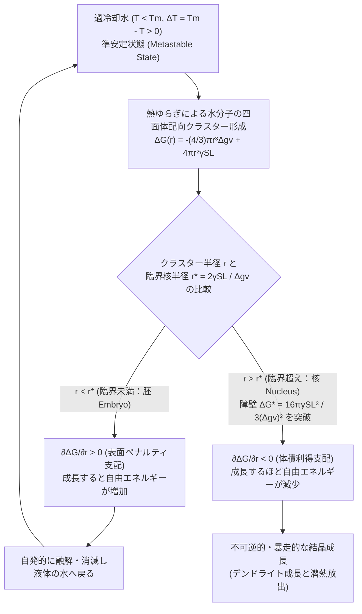
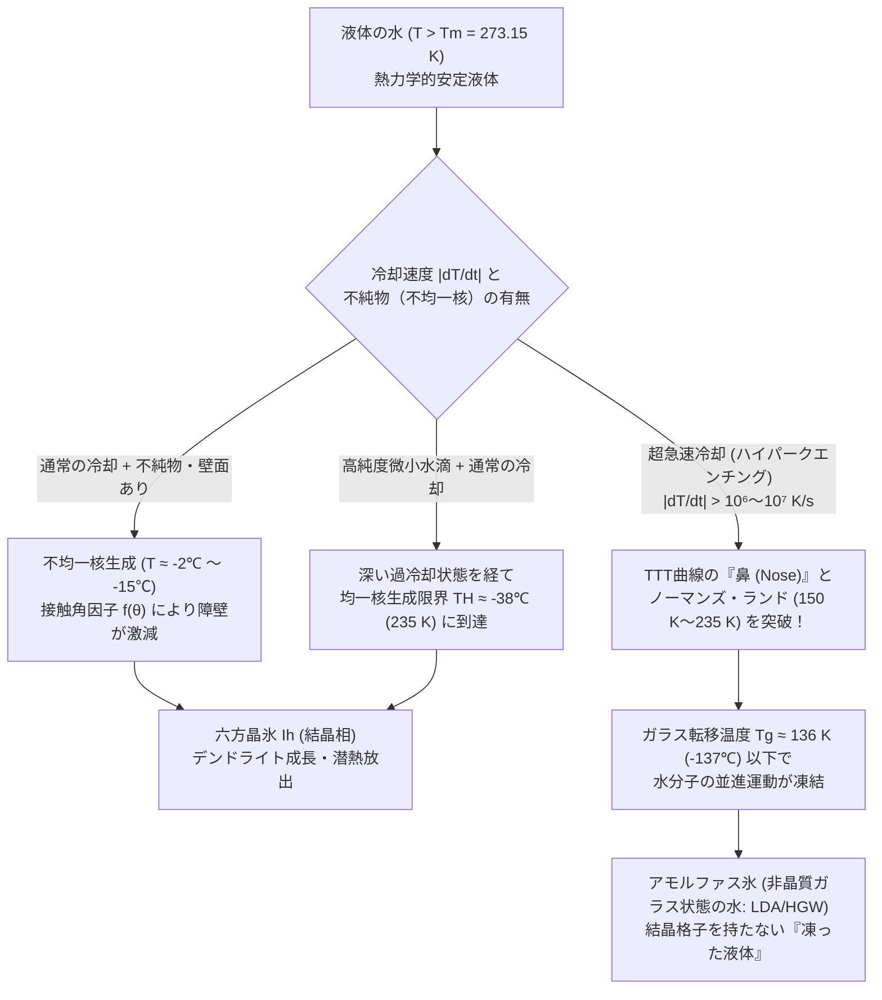

冷凍庫からそっと取り出したペットボトルの精製水。温度計を差し込めば確実にマイナス $8^\circ\text{C}$ を指しているにもかかわらず、中身はどう見ても透明な「液体」のままである。しかし次の瞬間、ボトルの底を机に軽くコツンと打ちつけるか、あるいはグラスの中の氷片に向かって注ぎ始めた途端、透明だった水の中に白い稲妻のような結晶の網目が猛烈な速度で駆け抜け、わずか数秒のうちにボトル全体が真っ白な氷の塊（シャーベット）へと変貌する。

私たちは小学校の理科で「水は $0^\circ\text{C}$ で凍り（凝固し）、$100^\circ\text{C}$ で沸騰する」と習う。しかし熱力学および統計力学の厳密な視点に立てば、この日常的な常識は半分しか正しくない。1気圧（$1013.25\,\text{hPa}$）における $0^\circ\text{C}$（$273.15\,\text{K}$）とは、厳密には<strong>「氷が溶け始める温度（融点 $T_m$）」</strong>、すなわち巨視的な氷と液体の水が熱力学的平衡状態で共存できる境界温度ではあっても、<strong>「液体の水が自動的に凍り始める温度」ではない</strong>のである。

実際、塵や不純物、容器の傷などを極限まで取り除いた高純度の水滴を大気圧下でゆっくりと冷やしていくと、水は $0^\circ\text{C}$ を通過しても何事もなかったかのように液体の状態を保ち続ける。マイナス $10^\circ\text{C}$ でも、マイナス $20^\circ\text{C}$ でも、さらにはマイナス $35^\circ\text{C}$ に達してもなお凍らない。最終的に人間の手が一切介入せずとも水分子自身の熱ゆらぎだけで自発的に凍結が始まる限界温度——<strong>均一核生成温度（Homogeneous Nucleation Limit, $T_H$）</strong>——は、1気圧において実に <strong>約 $-38^\circ\text{C} \sim -41^\circ\text{C}$（$232\,\text{K} \sim 235\,\text{K}$）</strong> という極低温領域に存在することが、最新のX線自由電子レーザー（XFEL）を用いた実験によって実証されている。

なぜ熱力学的には「氷になる方がエネルギー的に安定」であるはずの氷点下で、水はこれほど頑なに液体のままでいようとするのか？ ミクロな水分子の世界で、結晶が生まれる最初の瞬間にはどのような「見えざる壁」が立ちはだかっているのか？ そして、わずかな衝撃がその壁を崩壊させたとき、なぜボトル全体が100%のカチカチの氷ではなく、正確に計算可能な割合のシャーベットへと一瞬で変化するのか？

本稿では、<strong>準安定状態（Metastable State）</strong>の統計熱力学を出発点として、<strong>古典的核生成理論（Classical Nucleation Theory: CNT）</strong>による<strong>臨界核半径 $r^*$</strong> と<strong>自由エネルギー障壁 $\Delta G^*$</strong> の数学的導出、容器の壁やヨウ化銀・氷核タンパク質が引き起こす<strong>不均一核生成（Heterogeneous Nucleation）</strong>の幾何学、衝撃による<strong>音響キャビテーションとデンドライト（樹枝状結晶）成長</strong>の非平衡ダイナミクス、さらにはその鏡像現象である<strong>過加熱と突沸（Bumping）</strong>、大気物理学における<strong>ベルシェロン・フィンダイゼン過程</strong>、そして結晶化を完全に回避して水を「ガラス」へと変える<strong>ガラス転移（Vitrification）と水の「ノーマンズ・ランド（No-Man's Land）」</strong>に至るまで、凝縮系物理学の最重要テーマを徹底的に解き明かしていく。

---

## 第1章：「0℃＝凍る温度」という誤解と準安定状態の熱力学

### 1.1 ファーレンハイトの驚きと「融点」の真の意味

水が氷点下でも液体のまま留まる<strong>過冷却（Supercooling / Undercooling）</strong>という現象を科学史上で最初に体系的に記録したのは、華氏温度目盛（$^\circ\text{F}$）の考案者として知られるドイツの物理学者ダニエル・ガブリエル・ファーレンハイト（Daniel Gabriel Fahrenheit）であった。1724年、彼は密封したガラス球に入れた水を氷点下の屋外に一晩放置しても全く凍らず、ガラス球の先端を折り取って空気（あるいは微小な振動）を導入した瞬間に、水の中に無数の氷の薄片が走り抜けて温度が一気に $32^\circ\text{F}$（$0^\circ\text{C}$）まで跳ね上がることを発見し、深い驚きとともに王立協会に報告している。

この現象を理解するための第一歩は、熱力学における<strong>相平衡（Phase Equilibrium）</strong>の定義を正確に振り返ることである。温度 $T$、圧力 $P$ が一定の環境下において、物質がどの相（気相・液相・固相）を選ぶかを決定する支配的な熱力学ポテンシャルは、<strong>ギブズの自由エネルギー（Gibbs Free Energy） $G$</strong> である。

$$G = H - TS = U + PV - TS$$

ここで $H = U + PV$ はエンタルピー、$U$ は内部エネルギー、$S$ はエントロピーである。1モルあたり（あるいは1分子あたり）のギブズ自由エネルギーは<strong>化学ポテンシャル $\mu(P, T)$</strong> と呼ばれる。液体の水（添字 $\text{L}$）と固体の氷（六方晶氷 $\text{I}_h$、添字 $\text{S}$）の化学ポテンシャルをそれぞれ $\mu_{\text{L}}(P, T)$、$\mu_{\text{S}}(P, T)$ と書こう。

熱力学第二法則によれば、定温・定圧の閉じた系は必ずギブズ自由エネルギー $G$ が最小となる状態へ向かって変化する。各相の化学ポテンシャルを温度 $T$ で偏微分すると、1モルあたりのエントロピー $s = -\left(\frac{\partial \mu}{\partial T}\right)_P$ が得られる。分子が乱雑に動き回る液体の水は、規則正しい結晶格子に束縛された氷よりも高いエントロピーを持つ（$s_{\text{L}} > s_{\text{S}} > 0$）。したがって、$\mu(T)$ を温度 $T$ の関数としてグラフに描くと、液相の曲線 $\mu_{\text{L}}(T)$ の方が固相の曲線 $\mu_{\text{S}}(T)$ よりも急な負の傾き（$-s_{\text{L}} < -s_{\text{S}}$）を持つことになる。

この2本の曲線がちょうど交差する温度こそが、<strong>平衡融解温度（Equilibrium Melting Temperature: 融点） $T_m = 273.15\,\text{K}$（$0^\circ\text{C}$）</strong> である。

* $T > T_m$ の領域：$\mu_{\text{L}}(T) < \mu_{\text{S}}(T)$ となり、<strong>液体の水が熱力学的な最安定相</strong>となる。
* $T = T_m$ の点：$\mu_{\text{L}}(T_m) = \mu_{\text{S}}(T_m)$ となり、巨視的な氷と液体の水が引き分けの状態で無限に共存できる。
* $T < T_m$ の領域：$\mu_{\text{S}}(T) < \mu_{\text{L}}(T)$ となり、<strong>固体の氷が熱力学的な最安定相（大域的最小値：Global Minimum）</strong>となる。

では、なぜ $T < T_m$ になった瞬間にすべての水が一斉に氷へと変わらないのか？ ここに、巨視的なバルク（塊）の熱力学が見落としている<strong>「界面（Interface）のコスト」</strong>と<strong>「準安定状態（Metastable State）」</strong>の本質が潜んでいる。

### 1.2 安定・準安定・不安定（スピノーダル）の力学系アナロジー

熱力学的な状態の安定性は、山の斜面におけるボールの位置エネルギーにたとえると極めて明快になる。系の秩序変数（たとえば局所的な結晶化度や密度ゆらぎを表すパラメータ）を $\eta$ とし、自由エネルギーランドスケープ $G(\eta)$ を考えてみよう。

1. <strong>熱力学的安定状態（Stable Equilibrium）</strong>：自由エネルギー $G(\eta)$ が全領域で最も低い谷底（大域的極小値：Global Minimum）にある状態。微小なゆらぎに対しても $\frac{\partial G}{\partial \eta} = 0$ かつ曲率 $\frac{\partial^2 G}{\partial \eta^2} > 0$ であり、どのような擾乱が加わっても元の状態に戻る。$0^\circ\text{C}$ 以下の「氷」はこの状態にある。
2. <strong>準安定状態（Metastable State）</strong>：最も深い谷底ではないものの、周囲を小高い丘（エネルギー障壁 $\Delta G^*$）に囲まれた「浅い窪地（局所的極小値：Local Minimum）」にボールが引っかかっている状態である。ここでも局所的には $\frac{\partial G}{\partial \eta} = 0$ かつ<strong>二次微分（曲率）が正 $\left(\frac{\partial^2 G}{\partial \eta^2} > 0\right)$</strong> である。そのため、ごく小さな熱ゆらぎでボールがわずかに揺れても、窪地の斜面に押し戻されて元の液体状態へ引き戻されてしまう。真の谷底（氷の相）へ転がり落ちるためには、窪地の縁にあたる<strong>活性化エネルギー障壁 $\Delta G^*$ を飛び越えるだけの「有限の大きさを持った大振幅のゆらぎ（核生成：Nucleation）」</strong>が絶対に必要となる。$0^\circ\text{C}$ 以下で凍らずにいる「過冷却水」は、まさにこの準安定状態にある。
3. <strong>熱力学的不安定状態（Unstable / Spinodal State）</strong>：ボールが山の頂上や下り坂（曲率が負 $\frac{\partial^2 G}{\partial \eta^2} < 0$ の領域）に置かれた状態。ここではエネルギー障壁がゼロ（$\Delta G^* = 0$）であり、無限小のゆらぎですら自発的に増幅され、系全体が瞬時に相分離・相転移を起こす（<strong>スピノーダル分解：Spinodal Decomposition</strong>）。準安定領域と不安定領域を隔てる境界線 $\frac{\partial^2 G}{\partial \eta^2} = 0$ を<strong>スピノーダル線（Spinodal Line）</strong>と呼ぶ。

氷が溶けるとき（固相 $\to$ 液相）には、結晶の表面にはもともと気相と接する準液体層（Premelting Layer：ファラデーが1850年代に指摘した氷表面の数ナノメートルの擬似液体膜）が存在するため、自由エネルギー障壁が事実上存在せず、$0^\circ\text{C}$ を超えた瞬間に表面から確実に融解が始まる（結晶の過加熱が通常の加熱ではほぼ起きない理由である）。これに対し、液体から結晶を作る（液相 $\to$ 固相）には、何もない無秩序な液体の中に「固相と液相の境界（界面）」をゼロから新しく創り出さなければならない。この<strong>「新しい界面を創るためのエネルギーの罰金（ペナルティ）」</strong>こそが、過冷却という準安定状態を生み出す犯人なのである。

---

## 第2章：古典的核生成理論（CNT）の数学的定式化——体積利得と表面ペナルティの死闘

### 2.1 氷の「胚（Embryo）」を作るギブズ自由エネルギー変化 $\Delta G(r)$

この「体積の安定化」と「表面のペナルティ」の競合を数学的に定式化したのが、1920年代〜1930年代にマックス・フォルマー（Max Volmer）、アドルフ・ウェーバー（Adolf Weber）、レオ・ファルカス（Leo Farkas）、リヒャルト・ベッカー（Richard Becker）、ヴェルナー・デーリング（Werner Döring）らによって気液相転移向けに構築され、1949年にデイヴィッド・ターンブル（David Turnbull）とジョン・フィッシャー（John C. Fisher）によって凝縮系（液体―固体相転移）へと拡張された<strong>古典的核生成理論（Classical Nucleation Theory: CNT）</strong>である。

温度 $T$（ただし融点 $T_m$ より低く、<strong>過冷却度 $\Delta T \equiv T_m - T > 0$</strong> とする）にある過冷却水の中に、熱ゆらぎによって偶然、半径 $r$ の球形をした氷の微小クラスター（<strong>胚：Embryo</strong>）が1個形成されたとしよう。このとき、系全体のギブズ自由エネルギー変化 $\Delta G(r)$ は、<strong>「液体が固体に変わることで得られる体積項（負の利得）」</strong>と<strong>「氷と水の間に新しい界面が生じることで支払う表面項（正のコスト）」</strong>の和として厳密に書き下される。

$$\Delta G(r) = -\frac{4}{3}\pi r^3 \Delta g_v + 4\pi r^2 \gamma_{\text{SL}}$$

それぞれの項の物理的意味と温度依存性を丁寧に導出しよう。

#### （1）単位体積あたりの自由エネルギー駆動力 $\Delta g_v$
第1項の $\Delta g_v$ は、単位体積あたりの液体の水と固体の氷のギブズ自由エネルギー差（$\Delta g_v \equiv g_{\text{L}}(T) - g_{\text{S}}(T) > 0$）であり、結晶化を推し進める<strong>熱力学的駆動力（Driving Force）</strong>である。
単位体積あたりの融解エンタルピー（潜熱）を $\Delta H_f$（氷では $\Delta H_f \approx 3.06 \times 10^8\,\text{J/m}^3$、質量あたり $L_f \approx 333.5\,\text{J/g}$、モルあたり $6.01\,\text{kJ/mol}$）、単位体積あたりの融解エントロピーを $\Delta S_f$ とする。

融点 $T = T_m$ においては固液両相が平衡にあるため、自由エネルギー差はゼロである。

$$\Delta g_v(T_m) = \Delta H_f - T_m \Delta S_f = 0 \quad \Longrightarrow \quad \Delta S_f = \frac{\Delta H_f}{T_m}$$

温度 $T$ が $T_m$ から過冷却度 $\Delta T = T_m - T$ だけ下がったとき、一次近似として固液間の定圧比熱差 $\Delta c_p = c_{p,\text{L}} - c_{p,\text{S}}$ の寄与を無視すれば（ターンブル近似）、$\Delta H_f$ と $\Delta S_f$ を定数とみなせるため、$\Delta g_v(T)$ は過冷却度 $\Delta T$ に正比例する極めて美しい形で表される。

$$\Delta g_v(T) = \Delta H_f - T \Delta S_f = \Delta H_f - T \left(\frac{\Delta H_f}{T_m}\right) = \frac{\Delta H_f (T_m - T)}{T_m} = \frac{\Delta H_f \cdot \Delta T}{T_m}$$

（※なお、$-30^\circ\text{C}$ 以下の深い過冷却領域まで精密に扱う場合には、過冷却水の異常に大きな比熱 $c_{p,\text{L}}$ を考慮したホフマン近似 $\Delta g_v \approx \frac{\Delta H_f \Delta T}{T_m}\frac{T}{T_m}$ や、積分形 $\Delta g_v(T) = \frac{\Delta H_f \Delta T}{T_m} - \int_T^{T_m} \Delta c_p(T')\,dT' + T \int_T^{T_m} \frac{\Delta c_p(T')}{T'}\,dT'$ が用いられるが、物理的本質は完全に同一である。）

重要なのは、<strong>過冷却度 $\Delta T = T_m - T$ が大きくなるほど（温度が下がるほど）、氷になることで得られる体積あたりのエネルギー報酬 $\Delta g_v$ が線形に増大する</strong>という事実である。

#### （2）固液界面自由エネルギー（界面張力） $\gamma_{\text{SL}}$
第2項の $\gamma_{\text{SL}} > 0$ は、固体の氷と液体の水の境界1平方メートルあたりに蓄えられる<strong>固液界面自由エネルギー（Solid-Liquid Interfacial Tension）</strong>であり、水と氷（$\text{I}_h$）の間ではおおよそ $\gamma_{\text{SL}} \approx 28 \sim 32\,\text{mJ/m}^2$（$0.028 \sim 0.032\,\text{J/m}^2$）という値をとる。

なぜ界面には正のエネルギーコストがかかるのか？ 氷の結晶内部にある水分子は、周囲の4つの水分子と完璧な正四面体型（Tetrahedral）の水素結合ネットワークを組み、結合エンタルピーを最大限に稼いで安定化している。一方、バルクの液体の水の中にある分子は、水素結合を絶えず組み替えながら高い並進・回転エントロピーを謳歌している。ところが「氷と水の界面」に位置する水分子は、片側を結晶格子の周期ポテンシャルに拘束されて配置エントロピーを失いながら、もう片側では不完全な水素結合しか作れずエンタルピー的にも損をするという「板挟み（フラストレーション）」の状態に置かれる。このミクロなフラストレーションの総和が $\gamma_{\text{SL}}$ である。

### 2.2 臨界核半径 $r^*$ と自由エネルギー障壁 $\Delta G^*$ の厳密導出

いま導いた $\Delta G(r)$ の式をもう一度見つめてみよう。

$$\Delta G(r) = -\underbrace{\frac{4}{3}\pi r^3 \left(\frac{\Delta H_f \Delta T}{T_m}\right)}_{\text{体積項 }\propto\, r^3\text{（安定化）}} + \underbrace{4\pi r^2 \gamma_{\text{SL}}}_{\text{表面項 }\propto\, r^2\text{（不安定化）}}$$

ここには、数学における<strong>「2乗（$r^2$）と3乗（$r^3$）のスケーリング則の対決」</strong>がある！
半径 $r$ が極めて小さい領域（$r \ll 1\,\text{nm}$、水分子が数個〜数十個集まっただけのクラスター）では、$r^3$ よりも $r^2$ の方が圧倒的に大きい（たとえば $r = 0.1$ なら $r^2 = 0.01$ に対し $r^3 = 0.001$ である）。したがって、<strong>クラスターが小さいうちは第2項の表面ペナルティ $4\pi r^2 \gamma_{\text{SL}}$ が支配的となり、氷の粒が大きくなるほど自由エネルギー $\Delta G(r)$ は逆に増加（悪化）してしまう</strong>のである！

しかし、もし熱ゆらぎの偶然が重なってクラスターがある限界サイズを超えると、今度は急速に成長する $r^3$ の体積利得項が $r^2$ の表面項を追い抜き、$\Delta G(r)$ は減少（安定化）へと転じる。この山の頂上（極大点）こそが、結晶化が乗り越えなければならない分水嶺である。

$\Delta G(r)$ を半径 $r$ で微分してゼロとおく（$\frac{\partial \Delta G(r)}{\partial r} = 0$）ことで、この山頂の半径——<strong>臨界核半径（Critical Nucleus Radius） $r^*$</strong>——を求めよう。

$$\frac{\partial \Delta G(r)}{\partial r} = -4\pi r^2 \Delta g_v + 8\pi r \gamma_{\text{SL}} = 4\pi r \left( -r \Delta g_v + 2\gamma_{\text{SL}} \right) = 0$$

$r > 0$ の解として、直ちに<strong>臨界核半径 $r^*$</strong> が得られる。

$$r^* = \frac{2\gamma_{\text{SL}}}{\Delta g_v} = \frac{2\gamma_{\text{SL}} T_m}{\Delta H_f \Delta T}$$

さらに、この $r^*$ を元の $\Delta G(r)$ の式に代入すると、山頂の高さである<strong>自由エネルギー核生成障壁（Nucleation Free Energy Barrier） $\Delta G^*$</strong> が導出される。

$$\begin{aligned}
\Delta G^* \equiv \Delta G(r^*) &= -\frac{4}{3}\pi (r^*)^3 \Delta g_v + 4\pi (r^*)^2 \gamma_{\text{SL}} \\
&= -\frac{4}{3}\pi \left(\frac{2\gamma_{\text{SL}}}{\Delta g_v}\right)^3 \Delta g_v + 4\pi \left(\frac{2\gamma_{\text{SL}}}{\Delta g_v}\right)^2 \gamma_{\text{SL}} \\
&= -\frac{32\pi \gamma_{\text{SL}}^3}{3(\Delta g_v)^2} + \frac{16\pi \gamma_{\text{SL}}^3}{(\Delta g_v)^2} \\
&= \frac{16\pi \gamma_{\text{SL}}^3}{3(\Delta g_v)^2} = \frac{16\pi \gamma_{\text{SL}}^3 T_m^2}{3 (\Delta H_f)^2 (\Delta T)^2}
\end{aligned}$$

また、この関係式を用いると、任意の半径 $r$ における自由エネルギー変化は $\Delta G^*$ と $r^*$ のみを用いて無次元化された普遍的な形に書き直すこともできる。

$$\Delta G(r) = \Delta G^* \left[ 3\left(\frac{r}{r^*}\right)^2 - 2\left(\frac{r}{r^*}\right)^3 \right], \qquad \Delta G^* = \frac{1}{3}\left(4\pi (r^*)^2 \gamma_{\text{SL}}\right)$$

すなわち、臨界核を作るのに必要な活性化エネルギー $\Delta G^*$ は、<strong>「臨界核が持つ全表面エネルギー $4\pi (r^*)^2 \gamma_{\text{SL}}$ のちょうど $1/3$」</strong>（体積項が $2/3$ を相殺した残り）に等しいという、ギブズが発見したエレガントな定理が成り立つ。

### 2.3 「胚（Embryo）」の消滅と「核（Nucleus）」の暴走的成長

この $r^*$ を境にして、氷のクラスターの運命は真っ二つに分かれる。

* <strong>臨界未満のクラスター（$r < r^*$：胚 / Sub-critical Embryo）</strong>：
  この領域では傾きが正（$\frac{\partial \Delta G}{\partial r} > 0$）である。つまり、クラスターに水分子がもう1個くっついて半径 $r$ が大きくなると、系のギブズ自由エネルギー $\Delta G$ は<strong>増えてしまう</strong>。逆に、分子が剥がれてクラスターが縮小すれば $\Delta G$ は下がる。したがって、$r < r^*$ の小さな氷の赤ちゃん（胚）は、<strong>生まれても次の瞬間には熱力学の復元力によって自発的に溶けて消滅する運命にある</strong>！ 実は $0^\circ\text{C}$ 以下の過冷却水の中では、ナノ秒〜ピコ秒のタイムスケールで無数の氷の胚が絶えず生まれているのだが、そのほぼすべてが山頂 $r^*$ に届く前に坂道を転がり落ちて液体の水へと引き戻されているのである。
* <strong>臨界サイズのクラスター（$r = r^*$：臨界核 / Critical Nucleus）</strong>：
  ここでは $\frac{\partial \Delta G}{\partial r} = 0$ であり、微小な氷の球が周囲の過冷却水と不安定な平衡にある。これを別角度から表現したのが<strong>ギブズ・トムソン効果（Gibbs-Thomson Effect：曲率による融点降下）</strong>である。曲率半径 $r$ を持つ微小な球状結晶は、平坦なバルク氷（$r \to \infty$）に比べて表面張力による内部圧力上昇（ラプラス圧 $\Delta P = 2\gamma_{\text{SL}}/r$）を受けるため、その融点 $T_m(r)$ がバルク融点 $T_m^\infty$ よりも下がる。
  $$T_m(r) = T_m^\infty \left( 1 - \frac{2\gamma_{\text{SL}}}{\Delta H_f r} \right) \quad \Longleftrightarrow \quad \Delta T = T_m^\infty - T_m(r^*) = \frac{2\gamma_{\text{SL}} T_m^\infty}{\Delta H_f r^*}$$
  つまり、臨界核半径 $r^*$ とは<strong>「曲率効果によって降下した融点 $T_m(r^*)$ が、現在の過冷却水の温度 $T$ とちょうど一致するサイズ」</strong>にほかならない。
* <strong>臨界超えのクラスター（$r > r^*$：結晶核 / Supercritical Nucleus）</strong>：
  ひとたび熱ゆらぎ（あるいは外部からの衝撃）によってクラスターのサイズが山頂 $r^*$ をわずかでも超えると、傾きは負（$\frac{\partial \Delta G}{\partial r} < 0$）に反転する。ここからは水分子が付けば付くほど自由エネルギーが滝を落ちるように減少するため、もはや後戻りはできない。この $r > r^*$ のクラスターこそが真の<strong>「結晶核（Nucleus）」</strong>であり、巨視的な結晶へと<strong>不可逆かつ暴走的に（Catastrophically）成長</strong>していく。

### 2.4 数値で見る衝撃の事実：なぜ $-1^\circ\text{C}$ や $-5^\circ\text{C}$ では絶対に自発凍結しないのか？

導出した公式に実際の物理定数を代入して、過冷却度 $\Delta T$ によって $r^*$ と $\Delta G^*$ がどれほど劇的に変化するかを具体的に計算してみよう。
代表的な物性値として、$T_m = 273.15\,\text{K}$、$\Delta H_f \approx 3.06 \times 10^8\,\text{J/m}^3$、$\gamma_{\text{SL}} \approx 0.030\,\text{J/m}^2$、氷 $\text{I}_h$ における水1分子あたりの占有体積を $v_m = \frac{M_{\text{H}_2\text{O}}}{\rho_{\text{ice}} N_A} \approx 3.26 \times 10^{-29}\,\text{m}^3$、ボルツマン定数を $k_B = 1.3806 \times 10^{-23}\,\text{J/K}$ とする。臨界核に含まれる水分子の個数 $N^*$ は $N^* = \frac{4\pi (r^*)^3}{3 v_m}$ で与えられる。

| 温度 $T$ ($^\circ\text{C}$) | 過冷却度 $\Delta T$ ($\text{K}$) | 駆動力 $\Delta g_v$ ($\text{MJ/m}^3$) | 臨界核半径 $r^*$ ($\text{nm}$) | 臨界核の水分子数 $N^*$ (個) | 障壁 $\Delta G^* / (k_B T)$ (無次元) | ボルツマン因子 $\exp(-\Delta G^* / k_B T)$ | 均一核生成の現実性 |
| :--- | :--- | :--- | :--- | :--- | :--- | :--- | :--- |
| <strong>$-0.1^\circ\text{C}$</strong> | $0.1$ | $0.112$ | $536\,\text{nm}$ | $\approx 1.98 \times 10^{10}$ | $\approx 2.87 \times 10^8$ | $10^{-124,000,000}$ | 宇宙が何度終わっても絶対に不可能 |
| <strong>$-1.0^\circ\text{C}$</strong> | $1.0$ | $1.12$ | $53.6\,\text{nm}$ | $\approx 1.98 \times 10^7$ | $\approx 2.88 \times 10^6$ | $10^{-1,250,000}$ | 統計力学的に完全なゼロ |
| <strong>$-5.0^\circ\text{C}$</strong> | $5.0$ | $5.60$ | $10.7\,\text{nm}$ | $\approx 158,000$ | $\approx 1.17 \times 10^5$ | $10^{-50,800}$ | 均一核生成は絶対不可能 |
| <strong>$-15.0^\circ\text{C}$</strong> | $15.0$ | $16.8$ | $3.57\,\text{nm}$ | $\approx 5,860$ | $\approx 1.35 \times 10^4$ | $10^{-5,860}$ | 均一核生成は依然として不可能 |
| <strong>$-30.0^\circ\text{C}$</strong> | $30.0$ | $33.6$ | $1.79\,\text{nm}$ | $\approx 730$ | $\approx 3.58 \times 10^3$ | $10^{-1,550}$ | まだ障壁が高すぎる |
| <strong>$-40.0^\circ\text{C}$</strong> ($\approx T_H$) | $40.0$ | $44.8$ | $\approx 1.15\,\text{nm}^*$ | $\approx 190 \sim 260^*$ | $\approx 55 \sim 70^*$ | $\approx 10^{-25} \sim 10^{-30}$ | <strong>1秒以内に確実に自発凍結！</strong> |

（※ $-40^\circ\text{C}$ 付近の $*$ 印は、低温での界面張力の緩やかな低下 $\gamma_{\text{SL}}(T) \approx 22 \sim 24\,\text{mJ/m}^2$ を考慮した実測整合値である。）

この表を見れば、私たちがなぜ「$0^\circ\text{C}$ になっても水は自発的には凍らない」と断言できるのかが一目瞭然であろう。
自由エネルギー障壁 $\Delta G^*$ は<strong>過冷却度の2乗に反比例（$\Delta G^* \propto (\Delta T)^{-2}$）</strong>し、臨界核に含まれる分子数 $N^*$ は<strong>過冷却度の3乗に反比例（$N^* \propto (\Delta T)^{-3}$）</strong>する。

もし $T = -1^\circ\text{C}$（$\Delta T = 1\,\text{K}$）の純水の中で均一核生成を起こそうとすれば、熱ゆらぎの偶然だけで<strong>約2,000万個もの水分子（半径 $53.6\,\text{nm}$）</strong>が一斉に氷の結晶格子へと整列しなければならず、そのエネルギー障壁は熱エネルギー $k_B T$ の実に<strong>288万倍</strong>に達する。統計力学において、エネルギー $\Delta G^*$ のゆらぎが生じる確率はボルツマン因子 $\exp\left(-\frac{\Delta G^*}{k_B T}\right)$ に比例する。1立方センチメートルの水の中には約 $3.3 \times 10^{22}$ 個（$\approx 10^{22.5}$ 個）の水分子があり、分子の熱振動・配向試行回数は1秒間に約 $10^{12}$ 回（ピコ秒スケール）であるから、1立方センチメートルの水全体で1秒間に行われる核生成の試行回数（前指数因子 $J_0$）はせいぜい $10^{35} \sim 10^{40}\,\text{cm}^{-3}\text{s}^{-1}$ 程度である。したがって、1秒間に1個の臨界核が生まれるためには、ボルツマン因子が $\exp\left(-\frac{\Delta G^*}{k_B T}\right) \sim 10^{-30}$ すなわち <strong>$\frac{\Delta G^*}{k_B T} \approx 60 \sim 75$</strong> の水準にまで下がらなければならない。

この条件 $\frac{\Delta G^*(T)}{k_B T} \approx 65$ が満たされるのは、過冷却度が $\Delta T \approx 38 \sim 41\,\text{K}$ に達し、臨界核半径が $r^* \approx 1.1\,\text{nm}$（水分子にしてわずか<strong>約200個〜250個</strong>のクラスター！）にまで縮小したとき——すなわち<strong>均一核生成限界 $T_H \approx -38^\circ\text{C} \sim -41^\circ\text{C}$</strong> に到達したときだけなのである。

---

## 第3章：均一核生成 vs. 不均一核生成——なぜ水道水は数度の氷点下で凍るのか？

### 3.1 ターンブルの球冠（Spherical Cap）モデルと接触角因子 $f(\theta)$

ここで鋭い読者は当然こう疑問に思うはずだ。「もし純水が $-38^\circ\text{C}$ まで自発的に凍らないのなら、なぜ我が家の冷凍庫（約 $-18^\circ\text{C}$）に入れた製氷皿の水道水は、$-2^\circ\text{C}$ や $-3^\circ\text{C}$ であっさり凍り始めるのか？」

その答えこそが、何もないバルクの液体内部で起こる<strong>均一核生成（Homogeneous Nucleation）</strong>と、容器の壁面・微小な傷・水中に浮遊する塵（ダスト）や不純物の表面を足場にして起こる<strong>不均一核生成（Heterogeneous Nucleation）</strong>の決定的な違いである。

不純物や容器の固体壁面（基板：Substrate、添字 $\text{sub}$）の上に、氷の胚（添字 $\text{S}$）が<strong>接触角（Contact Angle） $\theta$</strong> をもってドーム状——幾何学的には<strong>球冠（Spherical Cap）</strong>——の形で作られる状況を考えよう（デイヴィッド・ターンブルの球冠モデル）。

ここには3種類の界面が存在する。
1. 氷と過冷却水の界面（界面張力 $\gamma_{\text{SL}}$）
2. 基板と過冷却水の界面（界面張力 $\gamma_{\text{sub,L}}$）
3. 基板と氷の界面（界面張力 $\gamma_{\text{sub,S}}$）

球冠の端（三相接触線：Three-Phase Contact Line）における水平方向の力の釣り合いから、有名な<strong>ヤングの式（Young's Equation）</strong>が成り立つ。

$$\gamma_{\text{sub,L}} = \gamma_{\text{sub,S}} + \gamma_{\text{SL}} \cos\theta \quad \Longrightarrow \quad \cos\theta = \frac{\gamma_{\text{sub,L}} - \gamma_{\text{sub,S}}}{\gamma_{\text{SL}}}$$

もし基板の表面が氷の結晶構造と相性が良く（親氷性が高く）、基板が水と接しているよりも氷と接している方がエネルギーが低い（$\gamma_{\text{sub,S}} < \gamma_{\text{sub,L}}$）ならば、$\cos\theta > 0$ すなわち接触角は鋭角（$\theta < 90^\circ$）となり、氷の胚は基板の上にべったりと薄く広がるような球冠を作る。

曲率半径 $r$、接触角 $\theta$ を持つ球冠の幾何学を計算すると、その体積 $V_{\text{cap}}(r, \theta)$、氷―水間のドーム曲面面積 $A_{\text{SL}}(r, \theta)$、および基板と接する底面円の面積 $A_{\text{base}}(r, \theta)$ は、球面幾何学の積分により次のように求まる。

$$\begin{aligned}
V_{\text{cap}}(r, \theta) &= \frac{4}{3}\pi r^3 \cdot \frac{(2 + \cos\theta)(1 - \cos\theta)^2}{4} \\
A_{\text{SL}}(r, \theta) &= 2\pi r^2 (1 - \cos\theta) \\
A_{\text{base}}(r, \theta) &= \pi (r \sin\theta)^2 = \pi r^2 (1 - \cos^2\theta)
\end{aligned}$$

この球冠が形成されるときのギブズ自由エネルギー変化 $\Delta G_{\text{het}}(r, \theta)$ は、体積利得と、新しくできたドーム表面のコスト、さらに底面が「基板―水界面」から「基板―氷界面」に置き換わったことによるエネルギー変化の合計である。

$$\Delta G_{\text{het}}(r, \theta) = -V_{\text{cap}}(r, \theta) \Delta g_v + A_{\text{SL}}(r, \theta)\gamma_{\text{SL}} + A_{\text{base}}(r, \theta)(\gamma_{\text{sub,S}} - \gamma_{\text{sub,L}})$$

ここにヤングの式 $\gamma_{\text{sub,S}} - \gamma_{\text{sub,L}} = -\gamma_{\text{SL}}\cos\theta$ を代入して表面項を整理すると、驚くべき因数分解が起こる！

$$\begin{aligned}
\text{表面項の和} &= 2\pi r^2 (1 - \cos\theta)\gamma_{\text{SL}} - \pi r^2 (1 - \cos^2\theta)\gamma_{\text{SL}}\cos\theta \\
&= \pi r^2 \gamma_{\text{SL}} (1 - \cos\theta) \left[ 2 - (1 + \cos\theta)\cos\theta \right] \\
&= 4\pi r^2 \gamma_{\text{SL}} \cdot \frac{(2 + \cos\theta)(1 - \cos\theta)^2}{4}
\end{aligned}$$

体積項に掛かっている幾何学因子と、表面項に掛かっている幾何学因子が<strong>寸分違わず完全に一致した</strong>ではないか！ この普遍的な角度関数を<strong>形状因子（または濡れ因子：Wetting Factor） $f(\theta)$</strong> と定義する。

$$f(\theta) \equiv \frac{(2 + \cos\theta)(1 - \cos\theta)^2}{4} = \frac{2 - 3\cos\theta + \cos^3\theta}{4} \quad \in [0, 1]$$

すると、不均一核生成の自由エネルギー変化 $\Delta G_{\text{het}}(r, \theta)$ は、均一核生成の $\Delta G_{\text{hom}}(r)$ に $f(\theta)$ を掛けただけの極めて簡潔な比例関係に帰着する。

$$\Delta G_{\text{het}}(r, \theta) = \Delta G_{\text{hom}}(r) \cdot f(\theta)$$

これを $r$ で微分してゼロとおいても、定数倍の $f(\theta)$ は消えるため、<strong>不均一核生成における臨界曲率半径 $r_{\text{het}}^*$ は均一核生成の $r_{\text{hom}}^*$ と全く変わらない</strong>（$r_{\text{het}}^* = r_{\text{hom}}^* = \frac{2\gamma_{\text{SL}}}{\Delta g_v}$）。
しかし、その曲率半径 $r^*$ を達成するために必要な氷の体積（分子数）と、乗り越えるべき<strong>自由エネルギー障壁 $\Delta G_{\text{het}}^*$ は、形状因子 $f(\theta)$ の分だけ劇的に圧縮される</strong>のである！

$$\Delta G_{\text{het}}^* = \Delta G_{\text{hom}}^* \cdot f(\theta) = \frac{16\pi \gamma_{\text{SL}}^3 T_m^2}{3 (\Delta H_f)^2 (\Delta T)^2} \cdot \frac{(2 + \cos\theta)(1 - \cos\theta)^2}{4}$$

接触角 $\theta$ によって障壁削減係数 $f(\theta)$ がどれほど劇的に小さくなるかを確認してみよう。

* $\theta = 180^\circ$（完全に水を弾き、氷を全く寄せ付けない理想表面）：$\cos 180^\circ = -1 \implies f(180^\circ) = \frac{1 \times 4}{4} = 1.000$（障壁削減ゼロ＝均一核生成と同じ）。
* $\theta = 90^\circ$（半球状の核）：$\cos 90^\circ = 0 \implies f(90^\circ) = \frac{2 \times 1}{4} = 0.500$（エネルギー障壁が半分に半減）。
* $\theta = 45^\circ$：$\cos 45^\circ \approx 0.7071 \implies f(45^\circ) \approx 0.058$（障壁が約 $1/17$ に縮小）。
* $\theta = 20^\circ$（氷の結晶格子に近い鉱物や傷）：$\cos 20^\circ \approx 0.9397 \implies f(20^\circ) \approx 0.0027$（<strong>障壁が実に $1/370$ に激減！</strong>）。
* $\theta = 10^\circ$（ヨウ化銀や氷核タンパク質などの超優良テンプレート）：$\cos 10^\circ \approx 0.9848 \implies f(10^\circ) \approx 0.00017$（<strong>障壁が $1/5,800$ に崩壊！</strong>）。
* $\theta = 0^\circ$（完全濡れ、たとえば既存の「氷の結晶そのもの」の表面）：$\cos 0^\circ = 1 \implies f(0^\circ) = 0$（<strong>核生成障壁が完全にゼロ！</strong> だからこそ、過冷却水を氷のかけらに注いだ瞬間、待ち時間ゼロで直ちに凍結が始まるのである）。

直感的に言えば、何もない水の中で半径 $r^* = 20\,\text{nm}$ の球を丸ごと1個作ろうとすれば膨大な数の水分子を集めなければならないが、氷と相性の良い壁面（小さな接触角 $\theta$）の上であれば、<strong>「半径 $20\,\text{nm}$ の大球のほんのてっぺんだけを薄く切り取ったレンズ状のキャップ」</strong>を作るだけで、その表面の曲率半径はすでに臨界値 $r^* = 20\,\text{nm}$ をクリアしてしまうのである！ これこそが、わずかな塵や容器の傷が「氷の種（Nucleation Site）」として働き、$-2^\circ\text{C}$ や $-5^\circ\text{C}$ でも水を凍らせてしまう幾何学的トリックの正体である。

### 3.2 人工降雨のヨウ化銀（$\text{AgI}$）と最強の生物学的氷核「シュードモナス菌」

この不均一核生成の原理を人類が極限まで応用したのが<strong>人工降雨（Cloud Seeding）</strong>であり、自然界が進化の過程で生み出した最高傑作が<strong>氷核活性細菌（Ice-Nucleating Bacteria）</strong>である。

#### （1）ヨウ化銀（$\text{AgI}$）による結晶格子のエピタキシャル・マッチング
1946年、ゼネラル・エレクトリック（GE）研究所のヴィンセント・シェーファー（Vincent Schaefer）がドライアイスによる過冷却雲の凍結を発見した直後、同僚の物理学者<strong>バーナード・ヴォネガット（Bernard Vonnegut：作家カート・ヴォネガットの実兄！）</strong>は、わざわざ低温のドライアイスを使わずとも、<strong>「氷と結晶格子の形や寸法がそっくりな別の固体結晶」</strong>を煙にして雲に撒けば、水分子がだまされてその表面に整列し、小さな接触角 $\theta \to 0$ で氷の核を作るはずだと考えた。

彼が結晶学ハンドブックを徹底的に調べて見つけ出した物質が<strong>ヨウ化銀（Silver Iodide: $\text{AgI}$）</strong>であった。
通常の1気圧付近で作られる氷（六方晶氷 $\text{I}_h$）は六方晶系（空間群 $P6_3/mmc$）に属し、その格子定数は $a = 4.518\,\text{\AA}$、$c = 7.356\,\text{\AA}$ である。驚くべきことに、ヨウ化銀の低温安定相である $\beta\text{-AgI}$（ウルツ鉱型六方晶構造、空間群 $P6_3mc$）の格子定数は <strong>$a = 4.580\,\text{\AA}$、$c = 7.494\,\text{\AA}$</strong> であり、氷との<strong>格子不整合度（Lattice Mismatch）がわずか $1.4\% \sim 1.9\%$ しかない</strong>！ この驚異的な構造の一致により、ヨウ化銀の微粒子表面では水分子がほとんど歪みなく六角形のネットワークを形成でき、本来なら $-38^\circ\text{C}$ まで凍らないはずの雲粒を <strong>$-3^\circ\text{C} \sim -4^\circ\text{C}$ という極めて高い温度で確実に凍結させる</strong>ことができる。

#### （2）生物界最強の氷製造機：シュードモナス・シリンゲ（*Pseudomonas syringae*）
しかし、人間の化学者が発見したヨウ化銀をさらに上回る「地球上最強の氷核物質」を、微生物は数千万年も前から発明していた。植物の葉の表面などに生息するグラム陰性細菌<strong>シュードモナス・シリンゲ（*Pseudomonas syringae*）</strong>が外膜に持つ<strong>氷核タンパク質（Ice-Nucleating Protein: INP、遺伝子名 `inaZ` 等）</strong>である。

このタンパク質は、16個のアミノ酸残基からなる反復配列（タンデムリピート）が幾重にも折り畳まれた長大な $\beta$-ヘリックス構造をしており、その表面に並ぶスレオニン（Thr）やセリン（Ser）の水酸基（$-\text{OH}$）が、まさに氷の結晶面（ベーサル面やプリズム面）の酸素原子の間隔と寸分違わぬ周期で配列している。さらに細菌の外膜上で数十個のINP分子が巨大な凝集体（クラスター）を形成することで、最初から臨界核半径 $r^*$ に匹敵する広大な「氷の鋳型テンプレート」を提供する。その結果、シュードモナス・シリンゲが存在する水は、実に <strong>$-1.2^\circ\text{C} \sim -2.0^\circ\text{C}$</strong> という融点ギリギリの温度で凍結を開始する！

なぜこの細菌はわざわざ水を凍らせるのか？ 彼らは植物の葉の表面で水を凍らせることで、鋭い氷の結晶によって植物の細胞壁を物理的に突き破り（霜害：Frost Damage）、壊れた植物細胞から漏れ出してくる栄養分を吸収して生きているのである。今日、世界中のスキー場で使用されている人工降雪機には、この不活化されたシュードモナス・シリンゲの乾燥粉末（商品名 Snomax など）が添加されており、気温がマイナス2度程度の比較的暖かい夜でも効率よく人工雪を降らせることを可能にしている。さらに大気物理学の研究により、葉の表面から舞い上がったこの細菌が上空の雲に到達し、地球規模の降水サイクルを誘発する「バイオ・エアロゾル（Bioprecipitation）」として機能していることまで明らかになっている。

---

## 第4章：衝撃で一瞬にして凍るメカニズムと、なぜ「100%の氷」にならずシャーベットになるのか？

### 4.1 音響キャビテーションと摩擦核生成（Tribonucleation）

それではいよいよ、冒頭で提示した最大の謎——<strong>「マイナス $8^\circ\text{C}$ に過冷却されたペットボトルの水を机にコツンと叩きつけた瞬間、なぜ一瞬で凍りつくのか？」</strong>——を物理学的に解剖しよう。

「振動を与えると水分子が揺さぶられて氷の配置に並ぶのだろう」と素朴に説明されることがあるが、これだけでは定量的には不十分である。なぜなら、手でボトルを叩く機械的振動の周波数（数 $\text{Hz}$ 〜数 $\text{kHz}$）は、水分子の熱運動の周波数（約 $10^{12}\,\text{Hz}$：テラヘルツ領域）に比べれば何億分の一という途方もなく遅い動きであり、分子から見れば単なる静的な並進移動にすぎないからである。

近年の高速度カメラ観測および流体力学・熱力学の研究によって解明された真のトリガーは、<strong>音響キャビテーション（Acoustic Cavitation：微小気泡の膨張・圧潰）</strong>および固液界面での<strong>摩擦・剪断核生成（Tribonucleation / Shear-Induced Nucleation）</strong>である。

ペットボトルを机に打ちつけると、ボトルの壁面から過冷却水の内部へ鋭い<strong>圧力波（音響衝撃波）</strong>が伝播する。音波は「圧縮波（高圧）」と「膨張波（負圧・引張応力）」の繰り返しである。

1. <strong>微小気泡の急速膨張と気液界面での配向・蒸発冷却</strong>：
   水中に目に見えないミクロン〜サブミクロンサイズで溶存していた空気の微小気泡（マイクロバブル）や、ペットボトル内壁の疎水性ポケットに潜んでいた気泡核が、衝撃波の負圧フェーズによって急激に引き伸ばされて膨張する。気泡が高速で膨張・変形する際、気液界面における強い電場勾配と表面張力勾配が水分子の双極子を強制的に配向させるとともに、気泡内部への急速な断熱膨張・蒸発が局所的な界面温度をさらに引き下げる。
2. <strong>気泡の暴力的圧潰（Rayleigh-Plesset Collapse）と超高圧スパイク</strong>：
   続く正圧フェーズにおいて、膨張したキャビテーション気泡は周囲の流体から猛烈な勢いで押し潰される（レイリー・プレセット方程式に従う非線形圧潰）。気泡が潰れる瞬間、その中心付近には数千気圧〜数ギガパスカル（$\text{GPa}$）に達する極限的な<strong>局所超高圧スパイク</strong>が発生する。
   水の相図を思い出してほしい。通常の六方晶氷 $\text{I}_h$ は加圧すると融点が下がる（約 $200\,\text{MPa}$ で $-22^\circ\text{C}$）が、$0.2\,\text{GPa}$ を超える超高圧領域では氷よりも高密度な高圧氷相（氷 $\text{III}, \text{V}, \text{VI}$ など）の融点が圧力とともに急上昇するほか、圧力パルスが通過した直後の<strong>急激な断熱減圧（Adiabatic Decompression）</strong>は、局所的な過冷却度を瞬間的に $-40^\circ\text{C}$（均一核生成限界 $T_H$）相当の領域へと叩き込む！
   さらに、激しく崩壊する気泡のジェット流が既存の微小な氷の胚を粉々に引き裂く<strong>二次核生成（Secondary Nucleation / Crystal Multiplication）</strong>を引き起こし、たった1個の臨界核がマイクロ秒のうちに数百万個の結晶核へと爆発的に増殖するのである。

### 4.2 マリンズ・セケルカ不安定性とデンドライト（樹枝状結晶）の高速伝播

こうしてボトルの一点（多くの場合、気泡が存在する水面付近や衝撃を受けた底面）で臨界核 $r > r^*$ が誕生すると、白い結晶のフロントが秒速数センチメートルという目に見える猛スピードでボトル全体へと枝分かれしながら駆け抜けていく。なぜ丸い氷の玉が大きくなるのではなく、針のような枝分かれ構造——<strong>デンドライト（Dendrite：樹枝状結晶）</strong>——として走るのだろうか？

これを支配しているのが、1963年にウィリアム・マリンズ（William W. Mullins）とロバート・セケルカ（Robert F. Sekerka）が定式化した<strong>マリンズ・セケルカ形態不安定性（Mullins-Sekerka Morphological Instability）</strong>である。

氷の結晶が成長するとき、液体の水が固体の氷に変わる界面では、1グラムあたり $L_f = 333.5\,\text{J/g}$ という莫大な<strong>凝固潜熱（Latent Heat of Fusion）</strong>が放出される。この潜熱のせいで、成長しつつある氷のすぐ表面の温度はほぼ $0^\circ\text{C}$（$T_m$）まで温められてしまう。結晶がさらに成長を続けるためには、界面で発生したこの熱を、周囲の冷たい過冷却水（たとえば $-8^\circ\text{C}$）の中へと<strong>熱伝導によって逃がし続けなければならない</strong>（これを<strong>ステファン問題：Stefan Problem</strong> と呼ぶ）。

いま、ほぼ球形をした氷の結晶の表面に、偶然ほんの小さな「突起（出っ張り）」ができたと想像してみよう。
周囲は $-8^\circ\text{C}$ の冷たい海であり、結晶表面は $0^\circ\text{C}$ である。等温線（温度の等高線）を描くと、平らな表面の前方よりも、冷たい海の中へと突き出した<strong>「突起の先端（Tip）」の周囲の方が、等温線がギュッと密集し、温度勾配 $|\nabla T|$ が圧倒的に急峻になる</strong>（電磁気学における避雷針の先端に電場が集中する「先端効果：Point Effect」と数学的に全く同じラプラス方程式の性質である！）。

フーリエの熱伝導法則 $\mathbf{q} = -k_{\text{L}} \nabla T$ により、温度勾配 $|\nabla T|$ が急な突起の先端からは、平らな部分よりもはるかに猛烈なスピードで潜熱が周囲の過冷却水へと逃げ去っていく。熱が早く逃げれば逃げるほど、その先端はますます速く凍ることができる！
つまり、<strong>「少し出っ張った場所ほど熱を効率よく捨てられるため、さらに猛スピードで前方へ突き出していく」</strong>という正のフィードバック（暴走的不安定性）が働くのである。その結果、滑らかな球面は瞬く間に崩壊し、氷 $\text{I}_h$ の六方晶対称性を反映した6方向の鋭い針（主幹：Primary Arm）と、そこから次々に分岐する側枝（Sidebranch）からなるフラクタル状の<strong>デンドライト（樹枝状結晶）</strong>となって、冷たい未凍結の過冷却水を求めてボトルの隅々まで稲妻のように突き進んでいくのである。

過冷却度 $\Delta T$ が大きいほど、デンドライト先端の成長速度 $v_{\text{tip}}$ はイヴァンツォフ（Ivantsov）の放物面解およびランガー・ミュラー＝クルムハール（Langer-Müller-Krumbhaar）の選択理論に従い、おおよそ $\Delta T$ のべき乗（$v_{\text{tip}} \propto (\Delta T)^\beta, \beta \approx 2 \sim 2.6$）で劇的に加速する。$-8^\circ\text{C}$ では毎秒約 $5 \sim 10\,\text{cm/s}$ に達するため、高さ $20\,\text{cm}$ のペットボトルならわずか2〜3秒で上から下まで結晶の網目が到達する。

### 4.3 断熱エンタルピー保存則：なぜ「約10%」しか凍らないのか？

さて、ボトルの底まで白い結晶が駆け抜けた直後、ペットボトルの中身はどうなっているだろうか？
外から見るとボトル全体が真っ白な氷の塊になったように見える。しかし、ボトルを強く握ってみると「グシャッ」と簡単に潰れ、キャップを開けて中身を出すと、カチカチの氷ではなく<strong>水分をたっぷり含んだ柔らかいシャーベット（スラッシュ：Slush）</strong>になっていることに気づく。しかも、そのシャーベットに温度計を挿すと、先ほどまでマイナス $8^\circ\text{C}$ だったはずの温度が、ピタリと <strong>$0.0^\circ\text{C}$</strong> に戻っているのである！

この劇的な温度上昇とシャーベット化の割合は、熱力学第一法則（エンタルピー保存則）から小学生の算数レベルの明快さで厳密に計算できる。

結晶がボトル内を駆け抜けるのにかかる時間はわずか2〜3秒である。この極めて短い時間の間、プラスチックのボトルの壁を通じた外部の空気との熱のやり取りは無視できるほど小さい。すなわち、この急速凍結プロセスは熱力学的に<strong>断熱過程（Adiabatic Process, $\Delta H_{\text{total}} = 0$）</strong>である。

質量 $M$ の過冷却水が、初期温度 $T_i = T_m - \Delta T$（たとえば $-8^\circ\text{C}$、すなわち $\Delta T = 8\,\text{K}$）にあるとしよう。
結晶化が始まると、水が凍るたびに1グラムあたり $L_f \approx 333.5\,\text{J/g}$ の凝固潜熱が放出される。この放出された熱はどこへ行くのか？ 外部へ逃げられない以上、<strong>ボトルの内部にある水と氷自身の温度を押し上げる（顕熱として吸収される）しかない</strong>！
そしてボトル内部の温度がどんどん上昇し、ついに融点 $T_m = 0^\circ\text{C}$ に到達した瞬間、$\mu_{\text{L}}(T_m) = \mu_{\text{S}}(T_m)$ すなわち過冷却度 $\Delta T$ がゼロとなるため、<strong>結晶を成長させる熱力学的駆動力が完全に消失し、それ以上の凍結はピタリと止まる</strong>のである。

全質量 $M$ のうち、最終的に氷へと変わった質量割合（<strong>氷結率：Ice Fraction</strong>）を $f_{\text{ice}} \equiv \frac{M_{\text{ice}}}{M}$ としよう。
「割合 $f_{\text{ice}}$ の水が凍ることで放出した潜熱」と、「全体の温度が $\Delta T$ だけ上昇して $0^\circ\text{C}$ になるために吸収した顕熱」が等しいという熱量保存の式を立てると、

$$M \cdot f_{\text{ice}} \cdot L_f = M \cdot c_{p,\text{L}} \cdot \Delta T$$

両辺を質量 $M$ で割れば、直ちに氷結率 $f_{\text{ice}}$ を与える黄金の公式（無次元数である<strong>ステファン数 $\text{Ste}$</strong> に一致する）が得られる！

$$f_{\text{ice}} = \frac{c_{p,\text{L}} \cdot \Delta T}{L_f} \equiv \text{Ste}$$

ここに、$0^\circ\text{C} \sim -8^\circ\text{C}$ における過冷却水の定圧比熱 $c_{p,\text{L}} \approx 4.21\,\text{J/(g}\cdot\text{K)}$、氷の凝固潜熱 $L_f = 333.5\,\text{J/g}$、そして初期過冷却度 $\Delta T = 8.0\,\text{K}$（$-8^\circ\text{C}$）を代入してみよう。

$$f_{\text{ice}} = \frac{4.21\,\text{J/(g}\cdot\text{K)} \times 8.0\,\text{K}}{333.5\,\text{J/g}} = \frac{33.68}{333.5} \approx 0.1010 \quad (\mathbf{10.1\%})$$

なんと、<strong>ボトル全体が真っ白に凍りついたように見えたあの瞬間、実際に氷に変わった水は全体のたった「10.1%」にすぎず、残りの「約90%」はまだ $0^\circ\text{C}$ の液体の水のまま</strong>だったのである！
それなのに、なぜボトルを逆さまにしても水がこぼれないほど「固まった」ように見えるのか？ それは、凍った $10\%$ の氷が1つの塊として底に沈んでいるのではなく、先ほど説明した<strong>無数の微細なデンドライト（樹枝状結晶）の針がボトルの端から端まで三次元的なジャングルジム（浸透ネットワーク：Percolating Network）を張り巡らせ、そのミクロな網目の隙間に残り $90\%$ の液体の水を毛細管現象と粘性によって閉じ込めている（スポンジが水を吸っているのと同じ状態）</strong>からなのである。

ちなみに、もし外部へ一切熱を逃がさずに、過冷却状態から一瞬の断熱凍結だけでボトルの水を「$100\%$ カチカチの完全な氷（$f_{\text{ice}} = 1.0$）」にしたければ、初期の過冷却度 $\Delta T$ はいくら必要になるだろうか？
上の式で $f_{\text{ice}} = 1$ とおけば、必要な過冷却度——これを<strong>ハイパークーリング限界（Hypercooling Limit） $\Delta T_{\text{hyp}}$</strong> と呼ぶ——は、

$$\Delta T_{\text{hyp}} = \frac{L_f}{c_{p,\text{L}}} \approx \frac{333.5\,\text{J/g}}{4.21\,\text{J/(g}\cdot\text{K)}} \approx 79.2\,\text{K} \quad (\text{すなわち } \mathbf{-79.2^\circ\text{C}}\text{！})$$

となる。しかし第2章で見た通り、液体の水は $-38^\circ\text{C} \sim -41^\circ\text{C}$（$T_H$）まで冷やした時点で均一核生成によって必ず自発的に凍ってしまうため、1気圧のバルクの水を $-79.2^\circ\text{C}$ まで液体のまま過冷却することは物理的に不可能である。したがって、<strong>大気圧下で過冷却水が衝撃で凍るとき、それが一瞬で100%の固体の氷になることは熱力学第一法則によって絶対的に禁じられており、必ずシャーベット（最大でも $\Delta T \approx 40\,\text{K}$ で氷結率約 $50\%$ 強）にしかならない</strong>のである。

---

## 第5章：鏡像としての「過加熱と突沸（Bumping）」——電子レンジの悲劇から泡箱まで

### 5.1 ヤング・ラプラス方程式と臨界蒸気泡半径 $r_b^*$

液体が凝固点 $T_m$ を下回っても凍らない「過冷却」と全く同じ物理原理が、温度スケールの反対側——沸点 $T_b$（1気圧で $100^\circ\text{C} = 373.15\,\text{K}$）を上回っても沸騰しない<strong>「過加熱（Superheating）」</strong>——においてもそのまま成立する。

傷ひとつない滑らかなガラスコップや新しい陶器（マグカップ）に水を入れて電子レンジで加熱したとき、沸騰の泡が一切出ていないにもかかわらず、取り出してコーヒーの粉末やスプーンを入れた瞬間に、水が一気に爆発的に沸き上がって顔や手に大火傷を負う事故——<strong>突沸（Bumping / Explosive Boiling）</strong>——が毎年のように報告されている。

なぜ $100^\circ\text{C}$ を超えても水はすぐには沸騰しないのか？
沸騰とは、液体の内部に「水蒸気の泡（気相の核）」が生まれて成長する一次相転移である。周囲の液体の圧力を $P_{\text{L}}$（大気圧 $1\,\text{atm} \approx 101.3\,\text{kPa}$）、温度 $T > T_b$ にある過加熱水の内部にできた半径 $r$ の球状の水蒸気泡の内部圧力を $P_{\text{V}}(T)$（その温度における飽和蒸気圧に近い値）、気液界面の表面張力を $\gamma_{\text{LV}}$（$100^\circ\text{C}$ の水で約 $58.9\,\text{mJ/m}^2$）としよう。

この蒸気泡を形成するためのギブズ自由エネルギー変化 $\Delta G_{\text{bubble}}(r)$ は、第2章のCNTと全く同じ構造を持つ。

$$\Delta G_{\text{bubble}}(r) = -\frac{4}{3}\pi r^3 \left( P_{\text{V}}(T) - P_{\text{L}} \right) + 4\pi r^2 \gamma_{\text{LV}}$$

これを $r$ で微分して $\frac{\partial \Delta G_{\text{bubble}}}{\partial r} = 0$ とおけば、泡が潰れずに成長できる最小サイズ——<strong>臨界気泡半径（Critical Bubble Radius） $r_b^*$</strong>——が得られる。

$$r_b^* = \frac{2\gamma_{\text{LV}}}{P_{\text{V}}(T) - P_{\text{L}}} \quad \Longleftrightarrow \quad P_{\text{V}}(T) = P_{\text{L}} + \frac{2\gamma_{\text{LV}}}{r_b^*}$$

右側の式は、流体力学で有名な<strong>ヤング・ラプラス方程式（Young-Laplace Equation）</strong>そのものである！
すなわち、半径 $r$ の丸い泡の表面には、表面張力 $\gamma_{\text{LV}}$ が泡を押し潰そうとする内向きの圧力——<strong>ラプラス圧（毛細管圧） $\Delta P_{\text{Laplace}} = \frac{2\gamma_{\text{LV}}}{r}$</strong>——が働いている。

このラプラス圧がどれほど凄まじいかを計算してみよう。
ちょうど $T = 100.0^\circ\text{C}$ のとき、水の飽和蒸気圧は $P_{\text{V}}(100^\circ\text{C}) = 1\,\text{atm} = P_{\text{L}}$ である。もしこの水の中に、半径 $r = 100\,\text{nm}$（$10^{-7}\,\text{m}$）の小さな水蒸気の泡が生まれたとしよう。その泡を押し潰そうとするラプラス圧は、

$$\Delta P_{\text{Laplace}} = \frac{2 \times 0.0589\,\text{N/m}}{10^{-7}\,\text{m}} = 1.178 \times 10^6\,\text{Pa} \approx \mathbf{11.6\,\text{気圧（atm）}}$$

なんと、大気圧の1倍に加えて表面張力が<strong>11.6気圧もの力で泡を締め上げている</strong>ため、泡の内部が合計12.6気圧以上の水蒸気圧を持たない限り、その泡は生まれた瞬間にペシャンコに押し潰されて消滅してしまうのである！（水の飽和蒸気圧が12.6気圧に達するには、温度を約 $190^\circ\text{C}$ まで上げなければならない！）

クラウジウス・クラペイロンの式（Clausius-Clapeyron Relation）を用いて、沸点からの<strong>過加熱度 $\Delta T_{\text{sh}} \equiv T - T_b > 0$</strong> と蒸気圧差の関係を $P_{\text{V}}(T) - P_{\text{L}} \approx \frac{\rho_{\text{V}} L_v \Delta T_{\text{sh}}}{T_b}$（ここで $\rho_{\text{V}}$ は水蒸気密度、$L_v \approx 2257\,\text{J/g}$ は蒸発潜熱）と近似すれば、臨界気泡半径 $r_b^*$ と核生成障壁 $\Delta G_{\text{bubble}}^*$ は次のように書ける。

$$r_b^* \approx \frac{2\gamma_{\text{LV}} T_b}{\rho_{\text{V}} L_v \Delta T_{\text{sh}}}, \qquad \Delta G_{\text{bubble}}^* = \frac{16\pi \gamma_{\text{LV}}^3}{3\left(P_{\text{V}}(T) - P_{\text{L}}\right)^2}$$

ヤカンや鍋でお湯を沸かすときに $100^\circ\text{C}$ 付近でちゃんと沸騰が始まるのは、金属や古い鍋の底にある無数のミクロな傷や凹み（キャビティ）の中に最初から空気のポケット（半径数マイクロメートル〜数十マイクロメートルの既存の気泡核）がトラップされており、ナノメートル領域の巨大なラプラス圧の壁を最初からバイパスした<strong>不均一気泡核生成</strong>が起きているからである。さらにコンロによる加熱は鍋の底から一方向に行われるため、強い対流が生じる。

ところが、傷のない滑らかなマグカップに水を入れて<strong>電子レンジ（マイクロ波誘電加熱、周波数 $2.45\,\text{GHz}$）</strong>にかけると、マイクロ波が水の内部へ直接浸透して体積全体を一様に加熱するため対流が起こりにくく、また壁面に気泡の種も存在しない。その結果、水は沸騰できないまま $105^\circ\text{C} \sim 110^\circ\text{C}$ の<strong>過加熱状態（準安定液体）</strong>へと静かに突入する。そこへコーヒーの粉や砂糖、割り箸などを投入すると、無数の微細な空気ポケット（不均一核生成サイト）が一挙に供給され、蓄えられていた過剰な顕熱 $c_{p,\text{L}} \Delta T_{\text{sh}}$ が一瞬にして水蒸気へと変わる<strong>突沸（Flash Vaporization / Bumping）</strong>を引き起こすのである（水の体積は水蒸気になると約1,700倍に膨張するため、わずか数パーセントの水が気化しただけでカップの中身全体が天井まで吹き飛ぶことになる）。なお、不純物を完全に除いた純水の<strong>均一気泡核生成限界（スピノーダルに近い極限過加熱温度）</strong>は、1気圧において実に <strong>約 $280^\circ\text{C} \sim 302^\circ\text{C}$</strong> に達することが実験で確認されている。

### 5.2 ドナルド・グレーザーの「泡箱（Bubble Chamber）」と素粒子物理学

この「過加熱された準安定液体は、ほんのわずかなエネルギーの引き金で局所的に沸騰する」という性質を逆手にとって、目に見えない素粒子の軌跡を写真に撮る画期的な検出器へと昇華させたのが、アメリカの物理学者<strong>ドナルド・グレーザー（Donald A. Glaser、1960年ノーベル物理学賞受賞）</strong>が1952年に発明した<strong>泡箱（Bubble Chamber）</strong>である。（よく「ビールを眺めていて思いついた」という伝説が語られるが、実際にはグレーザーは古典的核生成理論のラプラス圧と静電エネルギーの計算から緻密に設計し、初期実験でジエチルエーテルを用いた後に、ジョークとしてビールでも試してみたというのが史実である。）

泡箱の内部には、沸点より少し低い温度で高圧に保たれた液体水素（または液体プロパンなど）が満たされている。素粒子ビームが入射するほんの数ミリ秒前に、ピストンを急速に引いて容器内の圧力 $P_{\text{L}}$ を一気に下げる。すると液体水素は一瞬にして沸点を大きく超えた<strong>過加熱状態（準安定状態）</strong>に突入する。
その直後、高エネルギーの荷電粒子（陽子、パイ中間子、電子など）が液体の中を突き抜けると、飛跡に沿って周囲の原子を電離させ、ナノメートル領域に極微小な熱スパイク（デルタ線による局所加熱）を落とす。このエネルギー注入がまさに核生成障壁 $\Delta G_{\text{bubble}}^*$ を超える引き金となり、素粒子が通った道筋にだけ半径 $r > r_b^*$ のミクロな蒸気泡が一列に並んで誕生する！
泡が数ミリ秒間成長して目に見える大きさ（直径数十マイクロメートル）になった瞬間にストロボを焚いて写真を撮り、容器全体が突沸してしまう前に再びピストンで加圧して泡を消し去る。この「準安定状態の制御」によって、20世紀後半の素粒子物理学（中性カレントの発見や新粒子の探索）は黄金時代を切り拓いたのである。

---

## 第6章：空に浮かぶ過冷却の海・極限生物の知恵・そして「ガラス転移」へ

### 6.1 雲の物理学：ベルシェロン・フィンダイゼン過程と航空機の着氷事故

視線を実験室から頭上の空へと向けてみよう。私たちが毎日見上げている雲の多くは、実は<strong>「空に浮かぶ巨大な過冷却水の貯蔵庫」</strong>である。
対流圏の上空、気温が $0^\circ\text{C}$ から $-35^\circ\text{C}$ 程度までの高さに浮かぶ雲（積雲、層積雲、高積雲など）を構成する直径 $10 \sim 20\,\mu\text{m}$ の微小な雲粒（Cloud Droplets）は、1粒あたりの体積が極めて小さい（約 $10^{-9}\,\text{cm}^3$）ため、氷核となる塵を含まない確率が高く、<strong>氷点下 $15^\circ\text{C}$ や $20^\circ\text{C}$ の上空でもその大半が液体の「過冷却水滴（Supercooled Liquid Droplets）」のまま浮かんでいる</strong>！

この「過冷却水滴と少数の氷晶が同じ雲の中に共存する状態（混相雲：Mixed-Phase Cloud）」こそが、温帯地域に雨や雪を降らせる最も重要なメカニズム——<strong>ヴェーゲナー・ベルシェロン・フィンダイゼン過程（Wegener-Bergeron-Findeisen Process: WBF過程、冷たい雨の過程）</strong>——のエンジンである。

熱力学のクラウジウス・クラペイロン式から導かれる通り、同じ氷点下の温度 $T < 0^\circ\text{C}$ において、<strong>「氷の表面における飽和水蒸気圧 $e_s^{\text{ice}}(T)$」は、「過冷却水の表面における飽和水蒸気圧 $e_s^{\text{water}}(T)$」よりも常に低い</strong>（なぜなら、氷から水分子を引き剥がす昇華潜熱 $L_{\text{sub}} = L_v + L_f \approx 2834\,\text{J/g}$ の方が、液体から引き剥がす蒸発潜熱 $L_v \approx 2500\,\text{J/g}$ よりも大きいため、氷の表面からは水分子が飛び出しにくいからである）。

$$e_s^{\text{ice}}(T) < e_s^{\text{water}}(T) \quad (\text{for all } T < 273.15\,\text{K})$$

両者の差 $\Delta e_s = e_s^{\text{water}}(T) - e_s^{\text{ice}}(T)$ は、<strong>約 $-12^\circ\text{C} \sim -15^\circ\text{C}$ 付近で最大</strong>となる（この温度で過冷却水に対する相対湿度が $100\%$ の空気は、氷に対しては実に約 $113\% \sim 115\%$ もの<strong>過飽和状態</strong>にある！）。
そのため、過冷却水滴がひしめく雲の中にたった1個の氷の結晶が誕生すると、周囲の過冷却水滴からは次々に水分子が蒸発し、その水蒸気が氷の結晶へと猛烈な勢いで昇華凝結（Deposition）して吸い寄せられていく。こうして過冷却水滴を食べ尽くしながら数分で巨大な雪の結晶へと成長した氷が、重力に引かれて落下を開始し、途中で溶ければ「雨」、溶けずに地表に届けば「雪」となるのである。

しかし、この空に浮かぶ過冷却水滴は、航空機にとっては極めて恐ろしい脅威となる。<strong>航空機着氷（Aircraft Icing）</strong>である。
気温 $-5^\circ\text{C} \sim -15^\circ\text{C}$ の過冷却雲の中を旅客機が猛スピードで通過すると、主翼の前縁（Leading Edge）や速度計のピトー管に過冷却水滴が激突する。この激しい機械的衝撃と金属表面との接触が瞬間的な不均一核生成を引き起こす。

* <strong>樹氷状着氷（Rime Ice）</strong>：気温が低く（$-15^\circ\text{C} \sim -30^\circ\text{C}$）、水滴が小さい場合、水滴は翼にぶつかった瞬間に空気を巻き込みながらその場でほぼ完全に凍りつくため、白く脆い着氷となる。
* <strong>雨氷状着氷（Glaze Ice / Clear Ice）</strong>：最も危険なのが、気温が比較的高く（$-2^\circ\text{C} \sim -10^\circ\text{C}$）、大粒の過冷却水滴（Supercooled Large Droplets: SLD）が存在する場合である。第4章の公式 $f_{\text{ice}} = \frac{c_p \Delta T}{L_f}$ を思い出してほしい！ $\Delta T = 5\,\text{K}$ なら、ぶつかった瞬間に凍るのは水滴のわずか <strong>$6\%$</strong> であり、残りの <strong>$94\%$ の水は $0^\circ\text{C}$ の液体の膜となって主翼の表面を後方へとズルズルと流れていき、翼の上面（防氷ヒーターが届かない領域）で周囲の冷気に熱を奪われて透明で高密度な氷の塊（雨氷・クリアアイス）として凍結する</strong>！ このクリアアイスは主翼の気流を剥離させて揚力を劇的に奪い、数々の痛ましい航空機事故（1994年のATR-72ローズローン墜落事故や、2009年のエールフランス447便ピトー管凍結事故など）の直接原因となってきた。

### 6.2 極限生物のクライオバイオロジー：不凍タンパク質（AFP）によるケルビン効果ピン止め

氷点下の海や極地の冬を生き抜く生物たちもまた、CNTの数式を巧みに操って自らの命を守っている。細胞の中でデンドライト状の氷が成長すれば、鋭い氷の針が細胞膜をズタズタに引き裂き、さらに残された未凍結液の塩分濃度が急上昇する浸透圧ショックによって細胞は即座に死滅する。

南極海の氷の下（海水温 約 $-1.9^\circ\text{C}$）を泳ぐ<strong>ナンキョクカジカ（Antarctic Toothfish, *Dissostichus mawsoni*）</strong>などの魚類や越冬昆虫は、体液の浸透圧だけでは $-0.8^\circ\text{C}$ 程度で凍ってしまうはずなのに、決して凍ることがない。彼らは血液中に<strong>不凍タンパク質（Antifreeze Proteins: AFPs）</strong>や<strong>不凍糖タンパク質（AFGPs）</strong>を合成しているからである。

不凍タンパク質はどのようにして氷の成長を止めているのか？
実はAFPは、液体の水全体の性質を変えているのではなく、<strong>生まれたばかりの微小な氷の結晶の表面に不可逆的に吸着し、氷がそれ以上成長するのを物理的にブロックしている（レイモンド・デヴリーズの吸着阻害機構：Adsorption-Inhibition Mechanism）</strong>のである。

氷の表面に間隔 $d$（通常数ナノメートル）でAFP分子が点々と張り付いたとしよう。氷がさらに成長するためには、AFP分子とAFP分子の間の狭い隙間（間隔 $d$）から、氷の界面が風船のようにプクッと外側へ膨らみ出さなければならない。
しかし、間隔 $d$ の隙間から氷が膨らみ出すと、その氷の表面は最小でも半径 $r \approx d/2$ という<strong>極めて強い正の曲率（丸み）</strong>を持つことになる！
第2章で学んだ<strong>ギブズ・トムソン効果（ケルビン効果）</strong>を思い出そう。曲率半径 $r \approx d/2$ を持つ丸まった氷の界面は、表面張力ペナルティによって局所的な凝固温度が $\Delta T_{\text{TH}}$ だけ押し下げられる。

$$\Delta T_{\text{TH}} \approx \frac{2\gamma_{\text{SL}} T_m}{\Delta H_f (d/2)} = \frac{4\gamma_{\text{SL}} T_m}{\Delta H_f d}$$

その結果、氷は溶ける温度（融点 $T_m$）は変わらないまま、<strong>成長できる温度（非平衡凝固点）だけが数度低く押し下げられる</strong>（この融点と凝固点のギャップ $\Delta T_{\text{TH}}$ を<strong>熱ヒステリシス：Thermal Hysteresis</strong> と呼ぶ）。生物たちは、まさにCNTの「表面曲率ペナルティ $4\pi r^2 \gamma_{\text{SL}}$」をナノスケールのピン止めによって人工的に作り出し、過冷却状態を安定化させているのである！

### 6.3 結晶化を完全に出し抜く「ガラス転移（Vitrification）」と水のノーマンズ・ランド

最後に、現代の物性物理学と構造生物学における最もスリリングなフロンティア——<strong>「もし水を、氷の核が成長する暇すら与えないほどの超高速で冷却したらどうなるか？」</strong>——を見届けよう。

第2章と第3章では、温度が下がるほど核生成障壁 $\Delta G^*(T)$ が小さくなり、水が凍りやすくなることを見た。しかし、実際に単位体積・単位時間あたりにどれだけの結晶核が生まれるかを表す<strong>定常核生成速度（Steady-State Nucleation Rate） $J(T)$</strong>（単位：$\text{m}^{-3}\text{s}^{-1}$）の完全なターンブル・フィッシャー方程式には、もう1つ決定的に重要な因子が含まれている。

$$J(T) = J_0 \exp\left( -\frac{\Delta G_{\text{diff}}(T)}{k_B T} \right) \exp\left( -\frac{\Delta G^*(T)}{k_B T} \right)$$

ここで新しく登場した $\exp\left(-\frac{\Delta G_{\text{diff}}(T)}{k_B T}\right)$ は、水分子が液体のネットワークから結合を切って回転・移動し、氷の結晶格子へと飛び移るための<strong>拡散活性化因子（運動学的因子：Kinetic Factor）</strong>であり、液体の<strong>粘性率 $\eta(T)$</strong> に反比例（自己拡散係数 $D(T) \propto \frac{k_B T}{\eta(T)}$ に比例）する。

温度 $T$ を融点 $T_m$ からどんどん下げていくと、2つの指数関数の間で壮絶な綱引きが起こる。
1. <strong>熱力学的因子 $\exp\left(-\frac{\Delta G^*(T)}{k_B T}\right)$</strong>：温度が下がる（$\Delta T$ が増える）ほど障壁 $\Delta G^* \propto (\Delta T)^{-2}$ が急減するため、核生成速度を<strong>猛烈に加速させる</strong>。
2. <strong>運動学的（拡散）因子 $\exp\left(-\frac{\Delta G_{\text{diff}}(T)}{k_B T}\right) \propto \frac{1}{\eta(T)}$</strong>：温度が下がるほど分子の熱運動が鈍り、液体の粘性率 $\eta(T)$ が<strong>フォーゲル・フルチャー・タマン（VFT）則</strong> $\eta(T) = \eta_0 \exp\left(\frac{B T_0}{T - T_0}\right)$ に従って天文学的に増大するため、水分子が動けなくなり、核生成速度に<strong>猛烈なブレーキをかける</strong>！

この「アクセル（熱力学）」と「ブレーキ（運動学・粘性）」の積をとると、核生成速度 $J(T)$（および結晶化が完了するまでの時間 $\tau_{\text{xtal}}(T)$）は、ある中間温度で極大値（時間としては極小値）を持つ特徴的な山型になる。横軸に時間の対数 $\log t$、縦軸に温度 $T$ をとって結晶化が始まる境界線を描いたグラフを<strong>TTT図（Time-Temperature-Transformation Diagram：時間―温度―変態図）</strong>と呼ぶ。TTT図の上では、結晶化領域が左側に突き出したアルファベットの「C」のような形をしており、最も結晶化までの時間が短い突き出し部分を<strong>「TTT曲線の鼻（Nose）」</strong>と呼ぶ。

もし私たちが、結晶化が最も速く進む「TTT曲線の鼻」を通過するよりもさらに速い<strong>臨界冷却速度（Critical Cooling Rate） $\dot{T}_c = |dT/dt|_c$</strong> で液体を一気に冷やし抜くことができれば、水分子は氷の結晶格子に並び替わる時間的余裕を完全に失ったまま、粘性率が $\eta \approx 10^{12}\,\text{Pa}\cdot\text{s}$ に達する<strong>ガラス転移温度（Glass Transition Temperature, $T_g$）</strong>へと突入する！
こうして結晶化を一度も経験することなく、液体の乱雑な分子配置（アモルファス構造）を保ったままカチカチの固体になった状態こそが<strong>ガラス（Glass / Amorphous Solid）</strong>であり、このプロセスを<strong>ガラス化（Vitrification）</strong>と呼ぶ。

二酸化ケイ素（窓ガラス）や一般的なポリマーは、分子構造が複雑で粘性が高いため、毎秒数度〜数分の一度というゆっくりした冷却でも簡単に「鼻」をかわしてガラスになる。しかし、水分子（$\text{H}_2\text{O}$）は分子が小さく水素結合の組み替えがピコ秒で起こるため、純粋な水におけるTTT曲線の鼻は極めて左（マイクロ秒領域）に突き出している。
そのため、純水において均一核生成が始まる $T_H \approx 235\,\text{K}$（$-38^\circ\text{C}$）から、加熱時にアモルファス氷が結晶化してしまう温度 $T_x \approx 150\,\text{K}$（$-123^\circ\text{C}$）までの温度帯は、通常の冷却ではミリ秒以内に必ず氷になってしまう領域として、物理学者たちから畏敬の念を込めて<strong>水の「ノーマンズ・ランド（No-Man's Land：誰も立ち入れない領域）」</strong>と呼ばれてきた。

この「ノーマンズ・ランド」を突破して純水をガラス化（<strong>低密度アモルファス氷：Low-Density Amorphous Ice, LDA / Hyperquenched Glassy Water, HGW</strong>）するための臨界冷却速度は、実に<strong>毎秒100万ケルビン〜1,000万ケルビン（$\dot{T}_c \sim 10^6 \sim 10^7\,\text{K/s}$）</strong>にも達する！
1980年代、スイスの生物物理学者<strong>ジャック・デュボシェ（Jacques Dubochet）</strong>は、タンパク質などの生体分子を含んだ極めて薄い水溶液の膜を、液体窒素で冷やした液体エタン（約 $-190^\circ\text{C}$、沸騰気体膜を作らないため冷却効率が極めて高い）の中へ猛スピードで撃ち込むことで、毎秒 $10^6\,\text{K/s}$ 超のハイパークエンチングを実現し、水を<strong>ガラス転移温度 $T_g \approx 136\,\text{K}$（$-137^\circ\text{C}$）</strong>以下の「アモルファス氷（ガラス化した水）」として凍結させることに成功した。

なぜこれが革命だったのか？ 通常の冷凍で生体試料を凍らせると、第4章で見た氷の結晶（デンドライト）が成長して生体分子の立体構造を破壊し、電子線も氷の結晶格子で回折して像が乱れてしまう。しかし、水を<strong>ガラス化（Vitrification）</strong>させれば、体積膨張も結晶の刃も一切生じず、生体分子が溶液の中で生きて働いているそのままの姿を、透明なガラスの鎧の中に原子レベルの解像度で閉じ込めることができるのである！ この<strong>クライオ電子顕微鏡法（Cryo-EM）</strong>の確立によって、デュボシェはヨアヒム・フランク、リチャード・ヘンダーソンとともに<strong>2017年のノーベル化学賞</strong>を受賞した。また今日、不妊治療におけるヒトの卵子や受精卵（胚）の凍結保存がほぼ $100\%$ に近い生存率を達成しているのも、高濃度のガラス化液と液体窒素による超急速冷却で氷の核生成を完全に回避する「ガラス化保存法（Vitrification）」のおかげである。

さらに、このノーマンズ・ランドの奥深くには、水の異常物性（$4^\circ\text{C}$ で密度が最大になること、過冷却領域で等温圧縮率 $\kappa_T$ や定圧比熱 $C_P$ が $-45^\circ\text{C} \approx 228\,\text{K}$ に向かって発散するように急増すること）のすべての謎を解く鍵として、1992年にピーター・プール（Peter H. Poole）、フランチェスコ・ショルティーノ（Francesco Sciortino）、ウルリッヒ・エスマン（Ulrich Essmann）、ユージン・スタンレー（H. Eugene Stanley）らが提唱した<strong>「液―液臨界点（Liquid-Liquid Critical Point: LLCP）仮説」</strong>——過冷却水は単一の液体ではなく、水素結合が密に詰まった<strong>高密度液体（High-Density Liquid: HDL）</strong>と、氷のような正四面体ネットワークが発達した<strong>低密度液体（Low-Density Liquid: LDL）</strong>という2種類の異なる「液体の水」の間で揺れ動いており、低温高圧のノーマンズ・ランド内部に第2の臨界点が存在するという壮大な理論——が横たわっており、今この瞬間も世界中の物理学者たちがフェムト秒X線レーザーを駆使してその直接観測に挑み続けている。

---

## 第7章：総括——日常のコップ一杯の水に宿る統計力学のドラマ

本稿で辿ってきた、氷点下の水と相転移をめぐる物理学の全体像を最後に整理しよう。

| 現象・領域 | 温度範囲（1気圧・純水基準） | 支配する熱力学・物理法則 | 臨界サイズ・特徴的スケール | 自然界・工学における具体例 |
| :--- | :--- | :--- | :--- | :--- |
| <strong>平衡融点（Melting Point）</strong> | $T_m = 0.0^\circ\text{C}$ ($273.15\,\text{K}$) | $\mu_{\text{L}}(P, T_m) = \mu_{\text{S}}(P, T_m)$ （巨視的固液相平衡） | $r^* \to \infty$, $\Delta G^* \to \infty$ | 氷が溶け始める温度（水が自動凍結する温度ではない） |
| <strong>不均一核生成（Heterogeneous Nucleation）</strong> | $-1^\circ\text{C} \sim -25^\circ\text{C}$ | $\Delta G_{\text{het}}^* = \Delta G_{\text{hom}}^* \cdot f(\theta)$ $f(\theta) = \frac{(2+\cos\theta)(1-\cos\theta)^2}{4}$ | 接触角 $\theta$ により障壁が $10^{-2} \sim 10^{-4}$ 倍に激減 | 水道水の凍結、ヨウ化銀（$\text{AgI}$）人工降雨、氷核細菌 *P. syringae* |
| <strong>衝撃凍結とデンドライト成長</strong> | 過冷却度 $\Delta T > 0$（例：$-8^\circ\text{C}$） | キャビテーション圧潰＋マリンズ・セケルカ不安定性＋断熱熱量保存 | 氷結率 $f_{\text{ice}} = \frac{c_p \Delta T}{L_f}$ （$-8^\circ\text{C}$ で約 $10.1\%$ がシャーベット化） | 過冷却ペットボトルの衝撃凍結、雨氷（Clear Ice）による航空機着氷 |
| <strong>均一核生成限界（Homogeneous Limit）</strong> | $T_H \approx -38^\circ\text{C} \sim -41^\circ\text{C}$ ($232 \sim 235\,\text{K}$) | $\Delta G^* = \frac{16\pi \gamma_{\text{SL}}^3 T_m^2}{3(\Delta H_f)^2 (\Delta T)^2} \approx 65 k_B T$ | $r^* \approx 1.1\,\text{nm}$ （水分子 約 $200 \sim 250$ 個） | 巻雲（Cirrus）の自発凍結、バルク過冷却水の低温極限 |
| <strong>ガラス転移（Vitrification）</strong> | $T_g \approx -137^\circ\text{C}$ ($136\,\text{K}$) （冷却速度 $> 10^6\,\text{K/s}$） | 粘性率 $\eta(T)$ の急増によりTTT曲線の鼻（ノーマンズ・ランド）を回避 | 結晶核が成長する前に並進運動が凍結（アモルファス氷 LDA） | クライオ電子顕微鏡（Cryo-EM）、受精卵のガラス化凍結保存 |
| <strong>過加熱と突沸（Superheating & Bumping）</strong> | $T > 100^\circ\text{C}$（最大 $\sim 300^\circ\text{C}$） | ヤング・ラプラス圧 $\Delta P = \frac{2\gamma_{\text{LV}}}{r}$ $r_b^* = \frac{2\gamma_{\text{LV}}}{P_{\text{V}}(T) - P_{\text{L}}}$ | 傷のない容器で気泡核が不在のとき準安定化 | 電子レンジ加熱水の突沸、グレーザーの素粒子泡箱（Bubble Chamber） |

「水は0℃で凍る」というたった一行の教科書の記述の裏側には、<strong>体積自由エネルギー利得（$\propto r^3$）と界面張力ペナルティ（$\propto r^2$）の激しい綱引き</strong>があり、数千万個から数百個へと縮小していく<strong>臨界核半径 $r^*$</strong> のドラマがあり、熱を逃がすために自らを雪の結晶のようなフラクタルへと変貌させる<strong>マリンズ・セケルカ不安定性</strong>があり、そして結晶化すら追い抜いて時間を止める<strong>ガラス転移</strong>の物理が広がっている。

次に冷凍庫から冷たい水を取り出すとき、あるいは冬の空に浮かぶ白い雲を見上げるとき、その透明な水滴の中で毎秒1兆回も繰り返されている「氷の胚たちの誕生と消滅」、そして臨界核という頂を超えた瞬間に解き放たれる相転移のダイナミズムに、ぜひ思いを馳せてみてほしい。
