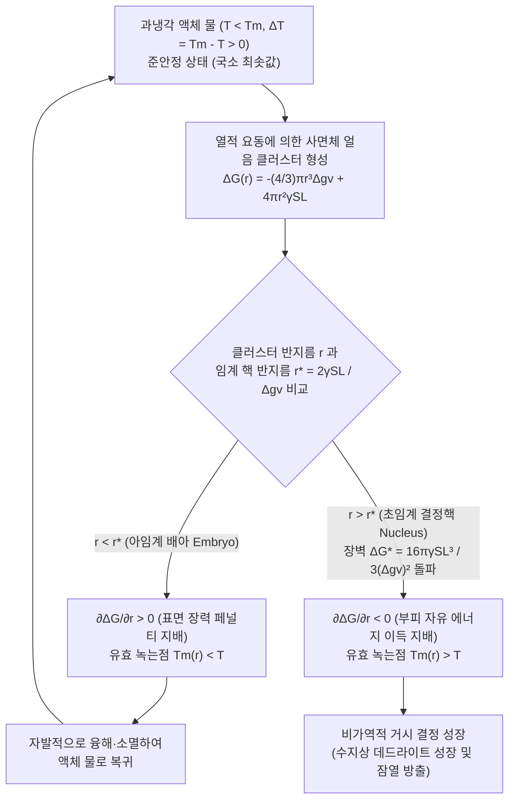
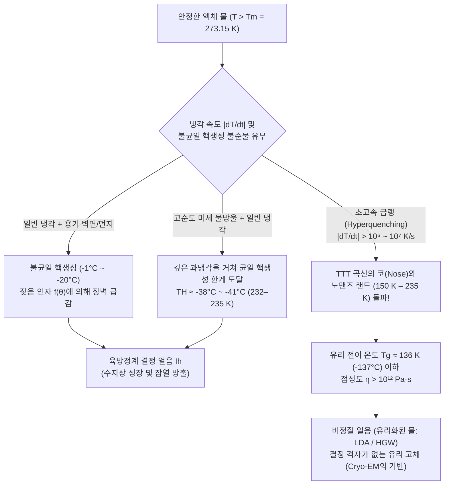

냉동실에서 조심스럽게 꺼낸 정제수 페트병. 온도계는 분명 영하 $8^\circ\text{C}$($265.15\,\text{K}$)를 가리키고 있지만, 병 속의 물은 여전히 투명하고 찰랑거리는 액체 상태 그대로다. 그러나 다음 순간, 병 바닥을 테이블에 가볍게 톡 치거나 컵 속의 작은 얼음 조각 위로 물을 붓기 시작하자마자, 투명했던 물속으로 하얀 번개 같은 바늘 모양의 결정망이 초속 수 센티미터의 맹렬한 속도로 뻗어 나가며 단 2~3초 만에 병 전체가 새하얀 슬러시(샤베트) 덩어리로 변모한다.

우리는 학교에서 표준 대기압($1\,\text{atm} = 101.325\,\text{kPa}$) 아래의 물은 $0^\circ\text{C}$에서 얼고 $100^\circ\text{C}$에서 끓는다고 배운다. 하지만 응집물질물리학과 통계열역학의 엄밀한 관점에서 볼 때, $0^\circ\text{C}$($273.15\,\text{K}$)는 거시적인 육방정계 얼음($\text{I}_h$)과 액체 물의 화학 퍼텐셜이 같아져($\mu_{\text{L}}(P, T_m) = \mu_{\text{S}}(P, T_m)$) 공존할 수 있는 <strong>평형 융해 온도(녹는점, $T_m$)</strong>일 뿐, <strong>액체 물이 자발적으로 얼기 시작하는 온도가 아니다</strong>.

실제로 먼지나 불순물, 용기 벽면의 흠집을 완벽히 제거한 고순도 미세 물방울은 $0^\circ\text{C}$를 지나 $-15^\circ\text{C}$, 심지어 $-35^\circ\text{C}$까지 내려가도 얼지 않는다. 최신 펨토초 X선 자유전자 레이저(XFEL) 회절 실험에 따르면, 1기압에서 순수한 물이 외부 핵 없이 오직 분자 자체의 열적 요동만으로 자발적 동결을 일으키는 <strong>균일 핵생성 한계 온도(Homogeneous Nucleation Limit, $T_H$)</strong>는 무려 <strong>약 $-38^\circ\text{C} \sim -41^\circ\text{C}$($232\text{--}235\,\text{K}$)</strong>에 달한다.

열역학적으로는 얼음이 되는 편이 자유 에너지가 더 낮음에도 불구하고, 왜 물은 영하의 세계에서 이토록 완강하게 액체로 남으려 하는 것일까?

---

## 제1장: 준안정 상태(Metastable State)와 상전이의 비대칭성

일정한 온도 $T$와 압력 $P$에서 물질의 상 안정성은 깁스 자유 에너지 $G = H - TS$(몰당 화학 퍼텐셜 $\mu$)에 의해 결정된다. 액체 물은 결정 격자에 구속된 얼음보다 높은 엔트로피($s_{\text{L}} > s_{\text{S}} > 0$)를 가지므로, $\left(\frac{\partial \mu}{\partial T}\right)_P = -s$에 의해 $T < T_m$ 영역에서는 항상 고체 얼음의 화학 퍼텐셜이 더 낮다($\mu_{\text{S}}(T) < \mu_{\text{L}}(T)$). 즉, 영하에서 얼음은 <strong>전역 최솟값(Global Minimum)</strong>이다.

그러나 $0^\circ\text{C}$와 $-38^\circ\text{C}$ 사이의 <strong>과냉각수(Supercooled Water)</strong>는 자유 에너지 지형 $G(\eta)$에서 <strong>준안정 상태(Metastable State, 국소 최솟값)</strong>라는 얕은 분지에 갇혀 있다:

$$\frac{\partial G}{\partial \eta} = 0, \qquad \frac{\partial^2 G}{\partial \eta^2} > 0$$

질서 변수 $\eta$에 대한 이계도함수(곡률)가 양수이므로, 미소한 열적 요동은 자유 에너지를 증가시켜 열역학적 복원력에 의해 즉시 소멸한다. 이 준안정 분지를 탈출하여 전역 최솟값(얼음)으로 내려가려면, 반드시 <strong>활성화 에너지 장벽 $\Delta G^* > 0$</strong>을 뛰어넘는 유한한 크기의 국소 요동——즉 <strong>핵생성(Nucleation)</strong>——이 일어나야 한다(반면 $\frac{\partial^2 G}{\partial \eta^2} < 0$인 영역은 장벽이 소멸하는 불안정 스피노달 영역이다).

얼음이 녹을 때($T > T_m$)는 결정 표면에 이미 나노미터 두께의 의사 액체층(Premelting Layer)이 존재하여 계면 장벽 없이 $0^\circ\text{C}$에서 즉시 녹지만, 액체 물이 얼 때는 무질서한 액체 내부에 새로운 고체-액체 계면을 처음부터 만들어야 하므로 막대한 계면 에너지 비용을 지불해야 한다.

---

## 제2장: 고전 핵생성 이론(CNT) — 부피 이득과 표면 페널티의 대결

### 2.1 깁스 자유 에너지 변화 $\Delta G(r)$의 엄밀한 유도

Volmer, Weber, Becker, Döring을 거쳐 Turnbull과 Fisher(1949)가 정립한 <strong>고전 핵생성 이론(Classical Nucleation Theory, CNT)</strong>에 따르면, 과냉각도 $\Delta T \equiv T_m - T > 0$인 물속에 반지름 $r$인 구형 얼음 클러스터(배아, Embryo)가 형성될 때의 자유 에너지 변화 $\Delta G(r)$은 다음과 같다:

$$\Delta G(r) = -\frac{4}{3}\pi r^3 \Delta g_v + 4\pi r^2 \gamma_{\text{SL}}$$

1. <strong>단위 부피당 자유 에너지 구동력 $\Delta g_v$</strong>:
   얼음의 단위 부피당 융해 잠열을 $\Delta H_f \approx 3.06 \times 10^8\,\text{J/m}^3$(질량당 $L_f = 333.5\,\text{J/g}$), 융해 엔트로피를 $\Delta S_f = \Delta H_f / T_m$이라 하면, 1차 근사(Turnbull 근사)에서 부피 구동력은 과냉각도 $\Delta T$에 정비례한다:
   $$\Delta g_v(T) = \Delta H_f - T\Delta S_f \approx \frac{\Delta H_f \cdot \Delta T}{T_m}$$
2. <strong>고체-액체 계면 장력 페널티 $\gamma_{\text{SL}}$</strong>:
   얼음과 물의 경계면에 놓인 물 분자들은 배위 엔트로피를 잃으면서도 완벽한 사면체 수소결합 엔탈피를 얻지 못해 $\gamma_{\text{SL}} \approx 28\text{--}32\,\text{mJ/m}^2$의 양(+)의 계면 자유 에너지를 갖는다.

### 2.2 임계 핵 반지름 $r^*$와 핵생성 에너지 장벽 $\Delta G^*$

반지름 $r$이 매우 작을 때는 표면 항($\propto r^2$)이 부피 항($\propto r^3$)을 압도하여 클러스터가 커질수록 오히려 $\Delta G(r)$가 증가한다. 극댓값을 찾기 위해 $\frac{\partial \Delta G(r)}{\partial r} = -4\pi r^2 \Delta g_v + 8\pi r \gamma_{\text{SL}} = 0$을 풀면 <strong>임계 핵 반지름($r^*$)</strong>과 <strong>핵생성 자유 에너지 장벽($\Delta G^*$)</strong>이 도출된다:

$$r^* = \frac{2\gamma_{\text{SL}}}{\Delta g_v} = \frac{2\gamma_{\text{SL}} T_m}{\Delta H_f \Delta T}, \qquad \Delta G^* = \Delta G(r^*) = \frac{16\pi \gamma_{\text{SL}}^3}{3(\Delta g_v)^2} = \frac{16\pi \gamma_{\text{SL}}^3 T_m^2}{3(\Delta H_f)^2 (\Delta T)^2}$$

* <strong>아임계 클러스터($r < r^*$, 배아 Embryo)</strong>: $\frac{\partial \Delta G}{\partial r} > 0$. 곡률에 의한 녹는점 강하(깁스-톰슨 효과 $T_m(r) = T_m(1 - \frac{2\gamma_{\text{SL}}}{\Delta H_f r}) < T$) 때문에 성장할수록 자유 에너지가 높아지므로 <strong>자발적으로 녹아 소멸</strong>한다.
* <strong>초임계 클러스터($r > r^*$, 결정핵 Nucleus)</strong>: $\frac{\partial \Delta G}{\partial r} < 0$. 장벽 $\Delta G^*$를 넘은 순간부터 분자가 붙을수록 자유 에너지가 급감하며 <strong>비가역적·폭주적 결정 성장</strong>이 일어난다.

| 온도 $T$ ($^\circ\text{C}$) | 과냉각도 $\Delta T$ ($\text{K}$) | 임계 반지름 $r^*$ ($\text{nm}$) | 임계 핵 물 분자 수 $N^*$ | 무차원 장벽 $\Delta G^* / (k_B T)$ | 볼츠만 인자 $\exp(-\Delta G^* / k_B T)$ | 균일 핵생성 실현성 |
| :--- | :--- | :--- | :--- | :--- | :--- | :--- |
| <strong>$-1.0^\circ\text{C}$</strong> | $1.0$ | $53.6\,\text{nm}$ | $\approx 1.98 \times 10^7$ | $\approx 2.88 \times 10^6$ | $10^{-1,250,000}$ | 통계역학적으로 완벽한 0 |
| <strong>$-5.0^\circ\text{C}$</strong> | $5.0$ | $10.7\,\text{nm}$ | $\approx 158,000$ | $\approx 1.17 \times 10^5$ | $10^{-50,800}$ | 우주 나이 동안 불가능 |
| <strong>$-15.0^\circ\text{C}$</strong> | $15.0$ | $3.57\,\text{nm}$ | $\approx 5,860$ | $\approx 1.35 \times 10^4$ | $10^{-5,860}$ | 균일 핵생성 불가능 |
| <strong>$-40.0^\circ\text{C}$</strong> ($\approx T_H$) | $40.0$ | $\approx 1.10\,\text{nm}$ | $\approx 180\text{--}250$ | $\approx 55\text{--}70$ | $\approx 10^{-25}\text{--}10^{-30}$ | <strong>1초 이내 즉각 자발 동결!</strong> |

---

## 제3장: 균일 핵생성 vs. 불균일 핵생성 — 접촉각 인자 $f(\theta)$와 인공강우

일반 수돗물이 $-2^\circ\text{C} \sim -5^\circ\text{C}$에서 어는 이유는 먼지나 용기 벽면 위에서 일어나는 <strong>불균일 핵생성(Heterogeneous Nucleation)</strong> 때문이다. Turnbull의 구관(Spherical Cap) 모델에서 고체 기판 위에 접촉각 $\theta$($\cos\theta = \frac{\gamma_{\text{sub,L}} - \gamma_{\text{sub,S}}}{\gamma_{\text{SL}}}$)로 얼음 배아가 형성되면, 임계 곡률 반지름 $r^*$는 동일하지만 에너지 장벽은 젖음 인자 $f(\theta)$만큼 축소된다:

$$\Delta G_{\text{het}}^* = \Delta G_{\text{hom}}^* \cdot f(\theta), \qquad f(\theta) = \frac{(2 + \cos\theta)(1 - \cos\theta)^2}{4} \in [0, 1]$$

* $\theta = 180^\circ$이면 $f(180^\circ) = 1$(장벽 감소 없음); $\theta = 30^\circ$이면 $f(30^\circ) \approx 0.013$(장벽이 $1.3\%$로 감소); $\theta = 10^\circ$이면 $f(10^\circ) \approx 1.7 \times 10^{-4}$(장벽이 $1/5,800$로 붕괴!); $\theta = 0^\circ$(기존 얼음 결정 위)이면 $f(0^\circ) = 0$이 되어 장벽 없이 즉시 언다.
* <strong>요오드화은($\text{AgI}$) 인공강우</strong>: 육방정계 $\beta\text{-AgI}$($a = 4.580\,\text{\AA}, c = 7.494\,\text{\AA}$)는 얼음 $\text{I}_h$($a = 4.518\,\text{\AA}, c = 7.356\,\text{\AA}$)와 격자 불일치도가 $1.4\%$에 불과해 $-3^\circ\text{C} \sim -4^\circ\text{C}$에서 구름 입자를 동결시킨다.
* <strong>슈도모나스 시링게(*Pseudomonas syringae*)의 빙핵 단백질(INPs, `inaZ`)</strong>: 세균 외막의 $\beta$-나선 반복 구조가 물 분자를 얼음 격자 간격으로 정렬시켜 <strong>$-1.5^\circ\text{C} \sim -2.0^\circ\text{C}$</strong>에서 결정을 탄생시킨다(스키장 인공제설제 Snomax의 핵심 원리).

---

## 제4장: 충격에 의한 순식간 동결과 '10% 슬러시 법칙'

$-8^\circ\text{C}$의 과냉각 페트병을 칠 때 결정화를 촉발하는 물리적 방아쇠는 <strong>음향 공동현상(Acoustic Cavitation)</strong>이다. 압력파의 인장(음압) 위상에서 팽창한 미세 기포가 압축 위상에서 Rayleigh-Plesset 비선형 붕괴를 일으키며 수 기가파스칼($\sim\text{GPa}$)의 국소 압력 스파이크와 단열 감압 냉각을 발생시켜 순식간에 $\Delta G^*$를 돌파한다.

생성된 결정핵이 자랄 때 방출되는 융해 잠열($L_f = 333.5\,\text{J/g}$)은 계면 온도를 $0^\circ\text{C}$로 높인다. 돌출된 결정 끝단(Tip)일수록 주변 과냉각수($-8^\circ\text{C}$)로의 온도 구배 $|\nabla T|$가 가팔라져 열을 더 빨리 방출하고 더 빨리 자라는 양의 피드백——<strong>멀린스-세케르카 형태 불안정성(Mullins-Sekerka Instability, 1963)</strong>——이 작동하여, 육각 대칭의 <strong>수지상 결정(Dendrites)</strong>이 초속 $5\text{--}10\,\text{cm/s}$로 병 전체를 관통한다.

결정화가 진행되는 2초 동안 외부와의 열교환은 무시할 수 있으므로 이는 <strong>단열 엔탈피 보존 과정($\Delta H_{\text{total}} = 0$)</strong>이다. 얼어붙은 질량 분율 $f_{\text{ice}}$가 방출한 잠열이 전체 물을 $0^\circ\text{C}$까지 데우는 현열과 같아지는 순간 동결은 멈춘다:

$$M \, f_{\text{ice}} \, L_f = M \, c_{p,\text{L}} \, \Delta T \quad \Longrightarrow \quad f_{\text{ice}} = \frac{c_{p,\text{L}} \Delta T}{L_f} \equiv \text{Ste}$$

$\Delta T = 8.0\,\text{K}$, $c_{p,\text{L}} \approx 4.21\,\text{J/(g}\cdot\text{K)}$, $L_f = 333.5\,\text{J/g}$를 대입하면:

$$f_{\text{ice}} = \frac{4.21 \times 8.0}{333.5} \approx 0.101 \quad (\mathbf{10.1\%})$$

즉, <strong>실제로는 전체 물의 약 $10.1\%$만 얼음으로 변하며</strong>, 이 $10\%$의 수지상 바늘 그물이 나머지 $89.9\%$의 $0^\circ\text{C}$ 액체 물을 스펀지처럼 가두어 불투명한 슬러시가 되는 것이다(단열 과정만으로 $100\%$ 얼리려면 $\Delta T_{\text{hyp}} = L_f / c_{p,\text{L}} \approx 79.2\,\text{K}$의 과냉각이 필요하나, 그 전에 $T_H \approx -38^\circ\text{C}$에서 균일 핵생성이 일어나므로 대기압에서는 불가능하다).

---

## 제5장: 과열과 돌비(Bumping), 구름 물리학, 그리고 유리 전이($T_g$)

1. <strong>과열(Superheating)과 글레이저의 거품상자(Bubble Chamber)</strong>: 매끄러운 머그잔의 물을 전자레인지로 가열하면 기포 핵이 없어 $100^\circ\text{C}$를 넘어도 끓지 않는다. 반지름 $r$인 증기 기포를 짓누르는 <strong>영-라플라스 모세관 압력 $\Delta P = \frac{2\gamma_{\text{LV}}}{r}$</strong> 때문에 임계 기포 반지름은 $r_b^* = \frac{2\gamma_{\text{LV}}}{P_{\text{V}}(T) - P_{\text{L}}} \approx \frac{2\gamma_{\text{LV}} T_b}{\rho_{\text{V}} L_v \Delta T_{\text{sh}}}$가 된다. 여기에 커피 가루를 넣으면 폭발적 <strong>돌비(Bumping)</strong>가 일어나며, 도널드 글레이저(1960년 노벨 물리학상)는 이 과열 액체 수소의 준안정성을 이용해 소립자의 궤적을 촬영하는 <strong>거품상자</strong>를 발명했다.
2. <strong>베르셰론 과정과 항공기 착빙 및 결빙방지 단백질(AFPs)</strong>: 영하에서 얼음 표면의 포화 수증기압은 과냉각수보다 항상 낮아($e_s^{\text{ice}}(T) < e_s^{\text{water}}(T)$) 구름 속 과냉각 물방울이 증발해 빙정으로 이동한다(<strong>베르셰론-핀다이젠 과정</strong>). 항공기가 과냉각 큰 물방울(SLD) 구름을 통과할 때 날개에 충돌한 물방울 중 $f_{\text{ice}} = c_p\Delta T/L_f$만 즉시 얼고 나머지가 뒤로 흘러 투명하고 치밀한 <strong>우빙(Clear/Glaze Ice)</strong>을 형성해 양력을 파괴한다. 반면 극지 어류의 <strong>결빙방지 단백질(AFPs)</strong>은 얼음 결정 표면에 간격 $d$로 흡착하여 계면 곡률 $r \approx d/2$을 강제함으로써 깁스-톰슨 효과($\Delta T_{\text{TH}} = \frac{4\gamma_{\text{SL}} T_m}{\Delta H_f d}$)로 얼음 성장을 억제한다.
3. <strong>유리 전이(Vitrification)와 물의 노맨즈 랜드(No-Man's Land)</strong>: 핵생성 속도 $J(T) = J_0 \exp(-\Delta G_{\text{diff}}/k_B T)\exp(-\Delta G^*/k_B T)$에서 온도가 내려갈수록 $\Delta G^*$는 감소하지만 점성도 $\eta(T)$가 급증하여 <strong>TTT 곡선의 코(Nose)</strong>를 형성한다.

임계 냉각 속도 $\dot{T}_c \sim 10^6\text{--}10^7\,\text{K/s}$ 이상으로 물을 초고속 급랭하면 '물의 노맨즈 랜드($150\text{--}235\,\text{K}$)'에서 결정화를 피하고 <strong>유리 전이 온도 $T_g \approx 136\,\text{K}$($-137^\circ\text{C}$)</strong> 이하에서 결정이 전혀 없는 <strong>저밀도 비정질 얼음(LDA, 유리화된 물)</strong>이 된다. 자크 뒤보셰(Jacques Dubochet)는 액체 에탄 급랭을 통한 물의 유리화로 <strong>초저온 전자현미경(Cryo-EM, 2017년 노벨 화학상)</strong> 시대를 열었으며, 노맨즈 랜드 내부의 고밀도 액체(HDL)-저밀도 액체(LDL) 상전이와 <strong>액체-액체 임계점(LLCP, 유진 스탠리 가설)</strong>은 오늘날 물의 모든 이상 물성을 푸는 열쇠로 연구되고 있다.
