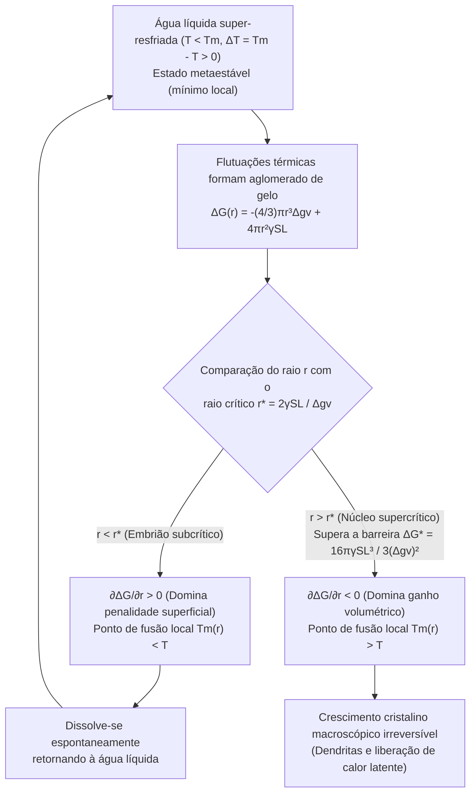
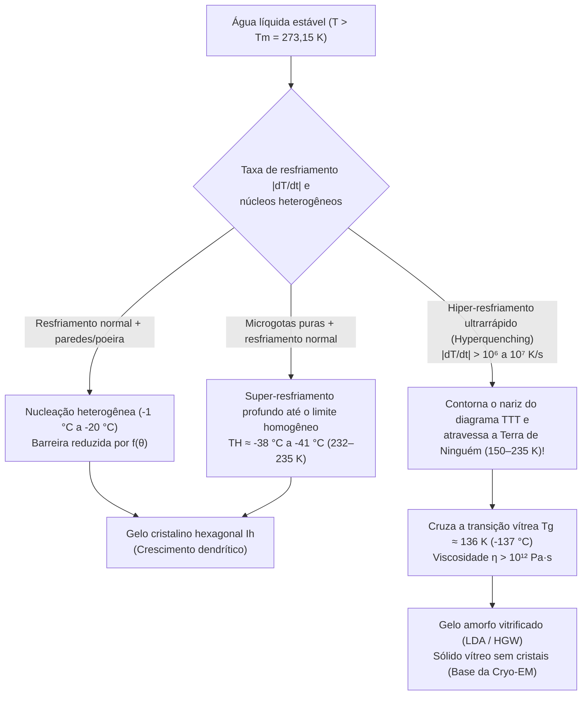

Imagine retirar cuidadosamente do congelador uma garrafa plástica lacrada de água purificada: o termômetro marca $-8^\circ\text{C}$ ($265{,}15\,\text{K}$), mas o conteúdo permanece completamente transparente e líquido. No entanto, no instante em que você bate levemente o fundo da garrafa contra a mesa — ou despeja o jato frio sobre um pequeno fragmento de gelo —, uma rede branca ofuscante de agulhas cristalinas percorre o líquido a vários centímetros por segundo, transformando toda a garrafa em uma massa de raspadinha (slush) em apenas dois segundos.

Na escola, aprendemos que à pressão atmosférica padrão ($1\,\text{atm} = 101{,}325\,\text{kPa}$) a água congela a $0^\circ\text{C}$ ($273{,}15\,\text{K}$). Porém, sob a ótica rigorosa da termodinâmica estatística e da física da matéria condensada, $0^\circ\text{C}$ é estritamente a <strong>temperatura de fusão de equilíbrio ($T_m$)</strong>, na qual o gelo hexagonal macroscópico ($\text{I}_h$) e a água líquida possuem o mesmo potencial químico ($\mu_{\text{L}}(P, T_m) = \mu_{\text{S}}(P, T_m)$), mas <strong>não é a temperatura na qual a água líquida cristaliza espontaneamente</strong>.

Isolada de poeira e de ranhuras nas paredes do recipiente, a água ultrapura permanece líquida a $-15^\circ\text{C}$, $-25^\circ\text{C}$ e até o <strong>limite de nucleação homogênea ($T_H \approx -38^\circ\text{C}$ a $-41^\circ\text{C}$, ou $232\text{--}235\,\text{K}$)</strong>, conforme confirmado por experimentos de difração com lasers de elétrons livres de raios X (XFEL) de femtossegundos. Que barreira microscópica impede a água de congelar assim que passa abaixo de $0^\circ\text{C}$?

---

## Capítulo 1: Termodinâmica da Metaestabilidade

À temperatura $T$ e pressão $P$ constantes, a estabilidade das fases é regida pela energia livre de Gibbs $G = H - TS$ (ou potencial químico molar $\mu$). Como a entropia molar da água líquida é maior que a do gelo cristalino ($s_{\text{L}} > s_{\text{S}} > 0$), a relação termodinâmica $\left(\frac{\partial \mu}{\partial T}\right)_P = -s$ implica que, para todo $T < T_m$, o gelo possui menor potencial químico ($\mu_{\text{S}}(T) < \mu_{\text{L}}(T)$) e constitui o <strong>mínimo global</strong>.

Contudo, entre $0^\circ\text{C}$ e $-38^\circ\text{C}$, a <strong>água super-resfriada (Supercooled Water)</strong> fica aprisionada em um <strong>estado metaestável (mínimo local)</strong> da paisagem de energia livre $G(\eta)$:

$$\frac{\partial G}{\partial \eta} = 0, \qquad \frac{\partial^2 G}{\partial \eta^2} > 0$$

Como a curvatura local em relação ao parâmetro de ordem $\eta$ é estritamente positiva, qualquer flutuação térmica infinitesimal eleva a energia livre e é imediatamente amortecida. Para escapar dessa bacia metaestável e atingir o mínimo global do gelo, o sistema precisa de uma flutuação localizada de amplitude finita capaz de vencer uma <strong>barreira de ativação de energia livre $\Delta G^* > 0$</strong>: o processo de <strong>nucleação</strong>. Em contrapartida, quando o gelo é aquecido a $T_m = 0^\circ\text{C}$, sua superfície já possui uma camada quase líquida nanométrica de pré-fusão (Premelting Layer), eliminando a barreira interfacial para o derretimento.

---

## Capítulo 2: Teoria Clássica da Nucleação (CNT) — Ganho Volumétrico versus Penalidade Superficial

### 2.1 Derivação exata de $\Delta G(r)$, do raio crítico $r^*$ e da barreira $\Delta G^*$

Desenvolvida por Volmer, Weber, Becker e Döring e estendida a transições líquido-sólido por David Turnbull e John C. Fisher (1949), a <strong>Teoria Clássica da Nucleação (CNT)</strong> expressa a variação da energia livre de Gibbs $\Delta G(r)$ ao formar um embrião esférico de gelo de raio $r$ no interior da água super-resfriada com grau de super-resfriamento $\Delta T \equiv T_m - T > 0$:

$$\Delta G(r) = -\frac{4}{3}\pi r^3 \Delta g_v + 4\pi r^2 \gamma_{\text{SL}}$$

onde $\Delta g_v = \Delta H_f - T\Delta S_f \approx \frac{\Delta H_f \cdot \Delta T}{T_m}$ é a força motriz volumétrica (com o calor latente volumétrico de fusão $\Delta H_f \approx 3{,}06 \times 10^8\,\text{J/m}^3$, ou $L_f = 333{,}5\,\text{J/g}$) e $\gamma_{\text{SL}} \approx 28\text{--}32\,\text{mJ/m}^2$ é a tensão interfacial sólido-líquido.

Para raios muito pequenos ($r \to 0$), o termo superficial quadrático ($\propto r^2$) domina sobre o termo volumétrico cúbico ($\propto -r^3$). Igualando a zero a derivada $\frac{\partial \Delta G(r)}{\partial r} = -4\pi r^2 \Delta g_v + 8\pi r \gamma_{\text{SL}} = 0$, obtemos o <strong>raio crítico do núcleo ($r^*$)</strong> e a <strong>barreira de energia livre de nucleação ($\Delta G^*$)</strong>:

$$r^* = \frac{2\gamma_{\text{SL}}}{\Delta g_v} = \frac{2\gamma_{\text{SL}} T_m}{\Delta H_f \Delta T}, \qquad \Delta G^* = \Delta G(r^*) = \frac{16\pi \gamma_{\text{SL}}^3}{3(\Delta g_v)^2} = \frac{16\pi \gamma_{\text{SL}}^3 T_m^2}{3(\Delta H_f)^2 (\Delta T)^2}$$

* <strong>Aglomerados subcríticos ($r < r^*$, «embriões»)</strong>: $\frac{\partial \Delta G}{\partial r} > 0$. Pelo efeito Gibbs-Thomson, seu ponto de fusão deprimido pela curvatura $T_m(r) = T_m(1 - \frac{2\gamma_{\text{SL}}}{\Delta H_f r})$ é menor que $T$, fazendo com que se dissolvam espontaneamente.
* <strong>Aglomerados supercríticos ($r > r^*$, «núcleos»)</strong>: $\frac{\partial \Delta G}{\partial r} < 0$. Cada molécula adicional reduz $\Delta G$, desencadeando um crescimento cristalino catastrófico e irreversível.

| Temperatura $T$ ($^\circ\text{C}$) | Super-resfriamento $\Delta T$ ($\text{K}$) | Raio crítico $r^*$ ($\text{nm}$) | Moléculas no núcleo $N^*$ | Barreira reduzida $\Delta G^* / (k_B T)$ | Fator de Boltzmann $\exp(-\Delta G^* / k_B T)$ | Nucleação homogênea |
| :--- | :--- | :--- | :--- | :--- | :--- | :--- |
| <strong>$-1{,}0^\circ\text{C}$</strong> | $1{,}0$ | $53{,}6\,\text{nm}$ | $\approx 1{,}98 \times 10^7$ | $\approx 2{,}88 \times 10^6$ | $10^{-1\,250\,000}$ | Estatisticamente zero |
| <strong>$-5{,}0^\circ\text{C}$</strong> | $5{,}0$ | $10{,}7\,\text{nm}$ | $\approx 158\,000$ | $\approx 1{,}17 \times 10^5$ | $10^{-50\,800}$ | Impossível na idade do universo |
| <strong>$-15{,}0^\circ\text{C}$</strong> | $15{,}0$ | $3{,}57\,\text{nm}$ | $\approx 5\,860$ | $\approx 1{,}35 \times 10^4$ | $10^{-5\,860}$ | Ainda proibida homogeneamente |
| <strong>$-40{,}0^\circ\text{C}$</strong> ($\approx T_H$) | $40{,}0$ | $\approx 1{,}10\,\text{nm}$ | $\approx 180\text{--}250$ | $\approx 55\text{--}70$ | $\approx 10^{-25}\text{--}10^{-30}$ | <strong>Congelamento espontâneo instantâneo!</strong> |

---

## Capítulo 3: Nucleação Homogênea vs. Heterogênea — O Fator de Molhamento de Turnbull $f(\theta)$

A água comum congela entre $-2^\circ\text{C}$ e $-5^\circ\text{C}$ graças à <strong>nucleação heterogênea</strong> nas paredes do recipiente ou em partículas de poeira. No modelo de calota esférica de Turnbull, um embrião com ângulo de contato $\theta$ ($\cos\theta = \frac{\gamma_{\text{sub,L}} - \gamma_{\text{sub,S}}}{\gamma_{\text{SL}}}$ pela equação de Young) mantém o mesmo raio crítico de curvatura $r^*$, mas reduz sua barreira de energia livre pelo <strong>fator geométrico de molhamento $f(\theta)$</strong>:

$$\Delta G_{\text{het}}^* = \Delta G_{\text{hom}}^* \cdot f(\theta), \qquad f(\theta) = \frac{(2 + \cos\theta)(1 - \cos\theta)^2}{4} \in [0, 1]$$

Para $\theta = 30^\circ$, $f(30^\circ) \approx 0{,}013$ (barreira reduzida a $1{,}3\%$); para $\theta = 10^\circ$, $f(10^\circ) \approx 1{,}7 \times 10^{-4}$! Dois exemplos clássicos de epitaxia cristalina:
1. <strong>Iodeto de prata ($\beta\text{-AgI}$) na semeadura de nuvens</strong> (Bernard Vonnegut, 1947): seus parâmetros de rede hexagonal ($a = 4{,}580\,\text{\AA}, c = 7{,}494\,\text{\AA}$) diferem em apenas $1{,}4\%$ do gelo $\text{I}_h$ ($a = 4{,}518\,\text{\AA}, c = 7{,}356\,\text{\AA}$), induzindo congelamento a $-3^\circ\text{C}$.
2. <strong>Proteínas nucleadoras de gelo (INPs, gene `inaZ`) de *Pseudomonas syringae*</strong>: repetições $\beta$-helicoidais na membrana bacteriana alinham as moléculas de água e congelam gotas a <strong>$-1{,}5^\circ\text{C}$ a $-2{,}0^\circ\text{C}$</strong> (usadas em canhões de neve artificial).

---

## Capítulo 4: Congelamento por Impacto, Dendritas de Mullins-Sekerka e a Fração de 10%

Ao bater uma garrafa de água super-resfriada a $-8^\circ\text{C}$, a onda de choque acústica desencadeia <strong>cavitação acústica</strong>: o colapso inercial de microbolhas (equação de Rayleigh-Plesset) gera picos locais de pressão de gigapascais ($\sim\text{GPa}$) e descompressão adiabática que superam instantaneamente $\Delta G^*$.

À medida que o cristal cresce, a liberação do calor latente de fusão ($L_f = 333{,}5\,\text{J/g}$) aquece a interface a $0^\circ\text{C}$. Pela <strong>instabilidade morfológica de Mullins-Sekerka (1963)</strong>, qualquer ponta que avance para a água fria a $-8^\circ\text{C}$ encontra um gradiente térmico $|\nabla T|$ mais íngreme, dissipa calor mais rápido e cresce formando agulhas ramificadas — <strong>dendritas</strong> — a $5\text{--}10\,\text{cm/s}$.

Como o processo dura $\sim 2\,\text{s}$, ele é <strong>adiabático ($\Delta H_{\text{total}} = 0$)</strong>: o calor latente liberado ao congelar uma fração de massa $f_{\text{ice}}$ aquece toda a mistura até $T_m = 0^\circ\text{C}$, interrompendo a cristalização:

$$M \, f_{\text{ice}} \, L_f = M \, c_{p,\text{L}} \, \Delta T \quad \Longrightarrow \quad f_{\text{ice}} = \frac{c_{p,\text{L}} \Delta T}{L_f} \equiv \text{Ste} = \frac{4{,}21 \times 8{,}0}{333{,}5} \approx 0{,}101 \quad (\mathbf{10{,}1\%})$$

<strong>Apenas $10{,}1\%$ da água realmente congela!</strong> Essa rede dendrítica tridimensional retém os $89{,}9\%$ restantes de água líquida a $0^\circ\text{C}$ como uma esponja, formando uma raspadinha macia (congelar $100\%$ adiabaticamente exigiria o limite de hiper-resfriamento $\Delta T_{\text{hyp}} = L_f / c_{p,\text{L}} \approx 79{,}2\,\text{K}$, impossível a $1\,\text{atm}$).

---

## Capítulo 5: Superaquecimento, Física de Nuvens e Transição Vítrea ($T_g$)

1. <strong>Superaquecimento (Superheating) e câmara de bolhas de Glaser</strong>: Em uma caneca lisa aquecida no micro-ondas acima de $100^\circ\text{C}$, a <strong>pressão capilar de Young-Laplace $\Delta P = \frac{2\gamma_{\text{LV}}}{r}$</strong> esmaga qualquer bolha menor que o raio crítico $r_b^* = \frac{2\gamma_{\text{LV}}}{P_{\text{V}}(T) - P_{\text{L}}} \approx \frac{2\gamma_{\text{LV}} T_b}{\rho_{\text{V}} L_v \Delta T_{\text{sh}}}$. Adicionar café ou açúcar introduz sítios de nucleação e provoca ebulição explosiva (<strong>ebulição eruptiva / bumping</strong>). Em 1952, Donald Glaser (Nobel de Física de 1960) utilizou hidrogênio líquido superaquecido em sua <strong>câmara de bolhas</strong> para fotografar trajetórias de partículas subatômicas.
2. <strong>Processo Wegener-Bergeron-Findeisen e proteínas anticongelantes (AFPs)</strong>: Abaixo de $0^\circ\text{C}$, a pressão de vapor de saturação sobre o gelo é menor que sobre a água super-resfriada ($e_s^{\text{ice}}(T) < e_s^{\text{water}}(T)$), fazendo crescer os cristais de neve às custas das gotículas líquidas; na aviação, o impacto de grandes gotas super-resfriadas (SLD) congela apenas a fração $f_{\text{ice}} = c_p\Delta T/L_f$ instantaneamente e o restante escorre formando o perigoso <strong>gelo claro (Glaze Ice)</strong>. Peixes polares usam <strong>glicoproteínas anticongelantes (AFGPs)</strong> que se ligam ao gelo com espaçamento $d$, impondo uma curvatura $r \approx d/2$ que reduz o ponto de congelamento pelo efeito Gibbs-Thomson ($\Delta T_{\text{TH}} = \frac{4\gamma_{\text{SL}} T_m}{\Delta H_f d}$).
3. <strong>Vitrificação e a «Terra de Ninguém» (No-Man's Land)</strong>: Na taxa de nucleação $J(T) \propto \exp(-\Delta G_{\text{diff}}/k_B T)\exp(-\Delta G^*/k_B T)$, a explosão da viscosidade $\eta(T)$ em baixas temperaturas desenha um «nariz» no diagrama <strong>Tempo-Temperatura-Transformação (TTT)</strong>.

Resfriando a água a uma taxa crítica $\dot{T}_c > 10^6\,\text{K/s}$ (imersão em etano líquido criada por Jacques Dubochet, Prêmio Nobel de Química de 2017 pela <strong>criomicroscopia eletrônica, Cryo-EM</strong>), contornamos a cristalização através da «Terra de Ninguém» ($150\text{--}235\,\text{K}$) e solidificamos a água abaixo de sua <strong>temperatura de transição vítrea $T_g \approx 136\,\text{K}$ ($-137^\circ\text{C}$)</strong> como <strong>gelo amorfo vitrificado (LDA)</strong>.
