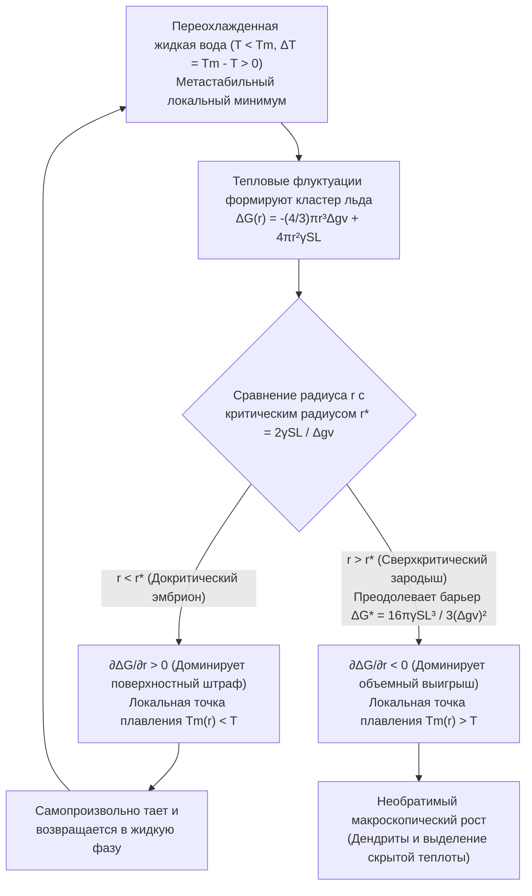
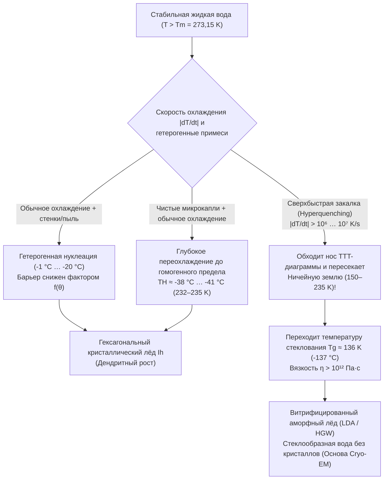

Представьте, что вы осторожно достаете из морозильника запечатанную пластиковую бутылку дистиллированной воды: термометр показывает $-8^\circ\text{C}$ ($265{,}15\,\text{K}$), однако вода внутри остается совершенно прозрачной и жидкой. Но стоит слегка ударить дном бутылки о стол — или вылить струю на крошечный осколок льда, — как ослепительно белая сеть игольчатых кристаллов пронзает жидкость со скоростью нескольких сантиметров в секунду, за две секунды превращая всё содержимое в непрозрачную снежную кашу (шугу).

Со школы нам известно правило: при нормальном атмосферном давлении ($1\,\text{атм} = 101{,}325\,\text{кПа}$) вода замерзает при $0^\circ\text{C}$ ($273{,}15\,\text{K}$). Однако с точки зрения статистической термодинамики и физики конденсированного состояния $0^\circ\text{C}$ — это строго <strong>равновесная температура плавления ($T_m$)</strong>, при которой макроскопический гексагональный лёд ($\text{I}_h$) и жидкая вода имеют одинаковый химический потенциал ($\mu_{\text{L}}(P, T_m) = \mu_{\text{S}}(P, T_m)$), но <strong>вовсе не температура автоматической кристаллизации воды</strong>.

В отсутствие пыли и царапин на стенках сосуда сверхчистая вода остается жидкой при $-15^\circ\text{C}$, $-25^\circ\text{C}$ и вплоть до <strong>предела гомогенной нуклеации ($T_H \approx -38^\circ\text{C}\dots{-41^\circ\text{C}}$, или $232\text{--}235\,\text{K}$)</strong>, что доказано экспериментами с использованием фемтосекундных рентгеновских лазеров на свободных электронах (XFEL). Какой же микроскопический барьер не дает воде замёрзнуть сразу ниже $0^\circ\text{C}$?

---

## Глава 1: Термодинамика метастабильного состояния

При постоянных температуре $T$ и давлении $P$ направление фазового перехода определяется энергией Гиббса $G = H - TS$ (или молярным химическим потенциалом $\mu$). Поскольку молярная энтропия жидкой воды выше, чем у кристаллического льда ($s_{\text{L}} > s_{\text{S}} > 0$), из соотношения $\left(\frac{\partial \mu}{\partial T}\right)_P = -s$ следует, что при всех $T < T_m$ химический потенциал льда ниже ($\mu_{\text{S}}(T) < \mu_{\text{L}}(T)$), то есть лёд отвечает <strong>глобальному минимуму</strong> свободной энергии.

Тем не менее в интервале от $0^\circ\text{C}$ до $-38^\circ\text{C}$ <strong>переохлажденная вода (Supercooled Water)</strong> оказывается запертой в <strong>метастабильном состоянии (локальном минимуме)</strong> ландшафта свободной энергии $G(\eta)$:

$$\frac{\partial G}{\partial \eta} = 0, \qquad \frac{\partial^2 G}{\partial \eta^2} > 0$$

Поскольку вторая производная по параметру порядка $\eta$ строго положительна, любые бесконечно малые тепловые флуктуации лишь повышают свободную энергию и подавляются термодинамическими возвращающими силами. Чтобы перейти в глобальный минимум (лёд), системе необходима локализованная флуктуация конечной амплитуды, способная преодолеть <strong>энергетический барьер активации $\Delta G^* > 0$</strong> — процесс <strong>нуклеации (зародышеобразования)</strong>. Напротив, при плавлении льда ($T > T_m$) на его поверхности уже существует нанометровый квазижидкий слой предплавления (Premelting Layer), благодаря чему энергетический барьер отсутствует и лёд начинает таять строго при $0^\circ\text{C}$.

---

## Глава 2: Классическая теория нуклеации (CNT) — борьба объемного выигрыша и поверхностного штрафа

### 2.1 Точный вывод $\Delta G(r)$, критического радиуса $r^*$ и барьера $\Delta G^*$

Разработанная Фольмером, Вебером, Беккером и Дёрингом и обобщенная на переходы жидкость–кристалл Дэвидом Тёрнбуллом и Джоном Фишером (1949), <strong>классическая теория нуклеации (CNT)</strong> записывает изменение энергии Гиббса $\Delta G(r)$ при образовании сферического зародыша льда радиуса $r$ в воде с переохлаждением $\Delta T \equiv T_m - T > 0$ как:

$$\Delta G(r) = -\frac{4}{3}\pi r^3 \Delta g_v + 4\pi r^2 \gamma_{\text{SL}}$$

где $\Delta g_v = \Delta H_f - T\Delta S_f \approx \frac{\Delta H_f \cdot \Delta T}{T_m}$ — объемная движущая сила кристаллизации ($\Delta H_f \approx 3{,}06 \times 10^8\,\text{Дж/м}^3$, удельная теплота плавления $L_f = 333{,}5\,\text{Дж/г}$), а $\gamma_{\text{SL}} \approx 28\text{--}32\,\text{мДж/м}^2$ — поверхностное натяжение на границе раздела фаз лёд–вода.

При малых радиусах ($r \to 0$) квадратичный поверхностный штраф ($\propto r^2$) доминирует над кубическим объемным выигрышем ($\propto -r^3$). Приравнивая производную к нулю $\frac{\partial \Delta G(r)}{\partial r} = -4\pi r^2 \Delta g_v + 8\pi r \gamma_{\text{SL}} = 0$, находим <strong>критический радиус зародыша ($r^*$)</strong> и <strong>энергетический барьер нуклеации ($\Delta G^*$)</strong>:

$$r^* = \frac{2\gamma_{\text{SL}}}{\Delta g_v} = \frac{2\gamma_{\text{SL}} T_m}{\Delta H_f \Delta T}, \qquad \Delta G^* = \Delta G(r^*) = \frac{16\pi \gamma_{\text{SL}}^3}{3(\Delta g_v)^2} = \frac{16\pi \gamma_{\text{SL}}^3 T_m^2}{3(\Delta H_f)^2 (\Delta T)^2}$$

* <strong>Докритические кластеры ($r < r^*$, «эмбрионы»)</strong>: $\frac{\partial \Delta G}{\partial r} > 0$. Вследствие эффекта Гиббса–Томсона их локальная температура плавления $T_m(r) = T_m(1 - \frac{2\gamma_{\text{SL}}}{\Delta H_f r})$ ниже температуры воды $T$, поэтому они самопроизвольно растворяются.
* <strong>Сверхкритические кластеры ($r > r^*$, «ядра / зародыши»)</strong>: $\frac{\partial \Delta G}{\partial r} < 0$. Присоединение новых молекул снижает $\Delta G$, запуская лавинообразный необратимый рост кристалла.

| Температура $T$ ($^\circ\text{C}$) | Переохлаждение $\Delta T$ ($\text{K}$) | Критический радиус $r^*$ ($\text{нм}$) | Число молекул в ядре $N^*$ | Безразмерный барьер $\Delta G^* / (k_B T)$ | Фактор Больцмана $\exp(-\Delta G^* / k_B T)$ | Гомогенная нуклеация |
| :--- | :--- | :--- | :--- | :--- | :--- | :--- |
| <strong>$-1{,}0^\circ\text{C}$</strong> | $1{,}0$ | $53{,}6\,\text{нм}$ | $\approx 1{,}98 \times 10^7$ | $\approx 2{,}88 \times 10^6$ | $10^{-1\,250\,000}$ | Статистически невозможна |
| <strong>$-5{,}0^\circ\text{C}$</strong> | $5{,}0$ | $10{,}7\,\text{нм}$ | $\approx 158\,000$ | $\approx 1{,}17 \times 10^5$ | $10^{-50\,800}$ | Невозможна за время жизни Вселенной |
| <strong>$-15{,}0^\circ\text{C}$</strong> | $15{,}0$ | $3{,}57\,\text{нм}$ | $\approx 5\,860$ | $\approx 1{,}35 \times 10^4$ | $10^{-5\,860}$ | Всё ещё полностью запрещена |
| <strong>$-40{,}0^\circ\text{C}$</strong> ($\approx T_H$) | $40{,}0$ | $\approx 1{,}10\,\text{нм}$ | $\approx 180\text{--}250$ | $\approx 55\text{--}70$ | $\approx 10^{-25}\text{--}10^{-30}$ | <strong>Мгновенное спонтанное замерзание!</strong> |

---

## Глава 3: Гомогенная и гетерогенная нуклеация — фактор смачивания Тёрнбулла $f(\theta)$

Обычная водопроводная вода замерзает при $-2^\circ\text{C}\dots{-5^\circ\text{C}}$ благодаря <strong>гетерогенной нуклеации</strong> на стенках или пылинках. В модели сферического сегмента Тёрнбулла зародыш с краевым углом смачивания $\theta$ ($\cos\theta = \frac{\gamma_{\text{sub,L}} - \gamma_{\text{sub,S}}}{\gamma_{\text{SL}}}$ по уравнению Юнга) имеет тот же радиус кривизны $r^*$, но его барьер снижается на <strong>геометрический фактор смачивания $f(\theta)$</strong>:

$$\Delta G_{\text{het}}^* = \Delta G_{\text{hom}}^* \cdot f(\theta), \qquad f(\theta) = \frac{(2 + \cos\theta)(1 - \cos\theta)^2}{4} \in [0, 1]$$

При $\theta = 30^\circ$ величина $f(30^\circ) \approx 0{,}013$ (барьер падает до $1{,}3\%$); при $\theta = 10^\circ$ фактор $f(10^\circ) \approx 1{,}7 \times 10^{-4}$! Два выдающихся примера эпитаксии:
1. <strong>Иодид серебра ($\beta\text{-AgI}$) при засеве облаков</strong> (Бернард Воннегут, 1947): параметры гексагональной решетки $\beta\text{-AgI}$ ($a = 4{,}580\,\text{\AA}, c = 7{,}494\,\text{\AA}$) отличаются от льда $\text{I}_h$ ($a = 4{,}518\,\text{\AA}, c = 7{,}356\,\text{\AA}$) всего на $1{,}4\%$, вызывая замерзание капель уже при $-3^\circ\text{C}$.
2. <strong>Белки нуклеации льда (INPs, ген `inaZ`) бактерии *Pseudomonas syringae*</strong>: $\beta$-спиральные повторы на мембране выстраивают молекулы воды в структуру льда и запускают кристаллизацию при <strong>$-1{,}5^\circ\text{C}\dots{-2{,}0^\circ\text{C}$</strong> (применяются в снежных пушках).

---

## Глава 4: Мгновенное замерзание при ударе, дендриты Маллинза–Секерки и закон 10% шуги

При ударе по бутылке с переохлажденной водой ($-8^\circ\text{C}$) акустическая волна вызывает <strong>акустическую кавитацию</strong>: схлопывание микропузырьков по уравнению Рэлея–Плессета порождает локальные скачки давления порядка гигапаскалей ($\sim\text{ГПа}$) и адиабатическое охлаждение, мгновенно преодолевая барьер $\Delta G^*$.

Выделяющаяся при росте льда скрытая теплота плавления ($L_f = 333{,}5\,\text{Дж/г}$) нагревает межфазную границу до $0^\circ\text{C}$. Из-за <strong>морфологической неустойчивости Маллинза–Секерки (1963)</strong> любой выступ, выдающийся в холодную воду ($-8^\circ\text{C}$), попадает в зону более крутого градиента температуры $|\nabla T|$, быстрее сбрасывает тепло и стремительно растет в виде ветвящихся игл — <strong>дендритов</strong> — со скоростью $5\text{--}10\,\text{см/с}$.

Поскольку процесс длится всего $\sim 2\,\text{с}$, он является <strong>адиабатическим ($\Delta H_{\text{total}} = 0$)</strong>: скрытая теплота, выделенная замёрзшей долей массы $f_{\text{ice}}$, нагревает всю воду в бутылке ровно до $T_m = 0^\circ\text{C}$, после чего кристаллизация прекращается:

$$M \, f_{\text{ice}} \, L_f = M \, c_{p,\text{L}} \, \Delta T \quad \Longrightarrow \quad f_{\text{ice}} = \frac{c_{p,\text{L}} \Delta T}{L_f} \equiv \text{Ste} = \frac{4{,}21 \times 8{,}0}{333{,}5} \approx 0{,}101 \quad (\mathbf{10{,}1\%})$$

<strong>В действительности замерзает лишь $10{,}1\%$ воды!</strong> Этот трехмерный дендритный каркас удерживает остальные $89{,}9\%$ жидкой воды при $0^\circ\text{C}$ подобно губке, образуя мягкую снежную кашу (для $100\%$-го адиабатического замерзания потребовался бы предел гиперпереохлаждения $\Delta T_{\text{hyp}} = L_f / c_{p,\text{L}} \approx 79{,}2\,\text{K}$, недостижимый при $1\,\text{атм}$).

---

## Глава 5: Перегрев и взрывное вскипание, физика облаков и стеклование ($T_g$)

1. <strong>Перегрев (Superheating) и пузырьковая камера Глейзера</strong>: В гладкой кружке в микроволновой печи вода нагревается выше $100^\circ\text{C}$ без кипения, так как <strong>капиллярное давление Юнга–Лапласа $\Delta P = \frac{2\gamma_{\text{LV}}}{r}$</strong> раздавливает пузырьки пара меньше критического радиуса $r_b^* = \frac{2\gamma_{\text{LV}}}{P_{\text{V}}(T) - P_{\text{L}}} \approx \frac{2\gamma_{\text{LV}} T_b}{\rho_{\text{V}} L_v \Delta T_{\text{sh}}}$. Добавление ложки сахара или кофе вносит центры парообразования и вызывает взрывное вскипание (<strong>bumping</strong>). В 1952 году Дональд Глейзер (Нобелевская премия 1960 г.) использовал перегретый жидкий водород в <strong>пузырьковой камере</strong> для регистрации треков элементарных частиц.
2. <strong>Процесс Вегенера–Бержерона–Финдайзена и антифризные белки (AFPs)</strong>: Ниже $0^\circ\text{C}$ давление насыщенного пара над льдом меньше, чем над переохлажденной водой ($e_s^{\text{ice}}(T) < e_s^{\text{water}}(T)$), поэтому кристаллы льда в облаках растут за счет испарения капель; в авиации при ударе крупных переохлажденных капель (SLD) о крыло мгновенно замерзает лишь доля $f_{\text{ice}} = c_p\Delta T/L_f$, а остальная вода растекается, образуя опасный <strong>прозрачный гололёд (Glaze Ice)</strong>. Полярные рыбы вырабатывают <strong>антифризные гликопротеины (AFGPs)</strong>, которые закрепляются на гранях льда с шагом $d$, навязывая кривизну $r \approx d/2$ и понижая точку замерзания по закону Гиббса–Томсона ($\Delta T_{\text{TH}} = \frac{4\gamma_{\text{SL}} T_m}{\Delta H_f d}$).
3. <strong>Витрификация (стеклование) и «Ничейная земля» (No-Man's Land)</strong>: В формуле скорости нуклеации $J(T) \propto \exp(-\Delta G_{\text{diff}}/k_B T)\exp(-\Delta G^*/k_B T)$ гигантский рост вязкости $\eta(T)$ при низких температурах формирует С-образный «нос» на <strong>TTT-диаграмме (Время–Температура–Превращение)</strong>.

При сверхбыстром охлаждении со скоростью выше критической $\dot{T}_c > 10^6\,\text{К/с}$ (метод погружения в жидкий этан, разработанный Жаком Дюбоше — Нобелевская премия по химии 2017 г. за <strong>криоэлектронную микроскопию, Cryo-EM</strong>) вода проскакивает «Ничейную землю» ($150\text{--}235\,\text{K}$) и ниже <strong>температуры стеклования $T_g \approx 136\,\text{K}$ ($-137^\circ\text{C}$)</strong> затвердевает без кристаллизации в <strong>аморфный лёд низкой плотности (LDA)</strong>.
