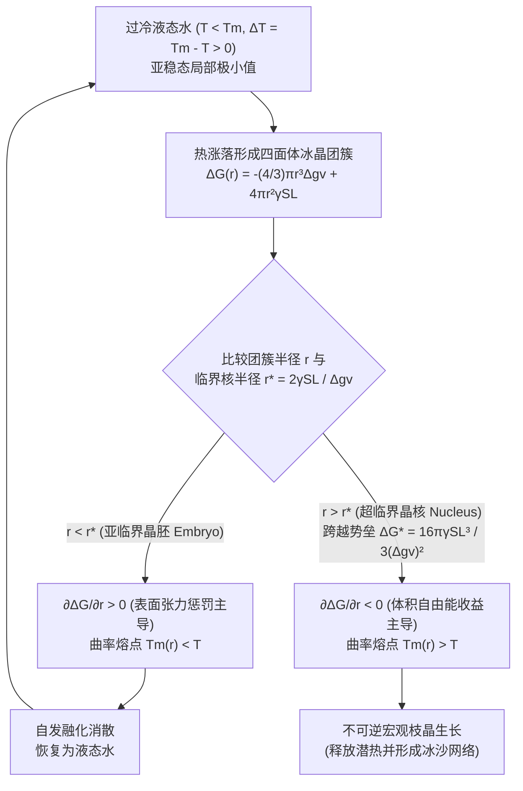
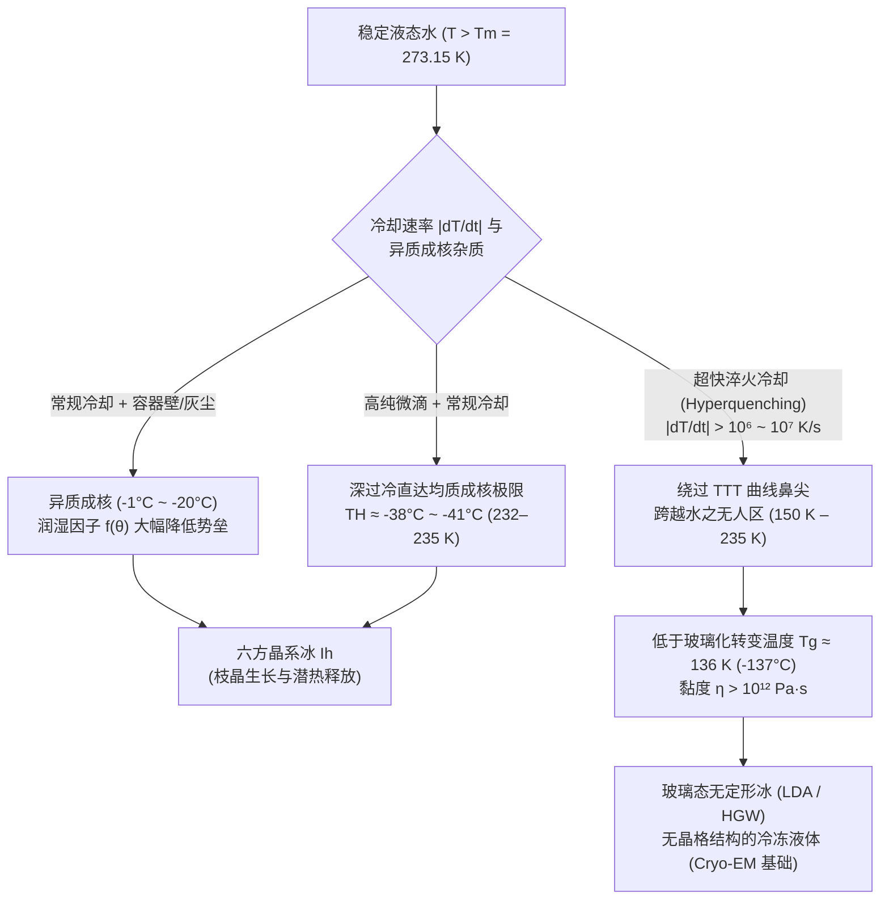

从冷冻室中轻轻取出一瓶密封的纯净水，温度计清晰地显示着 $-8^\circ\text{C}$（$265.15\,\text{K}$），但瓶中的水依然清澈透明、流动自如。然而就在下一秒，当你将瓶底在桌面上轻轻一磕，或者将水倒向碗中的一小块冰晶时，一道雪白的枝状结晶网络以每秒数厘米的速度闪电般贯穿整个瓶身，短短两秒内，整瓶水便化作了一团洁白的不透明冰沙（Slush）。

基础科学告诉我们，标准大气压（$1\,\text{atm} = 101.325\,\text{kPa}$）下水在 $0^\circ\text{C}$ 结冰、在 $100^\circ\text{C}$ 沸腾。然而从凝聚态物理与统计热力学的严格视角来看，这一常识只说对了一半。准确地说，$0^\circ\text{C}$（$273.15\,\text{K}$）是冰与水的<strong>平衡熔点（Equilibrium Melting Point, $T_m$）</strong>——即宏观六方冰（$\text{I}_h$）与液态水化学势相等（$\mu_{\text{L}}(P, T_m) = \mu_{\text{S}}(P, T_m)$）并能无限期共存的温度边界，而<strong>绝非液态水自动发生结晶的起点</strong>。

事实上，如果剔除灰尘、杂质与容器壁划痕，高纯度微米水滴在冷却通过 $0^\circ\text{C}$、$-15^\circ\text{C}$ 甚至 $-35^\circ\text{C}$ 时仍能保持液态。现代飞秒X射线自由电子激光（XFEL）散射实验证实，常压下纯水无需任何外来杂质仅靠自身热涨落自发冻结的极限——<strong>均质成核极限（Homogeneous Nucleation Limit, $T_H$）</strong>——低达 <strong>$-38^\circ\text{C} \sim -41^\circ\text{C}$（$232\text{--}235\,\text{K}$）</strong>（真空蒸发微滴甚至可短暂存活至 $-42.55^\circ\text{C}$）。

为什么在冰晶具有更低体相吉布斯自由能的零下温区，水分子却拒绝排列成冰？微观世界里究竟有一道怎样的自由能高墙？

---

## 第一章：亚稳态（Metastable State）的热力学本质

在定温定压（$T, P$）条件下，相变方向由吉布斯自由能 $G = H - TS$（摩尔吉布斯自由能即化学势 $\mu$）决定。由于液态水的分子排列无序度远高于冰晶格，其摩尔熵满足 $s_{\text{L}} > s_{\text{S}} > 0$。由热力学基本关系 $\left(\frac{\partial \mu}{\partial T}\right)_P = -s$ 可知，当温度降至 $T < T_m$ 时，固相冰的化学势低于液态水（$\mu_{\text{S}}(T) < \mu_{\text{L}}(T)$），冰成为热力学上的<strong>全局极小值（Global Minimum）</strong>。

然而，处于 $0^\circ\text{C}$ 至 $-38^\circ\text{C}$ 之间的<strong>过冷水（Supercooled Water）</strong>之所以没有立刻结冰，是因为它被困在了自由能曲面的<strong>亚稳态（Metastable State，局部极小值）</strong>中：

$$\frac{\partial G}{\partial \eta} = 0, \qquad \frac{\partial^2 G}{\partial \eta^2} > 0$$

只要自由能对序参量 $\eta$ 的二阶导数（曲率）为正，任何无穷小的热涨落都会导致自由能上升而被热力学恢复力抹平。若要逃离亚稳态盆地、跌入冰晶的全局极小值，系统必须通过局部有限振幅涨落，跨越一道高度为 $\Delta G^* > 0$ 的<strong>成核自由能势垒（Nucleation Barrier）</strong>（反之，当 $\frac{\partial^2 G}{\partial \eta^2} < 0$ 时势垒消失，系统进入失稳分解即 Spinodal 区域）。

冰在升温至 $0^\circ\text{C}$ 时之所以从不发生“过热”，是因为冰表面天然存在一层纳米级厚度的准液态预融层（Premelting Layer），相当于预先消除了固液界面创生势垒；而液态水降温结晶时，却必须在无序液体内部从零开始建立固液界面，从而付出高昂的界面能代价。

---

## 第二章：经典成核理论（CNT）——体积收益与表面惩罚的博弈

### 2.1 吉布斯自由能方程 $\Delta G(r)$ 的严格推导

由 Volmer、Weber、Becker、Döring 创立并由 Turnbull 与 Fisher（1949）推广至液固相变的<strong>经典成核理论（Classical Nucleation Theory, CNT）</strong>，将过冷水中半径为 $r$ 的球形冰晶胚（Embryo）的形成归纳为<strong>体积自由能收益（负项）</strong>与<strong>固液界面张力惩罚（正项）</strong>的竞争：

$$\Delta G(r) = -\frac{4}{3}\pi r^3 \Delta g_v + 4\pi r^2 \gamma_{\text{SL}}$$

1. <strong>单位体积自由能驱动力 $\Delta g_v$</strong>：
   设冰的单位体积熔化潜热为 $\Delta H_f \approx 3.06 \times 10^8\,\text{J/m}^3$（质量潜热 $L_f = 333.5\,\text{J/g}$），熔化熵为 $\Delta S_f$。在熔点 $T_m = 273.15\,\text{K}$ 处，$\Delta g_v(T_m) = \Delta H_f - T_m \Delta S_f = 0 \implies \Delta S_f = \frac{\Delta H_f}{T_m}$。当液体处于过冷度 $\Delta T \equiv T_m - T > 0$ 时（一阶近似忽略固液比热差 $\Delta c_p$）：
   $$\Delta g_v(T) = \Delta H_f - T\Delta S_f \approx \frac{\Delta H_f \cdot \Delta T}{T_m}$$
   过冷度 $\Delta T$ 越大，结冰带来的体相热力学奖励 $\Delta g_v$ 越强。
2. <strong>固液界面自由能惩罚 $\gamma_{\text{SL}}$</strong>：
   冰水界面处的分子既失去了液相的构型旋转熵，又无法像体相冰那样形成完美的四面体氢键网络，由此产生正的界面张力 $\gamma_{\text{SL}} \approx 28\text{--}32\,\text{mJ/m}^2$。

### 2.2 临界核半径 $r^*$ 与成核势垒 $\Delta G^*$

由于在极小尺度（$r \to 0$）下二次方的表面项 $r^2$ 远大于三次方的体积项 $r^3$，微小冰簇生长反而使 $\Delta G(r)$ 升高。对 $r$ 求导并令其为零：

$$\frac{\partial \Delta G(r)}{\partial r} = -4\pi r^2 \Delta g_v + 8\pi r \gamma_{\text{SL}} = 0$$

即可解出<strong>临界核半径（Critical Nucleus Radius, $r^*$）</strong>与<strong>成核自由能势垒（Nucleation Barrier, $\Delta G^*$）</strong>：

$$r^* = \frac{2\gamma_{\text{SL}}}{\Delta g_v} = \frac{2\gamma_{\text{SL}} T_m}{\Delta H_f \Delta T}, \qquad \Delta G^* = \Delta G(r^*) = \frac{16\pi \gamma_{\text{SL}}^3}{3(\Delta g_v)^2} = \frac{16\pi \gamma_{\text{SL}}^3 T_m^2}{3(\Delta H_f)^2 (\Delta T)^2}$$

* <strong>亚临界晶胚（$r < r^*$，Embryo）</strong>：$\frac{\partial \Delta G}{\partial r} > 0$。由于曲率过大（吉布斯-汤姆孙效应导致其局域熔点 $T_m(r) = T_m(1 - \frac{2\gamma_{\text{SL}}}{\Delta H_f r}) < T$），继续长大需要消耗自由能，因此会<strong>自发溶解回液态水</strong>。
* <strong>超临界晶核（$r > r^*$，Nucleus）</strong>：一旦涨落跨越 $r^*$，$\frac{\partial \Delta G}{\partial r} < 0$，体积项彻底压倒表面项，冰核将发生<strong>不可逆的灾难性宏观生长</strong>。

下表展示了不同温度下纯水均质成核的特征尺度（取 $v_m \approx 3.26 \times 10^{-29}\,\text{m}^3$）：

| 温度 $T$ ($^\circ\text{C}$) | 过冷度 $\Delta T$ ($\text{K}$) | 临界核半径 $r^*$ ($\text{nm}$) | 临界核水分子数 $N^*$ | 无量纲势垒 $\Delta G^* / (k_B T)$ | 玻尔兹曼因子 $\exp(-\Delta G^* / k_B T)$ | 均质成核可能性 |
| :--- | :--- | :--- | :--- | :--- | :--- | :--- |
| <strong>$-1.0^\circ\text{C}$</strong> | $1.0$ | $53.6\,\text{nm}$ | $\approx 1.98 \times 10^7$ | $\approx 2.88 \times 10^6$ | $10^{-1,250,000}$ | 统计物理上绝对为零 |
| <strong>$-5.0^\circ\text{C}$</strong> | $5.0$ | $10.7\,\text{nm}$ | $\approx 158,000$ | $\approx 1.17 \times 10^5$ | $10^{-50,800}$ | 宇宙寿命内不可能发生 |
| <strong>$-15.0^\circ\text{C}$</strong> | $15.0$ | $3.57\,\text{nm}$ | $\approx 5,860$ | $\approx 1.35 \times 10^4$ | $10^{-5,860}$ | 均质成核仍被完全禁止 |
| <strong>$-40.0^\circ\text{C}$</strong> ($\approx T_H$) | $40.0$ | $\approx 1.10\,\text{nm}$ | $\approx 180\text{--}250$ | $\approx 55\text{--}70$ | $\approx 10^{-25}\text{--}10^{-30}$ | <strong>1秒内必然自发冻结！</strong> |

由于 $\Delta G^* \propto (\Delta T)^{-2}$ 且 $N^* \propto (\Delta T)^{-3}$，只有当温度降至 $T_H \approx -38^\circ\text{C} \sim -41^\circ\text{C}$、临界核缩小到仅约 200 个水分子时，热涨落才能在实验时间尺度内跨越 $\Delta G^* \approx 65 k_B T$ 的门槛。

---

## 第三章：均质成核 vs. 异质成核——接触角因子 $f(\theta)$ 与人工降雨

日常自来水之所以在 $-2^\circ\text{C}$ 就会结冰，是因为容器壁、灰尘微粒提供了<strong>异质成核（Heterogeneous Nucleation）</strong>基底。根据 Turnbull 的球冠模型（Spherical Cap Model），当冰胚在固体基底上以<strong>接触角 $\theta$</strong>（由杨氏方程 $\cos\theta = \frac{\gamma_{\text{sub,L}} - \gamma_{\text{sub,S}}}{\gamma_{\text{SL}}}$ 决定）形成球冠时，其曲率半径 $r^*$ 不变，但所需体积与自由能势垒被乘上了一个几何润湿因子 $f(\theta)$：

$$\Delta G_{\text{het}}^* = \Delta G_{\text{hom}}^* \cdot f(\theta), \qquad f(\theta) = \frac{(2 + \cos\theta)(1 - \cos\theta)^2}{4} \in [0, 1]$$

* 当 $\theta = 180^\circ$（完全疏冰表面）时，$f(180^\circ) = 1$，无催化作用；
* 当 $\theta = 30^\circ$ 时，$f(30^\circ) \approx 0.013$，势垒骤降至均质成核的 $1.3\%$；
* 当 $\theta = 10^\circ$ 时，$f(10^\circ) \approx 1.7 \times 10^{-4}$，势垒被削减近 6000 倍！
* 当 $\theta = 0^\circ$（例如直接接触一块现成的冰晶）时，$f(0^\circ) = 0 \implies \Delta G_{\text{het}}^* = 0$，过冷水接触冰面的瞬间零延迟冻结。

自然界与工程中的两大异质成核典范：
1. <strong>碘化银（$\text{AgI}$）人工降雨</strong>（Bernard Vonnegut, 1947）：六方纤锌矿型 $\beta\text{-AgI}$ 的晶格常数（$a = 4.580\,\text{\AA}, c = 7.494\,\text{\AA}$）与六方冰 $\text{I}_h$（$a = 4.518\,\text{\AA}, c = 7.356\,\text{\AA}$）的晶格失配度仅为 $1.4\%$，可在 $-3^\circ\text{C} \sim -4^\circ\text{C}$ 高效催化云滴结冰。
2. <strong>丁香假单胞菌（*Pseudomonas syringae*）的冰核蛋白（INPs, `inaZ`）</strong>：细菌外膜上的 $\beta$-螺旋串联重复序列将水分子排布成完美类冰阵列，使水在 <strong>$-1.5^\circ\text{C} \sim -2.0^\circ\text{C}$</strong> 即开始结冰（广泛用于滑雪场人工造雪机）。

---

## 第四章：猛烈敲击瞬间结冰的机制与“10%冰沙定律”

当敲击 $-8^\circ\text{C}$ 的过冷水瓶时，触发成核的是<strong>声空化（Acoustic Cavitation）与摩擦成核</strong>：冲击波的负压相使微米气泡急剧膨胀，随后的正压相驱动气泡发生 Rayleigh-Plesset 惯性坍缩，产生高达 $\sim\text{GPa}$ 的局部压力尖峰与绝热膨胀降温，瞬间跨越 $\Delta G^*$。

紧接着，由于结冰界面释放潜热 $L_f = 333.5\,\text{J/g}$ 使界面升温至 $0^\circ\text{C}$，潜热必须向周围 $-8^\circ\text{C}$ 的过冷水中扩散。任何微小的界面凸起都会面临更陡的温度梯度 $|\nabla T|$（尖端扩散效应），从而更快散热、更快生长——这就是著名的<strong>Mullins-Sekerka 形态不稳定性（1963）</strong>，它驱使冰晶化作分形<strong>枝晶（Dendrites）</strong>以每秒数厘米的速度刺穿整瓶水。

为什么瞬间结冰后瓶内是软绵绵的冰沙而非坚硬的实心冰？因为短短 2 秒的结晶过程属于<strong>绝热焓守恒过程（$\Delta H_{\text{total}} = 0$）</strong>！冻结质量分数 $f_{\text{ice}}$ 释放的潜热，恰好被整瓶水从 $T_i = T_m - \Delta T$ 升温至平衡熔点 $T_m = 0^\circ\text{C}$ 所吸收：

$$M \, f_{\text{ice}} \, L_f = M \, c_{p,\text{L}} \, \Delta T \quad \Longrightarrow \quad f_{\text{ice}} = \frac{c_{p,\text{L}} \Delta T}{L_f} \equiv \text{Ste}$$

代入水的比热 $c_{p,\text{L}} \approx 4.21\,\text{J/(g}\cdot\text{K)}$、潜热 $L_f = 333.5\,\text{J/g}$ 及 $\Delta T = 8.0\,\text{K}$：

$$f_{\text{ice}} = \frac{4.21 \times 8.0}{333.5} \approx 0.101 \quad (\mathbf{10.1\%})$$

实际上<strong>只有约 $10.1\%$ 的水真正结成了冰</strong>！这 $10\%$ 的针状枝晶搭起了贯穿全瓶的三维逾渗网格，将剩余 $89.9\%$ 处于 $0^\circ\text{C}$ 的液态水锁在微孔中，形成了看似固态的冰沙（若要绝热一次性 $100\%$ 结冰，需达到超冷极限 $\Delta T_{\text{hyp}} = L_f / c_{p,\text{L}} \approx 79.2\,\text{K}$，远低于均质成核极限 $T_H$，故常压下绝无可能）。

---

## 第五章：镜像现象（过热与暴沸）、云物理与玻璃化转变（$T_g$）

### 5.1 过热（Superheating）、微波炉暴沸与泡室
当水在光滑无划痕的容器中用微波炉体相加热至 $T > T_b = 100^\circ\text{C}$ 时，半径为 $r$ 的蒸汽泡受到向内的<strong>杨-拉普拉斯毛细管附加压力 $\Delta P = \frac{2\gamma_{\text{LV}}}{r}$</strong>（半径 $50\,\text{nm}$ 时高达 $23.3\,\text{atm}$！），临界气泡半径为：

$$r_b^* = \frac{2\gamma_{\text{LV}}}{P_{\text{V}}(T) - P_{\text{L}}} \approx \frac{2\gamma_{\text{LV}} T_b}{\rho_{\text{V}} L_v \Delta T_{\text{sh}}}$$

缺乏气穴核时水可安静过热至 $105^\circ\text{C}\text{--}110^\circ\text{C}$（纯水极限可达 $\sim 300^\circ\text{C}$），一旦投入咖啡粉或汤匙引入海量气核，便会引发爆炸性<strong>暴沸（Bumping）</strong>。1952年，<strong>Donald Glaser</strong> 正是利用过热液氢的亚稳态发明了<strong>泡室（Bubble Chamber，1960年诺贝尔物理学奖）</strong>，让高能带电粒子的电离热尖峰触发局部沸腾，从而拍下微观粒子的轨迹。

### 5.2 贝吉龙过程、飞机结冰与生物抗冻蛋白（AFPs）
* <strong>韦格纳-贝吉龙-芬德森过程（WBF Process）</strong>：由于 $0^\circ\text{C}$ 以下冰面饱和蒸气压严格低于过冷水面（$e_s^{\text{ice}}(T) < e_s^{\text{water}}(T)$，在 $-12^\circ\text{C} \sim -15^\circ\text{C}$ 差值最大），混合相云中的冰晶会不断吞噬过冷水滴蒸发的水汽而长大成雪。当飞机穿越含过冷大水滴（SLD）的云层时，撞击机翼瞬间仅冻结 $f_{\text{ice}} = c_p\Delta T/L_f$ 的部分，其余液态水向后流动再冻结成透明致密的<strong>明冰（Glaze/Clear Ice）</strong>，严重破坏气动升力。
* <strong>极地鱼类的抗冻糖蛋白（AFGPs）</strong>：南极鱼类通过抗冻蛋白不可逆吸附于冰晶棱柱面，迫使冰界面在间距为 $d$ 的蛋白分子缝隙间凸出（曲率半径 $r \approx d/2$），利用吉布斯-汤姆孙曲率效应产生热滞后 $\Delta T_{\text{TH}} = \frac{4\gamma_{\text{SL}} T_m}{\Delta H_f d}$，在纳米尺度锁死冰晶生长。

### 5.3 玻璃化转变（Vitrification）与水之“无人区（No-Man's Land）”
Turnbull-Fisher 稳态成核率包含热力学驱动项与动力学扩散项的乘积：

$$J(T) = J_0 \exp\left(-\frac{\Delta G_{\text{diff}}(T)}{k_B T}\right) \exp\left(-\frac{\Delta G^*(T)}{k_B T}\right)$$

随着温度深降，热力学项加速成核，但液体的黏度 $\eta(T)$ 按 VFT 方程急剧发散，分子扩散被冻结。两者在<strong>时间-温度-转变图（TTT 图）</strong>上形成C形的“鼻尖（Nose）”。

若以超过<strong>临界冷却速率 $\dot{T}_c \sim 10^6\text{--}10^7\,\text{K/s}$</strong> 对纯水进行超快淬火，就能绕过“水之无人区（$150\,\text{K} \sim 235\,\text{K}$）”的结晶鼻尖，在 <strong>$T_g \approx 136\,\text{K}$（$-137^\circ\text{C}$）</strong> 以下将水直接转化为<strong>低密度无定形冰（玻璃态水，LDA）</strong>！Jacques Dubochet 正是凭借液态乙烷超快玻璃化冷冻技术创立了<strong>冷冻电镜（Cryo-EM，2017年诺贝尔化学奖）</strong>，使人类得以在原子尺度观测生命大分子的天然构象；而在无人区深处，高密度液态水（HDL）与低密度液态水（LDL）相分离的<strong>液-液临界点（LLCP，Stanley 假说）</strong>至今仍是凝聚态物理最激动人心的前沿。
