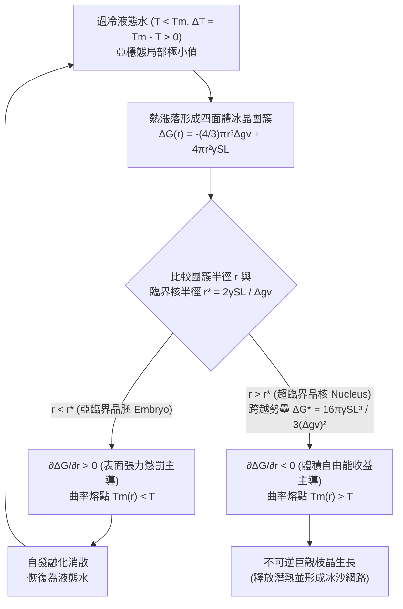
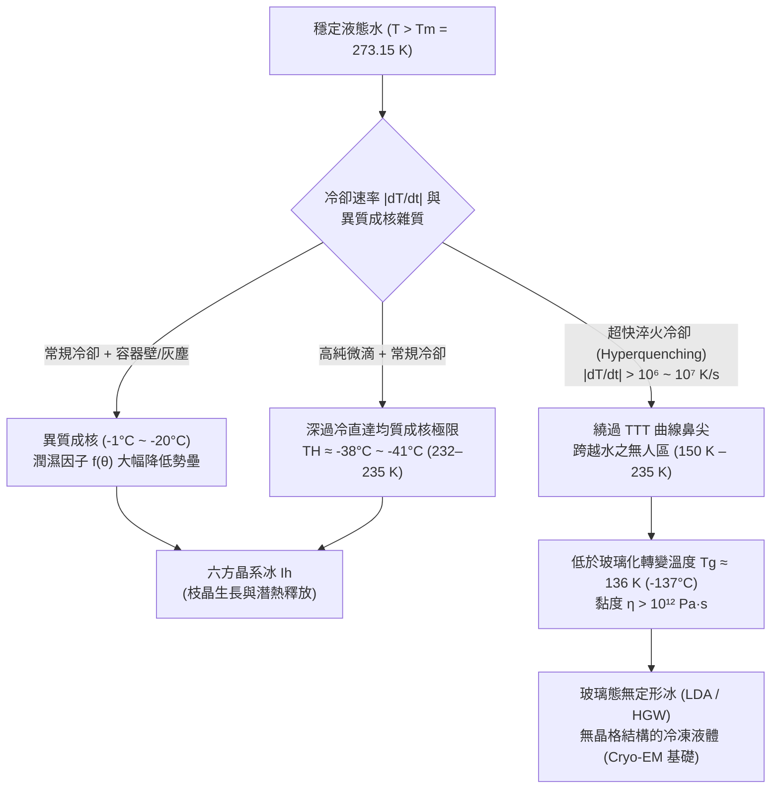

從冷凍庫中輕輕取出一瓶密封的純淨水，溫度計清晰地顯示著 $-8^\circ\text{C}$（$265.15\,\text{K}$），但瓶中的水依然清澈透明、流動自如。然而就在下一秒，當你將瓶底在桌面上輕輕一敲，或者將水倒向碗中的一小塊冰晶時，一道雪白的枝狀結晶網路以每秒數公分的速度閃電般貫穿整個瓶身，短短兩秒內，整瓶水便化作了一團潔白的不透明冰沙（Slush）。

基礎科學告訴我們，標準大氣壓（$1\,\text{atm} = 101.325\,\text{kPa}$）下水在 $0^\circ\text{C}$ 結冰、在 $100^\circ\text{C}$ 沸騰。然而從凝聚態物理與統計熱力學的嚴格視角來看，這一常識只說對了一半。準確地說，$0^\circ\text{C}$（$273.15\,\text{K}$）是冰與水的<strong>平衡熔點（Equilibrium Melting Point, $T_m$）</strong>——即巨觀六方冰（$\text{I}_h$）與液態水化學勢相等（$\mu_{\text{L}}(P, T_m) = \mu_{\text{S}}(P, T_m)$）並能無限期共存的溫度邊界，而<strong>絕非液態水自動發生結晶的起點</strong>。

事實上，如果剔除灰塵、雜質與容器壁刮痕，高純度微米水滴在冷卻通過 $0^\circ\text{C}$、$-15^\circ\text{C}$ 甚至 $-35^\circ\text{C}$ 時仍能保持液態。現代飛秒X射線自由電子雷射（XFEL）散射實驗證實，常壓下純水無需任何外來雜質僅靠自身熱漲落自發凍結的極限——<strong>均質成核極限（Homogeneous Nucleation Limit, $T_H$）</strong>——低達 <strong>$-38^\circ\text{C} \sim -41^\circ\text{C}$（$232\text{--}235\,\text{K}$）</strong>（真空蒸發微滴甚至可短暫存活至 $-42.55^\circ\text{C}$）。

為什麼在冰晶具有更低體相吉布斯自由能的零下溫區，水分子卻拒絕排列成冰？微觀世界裡究竟有一道怎樣的自由能高牆？

---

## 第一章：亞穩態（Metastable State）的熱力學本質

在定溫定壓（$T, P$）條件下，相變方向由吉布斯自由能 $G = H - TS$（莫耳吉布斯自由能即化學勢 $\mu$）決定。由於液態水的分子排列無序度遠高於冰晶格，其莫耳熵滿足 $s_{\text{L}} > s_{\text{S}} > 0$。由熱力學基本關係 $\left(\frac{\partial \mu}{\partial T}\right)_P = -s$ 可知，當溫度降至 $T < T_m$ 時，固相冰的化學勢低於液態水（$\mu_{\text{S}}(T) < \mu_{\text{L}}(T)$），冰成為熱力學上的<strong>全域極小值（Global Minimum）</strong>。

然而，處於 $0^\circ\text{C}$ 至 $-38^\circ\text{C}$ 之間的<strong>過冷水（Supercooled Water）</strong>之所以沒有立刻結冰，是因為它被困在了自由能曲面的<strong>亞穩態（Metastable State，局部極小值）</strong>中：

$$\frac{\partial G}{\partial \eta} = 0, \qquad \frac{\partial^2 G}{\partial \eta^2} > 0$$

只要自由能對序參量 $\eta$ 的二階導數（曲率）為正，任何無窮小的熱漲落都會導致自由能上升而被熱力學恢復力抹平。若要逃離亞穩態盆地、跌入冰晶的全域極小值，系統必須透過局部有限振幅漲落，跨越一道高度為 $\Delta G^* > 0$ 的<strong>成核自由能勢壘（Nucleation Barrier）</strong>（反之，當 $\frac{\partial^2 G}{\partial \eta^2} < 0$ 時勢壘消失，系統進入失穩分解即 Spinodal 區域）。

冰在升溫至 $0^\circ\text{C}$ 時之所以從不發生「過熱」，是因為冰表面天然存在一層奈米級厚度的準液態預融層（Premelting Layer），相當於預先消除了固液界面創生勢壘；而液態水降溫結晶時，卻必須在無序液體內部從零開始建立固液界面，從而付出高昂的界面能代價。

---

## 第二章：經典成核理論（CNT）——體積收益與表面懲罰的博弈

### 2.1 吉布斯自由能方程 $\Delta G(r)$ 的嚴格推導

由 Volmer、Weber、Becker、Döring 創立並由 Turnbull 與 Fisher（1949）推廣至液固相變的<strong>經典成核理論（Classical Nucleation Theory, CNT）</strong>，將過冷水中半徑為 $r$ 的球形冰晶胚（Embryo）的形成歸納為<strong>體積自由能收益（負項）</strong>與<strong>固液界面張力懲罰（正項）</strong>的競爭：

$$\Delta G(r) = -\frac{4}{3}\pi r^3 \Delta g_v + 4\pi r^2 \gamma_{\text{SL}}$$

1. <strong>單位體積自由能驅動力 $\Delta g_v$</strong>：
   設冰的單位體積熔化潛熱為 $\Delta H_f \approx 3.06 \times 10^8\,\text{J/m}^3$（質量潛熱 $L_f = 333.5\,\text{J/g}$），熔化熵為 $\Delta S_f$。在熔點 $T_m = 273.15\,\text{K}$ 處，$\Delta g_v(T_m) = \Delta H_f - T_m \Delta S_f = 0 \implies \Delta S_f = \frac{\Delta H_f}{T_m}$。當液體處於過冷度 $\Delta T \equiv T_m - T > 0$ 時（一階近似忽略固液比熱差 $\Delta c_p$）：
   $$\Delta g_v(T) = \Delta H_f - T\Delta S_f \approx \frac{\Delta H_f \cdot \Delta T}{T_m}$$
   過冷度 $\Delta T$ 越大，結冰帶來的體相熱力學獎勵 $\Delta g_v$ 越強。
2. <strong>固液界面自由能懲罰 $\gamma_{\text{SL}}$</strong>：
   冰水界面處的分子既失去了液相的構型旋轉熵，又無法像體相冰那樣形成完美的四面體氫鍵網路，由此產生正的界面張力 $\gamma_{\text{SL}} \approx 28\text{--}32\,\text{mJ/m}^2$。

### 2.2 臨界核半徑 $r^*$ 與成核勢壘 $\Delta G^*$

由於在極小尺度（$r \to 0$）下二次方的表面項 $r^2$ 遠大於三次方的體積項 $r^3$，微小冰簇生長反而使 $\Delta G(r)$ 升高。對 $r$ 求導並令其為零：

$$\frac{\partial \Delta G(r)}{\partial r} = -4\pi r^2 \Delta g_v + 8\pi r \gamma_{\text{SL}} = 0$$

即可解出<strong>臨界核半徑（Critical Nucleus Radius, $r^*$）</strong>與<strong>成核自由能勢壘（Nucleation Barrier, $\Delta G^*$）</strong>：

$$r^* = \frac{2\gamma_{\text{SL}}}{\Delta g_v} = \frac{2\gamma_{\text{SL}} T_m}{\Delta H_f \Delta T}, \qquad \Delta G^* = \Delta G(r^*) = \frac{16\pi \gamma_{\text{SL}}^3}{3(\Delta g_v)^2} = \frac{16\pi \gamma_{\text{SL}}^3 T_m^2}{3(\Delta H_f)^2 (\Delta T)^2}$$

* <strong>亞臨界晶胚（$r < r^*$，Embryo）</strong>：$\frac{\partial \Delta G}{\partial r} > 0$。由於曲率過大（吉布斯-湯姆孫效應導致其局域熔點 $T_m(r) = T_m(1 - \frac{2\gamma_{\text{SL}}}{\Delta H_f r}) < T$），繼續長大需要消耗自由能，因此會<strong>自發溶解回液態水</strong>。
* <strong>超臨界晶核（$r > r^*$，Nucleus）</strong>：一旦漲落跨越 $r^*$，$\frac{\partial \Delta G}{\partial r} < 0$，體積項徹底壓倒表面項，冰核將發生<strong>不可逆的災難性巨觀生長</strong>。

下表展示了不同溫度下純水均質成核的特徵尺度（取 $v_m \approx 3.26 \times 10^{-29}\,\text{m}^3$）：

| 溫度 $T$ ($^\circ\text{C}$) | 過冷度 $\Delta T$ ($\text{K}$) | 臨界核半徑 $r^*$ ($\text{nm}$) | 臨界核水分子數 $N^*$ | 無因次勢壘 $\Delta G^* / (k_B T)$ | 波茲曼因子 $\exp(-\Delta G^* / k_B T)$ | 均質成核可能性 |
| :--- | :--- | :--- | :--- | :--- | :--- | :--- |
| <strong>$-1.0^\circ\text{C}$</strong> | $1.0$ | $53.6\,\text{nm}$ | $\approx 1.98 \times 10^7$ | $\approx 2.88 \times 10^6$ | $10^{-1,250,000}$ | 統計物理上絕對為零 |
| <strong>$-5.0^\circ\text{C}$</strong> | $5.0$ | $10.7\,\text{nm}$ | $\approx 158,000$ | $\approx 1.17 \times 10^5$ | $10^{-50,800}$ | 宇宙壽命內不可能發生 |
| <strong>$-15.0^\circ\text{C}$</strong> | $15.0$ | $3.57\,\text{nm}$ | $\approx 5,860$ | $\approx 1.35 \times 10^4$ | $10^{-5,860}$ | 均質成核仍被完全禁止 |
| <strong>$-40.0^\circ\text{C}$</strong> ($\approx T_H$) | $40.0$ | $\approx 1.10\,\text{nm}$ | $\approx 180\text{--}250$ | $\approx 55\text{--}70$ | $\approx 10^{-25}\text{--}10^{-30}$ | <strong>1秒內必然自發凍結！</strong> |

由於 $\Delta G^* \propto (\Delta T)^{-2}$ 且 $N^* \propto (\Delta T)^{-3}$，只有當溫度降至 $T_H \approx -38^\circ\text{C} \sim -41^\circ\text{C}$、臨界核縮小到僅約 200 個水分子時，熱漲落才能在實驗時間尺度內跨越 $\Delta G^* \approx 65 k_B T$ 的門檻。

---

## 第三章：均質成核 vs. 異質成核——接觸角因子 $f(\theta)$ 與人工降雨

日常自來水之所以在 $-2^\circ\text{C}$ 就會結冰，是因為容器壁、灰塵微粒提供了<strong>異質成核（Heterogeneous Nucleation）</strong>基底。根據 Turnbull 的球冠模型（Spherical Cap Model），當冰胚在固體基底上以<strong>接觸角 $\theta$</strong>（由楊氏方程 $\cos\theta = \frac{\gamma_{\text{sub,L}} - \gamma_{\text{sub,S}}}{\gamma_{\text{SL}}}$ 決定）形成球冠時，其曲率半徑 $r^*$ 不變，但所需體積與自由能勢壘被乘上了一個幾何潤濕因子 $f(\theta)$：

$$\Delta G_{\text{het}}^* = \Delta G_{\text{hom}}^* \cdot f(\theta), \qquad f(\theta) = \frac{(2 + \cos\theta)(1 - \cos\theta)^2}{4} \in [0, 1]$$

* 當 $\theta = 180^\circ$（完全疏冰表面）時，$f(180^\circ) = 1$，無催化作用；
* 當 $\theta = 30^\circ$ 時，$f(30^\circ) \approx 0.013$，勢壘驟降至均質成核的 $1.3\%$；
* 當 $\theta = 10^\circ$ 時，$f(10^\circ) \approx 1.7 \times 10^{-4}$，勢壘被削減近 6000 倍！
* 當 $\theta = 0^\circ$（例如直接接觸一塊現成的冰晶）時，$f(0^\circ) = 0 \implies \Delta G_{\text{het}}^* = 0$，過冷水接觸冰面的瞬間零延遲凍結。

自然界與工程中的兩大異質成核典範：
1. <strong>碘化銀（$\text{AgI}$）人工降雨</strong>（Bernard Vonnegut, 1947）：六方纖鋅礦型 $\beta\text{-AgI}$ 的晶格常數（$a = 4.580\,\text{\AA}, c = 7.494\,\text{\AA}$）與六方冰 $\text{I}_h$（$a = 4.518\,\text{\AA}, c = 7.356\,\text{\AA}$）的晶格失配度僅為 $1.4\%$，可在 $-3^\circ\text{C} \sim -4^\circ\text{C}$ 高效催化雲滴結冰。
2. <strong>丁香假單胞菌（*Pseudomonas syringae*）的冰核蛋白（INPs, `inaZ`）</strong>：細菌外膜上的 $\beta$-螺旋串聯重複序列將水分子排布成完美類冰陣列，使水在 <strong>$-1.5^\circ\text{C} \sim -2.0^\circ\text{C}$</strong> 即開始結冰（廣泛用於滑雪場人工造雪機）。

---

## 第四章：猛烈敲擊瞬間結冰的機制與「10%冰沙定律」

當敲擊 $-8^\circ\text{C}$ 的過冷水瓶時，觸發成核的是<strong>聲空化（Acoustic Cavitation）與摩擦成核</strong>：衝擊波的負壓相使微米氣泡急劇膨脹，隨後的正壓相驅動氣泡發生 Rayleigh-Plesset 慣性坍縮，產生高達 $\sim\text{GPa}$ 的局部壓力尖峰與絕熱膨脹降溫，瞬間跨越 $\Delta G^*$。

緊接著，由於結冰界面釋放潛熱 $L_f = 333.5\,\text{J/g}$ 使界面升溫至 $0^\circ\text{C}$，潛熱必須向周圍 $-8^\circ\text{C}$ 的過冷水中擴散。任何微小的界面凸起都會面臨更陡的溫度梯度 $|\nabla T|$（尖端擴散效應），從而更快散熱、更快生長——這就是著名的<strong>Mullins-Sekerka 形態不穩定性（1963）</strong>，它驅使冰晶化作碎形<strong>枝晶（Dendrites）</strong>以每秒數公分的速度刺穿整瓶水。

為什麼瞬間結冰後瓶內是軟綿綿的冰沙而非堅硬的實心冰？因為短短 2 秒的結晶過程屬於<strong>絕熱焓守恆過程（$\Delta H_{\text{total}} = 0$）</strong>！凍結質量分數 $f_{\text{ice}}$ 釋放的潛熱，恰好被整瓶水從 $T_i = T_m - \Delta T$ 升溫至平衡熔點 $T_m = 0^\circ\text{C}$ 所吸收：

$$M \, f_{\text{ice}} \, L_f = M \, c_{p,\text{L}} \, \Delta T \quad \Longrightarrow \quad f_{\text{ice}} = \frac{c_{p,\text{L}} \Delta T}{L_f} \equiv \text{Ste}$$

代入水的比熱 $c_{p,\text{L}} \approx 4.21\,\text{J/(g}\cdot\text{K)}$、潛熱 $L_f = 333.5\,\text{J/g}$ 及 $\Delta T = 8.0\,\text{K}$：

$$f_{\text{ice}} = \frac{4.21 \times 8.0}{333.5} \approx 0.101 \quad (\mathbf{10.1\%})$$

實際上<strong>只有約 $10.1\%$ 的水真正結成了冰</strong>！這 $10\%$ 的針狀枝晶搭起了貫穿全瓶的三維逾滲網格，將剩餘 $89.9\%$ 處於 $0^\circ\text{C}$ 的液態水鎖在微孔中，形成了看似固態的冰沙（若要絕熱一次性 $100\%$ 結冰，需達到超冷極限 $\Delta T_{\text{hyp}} = L_f / c_{p,\text{L}} \approx 79.2\,\text{K}$，遠低於均質成核極限 $T_H$，故常壓下絕無可能）。

---

## 第五章：鏡像現象（過熱與突沸）、雲物理與玻璃化轉變（$T_g$）

### 5.1 過熱（Superheating）、微波爐突沸與泡室
當水在光滑無刮痕的容器中用微波爐體相加熱至 $T > T_b = 100^\circ\text{C}$ 時，半徑為 $r$ 的蒸汽泡受到向內的<strong>楊-拉普拉斯毛細管附加壓力 $\Delta P = \frac{2\gamma_{\text{LV}}}{r}$</strong>（半徑 $50\,\text{nm}$ 時高達 $23.3\,\text{atm}$！），臨界氣泡半徑為：

$$r_b^* = \frac{2\gamma_{\text{LV}}}{P_{\text{V}}(T) - P_{\text{L}}} \approx \frac{2\gamma_{\text{LV}} T_b}{\rho_{\text{V}} L_v \Delta T_{\text{sh}}}$$

缺乏氣穴核時水可安靜過熱至 $105^\circ\text{C}\text{--}110^\circ\text{C}$（純水極限可達 $\sim 300^\circ\text{C}$），一旦投入咖啡粉或湯匙引入海量氣核，便會引發爆炸性<strong>突沸（Bumping）</strong>。1952年，<strong>Donald Glaser</strong> 正是利用過熱液氫的亞穩態發明了<strong>泡室（Bubble Chamber，1960年諾貝爾物理學獎）</strong>，讓高能帶電粒子的游離熱尖峰觸發局部沸騰，從而拍下微觀粒子的軌跡。

### 5.2 貝吉龍過程、飛機結冰與生物抗凍蛋白（AFPs）
* <strong>韋格納-貝吉龍-芬德森過程（WBF Process）</strong>：由於 $0^\circ\text{C}$ 以下冰面飽和蒸氣壓嚴格低於過冷水面（$e_s^{\text{ice}}(T) < e_s^{\text{water}}(T)$，在 $-12^\circ\text{C} \sim -15^\circ\text{C}$ 差值最大），混合相雲中的冰晶會不斷吞噬過冷水滴蒸發的水汽而長大成雪。當飛機穿越含過冷大水滴（SLD）的雲層時，撞擊機翼瞬間僅凍結 $f_{\text{ice}} = c_p\Delta T/L_f$ 的部分，其餘液態水向後流動再凍結成透明致密的<strong>明冰（Glaze/Clear Ice）</strong>，嚴重破壞氣動升力。
* <strong>極地魚類的抗凍糖蛋白（AFGPs）</strong>：南極魚類透過抗凍蛋白不可逆吸附於冰晶稜柱面，迫使冰界面在間距為 $d$ 的蛋白分子縫隙間凸出（曲率半徑 $r \approx d/2$），利用吉布斯-湯姆孫曲率效應產生熱滯後 $\Delta T_{\text{TH}} = \frac{4\gamma_{\text{SL}} T_m}{\Delta H_f d}$，在奈米尺度鎖死冰晶生長。

### 5.3 玻璃化轉變（Vitrification）與水之「無人區（No-Man's Land）」
Turnbull-Fisher 穩態成核率包含熱力學驅動項與動力學擴散項的乘積：

$$J(T) = J_0 \exp\left(-\frac{\Delta G_{\text{diff}}(T)}{k_B T}\right) \exp\left(-\frac{\Delta G^*(T)}{k_B T}\right)$$

隨著溫度深降，熱力學項加速成核，但液體的黏度 $\eta(T)$ 按 VFT 方程急劇發散，分子擴散被凍結。兩者在<strong>時間-溫度-轉變圖（TTT 圖）</strong>上形成C形的「鼻尖（Nose）」。

若以超過<strong>臨界冷卻速率 $\dot{T}_c \sim 10^6\text{--}10^7\,\text{K/s}$</strong> 對純水進行超快淬火，就能繞過「水之無人區（$150\,\text{K} \sim 235\,\text{K}$）」的結晶鼻尖，在 <strong>$T_g \approx 136\,\text{K}$（$-137^\circ\text{C}$）</strong> 以下將水直接轉化為<strong>低密度無定形冰（玻璃態水，LDA）</strong>！Jacques Dubochet 正是憑藉液態乙烷超快玻璃化冷凍技術創立了<strong>冷凍電鏡（Cryo-EM，2017年諾貝爾化學獎）</strong>，使人類得以在原子尺度觀測生命大分子的天然構象；而在無人區深處，高密度液態水（HDL）與低密度液態水（LDL）相分離的<strong>液-液臨界點（LLCP，Stanley 假說）</strong>至今仍是凝聚態物理最激動人心的前沿。
