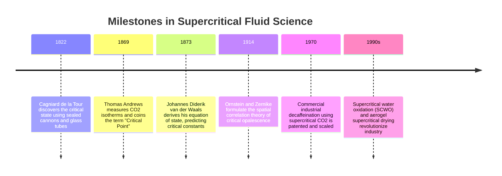
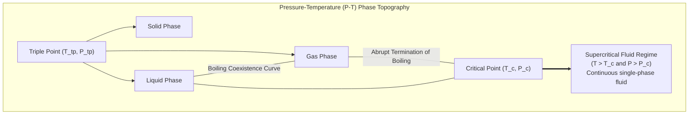
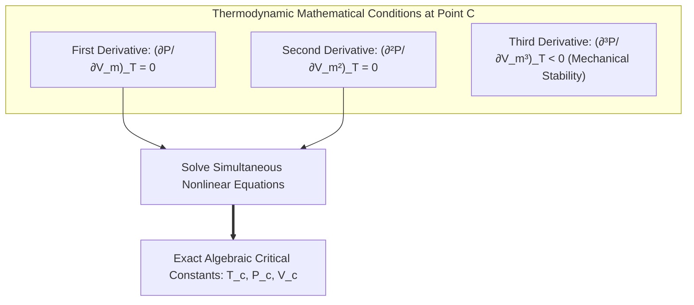
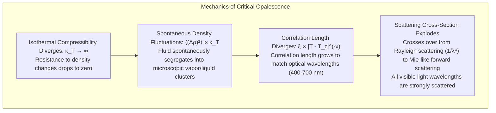
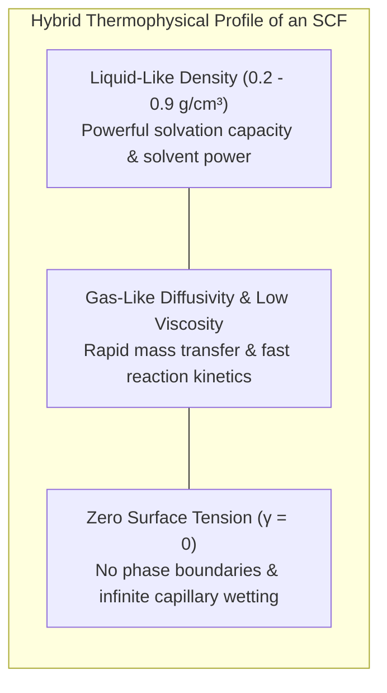
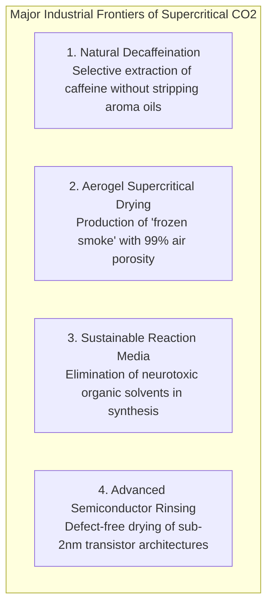
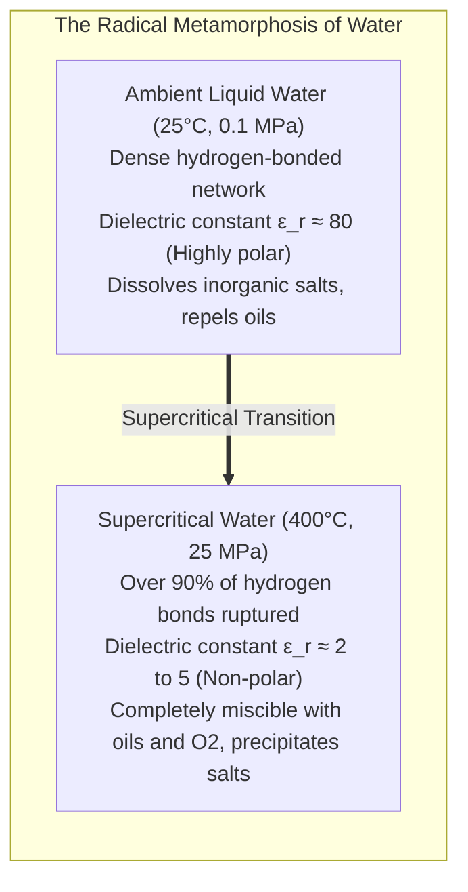
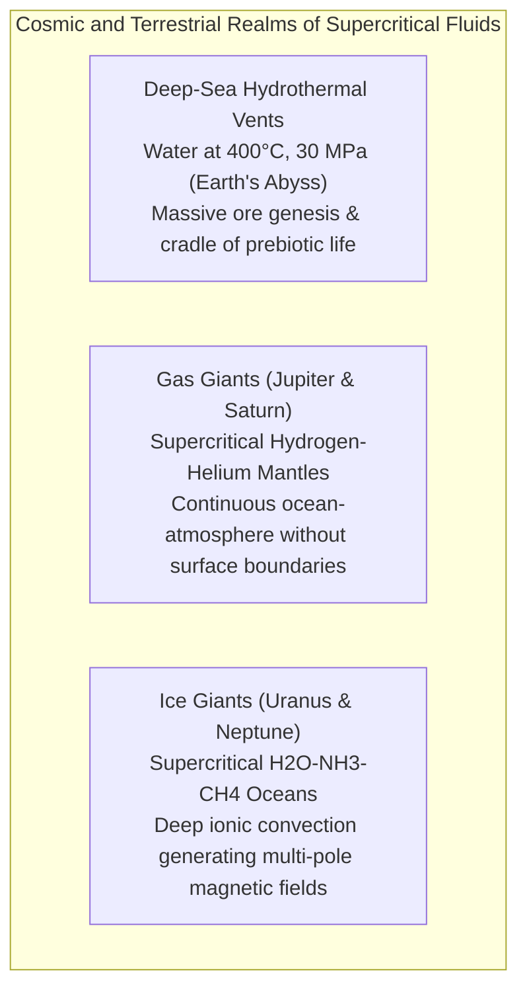

Picture a high-pressure optical cell forged from heavy-walled sapphire glass, securely sealing a mixture of liquid and gaseous carbon dioxide. As you gradually increase the temperature from outside, an astonishing thermodynamic drama unfolds.

With rising temperature, the density of the liquid pool at the bottom begins to decline due to thermal expansion. Simultaneously, the molecular density of the evaporating vapor above rises sharply. The density contrast between the two phases narrows at an accelerating rate. The once-sharp boundary dividing them—the meniscus—flattens as its surface tension approaches zero. 

Then, at precisely $31.1^\circ\text{C}$ ($304.2\,\text{K}$) and $7.38\,\text{MPa}$ ($72.8\,\text{atm}$), a breathtaking phenomenon occurs: the entire interior of the chamber suddenly blooms into a milky, shimmering, iridescent glow known as <strong>critical opalescence</strong>. Moments later, the meniscus vanishes entirely. In an instant, liquid and gas merge seamlessly into a single, uniform, dense hybrid state of matter.

This is the birth of a <strong>Supercritical Fluid (SCF)</strong>.

Throughout classical elementary education, we are taught the rigid dogma of the three classical states of matter: solid, liquid, and gas, separated by discontinuous first-order phase transitions of melting, boiling, and condensation. Yet fundamental thermodynamics reveals that the liquid and gas phases are not fundamentally distinct states of symmetry; rather, they are two regions of a continuous thermodynamic fluid continuum. By navigating around the <strong>critical point</strong>, one can convert a liquid into a gas—or vice versa—without boiling, bubbling, or crossing a phase boundary.

Supercritical fluids possess a mesmerizing combination of properties:
- <strong>Liquid-like density and solvating power</strong>: They dissolve complex organic solutes with the potency of liquid solvents.
- <strong>Gas-like transport properties</strong>: They exhibit ultra-low viscosity and diffusion coefficients hundreds of times higher than conventional liquids.
- <strong>Zero surface tension</strong>: Having no phase boundary, they penetrate deeply into micro- and nano-porous materials without inflicting capillary collapse.

In this comprehensive treatise, we will explore the thermodynamics, statistical physics, and transformative applications of supercritical fluids: from Charles Cagniard de la Tour's pioneering 1822 cannon barrel experiments, to the mathematical derivation of critical constants via the van der Waals equation of state, the Ornstein-Zernike theory of critical fluctuations, decaffeination and aerogel synthesis using supercritical $\text{CO}_2$, the destructive and oxidizing chemistry of supercritical water, and the immense supercritical oceans that define the deep interiors of Jupiter, Saturn, and deep-sea hydrothermal vents.

---

## 1. The Genesis of the Critical Point: Cagniard de la Tour's Cannon Experiment

### 1.1 An Acoustic Revelation in 1822

The experimental discovery that the interface separating liquid and vapor can disappear dates back to 1822. The French engineer and physicist <strong>Charles Cagniard de la Tour</strong> was investigating the acoustic resonant properties of liquids sealed inside a repurposed bronze cannon barrel.

Inside the barrel, he placed various liquids—water, alcohol, and ether—along with a small flint rolling ball. When the sealed cannon was rocked back and forth, the rolling flint produced distinct acoustic impacts depending on whether it rolled through a dense liquid pool or through vapor. Cagniard de la Tour observed that as the temperature was increased beyond a characteristic threshold, the splashing, rolling sound characteristic of the liquid phase suddenly and completely ceased.

Realizing that an acoustic test could not reveal the optical state of the medium, Cagniard de la Tour constructed robust, thick-walled glass capillary tubes to directly observe the phenomena. He recorded a milestone observation in physics: as the sealed liquid was heated, the volume of the liquid expanded while the density of the vapor above it surged. At a specific, reproducible temperature, the visible meniscus separating the two phases blurred, flattened, and <strong>completely dissolved</strong>, leaving the tube filled with an isotropic, homogeneous fluid.

In 1869, the Irish chemist and physicist <strong>Thomas Andrews</strong> performed meticulous, quantitative pressure-volume-temperature ($P$-$V$-$T$) measurements on carbon dioxide, proving that this critical threshold is an absolute physical constant for each pure substance, giving it the definitive name: the <strong>Critical Point</strong>.

---

## 2. Thermodynamics of the Critical Point and the van der Waals Equation

### 2.1 The P-T and P-V Phase Topography

In a classical pressure-temperature ($P$-$T$) phase diagram of a pure substance:
- The <strong>solid-liquid melting curve</strong> extends indefinitely upward into extreme pressures without terminating, reflecting the symmetry-breaking distinction between a periodic crystal lattice and an amorphous fluid.
- The <strong>solid-gas sublimation curve</strong> terminates at the triple point.
- The <strong>liquid-gas coexistence curve (vapor pressure curve)</strong> begins at the triple point and extends upward, but unlike the melting curve, it <strong>terminates abruptly at a distinct terminal point: the Critical Point ($T_c, P_c$)</strong>.

As the liquid-gas coexistence curve is traversed toward the critical point:
1. The liquid density $\rho_L(T)$ decreases due to thermal dilation.
2. The saturated vapor density $\rho_G(T)$ increases due to elevated vapor pressure.
3. At the critical point ($T \to T_c$), the density difference vanishes:
   $$\lim_{T \to T_c} \left( \rho_L(T) - \rho_G(T) \right) = 0$$
4. The latent heat of vaporization $\Delta H_{\text{vap}}$ (the enthalpy required to convert liquid to gas) continuously decreases to zero:
   $$\lim_{T \to T_c} \Delta H_{\text{vap}} = 0$$
5. The liquid-vapor surface tension $\gamma$ vanishes identically:
   $$\lim_{T \to T_c} \gamma = 0$$

Because surface tension represents the interfacial free energy per unit area separating two phases, $\gamma = 0$ implies that there is no thermodynamic energetic cost to form or destroy an interface. The meniscus simply ceases to exist.

### 2.2 Analytical Derivation via the van der Waals Equation of State

In 1873, the Dutch theoretical physicist <strong>Johannes Diderik van der Waals</strong> introduced his historic equation of state for real gases, introducing two physically intuitive corrections to the ideal gas law:
1. A co-volume parameter $b$, representing the finite steric excluded volume of the hard molecular cores.
2. An attractive parameter $a$, accounting for the long-range attractive dispersion forces (van der Waals forces) that reduce the pressure exerted on the walls:

$$\left( P + \frac{a}{V_m^2} \right) (V_m - b) = R T$$

where $P$ is pressure, $V_m$ is molar volume, $T$ is absolute temperature, and $R$ is the universal gas constant.

Rearranging for pressure $P$ as an explicit function of $V_m$ and $T$:
$$P(V_m, T) = \frac{R T}{V_m - b} - \frac{a}{V_m^2}$$

On a $P$-$V_m$ diagram:
- At subcritical temperatures ($T < T_c$), isotherms exhibit an S-shaped unphysical loop with local maxima and minima, where $(\partial P / \partial V_m)_T > 0$ represents a mechanically unstable regime (resolved physically by the Maxwell equal-area construction into a horizontal liquid-gas coexistence plateau).
- At supercritical temperatures ($T > T_c$), the isotherms are strictly monotonically decreasing, showing no phase separation.

The critical isotherm ($T = T_c$) represents the exact mathematical boundary where the two extrema coalesce into a single horizontal inflection point. The critical point $(T_c, P_c, V_c)$ is uniquely determined by two simultaneous derivative conditions:

$$\left( \frac{\partial P}{\partial V_m} \right)_T = -\frac{R T}{(V_m - b)^2} + \frac{2 a}{V_m^3} = 0$$

$$\left( \frac{\partial^2 P}{\partial V_m^2} \right)_T = \frac{2 R T}{(V_m - b)^3} - \frac{6 a}{V_m^4} = 0$$

From the second derivative condition:
$$\frac{2 R T}{(V_m - b)^3} = \frac{6 a}{V_m^4} \implies \frac{R T}{(V_m - b)^2} = \frac{3 a (V_m - b)}{V_m^4}$$

Substituting this into the first derivative condition:
$$\frac{3 a (V_m - b)}{V_m^4} = \frac{2 a}{V_m^3}$$

Dividing both sides by $a / V_m^3 \ne 0$:
$$\frac{3(V_m - b)}{V_m} = 2 \implies 3 V_m - 3 b = 2 V_m \implies V_c = 3 b$$

We have derived the <strong>critical molar volume</strong>: $V_c = 3b$.

Now substitute $V_c = 3b$ back into the first derivative relation to evaluate the <strong>critical temperature</strong> $T_c$:
$$\frac{R T_c}{(3b - b)^2} = \frac{2 a}{(3b)^3} \implies \frac{R T_c}{4 b^2} = \frac{2 a}{27 b^3} \implies T_c = \frac{8 a}{27 R b}$$

Finally, substitute $V_c = 3b$ and $T_c = \frac{8a}{27Rb}$ into the original van der Waals equation to find the <strong>critical pressure</strong> $P_c$:
$$P_c = \frac{R \left( \frac{8 a}{27 R b} \right)}{3b - b} - \frac{a}{(3b)^2} = \frac{8 a}{54 b^2} - \frac{a}{9 b^2} = \frac{4 a}{27 b^2} - \frac{3 a}{27 b^2} = \frac{a}{27 b^2}$$

#### The Universal Critical Compressibility Factor $Z_c$
A crowning achievement of van der Waals was calculating the dimensionless <strong>critical compressibility factor</strong> $Z_c$:
$$Z_c = \frac{P_c V_c}{R T_c} = \frac{\left( \frac{a}{27 b^2} \right) (3 b)}{R \left( \frac{8 a}{27 R b} \right)} = \frac{\frac{3 a}{27 b}}{\frac{8 a}{27 b}} = \frac{3}{8} = 0.375$$

The substance-specific parameters $a$ and $b$ cancel out entirely! The van der Waals theory predicts that *all* gases, regardless of chemical identity, possess an identical critical compressibility of $0.375$. While real molecular fluids exhibit $Z_c \approx 0.23 \sim 0.31$ due to multipole moments and quantum effects, this universal scaling established the foundational principle of corresponding states in modern thermodynamics.

---

## 3. Critical Opalescence and the Physics of Fluctuations

### 3.1 The Mystery of the Shimmering Milkiness

As a fluid in a sealed cell approaches within millikelvins of its critical point, an optical transformation occurs. A transparent, water-clear liquid and an equally transparent vapor suddenly turn turbid, opalescent, and brilliantly diffuse light, glowing like a milky, iridescent gemstone under illumination.

Why should a chemically pure, single-component substance with no dust, colloids, or impurities suddenly turn opaque and scatter light with ferocious intensity?

### 3.2 The Divergence of Isothermal Compressibility

The physical origin lies in the mathematical condition of the critical inflection point. Recall that:
$$\left( \frac{\partial P}{\partial V} \right)_T = 0$$

The thermodynamic <strong>isothermal compressibility</strong> $\kappa_T$, which measures the relative fractional volume decrease per unit pressure increase, is defined as:
$$\kappa_T = -\frac{1}{V} \left( \frac{\partial V}{\partial P} \right)_T = -\frac{1}{V \left( \frac{\partial P}{\partial V} \right)_T}$$

Because the denominator approaches zero at the critical point, the isothermal compressibility <strong>diverges to infinity</strong>:
$$\lim_{T \to T_c} \kappa_T = +\infty$$

An infinite compressibility means that the thermodynamic cost of changing the fluid's density is precisely zero. The fluid loses all mechanical stiffness; the slightest random thermal jiggle of a molecule is capable of compressing or rarefying vast macroscopic ensembles of neighboring molecules without encountering restoring pressure forces.

### 3.3 The Ornstein-Zernike Theory (1914)

In statistical thermodynamics, local density fluctuations $\Delta \rho(\mathbf{r}) = \rho(\mathbf{r}) - \langle \rho \rangle$ are directly proportional to the isothermal compressibility:
$$\langle (\Delta N)^2 \rangle = k_B T \langle N \rangle \rho \kappa_T$$

Under normal atmospheric conditions, the spatial range over which density fluctuations correlate—the <strong>correlation length $\xi$</strong>—is minuscule, on the order of an intermolecular spacing ($\xi \sim 0.1 \sim 0.3\,\text{nm}$). Because $\xi \ll \lambda_{\text{light}}$ (where visible light wavelengths $\lambda \approx 400 \sim 700\,\text{nm}$), light waves pass through the fluid undisturbed, experiencing it as an optically homogeneous continuum.

However, as $T \to T_c$, the correlation length diverges following a universal power law governed by the critical exponent $\nu \approx 0.63$:
$$\xi(T) = \xi_0 \left| \frac{T - T_c}{T_c} \right|^{-\nu}$$

In 1914, Dutch physicists <strong>Leonard Ornstein</strong> and <strong>Frits Zernike</strong> derived the spatial pair correlation function $G(r)$:
$$G(r) = \langle \Delta \rho(0) \Delta \rho(r) \rangle \sim \frac{e^{-r / \xi}}{r}$$

Within a few millikelvins of $T_c$, the correlation length $\xi$ swells from sub-nanometer dimensions to <strong>hundreds of nanometers—matching the exact wavelengths of visible light</strong>!

The fluid is no longer an optically smooth medium. Instead, it becomes a roiling, transient sea of macroscopic, light-scattering density patches—swirling droplets of near-liquid density and bubbles of near-gas density continually condensing and evaporating at the speed of thermal motion. When visible light enters this landscape, it undergoes violent, multi-wave scattering across the entire visual spectrum. The fluid turns milky white, revealing microscopic fluctuations to the naked human eye.

---

## 4. Thermophysical Duality of Supercritical Fluids

A supercritical fluid ($T > T_c, P > P_c$) occupies a unique domain that defies binary classification. It possesses transport properties that bridge the gap between liquids and gases:

| Property | Gas (Atmospheric) | <strong>Supercritical Fluid (SCF)</strong> | Liquid (Atmospheric) |
|---|---|---|---|
| <strong>Density ($\text{g/cm}^3$)</strong> | $0.001 \sim 0.002$ | <strong>$0.2 \sim 0.9$</strong> *(Liquid-like)* | $0.8 \sim 1.0$ |
| <strong>Viscosity ($\text{Pa}\cdot\text{s}$)</strong> | $10^{-5}$ | <strong>$10^{-5} \sim 10^{-4}$</strong> *(Gas-like)* | $10^{-3}$ |
| <strong>Self-Diffusion Coeff. ($\text{cm}^2\text{/s}$)</strong> | $0.1 \sim 0.4$ | <strong>$10^{-4} \sim 10^{-3}$</strong> *(100x liquid)* | $10^{-5}$ |
| <strong>Surface Tension ($\text{N/m}$)</strong> | None ($0$) | <strong>Strictly Zero ($0$)</strong> | $0.02 \sim 0.07$ |

### 4.1 Continuous Density Tunability

In ordinary liquid solvents, changing pressure by a few megapascals has an almost imperceptible effect on density due to low compressibility (water compresses by only $\sim 0.005\%$ per atmosphere).

In sharp contrast, because $\kappa_T$ is exceedingly large near the critical point, <strong>the density of a supercritical fluid can be smoothly, continuously, and reversibly tuned across an immense range—from gas-like to liquid-like—by making subtle adjustments to pressure or temperature</strong>.

Because the solvating capacity of a fluid correlates directly with its density (via the Hildebrand solubility parameter $\delta \propto \rho$), a chemical engineer can tune a supercritical fluid to dissolve a specific target molecule at high pressure, and then depressurize the system slightly to cause the solute to precipitate out quantitatively as a pure crystalline powder.

### 4.2 The Elimination of Capillary Stress

When a porous, nanostructured solid (such as a silica gel or an etched silicon wafer) is dried by evaporating a liquid solvent, the receding liquid-vapor meniscus exerts a colossal <strong>capillary pressure</strong> across the nanoscale pores, dictated by the Young-Laplace equation:
$$\Delta P_{\text{cap}} = \frac{2 \gamma \cos \theta}{r_p}$$

For a nanopore of radius $r_p = 2\,\text{nm}$ containing liquid water ($\gamma \approx 0.072\,\text{N/m}$), the capillary tension exceeds:
$$\Delta P_{\text{cap}} = \frac{2 \times 0.072}{2 \times 10^{-9}} = 7.2 \times 10^7\,\text{Pa} = 720\,\text{atmospheres}!$$

This massive compressive tension causes delicate microstructures, aerogels, and semiconductor photoresist patterns to buckle, collapse, and densify irreversibly.

Because supercritical fluids possess <strong>zero surface tension ($\gamma = 0$)</strong>, the Young-Laplace pressure drops to identically zero. Supercritical drying completely circumvents capillary stress, preserving fragile nanostructures in their pristine, uncompressed state.

---

## 5. Supercritical Carbon Dioxide ($	ext{scCO}_2$): The Green Champion

### 5.1 The Thermodynamic Miracle of $	ext{CO}_2$

Among all chemical compounds, carbon dioxide is the undisputed workhorse of industrial supercritical fluid technology. Its popularity stems from exceptionally benign thermodynamic and environmental metrics:
- <strong>Critical Temperature</strong>: $T_c = 31.1^\circ\text{C}$ ($304.2\,\text{K}$) — slightly below human body temperature.
- <strong>Critical Pressure</strong>: $P_c = 7.38\,\text{MPa}$ ($72.8\,\text{bar}$) — readily achievable in standard industrial pressure vessels.
- <strong>Non-toxic, non-flammable, chemically inert, non-corrosive, and inexpensive</strong>.
- <strong>Naturally abundant and recyclable</strong>: It can be captured from industrial emissions and recycled in closed-loop systems with net-zero release.

### 5.2 Industrial Decaffeination of Coffee

Prior to the 1970s, decaffeinated coffee was produced using chlorinated hydrocarbon solvents like dichloromethane or ethyl acetate. These volatile organic solvents posed toxicity risks, generated hazardous chemical waste, and inadvertently stripped out vital aromatic volatile compounds, degrading coffee quality.

The supercritical $\text{CO}_2$ process completely revolutionized the global coffee industry:
1. Green coffee beans are pre-soaked with steam and water to swell the cell matrix and mobilize caffeine molecules.
2. The moist beans are introduced into a tall extraction column pressurized with supercritical $\text{CO}_2$ at $70 \sim 90^\circ\text{C}$ and $20 \sim 30\,\text{MPa}$.
3. Because $\text{scCO}_2$ is non-polar and small, it diffuses effortlessly through the bean's cellular pores, selectively binding to and dissolving the hydrophobic caffeine molecules while leaving high-molecular-weight aroma precursors, sugars, and proteins untouched inside the bean.
4. The caffeine-laden $\text{scCO}_2$ streams into a washing tower where it contacts water, or into a decompression vessel where the pressure is dropped below $P_c$. The $\text{CO}_2$ instantly flashes into an inert gas and separates, while pure caffeine precipitates out as a crystalline white powder (which is captured and sold to pharmaceutical and beverage industries).
5. The gaseous $\text{CO}_2$ is recompressed and pumped back into the extractor in a continuous, zero-waste loop.

The resulting coffee retains its rich original flavor profile with <strong>zero toxic solvent residues</strong>.

### 5.3 Aerogels: Fabricating "Frozen Smoke"

Silica aerogels are the world's lightest solid materials, consisting of an amorphous, three-dimensional network of cross-linked silica nanoparticles enclosing up to $99.8\%$ air by volume. They exhibit thermal conductivities lower than that of static air, making them supreme insulators for space suits, Mars rovers, and cryogenic fuel tanks.

Synthesizing an aerogel begins with a "wet gel" whose nanopores are filled with liquid ethanol. If dried by standard thermal evaporation, capillary forces ($> 100\,\text{MPa}$) utterly crush the delicate fractal silica backbone into a dense, cracked powder known as a xerogel.

In <strong>supercritical drying</strong>, the liquid ethanol inside the wet gel is exchanged with liquid $\text{CO}_2$ in a high-pressure autoclave. The system is heated and pressurized past the critical point of $\text{CO}_2$ ($T > 31.1^\circ\text{C}, P > 7.38\,\text{MPa}$). Once in the supercritical state, the liquid-vapor phase boundary ceases to exist. The pressure is then slowly and isothermally vented to atmospheric levels. Because the solvent departs as a continuous supercritical fluid without ever forming a liquid meniscus, the capillary pressure remains exactly zero, and the fragile, ultra-porous silica skeleton is preserved without shrinkage.

---

## 6. Supercritical Water ($	ext{scH}_2	ext{O}$): The Radical Reactor

While supercritical carbon dioxide is mild, gentle, and non-polar, pushing water into its supercritical regime ($T_c = 373.9^\circ\text{C}, P_c = 22.06\,\text{MPa}$) unleashes an aggressive, highly reactive chemical environment that bears almost no resemblance to ambient water.

### 6.1 The Disintegration of the Hydrogen Bond Network

Under ambient conditions, water is an intensely polar solvent with an exceptionally high relative dielectric constant (permittivity) of $\epsilon_r \approx 80$. This strong polarity is maintained by an extensive, tetrahedral network of intermolecular hydrogen bonds, allowing water to readily hydrate and dissociate inorganic ions while rejecting non-polar hydrocarbons.

As water is heated past its critical point ($373.9^\circ\text{C}$):
1. Violent thermal kinetic energy tears apart more than $90\%$ of the hydrogen bonds.
2. The fluid density drops from $1.0\,\text{g/cm}^3$ to approximately $0.1 \sim 0.3\,\text{g/cm}^3$.
3. The dielectric constant plunges precipitously from $\epsilon_r \approx 80$ to <strong>$\epsilon_r \approx 2 \sim 5$</strong>!

A dielectric constant of $2 \sim 5$ is identical to that of non-polar organic solvents like hexane, benzene, and toluene. 

Consequently, supercritical water undergoes a complete reversal of chemical behavior:
- <strong>Total miscibility with organics</strong>: Hydrocarbons, plastic polymers, chlorinated aromatics, and oils become infinitely soluble in supercritical water.
- <strong>Complete miscibility with permanent gases</strong>: Oxygen ($\text{O}_2$), air, hydrogen, and carbon dioxide dissolve into supercritical water in all proportions, forming a single, homogeneous fluid phase with zero mass-transfer resistance.
- <strong>Severe precipitation of inorganic salts</strong>: Salts such as sodium chloride ($\text{NaCl}$), calcium sulfate, and silica lose their hydration shells; their solubility drops by orders of magnitude, causing them to precipitate instantly as crystalline salts.

### 6.2 Supercritical Water Oxidation (SCWO): Flash Destruction of Hazardous Wastes

The simultaneous complete miscibility of organic wastes and molecular oxygen in supercritical water forms the basis of <strong>Supercritical Water Oxidation (SCWO)</strong>—the ultimate waste remediation technology.

In conventional incineration, organic pollutants burn with diffusion flames, often yielding toxic byproducts of incomplete combustion (such as furans, dioxins, polycyclic aromatic hydrocarbons, and NOx). Furthermore, aqueous hazardous wastes require enormous amounts of fuel just to evaporate the carrier water.

In an SCWO reactor operating at $400 \sim 650^\circ\text{C}$ and $25\,\text{MPa}$:
- Organic toxins, water, and pure high-pressure oxygen merge into a <strong>single, homogeneous reaction phase</strong>.
- Without interphase boundary transport barriers, oxidation occurs at lightning speed via free-radical chain mechanisms.
- Organic compounds undergo greater than <strong>$99.9999\%$ destruction efficiency in contact times of only $5 \sim 30$ seconds</strong>.
- The carbon is converted cleanly to $\text{CO}_2$, hydrogen to $\text{H}_2\text{O}$, and heteroatoms (chlorine, sulfur, phosphorus) are oxidized to inorganic mineral acids ($\text{HCl}, \text{H}_2\text{SO}_4, \text{H}_3\text{PO}_4$), which are neutralized with bases and safely precipitated as mineral salts.

SCWO is utilized by defense and environmental agencies to destroy chemical weapons (such as mustard gas and VX nerve agents), persistent organic pollutants (PCBs, PFAS "forever chemicals"), and space station wastewater.

---

## 7. Supercritical Fluids in the Cosmos and Earth Systems

Far from being a rare artifact of high-tech human laboratories, supercritical fluids are one of the most widespread states of matter in our planetary system and across the cosmos.

### 7.1 Deep-Sea Hydrothermal Vents and Prebiotic Chemistry

At the bottom of Earth's oceans along mid-ocean ridges (such as the East Pacific Rise and Mid-Atlantic Ridge), water depths exceed $3,000\,\text{meters}$, generating ambient hydrostatic pressures above $30\,\text{MPa}$ (300 atmospheres). Magma chambers located kilometers beneath the seafloor heat circulating seawater to temperatures exceeding $400 \sim 450^\circ\text{C}$.

Under these conditions, seawater does not boil into steam. Instead, it transitions into <strong>supercritical geothermal water</strong>. 

As a supercritical fluid with high diffusivity, low viscosity, and high mineral solvency, it strips heavy metals (gold, copper, zinc, iron, manganese) and sulfides out of the oceanic basalt. When this supercritical brine vents through "black smoker" chimneys into cold ($2^\circ\text{C}$) abyssal seawater, the abrupt quenching triggers instantaneous mineral precipitation, building colossal polymetallic sulfide mounds.

Crucially, the intense catalytic gradients, chemical disequilibrium, and organic synthesis occurring within these supercritical hydrothermal systems represent one of the primary candidates for the <strong>abiotic origin of life on Earth (the hydrothermal origin hypothesis)</strong>.

### 7.2 Gas Giant Interiors: The Infinite Supercritical Oceans of Jupiter and Saturn

When humans gaze upon the banded clouds of Jupiter or Saturn, we instinctively imagine a thin gaseous atmosphere resting atop a solid planetary surface. Astrophysical planetary science reveals a radically different reality.

Jupiter's atmosphere is composed of roughly $90\%$ hydrogen and $10\%$ helium. As one descends through the Jovian cloud decks, the gravitational pull of the planet's vast mass increases both temperature and pressure rapidly. At a depth of merely a few hundred kilometers, conditions exceed the critical point of hydrogen:
$$T_c(\text{H}_2) = 33.2\,\text{K} \quad (-239.9^\circ\text{C}), \quad P_c(\text{H}_2) = 1.30\,\text{MPa} \quad (12.8\,\text{atm})$$

Data gathered by NASA's Galileo and Juno missions confirmed that <strong>Jupiter has no distinct surface, no shoreline, and no lake bed</strong>. 

The gaseous hydrogen atmosphere thickens smoothly, seamlessly, and continuously into a vast, planetary-scale ocean of <strong>supercritical fluid molecular hydrogen</strong>. Deeper still, at pressures exceeding $200\,\text{GPa}$ (2 million atmospheres), the supercritical molecular fluid undergoes an electronic Mott transition into a liquid metallic hydrogen ocean, where protons and electrons dissociate to generate Jupiter's colossal dynamo magnetic field. The largest planets in our solar system are fundamentally giant, churning spheres of supercritical fluid.

---

## 8. Conclusion: Beyond the Classical Boundaries of Matter

The sharp distinction between "liquid" and "gas" that governs human intuition is an environmental artifact of living on a cool, low-pressure planetary surface at 1 atmosphere.

When examined through the lens of thermodynamic phase space, the liquid-vapor phase boundary is merely a finite seam that terminates at the critical point. Beyond that point, the rigid categories of matter dissolve. Surface tension vanishes, latent heat disappears, and molecules attain a harmonious state: displaying the cohesive density and solvent power of a liquid, united with the rapid transport kinetics and boundless freedom of a gas.

From Cagniard de la Tour listening to the click of a stone inside an antique bronze cannon, to modern aerospace aerogels and the unfathomable depths of Jupiter's interior, the science of supercritical fluids stands as an enduring testament to the seamless, unified elegance of the physical universe.
