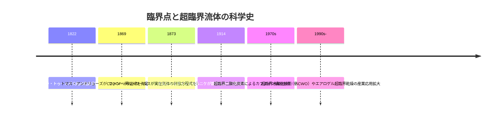
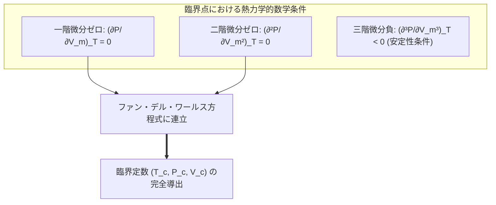
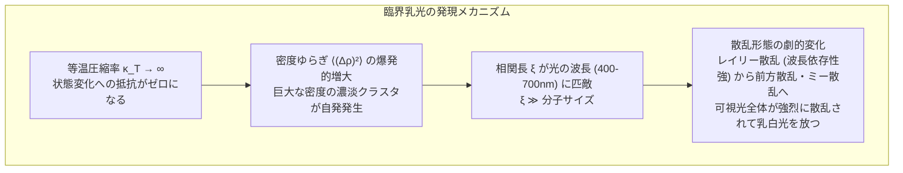
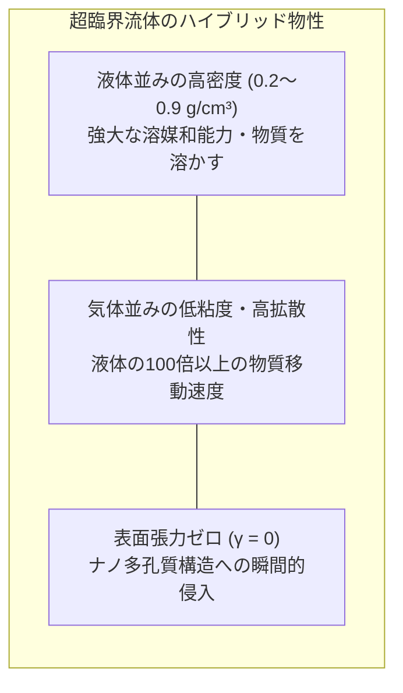
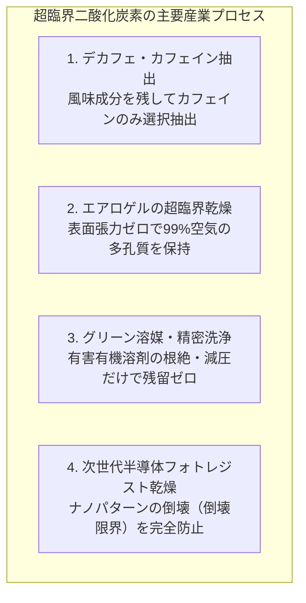
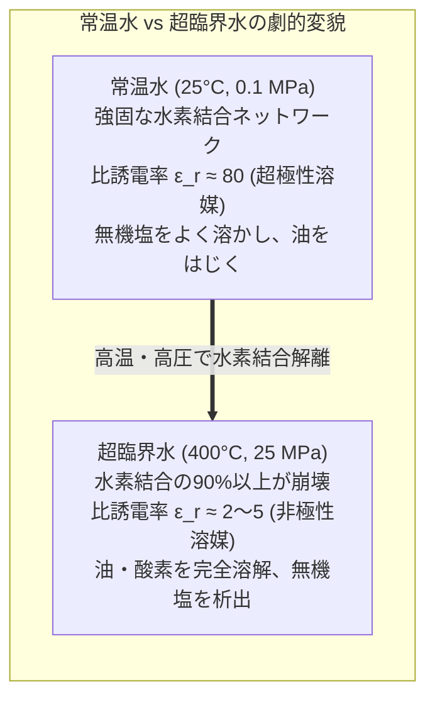
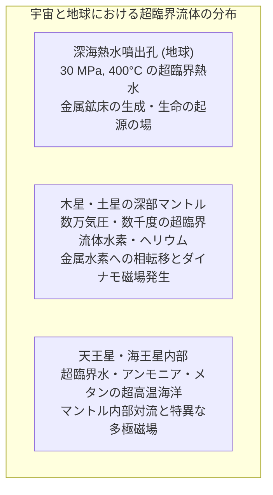

頑丈な耐圧サファイアガラス管の中に二酸化炭素の液体と気体を封入し、外部から徐々に加熱しながら観察する実験を思い浮かべてみましょう。

温度の上昇とともに、底にたまっていた液体の密度は熱膨張によって徐々に低下していきます。一方で、蒸発した気体の分子密度は急上昇し、両者の密度の差は急速に縮まっていきます。液面を隔てていた明確な境界線——メニスカス（気液界面）——は次第にぼやけ、表面張力が弱まるにつれて平坦化していきます。そして温度が $31.1^\circ\text{C}$、圧力が $7.38\,\text{MPa}$（約73気圧）に達した瞬間、息をのむような現象が起こります。容器全体が突如としてオパールのように虹色に白濁する「臨界乳光（Critical Opalescence）」の光を放った直後、液面が完全に消滅し、液体でも気体でもない、単一の均一で濃密な流体へと融合するのです。

これが、物質の究極のハイブリッド状態<strong>「超臨界流体（Supercritical Fluid, SCF）」</strong>の誕生の瞬間です。

私たちは学校教育で、「物質には固体・液体・気体の三態があり、沸騰によって液体は気体へ、凝縮によって気体は液体へと相転移する」と教わります。しかし熱力学の真理は、気体と液体が本質的に「連続」しており、ある臨界点（Critical Point）を迂回すれば、沸騰も気泡の発生も伴わずに液体を気体へと、あるいは気体を液体へと無限に滑らかに連続変化させられることを示しています。

超臨界流体は、「液体のような高い密度と強力な溶解力」を持ちながら、「気体のように壁面をすり抜ける高い拡散性と極めて低い粘度」を兼ね備え、さらに「表面張力が完全にゼロ」という、夢のような物理的特性を誇ります。

本稿では、1822年のカニャール・ド・ラ・トゥールによる劇的な発見から、ファン・デル・ワールス状態方程式による臨界点の数学的導出、オルンシュタイン・ゼルニケ理論が解き明かす臨界乳光のミクロなゆらぎ、カフェイン抽出やエアロゲル乾燥を支える超臨界二酸化炭素の工学、有機物を一瞬で水と二酸化炭素に灰化させる超臨界水の過激な化学、そして深海熱水噴出孔から巨大ガス惑星の内部構造に至る宇宙物理学まで、超臨界流体の全貌を徹底的に解き明かします。

---

## 1. 臨界点の発見：カニャール・ド・ラ・トゥールの革命的実験

### 1.1 大砲の砲身から始まった熱力学のブレイクスルー

気体と液体の境界が消えるという驚天動地の現象を人類が初めて目撃したのは、今から200年以上前、1822年のことでした。フランスの物理学者<strong>シャルル・カニャール・ド・ラ・トゥール（Charles Cagniard de la Tour）</strong>は、密閉された頑丈な大砲の砲身の中に水やアルコール、エーテルなどの液体と小さな火打ち石の球を封入し、加熱しながら音を聴くという大胆な実験を行いました。

砲身を揺すったとき、内部に液体が存在していれば、球が液体中を転がるときと気体中を転がるときとで鈍い衝突音が変化します。カニャール・ド・ラ・トゥールは、ある特定の温度を超えると、液体の存在を示す特有の音が完全に消失することに気づきました。

続いて彼は、内部を直接目視できる肉厚のガラス封管を用いた実験を行い、歴史的な光景を記録しました。液体が沸騰して気体で満たされるのではなく、<strong>液体の体積が膨張すると同時に気体の密度が上昇し、ある特定の温度と圧力において、気液を隔てる境界線（メニスカス）が完全に消失して単一の相になる</strong>ことを発見したのです。彼が発見したこの境界温度は、後に物理学者トマス・アンドリューズ（Thomas Andrews）によって<strong>「臨界点（Critical Point）」</strong>と命名されました。



---

## 2. 熱力学相図とファン・デル・ワールス状態方程式

### 2.1 圧力-温度（P-T）相図における特異点としての臨界点

物質の相平衡を記述する標準的な圧力-温度（$P$-$T$）相図において、相と相の境界は線（共存曲線）として描かれます：
- <strong>融解曲線（固相-液相境界）</strong>：圧力をいくら高めても融解曲線は途切れることなく伸び続け、無限の高圧下でも固体と液体の区別は保たれます。
- <strong>昇華曲線（固相-気相境界）</strong>：絶対零度近くから三重点（Triple Point）まで続きます。
- <strong>蒸気圧曲線（気液共存曲線）</strong>：三重点から出発しますが、融解曲線とは決定的に異なり、ある有限の温度と圧力の極限において<strong>突然プツリと途切れて消失</strong>します。

この蒸気圧曲線の終端こそが<strong>臨界点（$T_c, P_c$）</strong>です。

```mermaid
flowchart TD
    subgraph PhaseDiagramPT ["物質の圧力-温度 (P-T) 相図"]
        Solid["固相 (Solid)"]
        Liquid["液相 (Liquid)"]
        Gas["気相 (Gas)"]
        TriplePoint["三重点 (Triple Point)"]
        CriticalPoint["臨界点 (Critical Point: T_c, P_c)"]
        Supercritical["超臨界流体領域 (Supercritical Fluid)<br>T > T_c かつ P > P_c"]
    end
    TriplePoint --> Solid
    TriplePoint --> Liquid
    TriplePoint --> Gas
    Liquid ---|蒸気圧曲線 (気液共存)| Gas
    Gas ---|蒸気圧曲線の終端| CriticalPoint
    Liquid --- CriticalPoint
    CriticalPoint ==> Supercritical
```

蒸気圧曲線に沿って加熱していくと、液相の密度 $\rho_L$ は熱膨張により減少し、気相の密度 $\rho_G$ は蒸気圧の上昇により急激に増加します。臨界点（$T \to T_c$）において両者の密度差は完全にゼロとなります：
$$\lim_{T \to T_c} (\rho_L - \rho_G) = 0$$

同時に、液体を特徴づける<strong>蒸発潜熱（気化エンタルピー $\Delta H_{\text{vap}}$）</strong>と<strong>表面張力 $\gamma$</strong> も臨界点において厳密にゼロへと収束します：
$$\Delta H_{\text{vap}}(T_c) = 0, \quad \gamma(T_c) = 0$$

表面張力がゼロになるということは、気相と液相の間に界面を維持するためのエネルギー的な障壁が消滅したことを意味します。これが、メニスカスが忽然と消え去る幾何学的・熱力学的理由です。

### 2.2 ファン・デル・ワールス方程式による臨界点の解析的導出

1873年、オランダの物理学者<strong>ヨハネス・ファン・デル・ワールス（Johannes Diderik van der Waals）</strong>は、分子自身の有限な体積（排除体積 $b$）と分子間に働く引力（ファン・デル・ワールス力 $a/V_m^2$）を考慮した記念碑的な実在気体の状態方程式を提唱しました：

$$\left( P + \frac{a}{V_m^2} \right) (V_m - b) = R T$$

ここで $P$ は圧力、$V_m$ はモル体積、$T$ は絶対温度、$R$ は気体定数、$a$ と $b$ は各物質固有の定数です。

この式を圧力 $P$ について解くと：
$$P = \frac{R T}{V_m - b} - \frac{a}{V_m^2}$$

$P$-$V_m$ 平面上で等温線（Isotherm）を描くと：
- 臨界温度より高温（$T > T_c$）では、体積の減少に対して圧力は単調に増加し、理想気体に近い滑らかな曲線になります。
- 臨界温度より低温（$T < T_c$）では、等温線に極大値と極小値（S字型のうねり）が現れ、熱力学的に不安定な領域（マクスウェルの等面積則により気液二相共存の水平線で置き換えられる領域）が生じます。

臨界温度 $T_c$ の等温線は、この「単調減少」と「S字状の極値」のちょうど境界線に位置しており、臨界点（$T = T_c, P = P_c, V_m = V_c$）において<strong>水平な変曲点（Horizontal Inflection Point）</strong>を形成します。



数学的条件は以下の2式で与えられます：
$$\left( \frac{\partial P}{\partial V_m} \right)_T = -\frac{R T}{(V_m - b)^2} + \frac{2 a}{V_m^3} = 0$$
$$\left( \frac{\partial^2 P}{\partial V_m^2} \right)_T = \frac{2 R T}{(V_m - b)^3} - \frac{6 a}{V_m^4} = 0$$

この連立方程式を解きます。第2式より：
$$\frac{R T}{(V_m - b)^3} = \frac{3 a}{V_m^4} \implies \frac{R T}{(V_m - b)^2} = \frac{3 a (V_m - b)}{V_m^4}$$

これを第1式に代入すると：
$$\frac{3 a (V_m - b)}{V_m^4} = \frac{2 a}{V_m^3}$$
両辺を $a/V_m^3$（$\ne 0$）で割ると：
$$\frac{3(V_m - b)}{V_m} = 2 \implies 3 V_m - 3 b = 2 V_m \implies V_c = 3 b$$

得られた<strong>臨界モル体積 $V_c = 3b$</strong> を一階微分の式に代入して臨界温度 $T_c$ を求めます：
$$\frac{R T_c}{(3b - b)^2} = \frac{2 a}{(3b)^3} \implies \frac{R T_c}{4 b^2} = \frac{2 a}{27 b^3} \implies T_c = \frac{8 a}{27 R b}$$

最後に、$V_c$ と $T_c$ を元のファン・デル・ワールス方程式に代入して臨界圧力 $P_c$ を導出します：
$$P_c = \frac{R \left( \frac{8 a}{27 R b} \right)}{3b - b} - \frac{a}{(3b)^2} = \frac{8 a}{54 b^2} - \frac{a}{9 b^2} = \frac{4 a}{27 b^2} - \frac{3 a}{27 b^2} = \frac{a}{27 b^2}$$

#### 普遍的臨界圧縮率因子 $Z_c$
さらに、これらの臨界定数を無次元の圧縮率因子 $Z_c = \frac{P_c V_c}{R T_c}$ に代入すると：
$$Z_c = \frac{\left( \frac{a}{27 b^2} \right) (3 b)}{R \left( \frac{8 a}{27 R b} \right)} = \frac{3}{8} = 0.375$$

分子の個性パラメータ（$a$ や $b$）がすべて相殺され、すべての物質に共通する普遍的な定数 $3/8 = 0.375$ が現れます（実際の実在気体では分子間力の高次効果により $0.23 \sim 0.31$ 程度となりますが、この理論的一致は当時の物理学者たちを熱狂させました）。

---

## 3. 臨界乳光（Critical Opalescence）：ゆらぎの物理学

### 3.1 虹色に輝く白濁の謎

臨界点の近傍を実験観察していると、ある不可思議な光学現象に出くわします。臨界温度に近づくにつれて、それまで完全に透明だった液体と気体が、急激に濁り始め、乳白色から乳白色、そして散乱光によってオパールのように幻想的な青や赤の光を放つのです。この現象を<strong>「臨界乳光（Critical Opalescence）」</strong>と呼びます。

なぜ、化学的に純粋で単一な物質が、ゴミや不純物が一切含まれていないにもかかわらず、白濁して光を強く散乱するのでしょうか？



### 3.2 等温圧縮率の発散

臨界点では、前節で導いたように一階微分がゼロになります：
$$\left( \frac{\partial P}{\partial V} \right)_T = 0$$

流体の<strong>等温圧縮率 $\kappa_T$</strong> は以下のように定義されます：
$$\kappa_T = -\frac{1}{V} \left( \frac{\partial V}{\partial P} \right)_T = -\frac{1}{V \left( \frac{\partial P}{\partial V} \right)_T}$$

分母がゼロに近づくため、臨界点において等温圧縮率は<strong>無限大へと発散</strong>します：
$$\lim_{T \to T_c} \kappa_T = \infty$$

等温圧縮率が無限大であるということは、「系に圧力をわずかに加える（あるいは熱揺らぎの微小な力が働く）だけで、体積や密度が抵抗なく無限に大きく変動できる」という究極的に柔らかい状態を意味します。

### 3.3 オルンシュタイン・ゼルニケ理論（OZ理論）

統計力学において、局所的な密度ゆらぎ $\Delta \rho(\mathbf{r}) = \rho(\mathbf{r}) - \langle \rho \rangle$ の大きさは等温圧縮率に直接比例します：
$$\langle (\Delta N)^2 \rangle = k_B T \langle N \rangle \rho \kappa_T$$

通常の状態（常温常圧の気体や液体）では、分子が熱運動で集まったり離れたりする密度のゆらぎの空間的広がり（<strong>相関長 $\xi$</strong>）は、分子サイズと同等（数オングストローム、$\sim 0.1\,\text{nm}$）に過ぎません。この微小なゆらぎは、可視光の波長（$\lambda \approx 400 \sim 700\,\text{nm}$）に比べて圧倒的に小さいため、光は散乱されず（青空のレイリー散乱のように微弱に散乱されるのみで）直進し、流体は透明に見えます。

しかし臨界点に近づくと、相関長 $\xi$ は臨界指数 $\nu$ に従って巨視的なスケールへと発散します：
$$\xi \propto |T - T_c|^{-\nu} \quad (\nu \approx 0.63)$$

1914年、レオナルド・オルンシュタイン（Leonard Ornstein）とフリッツ・ゼルニケ（Frits Zernike）は、ゆらぎの二点相関関数 $G(r)$ を以下のように定式化しました：
$$G(r) = \langle \Delta \rho(0) \Delta \rho(r) \rangle \propto \frac{e^{-r / \xi}}{r}$$

臨界点の直傍では、相関長 $\xi$ が数百ナノメートルからマイクロメートルに達し、<strong>可視光の波長そのものと同じサイズにまで成長</strong>します。その結果、光の波長と同等サイズの巨大な「液滴のような高密度領域」と「気泡のような低密度領域」が流体内部で激しく生成消滅を繰り返すことになり、可視光のすべての波長が激しく多重散乱されて、系全体が乳白色のオパールのように輝くのです。

---

## 4. 超臨界流体の物理的性質：液体と気体の二重奏

超臨界流体（$T > T_c, P > P_c$）の真骨頂は、液体と気体の優れた特性を同時に兼ね備えている点にあります。

| 物性 | 気体（常圧） | <strong>超臨界流体（SCF）</strong> | 液体（常圧） |
|---|---|---|---|
| <strong>密度（$\text{g/cm}^3$）</strong> | $0.001 \sim 0.002$ | <strong>$0.2 \sim 0.9$</strong>（液体に近い） | $0.8 \sim 1.0$ |
| <strong>粘度（$\text{Pa}\cdot\text{s}$）</strong> | $10^{-5}$ | <strong>$10^{-5} \sim 10^{-4}$</strong>（気体に近い） | $10^{-3}$ |
| <strong>自己拡散係数（$\text{cm}^2\text{/s}$）</strong> | $0.1 \sim 0.4$ | <strong>$10^{-4} \sim 10^{-3}$</strong>（液体の100倍以上） | $10^{-5}$ |
| <strong>表面張力（$\text{N/m}$）</strong> | なし（0） | <strong>完全ゼロ（0）</strong> | $0.02 \sim 0.07$ |



### 4.1 密度の連続的チューナビリティ（Continuous Tunability）

通常の溶媒（水、エタノール、ヘキサンなど）では、温度や圧力を変えても液体である限り密度は数パーセント程度しか変化しません。

しかし超臨界流体では、臨界点近傍において等温圧縮率が極めて高いため、<strong>圧力をわずかに上下させるだけで、流体の密度を気体に近い希薄な状態から液体と同等の高密度状態まで、不連続な相転移を経ることなく滑らかに無段階（連続的）にコントロール</strong>できます。

流体の溶解度パラメータ（物質を溶かす能力）は密度に強く依存するため、「圧力を上げるとターゲット成分を一気に溶かし出し、圧力を下げると溶かした成分が瞬時に結晶として析出して分離する」という、従来の蒸留や抽出では考えられない自在な化学操作が可能になります。

### 4.2 表面張力ゼロがもたらす毛細管現象の完全打破

微細なナノ構造（半導体の回路パターンや多孔質ゲルなど）を液体で洗浄し、それを乾燥させようとすると、液体が蒸発する際に気液界面に働く強い表面張力 $\gamma$ によって巨大な<strong>毛細管力（ラプラス圧 $\Delta P = \frac{2\gamma}{r}$）</strong>が生じます。細孔半径 $r$ が数ナノメートルになると、この圧力は数十〜数百メガパスカル（数千気圧）に達し、繊細な微細構造を一瞬で圧壊・収縮させてしまいます。

超臨界流体には気液界面が存在せず、表面張力が厳密にゼロです。そのため、どんなに複雑怪奇で微細な空洞の深部であっても、毛細管力による構造破壊を一切起こすことなく瞬時に浸透し、そして乾燥させることができます。

---

## 5. 超臨界二酸化炭素（$	ext{scCO}_2$）：グリーンケミストリーの主役

### 5.1 なぜ二酸化炭素なのか？

数ある物質の中で、工業的に最も広く活用されているのが<strong>超臨界二酸化炭素（Supercritical $\text{CO}_2$）</strong>です。その理由は、熱力学的および環境的な奇跡とも言える条件の良さにあります：

| 項目 | 二酸化炭素（$\text{CO}_2$） | 水（$\text{H}_2\text{O}$） | メタン（$\text{CH}_4$） |
|---|---|---|---|
| <strong>臨界温度 $T_c$</strong> | <strong>$31.1^\circ\text{C}$（$304.2\,\text{K}$）</strong> | $373.9^\circ\text{C}$（$647.1\,\text{K}$） | $-82.6^\circ\text{C}$（$190.6\,\text{K}$） |
| <strong>臨界圧力 $P_c$</strong> | <strong>$7.38\,\text{MPa}$（$72.8\,\text{atm}$）</strong> | $22.06\,\text{MPa}$（$217.7\,\text{atm}$） | $4.60\,\text{MPa}$（$45.4\,\text{atm}$） |
| <strong>毒性・引火性</strong> | 無毒・不燃性・安価 | 無毒・不燃性 | 可燃性・爆発性 |

臨界温度 $31.1^\circ\text{C}$ は人間の体温よりも低く、室温のすぐ上にあります。臨界圧力 $7.38\,\text{MPa}$ も現代の高圧工学において極めて安全かつ容易に達成可能な圧力です。熱に弱い天然成分や生体分子を熱分解することなく処理できるため、理想的な溶媒として君臨しています。



### 5.2 カフェインレス・コーヒー（デカフェ）の製造

かつてコーヒー豆からカフェインを除去するためには、ジクロロメタンや酢酸エチルなどの有害な有機溶剤が用いられており、残留溶剤の毒性や風味成分（クロロゲン酸やアロマ油）の喪失が大きな課題でした。

1970年代に実用化された超臨界 $\text{CO}_2$ 抽出法は、この常識を一変させました：
1. 生のコーヒー豆を加湿し、カフェイン分子を膨潤させます。
2. 超臨界 $\text{CO}_2$（約 $70^\circ\text{C}, 25\,\text{MPa}$）を塔内に送り込みます。無極性の超臨界 $\text{CO}_2$ は豆の細胞壁の微細孔を容易に通り抜け、カフェイン分子を選択的に溶解します。コーヒーの豊かな香気成分の多くは豆内部に保持されます。
3. カフェインを含んだ超臨界 $\text{CO}_2$ を減圧塔に送り、圧力を臨界圧力以下に下げるか、水と接触させます。二酸化炭素は瞬時に気化して純粋なガスとなり、カフェインだけが白い粉末として底部に沈殿します。
4. 回収された二酸化炭素ガスはコンプレッサーで再加圧され、完全密閉サイクルで無限に再利用されます。

最終製品には<strong>化学薬品の残留が理論上完全にゼロ</strong>であり、風味を完璧に残した安全なデカフェコーヒーが作られます。

### 5.3 エアロゲル（夢の断熱材）の超臨界乾燥

「凍った煙」とも呼ばれるシリカエアロゲルは、体積の $95 \sim 99\%$ が空気で構成された世界最軽量の個体材料であり、宇宙探査機や建築の極限断熱材として使われます。

ウェットゲルの微細な骨格の中はアルコールなどの液体で満たされています。これを通常の加熱蒸発で乾燥させようとすると、気液界面の毛細管力によってシリカのナノ骨格が無残に圧壊し、ただの硬く重いシリカゲル（乾燥剤）になってしまいます。

そこで、ゲル内のアルコールを高圧下で液体二酸化炭素に置換し、温度と圧力を上げて超臨界 $\text{CO}_2$ へと導きます。系全体が超臨界状態に達したところで、気液界面を作らないように温度を保ったままゆっくりと圧力を大気圧まで抜いていきます。気液界面が一度も発生しないため、毛細管力は厳密にゼロであり、<strong>ゲル本来の超微細な多孔質骨格を $1\%$ も収縮させることなく、完全に乾燥した無傷のエアロゲルを取り出すことができる</strong>のです。

---

## 6. 超臨界水（$	ext{scH}_2	ext{O}$）：すべてを燃やし尽くす過激な流体

温和で扱いやすい超臨界二酸化炭素とは対照的に、水を超臨界状態（$T > 373.9^\circ\text{C}, P > 22.06\,\text{MPa}$）に追い込むと、誰もが知る「生命の母である水」とは似ても似つかない、恐るべき性質を持った過激な流体へと豹変します。



### 6.1 水素結合の崩壊と誘電率の激減

常温常圧の水が高い沸点を持ち、強力な極性溶媒として機能しているのは、水分子同士が網の目のような強固な「水素結合」を形成しているからです。この強い極性のため、常温水の比誘電率は $\epsilon_r \approx 80$ という極めて高い値を示します。

しかし、温度が臨界点 $373.9^\circ\text{C}$ を超えると、激しい熱運動によって水素結合ネットワークの大部分がズタズタに引き裂かれます。水分子間の距離が広がり、流体の密度が低下する結果、比誘電率は<strong>$\epsilon_r \approx 2 \sim 5$ まで急落</strong>します。

比誘電率が $2 \sim 5$ というのは、ヘキサン、ベンゼン、トルエンといった<strong>無極性有機溶媒とまったく同じレベル</strong>です！
この劇的な変貌により、超臨界水の中では信じられない現象が起こります：
1. <strong>有機物との完全混和</strong>：常温では決して混ざり合わないベンゼン、油、プラスチックなどが、水と完全に均一に混ざり合います。
2. <strong>気体との完全混和</strong>：酸素（$\text{O}_2$）や空気などのガスが、任意の割合で水に完全に溶解します。
3. <strong>無機塩の強烈な析出</strong>：食塩（$\text{NaCl}$）や硫酸塩などの無機塩は、イオンを水和して安定化できなくなるため、超臨界水の中では一切溶けなくなり、瞬時に白い粉末として析出します。

### 6.2 超臨界水酸化技術（SCWO）：有害物質の完全消滅

この「油も酸素も均一に混ざり合う」という超臨界水の性質を極限まで利用した環境技術が、<strong>超臨界水酸化（Supercritical Water Oxidation, SCWO）</strong>です。

通常の燃焼処理では、ダイオキシンなどの有害な不完全燃焼生成物資や排ガス（NOx、SOx）が発生します。また、水中に溶けた有害有機物を焼却するには膨大な蒸発エネルギーが必要です。

しかし超臨界水の中に廃プラスチック、PCB、ダイオキシン、さらにはサリンなどの化学兵器を放り込み、高圧酸素を注入すると：
- 反応物、酸素、溶媒が単一の均一相を形成するため、気液の物質移動抵抗が完全にゼロになります。
- $400 \sim 600^\circ\text{C}$ の穏やかな温度であるにもかかわらず、有機物はわずか<strong>数秒〜数十秒の滞留時間で $99.9999\%$ 以上の効率で完全酸化</strong>されます。
- 炭素はすべてクリーンな二酸化炭素（$\text{CO}_2$）に、水素は水（$\text{H}_2\text{O}$）に、塩素や硫黄は無機酸塩として中和回収され、有害物質は完全に無害化されます。

まさに「水の中で炎を使わずに完全燃焼させる」究極の廃棄物処理炉と言えます。

---

## 7. 自然界と天体物理学における超臨界流体

超臨界流体は、人間が実験室や工場で作る特殊な人工物質ではありません。宇宙と地球の歴史においては、むしろ普遍的に存在する物質形態です。

### 7.1 深海熱水噴出孔と生命の起源

水深3,000メートルを超える大西洋中央海嶺や東太平洋海嶺の海底では、水圧が $30\,\text{MPa}$（300気圧）を超えます。海底のマグマだまりによって熱せられた熱水は、沸騰して気泡を生じることなく、<strong>$400^\circ\text{C}$ を超える超臨界水</strong>となって「ブラックスモーカー」から激しく噴き出しています。

超臨界水は周囲の玄武岩から金、銀、銅、亜鉛、レアメタルを凄まじい勢いで溶かし出し、海水と接触して急冷される瞬間に巨大な熱水鉱床を形成します。さらに、超臨界熱水環境で起きる無機物からのアミノ酸やペプチドの非生物的合成反応は、地球上における生命誕生の有力な揺りかご（生命起源の化学進化説）として熱烈に研究されています。



### 7.2 巨大ガス惑星の内部構造：木星と土星の超臨界水素の海

太陽系最大の惑星である木星や土星には、地球のような明確な「地面（地表）」が存在しません。大気の主成分である水素とヘリウムは、深部に潜るにつれて重力によって強烈に圧縮され、温度と圧力は容易に水素の臨界点（$T_c = -240^\circ\text{C}, P_c = 1.3\,\text{MPa}$）を突破します。

探査機ジュノー（Juno）の観測データが示す通り、木星の大気から深部へ向かう旅において、<strong>雲から海への境界線（水面のような界面）は一切存在しません</strong>。希薄なガス状大気は、深さとともに果てしなく連続的に密度を増し、超臨界流体水素の超濃密な海へとシームレスに移り変わり、さらに深部（約数百万気圧）では電子が非局在化した「液体金属水素」へと連続的に遷移していきます。宇宙の質量の大部分を占める巨大惑星の内部は、文字通り超臨界流体で満たされているのです。

---

## 8. 結論：相の境界を超えた物質の新たな統一像

私たちが日常で目にする「液体」と「気体」という明確な二分法は、地球の表面という極めて限られた低圧環境（1気圧）が生み出した、ある種の一面的な見方に過ぎません。

熱力学の臨界点を超えたとき、相を隔てていた表面張力は消失し、潜熱はゼロとなり、分子は液体のような強い凝集力を保ったまま、気体のような驚異的な自由度で飛び交います。

カニャール・ド・ラ・トゥールが大砲の砲身の底に見出したその一筋の光は、単なる工学的な奇観にとどまらず、ミクロな分子相関から宇宙の巨大惑星の内部構造、そして未来の持続可能なグリーンケミストリーまでを貫く、自然界の深遠なる連続性と統一美を私たちに雄弁に物語り続けています。
