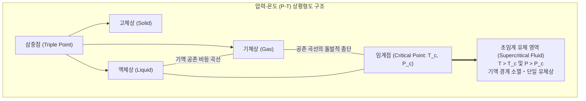

두꺼운 사파이어 유리로 제작된 고압 관찰 챔버 안에 이산화탄소 액체와 기체를 밀봉하고 외부에서 서서히 열을 가하는 실험을 상상해 보십시오.

온도가 상승함에 따라 바닥에 고여 있던 액체의 밀도는 열팽창으로 인해 점차 감소합니다. 반면 상부로 증발한 기체의 분자 밀도는 급격히 치솟으며 두 상 사이의 밀도 차이는 빠르게 좁혀집니다. 기체와 액체를 가르던 뚜렷한 경계면인 메니스커스(Meniscus)는 표면장력이 약화됨에 따라 점점 평평해지고 흐릿해집니다.

그리고 온도가 $31.1^\circ\text{C}$($304.2\,\text{K}$), 압력이 $7.38\,\text{MPa}$(약 73기압)에 도달하는 순간, 숨이 멎을 듯한 광경이 펼쳐집니다. 챔버 전체가 오팔 보석처럼 신비로운 무지갯빛 우윳빛으로 번쩍이는 <strong>임계 유광(Critical Opalescence)</strong>을 뿜어낸 직후, 경계선이 흔적도 없이 증발하며 액체도 기체도 아닌 단일한 고밀도 유체로 융합되는 것입니다.

이것이 바로 물질의 궁극적인 하이브리드 상태, <strong>초임계 유체(Supercritical Fluid, SCF)</strong>가 탄생하는 순간입니다.

우리는 흔히 물질에는 고체, 액체, 기체의 세 가지 상태가 존재하며 액체가 끓어 기체로 변하거나 기체가 응축되어 액체로 변할 때 뚜렷한 1차 상전이를 거친다고 배웁니다. 그러나 열역학의 진리는 액체와 기체가 본질적으로 단일한 연속체임을 보여줍니다. 특정한 <strong>임계점(Critical Point)</strong>을 우회하면 끓음이나 기포의 발생 없이 액체를 기체로, 혹은 기체를 액체로 무한히 매끄럽게 연속적으로 변환시킬 수 있습니다.

초임계 유체는 액체와 기체의 장점만을 모아놓은 경이로운 물리적 특성을 지닙니다:
- <strong>액체 수준의 높은 밀도와 용해력</strong>: 복잡한 유기 화합물을 강력하게 녹여냅니다.
- <strong>기체 수준의 낮은 점도와 높은 확산 계수</strong>: 물질 전달 속도가 일반 액체보다 수백 배 빠릅니다.
- <strong>표면장력이 엄밀히 제로($0$)</strong>: 미세한 나노 다공성 구조 내부로 모세관 응력 없이 침투합니다.

본 글에서는 1822년 카냐르 드 라 투르의 대포 실험부터 반데르발스 상태방정식의 임계 상수 수학적 유도, 오른슈타인-제르니케 이론이 밝힌 임계 유광의 미시적 요동, 디카페인 커피와 에어로젤 건조를 혁신한 초임계 이산화탄소, 맹독성 폐기물을 단 몇 초 만에 물과 이산화탄소로 완전 분해하는 초임계수, 그리고 목성과 토성 내부의 거대한 초임계 바다까지 초임계 유체의 모든 것을 철저히 파헤칩니다.

---

## 1. 임계점의 발견: 라 투르의 혁명적 대포 실험

기체와 액체의 경계가 사라진다는 놀라운 현상은 1822년 프랑스의 공학자이자 물리학자인 <strong>샤를 카냐르 드 라 투르(Charles Cagniard de la Tour)</strong>에 의해 처음 관측되었습니다. 그는 튼튼한 청동 대포의 포신 안에 물, 알코올, 에테르 등의 액체와 작은 부싯돌 구슬을 넣고 밀봉한 뒤 가열하면서 소리를 듣는 실험을 수행했습니다.

포신을 흔들었을 때 내부의 부싯돌이 짙은 액체 속을 구를 때와 기체 속을 구를 때의 충돌음은 확연히 달랐습니다. 라 투르는 온도가 특정 한계를 넘어서면 액체의 존재를 알리는 철벅거림과 둔탁한 소리가 완전히 사라지는 현상을 발견했습니다.

이후 라 투르는 두꺼운 유리 모세관을 제작하여 광학적으로 관찰했습니다. 액체가 팽창함과 동시에 기체의 밀도가 급상승하다가, 특정 온도에서 두 상을 가르던 경계면(메니스커스)이 완전히 사라지고 균일한 단일 유체상으로 바뀌는 역사적 장면을 기록했습니다. 1869년 아일랜드의 화학자 <strong>토머스 앤드루스(Thomas Andrews)</strong>는 이 온도와 압력을 정밀 측정하여 <strong>'임계점(Critical Point)'</strong>이라는 불멸의 이름을 부여했습니다.

---

## 2. 열역학 상평형도와 반데르발스 상태방정식

### 2.1 P-T 상평형도에서의 특이점

물질의 압력-온도($P$-$T$) 상평형도에서:
- <strong>고체-액체 융해 곡선</strong>은 압력이 증가해도 끊기지 않고 무한히 뻗어 나갑니다. 이는 주기적 격자 대칭성을 가진 고체와 무질서한 액체 사이의 근본적인 대칭성 차이 때문입니다.
- 그러나 삼중점에서 시작되는 <strong>액체-기체 공존 곡선(증기압 곡선)</strong>은 어느 한계점에 도달하면 <strong>갑자기 뚝 끊겨 소멸</strong>합니다.

이 종착점이 바로 <strong>임계점($T_c, P_c$)</strong>입니다.

공존 곡선을 따라 임계점으로 접근할수록:
1. 액체의 밀도 $\rho_L$은 열팽창으로 감소하고, 기체의 밀도 $\rho_G$는 증기압 상승으로 증가합니다.
2. 임계점에서 두 상의 밀도 차이는 완전히 영($0$)이 됩니다: $\lim_{T \to T_c} (\rho_L - \rho_G) = 0$.
3. 증발 잠열 $\Delta H_{\text{vap}}$이 영으로 수렴합니다.
4. 계면 표면장력 $\gamma$이 엄밀히 제로가 됩니다. 표면장력이 사라진다는 것은 계면을 유지하기 위한 에너지 장벽이 소멸했음을 의미하므로 메니스커스가 완벽히 사라지게 됩니다.

### 2.2 반데르발스 상태방정식과 임계 상수의 유도

1873년 네덜란드의 물리학자 <strong>요하네스 반데르발스</strong>는 분자 자신의 배제 부피 $b$와 분자 간 인력 $a/V_m^2$을 고려한 실재 기체 상태방정식을 제안했습니다:

$$\left( P + \frac{a}{V_m^2} \right) (V_m - b) = R T \implies P = \frac{R T}{V_m - b} - \frac{a}{V_m^2}$$

$P$-$V_m$ 평면에서 임계 등온선($T = T_c$)은 1차 및 2차 편미분이 동시에 0이 되는 <strong>수평 변곡점(Horizontal Inflection Point)</strong>을 형성합니다:
$$\left( \frac{\partial P}{\partial V_m} \right)_T = 0, \quad \left( \frac{\partial^2 P}{\partial V_m^2} \right)_T = 0$$

이 연립방정식을 풀면 각 물질의 미시적 인력 $a$와 분자 부피 $b$로부터 거시적 임계 상수가 수학적으로 엄밀히 유도됩니다:
- <strong>임계 몰부피</strong>: $V_c = 3b$
- <strong>임계 온도</strong>: $T_c = \frac{8a}{27Rb}$
- <strong>임계 압력</strong>: $P_c = \frac{a}{27b^2}$
- <strong>임계 압축인자</strong>: $Z_c = \frac{P_c V_c}{R T_c} = \frac{3}{8} = 0.375$

모든 기체는 분자 고유의 상수 $a, b$에 상관없이 임계점에서 보편적인 압축인자 $3/8$을 갖는다는 반데르발스의 '대응 상태 원리'는 물리학의 불멸의 금자탑입니다.

---

## 3. 임계 유광: 빛의 파장과 공명하는 밀도 요동

임계점에 근접하면 완전히 투명하던 액체와 기체가 우윳빛으로 탁해지며 오팔처럼 영롱하게 빛을 산란하는 <strong>임계 유광(Critical Opalescence)</strong>이 나타납니다.

불순물이 전혀 없는 순수한 물질이 왜 갑자기 불투명해지는 것일까요?

임계점에서는 $(\partial P / \partial V)_T = 0$이 되므로 유체의 <strong>등온 압축률 $\kappa_T$가 무한대로 발산</strong>합니다:
$$\kappa_T = -\frac{1}{V} \left( \frac{\partial V}{\partial P} \right)_T \to \infty$$

압축률이 무한대라는 것은 부피와 밀도를 변화시키는 데 드는 저항이 제로임을 뜻합니다. 따라서 미세한 열 요동만으로도 유체 내부에 거대한 국소적 밀도 요동이 자발적으로 발생합니다.

1914년 <strong>오른슈타인과 제르니케(Ornstein-Zernike)</strong>의 이론에 따르면 밀도 요동의 상관 길이 $\xi$는 임계점에서 거시적으로 발산합니다:
$$\xi \propto |T - T_c|^{-\nu} \quad (\nu \approx 0.63)$$

임계점 직전에서 상관 길이는 수백 나노미터까지 급성장하여 <strong>가시광선의 파장($400 \sim 700\,\text{nm}$)과 완벽히 일치</strong>하게 됩니다. 빛의 파장 크기만 한 액적 클러스터와 기포 클러스터가 빛을 전방위로 격렬하게 다중 산란시키기 때문에 유체가 환한 우윳빛으로 빛나게 되는 것입니다.

---

## 4. 초임계 이산화탄소($	ext{scCO}_2$)의 산업적 응용

가장 널리 쓰이는 초임계 유체는 단연 이산화탄소입니다.
- <strong>임계 온도 $T_c = 31.1^\circ\text{C}$</strong>: 체온보다 낮아 열에 민감한 유기물 변성 방지
- <strong>임계 압력 $P_c = 7.38\,\text{MPa}$</strong>: 범용 고압 설비로 손쉽게 도달
- 무독성, 불연성, 저비용, 친환경 및 완전 회수 순환 가능

### 4.1 디카페인 커피와 에어로젤 초임계 건조

1970년대에 상용화된 초임계 $\text{CO}_2$ 디카페인 공정은 풍미를 보존하면서 카페인만을 선택적으로 추출하는 친환경 기술입니다.

또한 세계에서 가장 가벼운 고체 단열재인 <strong>실리카 에어로젤</strong>의 제조는 초임계 건조의 백미입니다. 액체를 증발시킬 때 발생하는 모세관 라플라스 압력($\Delta P = \frac{2\gamma \cos \theta}{r_p}$)은 수백 기압에 달해 나노 골격을 파괴합니다. 하지만 표면장력이 엄밀히 제로인 초임계 $\text{CO}_2$로 유체를 치환한 뒤 임계점 이상에서 서서히 압력을 제거하면, 나노 다공성 구조가 단 $1\%$도 수축하지 않고 원형 그대로 보존됩니다.

---

## 5. 초임계수($	ext{scH}_2	ext{O}$): 만물을 산화시키는 극한의 유체

온화한 이산화탄소와 달리, 물을 초임계 상태($T_c = 373.9^\circ\text{C}, P_c = 22.06\,\text{MPa}$)로 만들면 맹렬한 반응성을 띤 극한의 유체로 돌변합니다.

고온에서 격렬한 열운동으로 90% 이상의 수소 결합이 끊어지면서 물의 비유전율은 상온의 $\epsilon_r \approx 80$에서 <strong>$\epsilon_r \approx 2 \sim 5$로 폭락</strong>합니다. 이는 헥세인이나 벤젠과 같은 비극성 유기용매 수준입니다!

이로 인해 초임계수는:
1. 플라스틱, 기름, 산소 기체를 완벽하게 균일 용해합니다.
2. 반면 소금($\text{NaCl}$) 같은 무기염은 용해도를 잃고 순식간에 결정으로 석출됩니다.

이를 이용한 <strong>초임계수 산화 기술(SCWO)</strong>은 다이옥신, PCB, 화학무기 등 난분해성 맹독 폐기물을 단 수 초 만에 $99.9999\%$ 이상의 효율로 완전 무해한 이산화탄소와 물로 산화 소멸시키는 궁극의 환경 정화 기술입니다.

---

## 6. 결론: 자연이 빚어낸 연속성의 미학

카냐르 드 라 투르의 청동 대포에서부터 현대 반도체의 나노 세정, 그리고 심해 400도의 열수 분출공과 목성 심부의 거대한 초임계 수소 바다에 이르기까지.

초임계 유체는 액체와 기체라는 인위적 이분법을 뛰어넘어, 자연계가 지닌 우아하고 연속적인 단일 유체의 진실을 우리에게 웅변하고 있습니다.
