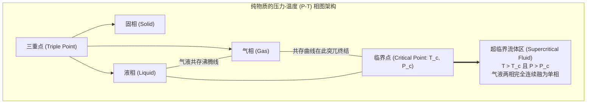
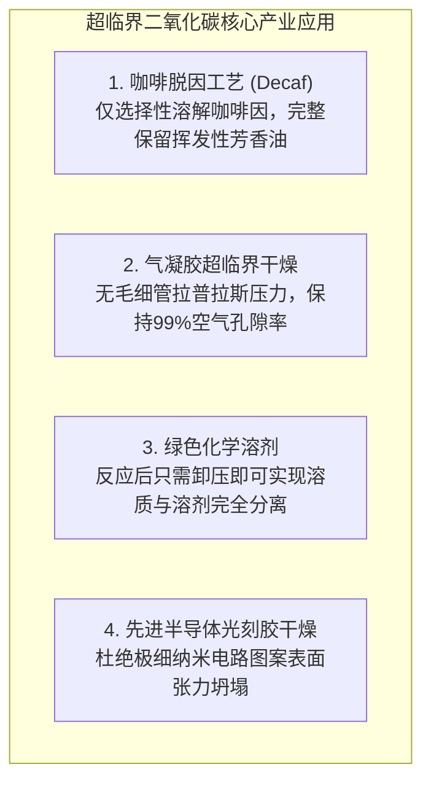

在一个由厚壁蓝宝石玻璃制成的高压光学观察室中，密封着液态与气态的二氧化碳。当你从外部对其缓慢加热并加压时，一场令人屏息的热力学奇观便悄然上演。

随着温度上升，底部液态二氧化碳因热膨胀导致密度不断下降；与此同时，上方蒸发的饱和蒸汽分子密度急剧飙升，二者之间的密度差异以肉眼可见的速度不断缩小。原本清晰分隔气液两相的界面——弯月面（Meniscus）——随着表面张力的衰减逐渐变平、模糊。

当温度达到 $31.1^\circ\text{C}$（$304.2\,\text{K}$）、压力达到 $7.38\,\text{MPa}$（约73个标准大气压）的瞬间，整个观察室内突然爆发出如欧泊宝石般璀璨、虹彩翻腾的乳白光辉——<strong>临界乳光（Critical Opalescence）</strong>。紧接着，那条界线彻底蒸发消逝，液体与气体融为一体，化作一种全新的物质形态。

这便是<strong>超临界流体（Supercritical Fluid, SCF）</strong>诞生的神奇时刻。

在经典物理学和基础教育中，我们习惯于将物质划分为固态、液态和气态三态，并认为液相与气相之间必须通过沸腾或冷凝的一级相变来相互转化。然而，现代热力学揭示了一个深刻的事实：液体与气体在本质上属于同一个连续的流体状态。只要绕过特定的<strong>临界点（Critical Point）</strong>，我们完全可以在不发生沸腾、不产生任何气泡的情况下，将液体极其平滑、连续地转化为气体，反之亦然。

超临界流体集液相与气相的优势于一身：
- <strong>具备液体般的高密度与溶解能力</strong>：能高效溶解复杂的非极性与极性化合物；
- <strong>具备气体般的低粘度与高扩散系数</strong>：传质速度比普通液体高出百倍；
- <strong>表面张力严格为零</strong>：能瞬间浸润最微小的纳米多孔结构而绝不破坏其物理骨架。

本文将带领读者深入超临界流体的迷人领域：从1822年法国物理学家卡尼亚尔·德·拉图尔（Cagniard de la Tour）的大炮炮筒实验，到范德瓦耳斯状态方程对临界常数的精确数学推导；从奥恩斯坦-泽尔尼克理论揭示的临界乳光微观涨落，到超临界二氧化碳萃取咖啡因与气凝胶超临界干燥；从瞬间氧化分解剧毒污染物的超临界水，到木星、土星深处绵延数万公里的超临界流体海洋。

---

## 一、 临界点的发现：拉图尔的炮筒实验

科学史上对气液界面消失的首次观测可追溯到1822年。法国工程师兼物理学家<strong>夏尔·卡尼亚尔·德·拉图尔</strong>正在研究液体在高压下的声学共鸣特性。他将水、酒精或乙醚连同一颗小火石球密封在一根改装过的厚壁青铜大炮炮筒内。

晃动炮筒时，根据火石球是在浓密液体中滚动还是在稀薄蒸汽中滚动，撞击金属的声音截然不同。拉图尔惊异地发现，当加热温度超过某一特定界限时，代表液体存在的晃荡与撞击声突然完全消失。

随后，拉图尔制作了高抗压厚壁玻璃毛细管进行光学直视实验，记录下了震撼科学界的现象：液体受热膨胀的同时蒸汽密度剧增，在某一特定的临界温度下，分隔两相的弯月界面完全模糊、平整并最终彻底消失，整个管内充满了单一且均匀的流体相。

1869年，爱尔兰物理化学家<strong>托马斯·安德鲁斯（Thomas Andrews）</strong>对二氧化碳的等温线进行了高精度的定量测定，首次正式确立了这一热力学不可逾越的边界，并将其定名为<strong>“临界点”（Critical Point）</strong>。

---

## 二、 热力学相图与范德瓦耳斯方程的严谨推导

### 2.1 压力-温度相图中的奇异终点

在纯物质的标准压力-温度（$P$-$T$）相图中：
- <strong>固-液熔化曲线</strong>随压力增加无限延伸，象征着具有空间平移对称破缺的晶体结构与无定形液体之间的刚性界限；
- <strong>气-液共存曲线（蒸气压曲线）</strong>自三重点起始，但在达到特定的临界温度 $T_c$ 与临界压力 $P_c$ 时，<strong>突然中断并戛然而止</strong>！

当沿着气液共存线向临界点逼近时：
1. 液态密度 $\rho_L$ 因热膨胀而持续下降；
2. 气态密度 $\rho_G$ 因饱和蒸汽压飙升而急剧增加；
3. 在临界点处，两相密度差完全归零：$\lim_{T \to T_c} (\rho_L - \rho_G) = 0$；
4. 汽化潜热 $\Delta H_{\text{vap}}$ 严格趋近于零；
5. 表面张力 $\gamma$ 恒等于零。

表面张力为零，意味着维持气相与液相界面的能量势垒彻底消除，界面自然不复存在。

### 2.2 范德瓦耳斯方程推导临界常数

1873年，荷兰物理学家<strong>约翰内斯·范德瓦耳斯</strong>提出了著名的实际气体状态方程，引入了分子自身有限体积（斥力排他体积 $b$）与分子间长程色散引力（范德瓦耳斯力修正项 $a/V_m^2$）：

$$\left( P + \frac{a}{V_m^2} \right) (V_m - b) = R T$$

将压力 $P$ 显式表示为摩尔体积 $V_m$ 和温度 $T$ 的函数：
$$P = \frac{R T}{V_m - b} - \frac{a}{V_m^2}$$

在 $P$-$V_m$ 图上，临界等温线 $T = T_c$ 恰好是单调递减曲线与出现非物理S形极值曲线的临界分界线，在此处形成一个<strong>水平拐点（Horizontal Inflection Point）</strong>。数学判据由一阶与二阶偏导数同时归零所决定：

$$\left( \frac{\partial P}{\partial V_m} \right)_T = -\frac{R T}{(V_m - b)^2} + \frac{2 a}{V_m^3} = 0$$

$$\left( \frac{\partial^2 P}{\partial V_m^2} \right)_T = \frac{2 R T}{(V_m - b)^3} - \frac{6 a}{V_m^4} = 0$$

联立上述二式，由二阶导数条件可得：
$$\frac{R T}{(V_m - b)^2} = \frac{3 a (V_m - b)}{V_m^4}$$

代入一阶导数条件：
$$\frac{3 a (V_m - b)}{V_m^4} = \frac{2 a}{V_m^3} \implies \frac{3(V_m - b)}{V_m} = 2 \implies V_c = 3 b$$

求得<strong>临界摩尔体积</strong> $V_c = 3b$。将其代回一阶微分方程，解得<strong>临界温度</strong>：
$$T_c = \frac{8 a}{27 R b}$$

将 $V_c$ 与 $T_c$ 代入原方程，求得<strong>临界压力</strong>：
$$P_c = \frac{a}{27 b^2}$$

进而可计算无量纲<strong>临界压缩因子</strong>：
$$Z_c = \frac{P_c V_c}{R T_c} = \frac{3}{8} = 0.375$$

无论物质分子具有何种微观参数 $a$ 与 $b$，范德瓦耳斯理论预测所有物质在临界点处的压缩因子均严格收敛于常数 $0.375$。这一里程碑式的推导确立了热力学中伟大的“对应状态原理”。

---

## 三、 临界乳光：宏观密度的剧烈量子涨落

### 3.1 闪烁的欧泊之光

在临界点附近，透明纯净的流体突然变得剧烈浑浊，呈现乳白色并强烈散射可见光。为什么没有任何杂质的均相物质会发生如此强烈的散射？

在临界点，一阶导数 $(\partial P / \partial V)_T = 0$，导致流体的<strong>等温压缩率 $\kappa_T$ 发散至无穷大</strong>：
$$\kappa_T = -\frac{1}{V} \left( \frac{\partial V}{\partial P} \right)_T \to \infty$$

压缩率发散意味着：系统对体积或密度变化的抵抗能力完全丧失。极度微小的热扰动便足以在宏观尺度上引发剧烈的局域密度涨落。

根据1914年<strong>奥恩斯坦与泽尔尼克（Ornstein-Zernike）</strong>的空间相关理论，密度关联长度 $\xi$ 随温度逼近临界点而发散：
$$\xi \propto |T - T_c|^{-\nu} \quad (\nu \approx 0.63)$$

在临界点附近，关联长度从亚纳米尺寸暴增至<strong>数百纳米，直接跨入可见光波长（$400 \sim 700\,\text{nm}$）的尺度</strong>！整个流体中充斥着不断生成和湮灭的微观“液滴团簇”与“气泡团簇”，可见光波在此发生剧烈的多重米氏散射，造就了令人叹为观止的临界乳光。

---

## 四、 超临界二氧化碳（$	ext{scCO}_2$）的绿色工业革命

在所有物质中，二氧化碳是应用最广的超临界工质，其临界参数具有无与伦比的工程亲和力：
- <strong>临界温度 $T_c = 31.1^\circ\text{C}$</strong>：接近室温，不会破坏热敏性生物活性物质；
- <strong>临界压力 $P_c = 7.38\,\text{MPa}$</strong>：常规工业高压容器即可轻松耐受；
- 无毒、不燃、廉价、化学惰性且可完全循环回收。

### 4.1 气凝胶的“冰冻烟雾”干燥奇迹

二氧化硅气凝胶是世界上最轻的固体材料，内部空气体积分数高达 $99\%$。如果在常规条件下加热蒸发凝胶孔隙内的溶剂，凹液面产生的微观毛细管拉普拉斯压力 $\Delta P = \frac{2\gamma \cos \theta}{r_p}$ 在纳米孔径下可达数百个大气压，会将极为脆弱的纳米骨架瞬间压垮粉碎。

通过高压置换引入超临界 $\text{CO}_2$，并在临界点以上缓慢降压，整个过程完全避开了气液相界面的生成，表面张力 $\gamma \equiv 0$。毛细管力彻底消除，纳米多孔骨架得以完好无损地完整保存，制造出坚固耐用的超级绝热气凝胶。

---

## 五、 超临界水（$	ext{scH}_2	ext{O}$）：焚毁万物的极端反应介质

与温和的超临界二氧化碳截然相反，水在进入超临界状态（$T_c = 373.9^\circ\text{C}, P_c = 22.06\,\text{MPa}$）后，会演变成一种极具破坏力与侵蚀性的极端流体。

常温下，水因强大的氢键网络而表现为强极性溶剂，相对介电常数高达 $\epsilon_r \approx 80$。然而在超临界状态下，超过 $90\%$ 的氢键被热动能无情撕裂，<strong>介电常数断崖式下跌至 $\epsilon_r \approx 2 \sim 5$</strong>——这与苯、己烷等非极性有机溶剂完全相同！

这种突变引发了颠覆常识的化学现象：
1. <strong>有机物与氧气完全互溶</strong>：塑料、油类、苯以及高压氧气能以任意比例与水完全互溶，形成毫无传质阻力的单一均相体系；
2. <strong>无机盐剧烈析出</strong>：失去水合作用保护的食盐（$\text{NaCl}$）溶解度骤降几个数量级，瞬间化为白色粉末沉淀。

利用这一特性的<strong>超临界水氧化技术（SCWO）</strong>，能在数秒内将多氯联苯（PCB）、二𫫇英、甚至沙林等军用化学毒剂以超过 $99.9999\%$ 的效率彻底氧化为二氧化碳、水和无害无机酸盐。

---

## 六、 结论：一览物质本质的连续之美

从卡尼亚尔·德·拉图尔轰鸣的古老大炮，到现代半导体超净间中的纳米级干燥；从深海 $400^\circ\text{C}$ 黑烟囱周围翻腾的孕育原始生命的矿物热泉，到木星深处数万公里波澜壮阔的超临界氢之海。

超临界流体彻底打破了人类对“固、液、气”机械割裂的狭隘偏见。它证明了大自然深处的物理定律从不拘泥于人为定义的界限，而是以无限的连续、对称与和谐，谱写着物质世界最宏伟的交响乐章。
