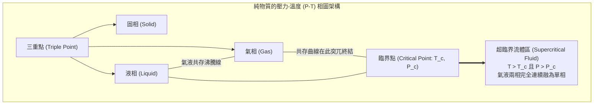
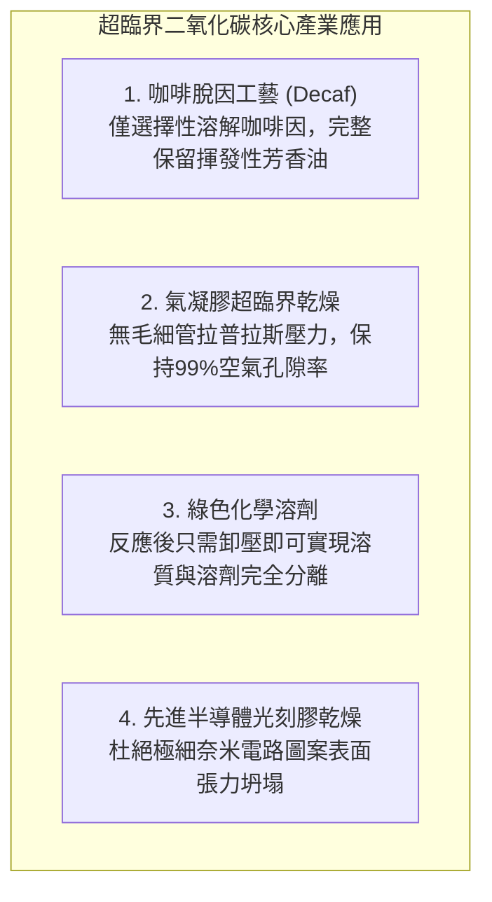

在一個由厚壁藍寶石玻璃製成的高壓光學觀察室中，密封著液態與氣態的二氧化碳。當你從外部對其緩慢加熱並加壓時，一場令人屏息的熱力學奇觀便悄然上演。

隨著溫度上升，底部液態二氧化碳因熱膨脹導致密度不斷下降；與此同時，上方蒸發的飽和蒸汽分子密度急劇飆升，二者之間的密度差異以肉眼可見的速度不斷縮小。原本清晰分隔氣液兩相的界面——彎月面（Meniscus）——隨著表面張力的衰減逐漸變平、模糊。

當溫度達到 $31.1^\circ\text{C}$（$304.2\,\text{K}$）、壓力達到 $7.38\,\text{MPa}$（約73個標準大氣壓）的瞬間，整個觀察室內突然爆發出如歐泊寶石般璀璨、虹彩翻騰的乳白光輝——<strong>臨界乳光（Critical Opalescence）</strong>。緊接著，那條界線徹底蒸發消逝，液體與氣體融為一體，化作一種全新的物質形態。

這便是<strong>超臨界流體（Supercritical Fluid, SCF）</strong>誕生的神奇時刻。

在經典物理學和基礎教育中，我們習慣於將物質劃分為固態、液態和氣態三態，並認為液相與氣相之間必須通過沸騰或冷凝的一級相變來相互轉化。然而，現代熱力學揭示了一個深刻的事實：液體與氣體在本質上屬於同一個連續的流體狀態。只要繞過特定的<strong>臨界點（Critical Point）</strong>，我們完全可以在不發生沸騰、不產生任何氣泡的情況下，將液體極其平滑、連續地轉化為氣體，反之亦然。

超臨界流體集液相與氣相的優勢於一身：
- <strong>具備液體般的高密度與溶解能力</strong>：能高效溶解複雜的非極性與極性化合物；
- <strong>具備氣體般的低粘度與高擴散係數</strong>：傳質速度比普通液體高出百倍；
- <strong>表面張力嚴格為零</strong>：能瞬間浸潤最微小的奈米多孔結構而絕不破壞其物理骨架。

本文將帶領讀者深入超臨界流體的迷人領域：從1822年法國物理學家卡尼亞爾·德·拉圖爾（Cagniard de la Tour）的大炮炮筒實驗，到範德瓦耳斯狀態方程對臨界常數的精確數學推導；從奧恩斯坦-澤爾尼克理論揭示的臨界乳光微觀漲落，到超臨界二氧化碳萃取咖啡因與氣凝膠超臨界乾燥；從瞬間氧化分解劇毒污染物的超臨界水，到木星、土星深處綿延數萬公里的超臨界流體海洋。

---

## 一、 臨界點的發現：拉圖爾的炮筒實驗

科學史上對氣液界面消失的首次觀測可追溯到1822年。法國工程師兼物理學家<strong>夏爾·卡尼亞爾·德·拉圖爾</strong>正在研究液體在高壓下的聲學共鳴特性。他將水、酒精或乙醚連同一顆小火石球密封在一根改裝過的厚壁青銅大炮炮筒內。

晃動炮筒時，根據火石球是在濃密液體中滾動還是在稀薄蒸汽中滾動，撞擊金屬的聲音截然不同。拉圖爾驚異地發現，當加熱溫度超過某一特定界限時，代表液體存在的晃蕩與撞擊聲突然完全消失。

隨後，拉圖爾製作了高抗壓厚壁玻璃毛細管進行光學直視實驗，記錄下了震撼科學界的現象：液體受熱膨脹的同時蒸汽密度劇增，在某一特定的臨界溫度下，分隔兩相的彎月界面完全模糊、平整並最終徹底消失，整個管內充滿了單一且均勻的流體相。

1869年，愛爾蘭物理化學家<strong>托馬斯·安德魯斯（Thomas Andrews）</strong>對二氧化碳的等溫線進行了高精度的定量測定，首次正式確立了這一熱力學不可逾越的邊界，並將其定名為<strong>「臨界點」（Critical Point）</strong>。

---

## 二、 熱力學相圖與範德瓦耳斯方程的嚴謹推導

### 2.1 壓力-溫度相圖中的奇異終點

在純物質的標準壓力-溫度（$P$-$T$）相圖中：
- <strong>固-液熔化曲線</strong>隨壓力增加無限延伸，象徵著具有空間平移對稱破缺的晶體結構與無定形液體之間的剛性界限；
- <strong>氣-液共存曲線（蒸氣壓曲線）</strong>自三重點起始，但在達到特定的臨界溫度 $T_c$ 與臨界壓力 $P_c$ 時，<strong>突然中斷並戛然而止</strong>！

當沿著氣液共存線向臨界點逼近時：
1. 液態密度 $\rho_L$ 因熱膨脹而持續下降；
2. 氣態密度 $\rho_G$ 因飽和蒸汽壓飆升而急劇增加；
3. 在臨界點處，兩相密度差完全歸零：$\lim_{T \to T_c} (\rho_L - \rho_G) = 0$；
4. 汽化潛熱 $\Delta H_{\text{vap}}$ 嚴格趨近於零；
5. 表面張力 $\gamma$ 恆等於零。

表面張力為零，意味著維持氣相與液相界面的能量勢壘徹底消除，界面自然不復存在。

### 2.2 範德瓦耳斯方程推導臨界常數

1873年，荷蘭物理學家<strong>約翰內斯·範德瓦耳斯</strong>提出了著名的實際氣體狀態方程，引入了分子自身有限體積（斥力排他體積 $b$）與分子間長程色散引力（範德瓦耳斯力修正項 $a/V_m^2$）：

$$\left( P + \frac{a}{V_m^2} \right) (V_m - b) = R T$$

將壓力 $P$ 顯式表示為摩爾體積 $V_m$ 和溫度 $T$ 的函數：
$$P = \frac{R T}{V_m - b} - \frac{a}{V_m^2}$$

在 $P$-$V_m$ 圖上，臨界等溫線 $T = T_c$ 恰好是單調遞減曲線與出現非物理S形極值曲線的臨界分界線，在此處形成一個<strong>水平拐點（Horizontal Inflection Point）</strong>。數學判據由一階與二階偏導數同時歸零所決定：

$$\left( \frac{\partial P}{\partial V_m} \right)_T = -\frac{R T}{(V_m - b)^2} + \frac{2 a}{V_m^3} = 0$$

$$\left( \frac{\partial^2 P}{\partial V_m^2} \right)_T = \frac{2 R T}{(V_m - b)^3} - \frac{6 a}{V_m^4} = 0$$

聯立上述二式，由二階導數條件可得：
$$\frac{R T}{(V_m - b)^2} = \frac{3 a (V_m - b)}{V_m^4}$$

代入一階導數條件：
$$\frac{3 a (V_m - b)}{V_m^4} = \frac{2 a}{V_m^3} \implies \frac{3(V_m - b)}{V_m} = 2 \implies V_c = 3 b$$

求得<strong>臨界摩爾體積</strong> $V_c = 3b$。將其代回一階微分方程，解得<strong>臨界溫度</strong>：
$$T_c = \frac{8 a}{27 R b}$$

將 $V_c$ 與 $T_c$ 代入原方程，求得<strong>臨界壓力</strong>：
$$P_c = \frac{a}{27 b^2}$$

進而可計算無量綱<strong>臨界壓縮因子</strong>：
$$Z_c = \frac{P_c V_c}{R T_c} = \frac{3}{8} = 0.375$$

無論物質分子具有何種微觀參數 $a$ 與 $b$，範德瓦耳斯理論預測所有物質在臨界點處的壓縮因子均嚴格收斂於常數 $0.375$。這一里程碑式的推導確立了熱力學中偉大的「對應狀態原理」。

---

## 三、 臨界乳光：宏觀密度的劇烈量子漲落

### 3.1 閃爍的歐泊之光

在臨界點附近，透明純淨的流體突然變得劇烈渾濁，呈現乳白色並強烈散射可見光。為什麼沒有任何雜質的均相物質會發生如此強烈的散射？

在臨界點，一階導數 $(\partial P / \partial V)_T = 0$，導致流體的<strong>等溫壓縮率 $\kappa_T$ 發散至無窮大</strong>：
$$\kappa_T = -\frac{1}{V} \left( \frac{\partial V}{\partial P} \right)_T \to \infty$$

壓縮率發散意味著：系統對體積或密度變化的抵抗能力完全喪失。極度微小的熱擾動便足以在宏觀尺度上引發劇烈的局域密度漲落。

根據1914年<strong>奧恩斯坦與澤爾尼克（Ornstein-Zernike）</strong>的空間相關理論，密度關聯長度 $\xi$ 隨溫度逼近臨界點而發散：
$$\xi \propto |T - T_c|^{-\nu} \quad (\nu \approx 0.63)$$

在臨界點附近，關聯長度從亞奈米尺寸暴增至<strong>數百奈米，直接跨入可見光波長（$400 \sim 700\,\text{nm}$）的尺度</strong>！整個流體中充斥著不斷生成和湮滅的微觀「液滴團簇」與「氣泡團簇」，可見光波在此發生劇烈的多重米氏散射，造就了令人嘆為觀止的臨界乳光。

---

## 四、 超臨界二氧化碳（$	ext{scCO}_2$）的綠色工業革命

在所有物質中，二氧化碳是應用最廣的超臨界工質，其臨界參數具有無與倫比的工程親和力：
- <strong>臨界溫度 $T_c = 31.1^\circ\text{C}$</strong>：接近室溫，不會破壞熱敏性生物活性物質；
- <strong>臨界壓力 $P_c = 7.38\,\text{MPa}$</strong>：常規工業高壓容器即可輕鬆耐受；
- 無毒、不燃、廉價、化學惰性且可完全循環回收。

### 4.1 氣凝膠的「冰凍煙霧」乾燥奇蹟

二氧化矽氣凝膠是世界上最輕的固體材料，內部空氣體積分數高達 $99\%$。如果在常規條件下加熱蒸發凝膠孔隙內的溶劑，凹液面產生的微觀毛細管拉普拉斯壓力 $\Delta P = \frac{2\gamma \cos \theta}{r_p}$ 在奈米孔徑下可達數百個大氣壓，會將極為脆弱的奈米骨架瞬間壓垮粉碎。

通過高壓置換引入超臨界 $\text{CO}_2$，並在臨界點以上緩慢降壓，整個過程完全避開了氣液相界面的生成，表面張力 $\gamma \equiv 0$。毛細管力徹底消除，奈米多孔骨架得以完好無損地完整保存，製造出堅固耐用的超級絕熱氣凝膠。

---

## 五、 超臨界水（$	ext{scH}_2	ext{O}$）：焚毀萬物的極端反應介質

與溫和的超臨界二氧化碳截然相反，水在進入超臨界狀態（$T_c = 373.9^\circ\text{C}, P_c = 22.06\,\text{MPa}$）後，會演變成一種極具破壞力與侵蝕性的極端流體。

常溫下，水因強大的氫鍵網路而表現為強極性溶劑，相對介電常數高達 $\epsilon_r \approx 80$。然而在超臨界狀態下，超過 $90\%$ 的氫鍵被熱動能無情撕裂，<strong>介電常數斷崖式下跌至 $\epsilon_r \approx 2 \sim 5$</strong>——這與苯、己烷等非極性有機溶劑完全相同！

這種突變引發了顛覆常識的化學現象：
1. <strong>有機物與氧氣完全互溶</strong>：塑料、油類、苯以及高壓氧氣能以任意比例與水完全互溶，形成毫無傳質阻力的單一均相體系；
2. <strong>無機鹽劇烈析出</strong>：失去水合作用保護的食鹽（$\text{NaCl}$）溶解度驟降幾個數量級，瞬間化為白色粉末沉澱。

利用這一特性的<strong>超臨界水氧化技術（SCWO）</strong>，能在數秒內將多氯聯苯（PCB）、二𫫇英、甚至沙林等軍用化學毒劑以超過 $99.9999\%$ 的效率徹底氧化為二氧化碳、水和無害無機酸鹽。

---

## 六、 結論：一覽物質本質的連續之美

從卡尼亞爾·德·拉圖爾轟鳴的古老大炮，到現代半導體超淨間中的奈米級乾燥；從深海 $400^\circ\text{C}$ 黑煙囪周圍翻騰的孕育原始生命的礦物熱泉，到木星深處數萬公里波瀾壯闊的超臨界氫之海。

超臨界流體徹底打破了人類對「固、液、氣」機械割裂的狹隘偏見。它證明了大自然深處的物理定律從不拘泥於人為定義的界限，而是以無限的連續、對稱與和諧，譜寫著物質世界最宏偉的交響樂章。
