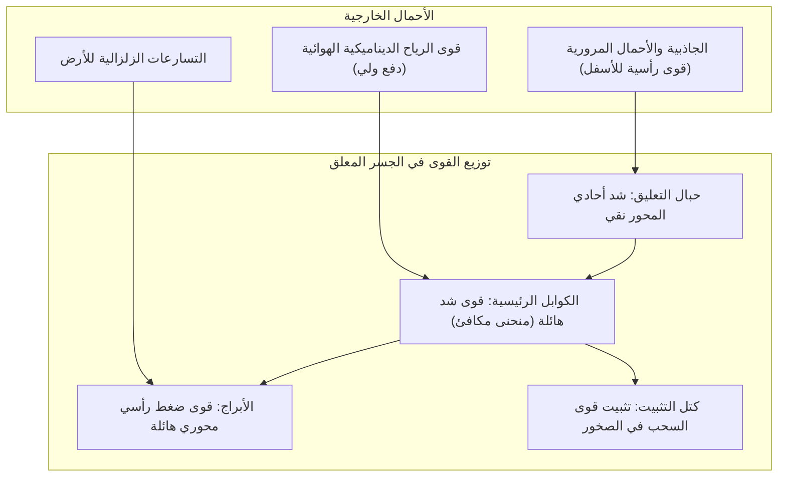
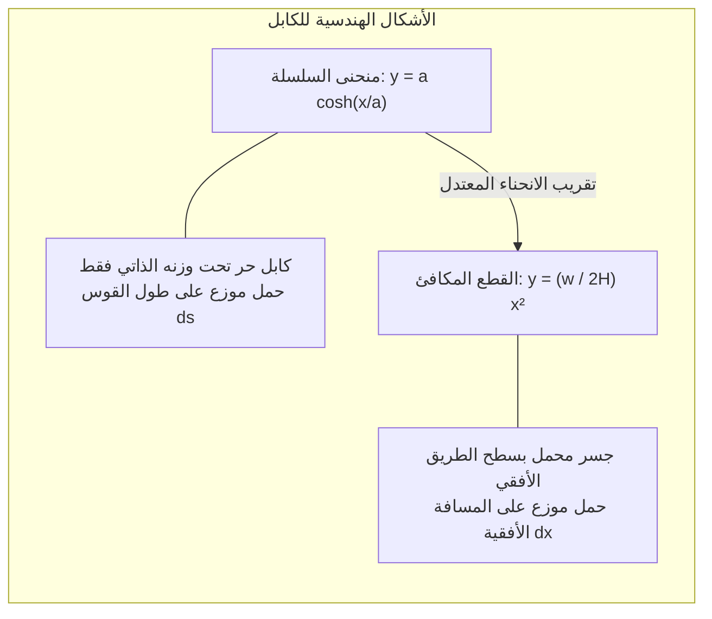
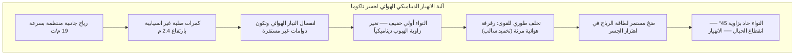

فوق أمواج المضائق البحرية الهادرة، تخترق الأبراج الفولاذية الشاهقة للجسور المعلقة الحديثة عنان السماء. ومن قممها، ترسم الكوابل الفولاذية الضخمة قطعاً مكافئاً بديعاً عبر كيلومترات من الفضاء المفتوح، معلقة تحتها آلاف الأطنان من الإسفلت وحركة المرور. من جسر **تشاناكالي 1915** في تركيا (صاحب الرقم القياسي العالمي ببحر رئيسي يبلغ 2023 متراً) إلى جسر **مضيق أكاشي** في اليابان (1991 متراً)، تمثل هذه الهياكل قمة إنجازات الهندسة المدنية.

كيف يمكن لطريق خرساني وفولاذي يزن عشرات الآلاف من الأطنان أن يظل معلقاً في الهواء دون ركيزة واحدة في وسط البحر؟ ولماذا لا ينهار تحت وطأة آلاف الشاحنات أو أمام الأعاصير والزلازل العنيفة؟

لا تكمن الإجابة في القوة الغاشمة أو الصلابة الخارقة، بل في الامتثال الهندسي لقوانين الطبيعة: يقوم الجسر المعلق بتفكيك القوى المعقدة إلى حالتين ميكانيكيتين نقيتين هما: **الشد الصافي (Tension)** و**الضغط المحوري الصافي (Compression)**.

---

## 1. الميكانيكا الأساسية: فصل الشد عن الضغط

يجب على أي منشأ أرضي موازنة قوى الجاذبية والأحمال البيئية لتحقيق الاتزان الإستاتيكي:
$$\sum \mathbf{F} = 0, \quad \sum \mathbf{M} = 0$$

في الجسور ذات الكمرات التقليدية، يولد الحمل **عزم انحناء (Bending Moment)**: تنضغط الألياف العلوية وتتمدد الألياف السفلية. ووفقاً لنظرية أويلر-بيرنولي، يزداد عزم الانحناء طردياً مع مربع طول البحر $L$:
$$M_{\max} = \frac{w L^2}{8}$$
إذا تضاعف البحر، تضاعف عزم الانحناء أربع مرات. ولمقاومته، يجب زيادة سماكة الكمرة حتى **تنهار تحت وطأة وزنها الذاتي**. وعند حدود 300 متر، تصل الجسور ذات الكمرات إلى حائلها الفيزيائي المطلق.

### الحل الهندسي في الجسور المعلقة
لا تملك الكوابل الفولاذية أي صلابة انحناء تذكر ($EI \approx 0$). ولكن تحت تأثير **الشد المحوري النقي**، تُظهر أسلاك الفولاذ المسحوبة على البارد قدرة تحمل مذهلة تقترب من الحدود النظرية للروابط الذرية للمعدن:
1. يرفع سطح الطريق بواسطة **حبال تعليق رأسية** (شد نقي).
2. تنتقل القوى إلى **الكوابل الرئيسية** (شد نقي).
3. تمر الكوابل عبر السروج في قمم **الأبراج**، محولة الشد المائل إلى ضغط رأسي هائل ينزل مباشرة إلى الصخور (ضغط نقي).
4. تثبت أطراف الكوابل في كتل خرسانية عملاقة تسمى **كتل التثبيت** (Anchorages).

---

## 2. رياضيات الكابل: منحنى السلسلة والقطع المكافئ

- **منحنى السلسلة (Catenary)**: يصف شكل الكابل المتدلي بحرية تحت وزنه الذاتي: $y(x) = a \cosh(x/a) - a$.
- **القطع المكافئ (Parabola)**: شكل الكابل عند تعليق سطح طريق أفقي منتظم الحمل $w$: $y(x) = \frac{w}{2H} x^2$.
- **الشد الأفقي**: $H = \frac{w L^2}{8f}$، وتتراوح النسبة المثلى بين السهم والبحر ($f/L$) هندسياً بين **$1/9$ إلى $1/11$**.

---

## 3. كارثة تاكوما ناروز (1940) والرفرفة الهوائية المرنة

في 7 نوفمبر 1940، انهار جسر **تاكوما ناروز** (بحر رئيسي 853 متراً) تحت رياح معتدلة بلغت سرعتها **68 كم/ساعة (19 م/ث)** فقط.

لم يكن السبب مجرد رنين ميكانيكي بسيط، بل كان ظاهرة **الرفرفة الالتوائية الهوائية المرنة (Aeroelastic Torsional Flutter)**: تسببت الكمرات غير الانسيابية في انفصال تدفق الهواء، وعملت قوى الرفع بزاوية طورية متأخرة عن حركة الجسر، مما جعل الهواء يعمل بمثابة "تخميد سالب" يضخ الطاقة الحركية في المنشأ حتى تمزق بالكامل.

الحلول الهندسية الحديثة: الجمالونات الشبكية المفتوحة (جسر أكاشي)، الصناديق الفولاذية الانسيابية الشبيهة بجناح الطائرة (جسر سيفرن)، والكمرات المزدوجة ذات الفتحة المركزية (جسر تشاناكالي 1915).

---

## 4. الجسور المعلقة مقابل الجسور الملجمة بالكوابل

| المعيار | الجسر المعلق (Suspension) | الجسر الملجم بالكوابل (Cable-Stayed) |
| :--- | :--- | :--- |
| **نظام الكوابل** | كابل رئيسي متصل مع حبال تعليق رأسية | كوابل مائلة تمتد مباشرة من البرج إلى السطح |
| **الإجهادات في السطح** | انحناء موضعي، إجهاد محوري ضئيل جداً | **إجهاد ضغط أفقي محوري هائل يسحق السطح** |
| **كتل التثبيت** | **إلزامية وضخمة جداً** لتثبيت الكابل في الأرض | **غير مطلوبة** (القوى الأفقية متزنة ذاتياً في السطح) |
| **البحر الاقتصادي الأنسب** | **1000 متر إلى أكثر من 3000 متر** | **300 متر إلى حوالي 1000 متر** |

عند تجاوز مسافة 1000 متر، تؤدي زاوية الكوابل المائلة إلى ضغط محوري ساحق على سطح الجسر، مما يجعل **الجسور المعلقة الخيار الحصري الوحيد للمسافات الشاسعة**.

---

## 5. تقنيات الاستدامة الحديثة

1. **حقن الهواء الجاف**: يُضخ هواء برطوبة نسبية أقل من 40% داخل الكوابل الرئيسية، مما يمنع الصدأ تماماً.
2. **الانبعاث الصوتي (AE)**: ترصد مجسات حساسة الموجات فوق الصوتية الصادرة عند انقطاع سلك واحد من بين عشرات الآلاف، لتحدد موقع الخلل بدقة السنتيمتر.
3. **التوأم الرقمي (Digital Twin)**: نماذج محاكاة حاسوبية مربوطة بآلاف المستشعرات تتنبأ بالإجهادات في الوقت الفعلي أثناء الزلازل والعواصف.
