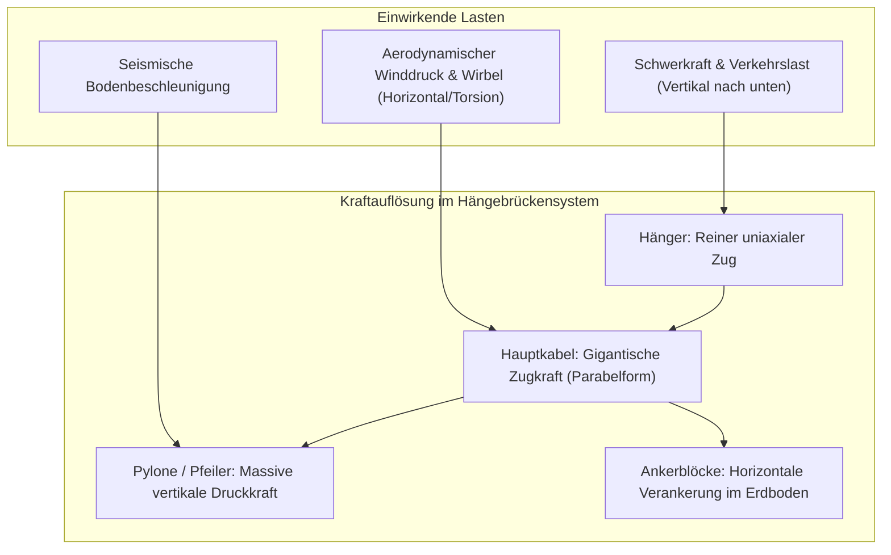
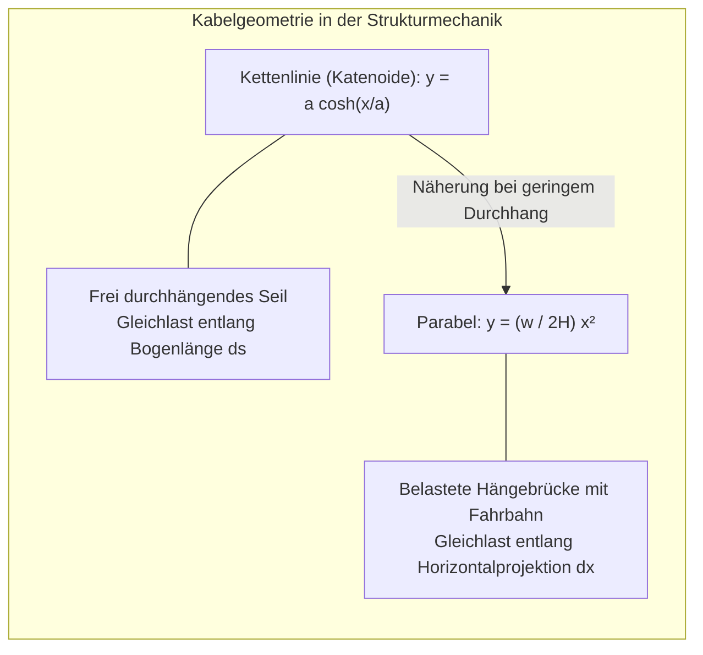
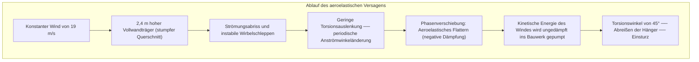

Über tosenden Meeresstraßen ragen monumentale Pylone in den Himmel. Von ihren Spitzen schwingen sich stählerne Hauptkabel in vollendeter Parabelform über kilometerweite Abgründe und halten gigantische Fahrbahnen schwebend in der Luft. Ob die **1915-Çanakkale-Brücke** in der Türkei mit ihrer Weltrekord-Spannweite von 2.023 Metern oder Japans **Akashi-Kaikyō-Brücke** (1.991 Meter): Moderne Hängebrücken sind die kühnsten Triumphe des Bauingenieurwesens.

Wie ist es möglich, dass eine Tausende Tonnen schwere Konstruktion ohne Stützen im Wasser nicht abstürzt? Warum zerbricht sie weder unter Stoßstange-an-Stoßstange stehenden Lkw-Kolonnen noch im Orkan?

Die Antwort liegt nicht in massiver Härte, sondern in vollkommener statischer Entflechtung: Die Hängebrücke zerlegt alle chaotischen Lasten in zwei elementare Zustände – **reine Zugspannung (Tension)** und **reine Druckspannung (Compression)**.

---

## 1. Die fundamentale Mechanik: Entkopplung von Biegung, Zug und Druck

Jedes Tragwerk muss vertikale Schwerkraftlasten und dynamische Horizontallasten im statischen Gleichgewicht halten:
$$\sum \mathbf{F} = 0, \quad \sum \mathbf{M} = 0$$

Bei einer gewöhnlichen Balkenbrücke erzeugt die Last ein **Biegemoment**: Die Obergrenze wird gestaucht (Druck), die Untergrenze gedehnt (Zug). Nach der Balkentheorie wächst das maximale Biegemoment quadratisch mit der Stützweite $L$:
$$M_{\max} = \frac{w L^2}{8}$$
Verdoppelt man die Spannweite, vervierfacht sich das Biegemoment. Um dem standzuhalten, müsste der Balken so massiv gebaut werden, dass er schließlich **unter seinem eigenen Eigengewicht zerbricht**. Bei maximal 300 Metern Spannweite erreichen Balkenbrücken ihre physikalische Grenze.

### Die Hängebrücke als Lösung
Drahtseile besitzen keinerlei Biegesteifigkeit ($EI \approx 0$). Doch bei **rein axialem Zug** erreicht hochfester, kaltgezogener Stahl seine absolute theoretische Festigkeitsgrenze:
1. **Fahrbahnlasten** werden über vertikale **Hänger** nach oben geleitet (reiner Zug).
2. Die **Hauptkabel** bündeln die Last und leiten sie über die Pylonspitzen (reiner Zug).
3. Die **Pylone** leiten die resultierende Normalkraft senkrecht als puren **Druck** ins Fundament.
4. Die **Ankerblöcke** nehmen die gewaltige Horizontalkraft auf und verankern sie im Erdreich.

Durch die Trennung in **Zug (Kabel)** und **Druck (Türme)** wird die zerstörerische Biegung eliminiert.

---

## 2. Die Mathematik des Tragkabels: Kettenlinie vs. Parabel

### 1. Das freie Seil: Die Kettenlinie (Katenoide)
Ein Seil mit homogener Eigenmasse $\mu$, das nur unter Eigengewicht hängt, gehorcht der Differentialgleichung:
$$\frac{d^2 y}{dx^2} = \frac{\mu g}{H} \sqrt{1 + \left(\frac{dy}{dx}\right)^2}$$
Die Integration liefert den Kosinus Hyperbolicus:
$$y(x) = a \cosh\left(\frac{x}{a}\right) - a, \quad a = \frac{H}{\mu g}$$

### 2. Die Brücke im Betrieb: Die Parabel
Trägt das Kabel eine gleichmäßig verteilte horizontale Fahrbahnlast $w$ ($w \gg \mu g$), wirkt die Last nicht entlang der Bogenlänge $ds$, sondern gleichmäßig über die horizontale Spannweite $dx$. Die Integration führt zur **Parabel**:
$$y(x) = \frac{w}{2H} x^2$$

Mit Stützweite $L$ und Pfeilhöhe (Durchhang) $f$ an der Stelle $x = L/2$:
$$H = \frac{w L^2}{8f}$$

Das Verhältnis $f/L$ (Durchhang zu Spannweite) stellt das zentrale Optimierungsproblem dar: Ein zu flaches Seil ($f \to 0$) lässt die Zugkraft $H \to \infty$ explodieren; ein zu tiefer Durchhang erfordert astronomisch hohe Pylone mit Knickgefahr. Der optimale Kompromiss liegt bei **$f/L \approx 1/9 \text{ bis } 1/11$**.

---

## 3. Die Katastrophe von Tacoma Narrows (1940) und das aeroelastische Flattern

Am 7. November 1940 stürzte die erst vier Monate alte **Tacoma-Narrows-Brücke** (Spannweite 853 Meter) bei einer moderaten Windgeschwindigkeit von lediglich **19 m/s (68 km/h)** ein.

### Ursache: Selbsterregtes Flattern (Aeroelastic Flutter)
Entgegen alter Lehrbuchmythen war nicht einfache Resonanz durch Kármánsche Wirbel schuld, sondern **aeroelastisches Torsionsflattern**. Der undurchlässige Vollwandträger riss die Luftströmung ab. Bei einsetzender Torsion wirkten die aerodynamischen Auftriebskräfte phasenversetzt zur Brückenbewegung. Die Luftströmung wirkte nicht mehr als Dämpfer, sondern wie ein Motor mit **negativer Dämpfung**: Sie pumpte kontinuierlich Bewegungsenergie in die Torsionsschwingung, bis die Schwingungsamplituden $45^\circ$ erreichten und die Hänger rissen.

Moderne Brücken verhindern dies durch:
- **Offene Fachwerkträger**: Wind strömt ungehindert hindurch (Akashi-Kaikyō).
- **Aerodynamische Hohlkastenprofile**: Tragflächenprofil minimiert Strömungsabrisse (Severn, Bosporus).
- **Zweikasten-Querschnitte mit Längsschlitz**: Druckausgleich zwischen Ober- und Unterseite (1915 Çanakkale).

---

## 4. Hängebrücke vs. Schrägseilbrücke

| Parameter | Hängebrücke | Schrägseilbrücke |
| :--- | :--- | :--- |
| **Kabelkonfiguration** | Durchgehendes Hauptkabel mit vertikalen Hängern | Fächer- oder harfenförmige Seile direkt vom Pylon zur Fahrbahn |
| **Beanspruchung Fahrbahnträger** | Vorwiegend lokale Biegung, minimale Längskraft | **Extrem hohe horizontale Druckkräfte (Normalkraft)** |
| **Verankerung** | **Riesige externe Ankerblöcke zwingend nötig** | **Selbstverankernd** (Horizontalkräfte heben sich im Träger auf) |
| **Wirtschaftliche Spannweite** | **1.000 m bis über 3.000 m** | **300 m bis ca. 1.000 m** |

Bei Spannweiten über 1.000 m führt der flache Neigungswinkel der Seile bei Schrägseilbrücken zu immensen Längsdruckkräften, die den Fahrbahnträger zerdrücken würden. Über 1.500 m ist die **Hängebrücke konkurrenzlos**.

---

## 5. Zukunftsfähige Instandhaltung: Trockenluft und Digitaler Zwilling

1. **Trockenluftinjektion**: Durch das Innere der Hauptkabel wird permanent entfeuchtete Luft (relative Feuchte $< 40\%$) geblasen, wodurch die Korrosion der zehntausenden Drähte physikalisch unmöglich gemacht wird.
2. **Schallemissionsanalyse (AE)**: Piezoelektrische Sensoren lauschen auf hochfrequente Schallwellen brechender Einzeldrähte und lokalisieren Materialermüdung zentimetergenau.
3. **Digitaler Zwilling**: Reale Sensordaten (GNSS, Dehnung, Beschleunigung) speisen permanente Finite-Elemente-Simulationen zur vorausschauenden Wartung.
