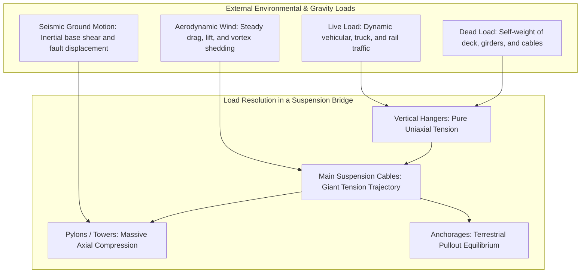
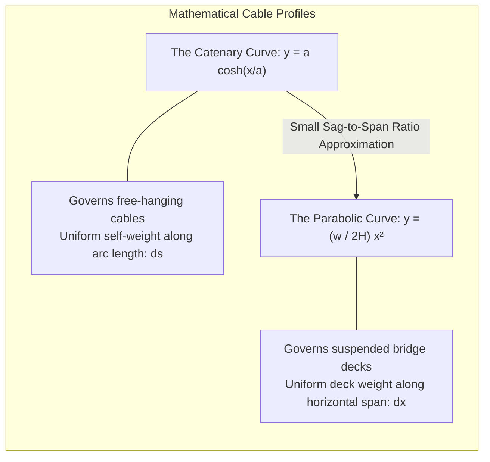
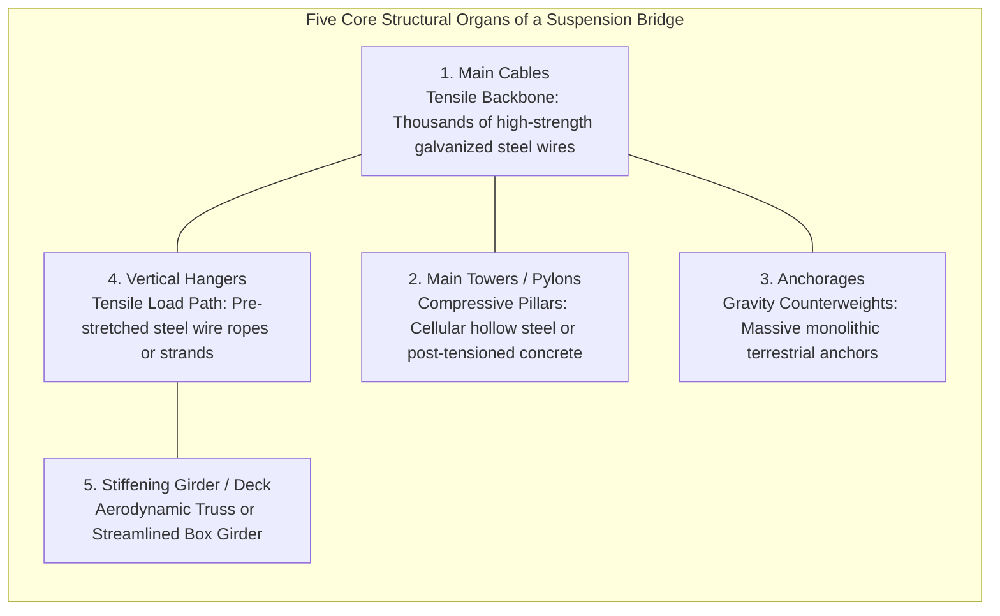
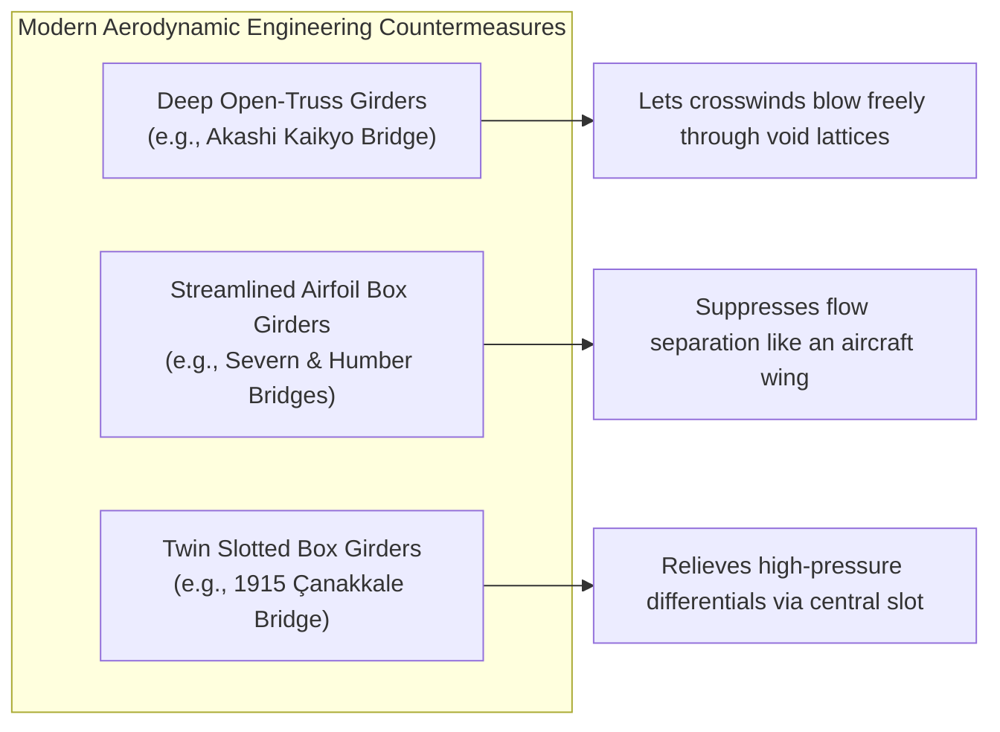
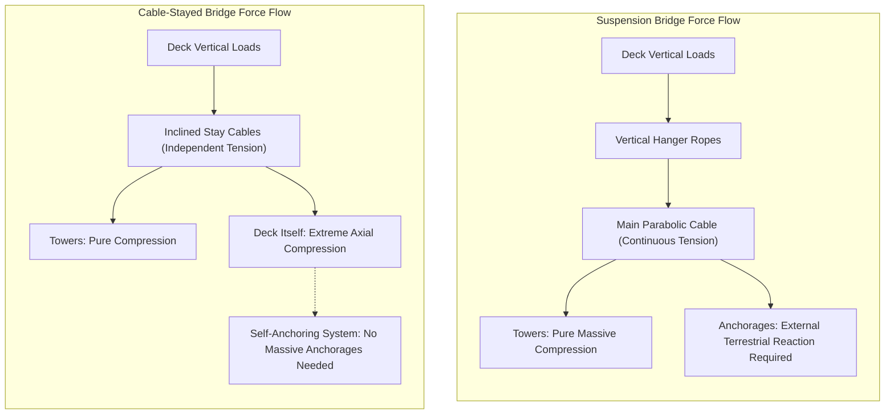
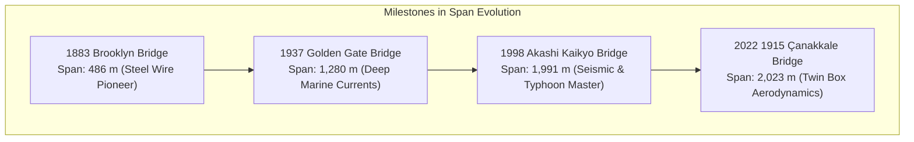
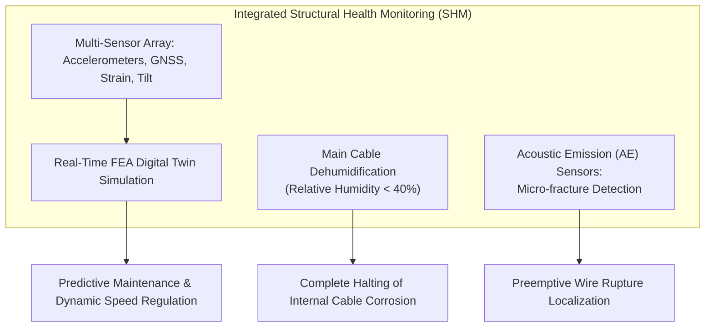

Suspended hundreds of meters above turbulent ocean straits, shrouded in maritime mist, the majestic steel towers of a modern suspension bridge reach into the clouds. From their summits, sweeping twin steel cables trace an effortless parabolic curve across kilometers of open sky, carrying beneath them thousands of tons of vehicular traffic on a floating ribbon of asphalt and structural steel.

To stand before such colossal monuments as the **1915 Çanakkale Bridge** in Turkey (with its world-record main span of 2,023 meters) or Japan’s **Akashi Kaikyo Bridge** (1,991 meters) is to confront an instinctive physical paradox:

*How can an expanse of solid earth and steel, spanning miles without a single supporting foundation in the middle, remain perfectly suspended in mid-air?*
*Why do these structures not buckle under the crushing weight of bumper-to-bumper freight traffic, nor tear themselves to pieces when assaulted by hurricane-force gale winds, ocean vortex currents, and tectonic earthquakes?*

The answer does not lie in brute material mass or unyielding rigidity. In fact, attempting to bridge a two-kilometer oceanic strait with brute-force rigidity is a mathematical impossibility. A suspension bridge endures precisely because it yields to the laws of nature. It is a structure of supreme geometric elegance that decouples chaotic multi-axial forces into their two most fundamental states: **pure tensile stress** and **pure axial compression**.

This treatise provides an exhaustive exploration of the structural mechanics, mathematics, aerodynamic fluid-structure interactions, and historical engineering milestones that govern the design and survival of the world's longest bridges.

---

## 1. The Fundamental Mechanics of Bridging: Decoupling Tension and Compression

In terrestrial structural engineering, every megastructure operates under an absolute mechanical mandate: it must continuously balance gravitational body forces, environmental loads, and inertial accelerations by transmitting them safely into the bedrock of the Earth through a closed chain of static equilibrium:
$$\sum \mathbf{F}_x = 0, \quad \sum \mathbf{F}_y = 0, \quad \sum \mathbf{F}_z = 0, \quad \sum \mathbf{M} = 0$$

Within any structural member, internal stress tensors can be decomposed into three primary modes:
1. **Compressive Stress ($\sigma_c < 0$)**: Forces pushing atoms closer together, resisted by the electronic repulsion of crystal lattices.
2. **Tensile Stress ($\sigma_t > 0$)**: Forces pulling atoms apart, resisted by interatomic covalent or metallic bonding.
3. **Bending Moments ($M$) and Shear Stresses ($\tau$)**: Asymmetric stress distributions that induce severe internal torque, simultaneously creating tension on one surface and compression on the opposing surface.

### 1.1 The Curse of Bending in Beam and Girder Bridges
The simplest bridge conceived by early civilization is the beam bridge: a rigid beam supported at its two ends. While straightforward, the physics of beam bending imposes an insurmountable exponential scaling penalty on long spans.

When a uniform transverse downward load $w$ (composed of self-weight and traffic) acts upon a simply supported beam of span length $L$, the internal bending moment $M(x)$ reaches its maximum at midspan:
$$M_{\max} = \frac{w L^2}{8}$$

According to classical Euler-Bernoulli beam theory, the maximum bending stress $\sigma_b$ generated in the extreme fibers of the beam cross-section is:
$$\sigma_b = \frac{M_{\max} y_{\max}}{I} = \frac{M_{\max}}{Z}$$
where $I$ is the area moment of inertia, $y_{\max}$ is the distance from the neutral axis to the furthest fiber, and $Z$ is the elastic section modulus.

Notice the quadratic dependence on span length ($L^2$). If an engineer doubles the span length from $200\text{ meters}$ to $400\text{ meters}$, the internal bending moment increases by a factor of four. To prevent the beam from rupturing, the cross-sectional height of the beam must be drastically enlarged. However, enlarging the beam increases its self-weight $w$, which in turn triggers a catastrophic positive feedback loop: the bridge’s own dead load outstrips its material yield strength long before a span of a single kilometer can ever be achieved. Conventional girder bridges reach their absolute economic and structural limit around $300\text{ meters}$.

### 1.2 The Suspension Solution: Eliminating the Bending Moment
The suspension bridge represents a radical departure from the tyranny of bending. Instead of attempting to bridge vast chasms with rigid horizontal members that resist transverse forces via internal shear and flexure, the suspension bridge suspends the entire deck from flexible cables.

A flexible wire or cable possesses virtually **zero bending rigidity ($EI \approx 0$)**. If you push a cable, it buckles instantly; if you try to bend it, it rotates without resistance. But when subjected to pure tensile pulling forces along its longitudinal axis, high-tensile steel exhibits an astonishing strength-to-weight ratio, approaching the theoretical bonding limit of metallic iron crystals.

The suspension bridge distributes its structural responsibilities with absolute clarity:
1. **The Deck**: Provides an aerodynamic, level roadway for traffic. Its bending stiffness is designed only to distribute local wheel loads and resist aerodynamic twisting, not to carry the span itself across the ocean.
2. **The Hanger Ropes**: Carry the weight of the deck vertically upward in pure uniaxial tension.
3. **The Main Cables**: Gather the vertical forces from thousands of hangers and redirect them along a continuous tensile curve toward the summits of the towers.
4. **The Towers (Pylons)**: Act as vertical compression struts. At the tower saddle, the angled tensile vectors of the main cables resolve into a predominantly vertical vector, pushing downward with tens of thousands of metric tons of pure compressive force directly into deep subsea bedrock.
5. **The Anchorages**: Massive monolithic counterweights at each terminal point of the bridge that securely moor the horizontal component of the cable tension directly into the crust of the Earth.

By transforming a destructive flexural problem into an elegant synergy of **pure tension** (cables) and **pure compression** (towers), the suspension bridge unlocks spans spanning thousands of meters.

---

## 2. Mathematics of the Cable: Catenary vs. Parabola

The characteristic dipping curve of a suspension bridge's main cable is frequently romanticized by artists, but to the applied mathematician and structural engineer, it represents an exact variational solution to potential energy minimization under static gravity.

In classical analytical mechanics, two distinct geometric curves govern flexible cable trajectories: the **Catenary** and the **Parabola**.

### 2.1 The Free-Hanging Catenary Curve
When an idealized, perfectly flexible, inextensible cable of uniform mass density per unit length $\mu$ hangs freely between two supports under the influence of uniform gravity $g$, the load is distributed evenly along the **arc length of the cable** ($ds$).

Consider a differential segment of the cable $ds = \sqrt{dx^2 + dy^2}$. Let $H$ denote the constant horizontal component of the cable tension, and $T(s)$ denote the tangential tension. Balancing the vertical and horizontal forces acting on this differential element yields the fundamental differential equation of the catenary:
$$\frac{d}{dx}\left( \frac{dy}{dx} \right) = \frac{\mu g}{H} \frac{ds}{dx} = \frac{\mu g}{H} \sqrt{1 + \left(\frac{dy}{dx}\right)^2}$$

Defining the characteristic parameter $a = \frac{H}{\mu g}$, this separable nonlinear differential equation integrates directly into the hyperbolic cosine function:
$$y(x) = a \cosh\left(\frac{x}{a}\right) - a = \frac{a}{2}\left( e^{x/a} + e^{-x/a} \right) - a$$

The catenary profile is assumed by unladen electrical transmission lines, mooring lines, and the main cable of a suspension bridge during its initial construction phase before any deck sections are suspended.

### 2.2 The Parabolic Trajectory of a Loaded Bridge
Once the vertical hanger ropes are connected and the heavy roadway deck is installed, the load distribution undergoes a fundamental mathematical transformation. The self-weight of the deck and vehicular traffic far outweighs the self-weight of the cable itself. Because the roadway is horizontal, this massive dead load is distributed **uniformly per unit of horizontal span length** ($dx$), rather than along the arc length ($ds$).

Let $w$ represent the total downward load per unit horizontal length ($w \gg \mu g$). The static equilibrium of a differential cable element spanning from the origin $(0, 0)$ at midspan to an arbitrary horizontal coordinate $x$ requires:
$$T \cos\theta = H$$
$$T \sin\theta = \int_0^x w \, d\xi = w x$$

Dividing the vertical equilibrium by the horizontal equilibrium yields the slope of the cable:
$$\frac{dy}{dx} = \tan\theta = \frac{w x}{H}$$

Integrating this first-order ordinary differential equation with boundary condition $y(0) = 0$ yields a pure quadratic function—a **Parabola**:
$$y(x) = \frac{w}{2 H} x^2$$

### 2.3 Horizontal Tension and the Sag-to-Span Ratio
Let the horizontal distance between the two tower supports be $L$ (the main span length), and let the vertical drop from the tower tops to the lowest cable point at midspan be $f$ (the sag). Evaluating the parabolic equation at the tower support ($x = L/2, y = f$):
$$f = \frac{w}{2 H} \left(\frac{L}{2}\right)^2 = \frac{w L^2}{8 H}$$

Solving this relation for the horizontal tension $H$ reveals the fundamental governing equation of suspension bridge design:
$$H = \frac{w L^2}{8 f}$$

The maximum cable tension $T_{\max}$ occurs at the highest elevation—the top of the tower saddles ($x = L/2$)—where the tangential angle $\theta_{\max}$ is steepest:
$$T_{\max} = \sqrt{H^2 + \left(\frac{w L}{2}\right)^2} = H \sqrt{1 + 16\left(\frac{f}{L}\right)^2}$$

This mathematical derivation exposes a pivotal engineering optimization problem governed by the **Sag-to-Span Ratio ($n = f / L$)**:
- **If the sag $f$ is made shallow ($n \to 0$)**: The required tower height decreases, dramatically reducing the construction cost and wind exposure of the towers. However, because $f$ sits in the denominator of the tension equation ($H \propto 1/f$), the horizontal cable tension skyrockets toward infinity. The cables would require enormous cross-sections of steel to avoid tensile rupture.
- **If the sag $f$ is made deep ($n \to \infty$)**: The cable tension decreases, allowing for thinner, lighter cables. However, the tower height must increase exponentially, triggering severe tower buckling instabilities, astronomical pylon foundation costs, and uncontrollable wind vulnerability.

Through comprehensive structural optimization across the 20th and 21st centuries, bridge engineers have determined that the optimal economic and mechanical compromise lies within a narrow sag-to-span ratio of **$1:9$ to $1:11$** (approximately $n \approx 0.10$).

---

## 3. The Anatomy of Megastructures: The Five Vital Organs

A modern suspension bridge is an interconnected megasystem where failure of any single component precipitates immediate, catastrophic global collapse.

### 3.1 Main Cables: The Miracle of Spun High-Tensile Steel
The main cables are the indispensable life-support system of the bridge. On the Akashi Kaikyo Bridge, each of the two main cables measures $1.122\text{ meters}$ in diameter and sustains an operational tensile force exceeding $600\text{ MN}$ ($60,000\text{ metric tons}$) per cable.

Crucially, an engineering cable of this magnitude cannot be manufactured as a single solid steel rod. A solid steel bar of one-meter diameter would inevitably contain metallurgical casting voids, microcracks, and localized thermal brittleness; furthermore, it would possess massive flexural rigidity, making it completely impossible to transport, bend, or install over the towers.

Instead, the main cable is an aggregated bundle of tens of thousands of high-carbon, cold-drawn galvanized steel wires, each roughly $5.0\text{ to }5.4\text{ mm}$ in diameter.
- **The Physics of Ultra-High Tensile Strength**: While standard structural mild steel yields at approximately $250\text{ to }400\text{ MPa}$, the cold-drawing process for suspension bridge wires elongates crystal grains into dense, parallel dislocation boundaries, driving ultimate tensile strength ($\sigma_u$) up to **$1,800\text{ to }2,000\text{ MPa}$**. A single $5\text{ mm}$ wire can lift three full-size passenger automobiles without yielding.
- **Aerial Spinning (AS) vs. Prefabricated Parallel Wire Strands (PPWS)**:
  1. *Aerial Spinning (AS)*: Pioneered by John A. Roebling, spinning wheels travel back and forth across catwalks suspended between anchorages, pulling individual loops of wire over the towers on site.
  2. *PPWS Method*: Perfected in Japan for the Honshu-Shikoku Bridge Project, bundles of 127 individual wires are pre-assembled in temperature-controlled factories into hexagonal parallel wire strands, wound onto massive steel reels, transported to the site, and pulled across in one continuous operation. PPWS offers superior geometric precision, reduced construction duration, and tighter void ratios.

Once all strands are placed, hydraulic squeezing machines compress the bundle into a dense cylinder with less than $18\%$ air void space. It is coated with protective zinc paste, wrapped under high tension with galvanized wire, and equipped with continuous **dehumidification systems** to eliminate internal condensation.

### 3.2 Main Towers (Pylons): Defeating Euler Buckling
Rising up to $300\text{ meters}$ above the waves, the towers must absorb the concentrated vertical reactions from both main cables, transmitting up to $120,000\text{ metric tons}$ of axial compression down to the foundations.

The overriding engineering design constraint for bridge towers is **elastic and inelastic buckling**. Under Euler's classical buckling theory, the critical axial compression load $P_{cr}$ before structural bifurcation occurs is given by:
$$P_{cr} = \frac{\pi^2 E I}{(K L)^2}$$
where $E$ is Young's modulus, $I$ is the cross-sectional second moment of area, $L$ is the unbraced height, and $K$ is the effective length factor.

Because $L$ is colossal, achieving a high critical buckling load demands an extraordinarily large moment of inertia $I$. Constructing the towers from solid steel or concrete would make them impossibly heavy, causing them to collapse under their own dead load. Engineers resolve this by designing **hollow, multi-cellular cross-sections**. Internally, the towers consist of a labyrinth of vertical stiffeners, transverse diaphragms, and internal maintenance elevators, creating vast torsional and flexural stiffness with minimal material weight.

### 3.3 Anchorages: Taming the Horizontal Vector
While towers handle vertical compressive loads, the anchorages must resist the monumental horizontal pull of the cables. If an anchorage yields horizontally by even a few centimeters, the cable sag increases, causing the bridge deck to drop dramatically.

There are two primary geological paradigms for anchorages:
1. **Gravity Anchorages**: Deployed when bedrock is buried beneath deep marine sediments or soft rock. Engineers excavate massive pits and cast monolithic blocks of plain and reinforced concrete weighing up to $1.5\text{ million metric tons}$. The sheer gravitational weight of the concrete, combined with base friction and passive earth pressure along its embedded faces, resists the pullout vector with a safety factor typically exceeding $2.5$.
2. **Tunnel (Rock-Socketed) Anchorages**: Deployed in deep mountain fjords with pristine crystalline bedrock (granite, basalt). Deep inclined tunnels are blasted into the mountainside following the exact line of the cable trajectory. Steel anchorage frames are assembled deep inside the mountain and encased in high-strength concrete, using the tensile capacity of the mountain range itself as the counterweight.

Inside the anchorage, the cylindrical cable enters through a splay saddle, where it fans out into individual strands. Each strand wraps around an adjustable steel strand shoe connected to deep post-tensioned tie-down anchor rods.

---

## 4. The Catastrophe of 1940: Tacoma Narrows and Aeroelasticity

No discipline in engineering has ever been so violently revolutionized by a single disaster as suspension bridge engineering was on November 7, 1940, with the collapse of the original **Tacoma Narrows Bridge** in Washington State.

Opened only four months prior, with an $853\text{-meter}$ main span that made it the third-longest suspension bridge in the world, the bridge tore itself to pieces in a moderate gale wind of merely **$19\text{ m/s}$ ($42\text{ mph}$, $68\text{ km/h}$)**. Recorded on pristine 16mm Kodachrome color film, the collapse demonstrated that structural strength alone cannot protect a bridge if its fluid-structure aerodynamics are flawed.

```mermaid
flowchart TD
    subgraph TacomaFailureSequence ["The Catastrophic Aeroelastic Flutter Sequence"]
        SteadyWind["Moderate Steady Wind: 19 m/s (42 mph)"]
        SolidPlate["Bluff Body Profile: 2.4 m Deep Solid Plate Girders"]
        VortexShedding["Boundary Layer Flow Separation: Alternating Vortices"]
        TorsionalMotion["Initial Small Torsional Oscillation"]
        AngleOfAttack["Periodic Dynamic Angle of Attack Variation: Alpha(t)"]
        NegativeDamping["Fluid-Structure Phase Lag: Aeroelastic Flutter (Negative Damping)"]
        EnergyAccumulation["Unbounded Kinetic Energy Pumping from Wind into Structure"]
        HangerRupture["Structural Failure: Center Hangers Snap, Deck Collapses"]
    end

    SteadyWind --> SolidPlate
    SolidPlate --> VortexShedding
    VortexShedding --> TorsionalMotion
    TorsionalMotion --> AngleOfAttack
    AngleOfAttack --> NegativeDamping
    NegativeDamping --> EnergyAccumulation
    EnergyAccumulation --> HangerRupture
```

### 4.1 The Hubris of the Deflection Theory
The chief designer of the Tacoma Narrows Bridge, Leon Moisseiff, was one of the brilliant mathematical minds behind the modern "Deflection Theory" (originally formulated by Josef Melan).

Deflection theory proved that as the span of a bridge grows and its dead weight increases, the immense tensile force in the main cables provides a powerful natural restoring force (gravity stiffness) against vertical displacement. Consequently, Moisseiff reasoned that the stiffening girder no longer needed to be an expensive, visually heavy steel truss.

Pushing this mathematical logic to its extreme, Moisseiff eliminated open trusses and designed the Tacoma Narrows deck with solid **plate girders** just $2.4\text{ meters}$ deep, yielding an ultra-slender width-to-depth ratio of $1:5$ and a span-to-depth ratio of $1:350$. From a purely static perspective, the calculations were immaculate: the bridge could easily withstand static horizontal wind pressures and full design traffic loads. **On paper, it was mathematically indestructible.**

### 4.2 The Real Culprit: Aeroelastic Torsional Flutter
For decades, popular physics textbooks erroneously explained the collapse as a simple case of "resonance driven by von Kármán vortex shedding." However, rigorous post-collapse research conducted by Theodore von Kármán himself, followed by Scanlan and modern computational fluid dynamics (CFD), demonstrated that resonance was merely a minor precursor. The true mechanism of destruction was **single-degree-of-freedom Aeroelastic Torsional Flutter**.

Unlike forced resonance (where an external periodic force matches the natural frequency of a structure), flutter is a **self-excited, self-sustaining dynamic instability**:

1. **Flow Separation on a Bluff Body**: The solid, vertical plate girders acted as non-aerodynamic "bluff bodies." When horizontal wind struck the windward girder, flow separated violently at the leading edges, casting off unstable alternating shear layers across the upper and lower surfaces of the roadway.
2. **Phase Lag in Unsteady Aerodynamics**: As the roadway twisted slightly under turbulent gusts, its geometric angle of attack $\alpha(t)$ changed. In an airfoil or streamlined body, lift acts almost instantaneously. But on the bluff rectangular cross-section of the Tacoma deck, the reattachment and shedding of vortices caused the aerodynamic lift and twisting moment to lag behind the structural displacement by a phase angle $\phi$.
3. **Negative Aerodynamic Damping**: When this phase lag occurs, the work done by the aerodynamic forces per oscillation cycle becomes strictly positive:
   $$W_{\text{aero}} = \oint M_{\text{aero}}(t) \, \dot{\theta}(t) \, dt > 0$$
   Instead of the surrounding air acting as a viscous damper to extinguish oscillations, the fluid flow actively injected kinetic energy into the structural vibration modes. The total damping of the system ($C_{\text{total}} = C_{\text{structural}} + C_{\text{aero}}$) became negative.
4. **Catastrophic Divergence**: On the morning of November 7, a vertical motion mode transitioned abruptly into an asymmetric torsional mode with a node at midspan (frequency $f \approx 0.2\text{ Hz}$). The bridge twisted with rotational amplitudes exceeding $\pm 45^\circ$, moving one sidewalk meters above the other. After hours of violent torsional whipping, fatigue stress fractured the center stay cables, hanger ropes snapped like guitar strings, and the six-hundred-meter suspended deck plunged into Puget Sound.

### 4.3 The Post-Tacoma Revolution: Aerodynamic Deck Engineering
The wreckage of the Tacoma Narrows Bridge fundamentally dismantled classical static bridge engineering, giving birth to modern wind engineering and aeroelastic structural dynamics.

Following the disaster, three primary aerodynamic engineering principles became mandatory worldwide:

- **Open Stiffening Trusses**: If an engineer must build a traditional deep girder, it must be constructed entirely of open steel lattice trusses that permit horizontal wind to flow through with minimal drag and zero vortex formation (e.g., the Akashi Kaikyo Bridge's $14\text{-meter}$ deep stiffening truss).
- **Streamlined Aerodynamic Box Girders**: Pioneered by Sir Gilbert Roberts (Freeman Fox & Partners) for the Severn Bridge in 1966, the deck is enclosed in a hollow, aerodynamic steel monocoque structure shaped like an aircraft wing, drastically suppressing flow separation.
- **Twin-Box Slotted Decks**: For spans exceeding two kilometers, even a streamlined single-box girder can encounter flutter. Engineers place two parallel box girders with a wide open grating slot between them, equalizing pressure differentials between upper and lower deck surfaces.
- **Wind Tunnel Boundary Layer Simulation**: Every super-long span bridge must undergo extensive scale-model testing in boundary-layer wind tunnels, subjecting spring-mounted deck sections and full aeroelastic bridge models to laminar, turbulent, and boundary-layer shear flows up to $1.5\times$ to $2\times$ maximum historical hurricane wind speeds.

---

## 5. Suspension vs. Cable-Stayed Bridges: A Rigorous Comparison

In modern megaproject planning, the suspension bridge shares the maritime skyline with the **cable-stayed bridge** (e.g., the Millau Viaduct, Russky Bridge, Tatara Bridge). While both rely on high-tensile steel cables descending from towers, their structural mechanics, internal force flows, and economic limits are profoundly divergent.

### 5.1 Comparative Structural Matrix

| Structural Parameter | Suspension Bridge | Cable-Stayed Bridge |
| :--- | :--- | :--- |
| **Cable System Geometry** | Continuous main parabolic cable spanning from anchorage to anchorage with vertical hangers | Discrete diagonal stay cables radiating directly from pylons to individual deck nodes (Fan, Harp, or Semi-Fan) |
| **Primary Cable Stress State** | Continuous, coupled global tension across all spans | Decoupled, independent tension per stay cable |
| **Deck Stress State** | Primarily local flexure; minimal longitudinal axial force | **Massive horizontal axial compression** generated by the horizontal vector components of inclined stays |
| **Anchorage Requirements** | **Mandatory & Massive**: External gravity or rock anchorages required to resist tens of thousands of tons of pull | **Self-Contained (Self-Anchoring)**: Opposing horizontal cable forces resolve directly into the deck, requiring no external anchor blocks |
| **Structural Stiffness** | Highly flexible; large global deflection under dynamic live loads | Highly rigid; inclined stays form triangulated trusses, minimizing dynamic deflection |
| **Economic Span Domain** | **$1,000\text{ m to }3,000+\text{ m}$** | **$300\text{ m to }1,000\text{ m}$** |

### 5.2 The Physical Limit of the Cable-Stayed Bridge
Why can a cable-stayed bridge not simply be scaled up to span three kilometers?

1. **Deck Axial Buckling**: Because each stay cable pulls diagonally, its horizontal tension component ($T \cos\theta$) pushes inward against the bridge deck. As the span approaches $1,000\text{ meters}$, the accumulated axial compressive thrust in the deck near the pylon becomes catastrophic. The deck must be reinforced with massive quantities of steel to prevent compressive buckling, eroding the structure's economic feasibility.
2. **Pylon Height Hyper-Scaling**: As stay cables extend further from the tower, their angle of inclination $\theta$ becomes flatter. Flatter cables lose their vertical lifting efficiency ($\sin\theta \to 0$), demanding immense tower heights ($H_{\text{tower}} \approx 0.25 \times L_{\text{span}}$) to maintain viable cable angles.
3. **Cable Sag (Ernst’s Modulus)**: Extremely long diagonal stay cables experience significant sag under their own dead weight. This sag severely degrades their effective elastic modulus ($E_{\text{eff}}$ according to Ernst’s formula):
   $$E_{\text{eff}} = \frac{E_0}{1 + \frac{(\rho g L_{\text{chord}})^2 E_0}{12 \sigma^3}}$$
   As chord length $L_{\text{chord}}$ grows, the cable behaves like a soft spring rather than a rigid structural bar.

Thus, for spans exceeding $1,000\text{ to }1,200\text{ meters}$, the **classic suspension bridge remains the undisputed and sole mechanical master of long-span terrestrial transit**.

---

## 6. Case Studies in Extreme Structural Engineering

The evolution of suspension bridge engineering is marked by monuments that directly defied geographical, seismic, and meteorological extremes.

### 6.1 The Brooklyn Bridge (1883): The Crucible of Modern Metallurgy
Designed by John Augustus Roebling and completed by his son Washington Roebling and daughter-in-law Emily Warren Roebling, the Brooklyn Bridge spanned $486.3\text{ meters}$ across New York’s East River.
- It was the first suspension bridge to employ cold-drawn galvanized steel wire instead of iron chains, quadrupling allowable tensile stresses.
- Its underwater pneumatic caissons were dug by laborers working in hyperbaric chambers up to $24\text{ meters}$ below the riverbed, enduring decompression sickness ("caisson disease").
- Roebling incorporated diagonal stay cables alongside traditional vertical hangers and deep stone masonry towers, intentionally over-engineering the structure with a **safety factor of six**. This conservative structural wisdom allows the bridge to carry modern commuter traffic over $140\text{ years}$ later.

### 6.2 The Akashi Kaikyo Bridge (1998): Surviving the Great Hanshin Earthquake
Connecting Kobe with Awaji Island across the storm-tossed Akashi Strait, this monumental structure stood as the world's longest bridge for 24 years.
- **Deep Marine Foundations**: Tower foundations were set in waters $60\text{ meters}$ deep with tidal currents of $4.5\text{ m/s}$ ($9\text{ knots}$) over an unstable gravel-sand seafloor. Engineers constructed and towed into place colossal steel caissons measuring $80\text{ meters}$ in diameter and $65\text{ meters}$ in height, filling them with $260,000\text{ metric tons}$ of specialized anti-washout underwater concrete.
- **The $1995$ Kobe Tectonic Trial**: On January 17, 1995, with the two $298\text{-meter}$ towers completed and the main cables fully spun, the catastrophic Magnitude $7.3$ Great Hanshin Earthquake struck directly beneath the bridge site. An active seismic fault shifted, displacing the south tower by **$1.1\text{ meters}$** and widening the intended $1,990\text{-meter}$ main span to $1,991\text{ meters}$. Because of the high-tensile material reserves and the flexible geometry of the suspension design, the structure suffered zero structural damage. The deck design was simply modified to incorporate an extra meter of length before installation resumed.

### 6.3 The 1915 Çanakkale Bridge (2022): Piercing the Two-Kilometer Frontier
Spanning Turkey's historic Dardanelles Strait, the 1915 Çanakkale Bridge broke the Akashi Kaikyo record with a central span of **$2,023\text{ meters}$**.
- **The Twin-Box Deck**: To prevent aeroelastic torsional flutter at a span exceeding two kilometers without the massive dead weight of an open-lattice truss, Turkish and international engineers deployed a twin aerodynamic box girder. Two parallel steel boxes are spaced $9\text{ meters}$ apart and interconnected by transverse crossbeams, allowing crosswinds to vent harmlessly through the central void. This aerodynamic breakthrough achieved critical flutter wind speeds in excess of **$300\text{ km/h}$ ($83\text{ m/s}$)**.
- **Ultra-High Performance Cable Steel**: Main cable wires were manufactured with an ultimate tensile strength of **$1,960\text{ MPa}$**, drastically lowering the cable self-weight required to support the colossal two-kilometer span.

---

## 7. The Science of Immortality: Predictive Maintenance and Digital Twins

How does a bridge subjected to millions of heavy axle load cycles, salty sea spray, thermal expansion, and scouring currents avoid fatigue failure over a design life of 100 to 200 years?

### 7.1 Dry Air Injection: Eradicating the Internal Rust Menace
The main cable represents the single non-replaceable component of a suspension bridge; if its interior wires rust through, the bridge must be condemned. Historically, rain and humidity infiltrated wrapped cables, condensing internally during night-time cooling.

In the 1990s, Japanese engineers developed the **Dry Air Injection System**:
- Dehumidification plants feed dry air (relative humidity below $40\%$) under pressure into the cable core at designated injection ports along its length.
- According to electrochemical corrosion kinetics, atmospheric oxidation of zinc and iron halts completely below $40\%$ relative humidity because a continuous electrolyte film cannot form on the wire surfaces.
- Exhaust ports vent moist air outward, maintaining a permanent dry microclimate inside the cable that extends its operational lifespan indefinitely.

### 7.2 Acoustic Emission (AE) Monitoring: Hearing Steel Snap
If an individual steel wire within a bundle of 36,000 wires snaps from fatigue under a passing freight train, visual inspection cannot detect it.

Engineers deploy **Acoustic Emission (AE) monitoring**:
When a metal wire ruptures, stored elastic strain energy is instantaneously released as a high-frequency elastic stress wave ($100\text{ kHz to }1\text{ MHz}$) that propagates through the cable. Piezoelectric sensors clamped along the cable detect these micro-acoustic bursts in microseconds. By calculating time-of-arrival differentials between sensor nodes:
$$\Delta t = \frac{x_2 - x_1}{v_{\text{wave}}}$$
automated algorithms pinpoint the precise location of broken wire strands within centimeters, long before cumulative damage threatens the safety factor of the cable.

### 7.3 Real-Time Digital Twins
Modern bridges operate as living cyber-physical systems. Hundreds of fiber-optic Bragg grating sensors, triaxial force-balance accelerometers, high-precision GNSS receivers, and laser anemometers feed real-time telemetry into high-performance computing clusters:
- The data continuously updates an advanced nonlinear Finite Element Method (FEM) model—the **Digital Twin**.
- The digital twin computes instantaneous internal stress distributions across every tower plate, hanger pin, and expansion joint under current wind, wave, and traffic conditions.
- If dynamic stresses approach predefined fatigue or aeroelastic stability thresholds, bridge control systems automatically regulate traffic lane openings, lower speed limits, or engage active tuned mass dampers (TMDs) to suppress excessive bridge motion.

---

## 8. Conclusion: The Supreme Grace of Structural Surrender

Throughout the history of civil engineering, human architecture has often sought to conquer nature through rigid, unyielding mass. The stone pyramid, the fortress wall, and the heavy concrete arch stand as bulwarks against physical forces.

The suspension bridge represents a far more profound philosophy: **victory through elastic surrender**.

It does not resist gravity with crushing, rigid thickness; it gathers gravitational force into an airy, slender parabola and lets it flow gracefully down into the earth. It does not fight the hurricane with an unbending wall; it weaves open geometric lattice voids and aerodynamic wing contours through which the wind glides harmlessly.

In the mathematical perfection of the catenary and parabola, in the molecular resilience of cold-drawn steel, and in the dynamic balance of tension and compression, the suspension bridge endures—not as a defiance of physics, but as humanity’s most sublime and enduring collaboration with the fundamental laws of the cosmos.
