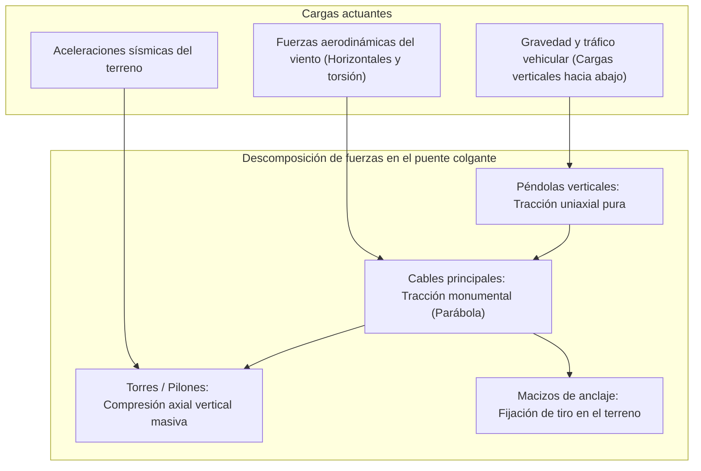
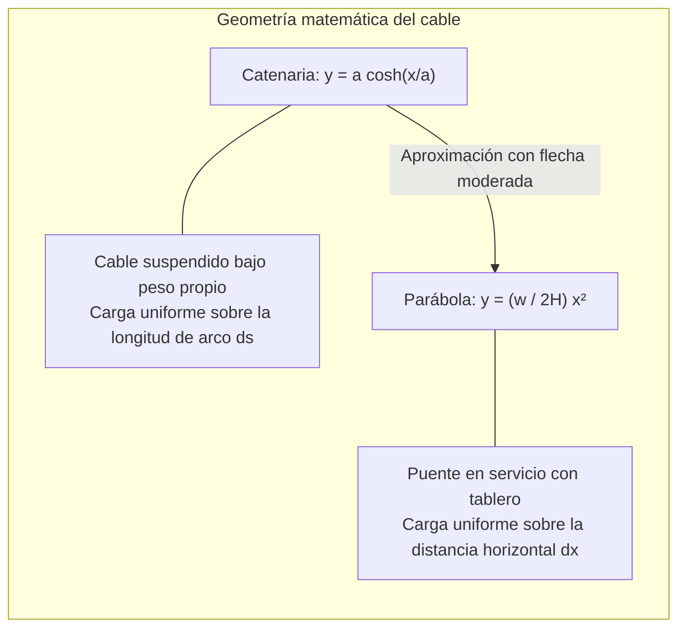
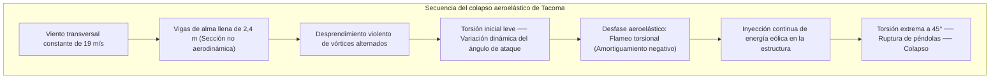

Sobre las embravecidas olas de estrechos marinos y envueltos en brumas oceánicas, los pilares colosales de un puente colgante moderno se elevan hacia el cielo. Desde sus cúspides, dos cables monumentales dibujan una parábola perfecta que sostiene en el vacío miles de toneladas de asfalto y vehículos en movimiento. Ya sea el **puente de Çanakkale 1915** en Turquía (con su récord mundial de vano principal de 2.023 metros) o el puente **Akashi Kaikyo** en Japón (1.991 metros), estas megaestructuras son el triunfo supremo de la ingeniería civil.

¿Cómo es posible que una estructura tan pesada flote sin apoyos intermedios en el agua? ¿Por qué no colapsa bajo el paso continuo de camiones pesados ni ante vientos huracanados o sismos de gran magnitud?

La respuesta no estriba en una masa pétrea inconmovible ni en una rigidez indestructible. El puente colgante triunfa porque se somete dócilmente a las leyes de la física: descompone todas las fuerzas caóticas en dos estados mecánicos puros: **tracción pura (Tension)** y **compresión axial pura (Compression)**.

---

## 1. La mecánica fundamental: desacoplamiento de tracción y compresión

Toda estructura terrestre debe equilibrar las cargas gravitatorias y ambientales para satisfacer las ecuaciones de equilibrio estático:
$$\sum \mathbf{F} = 0, \quad \sum \mathbf{M} = 0$$

En un puente de vigas convencional, la carga genera un **momento flector (Bending Moment)**: la fibra superior se comprime y la inferior se estira. Según la teoría de vigas de Euler-Bernoulli, el momento flector máximo crece con el cuadrado de la luz o vano $L$:
$$M_{\max} = \frac{w L^2}{8}$$
Si se duplica la longitud del vano, el momento flector se cuadruplica. Para resistirlo, la viga debe engrosarse tanto que su propio peso se dispara, alcanzando un punto crítico donde **la viga se quiebra bajo su propio peso muerto**. Hacia los 300 metros de luz, el puente de vigas alcanza su límite físico insalvable.

### La solución del puente colgante
Los cables de acero carecen por completo de rigidez a flexión ($EI \approx 0$). Sin embargo, bajo **tracción pura axial**, el acero trefilado de alta resistencia alcanza su límite teórico de cohesión atómica:
1. El tablero es elevado verticalmente por miles de **péndolas** (tracción pura).
2. Las péndolas transfieren la carga a los **cables principales** (tracción pura).
3. Los cables descansan sobre las monturas en lo alto de las **torres**, convirtiendo el tiro oblicuo en una carga vertical descendente transmitida al lecho rocoso (compresión pura).
4. Los extremos se fijan en gigantescos bloques de hormigón terrestres: los **macizos de anclaje**.

Sustituyendo la flexión por el binomio **tracción (cables) / compresión (torres)**, la ingeniería supera con soltura la barrera de los kilómetros.

---

## 2. Matemáticas del cable: Catenaria y Parábola

### 1. El cable libre: La Catenaria
Un cable de masa uniforme $\mu$ suspendido únicamente bajo su propio peso adopta la curva de la catenaria (coseno hiperbólico):
$$y(x) = a \cosh\left(\frac{x}{a}\right) - a, \quad a = \frac{H}{\mu g}$$

### 2. El cable cargado con el tablero: La Parábola
Cuando el pesado tablero horizontal cuelga del cable, la carga $w$ no se distribuye a lo largo del arco, sino **uniformemente sobre la distancia horizontal $dx$**. La integración diferencial conduce a una **parábola**:
$$y(x) = \frac{w}{2H} x^2$$

A partir de la luz $L$ y la flecha central $f$ ($y = f$ en $x = L/2$), se obtiene la tensión horizontal $H$:
$$H = \frac{w L^2}{8f}$$

La relación flecha-vano ($f/L$) define el equilibrio óptimo: cables muy tensos ($f \to 0$) disparan la fuerza $H$ hacia el infinito; cables demasiado colgantes exigen torres altísimas vulnerables al pandeo de Euler. El valor óptimo se sitúa entre **$1/9$ y $1/11$**.

---

## 3. La catástrofe de Tacoma Narrows (1940) y el flameo aeroelástico

El 7 de noviembre de 1940, el puente de **Tacoma Narrows** (vano de 853 metros) colapsó bajo un viento moderado de apenas **68 km/h (19 m/s)**.

El colapso no fue una simple resonancia mecánica por vórtices de Von Kármán, sino un fenómeno de **flameo aeroelástico torsional autoexcitado (Flutter)**. El viento actuó como un motor con amortiguamiento negativo, amplificando la oscilación torsional hasta que las péndolas cedieron y el tablero se precipitó al agua.

Soluciones modernas:
- **Vigas de celosía abierta**: El viento atraviesa la estructura sin generar sustentación (Akashi Kaikyo).
- **Cajón aerodinámico cerrado**: Perfil de ala de avión que previene el desprendimiento de flujo (puentes Severn, Bósforo).
- **Tablero de doble cajón con ranura central**: Regula la presión entre el intradós y el extradós (Çanakkale 1915).

---

## 4. Puente colgante vs. puente atirantado

| Criterio | Puente Colgante | Puente Atirantado |
| :--- | :--- | :--- |
| **Sistema de cables** | Cables portadores continuos con péndolas verticales | Tirantes oblicuos directos de la torre al tablero |
| **Tensión en el tablero** | Flexión local, esfuerzo axil insignificante | **Compresión horizontal axial colosal en el tablero** |
| **Macizos de anclaje** | **Obligatorios y masivos** (tiro en el suelo) | **Innecesarios** (autocombinados en el tablero) |
| **Rango de luz óptimo** | **1.000 m a más de 3.000 m** | **300 m a 1.000 m aprox.** |

Por encima de los 1.000 metros, los tirantes aplanados aplastan el tablero bajo fuerzas de compresión masivas, haciendo del **puente colgante el monarca indiscutible para luces mayores a 1.500 metros**.

---

## 5. Mantenimiento del siglo XXI

1. **Inyección de aire seco**: Se bombea aire con menos del 40% de humedad relativa dentro de los cables principales, deteniendo la corrosión electroquímica.
2. **Emisión acústica (AE)**: Sensores captan el sonido ultrasónico emitido cuando un alambre interno se quiebra por fatiga, ubicando el daño con precisión de centímetros.
3. **Gemelos digitales (Digital Twins)**: Modelos de elementos finitos actualizados en tiempo real mediante GNSS y acelerómetros simulan tensiones y guían el mantenimiento predictivo.
