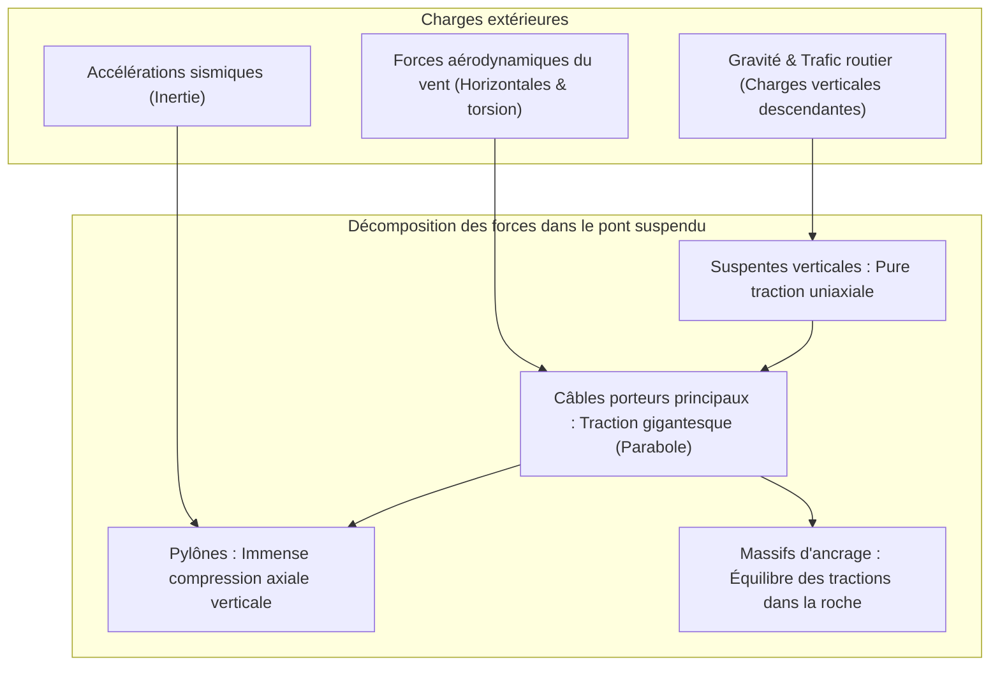
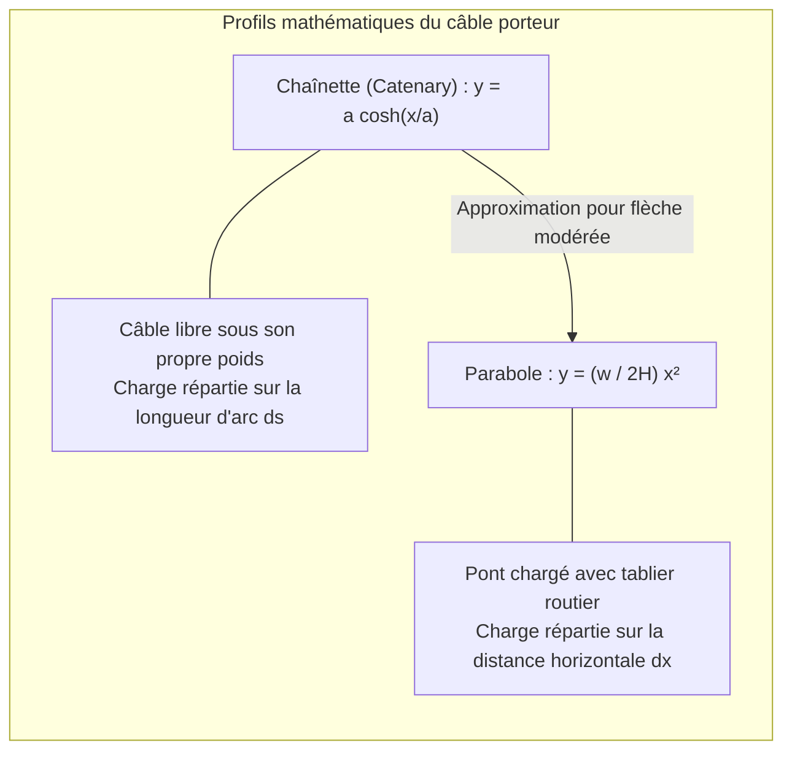
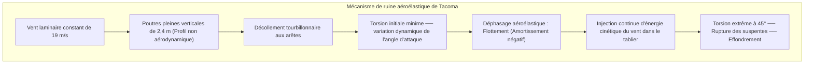

Au-dessus des courants tumultueux des détroits maritimes, les pylônes vertigineux d'un pont suspendu moderne s'élèvent vers le ciel. Depuis leurs sommets, deux câbles monumentaux décrivent une parabole parfaite à travers les nuages, soutenant au-dessus du vide un ruban continu d'asphalte et d'acier. Qu'il s'agisse du pont turc **Çanakkale 1915** (portée record mondiale de 2 023 mètres) ou du pont japonais du **détroit d'Akashi** (1 991 mètres), ces ouvrages incarnent l'apogée de l'ingénierie civile.

Comment ces structures titanesques peuvent-elles flotter sans le moindre appui intermédiaire ? Pourquoi ne rompent-elles pas sous le poids de milliers de camions ou face aux tempêtes et aux séismes majeurs ?

Leur secret ne réside pas dans une rigidité invincible, mais dans une parfaite soumission aux lois physiques : le pont suspendu décompose l'ensemble des charges chaotiques en deux états mécaniques élémentaires : **la traction pure (Tension)** et **la compression axiale pure (Compression)**.

---

## 1. La mécanique fondamentale : dissociation de la traction et de la compression

Toute structure terrestre doit équilibrer les charges gravitationnelles et environnementales afin de satisfaire aux lois de la statique :
$$\sum \mathbf{F} = 0, \quad \sum \mathbf{M} = 0$$

Dans un pont à poutres conventionnel, la charge crée un **moment fléchissant (Bending Moment)** : la fibre supérieure est comprimée tandis que la fibre inférieure est tendue. Selon la théorie des poutres d'Euler-Bernoulli, ce moment fléchissant maximal croît avec le carré de la portée $L$ :
$$M_{\max} = \frac{w L^2}{8}$$
Doubler la longueur quadruple le moment fléchissant. Pour y résister, la poutre doit être épaissie, ce qui augmente son poids propre jusqu'au point critique où **la poutre s'effondre sous sa propre masse**. Vers 300 mètres de portée, le pont à poutres atteint sa limite physique absolue.

### La solution du pont suspendu
Les câbles d'acier ne possèdent aucune rigidité en flexion ($EI \approx 0$). En revanche, soumis à une **traction pure axiale**, l'acier tréfilé à haute résistance approche la limite théorique de cohésion atomique du métal :
1. Le tablier est soutenu par des **suspentes verticales** (traction pure).
2. Les suspentes transfèrent la charge aux deux **câbles porteurs principaux** (traction pure).
3. Les câbles reposent sur les selles au sommet des **pylônes**, transformant la traction oblique en une charge verticale transmise au socle rocheux (compression pure).
4. Les extrémités sont scellées dans d'immenses blocs de béton terrestres, les **massifs d'ancrage** (Anchorages).

En substituant la flexion destructrice par le couple **traction (câbles) / compression (pylônes)**, les portées franchissent sans encombre le cap des kilomètres.

---

## 2. Mathématiques du câble : Chaînette et Parabole

### 1. Le câble libre sous son propre poids : La Chaînette
Pour un câble homogène de masse linéique $\mu$ suspendu librement dans la gravité, la charge s'applique le long de son arc $ds$. La résolution différentielle donne la chaînette :
$$y(x) = a \cosh\left(\frac{x}{a}\right) - a, \quad a = \frac{H}{\mu g}$$

### 2. Le câble portant le tablier : La Parabole
Lorsque le lourd tablier horizontal est suspendu aux câbles, la charge $w$ est répartie non plus selon l'arc, mais **uniformément selon l'abscisse horizontale $dx$**. L'équation différentielle s'écrit :
$$\frac{dy}{dx} = \frac{w x}{H}$$
Son intégration donne une **parabole** :
$$y(x) = \frac{w}{2H} x^2$$

En reliant la portée $L$ et la flèche centrale $f$ ($y = f$ en $x = L/2$), on obtient la tension horizontale $H$ :
$$H = \frac{w L^2}{8f}$$

Ce ratio flèche/portée ($f/L$) est le nœud de l'optimisation : si le câble est trop tendu ($f \to 0$), la force $H$ tend vers l'infini ; si la flèche est trop grande, les pylônes doivent être démesurément hauts, risquant le flambement d'Euler. La valeur optimale se situe entre **$1/9$ et $1/11$**.

---

## 3. La leçon de Tacoma Narrows (1940) et le flottement aéroélastique

Le 7 novembre 1940, le pont suspendu de **Tacoma Narrows** (portée de 853 mètres) s'est effondré sous un vent modéré de **68 km/h (19 m/s)**.

### Le phénomène : Flottement aéroélastique instable (Flutter)
Contrairement à la légende de la simple résonance aux tourbillons de Karman, l'effondrement a été causé par un **flottement aéroélastique torsionnel auto-excité**.
Les poutres latérales pleines créaient un décollement violent de la veine d'air. Lorsque le pont oscillait en torsion, les forces aérodynamiques agissaient avec un retard de phase par rapport au déplacement : l'air agissait comme un moteur à **amortissement négatif**, pompant l'énergie cinétique du vent directement dans la structure jusqu'à provoquer des oscillations de $45^\circ$ et la rupture des suspentes.

Les réponses modernes de l'ingénierie :
- **Poutres en treillis ajouré** : L'air circule librement sans portance (pont d'Akashi).
- **Caissons profilés fermés (Streamlined Box)** : Profil en aile d'avion qui supprime les tourbillons (pont Severn).
- **Tabliers à double caisson avec fente centrale** : Égalisation des pressions d'intrados et d'extrados (pont Çanakkale 1915).

---

## 4. Pont suspendu contre pont à haubans

| Critère | Pont suspendu | Pont à haubans |
| :--- | :--- | :--- |
| **Système de câbles** | Câbles porteurs continus avec suspentes verticales | Câbles inclinés reliant directement le mât au tablier |
| **Contrainte dans le tablier** | Flexion locale modérée, effort axial quasi nul | **Effort axial de compression horizontale gigantesque** |
| **Massifs d'ancrage** | **Indispensables et massifs** (retenue dans le sol) | **Inutiles** (forces horizontales auto-équilibrées dans le tablier) |
| **Domaine de portée** | **1 000 m à plus de 3 000 m** | **300 m à environ 1 000 m** |

Au-delà de 1 000 mètres, l'angle trop faible des haubans écrase littéralement le tablier sous une poussée compressive destructrice. Pour franchir 2 kilomètres de mer, le **pont suspendu reste le souverain incontesté**.

---

## 5. Maintenance prédictive moderne

1. **Injection d'air sec** : De l'air déshumidifié à moins de $40\%$ d'humidité relative est continuellement injecté au cœur des câbles, stoppant nette l'oxydation électrochimique des fils d'acier.
2. **Surveillance par émission acoustique (AE)** : Des capteurs piézoélectriques détectent instantanément l'onde de choc produite par la rupture d'un fil individuel parmi les 30 000 du câble, localisant la fatigue au centimètre près.
3. **Jumeaux numériques (Digital Twins)** : Des modèles par éléments finis mis à jour en temps réel par GPS et capteurs optiques anticipent les contraintes extrêmes et guident la maintenance préventive.
