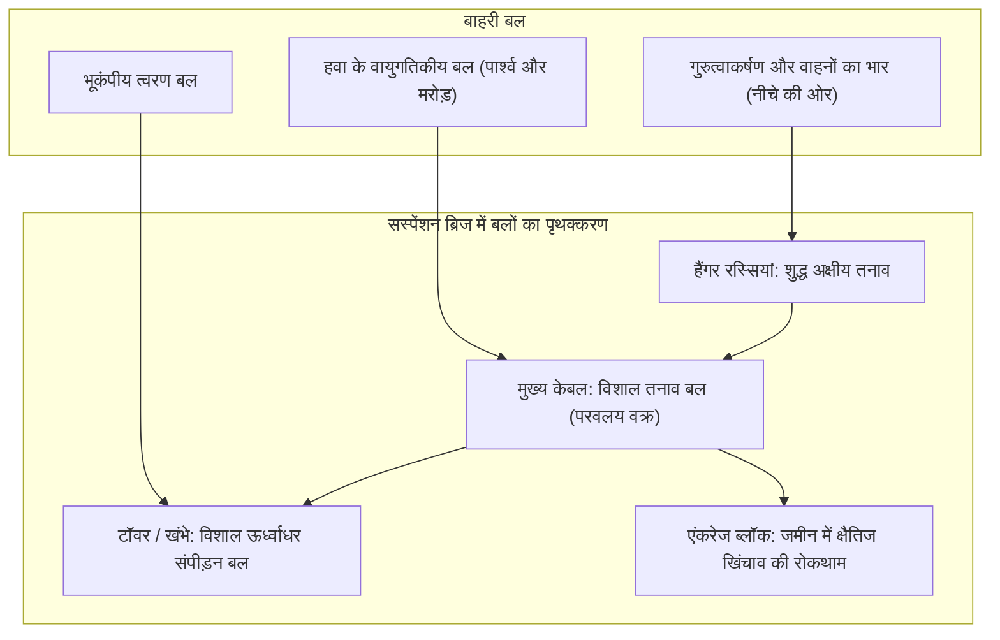
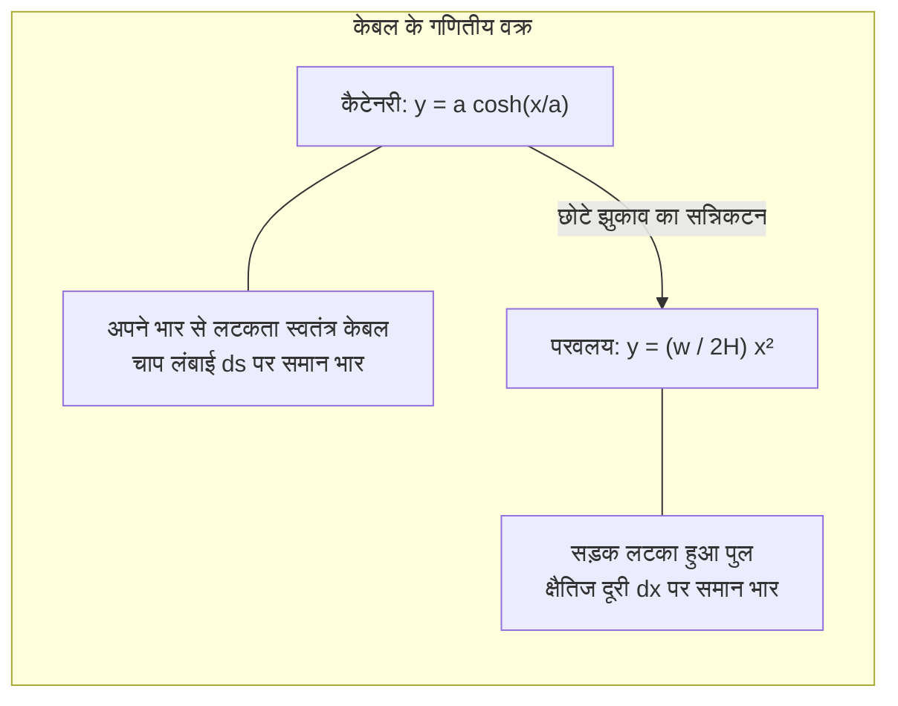
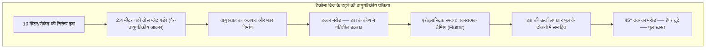

समुद्र की उफनती लहरों और कोहरे के ऊपर आधुनिक सस्पेंशन ब्रिज (झूला पुल) के विशालकाय स्टील टॉवर आसमान की ऊंचाइयों को छूते हैं। उनके शिखरों से दो विशाल मुख्य केबल एक सुरम्य परवलयाकार वक्र बनाते हैं, जिसके नीचे कंक्रीट और स्टील का चौड़ा राजमार्ग हवा में तैरता रहता है। तुर्की के **1915 चाणक्कले ब्रिज** (2,023 मीटर का विश्व रिकॉर्ड स्पैन) से लेकर जापान के **आकाशी कैक्यो ब्रिज** (1,991 मीटर) तक, ये विशाल संरचनाएं सिविल इंजीनियरिंग के शिखर हैं।

समुद्र के बीच में एक भी खंभा न होने पर भी हजारों टन भारी सड़क नीचे क्यों नहीं गिरती? ट्रकों के भारी दबाव और भीषण तूफानी हवाओं में भी यह पुल टूटकर क्यों नहीं बिखरता?

इसका उत्तर भारी-भरकम पत्थरों की कठोरता में नहीं, बल्कि भौतिकी के नियमों के सामंजस्यपूर्ण समर्पण में है। सस्पेंशन ब्रिज प्रकृति के जटिल बलों को दो मूल रूपों में अलग करता है: **शुद्ध तनाव (Tension)** और **शुद्ध संपीड़न (Compression)**।

---

## 1. पुल यांत्रिकी का मूल सिद्धांत: तनाव और संपीड़न का पृथक्करण

पृथ्वी के गुरुत्वाकर्षण क्षेत्र में किसी भी संरचना को स्थिर रहने के लिए स्थैतिक संतुलन बनाए रखना अनिवार्य है:
$$\sum \mathbf{F} = 0, \quad \sum \mathbf{M} = 0$$

पारंपरिक बीम पुलों में नीचे की ओर लगने वाला भार **बेंडिंग मोमेंट (झुकने का आघूर्ण)** उत्पन्न करता है: बीम का ऊपरी भाग सिकुड़ता है (संपीड़न) और निचला भाग खिंचता है (तनाव)। यूलर-बर्नोली बीम सिद्धांत के अनुसार अधिकतम बेंडिंग मोमेंट स्पैन $L$ के वर्ग के अनुपात में बढ़ता है:
$$M_{\max} = \frac{w L^2}{8}$$
यदि स्पैन को दोगुना किया जाए, तो बेंडिंग मोमेंट चार गुना बढ़ जाता है। इसे सहने के लिए बीम को इतना मोटा करना पड़ता है कि वह **अपने ही वजन (डेड लोड) के कारण टूटकर गिर जाता है**। 300 मीटर के आसपास बीम ब्रिज अपनी भौतिक सीमा तक पहुंच जाते हैं।

### सस्पेंशन ब्रिज का समाधान
लचीले स्टील केबलों में मुड़ने की क्षमता शून्य होती है ($EI \approx 0$)। लेकिन जब उन पर **अक्षीय खिंचाव (तनाव)** लगाया जाता है, तो हाई-टेन्साइल स्टील धातु के परमाणुओं की चरम क्षमता तक भार सहन कर सकता है:
1. सड़क का भार ऊर्ध्वाधर **हैंगर रस्सियों** द्वारा ऊपर खींचा जाता है (शुद्ध तनाव)।
2. हैंगर यह भार **मुख्य केबलों** को सौंपते हैं (शुद्ध तनाव)।
3. केबल **टॉवरों** के शीर्ष से गुजरते हुए तिरछे तनाव को सीधे नीचे की ओर दबाने वाले भार में बदल देते हैं (शुद्ध संपीड़न)।
4. केबल के सिरों को दोनों किनारों पर लाखों टन भारी कंक्रीट के **एंकरेज** में मजबूती से बांध दिया जाता है।

---

## 2. केबल का गणित: कैटेनरी और परवलय

- **कैटेनरी वक्र (Catenary)**: अपने भार से लटके स्वतंत्र केबल का आकार: $y(x) = a \cosh(x/a) - a$।
- **परवलय (Parabola)**: भारी क्षैतिज सड़क का भार उठाने वाले केबल का आकार: $y(x) = \frac{w}{2H} x^2$।
- **क्षैतिज तनाव**: $H = \frac{w L^2}{8f}$। झुकाव और स्पैन का आदर्श अनुपात ($f/L$) **$1/9$ से $1/11$** के बीच रखा जाता है।

---

## 3. टैकोमा नैरो ब्रिज का हादसा (1940) और एरोइलास्टिक स्पंदन

7 नवंबर 1940 को अमेरिका का **टैकोमा नैरो ब्रिज** (853 मीटर स्पैन) मात्र **68 किमी/घंटा (19 मीटर/सेकंड)** की मध्यम हवा में हिचकोले खाते हुए ढह गया।

यह हादसा केवल साधारण रेजोनेंस नहीं था, बल्कि **एरोइलास्टिक टॉर्सनल फ्लटर (Aeroelastic Flutter)** था: हवा ने नकारात्मक डैम्पिंग की तरह काम किया और दोलनों को तब तक बढ़ाया जब तक तार टूट नहीं गए।

आधुनिक समाधान: जालीदार ट्रस गर्डर (आकाशी कैक्यो), एरोडायनामिक बॉक्स गर्डर (सेवर्न ब्रिज), और बीच में स्लॉट वाले ट्विन बॉक्स गर्डर (चाणक्कले 1915)।

---

## 4. सस्पेंशन ब्रिज बनाम केबल-स्टेड ब्रिज

| पैरामीटर | सस्पेंशन ब्रिज (झूला पुल) | केबल-स्टेड ब्रिज |
| :--- | :--- | :--- |
| **केबल संरचना** | मुख्य केबल से लटके ऊर्ध्वाधर हैंगर | टॉवर से सीधे सड़क तक फैले तिरछे केबल |
| **सड़क में तनाव** | हल्का स्थानीय झुकाव, नगण्य अक्षीय बल | **सड़क पर अत्यधिक क्षैतिज संपीड़न (दबाव) बल** |
| **एंकरेज की जरूरत** | **अनिवार्य और विशालकाय** | **आवश्यक नहीं** (बल सड़क के भीतर ही संतुलित होते हैं) |
| **सर्वोत्तम स्पैन दूरी** | **1,000 मीटर से 3,000+ मीटर तक** | **300 मीटर से लगभग 1,000 मीटर** |

1,000 मीटर से अधिक लंबाई होने पर तिरछे केबल सड़क को इतनी बुरी तरह दबाते हैं कि सड़क टूट सकती है। इसलिए **1.5 किमी से अधिक लंबे समुद्री रास्तों के लिए सस्पेंशन ब्रिज ही एकमात्र विकल्प है**।

---

## 5. आधुनिक रखरखाव तकनीकें

1. **ड्राई एयर इंजेक्शन**: मुख्य केबल के अंदर 40% से कम नमी वाली सूखी हवा लगातार प्रवाहित की जाती है, जिससे जंग लगने का खतरा शून्य हो जाता है।
2. **ध्वनिक उत्सर्जन (Acoustic Emission)**: जब हजारों तारों में से एक भी तार टूटता है, तो अल्ट्रासोनिक ध्वनि सेंसर तुरंत कुछ ही सेंटीमीटर की सटीकता से खराबी का पता लगा लेते हैं।
3. **डिजिटल ट्विन (Digital Twin)**: हजारों सेंसर सुपरकंप्यूटर से जुड़े होते हैं जो भूकंप और तूफानों के दौरान पुल के तनाव की रीयल-टाइम भविष्यवाणी करते हैं।
