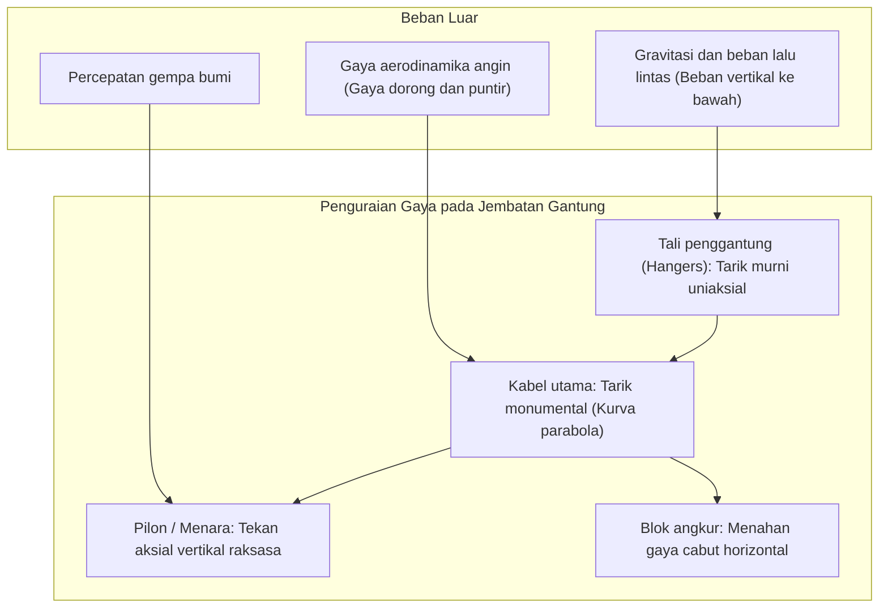
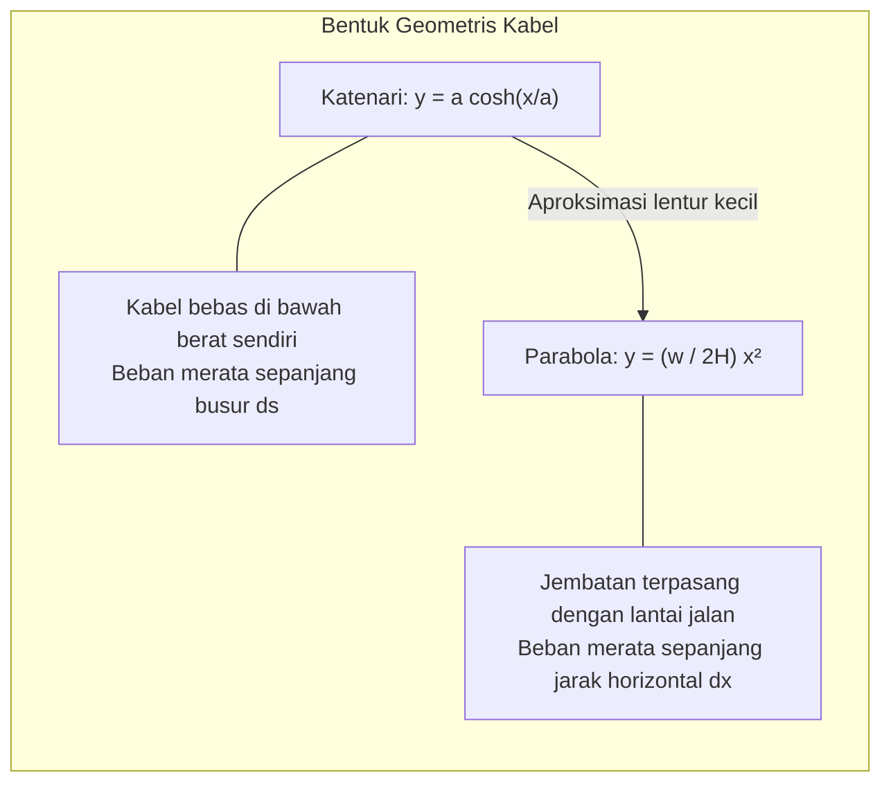
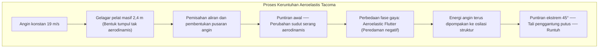

Di atas gelombang selat laut yang bergolak, menembus kabut samudra, menara-menara baja jembatan gantung modern menjulang tinggi ke angkasa. Dari puncaknya, kabel-kabel baja raksasa melengkung membentuk parabola anggun, menopang ribuan ton aspal dan arus kendaraan yang melayang puluhan meter di atas permukaan laut. Dari **Jembatan 1915 Çanakkale** di Turki (rekor dunia bentang utama 2.023 meter) hingga **Jembatan Akashi Kaikyo** di Jepang (1.991 meter), struktur-struktur ini adalah mahakarya teknik sipil terbesar umat manusia.

Bagaimana mungkin jalan raya baja seberat puluhan ribu ton dapat menggantung di udara tanpa tiang penyangga di tengah laut? Mengapa jembatan ini tidak patah saat diterpa badai topan dahsyat atau gempa bumi hebat?

Kuncinya bukan terletak pada ketebalan material yang kaku, melainkan pada ketundukan anggun terhadap hukum alam: jembatan gantung mengurai gaya-gaya destruktif menjadi dua kondisi mekanis murni: **gaya tarik murni (Tension)** dan **gaya tekan aksial murni (Compression)**.

---

## 1. Mekanika Dasar: Memisahkan Tarik dan Tekan

Setiap struktur di bumi harus menyeimbangkan gaya gravitasi dan beban lingkungan untuk memenuhi hukum kesetimbangan statis:
$$\sum \mathbf{F} = 0, \quad \sum \mathbf{M} = 0$$

Pada jembatan gelagar konvensional, beban menghasilkan **momen lentur (Bending Moment)**: bagian atas tertekan dan bagian bawah tertarik. Berdasarkan teori balok Euler-Bernoulli, momen lentur maksimum meningkat sebanding dengan kuadrat panjang bentang $L$:
$$M_{\max} = \frac{w L^2}{8}$$
Jika bentang dilipatgandakan, momen lentur melonjak empat kali lipat. Akibatnya, balok harus dibuat semakin tebal hingga akhirnya **runtuh akibat berat sendirinya**. Pada bentang sekitar 300 meter, jembatan balok mencapai batas fisika absolutnya.

### Solusi Jembatan Gantung
Kabel kawat baja tidak memiliki ketahanan lentur ($EI \approx 0$). Namun, di bawah **tarik aksial murni**, baja mutu tinggi mencapai batas teoritis ikatan antaratom logam:
1. Beban lantai jembatan ditarik ke atas oleh **tali penggantung** (tarik murni).
2. Tali penggantung menyalurkan beban ke **kabel utama** (tarik murni).
3. Kabel melintasi sadel di puncak **menara**, mengubah tarikan miring menjadi gaya tekan vertikal yang disalurkan langsung ke batuan dasar laut (tekan murni).
4. Ujung kabel dikunci pada **blok angkur** beton raksasa di daratan.

---

## 2. Matematika Kabel: Katenari dan Parabola

- **Katenari**: Bentuk kabel yang menggantung bebas di bawah berat sendirinya: $y(x) = a \cosh(x/a) - a$.
- **Parabola**: Bentuk kabel setelah menopang lantai jembatan horizontal merata $w$: $y(x) = \frac{w}{2H} x^2$.
- **Tegangan Horizontal**: $H = \frac{w L^2}{8f}$. Rasio lendutan terhadap bentang ($f/L$) optimal dirancang pada kisaran **$1/9 \sim 1/11$**.

---

## 3. Tragedi Tacoma Narrows (1940) dan Aeroelastic Flutter

Pada 7 November 1940, jembatan **Tacoma Narrows** (bentang 853 meter) runtuh akibat angin berkecepatan sedang yang hanya mencapai **68 km/jam (19 m/s)**.

Penyebab utamanya adalah **flutter puntir aeroelastis**: gelagar pelat pejal menyebabkan pemisahan aliran udara, dan gaya angkat aerodinamis bekerja dengan keterlambatan fase, bertindak sebagai peredaman negatif yang menyuntikkan energi angin hingga struktur hancur berkeping-keping.

Inovasi modern: gelagar rangka terbuka (Akashi Kaikyo), gelagar kotak aerodinamis streamlined (Severn), dan gelagar kotak ganda berventilasi tengah (Çanakkale 1915).

---

## 4. Jembatan Gantung vs. Jembatan Kabel Pancang

| Parameter | Jembatan Gantung | Jembatan Kabel Pancang (Cable-Stayed) |
| :--- | :--- | :--- |
| **Konfigurasi Kabel** | Kabel utama kontinu dengan penggantung vertikal | Kabel diagonal langsung dari pilon ke gelagar |
| **Tegangan Gelagar** | Lentur lokal kecil, gaya aksial minimal | **Gaya tekan aksial horizontal yang sangat masif** |
| **Kebutuhan Angkur** | **Wajib dan berukuran raksasa** | **Tidak perlu** (gaya kabel saling meniadakan di gelagar) |
| **Rentang Bentang Optimal** | **1.000 m hingga lebih dari 3.000 m** | **300 m hingga sekitar 1.000 m** |

Di atas 1.000 meter, sudut kabel pancang yang landai menekan gelagar dengan gaya horizontal yang dapat menghancurkan gelagar, menjadikan **jembatan gantung penguasa mutlak untuk bentang super panjang**.

---

## 5. Pemeliharaan Mutakhir

1. **Injeksi Udara Kering**: Udara berkelembapan relatif di bawah 40% dialirkan ke dalam kabel utama, menghentikan korosi kawat baja secara permanen.
2. **Pemantauan Emisi Akustik (AE)**: Sensor piezoelektrik mendeteksi gelombang mikro-suara saat seutas kawat baja putus akibat kelelahan logam, melacak lokasi kerusakan dalam skala sentimeter.
3. **Digital Twin**: Model elemen hingga berbasis komputasi awan yang terhubung dengan ribuan sensor memprediksi tegangan struktur secara real-time.
