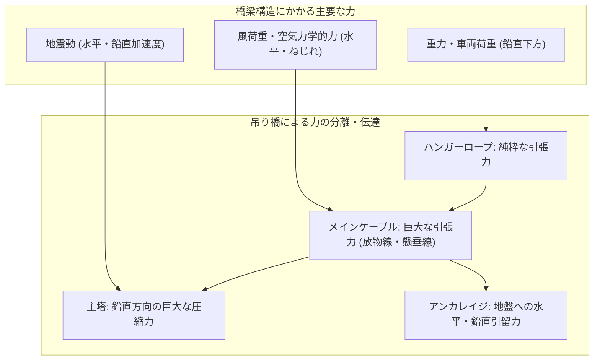
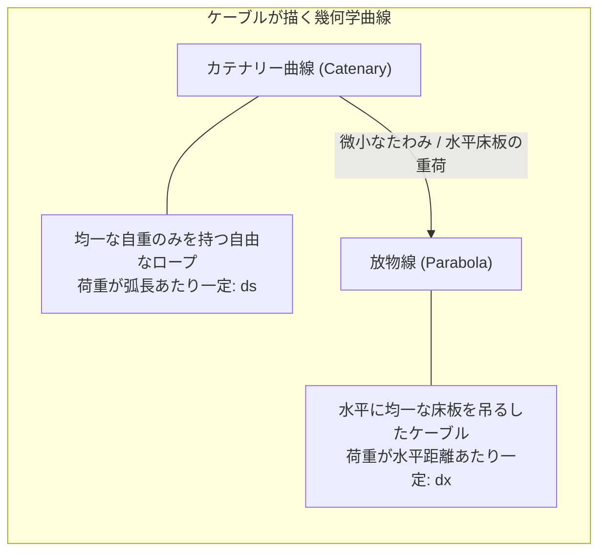
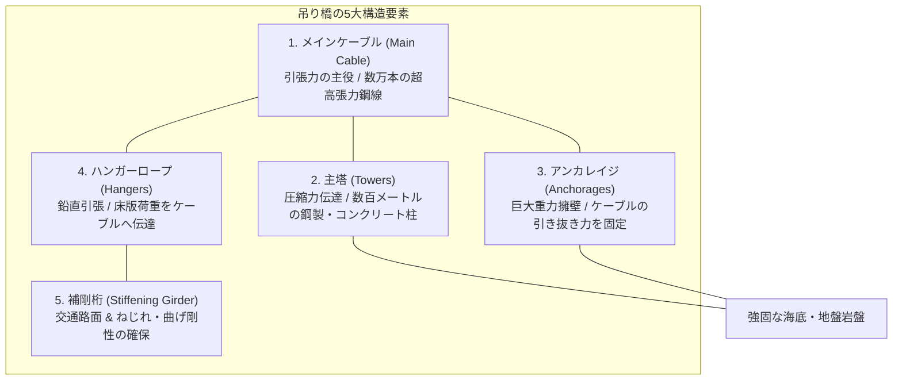
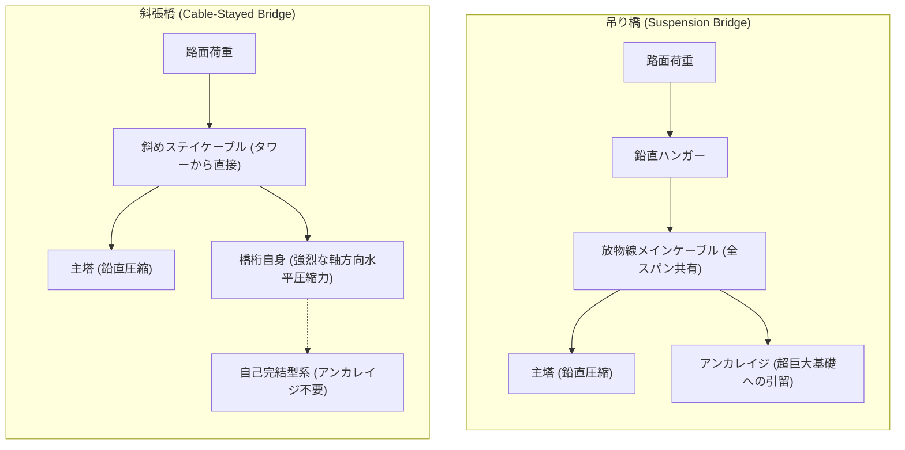
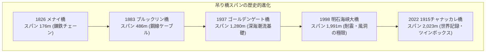
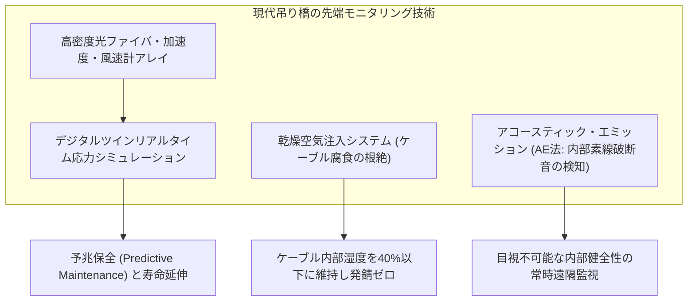

海峡の荒波を見下ろし、霧を突いて天空へとそびえる巨大な主塔。そこから優美な弧を描いて垂れ下がる極太のケーブルと、無数のワイヤーによって海面数十メートルの上空に浮遊するアスファルトの道路――。近代の「吊り橋（Suspension Bridge）」は、人類が築き上げた構造物の中でも最も壮大であり、力学の極限を体現する土木工学のモニュメントです。

世界最長の吊り橋であるトルコの「1915チャナッカレ橋」（中央径間2,023m）や、日本の誇る「明石海峡大橋」（中央径間1,991m）を目にするとき、誰もが根源的な疑問を抱きます。

「中間に一本の橋脚もないのに、なぜこれほど重い鋼鉄の道路が落ちないのか？」
「大型トラックが何千台も走り、大型台風の暴風が吹き荒れても、なぜ橋はへし折れないのか？」

その答えは、自然界の力学に対する徹底的な「従順」と「幾何学的秩序」にあります。吊り橋は、力に対して力で力任せに突っ張る構造ではありません。むしろ、重力と風の力を巧みに受け流し、極めてシンプルな2つの力――「<strong>引張力（Tension）</strong>」と「<strong>圧縮力（Compression）</strong>」――へと分解・純化して地球そのものへと逃がす、究極のエネルギー分散システムなのです。

本稿では、吊り橋が成立する数学的・力学的原理から、死荷重と活荷重を支えるケーブルの幾何学、歴史を揺るがした「タコマナローズ橋の崩壊」と流体力学の克服、斜張橋との決定的な違い、そして現代の超長大橋を支える最新のメンテナンス工学までを徹底的に解き明かします。

---

## 1. 橋の基本力学：引張と圧縮の分離

あらゆる構造物は、地球の重力場に存在する限り、下向きの荷重を受けます。橋が崩壊せずに架かり続けるための条件は、橋にかかるすべての力（下向きの荷重、横からの風、地震の揺れ）に対して、支点が押し返す力（反力）を正確にバランスさせ、「<strong>力のつり合い（Static Equilibrium）</strong>」を保つことです。

力学的に見ると、構造部材に生じる力は主に以下の3つに大別されます。
1. **圧縮力（Compression）**：部材を押し縮めようとする力。
2. **引張力（Tension）**：部材を引き伸ばそうとする力。
3. <strong>曲げモーメント（Bending Moment）</strong>および<strong>せん断力（Shear Force）</strong>：部材を曲げたり、断ち切ろうとする力。



### 1.1 ビーム橋の限界と「曲げ」のペナルティ
最も原始的な橋は、川の両岸に丸太や石板を渡しただけの「桁橋（ビーム橋）」です。
桁橋に上から荷重 $P$ がかかると、橋桁の中央部は下に向かってたわみます。このとき、桁の上側には部材を押し縮める<strong>圧縮力</strong>が働き、下側には部材を引き裂こうとする<strong>引張力</strong>が働きます。すなわち、部材の断面内で「曲げモーメント」が発生します。

材料力学において、梁の最大曲げ応力 $\sigma_{\max}$ は断面係数 $Z$ と曲げモーメント $M$ によって決まります。
$$\sigma_{\max} = \frac{M}{Z}$$

スパン長（支間長）を $L$、単位長さあたりの自重を $w$ とすると、単純梁の中央に発生する最大曲げモーメント $M_{\max}$ は以下の式で爆発的に増大します。
$$M_{\max} = \frac{w L^2}{8}$$

スパン長 $L$ が2倍になれば、自重による曲げモーメントは4倍になります。さらに長大なスパンを支えるために桁を太くすれば、自重 $w$ がさらに増加し、ついには「<strong>橋が自分自身の重み（自重）に耐えきれずに折れる</strong>」という物理的限界に達します。標準的な鋼桁橋やコンクリート桁橋の実用限界スパンが高々数百メートルにとどまるのは、この「曲げ」という非効率な力の伝達方式に原因があります。

### 1.2 吊り橋の勝利：力を「純粋な引張」へと変換する
吊り橋は、この「曲げモーメント」の呪縛を鮮やかに回避します。
吊り橋の主構造は、橋桁（路面）を支える「<strong>メインケーブル</strong>」です。ワイヤーやロープのような柔軟な線状部材は、曲げに対する抵抗力を持ちません。押せばたわみ、曲げようとしても抵抗できません。しかし、「<strong>引き伸ばす力（引張力）」に対しては、<strong>鋼材本来の理論限界に近い圧倒的な強度を発揮します</strong>。

吊り橋の基本メカニズムは以下の通りです。
1. 路面（桁）とそこを通行する車両の重量は、無数の垂直な「<strong>ハンガーロープ</strong>」によって上へと吊り上げられます。
2. ハンガーロープから伝わった荷重は、空中に張られた「<strong>メインケーブル</strong>」に集約され、ケーブル全体の張力へと変換されます。
3. メインケーブルは両端の「<strong>主塔（Tower）</strong>」の頂点を経由して大地へと引き下ろされます。
4. 主塔の頂点（サドル）において、ケーブルの斜め方向の張力は「巨大な鉛直下向きの力」へと向きを変え、主塔を純粋な<strong>圧縮力</strong>として基礎岩盤へと押し付けます。
5. ケーブルの両末端は、両岸の超巨大なコンクリート塊である「<strong>アンカレイジ（Anchorage）</strong>」に固定され、水平方向の引き抜き力は地球そのもの（強固な地盤）によって受け止められます。

このように、吊り橋は厄介な「曲げ」を排除し、「<strong>ケーブル＝純粋な引張</strong>」と「<strong>主塔＝純粋な圧縮</strong>」という、材料が最も得意とする2つの力だけに役割を純化しています。これこそが、桁橋では不可能な1,000m〜2,000m超という絶望的な長スパンを可能にする力学の真髄です。

---

## 2. ケーブルの数理：カテナリー曲線と放物線

吊り橋のメインケーブルが描く美しいカーブは、単なる視覚的デザインではありません。自然界が最小のエネルギーで荷重を支えようとするときに自発的に生み出す数学的な曲線です。

吊り橋のケーブル形状を論じる際、物理学と工学において重要な2つの曲線が存在します。それが「<strong>カテナリー曲線（懸垂線）</strong>」と「<strong>放物線（パラボラ）</strong>」です。



### 2.1 均一な自重がつくる「カテナリー曲線（懸垂線）」
重力場において、密度が均一で柔軟なロープの両端を固定して垂らしたときに形成される形状はカテナリー曲線（Catenary）と呼ばれます。

単位長さあたりのロープの質量を $\rho$、重力加速度を $g$、ロープ最下点における水平張力を $H$ と置きます。ロープの微小区間 $ds$ における力のつり合いを解くと、以下の微分方程式が得られます。
$$\frac{dy}{dx} = \frac{\rho g}{H} s$$
ここで $ds = \sqrt{1 + (dy/dx)^2} dx$ であるため、これを積分することで導かれるのが双曲線余弦関数（$\cosh$）です。
$$y(x) = a \cosh\left(\frac{x}{a}\right) = \frac{a}{2} \left( e^{x/a} + e^{-x/a} \right)$$
（ただし $a = \frac{H}{\rho g}$ であり、最下点の曲率半径に相当します）

電線や建設中のメインケーブル単体など、「自重のみが作用し、荷重がケーブルの弧長 $s$ に沿って均一に分布する場合」は、厳密にこのカテナリー曲線を描きます。

### 2.2 床板を吊り下げた吊り橋の形状「放物線」
しかし、実際の完成した吊り橋において、ケーブル自身の重さよりも、吊り下げられている「道路（補剛桁）と車両」の重さの方が圧倒的に大きくなります。
路面は水平に伸びているため、この荷重は「ケーブルの弧長 $s$ に沿って」ではなく、「<strong>水平距離 $x$ に対して均一</strong>」にかかります。

水平単位長さあたりの全荷重を $w$（一定）と仮定し、橋の中央最下点を原点 $(0, 0)$ とする座標系を取ります。原点から水平距離 $x$ までの微小区間に作用する鉛直下向きの総荷重は $W = w x$ です。

最下点での水平張力を $H$、点 $(x, y)$ でのケーブルの傾きを $\frac{dy}{dx}$ とすると、力のつり合いより：
$$\frac{dy}{dx} = \frac{w x}{H}$$

この微分方程式を積分すると、極めてシンプルな2次関数――すなわち<strong>放物線（Parabola）</strong>が導かれます。
$$y(x) = \frac{w}{2H} x^2$$

橋のスパン中央の垂れ下がり量（サグ量）を $f$、主塔間のスパン長を $L$ とすると、主塔位置 $x = L/2$ において $y = f$ となるため：
$$f = \frac{w (L/2)^2}{2H} = \frac{w L^2}{8H}$$

ここから、ケーブルの水平張力 $H$ を求める決定的な公式が得られます。
$$H = \frac{w L^2}{8f}$$

```
   主塔                                             主塔
    |                                               |
    |====\                                     /====|
    |     \                                   /     |
    |      \                                 /      |
    |       \               サグ量 f        /       |
    |--------\-------------v---------------/--------|
    |         \           ~~~             /         |
    |          \_________________________/          |
    |<------------------- スパン L ---------------->|
```

この式は、吊り橋工学における極めて重大なトレードオフを示しています。
- **サグ比（$n = f/L$）の影響**：
  サグ量 $f$ を大きくすれば（ケーブルを深く垂れ下がらせれば）、水平張力 $H$ は小さくなります。しかし、ケーブル長が長くなり、主塔の高さを極端に高くしなければならず、主塔の建設コストと風荷重が増大します。
  逆に、サグ量 $f$ を小さくして橋を平坦に近づけると、分母の $f$ が小さくなるため、ケーブルにかかる水平張力 $H$ は天文学的な大きさに跳ね上がります。

現代の吊り橋工学では、ケーブル張力と主塔高さの経済的バランスから、サグ比 $f/L$ は<strong>およそ $1/9 \sim 1/11$（約10分の1）</strong>に設計されるのが黄金律となっています。

---

## 3. 巨大吊り橋を構成する5大要素とその工学

吊り橋の全体系は、極限の荷重を支え合う5つの主要構造要素から構成されています。これらの一つでも破断すれば、橋全体が致命的な連鎖崩壊を起こします。



### 3.1 メインケーブル：地上最強の鋼鉄の束
吊り橋の心臓部がメインケーブルです。明石海峡大橋のメインケーブルは直径約1.12メートルにおよび、1本当たり約6万トン（両側2本で12万トン）の張力を常時支えています。

この巨大なケーブルは、一本の太い極太鋼棒ではありません。なぜなら、極太の鉄塊は内部に鋳造欠陥が生じやすく、柔軟性がないため曲げることができないからです。
メインケーブルは、<strong>直径約5ミリメートルの超高張力亜鉛めっき鋼線（ピアノ線）を数万本束ねたもの</strong>です。

- **引張強度の進化**：
  普通の建築用鋼材の引張強度は約 $400 \sim 500\text{ MPa}$ ですが、明石海峡大橋のために開発された鋼線は、炭素鋼にシリコンを添加して熱処理を施すことで、<strong>$1,800\text{ MPa}$（$1\text{ mm}^2$ あたり約180kgの重量を吊るせる強度）</strong>という驚異的な強度を達成しました。さらに最新のチャナッカレ橋では、<strong>$1,960\text{ MPa} \sim 2,000\text{ MPa}$ 級</strong>の超高強度線が実用化されています。

- **エアスピニング（AS）工法 vs プレハブ平行ワイヤーストランド（PPWS）工法**：
  ケーブルの架設方法には歴史的に2つの工法が存在します。
  1. **エアスピニング（AS）工法**：空中に張り渡したキャットウォーク（作業足場）上で、糸車のようなホイールを往復させ、数百本のワイヤーを現場で直接引き込みながら束ねていく伝統的工法（ブルックリン橋、ゴールデンゲート橋などで採用）。
  2. **PPWS工法**：工場であらかじめ127本などの鋼線を六角形に束ねたストランド（小束）をリールに巻いて現場に搬送し、それを現場で高精度に架設・圧着する日本発の高度工業化工法。天候に左右されにくく、極めて高い張力精度を誇ります。

束ねられた数万本のワイヤーは、油圧ジャッキ（ラッピングマシーン）によって円形に締め固められ、防食用の亜鉛めっき塗装と高密度のワイヤーラッピング、さらには内部に乾燥空気を送り込み続ける除湿換気システムによって、半永久的な防錆が図られています。

### 3.2 主塔：数万トンの鉛直荷重を受け止める背骨
主塔は、ケーブルから伝わる鉛直方向の莫大な圧縮力を受け止め、基礎岩盤へと伝える支柱です。明石海峡大橋の主塔の高さは海面上約298メートルにおよび、あべのハルカスや東京タワーに匹敵します。

主塔設計における最大の敵は「<strong>座屈（Buckling）</strong>」です。細長く高い柱に巨大な圧縮力が加わると、材料の圧縮破壊限界よりもはるかに低い荷重で、柱が横方向にくの字に折れ曲がる現象が発生します。
オイラーの座屈荷重の式：
$$P_{cr} = \frac{\pi^2 E I}{(K L)^2}$$
（$E$: ヤング率、$I$: 断面二次モーメント、$L$: 塔高、$K$: 境界条件係数）

これに対抗するため、主塔は一枚の板ではなく、肉厚の鋼板をボックス状に溶接した「鋼製中空セル構造」や「鉄筋コンクリート中空構造」とし、内部に無数のリブ（補強材）とダイヤフラム（仕切り板）を配置することで、軽量化と超高剛性を両立させています。

### 3.3 アンカレイジ：地球を掴む超巨大カウンターウェイト
メインケーブルにかかる数万トンの水平張力を最終的に食い止めているのが、橋の両端に位置する「アンカレイジ（係留地盤）」です。
もしアンカレイジが数センチメートルでも動けば、中央スパンのケーブルはたわみ、橋桁は水面へと沈み込んでしまいます。

アンカレイジには主に2つの形式があります。
1. **重力式アンカレイジ**：数十万トンから百万トンにおよぶ巨大なコンクリートブロックを築造し、「<strong>その途方もない自重と地盤との摩擦力</strong>」だけでケーブルの引張力に抵抗する構造。明石海峡大橋の神戸側アンカレイジ（4A）は、自重約140万トンのコンクリートが使用されており、世界最大の人工構造物の一つです。
2. **トンネル式（岩盤定着式）アンカレイジ**：両岸が強固な花崗岩などの硬質岩盤である場合、岩盤深くに斜めのトンネルを掘り進め、その奥底にアンカーフレームをコンクリートで固め、天然の山そのものの重量でケーブルを引き留める方式。

ケーブルの素線は、アンカレイジ内部で「スプレッダーサドル」によって扇状に広げられ、地中深くに埋め込まれた鋼製アンカーフレームに一本ずつ強固に緊結されています。

### 3.4 補剛桁（Stiffening Girder）：車を通し、ねじれに耐える
メインケーブルに吊り下げられる道路部分は「補剛桁」と呼ばれます。
補剛桁の役割は、単に車両を通す床板（床版）を提供するだけではありません。橋にかかる局所的な車両荷重を分散させてケーブルに均等に伝えるとともに、<strong>暴風による「曲げ」と「ねじれ」に抵抗する剛性を発揮すること</strong>が最大の任務です。

---

## 4. 歴史の特異点：タコマナローズ橋の崩壊と空力弾性学

吊り橋の力学の歴史を語る上で、決して避けて通れない壊滅的な悲劇があります。1940年11月7日、アメリカ・ワシントン州で発生した「<strong>タコマナローズ橋（初代）の崩壊</strong>」です。

完成からわずか4ヶ月、中央径間853mという当時世界第3位の規模を誇った最新鋭の吊り橋が、風速わずか<strong>$19\text{ m/s}$（時速約68km、中程度の強風）</strong>の風によって激しく波打ち、ついにはねじれ切れてピュージェット湾の海へと墜落しました。犠牲者（車内に取り残された犬1匹）の奇跡的な少なさと、崩壊の一部始終が鮮明なカラーフィルム映像として記録されていたことから、この事故は構造力学の世界に激震を与えました。

```
【タコマナローズ橋崩壊のメカニズム推移】
風の定常流入（風速19m/s）
   │
   ▼
深板桁（プレートガーダー）による空気剥離・渦の発生
   │
   ▼
カルマン渦の放出周波数と橋の固有振動数が接近
   │
   ▼
微小なねじれ変形が発生 ──＞ 断面形状の迎え角が周期的に変化
   │
   ▼
【自励振動（空力弾性フラッター現象）の発生】
風から橋の振動へとエネルギーが一方的に注ぎ込まれる（負の減衰）
   │
   ▼
振幅が発散（最大ねじれ角45度）──＞ センターハンガー破断 ──＞ 落橋
```

### 4.1 静的強度神話の破綻
当時の設計主幹であったレオン・モイセエフ（Leon Moisseiff）は、近代吊り橋理論の最高峰とされた「たわみ理論（Deflection Theory）」の権威でした。
たわみ理論は、「ケーブルの引張力が大きければ大きいほど、橋が変形した際にケーブル自身が復元力を発揮するため、橋桁自体の剛性は削ぎ落としても安全である」という数学的理論でした。

モイセエフはこの理論を極限まで推し進め、従来の武骨なトラス構造（骨組み構造）を廃止し、薄く優美な「<strong>プレートガーダー（鋼板で組んだ板桁、桁高わずか2.4m、幅11.9m、幅高比1:5）</strong>」を採用しました。
当時の静的力学計算において、タコマ橋は風による「静的な押し倒し力（水平抗力）」に対しては十分な安全率を持っていました。つまり、<strong>計算上は絶対に壊れないはずの橋</strong>だったのです。

### 4.2 崩壊の真犯人：空力弾性フラッター（自励振動）
長年、初等物理の教科書では「カルマン渦による共振現象」と単純化されて説明されてきましたが、現代の流体力学と構造力学では、崩壊の直接の原因は「<strong>空力弾性フラッター（Aeroelastic Flutter：特に非連成ねじれフラッター）</strong>」であったことが証明されています。

単なる「共振」であれば、風速が特定の共振速度から外れれば揺れは収まります。しかしタコマ橋で起きたのは、<strong>橋自身の揺れが空気の流れを変え、その空気の流れがさらに揺れを増幅させるという「自励振動（Self-excited Vibration）」</strong>でした。

1. **渦の発生と迎え角の変化**：
   風が平らなプレートガーダーの側面に当たると、桁の上下で空気の流れが剥離し、非対称な渦が交互に発生します。
2. **揚力とねじれモーメントの発生**：
   橋桁がわずかにねじれると、断面が飛行機の翼のようになり、空気力学的な「揚力」が発生します。
3. **位相遅れと負の減衰**：
   気流の剥離によって生じる圧力変化が、橋桁のねじれ運動に対して<strong>絶妙な時間遅れ（位相差）</strong>を持って作用しました。その結果、空気抵抗が振動を止めるブレーキ（正の減衰）として働くのではなく、「<strong>揺れを加速させるアクセル（負の減衰）</strong>」として機能してしまったのです。
4. **エネルギーの無制限注入**：
   定常的に吹く風の運動エネルギーが、ねじれ振動エネルギーへと際限なく変換され続けました。橋のねじれ角は最大で45度、左右の路面が交互に数メートルも跳ね上がる激しい振動へと発散し、限界応力を超えたハンガーロープが次々と破断してカタストロフに至りました。

### 4.3 風洞実験と流線型断面の誕生
タコマ橋の崩壊は、世界の橋梁工学を「静的構造力学」から「動的耐風工学（空力弾性学）」へと強制的に脱皮させました。
以降、長大吊り橋の設計において、以下の対策が絶対的義務となりました。

- **トラス補剛桁の採用（空気の通り道）**：
  風を遮る板状の桁をやめ、三角形の骨組みで風を通す「開口トラス構造」を採用する（明石海峡大橋など）。
- **流線型箱桁（エアロダイナミック・ボックスガーダー）**：
  イギリスのフレンズ・フリーマン（Freeman Fox & Partners）がセヴァーン橋（1966年）で初めて採用した、航空機の翼のような流線型の断面。風を滑らかにいなし、気流の剥離を抑え込む（1915チャナッカレ橋、ハンバー橋など）。
- **中央開口スリットの設置**：
  往復車線の間にグレーチング（格子状のすき間）を設け、床版の上下で圧力差が発生しないように風を逃がす構造。
- **全橋風洞実験の徹底**：
  巨大な風洞施設（日本では土木研究所の大型風洞など）に実物の縮尺模型を置き、層流・乱流・突風に対する空力係数をミリ単位で計測・検証する。

---

## 5. 吊り橋 vs 斜張橋：力学的メカニズムの対比

現代の長大橋を見渡すと、ケーブルで道路を吊る構造には「吊り橋」と「<strong>斜張橋（Cable-Stayed Bridge）</strong>」の2つの主流が存在します。横浜ベイブリッジや多々羅大橋、フランスのミヨー高架橋などは斜張橋の代表例です。両者は外見こそ似ていますが、その力学伝達経路は根本的に異なります。



### 5.1 力学特性の決定的な違い

| 比較項目 | 吊り橋（Suspension Bridge） | 斜張橋（Cable-Stayed Bridge） |
| :--- | :--- | :--- |
| <strong>ケーブルの張り方</strong> | 主塔間に垂らした主ケーブルから鉛直に吊る | 主塔から直接斜めに各床板へと放射状に張る |
| <strong>ケーブルの張力状態</strong> | 全スパンにわたって連続した引張力 | 各斜材ケーブルが独立して引張力を分担 |
| <strong>橋桁（路面）の力学状態</strong> | 主に鉛直荷重を分担（軸力は小さい） | ケーブルの斜め張力の水平分力により、<strong>強烈な水平圧縮力（軸力）</strong>を受ける |
| <strong>アンカレイジの要否</strong> | <strong>必須</strong>（ケーブル張力を大地で止める超巨大コンクリート塊が必要） | <strong>原則不要</strong>（斜め張力の水平分力を橋桁自身が圧縮力として相殺する「自己釣り合い系」） |
| <strong>構造剛性（変形量）</strong> | 柔軟（風や活荷重でたわみやすい） | 高い（斜めワイヤーが三角形トラスを形成するためたわみにくい） |
| <strong>経済的最適スパン</strong> | <strong>1,000m 〜 3,000m+</strong> | <strong>300m 〜 1,000m 前後</strong> |

### 5.2 なぜ斜張橋は1,000mを超えると吊り橋に勝てないのか？
斜張橋はアンカレイジを建設する必要がないため、建設コストと工期において吊り橋よりも圧倒的に有利です。このため、スパン長が数百メートルから1,000メートル程度までは斜張橋が第一の選択肢となります（ロシアのルースキー橋：スパン1,104m）。

しかし、スパンが1,000メートルを超えて長大化すると、斜張橋には致命的な物理的限界が訪れます。
1. **主塔高さの爆発的増大**：斜めケーブルの角度が寝てしまうと（水平に近づくと）、吊り上げる効率が急激に悪化するため、スパンの拡大に伴って主塔を極端に高くしなければなりません。
2. **桁断面の座屈限界**：斜めケーブルが橋桁を水平に押し縮める力（軸圧縮力）が天文学的な数値になり、橋桁自身が圧縮座屈を起こすリスクが高まるため、桁を極限まで太く重くせざるを得なくなります。
3. **ケーブルのサグ効果（エルンストの等価弾性係数）**：ケーブルが長くなりすぎると、斜材自体の自重でケーブルが下にたわみ、引張剛性が劇的に低下してしまいます。

したがって、<strong>スパン1,000メートルから2,000メートル、さらにはそれ以上の超長大海峡横断においては、依然として「吊り橋」が地球上で唯一無二の工学的覇者</strong>であり続けています。

---

## 6. 世界の極限吊り橋とその工学的金字塔

人類が海峡を克服してきた歴史は、吊り橋工学が自然の猛威に打ち勝ってきた歴史そのものです。



### 6.1 ブルックリン橋（1883年・アメリカ）――鋼鉄ワイヤー時代の幕開け
ジョン・ローブリングとその息子ワシントン・ローブリングによって建設されたイースト川を跨ぐブルックリン橋（スパン486m）は、近代吊り橋の原点です。
当時まだ実用化されたばかりだった高品質な鋼鉄（スチール）を世界で初めて主ケーブルに採用しました。高圧のケーソン（沈函）工法による海底基礎工事では、作業員やワシントン自身がケーソン病（減圧症）に倒れる悲劇に見舞われながらも、14年の歳月をかけて完成しました。ローブリングが安全率を過剰なまでに大きく見積もっていた（設計強度の6倍）ため、140年以上が経過した現在もニューヨークの主要交通路として現役で機能しています。

### 6.2 明石海峡大橋（1998年・日本）――震災と台風を克服した金字塔
兵庫県神戸市と淡路島を結ぶ明石海峡大橋は、中央支間長1,991m（建設時は計画1,990m）を誇り、四半世紀にわたって世界最長の座に君臨した日本の土木技術の最高傑作です。

- **超深海・急潮流の基礎（設置ケーソン工法）**：
  水深約60m、潮流毎秒4.5m（9ノット）という猛烈な海峡底部に、直径80m・高さ65m・鋼重約1.5万トンの超巨大二重円筒鋼製ケーソンを沈設。水中不分離性コンクリートを海中で連続打設して構築された主塔基礎は、潮流による洗掘を防ぐために独自の水中フィルター層を備えています。
- **阪神・淡路大震災（1995年）の直撃**：
  主塔とメインケーブルが架設され、まさにこれから橋桁を架けようとしていた1995年1月17日、橋の直下を震源とするマグニチュード7.3の兵庫県南部地震が発生しました。断層のズレにより、地盤そのものが動き、<strong>主塔間の距離が1.1メートル広がる</strong>という未曾有の事態に見舞われました。しかし、最高強度の鋼材と柔軟な力学設計が功を奏し、構造自体には致命的な損傷が一切生じませんでした。設計陣はスパンの伸びを吸収するよう桁の設計を即座に修正し、無事に完成へと導きました。

### 6.3 1915チャナッカレ橋（2022年・トルコ）――人類初の2kmスパン突破
トルコのダーダネルス海峡を横断する「1915チャナッカレ橋」は、中央径間<strong>2,023メートル</strong>を達成し、明石海峡大橋の記録を24年ぶりに更新して世界最長となりました（「2023」という数字はトルコ共和国建国100周年の年号に由来）。

チャナッカレ橋の最大の特徴は、補剛桁に「<strong>ツイン・エアロダイナミック・ボックスガーダー（2室分離流線型箱桁）</strong>」を採用した点です。
往復車線の箱桁を中央で9メートルの空間（スリット）を開けて配置し、横梁で連結することで、超長大スパンにおける風の渦発生を根本から抑え込み、耐風安定限界風速を<strong>時速300km以上（$80\text{ m/s}$ 超）</strong>にまで引き上げました。

---

## 7. 吊り橋はなぜ老朽化しないのか：非破壊検査とデジタルツイン保守

何万台もの大型車両が日々往来し、潮風に晒され続ける巨大吊り橋。これほど過酷な環境に置かれながら、なぜ吊り橋は100年、200年と持続できるのでしょうか。そこには、材料力学とセンシング技術が融合した最先端の保全工学が存在します。



### 7.1 最大の敵「腐食」を根絶する「乾燥空気注入システム」
メインケーブルを構成する数万本の鋼線は、外部が何重にも防食塗装されて密閉されていますが、昼夜の温度差による結露や微細な隙間からの湿気浸入により、内部で鋼線が錆びて破断するリスクが長年の未解決問題でした。

この問題を根本から解決したのが、日本で開発された「<strong>乾燥空気注入システム（Dry Air Injection System）</strong>」です。
ケーブルの長手方向に一定間隔で送気口と排気口を設け、湿熱空気を取り除いて湿度40%以下に除湿した乾燥空気を常時圧入し続けます。鉄が酸化して錆（酸化鉄）を生成するには水分と酸素が必要ですが、相対湿度が40%を下回ると化学反応速度が事実上ゼロになります。この技術により、ケーブル内部の腐食進行は完全に停止し、現代吊り橋の寿命は理論上数百年へと飛躍的に延伸されました。このシステムは現在、世界中の長大橋へとレトロフィット導入されています。

### 7.2 アコースティック・エミッション（AE法）による「音」の監視
何万本もの素線が固く締められたメインケーブルの深部で、仮に1本のワイヤーが疲労によって破断したとしても、外側からの目視では絶対に発見できません。

そこで実用化されているのが「<strong>アコースティック・エミッション（AE）法</strong>」です。材料が破壊・破断する瞬間、蓄積されていたひずみエネルギーが極めて高い周波数の弾性波（音波）として周囲に放射されます。ケーブルの各所に高感度ピエゾ圧電センサを取り付けておくことで、内部で素線が切れた微小な「パチン」という破壊音をリアルタイムで検知し、音波の到達時間差から破断箇所を数センチの精度で特定します。

### 7.3 デジタルツインとリアルタイム振動解析
現代のメガサスペンションブリッジには、数千個におよぶ加速度センサ、変位計、風向風速計、ひずみゲージ、GPS/GNSS測位端末が張り巡らされています。
橋の微小な揺れや主塔のミリ単位の傾斜、温度変化による伸縮データは、光ファイバーネットワークを通じて中央管理センターのスーパーコンピュータへと常時集約されます。

コンピュータ内には、橋の完全な物理シミュレーションモデルである「<strong>デジタルツイン（Digital Twin）</strong>」が構築されており、現実の橋が今どこにどのような応力を受けているかをリアルタイムで再現します。台風や巨大地震が発生した際も、作業員が現場に赴く前に、橋のどの部位が危険域に達したかを即座に可視化し、適切な交通規制や予防保全工事を実行できる体制が確立されています。

---

## 8. 結論：重力への優美な服従

人類が川や海を渡るために生み出してきた橋梁の歴史の中で、吊り橋は一貫して特別な存在であり続けています。

ビーム橋やアーチ橋が、自らの分厚い肉体によって力づくで荷重を受け止めようとするのに対し、吊り橋は自らの体を極限まで細く、しなやかに研ぎ澄ませます。
上空からかかる重力は、放物線を描くケーブルを通じて大地へと流し落とされ、横から叩きつける暴風は、流線型の桁とトラスの隙間を軽やかに通り抜けていきます。

「<strong>剛をもって剛を制するのではなく、柔をもって力学の法則に従順に従う</strong>」。

カテナリー曲線の数理と、鋼材の極限引張強度、そして空気力学の英知が結晶化した巨大吊り橋。それは、人類の飽くなき知性が地球の物理法則と交わした、最も美しく、最も力強い対話のモニュメントなのです。
