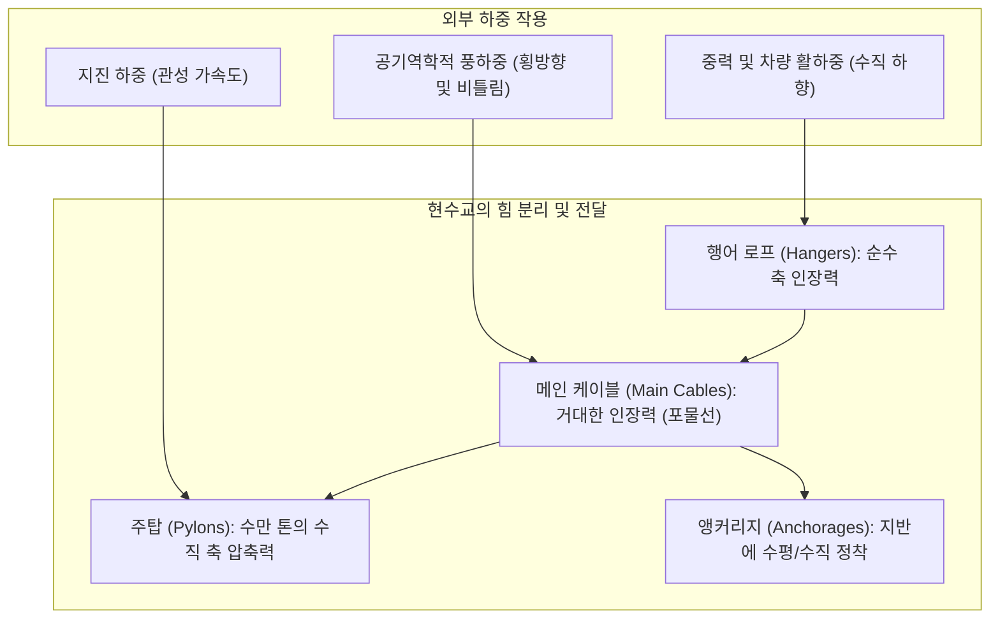
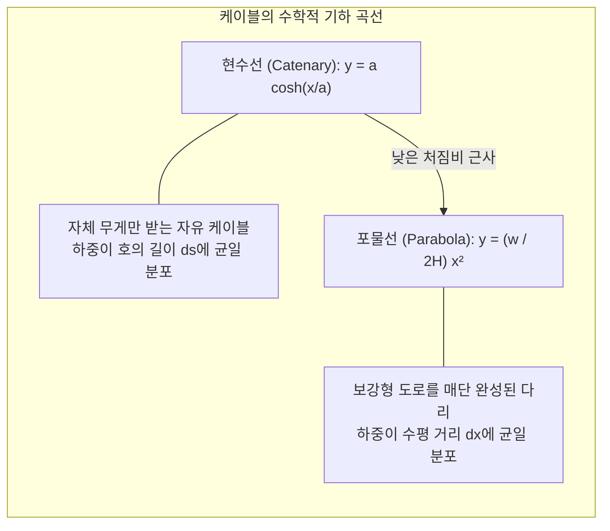
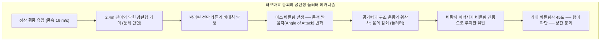

거친 파도가 몰아치는 해협 위, 안개를 뚫고 하늘 높이 솟아오른 거대한 주탑에서 우아한 곡선을 그리며 늘어뜨려진 굵은 케이블. 그 아래로 수만 톤의 아스팔트 도로가 수십 미터 허공에 떠 있는 현수교(Suspension Bridge)는 인류가 건설한 구조물 중 가장 웅장하며 극한의 역학을 체현하는 현대 토목공학의 금자탑입니다.

주경간 2,023m의 세계 최장 튀르키예 <strong>1915 차나칼레 대교</strong>나 주경간 1,991m의 일본 <strong>아카시 해협 대교</strong>를 바라볼 때 우리는 경이로운 질문을 던지게 됩니다.

"중간에 단 하나의 교각도 없는데, 저 엄청난 무게의 강철 도로가 어떻게 떨어지지 않고 버티는가?"
"거센 태풍과 지진의 충격에도 다리는 왜 꺾이지 않는가?"

그 해답은 물리적 힘에 맞서 완력으로 버티는 것이 아니라, 자연의 힘을 가장 순수한 두 가지 힘—「<strong>인장력(Tension)</strong>」과 「<strong>압축력(Compression)</strong>」—으로 분해하여 지구 그 자체로 흘려보내는 우아한 기하학적 메커니즘에 있습니다.

---

## 1. 교량 역학의 기초: 인장과 압축의 완전한 분리

모든 지상 구조물은 지구 중력장 아래에서 하향 하중을 받습니다. 전통적인 보교(Beam Bridge)는 부재 자체의 휨강성(Bending Rigidity)으로 하중을 버팁니다.

보의 중앙에 하중이 가해지면 부재 상부는 압축되고 하부는 인장되며 강력한 <strong>휨 모멘트(Bending Moment)</strong>가 발생합니다. 오일러-베르누이 보 이론에 따라 단순보의 최대 휨 모멘트는 경간 길이 $L$의 제곱에 비례합니다:
$$M_{\max} = \frac{w L^2}{8}$$
경간이 2배가 되면 휨 모멘트는 4배로 증가합니다. 이를 버티기 위해 보를 두껍게 만들면 자체 무게(사하중)가 기하급수적으로 늘어나, 결국 <strong>자신의 무게를 이기지 못하고 꺾이는 물리적 한계</strong>에 봉착합니다. 일반적인 거더교의 한계 경간이 300m 수준에 머무는 이유입니다.

### 현수교의 해법: 휨을 배제하고 인장과 압축으로 전환
현수교는 휨 모멘트라는 비효율적인 힘의 전달 방식을 우아하게 우회합니다. 강철 와이어 케이블은 굽힘에 저항하지 못하지만($EI \approx 0$), <strong>축 방향으로 잡아당기는 힘(순수 인장력)</strong>에 대해서는 강철 분자의 이론적 결합력에 근접하는 초인적인 강도를 발휘합니다.

1. <strong>도로의 무게</strong>: 수많은 수직 <strong>행어 로프(Hanger Ropes)</strong>가 위로 끌어올립니다 (순수 인장).
2. <strong>메인 케이블의 집약</strong>: 행어의 힘은 포물선을 그리는 <strong>메인 케이블(Main Cable)</strong>로 모여 케이블 전체의 인장력으로 변환됩니다.
3. <strong>주탑의 수직 압축</strong>: 주탑 정상의 안장(Saddle)을 통과하며 케이블의 장력은 수직 방향의 거대한 <strong>압축력</strong>으로 바뀌어 암반 기초로 전달됩니다.
4. <strong>앵커리지의 지반 고정</strong>: 케이블 양 끝단은 수십만 톤의 콘크리트 덩어리인 <strong>앵커리지(Anchorage)</strong>에 고정되어 지구 지각 자체로 인장력을 분산시킵니다.

이처럼 「<strong>케이블=순수 인장</strong>」, 「<strong>주탑=순수 압축</strong>」으로 역할을 완전히 분리함으로써 현수교는 1,000m~2,000m 이상의 초장대 스팬을 실현할 수 있습니다.

---

## 2. 케이블의 수학: 현수선(Catenary)과 포물선(Parabola)

현수교 케이블이 허공에 그리는 아름다운 곡선은 최소 포텐셜 에너지를 찾아가는 수학적 해입니다.

### 1. 자체 무게만을 받는 「현수선(Catenary)」
균일한 선밀도 $\mu$를 가진 유연한 케이블이 중력장에서 양 끝만 고정된 채 처질 때, 호의 길이 $ds = \sqrt{1 + (dy/dx)^2} dx$에 비례하는 자중을 받습니다. 이 미분방정식을 풀면 쌍곡여현함수($\cosh$)인 <strong>현수선</strong>이 유도됩니다:
$$y(x) = a \cosh\left(\frac{x}{a}\right) - a, \quad a = \frac{H}{\mu g}$$

### 2. 도로를 매단 현수교의 곡선 「포물선(Parabola)」
다리가 완성되면 도로 상판의 무게가 케이블 자중을 압도합니다. 수평 도로의 무게는 호의 길이 $ds$가 아닌 <strong>수평 거리 $x$에 대해 균일하게 분포($w \approx \text{const}$)</strong>합니다.
이 미분방정식을 적분하면 완벽한 2차 함수인 <strong>포물선</strong>이 됩니다:
$$y(x) = \frac{w}{2H} x^2$$

주경간 중앙 처짐량을 $f$, 주탑 사이 거리를 $L$이라 할 때, 지점 $x = L/2$에서 $y = f$가 되므로 수평 장력 $H$는 다음 공식으로 결정됩니다:
$$H = \frac{w L^2}{8f}$$

### 3. 처짐비(Sag Ratio)의 공학적 딜레마
- **처짐량 $f$가 너무 작으면(케이블을 팽팽하게 당기면)**: 분모의 $f \to 0$이 되어 수평 장력 $H$가 무한대로 치솟아 케이블이 끊어집니다.
- **처짐량 $f$가 너무 크면(케이블을 깊게 늘어뜨리면)**: 장력은 줄어들지만 주탑을 비정상적으로 높게 지어야 해 주탑의 좌굴(Buckling) 위험과 건설비가 급증합니다.

현대 교량공학에서 최적의 처짐비 $f/L$는 <strong>약 $1/9 \sim 1/11$</strong>로 설계됩니다.

---

## 3. 타코마 다리의 붕괴와 공탄성학(Aeroelasticity)의 탄생

1940년 11월 7일, 완공된 지 불과 4개월 된 미국 <strong>타코마 나로스교(Tacoma Narrows Bridge)</strong>가 시속 68km($19\text{ m/s}$)의 평범한 바람에 비틀리다 붕괴한 사건은 구조공학 역사를 송두리째 바꾼 특이점이었습니다.

### 1. 정역학적 설계의 한계
설계자 모이세이프는 케이블의 중력 복원력을 과신하여 공사비를 아끼고자 유려하고 얇은 <strong>2.4m 높이의 플레이트 거더(강판형)</strong>를 채택했습니다. 정적 계산상으로는 태풍급 바람에도 끄떡없는 튼튼한 다리였습니다.

### 2. 붕괴 원인: 공탄성 비틀림 플러터(Aeroelastic Flutter)
단순한 공진이 아니었습니다. 바람이 둔탁한 직사각형 보에 부딪히며 공기가 위아래로 박리되었고, 다리가 비틀릴 때 생기는 공기역학적 양력이 구조물의 진동보다 반 박자 늦게 작용하면서 **바람이 진동을 멈추는 저항(양의 감쇠)이 아니라 진동을 부채질하는 가속기(음의 감쇠)** 역할을 했습니다. 바람의 운동 에너지가 비틀림 진동으로 계속 쏟아져 들어가 진폭이 45도까지 발산한 끝에 케이블이 찢어지며 붕괴했습니다.

### 3. 현대 현수교의 3대 내풍 설계
- **트러스 보강형**: 바람이 그대로 통과할 수 있는 개구형 삼각형 트러스 구조 채택 (아카시 해협 대교).
- **유선형 강상판 박스거더**: 비행기 날개처럼 공기 흐름을 매끄럽게 유도하여 박리를 억제 (세번교, 차나칼레교).
- **중앙 슬롯 개구부**: 상하판 압력차를 해소하기 위해 차선 사이에 바람구멍(그레이팅)을 설치.

---

## 4. 현수교 vs 사장교: 역학적 차이점

| 비교 항목 | 현수교 (Suspension Bridge) | 사장교 (Cable-Stayed Bridge) |
| :--- | :--- | :--- |
| **케이블 방식** | 주탑 사이에 늘어뜨린 주케이블에서 수직 행어로 지지 | 주탑에서 비스듬히 뻗은 사재 케이블이 상판을 직접 지지 |
| <strong>상판의 응력 상태</strong> | 주로 국부적 휨만 부담 (축력 작음) | <strong>케이블 수평 분력에 의해 거대한 수평 압축력(축력) 발생</strong> |
| <strong>앵커리지 필요성</strong> | <strong>필수</strong> (수만 톤의 케이블 수평 인장력을 지반に 고정) | <strong>불필요</strong> (경간 양쪽 케이블의 수평 분력이 상판 자체에서 상쇄) |
| <strong>경제적 한계 경간</strong> | <strong>1,000m ~ 3,000m+ 초장대 경간 독점</strong> | <strong>300m ~ 1,000m 전후 최적</strong> |

사장교는 앵커리지가 필요 없어 1km 이내에서는 매우 경제적이지만, 1km를 넘어서면 비스듬한 케이블이 상판을 짓누르는 수평 압축력이 너무 커져 상판이 압축 좌굴을 일으킵니다. 따라서 <strong>1.5km 이상의 초장대 해협 횡단에서는 현수교가 인류의 유일한 해법</strong>입니다.

---

## 5. 불멸의 공학: 제습 시스템과 디지털 트윈

1. **건조 공기 주입 시스템 (Dry Air Injection)**:
   수만 가닥의 강선이 뭉쳐진 메인 케이블 내부에 상대습도 40% 이하의 건조 공기를 지속적으로 불어넣어 전기화학적 부식(녹) 발생을 영구적으로 차단합니다.
2. **음향 방출(AE: Acoustic Emission) 감지**:
   케이블 내부 깊숙한 곳에서 단 한 가닥의 강선이 피로로 끊어질 때 방출되는 미세한 고주파 탄성파를 실시간으로 포착하여 센티미터 단위로 손상 위치를 찾아냅니다.
3. **디지털 트윈(Digital Twin)**:
   수천 개의 가속도계, GPS, 풍향풍속계 데이터를 슈퍼컴퓨터의 가상 모델과 실시간 동기화하여 지진이나 태풍 발생 시 실시간 응력 상태를 예측하고 선제적 보수를 수행합니다.

### 결론
현수교는 육중한 힘으로 중력에 저항하는 건축물이 아닙니다. 가장 유연한 포물선으로 중력을 끌어안아 대지로 흘려보내고, 거센 바람을 틈새로 흘려보내는 「<strong>유연한 순응의 미학</strong>」입니다.
