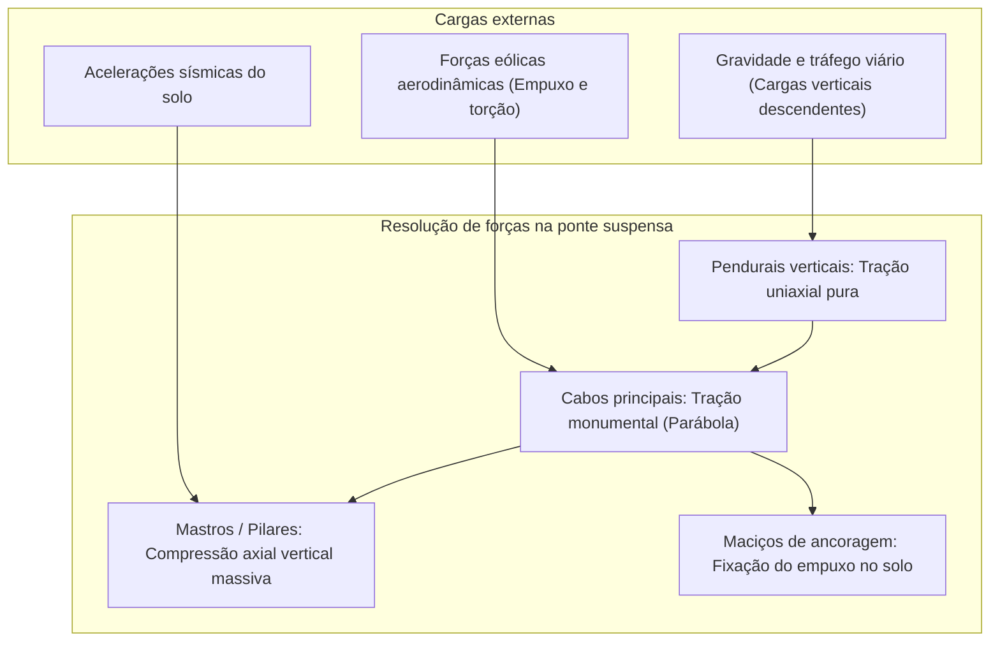
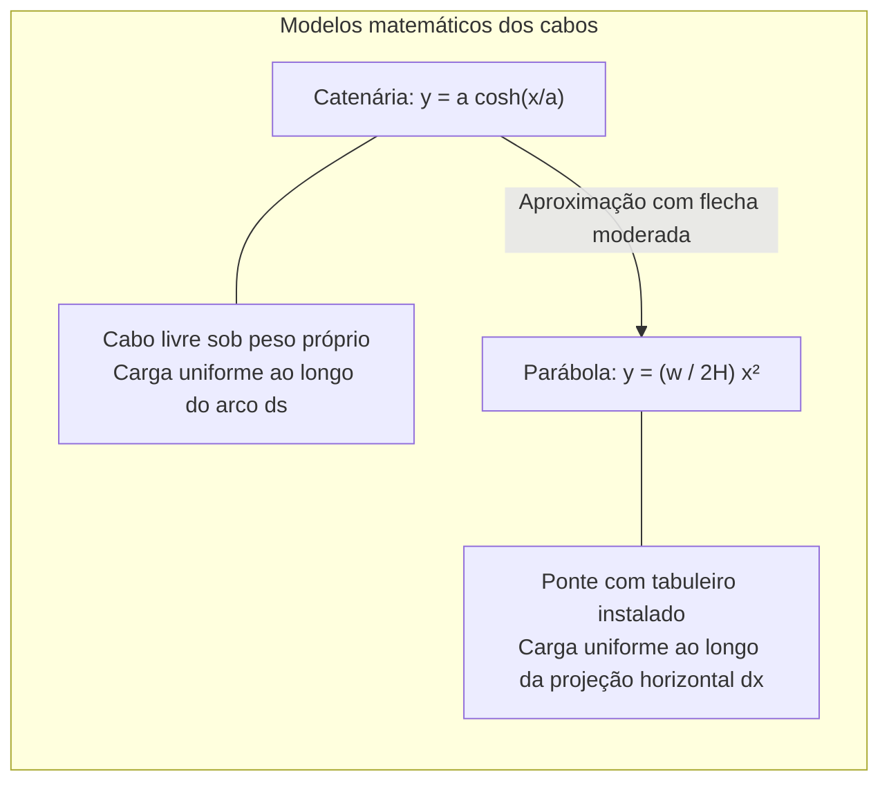
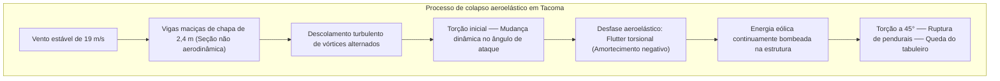

Sobre as correntes impetuosas de estreitos oceânicos, envoltos pela névoa marítima, os mastros colossais de uma ponte suspensa moderna erguem-se contra o céu. De seus topos, monumentais cabos de aço descrevem parábolas perfeitas, sustentando no ar milhares de toneladas de concreto, aço e tráfego contínuo. Da **ponte Çanakkale 1915** na Turquia (com seu recorde mundial de vão principal de 2.023 metros) à ponte **Akashi Kaikyo** no Japão (1.991 metros), estas megaestruturas representam o cume da engenharia civil.

Como pode uma estrutura tão monumental pairar no ar sem apoios centrais na água? Por que ela não cede sob frotas intermináveis de caminhões nem é destruída por furacões e terremotos?

A resposta não reside na rigidez bruta de paredes espessas, mas na submissão harmoniosa às leis da física: a ponte suspensa decompõe cargas complexas em dois estados mecânicos puros: **tração pura (Tension)** e **compressão axial pura (Compression)**.

---

## 1. Mecânica fundamental: separação de tração e compressão

Qualquer estrutura terrestre deve equilibrar cargas gravitacionais e ambientais no espaço estático:
$$\sum \mathbf{F} = 0, \quad \sum \mathbf{M} = 0$$

Em uma ponte de viga tradicional, o carregamento gera um **momento fletor (Bending Moment)**: as fibras superiores sofrem compressão e as inferiores tração. Pela teoria das vigas de Euler-Bernoulli, o momento fletor máximo cresce com o quadrado do vão livre $L$:
$$M_{\max} = \frac{w L^2}{8}$$
Dobrar a distância quadruplica a flexão. Para resistir, a viga deve se tornar tão densa que **acaba quebrando sob o próprio peso**. Por volta de 300 metros, as pontes de viga atingem seu limite físico.

### A solução da ponte suspensa
Cabos flexíveis têm rigidez à flexão quase nula ($EI \approx 0$). Contudo, sob **tração axial pura**, o aço de alta resistência alcança o limite de coesão molecular dos metais:
1. O tabuleiro é sustentado verticalmente pelos **pendurais** (tração pura).
2. Os pendurais transmitem a carga aos **cabos principais** (tração pura).
3. Os cabos repousam sobre as selas no topo dos **mastros**, convertendo a tração oblíqua em compressão vertical pura enviada ao leito rochoso subaquático.
4. As pontas são atadas a maciços de concreto colossais: os **maciços de ancoragem**.

---

## 2. A matemática do cabo: Catenária e Parábola

- **Catenária**: Forma assumida por um cabo livre sob peso próprio $\mu g$: $y(x) = a \cosh(x/a) - a$.
- **Parábola**: Forma sob carga de tabuleiro horizontal uniforme $w$: $y(x) = \frac{w}{2H} x^2$.
- **Tração Horizontal**: $H = \frac{w L^2}{8f}$, onde a razão flecha/vão ($f/L$) ótima é calibrada em torno de **$1/9$ a $1/11$**.

---

## 3. A lição de Tacoma Narrows (1940) e o flutter aeroelástico

Em 7 de novembro de 1940, a ponte de **Tacoma Narrows** (vão de 853 metros) colapsou sob ventos moderados de apenas **68 km/h (19 m/s)**.

O colapso não foi mera ressonância de Karman, mas **flutter aeroelástico autoexcitado**: forças aerodinâmicas agiram defasadas em relação ao movimento estrutural, fornecendo amortecimento negativo e bombeando energia até a ruptura física.

Soluções modernas: vigas em treliça aberta (Akashi Kaikyo), caixões aerodinâmicos contínuos (Severn) e tabuleiros de duplo caixão com vão central vazado (Çanakkale 1915).

---

## 4. Ponte suspensa versus ponte estaiada

| Critério | Ponte Suspensa | Ponte Estaiada |
| :--- | :--- | :--- |
| **Cabos** | Cabos principais contínuos com pendurais verticais | Estais inclinados diretos do mastro ao tabuleiro |
| **Esforço no tabuleiro** | Flexão local baixa, tração axial mínima | **Compressão horizontal axial imensa no tabuleiro** |
| **Ancoragens** | **Obrigatórias e colossais** (terraço de concreto) | **Desnecessárias** (autoancoradas no tabuleiro) |
| **Vão ótimo** | **1.000 m a mais de 3.000 m** | **300 m a 1.000 m** |

Acima de 1.000 metros, os estais angulares geram compressão tão destrutiva no tabuleiro que o **sistema de suspensão clássico torna-se o único viável**.

---

## 5. Manutenção preditiva moderna

1. **Injeção de ar seco**: Ar com umidade inferior a 40% é continuamente injetado no interior dos cabos principais, impedindo a ferrugem.
2. **Emissão acústica (AE)**: Sensores piezelétricos captam a onda sônica gerada pela ruptura microscópica de fios de aço internos.
3. **Gêmeo digital (Digital Twin)**: Modelos computacionais em tempo real avaliam o estresse estrutural sob tráfego e tempestades extremas.
