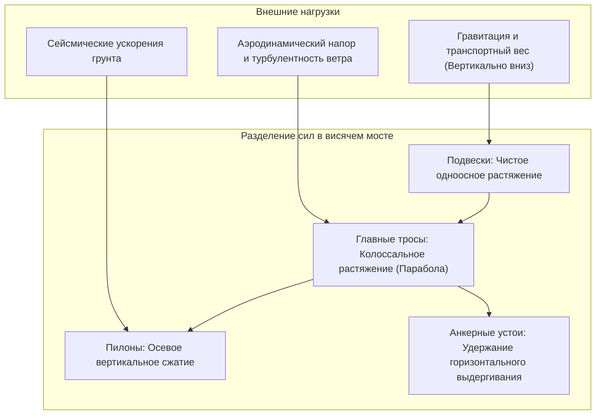
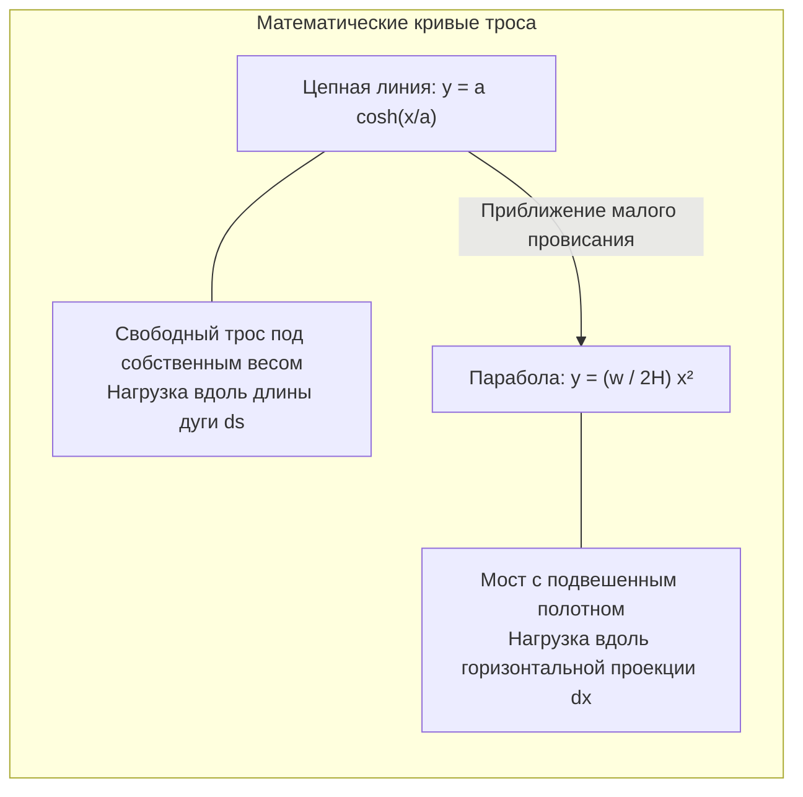
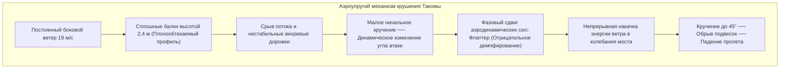

Над бушующими волнами глубоких морских проливов величественные пилоны современных висячих мостов (Suspension Bridges) устремляются в небо. С их вершин циклопические стальные тросы очерчивают изящную параболу через километры открытого пространства, удерживая в воздухе тысячи тонн стали, бетона и непрерывный поток автотранспорта. От моста **Чанаккале 1915** в Турции (с рекордным главным пролетом 2023 метра) до японского моста **Акаси-Кайкё** (1991 метр) — эти сооружения представляют собой абсолютную вершину мирового мостостроения.

Как может многотысячетонная стальная трасса держаться в воздухе без единой опоры в воде? Почему она не ломается под весом грузовиков и выдерживает удары тайфунов и землетрясений?

Ответ кроется не в несокрушимой монолитной толщине, а в совершенном подчинении законам физики: висячий мост разделяет сложнейшие нагрузки на два чистых состояния — **чистое растяжение (Tension)** и **чистое осевое сжатие (Compression)**.

---

## 1. Базовая механика: избавление от изгибающего момента

В обычной балочной конструкции нагрузка создает **изгибающий момент (Bending Moment)**: верхняя часть сжимается, а нижняя растягивается. Согласно теории балок Эйлера-Бернулли, максимальный изгибающий момент растет пропорционально квадрату длины пролета $L$:
$$M_{\max} = \frac{w L^2}{8}$$
Удвоение пролета увеличивает момент вчетверо. Чтобы выдержать его, балку приходится делать массивнее, пока она не **разрушится под собственным весом**. Поэтому балочные мосты ограничены пролетами около 300 метров.

### Решение висячего моста
Гибкие стальные канаты практически не сопротивляются изгибу ($EI \approx 0$). Однако при **чистом осевом растяжении** высокопрочная стальная проволока достигает теоретических пределов межатомной прочности:
1. Дорожное полотно удерживается вертикальными **подвесками** (чистое растяжение).
2. Подвески передают усилие **главным несущим тросам** (чистое растяжение).
3. Тросы опираются на седла **пилонов**, направляя равнодействующую силу вертикально вниз в коренную породу (чистое сжатие).
4. Горизонтальное натяжение тросов удерживается колоссальными береговыми **анкерными массивами**.

---

## 2. Математика троса: Цепная линия и Парабола

- **Цепная линия (Catenary)**: Описывает свободный трос под собственным весом: $y(x) = a \cosh(x/a) - a$.
- **Парабола (Parabola)**: Возникает при подвеске тяжелого горизонтального пролетного строения с постоянной нагрузкой $w$: $y(x) = \frac{w}{2H} x^2$.
- **Горизонтальное натяжение**: $H = \frac{w L^2}{8f}$. Оптимальное отношение стрелы провисания к пролету ($f/L$) составляет **$1/9 \sim 1/11$**.

---

## 3. Урок Такомы (1940 г.) и аэроупругий флаттер

7 ноября 1940 года мост **Такома-Нарроуз** (пролет 853 м) разрушился при умеренном ветре скоростью всего **19 м/с (68 км/ч)**.

Причиной катастрофы был **аэроупругий крутильный флаттер**: сплошные балки срывали поток, а аэродинамическая подъемная сила действовала с фазовым запаздыванием, создавая отрицательное демпфирование и раскачивая конструкцию до полного разрушения.

Современные решения: решетчатые сквозные фермы (Акаси-Кайкё), обтекаемые коробчатые балки аэродинамического профиля крыла (Северн) и двухкоробчатые конструкции с центральной прорезью (Чанаккале 1915).

---

## 4. Висячие против Вантовых мостов

| Параметр | Висячий мост | Вантовый мост |
| :--- | :--- | :--- |
| **Кабельная система** | Непрерывный несущий кабель с вертикальными подвесками | Прямые наклонные ванты от пилона к балке |
| **Напряжения в балке** | Незначительное осевое усилие | **Огромное продольное осевое сжатие балки** |
| **Анкерные блоки** | **Обязательны и массивны** (удержание в грунте) | **Не требуются** (самоанкерующаяся система) |
| **Предельный пролет** | **От 1 000 м до более 3 000 м** | **От 300 м до примерно 1 000 м** |

При пролетах свыше 1 000 м наклонные ванты сжимают балку столь разрушительной силой, что **висячий мост остается единственным инженерным решением для мегапролетов**.

---

## 5. Современные технологии долговечности

1. **Система нагнетания сухого воздуха**: Внутрь главных кабелей подается воздух с относительной влажностью менее 40%, что делает коррозию проволок физически невозможной.
2. **Акустико-эмиссионный контроль (AE)**: Пьезодатчики в реальном времени улавливают ультразвук разрыва отдельной проволоки, локализуя усталость с точностью до сантиметров.
3. **Цифровые двойники (Digital Twins)**: Модели на базе МКЭ сопоставляют данные сотен датчиков и предсказывают усталость конструкций при тайфунах.
