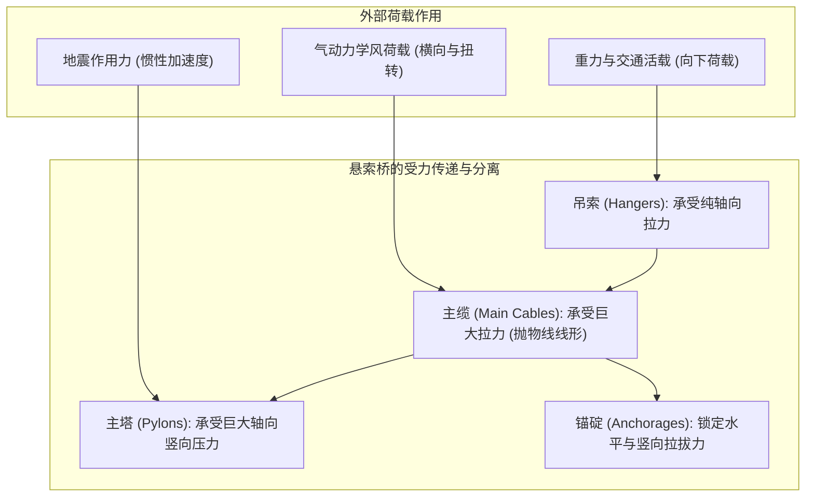
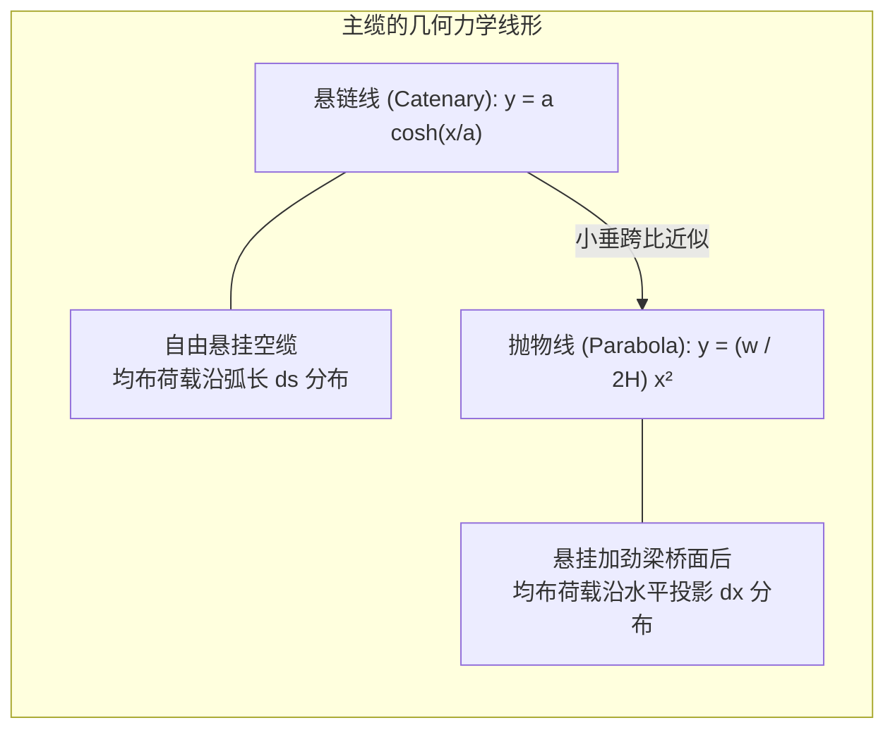
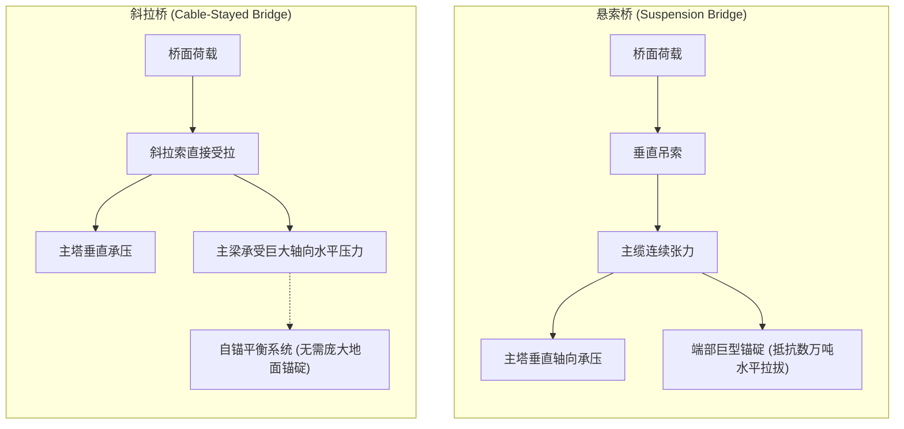
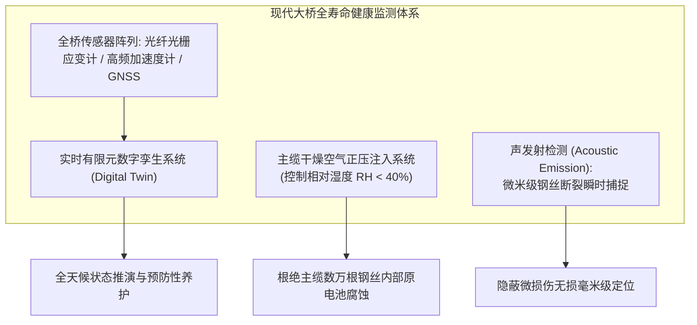

在狂风呼啸、暗流涌动的海峡之上，现代悬索桥（Suspension Bridge）宛如悬挂在天地之间的钢铁巨龙。从土耳其主跨达2023米的<strong>1915恰纳卡莱大桥<strong>，到日本主跨1991米的</strong>明石海峡大桥</strong>，这些跨越数公里的旷世杰作不仅是现代交通的咽喉，更是人类土木工程挑战力学极限的终极象征。

面对这些在海面上空数十米凌空虚渡的庞然大物，人们常常产生由衷的惊叹：
在海峡中央没有任何桥墩支撑的情况下，成千上万吨的钢筋混凝土与穿梭不息的车流，究竟依靠什么力量悬浮在空中？面对时速两百公里的台风与狂暴地震，它为何不会折断坍塌？

答案并不在于材料的蛮力与绝对的刚性，而在于对自然法则的「<strong>顺应与化解</strong>」。悬索桥通过极致优雅的几何形态，将混乱复杂的多轴外力彻底分解为两种最纯粹的受力状态——「<strong>纯拉力（Tension）</strong>」与「<strong>纯压力（Compression）</strong>」。

---

## 一、 桥梁力学的本质：拉力与压力的完全分离

地球引力决定了任何地面结构都必须承受恒定存在的向下重力荷载。传统梁桥（Beam Bridge）跨越空间的方式，是通过横梁自身的抗弯刚度来硬扛荷载。

当荷载作用于梁桥中央时，横梁产生下挠变形：上表面承受压缩，下表面承受拉伸，即断面内产生强烈的<strong>弯矩（Bending Moment）</strong>。根据欧拉-伯努利梁理论，梁桥中央的最大弯矩与跨径的平方成正比：
$$M_{\max} = \frac{w L^2}{8}$$
当跨度 $L$ 翻倍时，弯矩激增4倍。为了承受巨大的弯矩，桥梁断面积必须呈指数级增大，最终导致<strong>桥梁因无法支撑自身自重（Dead Load）而坍塌</strong>。因此，传统梁桥的极限经济跨径很难突破300米。

### 悬索桥的破局之道
悬索桥彻底打破了梁桥抗弯的力学困境。缆索作为一种柔性构件，其抗弯刚度几乎为零（$EI \approx 0$），然而当它承受<strong>轴向纯拉伸</strong>时，高强钢丝却能发挥出逼近金属晶体理论极值的承载能力。

1. <strong>桥面活载与死载</strong>：通过密集的垂直<strong>吊索（Hangers）</strong>向上悬吊。
2. <strong>主缆汇聚拉力</strong>：吊索将垂直力传递给横跨长空的两根<strong>主缆（Main Cables）</strong>，转化为沿缆索轴向流动的巨型拉力。
3. <strong>主塔承受纯压</strong>：主缆翻越两端数百米高的<strong>主塔（Towers）</strong>鞍座，主缆的下垂角度将斜向拉力转化为垂直向下的恒定压力，压向海底坚硬基岩。
4. <strong>锚碇锁定地壳</strong>：主缆的两端被深深锚固在两岸各达数十万吨的巨型混凝土<strong>锚碇（Anchorages）</strong>中，将巨大的水平分力平衡在大地之中。

通过将灾难性的弯矩转化为「<strong>主缆受拉、主塔受压</strong>」，人类第一次获得了跨越千米级海峡的物理入场券。

---

## 二、 悬索曲线的数理方程：悬链线与抛物线

悬索桥主缆所展现出的自然弧度，是物理学中位能极小化原理的优美体现。在力学分析中，存在着两条至关重要的曲线：<strong>悬链线（Catenary）</strong>与<strong>抛物线（Parabola）</strong>。

### 1. 均布自重下的「悬链线」
当一根质量均匀、柔性无刚度的缆索两端固定、在纯重力场中自然下垂时，其微元弧长 $ds = \sqrt{dx^2 + dy^2}$ 承受恒定自重 $\mu g$。解平衡微分方程：
$$\frac{d^2 y}{dx^2} = \frac{\mu g}{H} \sqrt{1 + \left(\frac{dy}{dx}\right)^2}$$
积分得到著名的双曲余弦方程（悬链线）：
$$y(x) = a \cosh\left(\frac{x}{a}\right) - a, \quad a = \frac{H}{\mu g}$$

### 2. 悬吊桥面后的「抛物线」
然而在悬索桥成桥状态下，桥面和交通荷载的重量远远超越主缆自重。由于道路水平延伸，这些巨大的恒载实际上是<strong>沿着水平投影距离 $x$ 均匀分布的（$w \approx \text{const}$）</strong>。

微元力矩平衡方程化简为：
$$\frac{dy}{dx} = \frac{w x}{H}$$
对此一阶常微分方程积分，得到的是标准的二次<strong>抛物线方程</strong>：
$$y(x) = \frac{w}{2H} x^2$$

设主跨跨径为 $L$，跨中垂度为 $f$。在支点 $x = L/2$ 处 $y = f$，由此导出悬索桥主缆水平拉力 $H$ 的经典计算公式：
$$H = \frac{w L^2}{8f}$$

### 3. 垂跨比（Sag-to-Span Ratio）的工程权衡
公式清晰揭示了水平张力 $H$ 与垂度 $f$ 的反比关系：
- **垂度 $f$ 过小（缆索拉得过平）**：由于分母 $f \to 0$，主缆中的水平拉力 $H$ 将趋向无穷大，需要极其庞大粗重的高强钢丝束，经济性彻底崩溃。
- **垂度 $f$ 过大（缆索下垂过深）**：虽然缆索拉力减小，但主塔必须建造得极其高耸，导致主塔风阻剧增且极易发生欧拉压弯失稳（Buckling）。

现代大跨度悬索桥的<strong>垂跨比（$f/L$）黄金范围通常取在 $1/9 \sim 1/11$（约十分之一）</strong>，以此实现缆索用钢量与主塔建造成本的最优平衡。

---

## 三、 塔科马海峡大桥风毁惨剧与气动弹性颤振

在人类桥梁史上，1940年11月7日美国<strong>塔科马海峡大桥（Tacoma Narrows Bridge）</strong>的坍塌，是结构工程学划时代的转折点。

这座主跨853米、当时世界第三长的现代化悬索桥，在仅仅<strong>19米/秒（约8级大风）</strong>的普通强风吹袭下，发生了强烈的波浪状起伏与剧烈扭转，最终彻底断裂解体，坠入普吉特海湾。

### 1. 经典静力学设计的破产
设计师莱昂·莫伊塞耶夫（Leon Moisseiff）采用了当时最先进的「挠度理论（Deflection Theory）」，认为巨大缆索张力能够提供强大的重力自恢复刚度，因此大幅压缩了桥身钢材用量，采用了轻盈优美的<strong>实腹式钢板梁（高仅2.4米，宽11.9米，跨深比高达1:350）</strong>。
在传统静力计算中，该桥能够抵御极其巨大的静阵风推力。**在当时的图纸计算上，它是一座绝不可能倒塌的桥梁。**

### 2. 致命元凶：单自由度气动弹性颤振（Aeroelastic Flutter）
长久以来，初级物理读物常将其错误归咎于「卡门涡街共振」。然而冯·卡门及后来的空气动力学研究证实：共振并非主因，真正摧毁大桥的是流固耦合中的「<strong>自激振动（气动弹性颤振）</strong>」。

1. **钝体气流分离**：实腹式板梁如同迎风矗立的挡风墙，风流吹拂在其垂直腹板上迅速剥离，在梁体后方形成不稳定的剪切涡流。
2. <strong>负气动阻尼</strong>：当桥梁受扰动产生微小扭转时，气流对断面的升力与扭矩不再与运动同相，而是产生了滞后相位差。此时，空气介质不仅没有吸收振动能量，反而像马达一样<strong>持续将风能注入振动系统中（有效阻尼比变为负值）</strong>。
3. **振幅发散**：桥面左右两侧交替上下翻飞，最大扭转角达45度，直至中央吊索屈服断裂，全桥彻底崩塌。

### 3. 现代抗风工学的三大防护屏障
塔科马大桥的坍塌迫使土木工程界全面引入航空气动弹性力学，确立了现代大跨桥梁抗风设计准则：
- **深层开孔钢桁架梁**：让狂风自由穿透桁架缝隙，完全消除形成大幅升力的实体挡风面（如明石海峡大桥）。
- **流线型扁平钢箱梁（Streamlined Box Girder）**：断面设计如飞机机翼，引导气流平滑贴体流动，抑制气流剥离（如塞文桥、亨伯桥）。
- **中央开槽双箱梁（Twin-Box Girder）**：在两个平行流线型箱梁之间留出数米宽的排风缝，极大平衡上下翼缘气压差，将极限临界颤振风速提高至300 km/h以上（如1915恰纳卡莱大桥）。

---

## 四、 悬索桥 vs 斜拉桥：受力机理的本质差异

| 结构特性 | 悬索桥（Suspension Bridge） | 斜拉桥（Cable-Stayed Bridge） |
| :--- | :--- | :--- |
| **缆索布置** | 悬垂主缆通过立向吊索垂直提拉桥面 | 索塔直接引出倾斜斜拉索辐射连接主梁 |
| <strong>主梁受力状态</strong> | 主梁基本仅承受局部弯曲，纵向轴力极小 | <strong>主梁承受极其巨大的水平轴向挤压力</strong> |
| <strong>锚碇依赖</strong> | <strong>必须建造巨型锚碇</strong>（将水平拉力传递给地壳） | <strong>通常无需外锚</strong>（斜索水平分力在主梁内部自相平衡） |
| **结构刚度** | 柔性大，活载下变形较为显著 | 三角形桁架刚度高，行车平稳抗挠度好 |
| <strong>经济适用跨径</strong> | <strong>1,000米 至 3,000米+ 超大跨径独霸</strong> | <strong>300米 至 1,000米 左右最优选</strong> |

斜拉桥由于取消了造价高昂的锚碇系统，在千米以内具备无与伦比的经济优势。然而当跨径突破1000米向2000米延伸时，斜拉索的倾角变平导致提吊效率断崖式下跌，且主梁内部积聚的轴向压力将诱发毁灭性压溃失稳。因此，**跨越1.5至3公里的海峡超级工程，悬索桥依然是无可替代的王者**。

---

## 五、 超长寿命的保障：除湿防腐与数字孪生健康监测

一座暴露在强紫外线、高盐分海雾与疲劳交变荷载下的超级悬索桥，如何保证百年以上的结构安全性？

1. **主缆干燥空气注入系统**：
   主缆由数万根高强钢丝致密压实而成，一旦内部渗水生锈，整桥寿命便宣告终结。日本工程界研发的干燥空气注入技术，向主缆内部持续压入相对湿度低于40%的洁净干燥气体。在无液态水膜的微环境中，铁原子的电化学腐蚀彻底停滞，实现了钢丝缆索的永久免蚀。
2. **声发射（Acoustic Emission）断丝无损监测**：
   利用压电传感器全天候监听主缆。当数万根钢丝中哪怕仅有一根因疲劳产生微观脆断时，应变能释放释放出的瞬态高频弹性波会被精准捕捉，通过波形时差在数厘米精度内锁定损伤位置。
3. **有限元数字孪生（Digital Twin）**：
   遍布全桥的风速计、GPS挠度计与应变光栅每秒将数万组遥测数据回传至超级计算中心，驱动数字孪生体进行非线性瞬态力学仿真，使工程师能够先于任何灾难显现前，精准执行预先维修。

### 结语
悬索桥不是与重力争锋的刚硬屏障，而是将重力与风暴巧妙导向地壳的力学织锦。它用最优美的悬垂弧线化解万钧重荷，不仅凝结了材料科学、空气动力学与结构力学的百代智慧，更展现了人类智慧在面对不可逆物理法则时，所展现出的极致崇高与诗意。
