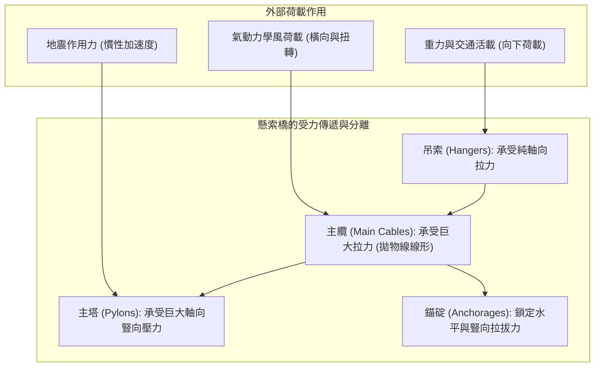
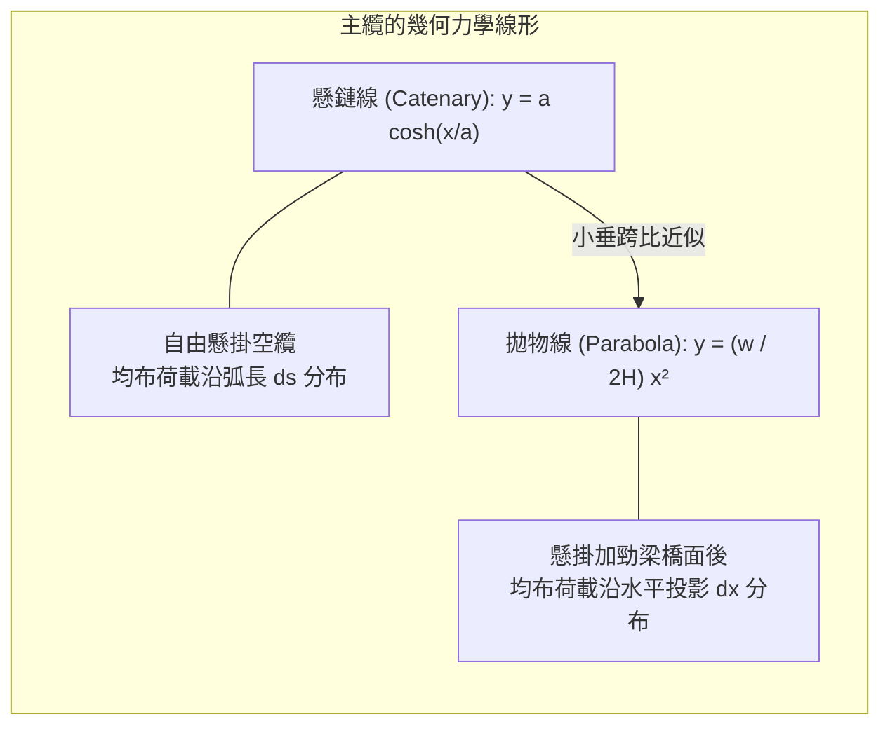
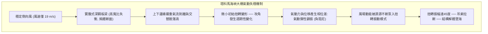
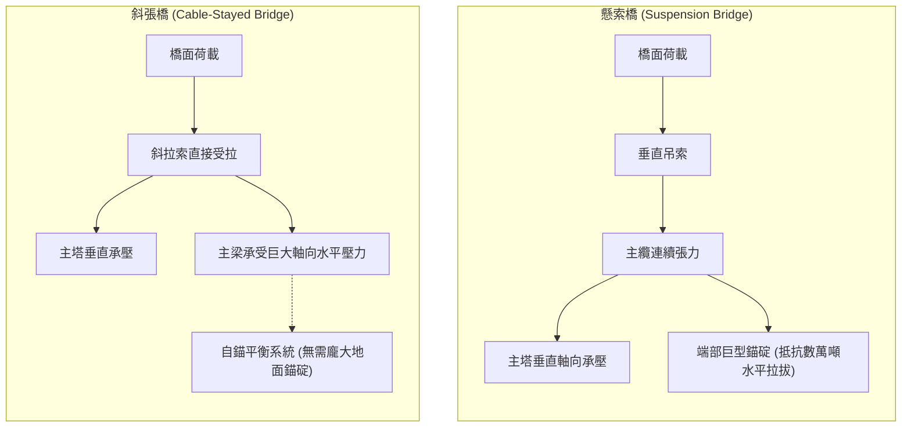
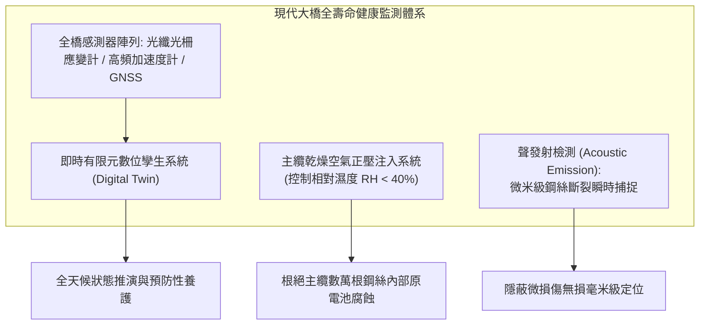

在狂風呼嘯、暗流湧動的海峽之上，現代懸索橋（Suspension Bridge）宛如懸掛在天地之間的鋼鐵巨龍。從土耳其主跨達2023公尺的<strong>1915恰納卡萊大橋<strong>，到日本主跨1991公尺的</strong>明石海峽大橋</strong>，這些跨越數公里的曠世傑作不僅是現代交通的咽喉，更是人類土木工程挑戰力學極限的終極象徵。

面對這些在海面上空數十公尺凌空虛渡的龐然大物，人們常常產生由衷的驚嘆：
在海峽中央沒有任何橋墩支撐的情況下，成千上萬噸的鋼筋混凝土與穿梭不息的車流，究竟依靠什麼力量懸浮在空中？面對時速兩百公里的颱風與狂暴地震，它為何不會折斷坍塌？

答案並不在於材料的蠻力與絕對的剛性，而在於對自然法則的「<strong>順應與化解</strong>」。懸索橋透過極致優雅的幾何形態，將混亂複雜的多軸外力徹底分解為兩種最純粹的受力狀態——「<strong>純拉力（Tension）</strong>」與「<strong>純壓力（Compression）</strong>」。

---

## 一、 橋樑力學的本質：拉力與壓力的完全分離

地球引力決定了任何地面結構都必須承受恆定存在的向下重力荷載。傳統梁橋（Beam Bridge）跨越空間的方式，是透過橫梁自身的抗彎剛度來硬扛荷載。

當荷載作用於梁橋中央時，橫梁產生下撓變形：上表面承受壓縮，下表面承受拉伸，即斷面內產生強烈的<strong>彎矩（Bending Moment）</strong>。根據歐拉-伯努利梁理論，梁橋中央的最大彎矩與跨徑的平方成正比：
$$M_{\max} = \frac{w L^2}{8}$$
當跨度 $L$ 翻倍時，彎矩激增4倍。為了承受巨大的彎矩，橋樑斷面積必須呈指數級增大，最終導致<strong>橋樑因無法支撐自身自重（Dead Load）而坍塌</strong>。因此，傳統梁橋的極限經濟跨徑很難突破300公尺。

### 懸索橋的破局之道
懸索橋徹底打破了梁橋抗彎的力學困境。纜索作為一種柔性構件，其抗彎剛度幾乎為零（$EI \approx 0$），然而當它承受<strong>軸向純拉伸</strong>時，高強鋼絲卻能發揮出逼近金屬晶體理論極值的承載能力。

1. <strong>橋面活載與死載</strong>：透過密集的垂直<strong>吊索（Hangers）</strong>向上懸吊。
2. <strong>主纜匯聚拉力</strong>：吊索將垂直力傳遞給橫跨長空的兩根<strong>主纜（Main Cables）</strong>，轉化為沿纜索軸向流動的巨型拉力。
3. <strong>主塔承受純壓</strong>：主纜翻越兩端數百公尺高的<strong>主塔（Towers）</strong>鞍座，主纜的下垂角度將斜向拉力轉化為垂直向下的恆定壓力，壓向海底堅硬基岩。
4. <strong>錨碇鎖定地殼</strong>：主纜的兩端被深深錨固在兩岸各達數十萬噸的巨型混凝土<strong>錨碇（Anchorages）</strong>中，將巨大的水平分力平衡在大地之中。

透過將災難性的彎矩轉化為「<strong>主纜受拉、主塔受壓</strong>」，人類第一次獲得了跨越千公尺級海峽的物理入場券。

---

## 二、 懸索曲線的數理方程：懸鏈線與拋物線

懸索橋主纜所展現出的自然弧度，是物理學中位能極小化原理的優美體現。在力學分析中，存在著兩條至關重要的曲線：<strong>懸鏈線（Catenary）</strong>與<strong>拋物線（Parabola）</strong>。

### 1. 均布自重下的「懸鏈線」
當一根質量均勻、柔性無剛度的纜索兩端固定、在純重力場中自然下垂時，其微元弧長 $ds = \sqrt{dx^2 + dy^2}$ 承受恆定自重 $\mu g$。解平衡微分方程：
$$\frac{d^2 y}{dx^2} = \frac{\mu g}{H} \sqrt{1 + \left(\frac{dy}{dx}\right)^2}$$
積分得到著名的雙曲餘弦方程（懸鏈線）：
$$y(x) = a \cosh\left(\frac{x}{a}\right) - a, \quad a = \frac{H}{\mu g}$$

### 2. 懸吊橋面後的「拋物線」
然而在懸索橋成橋狀態下，橋面和交通荷載的重量遠遠超越主纜自重。由於道路水平延伸，這些巨大的恆載實際上是<strong>沿著水平投影距離 $x$ 均勻分布的（$w \approx \text{const}$）</strong>。

微元力矩平衡方程化簡為：
$$\frac{dy}{dx} = \frac{w x}{H}$$
對此一階常微分方程積分，得到的是標準的二次<strong>拋物線方程</strong>：
$$y(x) = \frac{w}{2H} x^2$$

設主跨跨徑為 $L$，跨中垂度為 $f$。在支點 $x = L/2$ 處 $y = f$，由此導出懸索橋主纜水平拉力 $H$ 的經典計算公式：
$$H = \frac{w L^2}{8f}$$

### 3. 垂跨比（Sag-to-Span Ratio）的工程權衡
公式清晰揭示了水平張力 $H$ 與垂度 $f$ 的反比關係：
- **垂度 $f$ 過小（纜索拉得過平）**：由於分母 $f \to 0$，主纜中的水平拉力 $H$ 將趨向無窮大，需要極其龐大粗重的高強鋼絲束，經濟性徹底崩潰。
- **垂度 $f$ 過大（纜索下垂過深）**：雖然纜索拉力減小，但主塔必須建造得極其高聳，導致主塔風阻劇增且極易發生歐拉壓彎失穩（Buckling）。

現代大跨度懸索橋的<strong>垂跨比（$f/L$）黃金範圍通常取在 $1/9 \sim 1/11$（約十分之一）</strong>，以此實現纜索用鋼量與主塔建造成本的最優平衡。

---

## 三、 塔科馬海峽大橋風毀慘劇與氣動彈性顫振

在人類橋樑史上，1940年11月7日美國<strong>塔科馬海峽大橋（Tacoma Narrows Bridge）</strong>的坍塌，是結構工程學劃時代的轉折點。

這座主跨853公尺、當時世界第三長的現代化懸索橋，在僅僅<strong>19公尺/秒（約8級大風）</strong>的普通強風吹襲下，發生了強烈的波浪狀起伏與劇烈扭轉，最終徹底斷裂解體，墜入普吉特海灣。

### 1. 經典靜力學設計的破產
設計師萊昂·莫伊塞耶夫（Leon Moisseiff）採用了當時最先進的「撓度理論（Deflection Theory）」，認為巨大纜索張力能夠提供強大的重力自恢復剛度，因此大幅壓縮了橋身鋼材用量，採用了輕盈優美的<strong>實腹式鋼板梁（高僅2.4公尺，寬11.9公尺，跨深比高達1:350）</strong>。
在傳統靜力計算中，該橋能夠抵禦極其巨大的靜陣風推力。**在當時的圖紙計算上，它是一座絕不可能倒塌的橋樑。**

### 2. 致命元兇：單自由度氣動彈性顫振（Aeroelastic Flutter）
長久以來，初級物理讀物常將其錯誤歸咎於「卡門渦街共振」。然而馮·卡門及後來的空氣動力學研究證實：共振並非主因，真正摧毀大橋的是流固耦合中的「<strong>自激振動（氣動彈性顫振）</strong>」。

1. **鈍體氣流分離**：實腹式板梁如同迎風矗立的擋風牆，風流吹拂在其垂直腹板上迅速剝離，在梁體後方形成不穩定的剪切渦流。
2. <strong>負氣動阻尼</strong>：當橋樑受擾動產生微小扭轉時，氣流對斷面的升力與扭矩不再與運動同相，而是產生了滯後相位差。此時，空氣介質不僅沒有吸收振動能量，反而像馬達一樣<strong>持續將風能注入振動系統中（有效阻尼比變為負值）</strong>。
3. **振幅發散**：橋面左右兩側交替上下翻飛，最大扭轉角達45度，直至中央吊索屈服斷裂，全橋徹底崩塌。

### 3. 現代抗風工學的三大防護屏障
塔科馬大橋的坍塌迫使土木工程界全面引入航空氣動彈性力學，確立了現代大跨橋樑抗風設計準則：
- **深層開孔鋼桁架梁**：讓狂風自由穿透桁架縫隙，完全消除形成大幅升力的實體擋風面（如明石海峽大橋）。
- **流線型扁平鋼箱梁（Streamlined Box Girder）**：斷面設計如飛機機翼，引導氣流平滑貼體流動，抑制氣流剝離（如塞文橋、亨伯橋）。
- **中央開槽雙箱梁（Twin-Box Girder）**：在兩個平行流線型箱梁之間留出數公尺寬的排風縫，極大平衡上下翼緣氣壓差，將極限臨界顫振風速提高至300 km/h以上（如1915恰納卡萊大橋）。

---

## 四、 懸索橋 vs 斜張橋：受力機理的本質差異

| 結構特性 | 懸索橋（Suspension Bridge） | 斜張橋（Cable-Stayed Bridge） |
| :--- | :--- | :--- |
| **纜索布置** | 懸垂主纜透過立向吊索垂直提拉橋面 | 索塔直接引出傾斜斜拉索輻射連接主梁 |
| <strong>主梁受力狀態</strong> | 主梁基本僅承受局部彎曲，縱向軸力極小 | <strong>主梁承受極其巨大的水平軸向擠壓力</strong> |
| <strong>錨碇依賴</strong> | <strong>必須建造巨型錨碇</strong>（將水平拉力傳遞給地殼） | <strong>通常無需外錨</strong>（斜索水平分力在主梁內部自相平衡） |
| **結構剛度** | 柔性大，活載下變形較為顯著 | 三角形桁架剛度高，行車平穩抗撓度好 |
| <strong>經濟適用跨徑</strong> | <strong>1,000公尺 至 3,000公尺+ 超大跨徑獨霸</strong> | <strong>300公尺 至 1,000公尺 左右最優選</strong> |

斜張橋由於取消了造價高昂的錨碇系統，在千公尺以內具備無與倫比的經濟優勢。然而當跨徑突破1000公尺向2000公尺延伸時，斜拉索的傾角變平導致提吊效率斷崖式下跌，且主梁內部積聚的軸向壓力將誘發毀滅性壓潰失穩。因此，**跨越1.5至3公里的海峽超級工程，懸索橋依然是無可替代的王者**。

---

## 五、 超長壽命的保障：除濕防腐與數位孿生健康監測

一座暴露在強紫外線、高鹽分海霧與疲勞交變荷載下的超級懸索橋，如何保證百年以上的結構安全性？

1. **主纜乾燥空氣注入系統**：
   主纜由數萬根高強鋼絲緻密壓實而成，一旦內部滲水生鏽，整橋壽命便宣告終結。日本工程界研發的乾燥空氣注入技術，向主纜內部持續壓入相對濕度低於40%的潔淨乾燥氣體。在無液態水膜的微環境中，鐵原子的電化學腐蝕徹底停滯，實現了鋼絲纜索的永久免蝕。
2. **聲發射（Acoustic Emission）斷絲無損監測**：
   利用壓電感測器全天候監聽主纜。當數萬根鋼絲中哪怕僅有一根因疲勞產生微觀脆斷時，應變能釋放出的瞬態高頻彈性波會被精準捕捉，透過波形時差在數公分精度內鎖定損傷位置。
3. **有限元數位孿生（Digital Twin）**：
   遍布全橋的風速計、GPS撓度計與應變光纖每秒將數萬組遙測數據回傳至超級計算中心，驅動數位孿生體進行非線性瞬態力學模擬，使工程師能夠先於任何災難顯現前，精準執行預先維修。

### 結語
懸索橋不是與重力爭鋒的剛硬屏障，而是將重力與風暴巧妙導向地殼的力學織錦。它用最優美的懸垂弧線化解萬鈞重荷，不僅凝結了材料科學、空氣動力學與結構力學的百代智慧，更展現了人類智慧在面對不可逆物理法則時，所展現出的極致崇高與詩意。
