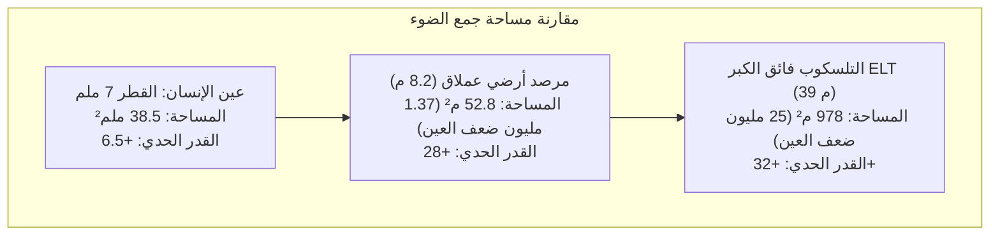

حين نرنو بأبصارنا نحو السماء ليلاً، فإننا ننظر مباشرة إلى أعماق الماضي. فضياء القمر يعود إلى 1.3 ثانية مضت، وأشعة الشمس انطلقت قبل 8 دقائق و20 ثانية، بينما استغرق نور مجرة أندروميدا 2.5 مليون سنة ليصلنا، وتكشف لنا العناقيد المجرية السحيقة صورة الكون كما كان قبل أكثر من 13 مليار عام.

من المنظور الفيزيائي الدقيق، لا يُعد التلسكوب مجرد عدسة مكبرة، بل هو <strong>آلة زمن فوتونية فائقة الدقة: جهاز بصري صُمم لاقتناص أضعف تدفقات الإشعاع الكهرومغناطيسي عبر الأبعاد الكونية والتحكم في جبهات الموجة الضوئية على مستوى النانومتر</strong>.

منذ عام 1609 عندما وجّه غاليليو غاليلي منظاره الكاسر الصغير نحو الفضاء، مروراً بتلسكوب جيمس ويب الفضائي (JWST) بمرآته الذهبية المصنوعة من البيريليوم بقطر 6.5 متر عند نقطة لاغرانج L2، وحتى التلسكوب الأوروبي البالغ الكبر (ELT) بقطر 39 متراً في تشيلي، حققت البشرية قفزات علمية مذهلة.

---

### 1. القيود البيولوجية للعين البشرية والحاجة لفتحات رصد عملاقة

تخضع العين البشرية لقيود صارمة تحول دون رصد أعماق الفضاء:
- <strong>صغر فتحة البؤبؤ</strong>: لا يتعدى قطر بؤبؤ العين المتكيف مع الظلام $d_{eye} \approx 7\,\mathrm{mm}$ (مساحة $38.5\,\mathrm{mm}^2$)؛
- <strong>انعدام التراكم الزمني</strong>: زمن التكامل العصبي لشبكية العين يبلغ حوالي $0.1\,\mathrm{ثانية}$ فقط، مما يستحيل معه تجميع الفوتونات بالتعريض الطويل؛
- <strong>قانون التربيع العكسي</strong>: تتناقص كثافة الفوتونات القادمة من المجرات البعيدة مع مربع المسافة، لتصل بمعدل فوتونات ضئيلة لكل متر مربع في الساعة.

الوظيفة الفيزيائية الأساسية للتلسكوب هي <strong>قدرة تجميع الضوء (Light Gathering Power)</strong>، وتتناسب طردياً مع مربع القطر $D$:

$$A = \frac{\pi}{4} D^2$$

يجمع مرصد بقطر 8.2 متر <strong>1.37 مليون ضعف كمية الفوتونات</strong> مقارنة بالعين البشرية كل ثانية. وبفضل حساسات CCD المبردة بكفاءة تتجاوز 90%، يمكن رصد أجرام أبهت بمليارات المرات من حدود الرؤية بالعين المجردة.

---

### 2. التلسكوبات الكاسرة والعاكسة: الزيغ اللوني وحدود العدسات

شهد تاريخ علم الفلك صراعاً تقنياً بين التلسكوبات الكاسرة (العدسات) والعاكسة (المرايا).

#### معضلة الزيغ اللوني في العدسات
يعتمد معامل الانكسار $n(\lambda)$ في الزجاج على الطول الموجي (ظاهرة التشتت). فينكسر الضوء الأزرق بزاوية أكبر من الضوء الأحمر:

$$f_{\text{أزرق}} < f_{\text{أحمر}}$$

ينتج عن ذلك هالات ضبابية ملونة تحيط بالنجوم. ومع محاولات معالجة ذلك بالعدسات المزدوجة اللون، اصطدمت العدسات بحواجز فيزيائية مستحيلة:
1. <strong>الانحناء التثاقلي</strong>: لا يمكن دعم العدسة إلا من حوافها الخارجية، وعند تجاوز قطر متر واحد يتشوه الزجاج تحت وزنه الهائل؛
2. <strong>الامتصاص الداخلي</strong>: تمتص الكتل الزجاجية السميكة الأشعة فوق البنفسجية؛
3. <strong>صعوبة الصقل المزدوج</strong>: يلزم صقل وجهي العدسة بدقة نانومترية متناهية.

كان كاسر يركس بقطر 40 بوصة (1.02 متر) عام 1897 نهاية عصر العدسات العملاقة.

#### انتصار المرايا العاكسة
في عام 1668، صمم إسحاق نيوتن أول تلسكوب عاكس. <strong>إن قانون الانعكاس ($\theta_i = \theta_r$) مستقل تماماً عن الطول الموجي!</strong>
- تنعكس كافة ألوان الضوء إلى <strong>نفس البؤرة الهندسية تماماً، مما ينفي الزيغ اللوني نهائياً ($0$)</strong>؛
- يمكن دعم المرآة ميكانيكياً من كامل سطحها الخلفي بمحركات دقيقة؛
- تصميم <strong>ريتشي-كريتيان (RC)</strong> بمرآتين زائديتين يلغي الزيغ الكروي والغيبوبة معاً، وهو المعتمد في تلسكوبات هابل وسوبارو وVLT.

---

### 3. الفتحة والفيزياء الموجية: حد الحيود وقرص إيري

يحدد القطر $D$ أيضاً <strong>القدرة على التحليل الزاوي (Angular Resolution)</strong>. وبفعل حيود فرانهوفر عبر الفتحة الدائرية، يظهر النجم النقطي كقرص مركزي تحيط به حلقات يسمى <strong>قرص إيري (Airy Disk)</strong>.
تحدد الحلقة المظلمة الأولى <strong>معيار رايلي</strong>:

$$\theta_{\text{diff}} \approx 1.22 \frac{\lambda}{D} \quad \text{[راديان]}$$

بالثواني القوسية:

$$\theta_{\text{arcsec}} \approx 2.52 \times 10^5 \times \frac{\lambda}{D} \quad [\text{ثانية قوسية}]$$

في الضوء المرئي، يمتلك هابل ($D = 2.4\,\mathrm{m}$) قدرة تحليلية $0.058''$. بينما سيحقق تلسكوب ELT المستقبلي دقة تبلغ <strong>$0.0035''$ (3.5 ميلي ثانية قوسية)</strong>، وهي كافية لتمييز مجسم بطول 6.5 أمتار على سطح القمر!

---

### 4. حاجز الغلاف الجوي: الاضطرابات ومعامل فريد

على الأرض، تشوه التيارات الهوائية المضطربة جبهات الموجة الضوئية.
يحدد <strong>معامل فريد ($r_0$)</strong> حجم مناطق التماسك البصري في الهواء، ولا يتجاوز في النطاق المرئي <strong>$10$ إلى $20\,\mathrm{سم}$</strong>، مما يحد من دقة المراصد الأرضية لتصبح مكافئة لتلسكوب هاوٍ بقطر 15 سم (قرص الرؤية Seeing Disk).

---

### 5. ترويض الغلاف الجوي: البصريات التكيفية (AO)

تقوم تقنية <strong>البصريات التكيفية</strong> بقياس تشوهات جبهة الموجة بمعدل يزيد عن $1000\,\mathrm{Hz}$ باستخدام مستشعر شاك-هارتمان، وتحريك آلاف المشغلات الكهروضغطية لتشويه مرآة مرنة وإلغاء الاضطراب الجوي فورياً.
وباستخدام <strong>نجوم الليزر الدليلية (LGS)</strong> لإثارة ذرات الصوديوم على ارتفاع 90 كم، تستعيد المراصد الأرضية دقتها النظرية الكاملة.

---

### 6. المطيافية الفلكية: البصمة الكيميائية للكون

تستند أكثر من 70% من الاكتشافات الفيزيائية الفلكية إلى <strong>علم الأطياف (Spectroscopy)</strong>:
- <strong>خطوط فرانهوفر</strong>: تكشف العناصر الكيميائية للنجوم عبر امتصاصات ذرية دقيقة ($\Delta E = h\nu$)؛
- <strong>تأثير دوبلر والانزياح نحو الأحمر</strong>: يقيس السرعات الشعاعية وتوسع الكون (قانون هابل)؛
- <strong>مطياف إيشيل</strong>: يقيس تذبذبات السرعة الشعاعية للنجوم بدقة سنتيمترات في الثانية لاكتشاف الكواكب الخارجية.

---

### 7. المراصد الفضائية وتلسكوب جيمس ويب (JWST)

للهروب من الامتصاص الجوي للأشعة تحت الحمراء وفوق البنفسجية، انطلقت التلسكوبات الفضائية.

يمثل <strong>تلسكوب جيمس ويب</strong> (أُطلق عام 2021) قمة الهندسة الفضائية:
- مرآة بقطر 6.5 متر مكونة من 18 جزءاً سداسياً من البيريليوم المطلي بالذهب الخالص (بسمك 100 نانومتر) لعكس 98% من الأشعة تحت الحمراء؛
- درع شمسية من 5 طبقات تضمن حرارة سلبية تبلغ $-233^\circ\mathrm{C}$ ($40\,\mathrm{K}$) عند نقطة L2؛
- مبرد هيليوم نشط يبرد أجهزة الأشعة تحت الحمراء المتوسطة إلى <strong>$6.7\,\mathrm{K}$ ($-266.45^\circ\mathrm{C}$)</strong> لإلغاء أي تشويش حراري ذاتي.

---

### 8. خاتمة

من منظار غاليليو الخشبي إلى مرايا جيمس ويب الذهبية، تمثل مسيرة التلسكوبات ملحمة انتصار العقل البشري على قيود الانكسار والحيود واضطرابات الهواء، لتبقى هذه الأدوات أعظم نوافذ تطل بها البشرية على أسرار نشأة الكون والوجود.
