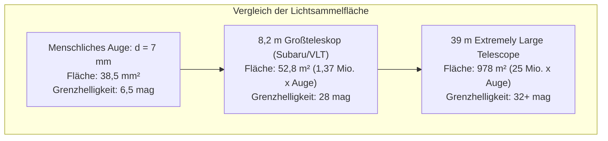
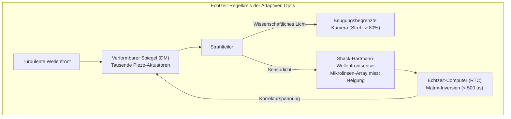

Wenn wir nachts zum Sternenhimmel aufblicken, schauen wir direkt in die Vergangenheit. Das Mondlicht ist 1,3 Sekunden alt, das Sonnenlicht 8 Minuten und 20 Sekunden, das Licht der Andromeda-Galaxie war 2,5 Millionen Jahre unterwegs, und die fernsten Galaxienhaufen zeigen sich uns so, wie sie vor über 13 Milliarden Jahren kurz nach dem Urknall existierten.

Aus physikalischer Sicht ist ein astronomisches Teleskop keine bloße Vergrößerungslinse. Es ist eine <strong>hochpräzise photonensammelnde Zeitmaschine: Ein optisches Instrument, das extrem schwache elektromagnetische Strahlungsströme über kosmische Distanzen einfängt, ihre Wellenfronten im Nanometerbereich kontrolliert und so die Struktur von Raum und Zeit rekonstruiert</strong>.

Seit Galileo Galilei 1609 erstmals ein einfaches Linsenfernrohr zum Himmel richtete, hat die beobachtende Astrophysik revolutionäre Fortschritte erzielt. Heute erforscht das James-Webb-Weltraumteleskop (JWST) mit seinem 6,5 Meter großen, vergoldeten Beryllium-Hauptspiegel vom Lagrange-Punkt L2 aus die ersten Sterne des Universums, während in der chilenischen Atacama-Wüste das Extremely Large Telescope (ELT) mit 39 Metern Spiegeldurchmesser entsteht, das die atmosphärische Turbulenz mittels Laserleitsternen und adaptiver Optik in Echtzeit neutralisiert.

---

### 1. Das biologische Limit des menschlichen Auges und die Notwendigkeit riesiger Aperturen

Um die Notwendigkeit von Riesenteleskopen zu verstehen, muss man die biophysikalischen Grenzen des menschlichen Auges betrachten:
- <strong>Winzige Eintrittspupille</strong>: Die menschliche Pupille erreicht bei Dunkeladaptation einen Durchmesser $d_{eye}$ von maximal etwa $7\,\mathrm{mm}$ (Fläche $A \approx 38,5\,\mathrm{mm}^2$);
- <strong>Keine photonische Akkumulation</strong>: Die neurobiologische Integrationszeit der Netzhaut beträgt lediglich etwa $0,1\,\mathrm{Sekunden}$. Photonen können nicht über Minuten oder Stunden akkumuliert werden;
- <strong>Das Abstandsgesetz der Strahlung</strong>: Der Photonenfluss $F$ eines astronomischen Objekts sinkt quadratisch mit der Entfernung $d$ ($F = L / 4\pi d^2$). Von Galaxien in 13 Milliarden Lichtjahren Entfernung treffen pro Quadratmeter und Stunde oft nur wenige Photonen auf der Erde ein.

Die elementare Funktion eines Teleskops ist die <strong>Lichtsammelleistung (Light Gathering Power)</strong>. Die Sammelfläche $A$ skaliert mit dem Quadrat des Spiegeldurchmessers $D$:

$$A = \frac{\pi}{4} D^2$$

Ein Spiegelteleskop mit 8,2 Metern Durchmesser sammelt <strong>1,37 Millionen Mal mehr Photonen pro Sekunde</strong> als das menschliche Auge. In Kombination mit kryogen gekühlten CCD/CMOS-Sensoren mit einer Quantenausbeute von über 90 % und Belichtungszeiten von vielen Stunden können Himmelsobjekte abgebildet werden, die milliardenfach lichtschwächer sind als das Limit des bloßen Auges.

---

### 2. Refraktoren versus Reflektoren: Das physikalische Scheitern von Glaslinsen

Die Geschichte der Teleskope war lange Zeit ein Wettstreit zwischen refraktiven Linsenfernrohren und reflektiven Spiegelteleskopen.

#### Chromatische Aberration (Farbfehler)
In jedem dielektrischen Medium (wie Kronglas oder Flintglas) hängt der Brechungsindex $n$ von der Wellenlänge $\lambda$ des Lichts ab (Dispersion nach Cauchy):

$$n(\lambda) \approx A + \frac{B}{\lambda^2} + \frac{C}{\lambda^4}$$

Da kurzwelliges blaues Licht stärker gebrochen wird als langwelliges rotes Licht ($n_{\text{blau}} > n_{\text{rot}}$), liegt der Brennpunkt für blaues Licht näher an der Linse als der für rotes Licht:

$$f_{\text{blau}} < f_{\text{rot}}$$

Ein einfacher Refraktor erzeugt dadurch störende violette Farbsäume (chromatische Aberration) um jeden Stern. Zwar verringerten achromatische Dubletts und apochromatische Tripletts diesen Fehler, doch stoßen Linsen an fundamentale mechanische und thermodynamische Grenzen:
1. <strong>Gravitative Durchbiegung</strong>: Linsen können nur am äußeren Rand gefasst werden. Bei Durchmessern über 1 Meter verzieht sich das tonnenschwere Glas unter seinem eigenen Gewicht;
2. <strong>Volumenabsorption und Schlieren</strong>: Dicke Glasblöcke absorbieren kurzwelliges Licht und lassen sich nicht ohne interne Spannungen oder mikroskopische Gasbläschen gießen;
3. <strong>Beidseitiger Präzisionsschliff</strong>: Beide Oberflächen einer Linse müssen auf Nanometerbruchteile exakt poliert werden.

Mit dem 40-Zoll-Refraktor (1,02 m) des Yerkes-Observatoriums von 1897 war die Grenze des Linsenteleskops endgültig erreicht.

#### Der Triumph des Spiegelteleskops
1668 konstruierte Isaac Newton das erste funktionierende Spiegelteleskop. <strong>Das Reflexionsgesetz ($\theta_i = \theta_r$) ist streng wellenlängenunabhängig!</strong>
- Ein Hohlspiegel fokussiert alle Wellenlängen an <strong>exakt demselben geometrischen Brennpunkt – der Farbfehler ist prinzipbedingt absolut null</strong>;
- Spiegel können ganzflächig auf der Rückseite durch mechanische und pneumatische Aktuatoren gestützt werden;
- Das moderne <strong>Ritchey-Chrétien-Design (RC)</strong> mit zwei hyperbolischen Spiegeln eliminiert gleichzeitig sphärische Aberration und Koma und bildet den weltweiten Standard für Observatorien wie Hubble, Keck und VLT.

---

### 3. Apertur und Wellenoptik: Das Beugungslimit und das Airy-Scheibchen

Neben der Lichtsammelleistung bestimmt der Durchmesser $D$ das <strong>Winkelauflösungsvermögen (Angular Resolution)</strong>.

Licht breitet sich als elektromagnetische Welle aus. Beim Durchgang durch eine kreisförmige Apertur entsteht im Fokus durch Fraunhofer-Beugung das charakteristische <strong>Airy-Beugungsmuster (Airy Disk)</strong> mit konzentrischen Beugungsringen:

$$I(\theta) = I_0 \left( \frac{2 J_1(x)}{x} \right)^2, \quad x = \frac{\pi D}{\lambda} \sin\theta$$

Daraus ergibt sich das fundamentale <strong>Rayleigh-Kriterium</strong>:

$$\theta_{\text{diff}} \approx 1,22 \frac{\lambda}{D} \quad \text{[Bogenmaß]}$$

In Bogensekunden umgerechnet:

$$\theta_{\text{arcsec}} \approx 2,52 \times 10^5 \times \frac{\lambda}{D} \quad [\text{Bogensekunden}]$$

Bei sichtbarem Licht ($\lambda = 550\,\mathrm{nm}$) liefert das Hubble-Teleskop ($D = 2,4\,\mathrm{m}$) eine theoretische Beugungsgrenze von $0,058''$. Das künftige 39-Meter-ELT erreicht atemberaubende <strong>$0,0035''$ (3,5 Millibogensekunden)</strong> – genug, um Strukturen von 6,5 Metern Größe auf dem Mond aufzulösen!

---

### 4. Die Barriere der Erdatmosphäre: Seeing und der Fried-Parameter

Auf der Erde wird dieses Auflösungsvermögen jedoch durch atmosphärische Turbulenz zunichte gemacht. Wind und Temperaturunterschiede erzeugen wirbelnde Luftmassen mit schwankendem Brechungsindex.

Der <strong>Fried-Parameter ($r_0$)</strong> beschreibt den räumlichen Durchmesser, über den eine Wellenfront noch kohärent bleibt. Bei sichtbarem Licht liegt $r_0$ selbst an den besten Standorten der Welt (wie Hawaii oder Chile) bei lediglich <strong>$10$ bis $20\,\mathrm{cm}$</strong>.

Ohne Korrektur verschmiert das Bild jedes Großteleskops zu einer turbulenten Unschärfe – dem sogenannten <strong>Seeing Disk</strong> mit einer Winkelauflösung von $0,5''$ bis $1,0''$, was der Auflösung eines Amateurteleskops von nur 15 cm Durchmesser entspricht.

---

### 5. Die Bändigung der Turbulenz: Adaptive Optik (AO) und Laserleitsterne

Um dieses Problem zu lösen, entwickelten Astrophysiker die <strong>Adaptive Optik (AO)</strong>:

Mit Frequenzen von $1.000$ bis $2.000\,\mathrm{Hz}$ misst der Shack-Hartmann-Sensor die Wellenfrontdeformation und verformt den Spiegel über Tausende von Piezoaktoren nanometergenau gegen die Turbulenz.

Mithilfe von <strong>Laserleitsternen (Laser Guide Stars: LGS)</strong>, bei denen ein gelber Laser ($589\,\mathrm{nm}$) die natürliche Natriumschicht in 90 km Höhe zum Leuchten anregt, steht an jedem beliebigen Punkt des Himmels ein künstlicher Referenzstern zur Verfügung.

---

### 6. Astrophysikalische Spektroskopie: Das Barcode-Muster des Kosmos

Über 70 % aller astrophysikalischen Erkenntnisse stammen nicht aus Fotos, sondern aus der <strong>Spektroskopie</strong>:
- <strong>Fraunhofer-Absorptionslinien</strong>: Elektronenübergänge in Atomen absorbieren diskrete Photonenenergien ($\Delta E = h\nu = hc/\lambda$) und liefern unverwechselbare chemische Fingerabdrücke entfernter Sterne;
- <strong>Doppler-Effekt und Rotverschiebung</strong>: Die Verschiebung der Spektrallinien ($\Delta \lambda / \lambda_0 \approx v/c$) beweist die Expansion des Universums (Hubble-Gesetz);
- <strong>Radialgeschwindigkeitsmethode</strong>: Hochauflösende Echelle-Spektrografen messen das gravitative Torkeln von Sternen mit einer Präzision von <strong>wenigen Zentimetern pro Sekunde</strong> und weisen so Exoplaneten nach.

---

### 7. Weltraumobservatorien: Das James-Webb-Weltraumteleskop (JWST)

Um der atmosphärischen Absorption in Infrarot-, Ultraviolett- und Röntgenbereichen vollständig zu entkommen, wurden Weltraumteleskope gebaut.

Das 2021 gestartete <strong>JWST</strong> markiert den Höhepunkt dieser Entwicklung:
- <strong>Infrarot-Fokus</strong>: Durch die kosmologische Rotverschiebung wurde das Licht der ersten Galaxien ($z > 10$) in den Infrarotbereich verschoben; zudem durchdringt Infrarotlicht kosmische Staubwolken;
- <strong>6,5 m Beryllium-Gold-Spiegel</strong>: 18 sechseckige Segmente aus ultraleichtem Beryllium, bedampft mit einer 100 nm dünnen Goldschicht für 98 % Infrarot-Reflexion;
- <strong>Lagrange-Punkt L2 und 5-lagiger Sonnenschild</strong>: Ein Sonnenschild kühlt die Instrumente passiv auf $-233^\circ\mathrm{C}$ ($40\,\mathrm{K}$); ein Helium-Kryokühler kühlt das MIRI-Instrument aktiv auf <strong>$6,7\,\mathrm{Kelvin}$ ($-266,45^\circ\mathrm{C}$)</strong> ab, um jedes thermische Eigenrauschen zu eliminieren.

---

### 8. Fazit

Von Galileis Holzrohr bis zum 39-Meter-ELT und den goldenen Segmenten des JWST zeigt die Geschichte der Teleskope den Triumph der menschlichen Vernunft über die physikalischen Hürden von Beugung, Dispersion und Turbulenz. Teleskope sammeln die ältesten Boten des Kosmos und eröffnen uns den Blick auf den Ursprung unserer eigenen Existenz.
