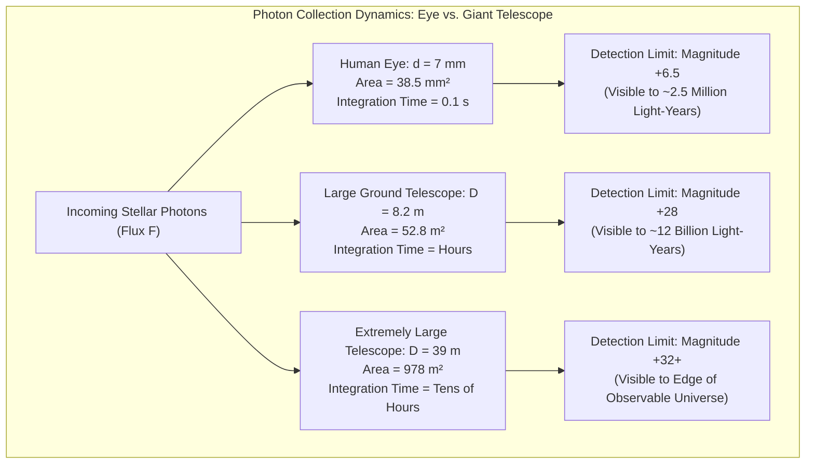
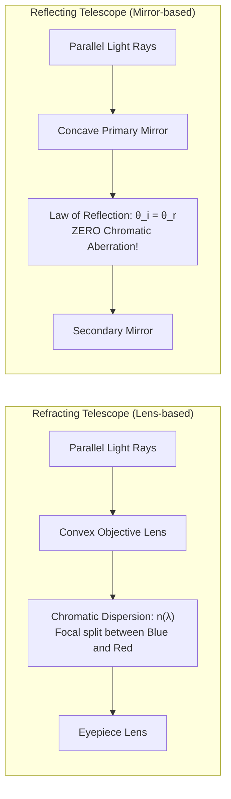
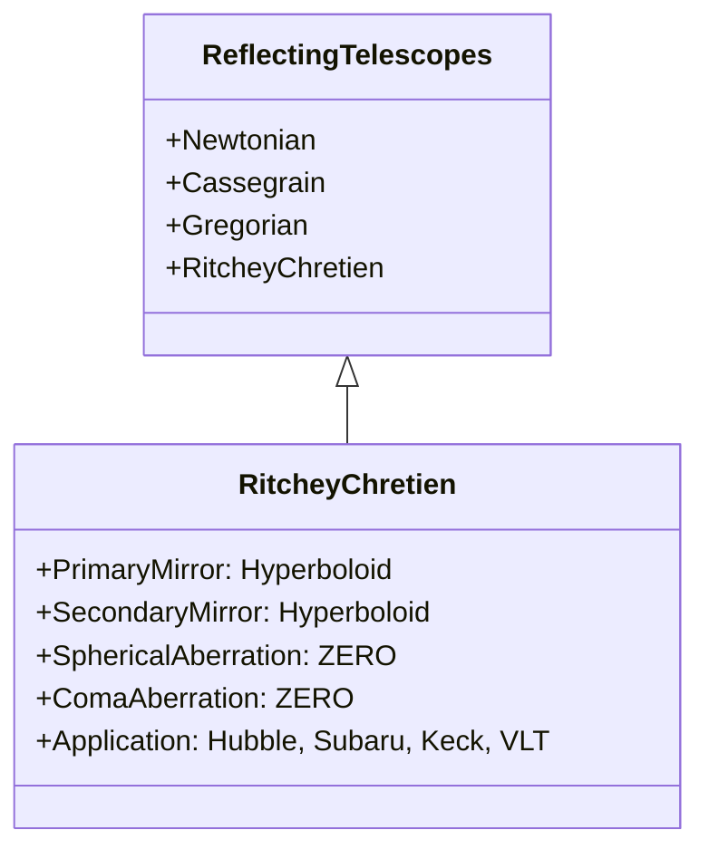
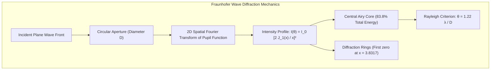
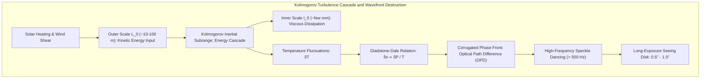
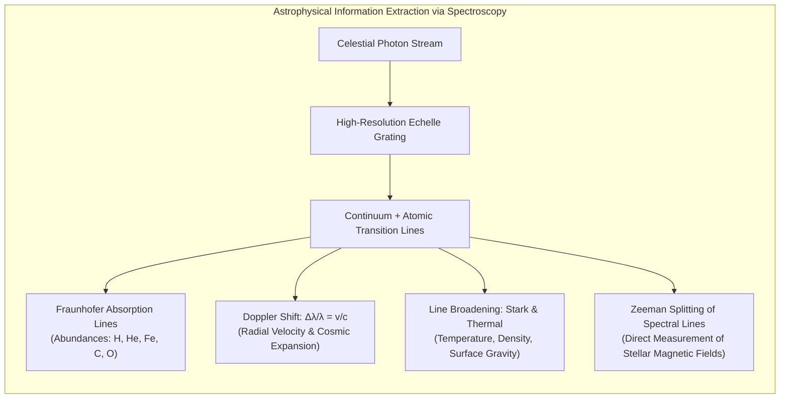
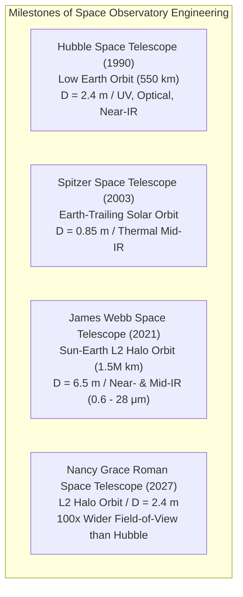
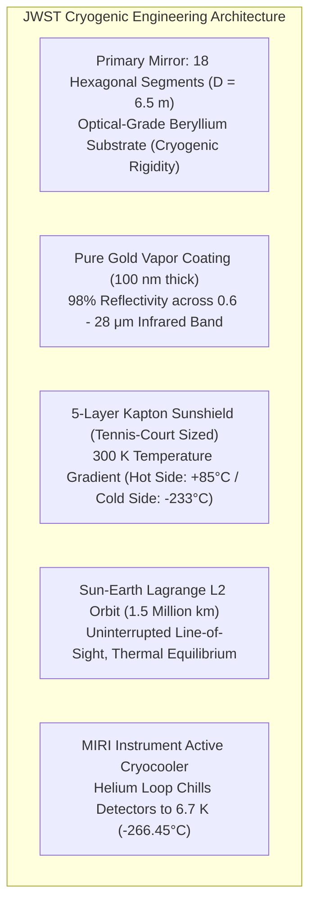
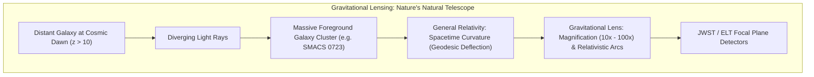

When we look up into the night sky, we are looking directly into the past. The Moon appears as it was 1.3 seconds ago; the Sun as it was 8 minutes and 20 seconds ago; the Andromeda Galaxy as it was 2.5 million years ago; and the most distant galactic clusters appear as they existed over 13 billion years ago, when the cosmos was in its infancy.

In popular imagination, a telescope is often conceived as a giant magnifying glass designed to make distant objects appear closer. In the rigorous framework of physics, however, a telescope is fundamentally <strong>a precision photon-harvesting time machine: an optical instrument engineered to collect vanishingly sparse flux packets of electromagnetic radiation across vast cosmic distances, manipulate their phase fronts at the nanometer scale, and reconstruct the spatiotemporal fabric of the universe</strong>.

Four centuries have passed since 1609, when Galileo Galilei aimed his primitive handheld spyglass toward the heavens to discover the moons of Jupiter and the rugged craters of our Moon. Today, astrophysics stands upon the threshold of an unprecedented golden age. We operate the James Webb Space Telescope (JWST)—a 6.5-meter gold-coated beryllium aperture orbiting the Sun-Earth Lagrange Point 2 (L2) to uncover the first stars born after the Big Bang—and construct colossal ground-based observatories such as the 39-meter Extremely Large Telescope (ELT), which uses artificial laser guide stars and thousands of piezoelectric actuators to cancel out atmospheric turbulence in real time.

Why do astronomers relentlessly push the boundaries of mirror diameter? Why did reflective optics triumph completely over glass refracting lenses? And how have the twin barriers of wave diffraction and atmospheric perturbation been overcome by geometric optics, wave physics, adaptive algorithms, and space engineering? This comprehensive guide presents an exhaustive physical and engineering breakdown of how telescopes collect light and peer across billions of light-years.

---

### 1. The Imperative of Light Gathering: The Biological Limits of the Human Eye

To appreciate the optical necessity of astronomical telescopes, one must first quantify the severe biological constraints of the human eye as an optical detector.

The human eye functions as an adaptive imaging lens system with an entrance pupil diameter $d_{eye}$ that rarely exceeds $7\,\mathrm{mm}$ ($0.007\,\mathrm{m}$) under fully dark-adapted (scotopic) conditions. Furthermore, the human retina does not accumulate photonic charge over extended periods; its integration time $\tau_{int}$ is fixed by neurobiological metabolic limits at approximately $0.1\,\mathrm{seconds}$ ($10\,\mathrm{Hz}$). Photons arriving outside this brief integration window cannot be coherently summed to increase the signal-to-noise ratio ($SNR$).

The photon flux $F$ received from an astronomical source obeys the inverse-square law of distance:

$$F = \frac{L}{4 \pi d^2}$$

where $L$ is the intrinsic luminosity of the celestial object and $d$ is its cosmological distance. For a faint, primeval galaxy located 13 billion light-years away, the photon flux reaching Earth's surface can be as sparse as a few photons per square meter per hour. 

With an entrance aperture of $7\,\mathrm{mm}$, the geometrical collecting area of the human eye is:

$$A_{eye} = \frac{\pi}{4} d_{eye}^2 \approx \frac{\pi}{4} (0.007\,\mathrm{m})^2 \approx 3.85 \times 10^{-5}\,\mathrm{m}^2 \quad (38.5\,\mathrm{mm}^2)$$

Over an integration window of $0.1\,\mathrm{s}$, the probability of even a single photon from that deep-space galaxy entering the pupil is essentially zero. Thus, the naked human eye cannot detect objects fainter than apparent magnitude $V \approx +6.0$ to $+6.5$.



The fundamental primary function of any telescope is <strong>Light Gathering Power (LGP)</strong>. The collecting area $A$ scales with the square of the aperture diameter $D$:

$$A = \frac{\pi}{4} D^2$$

Comparing the light-gathering capability of an 8.2-meter ground-based observatory (such as the Subaru Telescope or VLT) to the human eye yields:

$$\frac{A_{telescope}}{A_{eye}} = \left( \frac{D}{d_{eye}} \right)^2 = \left( \frac{8.2\,\mathrm{m}}{0.007\,\mathrm{m}} \right)^2 \approx 1.37 \times 10^6$$

A single 8.2-meter primary mirror harvests <strong>1.37 million times more photons per second</strong> than the human eye. When coupled with cryogenically cooled astronomical CCD/CMOS detectors exhibiting quantum efficiencies exceeding $90\%$ and integration exposures spanning tens of hours, modern telescopes detect objects over <strong>one billion times fainter</strong> than the faintest stars visible to the unaided human eye.

---

### 2. The Optical Dichotomy: Refractors vs. Reflectors and the Physical Limits of Glass

The four-hundred-year historical evolution of astronomical telescopes is characterized by a fundamental physical struggle between two optical methodologies: refractors, which bend light through glass lenses, and reflectors, which bounce light off curved mirror surfaces.

#### The Galilean and Keplerian Refractors
The earliest astronomical instruments were refracting telescopes:
1. <strong>Galilean Refractor (1609)</strong>: Combines a convergent convex objective lens with a divergent concave eyepiece. While it provides an erect (upright) image, its field of view is extremely narrow, and angular magnification cannot be increased without severe aberrations.
2. <strong>Keplerian Refractor (1611)</strong>: Employs two convex lenses (objective and eyepiece). The intermediate image is inverted, but the field of view is significantly broader, permitting much higher magnifications and the insertion of crosshairs (reticles) at the focal plane for precision astrometry.



#### The Physics of Chromatic Aberration and Cauchy's Dispersion
The Achilles' heel of the refracting telescope is <strong>chromatic aberration</strong>.

In any dielectric medium (such as crown or flint glass), the phase velocity of light $v(\lambda) = c / n(\lambda)$ depends on its electromagnetic wavelength $\lambda$. This refractive index dispersion is accurately modeled by Cauchy's empirical equation:

$$n(\lambda) \approx A + \frac{B}{\lambda^2} + \frac{C}{\lambda^4}$$

where $A$, $B$, and $C$ are material constants. Because the refractive index $n(\lambda)$ decreases monotonically as wavelength increases, short-wavelength blue light experiences a higher refractive index than long-wavelength red light:

$$n(\lambda_{\text{blue}}) > n(\lambda_{\text{red}})$$

According to the Lensmaker's Equation for a thin lens with radii of curvature $R_1$ and $R_2$:

$$\frac{1}{f(\lambda)} = (n(\lambda) - 1) \left( \frac{1}{R_1} - \frac{1}{R_2} \right)$$

Because $n(\lambda_{\text{blue}}) > n(\lambda_{\text{red}})$, the focal length for blue light $f_{\text{blue}}$ is strictly shorter than the focal length for red light $f_{\text{red}}$:

$$f_{\text{blue}} < f_{\text{red}}$$

When a single convex objective lens focuses starlight, blue light converges closer to the lens than red light. Any focal plane chosen will produce a sharp image in one color surrounded by a blurry halo of out-of-focus light of other colors.

In the 17th century, Johannes Hevelius and Christiaan Huygens attempted to mitigate chromatic aberration by dramatically increasing the focal ratio ($f/D$). This culminated in monstrous "aerial telescopes" with focal lengths of $40\,\mathrm{m}$ to $60\,\mathrm{m}$, suspended by complex ropes and masts that swayed uncontrollably in the slightest breeze.

In the mid-18th century, John Dollond commercialized the <strong>achromatic doublet</strong>—bonding a low-dispersion crown glass convex lens with a high-dispersion flint glass concave lens. This configuration matches the focal lengths of two distinct wavelengths (typically red and blue). Later, <strong>apochromatic triplets</strong> matched three wavelengths (red, green, blue).

#### The Structural Impossibility of Giant Refractors
Despite optical corrections, the physical scaling laws of glass lenses impose an insurmountable barrier to building giant refractors:
1. <strong>Mechanical Flexure and Edge Support</strong>: A lens must allow light to pass completely through it, meaning it can only be supported mechanically around its narrow outer perimeter. As the lens diameter $D$ grows, its volume and weight scale as $D^3$. When a glass lens exceeds approximately $1\,\mathrm{meter}$ in diameter, its own massive weight causes the central glass to sag under gravity, distorting the optical figure beyond acceptable tolerances.
2. <strong>Bulk Absorption and Inhomogeneities</strong>: A giant lens requires immense thickness at its center. Optical glass absorbs a significant fraction of incoming light (especially in the blue and ultraviolet regimes). Furthermore, casting a multi-ton blank of optical glass completely free of internal thermal stresses, striae, and microscopic gas bubbles is technically impossible.
3. <strong>Dual-Surface Polishing</strong>: A lens possesses two optical surfaces that must both be polished to nanometer precision, and thermal gradients across the interior glass alter the refractive index dynamically.

The pinnacle of refractor technology was reached in 1897 with the <strong>40-inch ($1.02\,\mathrm{meter}$) Yerkes Observatory telescope</strong> in Wisconsin, USA. No larger refracting telescope has ever been constructed for astronomical research.

#### The Reflective Revolution: From Newton to Ritchey-Chrétien
In 1668, Isaac Newton circumvented chromatic aberration entirely by constructing the first practical <strong>reflecting telescope</strong>.

The fundamental law of reflection states:

$$\theta_i = \theta_r$$

The angle of reflection equals the angle of incidence. This geometric boundary condition is completely independent of the photon's wavelength $\lambda$. Whether dealing with extreme ultraviolet, blue, yellow, deep red, or mid-infrared light, <strong>all wavelengths reflect at precisely identical angles</strong>.

Reflectors possess overwhelming engineering advantages:
- <strong>Zero Chromatic Aberration</strong>: The focal length is purely geometric: $f = R/2$ for a spherical or parabolic mirror.
- <strong>Full Backing Support</strong>: Because light does not penetrate the mirror substrate, the entire rear surface of the mirror can be supported by active pneumatic or mechanical flotation cells, eliminating gravitational sagging.
- <strong>Single-Surface Optical Polish</strong>: Only the front polished surface reflects light; internal bubbles or color inside the mirror substrate have zero effect on image formation.



Modern astronomical research relies on specialized optical configurations:

| Optical Design | Primary Mirror | Secondary Mirror | Focal Plane Characteristics & Usage |
| :--- | :--- | :--- | :--- |
| <strong>Newtonian</strong> | Paraboloid | Flat diagonal mirror ($45^\circ$) | Focal plane exits side of tube. Susceptible to off-axis coma. Popular in amateur astronomy. |
| <strong>Classical Cassegrain</strong>| Paraboloid | Convex Hyperboloid | Hole in primary mirror; long effective focal length folded into compact physical tube. |
| <strong>Ritchey-Chrétien (RC)</strong>| Convex Hyperboloid | Convex Hyperboloid | <strong>Eliminates both spherical aberration and off-axis coma simultaneously</strong>. Standard design for HST, Keck, VLT, and Subaru. |
| <strong>Three-Mirror Anastigmat (TMA)</strong> | Aspheric / Ellipsoid | Hyperboloid / Spherical | Three curved mirrors (primary, secondary, tertiary). <strong>Eliminates spherical aberration, coma, and astigmatism over wide field</strong>. Used in JWST, Roman Space Telescope, and Vera C. Rubin Observatory. |

---

### 3. The Mechanics of Aperture: Wave Diffraction, the Airy Disk, and Rayleigh's Criterion

Beyond light gathering, the ultimate physical limit of telescope performance is <strong>angular resolution</strong>—the ability to distinguish two closely spaced point sources as distinct entities.

In geometric ray optics, a distant point star focuses into an infinitesimal mathematical point. In physical wave optics, however, light is an electromagnetic wave satisfying Maxwell's equations and the Helmholtz wave equation:

$$\nabla^2 U + k^2 U = 0, \quad k = \frac{2\pi}{\lambda}$$

When a plane wave from a distant star encounters the circular aperture of a telescope primary mirror with diameter $D$, the edge of the aperture truncates the wavefront, producing <strong>Fraunhofer diffraction</strong> at the focal plane.



The mathematical intensity distribution of light on the focal plane is given by the square of the Fourier transform of the circular pupil function, yielding the famous <strong>Airy Pattern</strong>:

$$I(\theta) = I_0 \left( \frac{2 J_1(x)}{x} \right)^2$$

where:
- $I_0$ is the peak intensity at the optical axis ($\theta = 0$).
- $J_1(x)$ is the Bessel function of the first kind of order one.
- $x$ is the dimensionless spatial coordinate:

$$x = \frac{\pi D}{\lambda} \sin\theta \approx \frac{\pi D \theta}{\lambda}$$

The central bright region—the <strong>Airy Disk</strong>—contains approximately $83.8\%$ of the total focused light energy. The boundary of the Airy disk is defined by the first dark ring, which corresponds to the first zero of the Bessel function:

$$J_1(x) = 0 \implies x_1 \approx 3.831706$$

Equating $x$ to $3.831706$:

$$\frac{\pi D \theta}{\lambda} = 3.831706 \implies \theta \approx 1.21966 \frac{\lambda}{D}$$

This is the celebrated <strong>Rayleigh Criterion for Angular Resolution</strong>:

$$\theta_{\text{diff}} \approx 1.22 \frac{\lambda}{D} \quad \text{[radians]}$$

Converting radians to astronomical arcseconds ($1\,\text{radian} \approx 206,265\,\text{arcseconds}$):

$$\theta_{\text{arcsec}} \approx 2.52 \times 10^5 \times \frac{\lambda}{D} \quad [\text{arcseconds}]$$

#### Quantitative Scaling of Diffraction Limits
For visible light at the peak solar wavelength $\lambda = 550\,\mathrm{nm} = 5.5 \times 10^{-7}\,\mathrm{m}$:

| Instrument | Aperture $D$ | Theoretical Diffraction Limit $\theta$ | Resolvable Feature on the Moon ($d \approx 384,400\,\mathrm{km}$) |
| :--- | :--- | :--- | :--- |
| <strong>Human Eye</strong> | $7\,\mathrm{mm}$ | $19.8\,\text{arcsec}$ (biological limit $\approx 60''$) | $\approx 110\,\mathrm{km}$ |
| <strong>Amateur Telescope</strong> | $20\,\mathrm{cm}$ ($0.2\,\mathrm{m}$) | $0.69\,\text{arcsec}$ | $\approx 1.3\,\mathrm{km}$ |
| <strong>Palomar Observatory</strong> | $5.08\,\mathrm{m}$ | $0.027\,\text{arcsec}$ | $\approx 51\,\mathrm{meters}$ |
| <strong>Hubble Space Telescope</strong> | $2.4\,\mathrm{m}$ | $0.058\,\text{arcsec}$ | $\approx 107\,\mathrm{meters}$ |
| <strong>Subaru / Keck Telescopes</strong> | $8.2\,\mathrm{m} - 10\,\mathrm{m}$ | $0.014\,\text{arcsec} - 0.017\,\text{arcsec}$ | $\approx 26 - 31\,\mathrm{meters}$ |
| <strong>Extremely Large Telescope (ELT)</strong> | $39.3\,\mathrm{m}$ | $0.0035\,\text{arcsec}$ ($3.5\,\text{milliarcseconds}$) | $\approx 6.5\,\mathrm{meters}$ |

Because angular resolution $\theta$ is inversely proportional to $D$, <strong>doubling the mirror diameter halves the angular size of the smallest resolvable detail, quadrupling image sharpness and spatial information density</strong>.

---

### 4. The Terrestrial Barrier: Atmospheric Turbulence, Seeing, and Fried's Parameter

For ground-based observatories, theoretical diffraction limits remained unreachable for over three centuries. The culprit is Earth's dynamic, turbulent atmosphere.

Although optical glass can be polished to within a few nanometers of a mathematical paraboloid, incoming starlight must first traverse approximately $100\,\mathrm{kilometers}$ of dynamic air. Earth's atmosphere is constantly agitated by wind shear, solar heating, and convective currents, creating a swirling cascade of turbulent thermal eddies.



#### The Gladstone-Dale Relation and Kolmogorov Turbulence
The refractive index of air $n$ differs from unity by a small quantity proportional to air density $\rho$, governed by the <strong>Gladstone-Dale Law</strong>:

$$n - 1 = K_{\text{GD}} \rho \approx 7.76 \times 10^{-5} \frac{P}{T}$$

where $P$ is atmospheric pressure in hectopascals and $T$ is temperature in Kelvin. Microscopic temperature differences of just $0.01\,\mathrm{K}$ between adjacent turbulent air pockets create fluctuations in the refractive index $\delta n \sim 10^{-8}$. Over an optical path of kilometers, these variations accumulate into phase shifts across the wavefront:

$$\Delta \phi(x, y) = \frac{2\pi}{\lambda} \int_0^\infty \delta n(x, y, z) \, dz$$

According to Kolmogorov's statistical theory of turbulence, kinetic energy cascades from large outer scales ($L_0 \sim 10 - 100\,\mathrm{m}$) down to small dissipative inner scales ($l_0 \sim 1 - 10\,\mathrm{mm}$). The spatial variance of refractive index fluctuations is characterized by the <strong>refractive index structure constant</strong> $C_n^2(z)$, which varies with altitude.

#### Fried's Coherence Parameter ($r_0$)
In 1965, David L. Fried formulated the mathematical foundation of atmospheric optical coherence. <strong>Fried's parameter ($r_0$)</strong> defines the spatial diameter over which the root-mean-square phase variance across an incoming wavefront is exactly 1 radian squared ($\sigma_\phi^2 = 1.0\,\text{rad}^2$):

$$r_0 = \left( 0.423 \, k^2 \int_0^\infty C_n^2(z) \, dz \right)^{-3/5} \propto \lambda^{6/5} \left( \cos\zeta \right)^{3/5}$$

where $k = 2\pi/\lambda$ and $\zeta$ is the zenith angle.

At visible wavelengths ($\lambda = 550\,\mathrm{nm}$), even at premier astronomical summits such as Mauna Kea in Hawaii ($4,200\,\mathrm{m}$) or Cerro Paranal in Chile ($2,600\,\mathrm{m}$), $r_0$ typically measures only <strong>$10\,\mathrm{cm}$ to $20\,\mathrm{cm}$</strong>.

Fried's parameter reveals a profound and devastating reality:
<strong>Regardless of whether a ground-based telescope has an aperture of 1 meter, 8 meters, or 30 meters, if the exposure time exceeds a few tens of milliseconds, atmospheric turbulence blurs the image into an incoherent "seeing disk" whose angular resolution is equivalent to a tiny telescope with diameter $D = r_0 \approx 15\,\mathrm{cm}$</strong>:

$$\theta_{\text{seeing}} \approx \frac{\lambda}{r_0} \approx 0.5'' \sim 1.0''$$

For the 8.2-meter Subaru telescope, whose theoretical diffraction limit is $0.017''$, uncontrolled atmospheric turbulence degrades its resolution to roughly $0.6''$—<strong>a 35-fold loss of optical performance</strong>, completely neutralizing its multi-million-dollar aperture advantage.

The quality of an optical system operating through turbulence is quantified by the <strong>Strehl Ratio ($S$)</strong>:

$$S = \frac{I_{\text{observed}}(0)}{I_{\text{diffraction}}(0)} \approx \exp(-\sigma_\phi^2)$$

Under uncorrected seeing conditions, $\sigma_\phi^2 \gg 1$, driving the Strehl ratio down to less than $0.01$ (under $1\%$ of the diffraction limit).

---

### 5. Overcoming the Atmosphere: The Technology of Adaptive Optics (AO)

To recapture diffraction-limited performance from the ground, physicists developed <strong>Adaptive Optics (AO)</strong>: an electro-optical control system that measures wavefront perturbations thousands of times per second and dynamically deforms an active mirror surface to cancel them out.

Because the coherence time of atmospheric turbulence (the Greenwood time $\tau_0$) is on the order of a few milliseconds:

$$\tau_0 \approx 0.314 \frac{r_0}{\bar{v}_{\text{wind}}} \sim 2 - 5\,\mathrm{milliseconds}$$

an adaptive optics system must execute its measurement-computation-correction cycle at bandwidths exceeding <strong>$1,000\,\mathrm{Hz}$ to $2,000\,\mathrm{Hz}$</strong>.

```mermaid
flowchart TD
    subgraph AOCycle ["Real-Time Closed-Loop Adaptive Optics System"]
        DistortedLight["Distorted Optical Wavefront from Atmosphere"] --> DM["Deformable Mirror (DM)<br/>Piezoelectric Actuators (λ/10 precision)"]
        DM --> Dichroic["Dichroic Beam Splitter"]
        Dichroic -->|Science Band (e.g. Infrared)| ScienceCam["High-Resolution Science Instrument<br/>Diffraction-Limited Airy Core (Strehl > 80%)"]
        Dichroic -->|Sensing Band (e.g. Visible)| WFS["Shack-Hartmann Wavefront Sensor<br/>Microlens Array + High-Speed EMCCD"]
        WFS --> Slopes["Local Wavefront Slope Gradients (Δx, Δy)"]
        Slopes --> RTC["Real-Time Controller (FPGA / GPU Array)<br/>Matrix Vector Multiply: V = M · S (< 500 μs)"]
        RTC -->|Feedback Voltage Command| DM
    end
```

#### The Triad of Adaptive Optics Engineering
1. <strong>Shack-Hartmann Wavefront Sensor (SH-WFS)</strong>:
   An incoming beam is focused through a two-dimensional grid of microscopic lenslets (microlens array). If the wavefront is a perfect plane, each lenslet produces a focal spot exactly centered on its sub-aperture optical axis. If the wavefront is corrugated, local tilts deflect the spots by displacements $\Delta x, \Delta y$:
   
   $$\Delta x = f_{ml} \frac{\partial \phi}{\partial x}, \quad \Delta y = f_{ml} \frac{\partial \phi}{\partial y}$$
   
   where $f_{ml}$ is the focal length of the microlens. An ultra-fast, low-noise electron-multiplying CCD (EMCCD) reads spot locations at over $1,500\,\mathrm{frames/sec}$.
2. <strong>Real-Time Controller (RTC)</strong>:
   The slope vectors from hundreds or thousands of sub-apertures are fed into massive FPGA or GPU computing clusters. The controller executes a Matrix-Vector Multiplication ($V = \mathbf{R} \cdot S$) using reconstructor matrices generated by Singular Value Decomposition (SVD) of modal Zernike or Karhunen-Loève polynomials, outputting corrected actuator voltages within $500\,\mathrm{microseconds}$.
3. <strong>Deformable Mirror (DM)</strong>:
   A thin glass or silicon faceplate supported by an array of hundreds to thousands of precision piezoelectric or electromagnetic actuators. The actuators push and pull the mirror's reflective surface by fractions of a nanometer to several micrometers, introducing an exact conjugate phase shift:
   
   $$\phi_{\text{DM}}(x, y) = - \phi_{\text{atmosphere}}(x, y)$$

#### The Laser Guide Star (LGS) Revolution
Adaptive optics requires a bright optical reference source ("guide star") within the <strong>isoplanatic patch ($\theta_0$)</strong>—the tiny angular zone ($\sim 10'' - 20''$ in the near-infrared) over which atmospheric distortion remains correlated:

$$\theta_0 \approx 0.314 \frac{r_0}{\bar{h}} \quad (\bar{h} = \text{mean turbulence altitude})$$

Because bright natural stars ($V < 12$) occupy less than $1\%$ of the sky, early AO systems were blind across $99\%$ of celestial targets.

To break this sky-coverage barrier, astronomers invented <strong>Laser Guide Stars (LGS)</strong>:
- At an altitude of approximately $90\,\mathrm{km}$ in the upper mesosphere lies a natural atmospheric layer of neutral <strong>sodium atoms ($\mathrm{Na}$)</strong> deposited by ablating micrometeorites.
- Powerful continuous-wave or pulsed lasers tuned precisely to the sodium $\mathrm{D}_2$ atomic resonance line ($\lambda = 589.159\,\mathrm{nm}$) fire upward from the telescope mount.
- The sodium atoms absorb the laser photons and spontaneously re-emit resonant fluorescence, creating a glowing artificial star at an altitude of 90 kilometers.

By tracking this artificial beacon, adaptive optics systems operate across virtually the entire celestial sphere, allowing 8-to-10-meter ground telescopes to deliver images in the near-infrared that rival or exceed the spatial sharpness of the Hubble Space Telescope.

---

### 6. Decoding Cosmic Fingerprints: Astronomical Spectroscopy

While breathtaking imagery captures public fascination, imaging accounts for less than $30\%$ of primary scientific discoveries in modern astrophysics. The vast majority of physical knowledge—stellar composition, temperatures, magnetic fields, radial velocities, and cosmic expansion—is unlocked through <strong>Spectroscopy</strong>.

Spectroscopy disperses incoming light into its constituent electromagnetic wavelengths, mapping intensity as a continuous function $F(\lambda)$.



#### Fraunhofer Lines and Quantum Transitions
In 1814, Joseph von Fraunhofer cataloged hundreds of dark absorption lines crossing the continuous solar spectrum. These lines arise from quantum-mechanical electronic transitions within atoms and ions in stellar atmospheres.

When a photon passes through a stellar atmosphere, an electron in an atom absorbs it if and only if the photon energy $h\nu$ matches the discrete energy difference between two quantum orbitals:

$$\Delta E = E_2 - E_1 = h \nu = \frac{h c}{\lambda}$$

Because every element, ion, and molecule in the universe possesses a unique, invariant set of electronic energy levels governed by quantum electrodynamics, the resulting absorption and emission lines serve as unalterable <strong>chemical barcodes</strong>. Through spectral line identification, astronomers analyze the metallicity, chemical evolution, and isotopic ratios of stars billions of light-years away without leaving Earth.

#### The Doppler Effect and the Expanding Universe
When an astronomical source moves relative to an observer with line-of-sight radial velocity $v$, its emitted wavelength $\lambda_0$ shifts to an observed wavelength $\lambda_{\text{obs}}$ according to the relativistic Doppler equation:

$$1 + z = \frac{\lambda_{\text{obs}}}{\lambda_0} = \sqrt{\frac{1 + v/c}{1 - v/c}}$$

For non-relativistic velocities ($v \ll c$):

$$z = \frac{\Delta \lambda}{\lambda_0} \approx \frac{v}{c}$$

- If the object moves away from the observer, its spectral lines shift toward longer wavelengths: <strong>Redshift ($z > 0$)</strong>.
- If the object moves toward the observer, lines shift toward shorter wavelengths: <strong>Blueshift ($z < 0$)</strong>.

In 1929, Edwin Hubble measured the redshifts of distant galaxies and discovered that their recessional velocities $v$ scale linearly with their distance $r$:

$$v = H_0 r$$

where $H_0$ is the Hubble constant. This observation demonstrated that space itself is expanding, laying the empirical cornerstone of the Big Bang model.

#### High-Resolution Echelle Spectrographs and Exoplanet Detection
Modern astronomical spectrographs employ <strong>Echelle gratings</strong>—blazed diffraction gratings etched with coarse, precisely angled steps operated at high diffraction orders ($m \sim 30 - 100$). An orthogonal cross-dispersing prism separates overlapping orders into a compact two-dimensional spectrum covering broad wavelength ranges simultaneously at resolving powers exceeding:

$$R = \frac{\lambda}{\Delta \lambda} > 100,000$$

With such resolving power, instruments like ESPRESSO on the VLT achieve radial velocity measurement precision of <strong>$10\,\mathrm{cm/s}$ ($0.1\,\mathrm{m/s}$)</strong>—slower than a human walking pace. As an exoplanet orbits its host star, mutual gravitational attraction tugs the star in a microscopic reflex orbit around their common center of mass. This reflex motion imprints a periodic Doppler shift upon the stellar spectrum, enabling the discovery of thousands of alien planetary systems.

---

### 7. Escaping the Atmospheric Cage: Space Observatories

Even if adaptive optics achieves diffraction-limited performance from the ground, terrestrial observatories face an absolute physical barrier: <strong>Atmospheric Extinction and Opacity</strong>.

Earth's atmospheric gases selectively absorb broad swathes of the electromagnetic spectrum:
- <strong>Ozone ($\mathrm{O}_3$) and Molecular Oxygen ($\mathrm{O}_2$)</strong> absorb virtually all gamma rays, X-rays, and far-to-mid ultraviolet radiation ($\lambda < 300\,\mathrm{nm}$).
- <strong>Water Vapor ($\mathrm{H}_2\mathrm{O}$) and Carbon Dioxide ($\mathrm{CO}_2$)</strong> absorb vast bands of near-, mid-, and far-infrared radiation, rendering the atmosphere opaque between $1\,\mu\mathrm{m}$ and $1\,\mathrm{mm}$ except for narrow atmospheric transmission windows ($J, H, K, L, M$ bands).
- <strong>Ionospheric Plasma</strong> reflects low-frequency radio waves ($\lambda > 20\,\mathrm{m}$).

To observe the universe in high-energy ultraviolet, X-ray, or clean thermal infrared radiation, telescopes must escape the atmosphere entirely.



#### The Hubble Legacy: Unbroken Diffraction Limits in LEO
Launched in 1990 into a 550-kilometer Low Earth Orbit (LEO), the <strong>Hubble Space Telescope (HST)</strong> revolutionized astrophysics. Operating outside atmospheric turbulence, its 2.4-meter Ritchey-Chrétien reflector continuously delivers unperturbed diffraction-limited resolution ($\approx 0.05\,\text{arcseconds}$ in visible light).

Hubble’s celebrated Deep Fields exposed faint, infant galaxies that emitted their light over 12 billion years ago, providing definitive evidence of galaxy mergers, active galactic nuclei (AGN), and the accelerated expansion of the universe driven by dark energy.

#### The James Webb Space Telescope (JWST): The Sovereign of the Infrared
Launched on December 25, 2021, the <strong>James Webb Space Telescope (JWST)</strong> represents the apex of modern astronomical engineering.

Why was JWST optimized for infrared light rather than visible light?
1. <strong>Cosmological Redshift of Primeval Galaxies</strong>:
   Light emitted by the very first generation of stars and galaxies (Population III stars and protogalaxies at $z \sim 10 - 20$) was originally ultraviolet and visible light ($\sim 100 - 500\,\mathrm{nm}$). Over 13.5 billion years of cosmic expansion, the cosmic scale factor $a(t)$ stretched those electromagnetic waves by a factor of $(1+z) \approx 11 - 21$, shifting them cleanly into the near- and mid-infrared spectrum ($1\,\mu\mathrm{m} - 10\,\mu\mathrm{m}$).
2. <strong>Dust Penetration</strong>:
   Interstellar molecular clouds and protoplanetary accretion disks are dense with carbonaceous and silicate dust grains. Rayleigh-Mie scattering cross-sections scale inversely with wavelength:
   
   $$\sigma_{\text{scat}} \propto \lambda^{-4} \quad (\text{Rayleigh regime})$$
   
   Visible light is completely scattered and extinguished by cosmic dust. Longer infrared wavelengths glide through the dust unobstructed, exposing embryonic protostars and planetary systems forming within nebula interiors.



#### Extreme Engineering Milestones of JWST
- <strong>Segmented Beryllium-Gold Mirror</strong>: Because a 6.5-meter monolithic mirror could not fit within any existing rocket fairing (Ariane 5 fairing diameter was $4.57\,\mathrm{m}$), JWST was built with 18 folding hexagonal mirror segments made of <strong>Beryllium</strong>—a metal possessing an extraordinary strength-to-weight ratio and a near-zero coefficient of thermal expansion at cryogenic temperatures. Each segment is coated in a vapor-deposited layer of <strong>pure gold ($100\,\mathrm{nm}$ thick)</strong>, providing over $98\%$ reflectivity across the infrared regime.
- <strong>Five-Layer Kapton Sunshield</strong>: Because any thermal emission from the telescope itself would swamp faint cosmic infrared signals, JWST must remain perpetually cold. It unfurled a tennis-court-sized five-layer sunshield constructed of aluminum- and silicon-coated Kapton membranes. The sunward side absorbs intense solar irradiance, heating to $+85^\circ\mathrm{C}$ ($358\,\mathrm{K}$), while radiative cooling drops the shadowed instrument side down to <strong>$-233^\circ\mathrm{C}$ ($40\,\mathrm{K}$)</strong> passively.
- <strong>Active Helium Cryocooler</strong>: To operate its Mid-Infrared Instrument (MIRI) out to $28\,\mu\mathrm{m}$, an active closed-loop helium-loop pulse tube cryocooler chills MIRI detectors down to <strong>$6.7\,\mathrm{Kelvin}$ ($-266.45^\circ\mathrm{C}$)</strong>—just above absolute zero.
- <strong>Lagrange Point L2 Orbit</strong>: Stationed in a halo orbit around the Sun-Earth L2 point $1.5\,\mathrm{million\ kilometers}$ behind Earth, JWST keeps the Sun, Earth, and Moon permanently oriented in the same direction, shielded behind its sunshield while gazing continuously into deep space.

---

### 8. Frontier Horizons: Extremely Large Telescopes and Nature's Cosmic Lenses

Astronomical optics continues to push outward toward extraordinary new frontiers.

#### The Era of 30-to-40-Meter Ground Telescopes
Under construction in the Chilean Atacama Desert, the European Southern Observatory's <strong>Extremely Large Telescope (ELT)</strong> will feature an astounding <strong>$39.3\,\mathrm{meter}$ primary mirror</strong> composed of 798 hexagonal segments.

Combining a collecting area of nearly $1,000\,\mathrm{m}^2$ with advanced Multi-Conjugate Adaptive Optics (MCAO), the ELT will achieve angular resolutions of <strong>$3.5\,\text{milliarcseconds}$</strong> in the near-infrared—<strong>over four times sharper than JWST</strong>. The ELT will directly image terrestrial exoplanets within the habitable zones of nearby stars, spectroscopically searching their atmospheres for biosignature gases such as water vapor, methane, oxygen, and ozone.



#### Gravitational Lensing: Nature's Billion-Light-Year Telescope
Even when human engineering reaches its manufacturing limits, the universe provides its own colossal optical systems: <strong>Gravitational Lenses</strong>, predicted by Albert Einstein's General Theory of Relativity.

When light from a distant primeval galaxy passes near a massive foreground galaxy cluster (such as Abell 2744 or SMACS 0723), the immense gravitational potential warps the surrounding metric tensor of spacetime:

$$\alpha = \frac{4 G M(<r)}{c^2 r}$$

The curved spacetime acts as a natural convex lens spanning millions of light-years, bending and focusing the background light rays into bright arcs and Einstein rings. This natural magnification amplifies the brightness and angular size of background galaxies by factors of <strong>$10\times$ to over $100\times$</strong>, enabling JWST to resolve star-forming clumps and individual supergiant stars that existed just a few hundred million years after the Big Bang.

---

### 9. Summary: The Expanding Sphere of Human Vision

From the modest 30-millimeter refractor that Galileo pointed toward Jupiter to the 6.5-meter golden hexagonal mirrors of JWST and the 39-meter segmented aperture of the ELT, the four-century saga of astronomical telescopes embodies one of humanity’s greatest triumphs over physical limitations:

- <strong>Geometric Optics</strong> replaced refracting glass lenses with parabolic and hyperbolic mirrors to banish chromatic aberration;
- <strong>Wave Optics</strong> quantified the diffraction barriers of circular apertures, proving that spatial resolving power scales relentlessly with aperture diameter ($D$);
- <strong>Adaptive Optics</strong> countered the chaotic thermal eddies of Earth’s atmosphere through kilohertz electro-piezoelectric feedback and laser guide stars;
- <strong>Space Engineering</strong> hoisted multi-ton cryogenic observatories beyond Earth's absorbing atmosphere to capture ancient infrared and high-energy photons;
- <strong>General Relativity</strong> harnessed the curvature of cosmic spacetime itself as a macro-scale gravitational amplifier.

Telescopes are far more than tools for peering at distant pinpricks of light. They are the supreme optical extensions of human consciousness—precision instruments that gather the oldest photons in existence to decipher the origins of matter, the birth of stars, the architecture of planetary systems, and the ultimate destiny of our cosmos.
