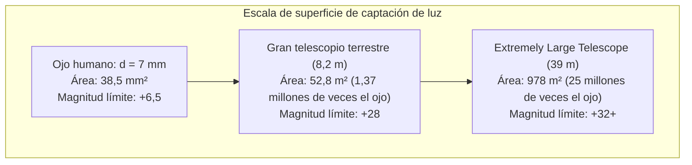

Cuando miramos al cielo nocturno, observamos directamente el pasado. La luz de la Luna tarda 1,3 segundos en llegar; la del Sol, 8 minutos y 20 segundos; la de la galaxia de Andrómeda ha viajado 2,5 millones de años; y los cúmulos de galaxias más lejanos nos muestran el cosmos tal como era hace más de 13.000 millones de años.

En el marco de la física, un telescopio no es una lupa de aumento, sino <strong>una máquina del tiempo fotónica de máxima precisión: un instrumento óptico diseñado para capturar flujos extremadamente débiles de radiación electromagnética a través de distancias cósmicas y controlar los frentes de onda a escala nanométrica</strong>.

Desde 1609, cuando Galileo Galilei apuntó su pequeño telescopio refractor hacia el firmamento, hasta el Telescopio Espacial James Webb (JWST) en el punto de Lagrange L2 con su espejo de berilio chapado en oro de 6,5 metros, y el Extremely Large Telescope (ELT) de 39 metros en Chile, la capacidad humana para desentrañar el cosmos ha crecido de forma prodigiosa.

---

### 1. El límite fisiológico del ojo humano y la física de la recolección de luz

El ojo humano presenta limitaciones biológicas insalvables como sensor astronómico:
- <strong>Pupila de apertura reducida</strong>: El diámetro de la pupila humana adaptada a la oscuridad es de apenas $d_{eye} \approx 7\,\mathrm{mm}$ (área de $38,5\,\mathrm{mm}^2$);
- <strong>Tiempo de integración nulo</strong>: La retina no puede acumular fotones en exposiciones prolongadas; su tiempo de integración es de apenas $0,1\,\mathrm{segundos}$;
- <strong>Ley del inverso del cuadrado</strong>: Los fotones de galaxias situadas a miles de millones de años luz llegan con una densidad de apenas unos pocos fotones por metro cuadrado y hora.

La función física primordial de un telescopio es su <strong>Poder de Recolección de Luz (Light Gathering Power)</strong>. El área colectora $A$ escala con el cuadrado del diámetro $D$:

$$A = \frac{\pi}{4} D^2$$

Un telescopio de 8,2 metros recoge <strong>1,37 millones de veces más fotones por segundo</strong> que el ojo humano. Con detectores astronómicos CCD/CMOS enfriados criogénicamente y exposiciones de decenas de horas, es posible observar objetos miles de millones de veces más tenues que el límite del ojo humano.

---

### 2. Refractores frente a reflectores: La aberración cromática y el límite del vidrio

La historia de los telescopios enfrentó dos caminos ópticos: lentes (refractores) y espejos curvos (reflectores).

#### La aberración cromática en las lentes
En cualquier medio transparente, el índice de refracción $n(\lambda)$ varía con la longitud de onda de la luz (ecuación de Cauchy). La luz azul sufre mayor refracción que la luz roja:

$$f_{\text{azul}} < f_{\text{rojo}}$$

Esto genera bordes coloreados y falta de nitidez en la imagen. Aunque los dobletes acromáticos redujeron este efecto, las lentes sufren límites mecánicos infranqueables:
1. <strong>Deformación gravitacional</strong>: Las lentes sólo pueden sujetarse por su borde perimetral; al superar 1 metro de diámetro, el propio peso del vidrio deforma su curvatura;
2. <strong>Absorción interna</strong>: El vidrio grueso absorbe la radiación ultravioleta y visible;
3. <strong>Pulido bilateral</strong>: Exige pulir con precisión nanométrica ambas caras de la lente.

En 1897, el refractor de 40 pulgadas (1,02 m) del Observatorio Yerkes cerró la era de los grandes telescopios de lentes.

#### El triunfo absoluto de los reflectores
En 1668, Isaac Newton construyó el primer telescopio reflector. <strong>¡La ley de reflexión ($\theta_i = \theta_r$) no depende de la longitud de onda!</strong>
- Todos los colores convergen en el <strong>mismo foco geométrico, eliminando por completo la aberración cromática ($0$)</strong>;
- Los espejos pueden sujetarse en toda su cara posterior mediante actuadores mecánicos y neumáticos;
- El diseño <strong>Ritchey-Chrétien (RC)</strong> con dos espejos hiperbólicos elimina simultáneamente la aberración esférica y el coma, siendo el estándar actual en Hubble, VLT y Subaru.

---

### 3. Apertura y óptica ondulatoria: El límite de difracción y el disco de Airy

El diámetro $D$ dicta también la <strong>resolución angular</strong> del instrumento. Debido a la difracción de Fraunhofer por una apertura circular, una estrella puntual se proyecta como un <strong>disco de Airy</strong> rodeado de anillos concéntricos.
El primer mínimo de difracción define el <strong>criterio de Rayleigh</strong>:

$$\theta_{\text{diff}} \approx 1,22 \frac{\lambda}{D} \quad \text{[radianes]}$$

En segundos de arco:

$$\theta_{\text{arcsec}} \approx 2,52 \times 10^5 \times \frac{\lambda}{D} \quad [\text{segundos de arco}]$$

En luz visible ($\lambda = 550\,\mathrm{nm}$), el telescopio Hubble ($D = 2,4\,\mathrm{m}$) alcanza una resolución de $0,058''$. El futuro ELT de 39 metros alcanzará <strong>$0,0035''$ (3,5 milisegundos de arco)</strong>, suficiente para resolver detalles de 6,5 metros en la Luna.

---

### 4. La barrera atmosférica: Turbulencia y parámetro de Fried

En la superficie terrestre, la turbulencia del aire crea bolsas térmicas en continuo movimiento que desvían aleatoriamente los frentes de onda.

El <strong>parámetro de Fried ($r_0$)</strong> mide el tamaño espacial de coherencia óptica de la atmósfera. En el espectro visible rara vez supera los <strong>$10$ a $20\,\mathrm{cm}$</strong>, limitando la resolución efectiva de cualquier gran telescopio terrestre a un disco borroso de $0,5''$ a $1,0''$ (seeing disk).

---

### 5. Óptica adaptativa (AO) y estrellas guía láser

La <strong>óptica adaptativa</strong> mide las deformaciones del frente de onda a más de $1.000\,\mathrm{Hz}$ mediante un sensor Shack-Hartmann y acciona en tiempo real miles de actuadores piezoeléctricos bajo un espejo deformable para cancelar la turbulencia.
El uso de <strong>estrellas guía láser (LGS)</strong>, excitando la capa de sodio mesosférica a 90 km de altitud, permite obtener imágenes con resolución de difracción en casi todo el firmamento.

---

### 6. Espectroscopía: El código de barras del Universo

Más del 70 % del conocimiento astrofísico proviene de la <strong>espectroscopía</strong>:
- <strong>Líneas de Fraunhofer</strong>: Revelan la composición química de las estrellas mediante absorciones atómicas discretas ($\Delta E = h\nu$);
- <strong>Efecto Doppler y corrimiento al rojo</strong>: Cuantifican la velocidad radial y la expansión del universo (ley de Hubble);
- <strong>Espectrógrafos Echelle</strong>: Detectan variaciones de velocidad estelar de centímetros por segundo, permitiendo descubrir miles de exoplanetas.

---

### 7. Observatorios espaciales y el James Webb (JWST)

Para sortear la absorción atmosférica en bandas infrarrojas y ultravioletas, los telescopios deben orbitar en el espacio.

El <strong>JWST</strong> (lanzado en 2021) opera en el punto L2:
- Espejo de 6,5 metros formado por 18 hexágonos de berilio chapados en oro (100 nm de espesor) optimizado para el infrarrojo;
- Parasol de 5 capas que mantiene una temperatura pasiva de $-233^\circ\mathrm{C}$ ($40\,\mathrm{K}$);
- Criorefrigerador de helio que enfría el instrumento MIRI a <strong>$6,7\,\mathrm{K}$ ($-266,45^\circ\mathrm{C}$)</strong> para eliminar el ruido térmico propio.

---

### 8. Conclusión

Desde las lentes de Galileo hasta el JWST y el ELT de 39 metros, la evolución de los telescopios representa la victoria de la óptica y la ingeniería sobre las limitaciones de la difracción y la atmósfera, permitiéndonos presenciar el origen mismo de las estrellas y de la materia.
