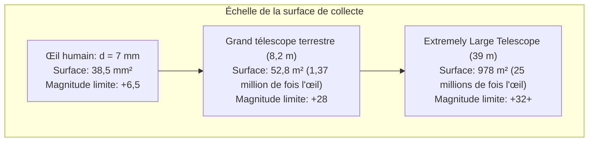

Lorsque nous contemplons la voûte céleste nocturne, nous observons le passé. La lumière de la Lune nous parvient avec un décalage de 1,3 seconde, celle du Soleil de 8 minutes et 20 secondes, celle de la galaxie d'Andromède a voyagé pendant 2,5 millions d'années, et les amas de galaxies les plus reculés nous révèlent l'Univers tel qu'il était il y a plus de 13 milliards d'années.

Fondamentalement, un télescope n'est pas une simple loupe grossissante : c'est <strong>une machine à remonter le temps photonique d'une précision absolue, conçue pour collecter d'infimes flux de rayonnement électromagnétique à travers les immensités cosmiques et contrôler leurs fronts d'onde à l'échelle nanométrique</strong>.

Depuis 1609, lorsque Galilée pointa sa première lunette vers le ciel, jusqu'au télescope spatial James Webb (JWST) opérant au point de Lagrange L2 avec son miroir en béryllium doré de 6,5 mètres, et la construction du Télescope géant européen (ELT) de 39 mètres équipé d'optique adaptative, l'humanité a sans cesse repoussé les limites de la physique optique.

---

### 1. La limite biologique de l'œil humain et la puissance de collecte

L'œil humain présente de sévères restrictions en tant que détecteur :
- <strong>Diamètre pupillaire restreint</strong> : La pupille dilatée dans l'obscurité ne dépasse pas $d_{eye} \approx 7\,\mathrm{mm}$ (surface d'environ $38,5\,\mathrm{mm}^2$) ;
- <strong>Absence d'accumulation temporelle</strong> : Le temps d'intégration rétinien est limité à environ $0,1\,\mathrm{seconde}$, interdisant toute pose longue ;
- <strong>Décroissance en carré inverse du flux lumineux</strong> : Les photons issus de galaxies lointaines arrivent avec une parcimonie extrême (quelques unités par mètre carré et par heure).

La première fonction essentielle d'un télescope est son <strong>pouvoir collecteur de lumière (Light Gathering Power)</strong>. La surface de collecte $A$ croît avec le carré du diamètre $D$ :

$$A = \frac{\pi}{4} D^2$$

Un télescope de 8,2 mètres collecte <strong>1,37 million de fois plus de photons par seconde</strong> que l'œil humain. Couplé à des capteurs CCD/CMOS refroidis offrant un rendement quantique supérieur à 90 %, il permet d'enregistrer des astres des milliards de fois plus faibles que la limite visuelle humaine.

---

### 2. Réfracteurs contre réflecteurs : L'aberration chromatique et la supériorité des miroirs

L'histoire des télescopes a vu s'affronter deux principes fondamentaux : les lunettes réfractrices (à lentilles) et les télescopes réflecteurs (à miroirs).

#### L'aberration chromatique des lentilles
Dans un milieu transparent comme le verre, l'indice de réfraction $n(\lambda)$ varie selon la longueur d'onde de la lumière (loi de dispersion de Cauchy). La lumière bleue, de plus courte longueur d'onde, subit une réfraction plus prononcée que la lumière rouge :

$$f_{\text{bleu}} < f_{\text{rouge}}$$

Ce phénomène crée des halos colorés flous autour des astres. Bien que les doublets achromatiques aient atténué ce défaut, les lentilles se heurtent à des barrières physiques rédhibitoires :
1. <strong>Flexion gravitationnelle</strong> : Une lentille ne peut être soutenue que par sa périphérie ; au-delà d'un mètre de diamètre, le verre ploie sous son propre poids ;
2. <strong>Absorption interne</strong> : Les verres épais absorbent le rayonnement ultraviolet et visible ;
3. <strong>Double surface optique</strong> : Il faut polir deux faces avec une précision nanométrique.

Le télescope de 40 pouces (1,02 m) de Yerkes en 1897 marque ainsi la fin définitive des grands réfracteurs.

#### Le triomphe du télescope réflecteur
En 1668, Isaac Newton conçoit le premier télescope à miroir concave. <strong>La loi de la réflexion ($\theta_i = \theta_r$) est strictement indépendante de la longueur d'onde !</strong>
- Tous les photons sont réfléchis au <strong>même foyer géométrique, annulant l'aberration chromatique ($0$)</strong> ;
- Le miroir peut être soutenu sur toute sa face arrière par des vérins pneumatiques ou piézoélectriques ;
- La configuration moderne <strong>Ritchey-Chrétien (RC)</strong>, employant deux miroirs hyperboliques, élimine conjointement l'aberration sphérique et la coma.

---

### 3. Ouverture et optique ondulatoire : Limite de diffraction et disque d'Airy

Le diamètre $D$ détermine également le <strong>pouvoir de résolution angulaire</strong> du télescope.

En optique ondulatoire, la diffraction de Fraunhofer par l'ouverture circulaire transforme une étoile ponctuelle en une tache centrale entourée d'anneaux : le <strong>disque d'Airy</strong>.
Le premier anneau sombre définit le <strong>critère de Rayleigh</strong> :

$$\theta_{\text{diff}} \approx 1,22 \frac{\lambda}{D} \quad \text{[radians]}$$

En secondes d'arc :

$$\theta_{\text{arcsec}} \approx 2,52 \times 10^5 \times \frac{\lambda}{D} \quad [\text{secondes d'arc}]$$

Pour la lumière visible ($\lambda = 550\,\mathrm{nm}$), Hubble ($D = 2,4\,\mathrm{m}$) atteint une limite théorique de $0,058''$. Le futur ELT de 39 mètres atteindra <strong>$0,0035''$ (3,5 millisecondes d'arc)</strong>, permettant de distinguer un objet de 6,5 mètres sur la surface de la Lune !

---

### 4. L'obstacle de l'atmosphère : Turbulence et paramètre de Fried

Sur Terre, la turbulence atmosphérique dégrade irrémédiablement ces performances théoriques. Les tourbillons thermiques de l'air créent des fluctuations d'indice de réfraction.

Le <strong>paramètre de Fried ($r_0$)</strong> mesure la taille des zones atmosphériques optiquement cohérentes. Dans le domaine visible, $r_0$ ne dépasse pas <strong>$10$ à $20\,\mathrm{cm}$</strong>, même sur les sommets du Chili ou de Hawaï. Sans correction, la résolution des télescopes géants est plafonnée à environ $0,5''$ à $1,0''$ (le disque de seeing), équivalent à celle d'un instrument d'amateur de 15 cm.

---

### 5. La correction en temps réel : L'optique adaptative (AO)

L'<strong>optique adaptative</strong> mesure la distorsion du front d'onde à plus de $1\,000\,\mathrm{Hz}$ à l'aide d'un analyseur Shack-Hartmann et déforme un miroir flexible supporté par des milliers d'actionneurs piézoélectriques pour compenser la turbulence en temps réel.
Grâce aux <strong>étoiles guides laser (LGS)</strong> excitant les atomes de sodium à 90 km d'altitude, les observatoires terrestres atteignent désormais leur limite de diffraction théorique sur l'ensemble de la voûte céleste.

---

### 6. La spectroscopie : Déchiffrer l'empreinte digitale des étoiles

Plus de 70 % des données en astrophysique proviennent de la <strong>spectroscopie</strong> :
- <strong>Raies de Fraunhofer</strong> : L'absorption d'énergie par les atomes ($\Delta E = h\nu$) révèle la composition chimique stellaire ;
- <strong>Effet Doppler et décalage vers le rouge (redshift)</strong> : Mesure de la récession des galaxies et de l'expansion de l'Univers ;
- <strong>Spectrographes Echelle</strong> : Mesure de la vitesse radiale avec une précision de quelques centimètres par seconde pour détecter des exoplanètes.

---

### 7. Les télescopes spatiaux et le James Webb (JWST)

Pour échapper à l'absorption atmosphérique (infrarouge, ultraviolet, rayons X), les télescopes spatiaux sont indispensables.

Lancé en 2021, le <strong>JWST</strong> est une merveille technologique :
- Miroir primaire de 6,5 mètres composé de 18 hexagones en béryllium recouverts d'une couche d'or pur de 100 nm ;
- Bouclier thermique à 5 couches assurant une température passive de $-233^\circ\mathrm{C}$ ($40\,\mathrm{K}$) au point de Lagrange L2 ;
- Cryoréfrigérateur à hélium refroidissant l'instrument MIRI à <strong>$6,7\,\mathrm{K}$ ($-266,45^\circ\mathrm{C}$)</strong> pour neutraliser le bruit thermique infrarouge.

---

### 8. Conclusion

Des premières lentilles de Galilée aux géants modernes au sol et dans l'espace, l'histoire des télescopes est celle de la maîtrise de la lumière contre la diffraction et la turbulence. Ces instruments représentent l'extension ultime de la conscience humaine pour percer les mystères de l'Univers.
