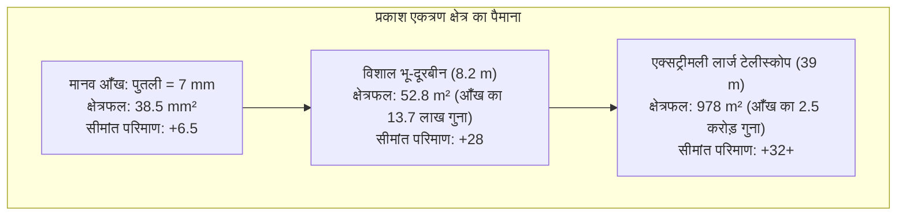

जब हम रात के आकाश की ओर देखते हैं, तो हम वास्तव में अतीत को देख रहे होते हैं। चंद्रमा का प्रकाश 1.3 सेकंड पुराना है, सूर्य का प्रकाश 8 मिनट और 20 सेकंड पहले चला था, एंड्रोमेडा आकाशगंगा का प्रकाश 25 लाख वर्ष की यात्रा करके हम तक पहुंचता है, और सुदूर ब्रह्मांडीय आकाशगंगाएं हमें उस समय का दृश्य दिखाती हैं जब बिग बैंग के बाद ब्रह्मांड अपनी बाल्यावस्था में था।

भौतिकी के दृष्टिकोण से दूरबीन केवल वस्तुओं को बड़ा करके दिखाने वाला आवर्धक लेंस नहीं है। यह <strong>एक अत्यंत सटीक फोटोनिक टाइम मशीन है: एक ऐसा प्रकाशीय यंत्र जिसे ब्रह्मांडीय दूरियों से आने वाले अत्यंत क्षीण विद्युत चुम्बकीय विकिरण को इकट्ठा करने और नैनोमीटर स्तर पर तरंगों के कला-अग्र (Wavefront) को नियंत्रित करके ब्रह्मांड के रहस्यों को उजागर करने के लिए बनाया गया है</strong>।

1609 में जब गैलीलियो गैलीली ने अपनी हाथ से बनी छोटी अपवर्तक दूरबीन को आकाश की ओर घुमाया था, तब से लेकर आज लैग्रेंज बिंदु L2 पर स्थित 6.5-मीटर के सोने की परत चढ़े बेरिलियम दर्पण वाले जेम्स वेब स्पेस टेलीस्कोप (JWST) और चिली के अटाकामा मरुस्थल में लेजर गाइड स्टार्स से लैस 39-मीटर के एक्सट्रीमली लार्ज टेलीस्कोप (ELT) तक, मानव जाति ने प्रकाशिकी के नियमों में महारत हासिल कर ली है।

---

### 1. मानव आँख की सीमाएँ और प्रकाश एकत्र करने की भौतिक अनिवार्यता

विशाल दूरबीनों की आवश्यकता को समझने के लिए पहले मानव आँख की सीमाओं को समझना होगा:
- <strong>अत्यंत छोटा पुतली व्यास</strong>: अंधेरे में पूरी तरह फैलने के बाद भी मानव पुतली का व्यास $d_{eye}$ मात्र $7\,\mathrm{mm}$ (क्षेत्रफल $38.5\,\mathrm{mm}^2$) होता है;
- <strong>लंबे एक्सपोजर का अभाव</strong>: रेटिना का एकीकरण समय मात्र $0.1\,\mathrm{सेकंड}$ होता है, जिससे यह कई घंटों तक प्रकाश को संचित नहीं कर सकती;
- <strong>दूरी का व्युत्क्रम-वर्ग नियम</strong>: 13 अरब प्रकाश-वर्ष दूर स्थित किसी आदिम आकाशगंगा से पृथ्वी पर प्रति वर्ग मीटर प्रति घंटे केवल कुछ ही फोटॉन पहुंचते हैं।

किसी भी दूरबीन का प्राथमिक कार्य <strong>प्रकाश एकत्र करने की क्षमता (Light Gathering Power)</strong> है। प्रकाश संचयन क्षेत्र $A$ दर्पण के व्यास $D$ के वर्ग के समानुपाती होता है:

$$A = \frac{\pi}{4} D^2$$

एक 8.2-मीटर व्यास वाली दूरबीन मानव आँख की तुलना में प्रति सेकंड <strong>13.7 लाख गुना अधिक फोटॉन</strong> एकत्र करती है। शून्य से नीचे ठंडे किए गए 90% से अधिक क्वांटम दक्षता वाले खगोलीय कैमरों के साथ कई घंटों का एक्सपोजर लेकर हम नंगी आँखों से खरबों गुना धुंधले तारों को भी स्पष्ट देख सकते हैं।

---

### 2. अपवर्तक बनाम परावर्तक: वर्ण विपथन और कांच के भौतिक अवरोध

दूरबीनों का इतिहास कांच के लेंसों (अपवर्तक) और अवतल दर्पणों (परावर्तक) के बीच संघर्ष का इतिहास रहा है।

#### वर्ण विपथन (Chromatic Aberration) की समस्या
पारदर्शी कांच में प्रकाश का अपवर्तनांक $n(\lambda)$ तरंग दैर्ध्य पर निर्भर करता है (कॉची का विक्षेपण नियम)। छोटी तरंग दैर्ध्य वाला नीला प्रकाश लाल प्रकाश की तुलना में अधिक मुड़ता है:

$$f_{\text{नीला}} < f_{\text{लाल}}$$

परिणामस्वरूप, तारों के चारों ओर रंगीन धुंधले घेरे बन जाते हैं। हालांकि दोहरे लेंसों (Achromat) से इसमें सुधार किया गया, लेकिन विशाल लेंसों की कुछ घातक सीमाएँ हैं:
1. <strong>गुरुत्वाकर्षण के कारण झुकाव</strong>: लेंस को केवल किनारों से सहारा दिया जा सकता है; 1 मीटर से बड़े व्यास का भारी लेंस अपने ही वजन से झुक जाता है;
2. <strong>प्रकाश का अवशोषण</strong>: मोटा कांच पराबैंगनी प्रकाश को सोख लेता है और विशाल कांच को बिना बुलबुले के ढालना असंभव है;
3. <strong>दोहरी सतह की घिसाई</strong>: लेंस के दोनों तरफ नैनोमीटर सटीकता से पॉलिश करना अनिवार्य होता है।

1897 में स्थापित यर्क्स वेधशाला की 40-इंच (1.02 मीटर) दूरबीन इतिहास की अंतिम विशाल अपवर्तक दूरबीन साबित हुई।

#### परावर्तक दूरबीनों की पूर्ण विजय
1668 में आइजैक न्यूटन ने परावर्तक दूरबीन बनाई। <strong>प्रकाश के परावर्तन का नियम ($\theta_i = \theta_r$) प्रकाश की तरंग दैर्ध्य पर बिल्कुल निर्भर नहीं करता!</strong>
- अवतल दर्पण सभी रंगों के प्रकाश को <strong>एक ही ज्यामितीय फोकस पर केंद्रित करता है, जिससे वर्ण विपथन पूरी तरह शून्य ($0$) हो जाता है</strong>;
- दर्पण को पीछे से पूरी तरह यांत्रिक और वायवीय एक्ट्यूएटर्स द्वारा सहारा दिया जा सकता है;
- आधुनिक <strong>रिची-क्रेचियन (RC)</strong> प्रणाली दो अतिपरवलयिक दर्पणों का उपयोग करके गोलीय विपथन और कोमा दोनों को समाप्त करती है (हबल और वीएलटी का मानक)।

---

### 3. एपर्चर और तरंग प्रकाशिकी: विवर्तन सीमा और एरी डिस्क (Airy Disk)

दर्पण का व्यास $D$ केवल प्रकाश ही नहीं बढ़ाता, बल्कि <strong>कोणीय विभेदन (Angular Resolution)</strong> भी निर्धारित करता है।
वृत्ताकार छिद्र से गुजरने पर प्रकाश का फ्राउनहोफर विवर्तन होता है, जिससे तारे की छवि एक केंद्रीय चमकीली डिस्क और संकेंद्री वलयों के रूप में बनती है जिसे <strong>एरी डिस्क (Airy Disk)</strong> कहते हैं।
पहला अंधकार वलय <strong>रेले के विभेदन मानदंड</strong> को परिभाषित करता है:

$$\theta_{\text{diff}} \approx 1.22 \frac{\lambda}{D} \quad \text{[रेडियन]}$$

आर्कसेकंड (Arcsecond) में:

$$\theta_{\text{arcsec}} \approx 2.52 \times 10^5 \times \frac{\lambda}{D} \quad [\text{आर्कसेकंड}]$$

दृश्य प्रकाश ($\lambda = 550\,\mathrm{nm}$) में हबल ($D = 2.4\,\mathrm{m}$) का विभेदन $0.058''$ है। वहीं 39-मीटर का ईएलटी <strong>$0.0035''$ (3.5 मिलीआर्कसेकंड)</strong> प्राप्त करेगा, जिससे चंद्रमा की सतह पर केवल 6.5 मीटर की वस्तु को भी अलग देखा जा सकेगा!

---

### 4. वायुमंडलीय अवरोध: अशांति और फ्रीड पैरामीटर (Fried Parameter)

पृथ्वी की अशांत वायुमंडलीय हवाएं प्रकाश की तरंगों को विकृत कर देती हैं।
<strong>फ्रीड पैरामीटर ($r_0$)</strong> वायुमंडल के प्रकाशीय सुसंगतता आकार को मापता है, जो दृश्य प्रकाश में मात्र <strong>$10$ से $20\,\mathrm{cm}$</strong> होता है। इस अशांति के कारण बिना सुधार के सभी विशाल भू-दूरबीनों की स्पष्टता केवल $0.5''$ से $1.0''$ के धुंधले वृत्त (सीइंग डिस्क) तक सीमित रह जाती है।

---

### 5. वायुमंडल को मात देना: अनुकूली प्रकाशिकी (Adaptive Optics)

<strong>अनुकूली प्रकाशिकी</strong> शाक-हार्टमैन सेंसर द्वारा प्रति सेकंड 1,000 से अधिक बार वायुमंडलीय तरंग विकृति को मापती है और हजारों पीजोइलेक्ट्रिक एक्ट्यूएटर्स की मदद से एक पतले लचीले दर्पण को विकृत करके वास्तविक समय में इस अशांति को पूरी तरह निष्प्रभावी कर देती है।
90 किमी की ऊंचाई पर सोडियम परमाणुओं को उत्तेजित करने वाले <strong>लेजर गाइड स्टार (LGS)</strong> के साथ भू-दूरबीनें अब पूरे आकाश में हबल से भी बेहतर विवर्तन सीमा वाली स्पष्ट छवियां प्राप्त करती हैं।

---

### 6. खगोलीय स्पेक्ट्रोस्कोपी: ब्रह्मांड का बारकोड

खगोलभौतिकी के 70% से अधिक शोध <strong>स्पेक्ट्रोस्कोपी</strong> पर आधारित हैं:
- <strong>फ्राउनहोफर अवशोषण रेखाएं</strong>: तारों के वातावरण में परमाणुओं द्वारा विशिष्ट फोटॉनों का अवशोषण रासायनिक संरचना का सटीक फिंगरप्रिंट प्रदान करता है;
- <strong>डॉप्लर प्रभाव और रेडशिफ्ट</strong>: तारों और आकाशगंगाओं के पीछे हटने की गति और ब्रह्मांड के विस्तार (हबल का नियम) को मापता है;
- <strong>एशेल स्पेक्ट्रोग्राफ</strong>: तारों की गति में सेंटीमीटर प्रति सेकंड के अत्यंत सूक्ष्म खिंचाव को मापकर बाह्यग्रहों (Exoplanets) की खोज करता है।

---

### 7. अंतरिक्ष वेधशालाएं और जेम्स वेब स्पेस टेलीस्कोप (JWST)

वायुमंडलीय अवशोषण (अवरक्त और पराबैंगनी किरणों के क्षय) से बचने के लिए दूरबीनों को अंतरिक्ष में स्थापित किया जाता है।

2021 में प्रक्षेपित <strong>JWST</strong> आधुनिक इंजीनियरिंग का चमत्कार है:
- 18 हेक्सागोनल बेरिलियम टुकड़ों से बना 6.5-मीटर का प्राथमिक दर्पण, जिस पर 98% अवरक्त परावर्तन के लिए 100 नैनोमीटर शुद्ध सोने की परत चढ़ाई गई है;
- 5-परतों वाली टेनिस-कोर्ट जितनी बड़ी सनशील्ड जो L2 बिंदु पर $-233^\circ\mathrm{C}$ ($40\,\mathrm{K}$) का निष्क्रिय शीतलन प्रदान करती है;
- बंद हीलियम लूप क्रायोकूलर जो MIRI उपकरण को <strong>$6.7\,\mathrm{K}$ ($-266.45^\circ\mathrm{C}$)</strong> तक ठंडा रखता है ताकि दूरबीन का अपना थर्मल शोर समाप्त हो सके।

---

### 8. निष्कर्ष

गैलीलियो की लकड़ी की नली से लेकर जेम्स वेब के सोने के दर्पण और 39-मीटर के ईएलटी तक, दूरबीनों का विकास प्रकाशिकी, विवर्तन और वायुमंडलीय बाधाओं पर मानव बुद्धि की ऐतिहासिक विजय है। दूरबीनें समय की शुरुआत से चले आ रहे प्राचीनतम फोटॉनों को पकड़कर हमारे अस्तित्व और ब्रह्मांड के मूल रहस्यों को उजागर करने वाली सबसे गहरी आंखें हैं।
