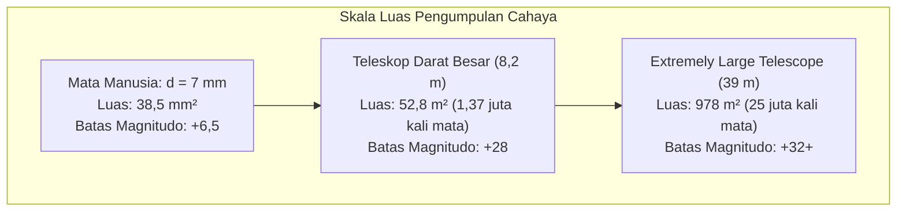

Saat kita menatap langit malam, kita sedang memandang masa lalu. Cahaya Bulan memerlukan 1,3 detik untuk tiba; cahaya Matahari 8 menit 20 detik; cahaya Galaksi Andromeda telah mengarungi ruang selama 2,5 juta tahun; dan gugus galaksi terjauh menampilkan kosmos saat berusia kurang dari 1 miliar tahun setelah Big Bang.

Dalam kacamata fisika murni, teleskop bukanlah sekadar kaca pembesar. Teleskop adalah <strong>mesin waktu fotonik presisi tinggi: instrumen optik yang dirancang untuk mengumpulkan fluks radiasi elektromagnetik yang teramat lemah melintasi ruang kosmik dan mengendalikan muka gelombang pada skala nanometer</strong>.

Sejak Galileo Galilei mengarahkan teropong refraktor buatannya ke langit pada tahun 1609 hingga era Teleskop Luar Angkasa James Webb (JWST) dengan cermin berilium berlapis emas 6,5 meter dan pembangunan Extremely Large Telescope (ELT) 39 meter di Cile, eksplorasi alam semesta terus mendobrak batas-batas fisik optika.

---

### 1. Keterbatasan Biologis Mata Manusia dan Daya Kumpul Cahaya

Mata manusia memiliki keterbatasan parah sebagai detektor astronomi:
- <strong>Bukaan pupil amat kecil</strong>: Pupil manusia yang beradaptasi gelap hanya berdiameter $d_{eye} \approx 7\,\mathrm{mm}$ (luas $38,5\,\mathrm{mm}^2$);
- <strong>Ketiadaan akumulasi foton</strong>: Waktu integrasi retina hanya sekitar $0,1\,\mathrm{detik}$, mustahil melakukan eksposur panjang;
- <strong>Hukum kuadrat terbalik</strong>: Fluks foton dari galaksi purba yang menempuh miliaran tahun cahaya sangat jarang, hanya beberapa foton per meter persegi per jam.

Fungsi utama teleskop adalah <strong>Daya Kumpul Cahaya (Light Gathering Power)</strong>. Luas permukaan pengumpul $A$ sebanding dengan kuadrat diameter $D$:

$$A = \frac{\pi}{4} D^2$$

Teleskop 8,2 meter mengumpulkan <strong>1,37 juta kali lebih banyak foton per detik</strong> dibanding mata manusia. Menggunakan sensor CCD/CMOS astronomi berpendingin kriogenik dengan efisiensi kuantum melampaui 90%, para astronom dapat mendeteksi benda langit miliaran kali lebih redup dari batas penglihatan manusia.

---

### 2. Refraktor vs Reflektor: Aberasi Kromatik dan Batas Fisik Lensa Kaca

Sejarah teleskop diwarnai persaingan antara teleskop pembias (refraktor lensa) dan pemantul (reflektor cermin).

#### Hambatan Aberasi Kromatik pada Lensa
Pada medium kaca, indeks bias $n(\lambda)$ bervariasi menurut panjang gelombang cahaya (dispersi Cauchy). Cahaya biru bergelombang pendek dibiaskan lebih tajam daripada cahaya merah:

$$f_{\text{biru}} < f_{\text{merah}}$$

Hal ini menimbulkan lingkaran kabur berwarna di sekitar bintang (aberasi kromatik). Meskipun ditemukan lensa akromatik ganda, lensa kaca memiliki kelemahan struktural fatal:
1. <strong>Lenturan Gravitasi</strong>: Lensa hanya bisa ditopang pada tepian bingkai; jika diameternya melebihi 1 meter, kaca masif seberat berton-ton akan melengkung akibat bobotnya sendiri;
2. <strong>Penyerapan Cahaya Internal</strong>: Kaca tebal menyerap radiasi ultraviolet dan cahaya tampak;
3. <strong>Polesan Ganda</strong>: Permukaan depan dan belakang harus dipoles presisi dalam skala nanometer.

Teleskop refraktor 40 inci (1,02 m) di Observatorium Yerkes tahun 1897 menjadi refraktor raksasa terakhir dalam sejarah.

#### Keunggulan Mutlak Teleskop Reflektor
Pada tahun 1668, Isaac Newton menciptakan teleskop reflektor pertama. <strong>Hukum pemantulan cahaya ($\theta_i = \theta_r$) sama sekali tidak bergantung pada panjang gelombang!</strong>
- Cermin cekung memfokuskan semua warna ke <strong>titik fokus geometris yang persis sama, meniadakan aberasi kromatik ($0$)</strong>;
- Bagian belakang cermin dapat ditopang penuh oleh ratusan aktuator mekanik dan pneumatik;
- Desain <strong>Ritchey-Chrétien (RC)</strong> menggunakan sepasang cermin hiperbolik untuk mengeliminasi aberasi sferis dan koma sekaligus (standar Hubble dan VLT).

---

### 3. Bukaan dan Optika Gelombang: Batas Difraksi dan Piringan Airy

Diameter bukaan $D$ juga menentukan <strong>resolusi sudut (ketajaman pemisahan objek)</strong>. Akibat difraksi Fraunhofer melalui bukaan bundar, bintang tampak sebagai <strong>piringan Airy</strong> yang dikelilingi cincin-cincin difraksi.
Pita gelap pertama merumuskan <strong>kriteria Rayleigh</strong>:

$$\theta_{\text{diff}} \approx 1,22 \frac{\lambda}{D} \quad \text{[radian]}$$

Dalam detik busur:

$$\theta_{\text{arcsec}} \approx 2,52 \times 10^5 \times \frac{\lambda}{D} \quad [\text{detik busur}]$$

Pada spektrum tampak ($\lambda = 550\,\mathrm{nm}$), Teleskop Hubble ($D = 2,4\,\mathrm{m}$) memiliki resolusi $0,058''$. ELT 39 meter mendatang akan mencapai <strong>$0,0035''$ (3,5 milidetik busur)</strong>, sanggup membedakan obyek berukuran 6,5 meter di Bulan!

---

### 4. Halangan Atmosfer Bumi: Turbulensi dan Parameter Fried

Di permukaan Bumi, turbulensi atmosferik akibat pusaran udara panas mengacak fase muka gelombang cahaya.

<strong>Parameter Fried ($r_0$)</strong> mengukur diameter area koheren optik atmosfer. Pada panjang gelombang tampak, $r_0$ jarang melampaui <strong>$10$ hingga $20\,\mathrm{cm}$</strong>, sehingga resolusi teleskop darat terdegradasi menjadi piringan kabur sebesar $0,5''$ hingga $1,0''$ (*seeing disk*).

---

### 5. Menaklukkan Turbulensi: Optika Adaptif (AO)

Teknologi <strong>Optika Adaptif</strong> mengukur distorsi gelombang lebih dari $1.000\,\mathrm{Hz}$ dengan sensor Shack-Hartmann dan menggerakkan ribuan aktuator piezoelektrik pada cermin tipis fleksibel untuk menetralisir distorsi secara seketika.
Melalui teknologi <strong>Bintang Pandu Laser (LGS)</strong> yang menembakkan laser natrium 589 nm ke ketinggian 90 km, teleskop darat kini dapat beroperasi dengan ketajaman batas difraksi di hampir seluruh penjuru langit.

---

### 6. Spektroskopi Astronomi: Membaca Sidik Jari Kimia Kosmos

Lebih dari 70% penemuan astrofisika dihasilkan melalui <strong>spektroskopi</strong>:
- <strong>Garis Serapan Fraunhofer</strong>: Transisi energi elektron atomik ($\Delta E = h\nu$) mengungkap kelimpahan unsur kimia bintang;
- <strong>Efek Doppler dan Pergeseran Merah</strong>: Mengukur kecepatan radial dan ekspansi alam semesta (hukum Hubble);
- <strong>Spektrograf Echelle</strong>: Mendeteksi goyangan kecepatan bintang hingga orde sentimeter per detik untuk menemukan planet ekstrasurya.

---

### 7. Teleskop Luar Angkasa dan James Webb (JWST)

Untuk menghindari penyerapan atmosfer pada pita inframerah dan ultraviolet, teleskop harus diluncurkan ke antariksa.

Teleskop <strong>JWST</strong> (diluncurkan 2021) beroperasi di orbit Lagrange L2:
- Cermin berilium 6,5 meter tersusun atas 18 heksagon berlapis emas murni 100 nm dengan reflektivitas inframerah 98%;
- Perisai surya 5 lapis mempertahankan suhu pasif $-233^\circ\mathrm{C}$ ($40\,\mathrm{K}$);
- Pendingin kriogenik helium aktif mendinginkan instrumen MIRI hingga <strong>$6,7\,\mathrm{K}$ ($-266,45^\circ\mathrm{C}$)</strong> demi menghilangkan gangguan desah termal sendiri.

---

### 8. Kesimpulan

Dari tabung kecil Galileo hingga mahakarya cermin emas JWST dan ELT 39 meter, evolusi teleskop merupakan bukti keunggulan sains dan rekayasa dalam mengatasi hambatan refraksi, difraksi, dan turbulensi atmosfer demi menyingkap misteri kelahiran semesta.
