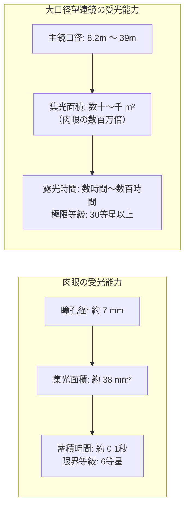
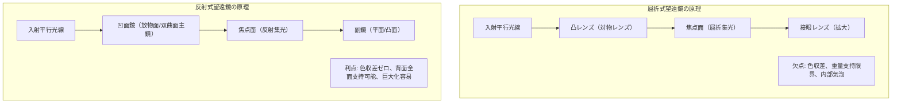
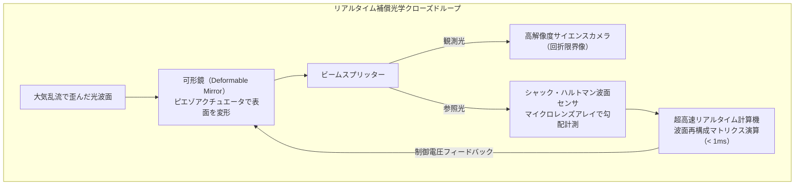
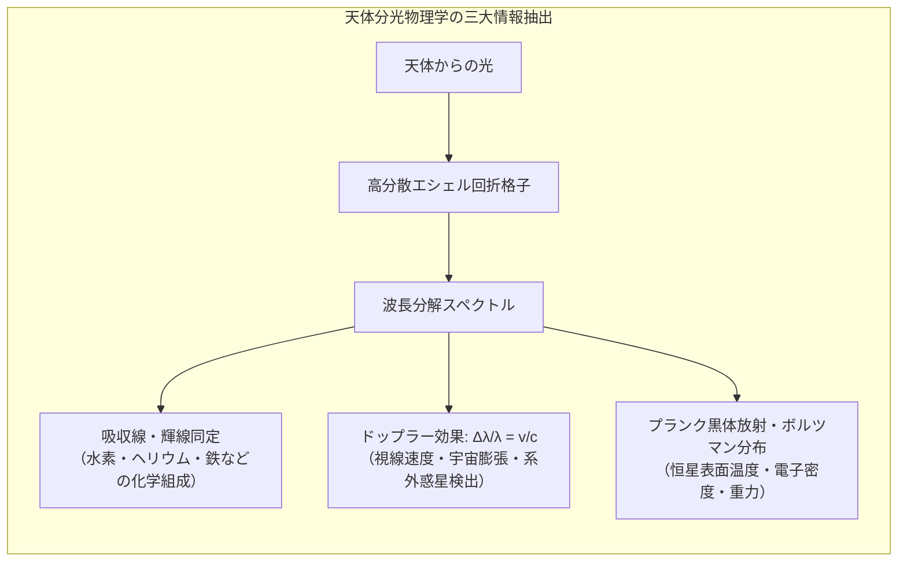
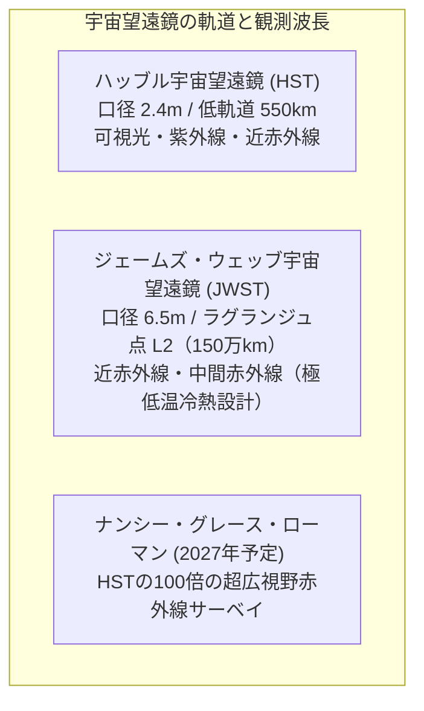
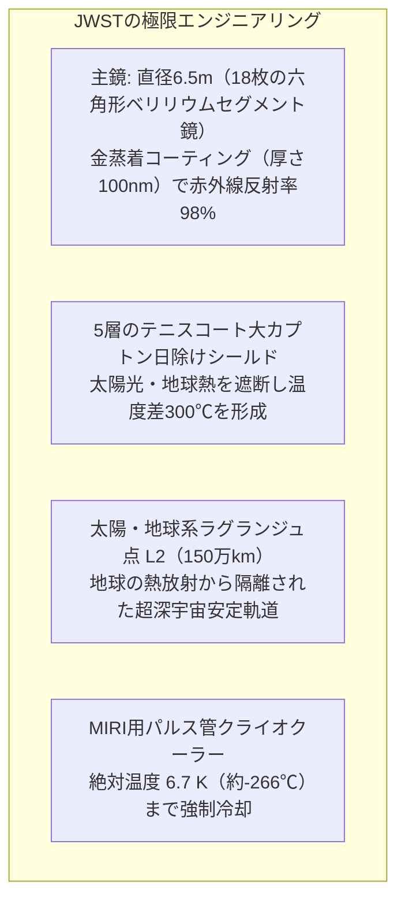

夜空を見上げるとき、私たちは過去の光を見ている。月は1.3秒前、太陽は8分20秒前、アンドロメダ銀河は250万年前、そして深宇宙の銀河団は130億年以上前の姿をとどめている。

望遠鏡とは、単に遠くの物体を拡大して見せる虫眼鏡ではない。物理学の本質において、望遠鏡とは<strong>「宇宙という巨大なタイムマシンから届く微弱極まりない光子（フォトン）をかき集め、光の波面をナノメートル単位で制御して時空の深淵を再構築する光情報収集装置」</strong>である。

1609年にガリレオ・ガリレイが手作りの小さな屈折望遠鏡を夜空に向け、木星の衛星や月面のクレーターを発見してから約400年。現代の天文学は、口径6.5メートルの黄金の主鏡を擁して太陽・地球系ラグランジュ点L2から宇宙最初期の星々を暴くジェームズ・ウェッブ宇宙望遠鏡（JWST）や、レーザーガイド星と数千個の圧電アクチュエータで地球大気の陽炎を打ち消す極大型地上望遠鏡（ELT）の時代へと到達した。

なぜ天文学者は巨費を投じて鏡を巨大化させ続けるのか。なぜ屈折レンズは鏡に取って代わられたのか。光の波動性と大気の乱れという根源的な物理的限界を、人類はどのような光学技術と数学的アルゴリズムによって克服してきたのか。幾何光学、波動光学、補償光学、分光天文学、そして宇宙望遠鏡の最前線まで、光を集める技術の全貌を徹底的に掘り下げていく。

---

### 1. 人類はなぜ光を集めるのか：肉眼の物理的限界

望遠鏡の本質を理解するには、まず人類の生体光学センサである「肉眼」の限界を知る必要がある。

人間の瞳孔径 $D_{eye}$ は、暗闇で最大限に散大しても約 $7\,\mathrm{mm}$（$0.007\,\mathrm{m}$）にすぎない。また、網膜上の視細胞（桿体・錐体）の受光時間（露出時間）は約 $0.1$ 秒であり、光を蓄積する機能を持たない。

天体から地球に届く光の強さ（照度）は、距離の2乗に反比例して減衰する。深宇宙に輝く130億光年彼方の銀河から届く光子は、1平方メートルあたり1秒間に数個から数千個という、極めて希薄なフォトン・ストリームである。直径 $7\,\mathrm{mm}$ の瞳孔を通過する光子の数は、1秒間に1個未満に落ち込み、人間の脳が神経信号として知覚することは物理的に不可能となる。

望遠鏡の第一の物理的役割は、<strong>「集光（Light Gathering）」</strong>である。
望遠鏡の主鏡や対物レンズの口径を $D$ とすると、受光面積 $A$ は直径の2乗に比例する：

$$A = \frac{\pi}{4} D^2$$

肉眼の瞳孔径を $d = 7\,\mathrm{mm}$、すばる望遠鏡などの口径を $D = 8.2\,\mathrm{m} = 8200\,\mathrm{mm}$ とすると、その集光力比率は：

$$\left(\frac{D}{d}\right)^2 = \left(\frac{8200}{7}\right)^2 \approx 1.37 \times 10^6$$

すなわち、すばる望遠鏡1基で、人間の肉眼137万個分もの光を同時に集めることができる。これに高感度CCD/CMOS冷却素子を組み合わせ、数時間におよぶ光子積算（フォトン・カウンティング）を行うことで、肉眼の数十億倍に達する感度で極微の星明かりを捉えることが可能となる。

---

### 2. 屈折式と反射式：幾何光学の二大潮流とガラスの壁

望遠鏡の歴史は、光を屈折させて集める「レンズ（屈折式）」と、光を反射させて集める「凹面鏡（反射式）」の闘争の歴史であった。

#### ガリレオ式とケプラー式（屈折望遠鏡）
1609年にガリレオが製作した望遠鏡は、凸レンズの対物レンズと凹レンズの接眼レンズを組み合わせた<strong>「ガリレオ式望遠鏡」</strong>であった。この方式は正立像が得られる利点があったが、視野が極めて狭く、倍率を上げると像が急激に暗くなる欠点があった。

1611年、ヨハネス・ケプラーは凸レンズ2枚を組み合わせた<strong>「ケプラー式望遠鏡」</strong>を考案した。像は倒立（上下左右逆）になるものの、広い視野と安定した高倍率が得られるため、以後の天体観測用屈折望遠鏡の標準となった。

#### 色収差（Chromatic Aberration）という致命的な壁
しかし、屈折望遠鏡には避けることのできない物理的宿命があった。それが<strong>「色収差」</strong>である。

ガラスなどの透明媒質の屈折率 $n$ は、光の波長 $\lambda$ に依存する（分散現象）。コーシーの分散式によれば、波長が短い光（青や紫）ほど屈折率が大きく、波長が長い光（赤）ほど屈折率は小さい：

$$n(\lambda) \approx A + \frac{B}{\lambda^2} + \frac{C}{\lambda^4}$$

対物レンズに白色光が入射すると、青い光はレンズの近くで焦点を結び、赤い光はレンズから遠い位置で焦点を結ぶ。その結果、恒星の周囲に青紫色のにじみ（ハロー）が発生し、微細構造が完全にぼやけてしまう。

17世紀の天文学者たちは、色収差を小さくするために焦点距離を極限まで引き延ばす道を選んだ。クリスティアーン・ホイヘンスらは、焦点距離が $40\,\mathrm{m}$ や $60\,\mathrm{m}$ に達する長大な「空気望遠鏡」を建設したが、わずかな風で鏡筒が揺れ、実用性は限界に達していた。

18世紀半ば、クラウンガラス（低分散）とフリントガラス（高分散）という屈折率の異なる2枚のレンズを張り合わせた<strong>「アクロマートレンズ」</strong>が発明され、2つの波長（赤と青）の焦点を一致させることが可能となった。さらに3枚のレンズを用いて3色を一致させる<strong>「アポクロマートレンズ」</strong>も登場したが、以下の工学的理由により、屈折望遠鏡の巨大化は口径 $1\,\mathrm{m}$ で永久に終焉を迎える：

1. <strong>重量と歪み</strong>：レンズは光を透過させる必要があるため、縁（外周）しか機械的に支持できない。口径が1メートルを超えると、レンズ自身の自重によってガラスがたわみ、光学性能が破綻する。
2. <strong>光の吸収と気泡</strong>：極厚の巨大ガラスレンズは、内部での光の吸収が無視できなくなり、内部の微小な気泡や不均質性が致命的な像の劣化をもたらす。
3. <strong>熱膨張と研磨面</strong>：レンズは2面（表裏）をナノメートル精度で研磨しなければならず、ガラス内部全体の温度均一化が困難を極める。

現存する世界最大の屈折望遠鏡は、1897年に完成したアメリカのヤーキス天文台の40インチ（口径 $102\,\mathrm{cm}$）屈折望遠鏡であり、これ以降、天文学の主役は完全に反射望遠鏡へと交代した。

#### 反射望遠鏡の勝利：ニュートン式からリッチー・クレチアン式へ
1668年、アイザック・ニュートンは光を反射させる金属凹面鏡を用いた<strong>「ニュートン式反射望遠鏡」</strong>を製作した。

反射の法則（入射角＝反射角）は、光の波長に一切依存しない。凹面鏡で反射された光は、赤色光も青色光も、紫外線も赤外線も、<strong>完全に同一の焦点に集束する</strong>。すなわち、<strong>幾何学的な色収差が原理的にゼロ（$0$）</strong>なのである。

さらに反射鏡は、裏面全体を金属構造物で堅牢に支持できるため、自重によるたわみを抑え込むことができ、研磨が必要なのも表面の1面のみで済む。

現代の天文学観測を支える代表的な反射光学系は以下の通りである：

| 光学形式 | 主鏡形状 | 副鏡形状 | 特徴と用途 |
| :--- | :--- | :--- | :--- |
| <strong>ニュートン式</strong> | 回転放物面 | 平面鏡（$45^\circ$斜鏡） | 構造がシンプルで安価。周辺視野でコマ収差が発生。アマチュア天体観測で普及。 |
| <strong>カセグレン式</strong> | 回転放物面 | 回転双曲面（凸面） | 主鏡中央に穴を開け、鏡筒後方に焦点を取り出す。鏡筒長を焦点距離の数分の一に短縮可能。 |
| <strong>リッチー・クレチアン式 (RC)</strong> | 回転双曲面 | 回転双曲面（凸面） | 主鏡・副鏡ともに双曲面とすることで、<strong>球面収差とコマ収差を同時に完全除去</strong>。ハッブル宇宙望遠鏡やすばる望遠鏡、VLTなど現代のプロ用天体望遠鏡の標準規格。 |
| <strong>シュミット・カセグレン式</strong> | 球面 | 球面＋補正板 | 薄い非球面補正板を前面に配置し球面収差を補正。広視野で天体写真撮影に適する。 |

特に<strong>リッチー・クレチアン（Ritchey-Chrétien）光学系</strong>は、広い視野角にわたって星像が点像を結ぶため、深宇宙サーベイや精密測光・分光観測において世界最高峰のデファクトスタンダードとして君臨している。

---

### 3. 口径の力学：回折限界とエアリーディスク

望遠鏡を大きくする目的は、単に光を多く集めること（集光力）だけではない。より本質的な目的は、<strong>「分解能（Resolution：二つの近接した天体を分離して見分ける能力）」</strong>の極限的向上にある。

幾何光学では光を直進する「光線」として扱うが、物理光学（波動光学）において光は波長 $\lambda$ を持つ電磁波である。円形の開口部（望遠鏡の対物レンズや主鏡）を波が通過するとき、開口部の縁で必ず<strong>回折（Diffraction）</strong>が発生する。

このため、無限遠にある幾何学的な「点」である恒星を望遠鏡で結像させても、決して無限小の点には収束せず、中心の明るい円盤とそれを取り巻く明暗の同心円状のリングからなる回折パターンを形成する。これを<strong>「エアリーディスク（Airy Disk）」</strong>と呼ぶ。

円形開口による回折強度の角分布 $I(\theta)$ は、第1種1次ベッセル関数 $J_1(x)$ を用いて次のように厳密に表される：

$$I(\theta) = I_0 \left( \frac{2 J_1(x)}{x} \right)^2, \quad x = \frac{\pi D}{\lambda} \sin\theta$$

ここで $\theta$ は中心からの視角、$D$ は望遠鏡の口径、$\lambda$ は観測波長である。
第1暗環（強度がゼロになる最初のリング）は、ベッセル関数の最初の零点 $x \approx 3.8317$ に対応する。微小角近似 $\sin\theta \approx \theta$ を適用すると：

$$\frac{\pi D}{\lambda} \theta = 3.8317 \implies \theta \approx 1.21966 \frac{\lambda}{D}$$

これが光学における金字塔、<strong>「レイリーの分解能基準（Rayleigh Criterion）」</strong>である：

$$\theta_{\text{Rayleigh}} \approx 1.22 \frac{\lambda}{D} \quad \text{[ラジアン]}$$

度数法の「秒角（arcsecond: $1'' = 1/3600^\circ$）」に換算すると：

$$\theta \approx 2.52 \times 10^5 \times \frac{\lambda}{D} \quad [\text{秒角}]$$

例えば、可視光の中心波長 $\lambda = 550\,\mathrm{nm} = 5.5 \times 10^{-7}\,\mathrm{m}$ における口径と理論分解能の関係を計算すると：

- 肉眼（$D = 7\,\mathrm{mm}$）：$\theta \approx 19.8''$ （約20秒角、実際は網膜細胞の配列限界により約1分角＝60秒角）
- 小型天体望遠鏡（$D = 20\,\mathrm{cm} = 0.2\,\mathrm{m}$）：$\theta \approx 0.69''$
- ハッブル宇宙望遠鏡（$D = 2.4\,\mathrm{m}$）：$\theta \approx 0.058''$
- すばる望遠鏡（$D = 8.2\,\mathrm{m}$）：$\theta \approx 0.017''$
- 建設中の極大型望遠鏡 ELT（$D = 39\,\mathrm{m}$）：$\theta \approx 0.0035''$（3.5ミリ秒角！）

回折限界角 $\theta$ は口径 $D$ に反比例するため、<strong>口径を10倍にすれば、10倍細かい構造を見分けることができる</strong>。
月面上（距離約38万km）において、3.5ミリ秒角の分解能はわずか<strong>約6.5メートル</strong>の物体を識別できる能力に匹敵する。

---

### 4. 地上の壁：大気の揺らぎとシーイング（Seeing）

しかし、地上にどれほど巨大な望遠鏡を建設しても、20世紀後半まで天文学者はこの理論回折限界を達成することができなかった。地上と宇宙の間に立ちはだかる巨大な光学障害——<strong>「地球大気の乱流」</strong>が存在するからである。

夜空の星がキラキラと瞬く現象は詩的であるが、天文学者にとっては最悪の光学収差である。地表付近から上空十数キロメートルに及ぶ大気中には、温度や密度の異なる大小無数の空気塊（乱流渦）が風に乗って猛スピードで流れている。

空気の屈折率 $n$ は、グラッドストーン・デールの関係式により密度 $\rho$（すなわち温度 $T$ と気圧 $P$）に依存する：

$$n - 1 \propto \frac{P}{T}$$

宇宙から届く完全な平面波の光面は、地球大気を通過する過程で局所的な屈折率の微小変動を受け、波面がナノメートルからマイクロメートル単位でズタズタに歪んでしまう。

#### コルモゴロフ乱流理論とフリードパラメータ $r_0$
大気乱流による光学波面の統計的性質は、ロシアの数学者アンドレイ・コルモゴロフの乱流局所等方性理論に基づき、デイヴィッド・フリード（David L. Fried）によって体系化された。

光学的に波面がコヒーレント（平坦）と見なせる大気領域の平均直径を<strong>「フリードパラメータ（Fried Parameter: $r_0$）」</strong>と呼ぶ：

$$r_0 \propto \lambda^{6/5} \left( \int_0^\infty C_n^2(z) \, dz \right)^{-3/5}$$

ここで $C_n^2(z)$ は高度 $z$ における大気屈折率構造定数である。

可視光（$\lambda = 550\,\mathrm{nm}$）において、ハワイのマウナケア山頂やチリのアタカマ砂漠のような世界最高峰の天文観測適地であっても、$r_0$ は通常 <strong>$10\,\mathrm{cm}$ から $20\,\mathrm{cm}$</strong> 程度にすぎない。

この物理的事実が意味する結論は極めて残酷である：
<strong>「地上望遠鏡の口径 $D$ をいくら大きくしても、長時間露光を行った場合の解像度は、口径 $r_0$（わずか十数センチメートル）の小型望遠鏡の回折限界で頭打ちになる」</strong>。

大気乱流によって星像がぼやける角直径を<strong>「シーイング（Seeing）」</strong>と呼ぶが、世界最高の観測地でもシーイングは通常 $0.5'' \sim 1.0''$（秒角）程度である。
口径8.2メートルのすばる望遠鏡の理論回折限界は $0.017''$ であるにもかかわらず、大気乱流を放置すれば $0.5''$ 程度まで解像度が約30倍も悪化し、巨大な口径の持つ「視力」が完全に殺されてしまうのである。

光像の質を評価する指標として<strong>ストレール比（Strehl Ratio: $S$）</strong>が用いられる。これは収差のある光学系の中心ピーク強度の、無収差回折限界系の中心ピーク強度に対する比率である：

$$S \approx \exp(-\sigma_\phi^2)$$

ここで $\sigma_\phi^2$ は波面位相誤差の分散（ラジアンの2乗）である。大気乱流下での生ストレール比は $0.01$（1%）以下にまで低下する。

---

### 5. 光をねじ伏せる技術：補償光学（Adaptive Optics: AO）

「大気が光を歪めるならば、その歪みをリアルタイムで計測し、逆の歪みを与えて相殺すればよい」。
この驚異的な発想を具現化した技術が<strong>「補償光学（Adaptive Optics: AO）」</strong>である。

大気乱流の揺らぎの時定数（グリーンウッド時間 $\tau_0$）はわずか数ミリ秒（千分の一秒）である。補償光学システムは、毎秒1000回から2000回（$1\sim 2\,\mathrm{kHz}$）という超高速で以下のループを繰り返す：

#### 補償光学を構成する三種の神器
1. <strong>波面センサ（Wavefront Sensor: WFS）</strong>：
   最も広く使われる<strong>シャック・ハルトマン波面センサ</strong>は、数百〜数千個の極小マイクロレンズアレイで入射瞳を分割し、歪んだ波面の各微小領域の傾き（チルト勾配）を焦点位置の変位 $\Delta x, \Delta y$ として超高速CCD上に結像させ、波面の凹凸形状を瞬時に計測する。
2. <strong>リアルタイム計算機（Real-Time Controller: RTC）</strong>：
   センサから送られる数千点の傾きデータから、波面再構成マトリクス（特異値分解 SVD やゲルシュゴリンの定理に基づく最適制御則）を解き、アクチュエータへの指令電圧をわずか $0.5$ ミリ秒以内に算出する。
3. <strong>可形鏡（Deformable Mirror: DM）</strong>：
   薄いガラス鏡またはシリコンメンブレンの背面に、数百から数千本のピエゾ（圧電）素子アクチュエータを蜂の巣状に配置した鏡。アクチュエータをナノメートル単位で伸縮させ、入射光の波面歪みと完全に逆位相の形状へと表面を高速に変形させる。

#### レーザーガイド星（Laser Guide Star: LGS）の魔法
補償光学を動作させるには、波面センサで計測するための明るい星（ガイド星：10等星以上）が視野のすぐ近く（アイソプラナティック角 $\theta_0 \approx 10''$ 以内）に存在しなければならない。しかし、全天の中でそのような好条件を満たす領域はわずか数パーセントにすぎない。

そこで人類が開発したのが、地上から上空に向けて強力なレーザーを発射し、夜空に人工の星を作り出す<strong>「レーザーガイド星（LGS）」</strong>技術である。

地上約 $90\,\mathrm{km}$ の中間圏界面には、微小隕石の蒸発によって形成された<strong>ナトリウム原子層</strong>が存在する。波長 $589\,\mathrm{nm}$（ナトリウムのD2線）の強力なパルスレーザーを地上から夜空に照射すると、上空90kmのナトリウム原子が共鳴散乱を起こして明るい黄色に発光し、大気圏の最上部に人工の基準光源が点灯する。

この人工星の光を波面センサで捉えることで、地上大望遠鏡は<strong>全天のほぼ100%の領域において、ハッブル宇宙望遠鏡を凌駕する回折限界の視力を発揮することが可能となった</strong>のである。

---

### 6. 宇宙を暴くスペクトル：分光観測と天体物理学の誕生

望遠鏡は単に天体の「写真」を撮るだけの装置ではない。現代天文学において、得られる科学的データの7割以上は<strong>「分光観測（Spectroscopy）」</strong>によってもたらされる。

「星の光をプリズムや回折格子で虹色の波長成分に分解する」。ただそれだけの操作から、天文学者はその星がどのような元素で構成され、温度や気圧がいくらで、どちらの方向に秒速何キロメートルで動いているかを完全に割り出すことができる。

#### フラウンホーファー線と元素の指紋
太陽光のスペクトルを精密に観察すると、連続した虹の中に無数の黒い暗線（吸収線）が存在する。1814年にヨゼフ・フォン・フラウンホーファーが詳細に記録したこの暗線は、恒星の大気中に存在する原子が、特定のエネルギー準位間の電子遷移に対応する固有波長の光子を共鳴吸収することによって生じる。

量子力学によれば、原子のエネルギー準位 $E_n$ は飛び飛びの値をとる。光子のエネルギー $h\nu = hc/\lambda$ がエネルギー差 $\Delta E = E_2 - E_1$ と一致したときのみ光が吸収されるため、吸収線の波長パターンは元素固有の<strong>「指紋（Fingerprint）」</strong>となる。これにより、天文学者は何億光年も離れた銀河の化学組成を、地球の実験室にいながら分析できる。

#### ドップラー効果と宇宙膨張
天体が視線方向に速度 $v$ で運動しているとき、観測されるスペクトルの波長 $\lambda_{obs}$ は、静止時の波長 $\lambda_0$ からドップラー効果によりシフトする：

$$\frac{\Delta \lambda}{\lambda_0} = \frac{\lambda_{obs} - \lambda_0}{\lambda_0} \approx \frac{v}{c} \quad (v \ll c)$$

光の波長が長波長側（赤色側）にずれる現象を<strong>赤方偏移（Redshift: $z$）</strong>、短波長側（青色側）にずれる現象を<strong>青方偏移（Blueshift）</strong>と呼ぶ。

1929年、エドウィン・ハッブルは遠方の銀河ほど赤方偏移 $z$ が大きく、後退速度 $v$ が距離 $r$ に比例していることを発見した（ハッブルの法則：$v = H_0 r$）。これは<strong>「宇宙そのものが膨張している」</strong>という20世紀最大の科学的発見の決定打となった。

#### エシェル分光器と太陽系外惑星の発見
回折格子を階段状に精密加工した<strong>エシェル回折格子（Echelle Grating）</strong>を用いると、波長分解能 $R = \lambda / \Delta \lambda$ が $100,000$ を超える超高分散スペクトルが得られる。

この技術により、天文学者は恒星の視線速度を<strong>秒速数十センチメートル（人間の歩行速度以下！）</strong>の精度で計測できるようになった。恒星の周囲を惑星が公転すると、共通重心のまわりのわずかなふらつき運動によって恒星のスペクトルが周期的にドップラーシフトを起こす。1995年、ミシェル・マイヨールとディディエ・ケローはこの手法（視線速度法）により史上初の太陽系外惑星「ペガスス座51番星b」を発見し、2019年のノーベル物理学賞を受賞した。

---

### 7. 地球を脱出する瞳：宇宙望遠鏡の時代

地上望遠鏡が補償光学によって大気の乱流を克服したとしても、地上には克服不可能な究極の物理障壁がもう一つ存在する。<strong>「大気による光の吸収（不透明性）」</strong>である。

地球大気中のオゾン層、水蒸気、二酸化炭素、酸素分子は、ガンマ線、X線、紫外線の大部分、そして赤外線の多くの波長帯を完全に吸収・遮断してしまう。宇宙の真の姿をすべての電磁波帯で捉えるには、望遠鏡そのものをロケットに乗せて大気圏外へと打ち上げる以外に道はない。

#### ハッブル宇宙望遠鏡（HST）の不滅の遺産
1990年にスペースシャトル・ディスカバリー号によって高度約 $550\,\mathrm{km}$ の地球低軌道に投入されたハッブル宇宙望遠鏡（口径2.4メートル）は、天文学のパラダイムを根底から塗り替えた。

大気の揺らぎが一切存在しない宇宙空間において、ハッブルは常に理論回折限界のシャープな星像を結び続けた。何もないように見えた漆黒の夜空の微小領域に望遠鏡を10日間連続で向け続けた「ハッブル・ディープ・フィールド（HDF）」は、数千個の原始銀河がひしめく姿を写し出し、初期宇宙の銀河進化研究に決定的な衝撃を与えた。

#### ジェームズ・ウェッブ宇宙望遠鏡（JWST）：黄金の六角形が拓く深宇宙
2021年12月25日に打ち上げられた<strong>ジェームズ・ウェッブ宇宙望遠鏡（JWST）</strong>は、人類光学技術の最高到達点である。

なぜJWSTはハッブルのような可視光ではなく、<strong>「赤外線（Infrared）」</strong>に特化しているのか？
そこには深宇宙天文学における二つの強烈な物理的必然性がある：

1. <strong>宇宙論的赤方偏移（Cosmological Redshift）</strong>：
   135億年以上前の初期宇宙でファーストスター（初代星）や原始銀河が放った光は、紫外線や可視光線であった。しかし、その光が膨張する時空を130億年以上旅して地球に届く間に、波長が宇宙膨張によって引き伸ばされ、近赤外線から中間赤外線へと完全にシフトしている（$z = 10 \sim 20$ では波長が $11\sim 21$ 倍に延伸）。
2. <strong>星間塵（ダスト）の透過</strong>：
   星や惑星が誕生する原始惑星系円盤や星形成領域は、濃密な分子雲や宇宙塵に覆われている。可視光はダストによって散乱（レイリー散乱 $\propto \lambda^{-4}$）されて内部を観測できないが、波長の長い赤外線はダストを素通りして内部の構造を鮮明に描き出す。

JWSTの主鏡は口径 $6.5\,\mathrm{m}$ に達し、ロケットのフェアリング（直径約5m）に収まらないため、折りたたみ式の18枚の六角形セグメント鏡として設計された。軽量かつ極低温でも熱変形が極めて小さい<strong>ベリリウム</strong>を基板とし、赤外線の反射率が最も高い<strong>純金薄膜（厚さわずか $100\,\mathrm{nm}$）</strong>が蒸着されている。

さらに赤外線望遠鏡にとって、望遠鏡自身が発する熱放射（赤外線ノイズ）は致命的である。JWSTはテニスコート大の5層カプトン製日除けシールドを展開し、太陽に面する側が $+85^\circ\mathrm{C}$ であるのに対し、観測装置側を <strong>$-233^\circ\mathrm{C}$（絶対温度 $40\,\mathrm{K}$）</strong> 以下の超極低温に保っている。中間赤外線検出器（MIRI）に至っては、ヘリウム循環クライオクーラーによって <strong>$6.7\,\mathrm{K}$（$-266.45^\circ\mathrm{C}$）</strong> まで冷却され、宇宙背景の微弱な赤外線フォトンを確実に捉える。

---

### 8. 次世代の巨瞳と天文学のフロンティア

人類の光を集める探求は、いま新たな次元へと突入している。

#### 地上極大型望遠鏡（ELT）の衝撃
現在、チリのアタカマ砂漠で建設が進むヨーロッパ南天天文台の<strong>「極大型望遠鏡（Extremely Large Telescope: ELT）」</strong>は、主鏡口径が驚異の <strong>$39.3\,\mathrm{m}$</strong> に達する。798枚の六角形セグメント鏡で構成されるこの巨眼は、ハッブル宇宙望遠鏡の16倍、JWSTをも凌駕する超絶的な解像力を誇る。

最新のマルチ共役補償光学（MCAO）とレーザーガイド星を駆使することで、地上からハッブルの数十倍シャープな視力を実現し、太陽系外惑星の大気から酸素やメタンなどの「生命の兆候（バイオシグネチャー）」を直接分光検出することを目指している。

#### 天然の宇宙望遠鏡：重力レンズ効果
人類が製作する望遠鏡の限界を超えて、さらに遠い宇宙を見るための究極の「レンズ」が宇宙空間に存在する。アインシュタインの一般相対性理論が予言した<strong>「重力レンズ効果（Gravitational Lensing）」</strong>である。

銀河団のような超巨大な質量体が存在すると、その周囲の時空が歪み、背景にある遠方銀河からの光が曲げられて集光される。この天然の重力場は、口径数百万光年におよぶ巨大望遠鏡として機能し、背景の銀河を数十倍から数百倍に拡大・増光する。JWSTはこの重力レンズ天然ブースターを利用して、ビッグバン後わずか数億年の「宇宙の夜明け（Cosmic Dawn）」に生まれた最古の銀河を次々と発見している。

---

### 9. 結語：望遠鏡の進化が書き換える人類の存在意義

ガリレオが手にした小さな筒から、ラグランジュ点を漂う黄金の巨鏡、そして砂漠にそびえ立つ40メートルの巨大ファシリティまで、望遠鏡の歴史は<strong>「人類がいかにして自然界の物理的限界（回折、収差、大気乱流、熱雑音）を科学と工学の力で突破してきたか」</strong>という壮大な叙事詩である。

鏡の口径を広げ、光子の取りこぼしを極小化し、波面の乱れをナノメートルの精度で制御する——その光学技術の進化の果てに、私たちは138億年前のビッグバン直後の宇宙の姿を目撃し、無数の星々のまわりを回る系外惑星に生命の息吹を探す段階にまで到達した。

望遠鏡は、人類が獲得した最も遠くを見る「知性の眼」であり、私たちが何者であり、広大無辺な宇宙のどこから来てどこへ向かうのかを問い続けるための、かけがえのない道標なのである。
