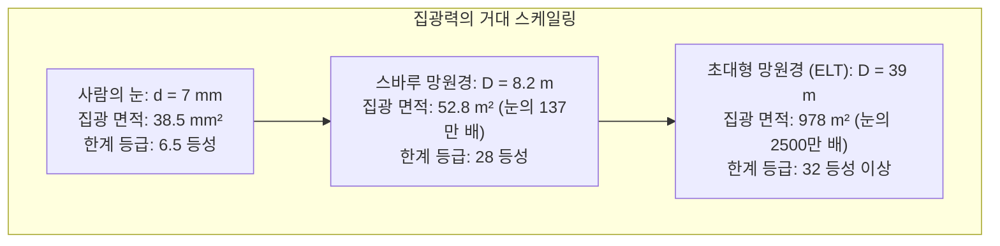

밤하늘을 올려다볼 때, 우리는 과거의 시간을 보고 있습니다. 달빛은 1.3초 전, 태양빛은 8분 20초 전, 안드로메다은하는 250만 년 전, 그리고 머나먼 심우주의 은하단은 130억 년 전의 원초적 빛을 품고 있습니다.

물리학의 본질에서 볼 때, 망원경은 단순한 돋보기가 아닙니다. 망원경은 <strong>‘광대한 시공간을 가로질러 날아온 극미한 광자(포톤) 다발을 그러모으고, 빛의 파면을 나노미터 정밀도로 제어하여 우주의 원초적 구조를 복원해 내는 정밀 타임머신’</strong>입니다.

1609년 갈릴레오 갈릴레이가 손수 만든 소형 굴절망원경으로 목성의 위성과 달의 분화구를 발견한 이래 400여 년이 흘렀습니다. 현대 천문학은 지구-태양 라그랑주 L2 지점에서 6.5미터 금도금 베릴륨 거울로 우주 최초의 별을 추적하는 제임스 웹 우주망원경(JWST)과, 인공 레이저 가이드 성과 수천 개의 압전 액추에이터로 대기 요동을 실시간 상쇄하는 39미터 유럽 초대형 망원경(ELT)의 시대로 진입했습니다.

---

### 1. 인류는 왜 빛을 모아야 하는가: 육안의 생체 광학적 한계

망원경의 물리적 필요성을 이해하려면 먼저 인간 시각 기관의 한계를 정량화해야 합니다:
- <strong>동공 크기의 한계</strong>: 암적응 상태에서도 사람의 동공 지름 $d_{eye}$은 약 $7\,\mathrm{mm}$ (면적 약 $38.5\,\mathrm{mm}^2$)에 불과합니다;
- <strong>전하 축적(노출) 불가능</strong>: 망원경의 CCD 센서와 달리 망원경 없는 망막의 적분 시간은 약 $0.1$초에 불과하여 빛을 누적할 수 없습니다;
- <strong>거리 역제곱 법칙</strong>: 130억 광년 거리의 초기 은하에서 지구로 도달하는 광자 플럭스는 단위 면적당 시간당 수 개에 불과하여 동공으로 들어올 확률이 $0$에 가깝습니다.

망원경의 1차적 물리 기능은 <strong>집광력(Light Gathering Power)</strong>입니다. 집광 면적 $A$는 구경 $D$의 제곱에 비례합니다:

$$A = \frac{\pi}{4} D^2$$

구경 8.2미터의 대형 천체망원경 1기는 인간 동공의 <strong>137만 배</strong>에 달하는 광자를 매초 수집합니다. 여기에 양자 효율 90% 이상의 냉각 CCD 소자로 수십 시간 장기 노출을 진행하면, 인간 육안보다 수십억 배 어두운 심우주 천체까지 선명하게 포착할 수 있습니다.

---

### 2. 굴절식과 반사식의 광학적 대결 및 유리의 물리적 한계

망원경의 역사는 렌즈로 빛을 굴절시키는 ‘굴절망원경’과 오목거울로 빛을 반사시키는 ‘반사망원경’ 간의 치열한 물리적 경쟁이었습니다.

#### 색수차(Chromatic Aberration)라는 치명적 장벽
유리와 같은 유전체 매질에서 빛의 굴절률 $n$은 파장 $\lambda$에 따라 변합니다(코시의 분산 공식):

$$n(\lambda) \approx A + \frac{B}{\lambda^2} + \frac{C}{\lambda^4}$$

파장이 짧은 푸른빛은 굴절률이 커서 렌즈 가까이에 초점을 맺고, 파장이 긴 붉은빛은 렌즈에서 먼 곳에 초점을 맺습니다. 이로 인해 별 주변에 보라색 무지개 번짐(색수차)이 필연적으로 발생합니다.

아크로매틱 렌즈 등의 발명에도 불구하고 굴절망원경은 치명적인 공학적 한계에 부딪혔습니다:
1. <strong>자중 처짐</strong>: 렌즈는 빛이 통과해야 하므로 테두리만 지지할 수 있습니다. 구경이 1미터를 넘으면 수 톤에 달하는 유리 자체 무게로 중심부가 처져 광학면이 붕괴합니다;
2. <strong>내부 흡수 및 기포</strong>: 거대한 유리 내부에서 자외선과 가시광이 심하게 흡수되며, 거대한 유리를 결함 없이 주조하는 것이 불가능합니다;
3. <strong>양면 연마의 난제</strong>: 전면과 후면 2개의 면을 나노미터 정밀도로 연마해야 합니다.

1897년 완성된 미국 여키스 천문대의 40인치(1.02m) 굴절망원경을 끝으로 굴절식의 시대는 종언을 고했습니다.

#### 반사망원경의 절대적 승리
1668년 뉴턴이 발명한 반사망원경은 광학의 패러다임을 바꿨습니다. <strong>반사의 법칙($\theta_i = \theta_r$)은 빛의 파장에 전혀 영향을 받지 않습니다!</strong>
- 적외선이든 가시광선이든 모든 파장의 빛이 <strong>완벽히 동일한 기하학적 초점에 모이므로 색수차가 물리적으로 0</strong>입니다;
- 거울 뒷면 전체를 기계적 액추에이터로 지지할 수 있어 자중 처짐을 완전히 극복할 수 있습니다;
- 현대의 <strong>리치-크레티앙(Ritchey-Chrétien)</strong> 광학계는 주경과 부경을 모두 쌍곡면으로 설계하여 구면수차와 코마수차를 동시에 제거, 현대 대형 망원경의 표준이 되었습니다.

---

### 3. 구경과 파동광학: 회절 한계와 에어리 디스크(Airy Disk)

망원경 구경을 키우는 또 다른 본질적 이유는 <strong>각분해능(Angular Resolution)</strong>의 향상입니다.

빛은 전자기파이므로 원형 개구부를 통과할 때 프라운호퍼 회절을 일으킵니다. 그 결과 점광원은 점이 아니라 중심 원반과 동심 고리로 구성된 <strong>에어리 디스크(Airy Disk)</strong>로 결상됩니다.

회절 강도 분포는 1종 1차 베셀 함수 $J_1(x)$로 표현되며:

$$I(\theta) = I_0 \left( \frac{2 J_1(x)}{x} \right)^2, \quad x = \frac{\pi D}{\lambda} \sin\theta$$

첫 번째 암환의 조건($x \approx 3.8317$)으로부터 <strong>레일리 분해능 기준(Rayleigh Criterion)</strong>이 유도됩니다:

$$\theta_{\text{diff}} \approx 1.22 \frac{\lambda}{D} \quad \text{[라디안]}$$

$$\theta_{\text{arcsec}} \approx 2.52 \times 10^5 \times \frac{\lambda}{D} \quad [\text{초각}]$$

가시광선($550\,\mathrm{nm}$) 기준 허블 우주망원경($D=2.4\,\mathrm{m}$)의 분해능은 약 $0.058''$, 39미터 ELT 망원경은 무려 <strong>$0.0035''$(3.5밀리초각)</strong>에 달하여 달 표면의 6.5미터 크기 물체까지 식별할 수 있습니다.

---

### 4. 지상의 장벽: 대기 요동과 시잉(Seeing)

그러나 지구 대기는 바람과 온도차로 인해 끊임없이 요동치는 난류 소용돌이로 가득 차 있습니다. 국소 굴절률 변동으로 인해 우주에서 온 평면파면은 산산이 조각납니다.

데이비드 프리드가 정립한 <strong>프리드 파라미터($r_0$)</strong>는 가시광 대역에서 세계 최고 관측지라 하더라도 <strong>$10\sim 20\,\mathrm{cm}$</strong>에 불과합니다. 즉, 아무리 수십 미터짜리 거대 망원경을 지상에 지어도 대기 난류를 교정하지 않으면 구경 15cm짜리 소형 망원경 수준인 <strong>$0.5''\sim 1.0''$ 크기의 흐릿한 ‘시잉 원반(Seeing Disk)’</strong>으로 상이 뭉개지고 맙니다.

---

### 5. 대기를 제압하는 기술: 적응제어광학(Adaptive Optics: AO)

이를 극복하기 위해 탄생한 기술이 <strong>적응제어광학(AO)</strong>입니다:
- <strong>샥-하트만 파면 센서</strong>: 마이크로렌즈 어레이로 파면의 국소 기울기를 초당 1,000회 이상 측정;
- <strong>실시간 제어기(RTC)</strong>: 500마이크로초 이내에 대기 난류 역위상 보정 매트릭스 연산;
- <strong>변형 거울(DM)</strong>: 수천 개의 압전 액추에이터가 거울 표면을 나노미터 단위로 실시간 변형시켜 왜곡을 상쇄.

여기에 고도 90km 메조스피어의 나트륨 원자층을 $589\,\mathrm{nm}$ 레이저로 자극하여 인공 별을 띄우는 <strong>레이저 가이드 성(LGS)</strong> 기술이 결합되어, 지상에서도 허블 망원경을 능가하는 회절한계 해상도를 달성하게 되었습니다.

---

### 6. 우주의 지문을 읽는 천체 분광학

천체물리학 연구의 70% 이상은 <strong>분광 관측(Spectroscopy)</strong>을 통해 이루어집니다:
- <strong>프라운호퍼 흡수선</strong>: 별 대기의 원자가 양자역학적 준위 차이($\Delta E = h\nu$)에 해당하는 특정 광자를 흡수하여 고유의 화학 지문을 형성;
- <strong>도플러 효과와 우주 팽창</strong>: 스펙트럼의 적색편이($z \approx v/c$)를 측정하여 은하의 후퇴 속도와 우주 팽창(허블 법칙)을 규명;
- <strong>외계 행성 탐사</strong>: 초정밀 에셸 분광기로 별의 시선속도가 초속 수십 센티미터 단위로 미세하게 흔들리는 도플러 효과를 측정하여 외계 행성을 발견.

---

### 7. 대기 밖으로의 도약: 우주망원경과 제임스 웹(JWST)

대기의 적외선·자외선 흡수를 완벽히 피하기 위해 우주망원경이 탄생했습니다.

2021년 발사된 <strong>제임스 웹 우주망원경(JWST)</strong>은:
- 초기 우주의 빛이 우주 팽창으로 적색편이되어 적외선으로 이동한 점에 착안, 근적외선/중적외선에 특화;
- 18장의 육각형 베릴륨 거울에 $100\,\mathrm{nm}$ 순금 박막을 증착하여 적외선 반사율 98% 달성;
- 지구에서 150만 km 떨어진 L2 궤도에서 5층 테니스장 크기 차광막으로 태양열을 차단, $-233^\circ\mathrm{C}$ 이하의 극저온을 유지하며 헬륨 폐회로 냉동기로 중적외선 검출기를 <strong>$6.7\,\mathrm{K}$($-266.45^\circ\mathrm{C}$)</strong>까지 냉각하여 관측을 수행합니다.

---

### 8. 결론: 인간 시야의 물리적 확장

갈릴레오의 작은 렌즈관에서 시작하여 JWST의 황금빛 거울과 39m ELT에 이르기까지, 망원경의 진화는 굴절, 회절, 대기 난류라는 물리적 한계를 과학과 공학으로 돌파해 온 위대한 지적 여정입니다. 망원경은 가장 오래된 빛을 모아 우주의 기원과 우리의 존재를 증명하는 인류 최고의 눈입니다.
