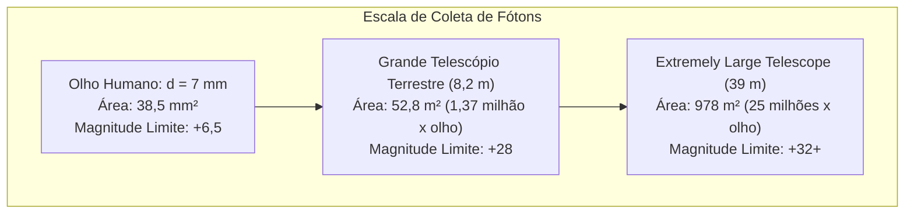

Ao contemplarmos o céu noturno, estamos olhando diretamente para o passado. A luz da Lua partiu há 1,3 segundo; a do Sol, há 8 minutos e 20 segundos; a da galáxia de Andrômeda viajou por 2,5 milhões de anos; e os aglomerados de galáxias mais distantes nos mostram o cosmos como ele existia há mais de 13 bilhões de anos.

Na essência da física, um telescópio não é uma lupa de ampliação, mas <strong>uma máquina do tempo fotônica de precisão absoluta: um instrumento óptico projetado para capturar fluxos extremamente tênues de radiação eletromagnética através das imensidões cósmicas e controlar as frentes de onda em escala nanométrica</strong>.

Desde 1609, quando Galileu Galilei apontou sua modesta luneta refratora para os céus, até o Telescópio Espacial James Webb (JWST) no ponto de Lagrange L2 com seu espelho de berílio folheado a ouro de 6,5 metros, e o Extremely Large Telescope (ELT) de 39 metros em construção no Chile, a astrofísica avançou superando limites físicos fundamentais.

---

### 1. O Limite Fisiológico do Olho Humano e o Poder Coletor de Luz

O olho humano possui restrições biológicas severas como detector astronômico:
- <strong>Pupila de pequena abertura</strong>: O diâmetro pupilar humano adaptado ao escuro não passa de $d_{eye} \approx 7\,\mathrm{mm}$ (área de $38,5\,\mathrm{mm}^2$);
- <strong>Incapacidade de integração temporal</strong>: A retina não acumula fótons em exposições longas; o tempo de integração neural é de apenas $0,1\,\mathrm{segundo}$;
- <strong>Atenuação pelo inverso do quadrado da distância</strong>: Fótons de galáxias primordiais chegam à Terra com densidades de apenas alguns fótons por metro quadrado por hora.

A função física primordial de um telescópio é seu <strong>Poder Coletor de Luz (Light Gathering Power)</strong>. A área coletora $A$ escala com o quadrado do diâmetro $D$:

$$A = \frac{\pi}{4} D^2$$

Um telescópio de 8,2 metros coleta <strong>1,37 milhão de vezes mais fótons por segundo</strong> do que o olho humano. Com sensores CCD/CMOS astronômicos resfriados criogenicamente com rendimento quântico acima de 90% e exposições de muitas horas, é possível registrar astros bilhões de vezes mais tênues que a visão desarmada.

---

### 2. Refratores versus Refletores: A Aberração Cromática e o Fim das Lentes

A história dos telescópios travou uma disputa entre lunetas refratoras (lentes) e telescópios refletores (espelhos).

#### O Obstáculo Insuperável da Aberração Cromática
Em meios transparentes, o índice de refração $n(\lambda)$ varia com o comprimento de onda da luz (dispersão de Cauchy). A luz azul sofre maior desvio refrativo que a vermelha:

$$f_{\text{azul}} < f_{\text{vermelho}}$$

Isso gera halos coloridos borrados ao redor dos astros. Embora dubletos acromáticos tenham minimizado esse defeito, lentes de vidro enfrentam limites mecânicos fatais:
1. <strong>Deformação Gravitacional</strong>: Uma lente só pode ser apoiada pela borda; com mais de 1 metro de diâmetro, o vidro enverga sob o próprio peso;
2. <strong>Absorção e Defeitos Internos</strong>: Vidros espessos absorvem luz ultravioleta e azul, e é impossível fundir toneladas de vidro sem bolhas;
3. <strong>Polimento em Dupla Face</strong>: Exige polir com precisão nanométrica duas superfícies ópticas.

O refrator de 40 polegadas (1,02 m) do Observatório Yerkes, em 1897, marcou o fim da era dos grandes telescópios de lentes.

#### O Triunfo Absoluto dos Refletores
Em 1668, Isaac Newton construiu o primeiro refletor prático. <strong>A lei da reflexão ($\theta_i = \theta_r$) independe do comprimento de onda da luz!</strong>
- Todos os comprimentos de onda convergem para o <strong>mesmo foco geométrico, anulando a aberração cromática ($0$)</strong>;
- Os espelhos podem ser apoiados por toda a face traseira com atuadores eletromecânicos e pneumáticos;
- O design <strong>Ritchey-Chrétien (RC)</strong> elimina simultaneamente aberração esférica e coma, sendo o padrão adotado no Hubble, VLT e Subaru.

---

### 3. Abertura e Óptica Ondulatória: Limite de Difração e Disco de Airy

O diâmetro $D$ governa também a <strong>resolução angular</strong> do instrumento. Pela difração de Fraunhofer em abertura circular, uma estrela pontual se projeta como um <strong>disco de Airy</strong> cercado por anéis concêntricos.
O primeiro mínimo de difração define o <strong>critério de Rayleigh</strong>:

$$\theta_{\text{diff}} \approx 1,22 \frac{\lambda}{D} \quad \text{[radianos]}$$

Em segundos de arco:

$$\theta_{\text{arcsec}} \approx 2,52 \times 10^5 \times \frac{\lambda}{D} \quad [\text{segundos de arco}]$$

Na faixa visível ($\lambda = 550\,\mathrm{nm}$), o Hubble ($D = 2,4\,\mathrm{m}$) atinge uma resolução de $0,058''$. O futuro ELT de 39 metros alcançará <strong>$0,0035''$ (3,5 milissegundos de arco)</strong>, permitindo distinguir estruturas de 6,5 metros na Lua!

---

### 4. A Barreira Terrestre: Turbulência Atmosférica e Parâmetro de Fried

Na Terra, a turbulência do ar gera vórtices térmicos com flutuações randômicas no índice de refração.

O <strong>parâmetro de Fried ($r_0$)</strong> mede a dimensão das células de coerência óptica da atmosfera. No espectro visível, $r_0$ raramente ultrapassa <strong>$10$ a $20\,\mathrm{cm}$</strong>, limitando a resolução de grandes telescópios a um borrão de $0,5''$ a $1,0''$ (disco de seeing).

---

### 5. Óptica Adaptativa (AO) e Estrelas Guia a Laser

A <strong>óptica adaptativa</strong> analisa as distorções da frente de onda a mais de $1.000\,\mathrm{Hz}$ com um sensor Shack-Hartmann e deforma dinamicamente um espelho fino apoiado em milhares de atuadores piezoelétricos para anular a turbulência em tempo real.
Com as <strong>estrelas guia a laser (LGS)</strong>, excitando átomos de sódio na mesosfera a 90 km de altitude, os observatórios terrestres recuperam a resolução teórica de difração em qualquer ponto do céu.

---

### 6. Espectroscopia: A Assinatura Química do Cosmos

Mais de 70% das descobertas na astrofísica provêm da <strong>espectroscopia</strong>:
- <strong>Linhas de Fraunhofer</strong>: Revelam a composição química das estrelas através de absorções atômicas discretas ($\Delta E = h\nu$);
- <strong>Efeito Doppler e Redshift</strong>: Determinam a velocidade radial e a expansão acelerada do universo (lei de Hubble);
- <strong>Espectrógrafos Echelle</strong>: Medem oscilações na velocidade estelar da ordem de centímetros por segundo, permitindo a detecção de exoplanetas.

---

### 7. Observatórios Espaciais e o Telescópio James Webb (JWST)

Para escapar da absorção de infravermelho e ultravioleta pela atmosfera, os telescópios espaciais são fundamentais.

O <strong>JWST</strong> (lançado em 2021) opera no ponto de Lagrange L2:
- Espelho primário de 6,5 metros composto por 18 hexágonos de berílio folheados a ouro (camada de 100 nm) para máxima refletividade no infravermelho;
- Escudo térmico de 5 camadas garantindo temperaturas passivas de $-233^\circ\mathrm{C}$ ($40\,\mathrm{K}$);
- Criorefrigerador ativo de hélio resfriando o instrumento MIRI a <strong>$6,7\,\mathrm{K}$ ($-266,45^\circ\mathrm{C}$)</strong> para eliminar qualquer ruído térmico instrumental.

---

### 8. Conclusão

De Galileu aos gigantes contemporâneos terrestres e espaciais, a física dos telescópios é a história da vitória da engenharia sobre os limites da refração, difração e turbulência. Eles constituem a extensão máxima dos olhos da humanidade para compreender o início do cosmos e nossa própria existência.
