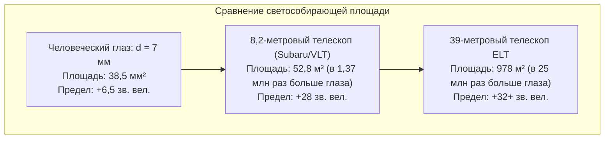

Вглядываясь в ночное небо, мы смотрим прямо в прошлое. Свет Луны летит до нас 1,3 секунды; солнечные лучи — 8 минут и 20 секунд; свет от галактики Андромеды преодолевал космос 2,5 миллиона лет, а далекие скопления галактик доносят до нас фотоны, испущенные более 13 миллиардов лет назад.

С точки зрения фундаментальной физики телескоп — это не просто оптическая увеличительная труба. Это <strong>высокоточная фотонная машина времени: научный прибор, созданный для улавливания предельно слабого потока электромагнитного излучения сквозь пространство и управления волновым фронтом с нанометровой точностью</strong>.

С тех пор как в 1609 году Галилео Галилей направил свою зрительную трубу на небо, открыв спутники Юпитера и кратеры Луны, наблюдательная астрофизика совершила колоссальный эволюционный скачок. Сегодня космический телескоп «Джеймс Уэбб» (JWST) с 6,5-метровым позолоченным бериллиевым зеркалом исследует первые звезды в точке Лагранжа L2, а в пустыне Атакама строится Чрезвычайно большой телескоп (ELT) диаметром 39 метров с адаптивной оптикой, сводящей на нет атмосферную турбулентность.

---

### 1. Биологический предел человеческого глаза и необходимость колоссальной апертуры

Чтобы понять физическую необходимость гигантских телескопов, следует учесть ограничения человеческого глаза:
- <strong>Крошечный диаметр зрачка</strong>: В условиях полной темновой адаптации диаметр зрачка человека $d_{eye}$ не превышает $7\,\mathrm{мм}$ (площадь около $38,5\,\mathrm{мм}^2$);
- <strong>Отсутствие временного накопления</strong>: Нейробиологическое время экспозиции сетчатки составляет всего около $0,1\,\mathrm{секунды}$, что исключает длительное накопление фотонов;
- <strong>Закон обратных квадратов</strong>: Поток фотонов от древних галактик падает пропорционально квадрату расстояния. На каждый квадратный метр Земли попадают лишь считанные фотоны в час.

Главная физическая характеристика телескопа — <strong>светосила / светособирающая способность (Light Gathering Power)</strong>. Площадь апертуры $A$ пропорциональна квадрату диаметра $D$:

$$A = \frac{\pi}{4} D^2$$

Телескоп диаметром 8,2 метра собирает в <strong>1,37 миллиона раз больше фотонов в секунду</strong>, чем человеческий глаз. В сочетании с охлаждаемыми астрономическими ПЗС/КМОП-детекторами с квантовой эффективностью свыше 90 % и многочасовыми экспозициями ученые могут регистрировать объекты в миллиарды раз слабее порога зрительного восприятия.

---

### 2. Рефракторы против рефлекторов: Физический предел линзовой оптики

История телескопостроения определялась соперничеством двух систем: линзовых рефракторов и зеркальных рефлекторов.

#### Хроматическая аберрация стеклянных линз
В прозрачной среде показатель преломления $n(\lambda)$ зависит от длины волны света (дисперсия Коши). Коротковолновый синий свет преломляется сильнее, чем красный:

$$f_{\text{синий}} < f_{\text{красный}}$$

В результате вокруг звезд возникают цветные ореолы нерезкости. Несмотря на появление ахроматических дублетов, линзовые системы столкнулись с непреодолимыми физическими преградами:
1. <strong>Гравитационное провисание</strong>: Линзу можно крепить только по краю; при диаметре более 1 метра многотонное стекло деформируется под собственным весом;
2. <strong>Внутреннее поглощение и дефекты</strong>: Толстое стекло поглощает свет в ультрафиолетовой и синей областях; отлить оптический монолит в несколько тонн без пузырьков технически невозможно;
3. <strong>Двусторонняя прецизионная полировка</strong>: Требуется нанометровая точность обработки обеих поверхностей линзы.

40-дюймовый (1,02 м) телескоп Йеркской обсерватории, построенный в 1897 году, навсегда завершил эпоху больших рефракторов.

#### Триумф зеркальных рефлекторов
В 1668 году Исаак Ньютон создал первый практический зеркальный телескоп. <strong>Закон отражения ($\theta_i = \theta_r$) абсолютно не зависит от длины волны!</strong>
- Вогнутое зеркало собирает лучи всех цветов в <strong>единый геометрический фокус: хроматическая аберрация строго равна нулю ($0$)</strong>;
- Вся тыльная сторона зеркала может опираться на пневматические и пьезоэлектрические актуаторы;
- Оптическая схема <strong>Ричи — Кретьена (RC)</strong> с двумя гиперболическими зеркалами полностью устраняет сферическую аберрацию и кому (стандарт Хаббла, Keck и VLT).

---

### 3. Апертура и дифракционный предел: Диск Эйри и критерий Рэлея

Помимо светосилы, диаметр $D$ определяет <strong>угловое разрешение (Angular Resolution)</strong> телескопа.

В волновой оптике свет, проходя через круглую диафрагму, испытывает дифракцию Фраунгофера, формируя в фокусе <strong>диск Эйри</strong> с концентрическими кольцами.
Первый темный минимум задает фундаментальный <strong>критерий Рэлея</strong>:

$$\theta_{\text{diff}} \approx 1,22 \frac{\lambda}{D} \quad \text{[радиан]}$$

В угловых секундах:

$$\theta_{\text{arcsec}} \approx 2,52 \times 10^5 \times \frac{\lambda}{D} \quad [\text{угловых секунд}]$$

В видимом диапазоне ($\lambda = 550\,\mathrm{нм}$) телескоп «Хаббл» ($D = 2,4\,\mathrm{м}$) имеет предел разрешения $0,058''$. Строящийся 39-метровый ELT достигнет фантастических <strong>$0,0035''$ (3,5 миллисекунды дуги)</strong>, что позволит различить на поверхности Луны объект размером всего 6,5 метров!

---

### 4. Барьер земной атмосферы: Сиинг и параметр Фрида

На Земле теоретическое разрешение нивелируется атмосферной турбулентностью. Тепловые вихри воздуха хаотически искажают оптический волновой фронт.

<strong>Параметр Фрида ($r_0$)</strong> задает диаметр зоны оптической когерентности атмосферы. В видимом диапазоне $r_0$ составляет всего <strong>$10$–$20\,\mathrm{см}$</strong> даже в лучших обсерваториях мира. Без коррекции изображение любого гигантского телескопа размывается в турбулентное пятно угловым размером $0,5''$–$1,0''$ (диск сиинга).

---

### 5. Адаптивная оптика (AO) и лазерные опорные звезды

Технология <strong>адаптивной оптики</strong> измеряет фазовые искажения с частотой более $1000\,\mathrm{Гц}$ датчиком Шэка — Гартмана и с помощью тысяч пьезоактуаторов изгибает тонкое деформируемое зеркало, компенсируя турбулентность в реальном времени.
Использование <strong>лазерных гидов (LGS)</strong>, возбуждающих слой атомов натрия в мезосфере на высоте 90 км, создает искусственную звезду в любой точке небесной сферы, возвращая наземным телескопам дифракционную четкость.

---

### 6. Астрономическая спектроскопия: Штрих-код Вселенной

Более 70 % научных открытий в астрофизике дает <strong>спектроскопия</strong>:
- <strong>Фраунгоферовы линии</strong>: Атомы звездного вещества поглощают фотоны строго определенных энергий ($\Delta E = h\nu$), раскрывая химический состав звезд;
- <strong>Эффект Доплера и красное смещение</strong>: Сдвиг спектральных линий определяет радиальные скорости и расширение Вселенной (закон Хаббла);
- <strong>Эшелле-спектрографы</strong>: Регистрируют колебания лучевой скорости звезды с точностью до десятков сантиметров в секунду, открывая экзопланеты.

---

### 7. Космические телескопы и «Джеймс Уэбб» (JWST)

Чтобы избежать поглощения инфракрасного, ультрафиолетового и рентгеновского излучения молекулами атмосферы, телескопы выводят в космос.

Запущенный в 2021 году <strong>JWST</strong> работает в точке L2:
- 6,5-метровое главное зеркало из 18 бериллиевых сегментов с золотым покрытием (слой 100 нм) для 98 % отражения инфракрасных волн;
- 5-слойный солнцезащитный щит поддерживает пассивную температуру $-233^\circ\mathrm{C}$ ($40\,\mathrm{K}$);
- Замкнутый гелиевый криокулер охлаждает детектор MIRI до <strong>$6,7\,\mathrm{K}$ ($-266,45^\circ\mathrm{C}$)</strong> для полного подавления собственного теплового фона.

---

### 8. Заключение

От первой подзорной трубы Галилея до 39-метрового ELT и золотых зеркал «Джеймса Уэбба» эволюция телескопов демонстрирует триумф человеческого разума над законами дифракции и атмосферного хаоса. Телескопы улавливают древнейшие фотоны мироздания, позволяя нам постичь зарождение звезд, планет и самой жизни.
