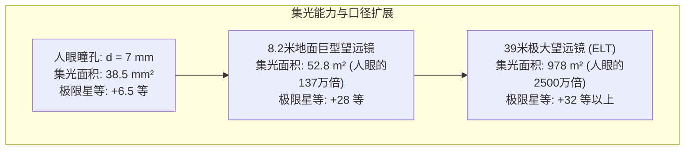
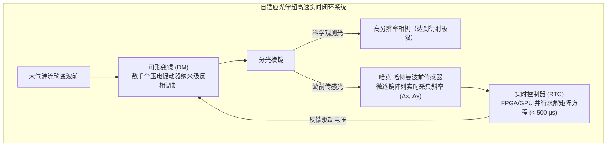

仰望夜空，我们目光所及皆是宇宙的过去：月光来自 1.3 秒前，阳光来自 8 分 20 秒前，仙女座星系的光芒穿越了 250 万年，而深空星系团投射出的则是 130 亿年前宇宙婴儿时期的微光。

在物理学本质上，望远镜绝非简单的光学放大镜，而是<strong>一台精密的“光子收集时间机器”——它在浩瀚时空中捕获极度微弱的稀疏光子流，在纳米尺度精准操纵电磁波前，从而重建深邃宇宙的时空图景</strong>。

从 1609 年伽利略首次将自制折射望远镜指向星空，到如今在日地拉格朗日 L2 点巡弋的 6.5 米镀金铍镜詹姆斯·韦伯空间望远镜（JWST），再到智利沙漠中利用激光导引星与压电自适应光学对抗大气湍流的 39 米欧洲极大望远镜（ELT），人类观测宇宙的能力经历了翻天覆地的物理跨越。

---

### 1. 为什么人类需要聚光：人眼的生理光学瓶颈

理解望远镜的物理必要性，首先必须量化人眼作为光电传感器的物理极限：
- <strong>有效通光口径极其微小</strong>：人眼瞳孔在暗适应下的最大散大直径 $d_{eye}$ 仅约 $7\,\mathrm{mm}$（面积约 $38.5\,\mathrm{mm}^2$）；
- <strong>无法实现长时间曝光积分</strong>：人眼视网膜神经元信号积分时间 $\tau_{int}$ 仅约 $0.1\,\mathrm{s}$，无法对光子进行累加计数；
- <strong>遥远天体的光子通量衰减</strong>：天体到达地球表面的光子通量遵循距离平方反比定律 $F = L / (4\pi d^2)$。百亿光年外的原初星系到达地球的可见光光子每平方米每小时仅有零星数个，射入人眼瞳孔的几率趋近于零。

望远镜的第一核心物理功能是<strong>集光力（Light Gathering Power）</strong>。集光面积 $A$ 与口径 $D$ 的平方成正比：

$$A = \frac{\pi}{4} D^2$$

一台口径 8.2 米的地面望远镜，其集光面积是人眼的 <strong>137 万倍</strong>。搭配量子效率超过 90% 的制冷天文 CCD/CMOS 探测器进行长达数十小时的曝光累加，人类得以观测到比肉眼极限暗数十亿倍的宇宙最深处天体。

---

### 2. 折射式与反射式：几何光学演进与玻璃的物理极限

望远镜发展史是透镜折射与凹面镜反射两种技术路径的博弈史。

#### 色差（Chromatic Aberration）的不可逆物理宿命
在透明介质（如玻璃）中，光的相速度 $v(\lambda) = c/n(\lambda)$ 取决于波长。根据柯西色散公式：

$$n(\lambda) \approx A + \frac{B}{\lambda^2} + \frac{C}{\lambda^4}$$

蓝光波长较短，折射率更大；红光波长较长，折射率更小。根据薄透镜焦距公式：

$$\frac{1}{f(\lambda)} = (n(\lambda) - 1) \left(\frac{1}{R_1} - \frac{1}{R_2}\right)$$

同一凸透镜对蓝光的焦距 $f_{blue}$ 必然短于红光的焦距 $f_{red}$。白色星光穿过单片物镜后，无法聚焦于同一焦点，形成严重的色差弥散斑与彩色光晕。

尽管后世发明了消色差双合透镜（Achromatic Doublet）与三合复消色差透镜，但折射望远镜的尺寸受制于不可逾越的工程物理壁垒：
1. <strong>重力下垂变形</strong>：透镜必须透光，只能在机械边缘进行固定。当玻璃口径超过 1 米时，数吨重的透镜在自身重力下发生物理下垂变形，严重破坏光学面型；
2. <strong>光线内吸收与气泡缺陷</strong>：超厚大透镜对短波长紫外与蓝光产生严重吸收，且浇铸数吨绝对无气泡杂质的光学玻璃在工艺上是不可能的；
3. <strong>双表面精密研磨困难</strong>：透镜的前后两个光学曲面均需达到纳米级面型精度。

1897 年建成的美国叶凯士天文台 40 英寸（1.02 米）折射镜成为了人类折射望远镜的历史绝唱。

#### 反射望远镜的全面统治
1668 年牛顿发明的反射望远镜彻底改写了光学史。<strong>光的反射定律（$\theta_i = \theta_r$）完全与光波波长无关！</strong>
- 无论是紫外、可见光还是远红外线，经凹面反射镜反射后汇聚于<strong>完全同一几何焦点，色差在原理上严格为零（0）</strong>；
- 镜片背面可由数十乃至数百个气动/电动促动器全面支撑，彻底免除重力变形；
- 现代主流的<strong>里奇-克莱琴（Ritchey-Chrétien, RC）光学系统</strong>通过双曲面主镜与双曲面副镜的精妙匹配，同时彻底消除了球差与彗差，成为哈勃空间望远镜与各大地面 8 米旗舰天文台的标准构型。

---

### 3. 口径与波动光学：衍射极限与艾里斑（Airy Disk）

望远镜追求更大口径的第二大驱动力是<strong>角分辨率（Angular Resolution）</strong>。

在波动光学框架下，光线穿过有限圆形孔径时必然发生夫琅禾费衍射。点光源在焦平面上形成的衍射光斑并非几何奇点，而是具有同心明暗圆环的<strong>艾里斑（Airy Disk）</strong>。

其归一化光强分布由一阶贝塞尔函数 $J_1(x)$ 严格描述：

$$I(\theta) = I_0 \left( \frac{2 J_1(x)}{x} \right)^2, \quad x = \frac{\pi D}{\lambda} \sin\theta$$

第一暗环的角半径对应于贝塞尔函数的首个零点（$x_1 \approx 3.8317$），由此导出著名的<strong>瑞利分辨率准则（Rayleigh Criterion）</strong>：

$$\theta_{\text{diff}} \approx 1.22 \frac{\lambda}{D} \quad \text{[弧度]}$$

换算为角秒（arcsecond）：

$$\theta_{\text{arcsec}} \approx 2.52 \times 10^5 \times \frac{\lambda}{D} \quad [\text{角秒}]$$

在波长 $\lambda = 550\,\mathrm{nm}$ 时：
- 人眼瞳孔（$D=7\,\mathrm{mm}$）：理论衍射极限约 $20''$（受视网膜受体间距限制实际约 $60''$）；
- 哈勃望远镜（$D=2.4\,\mathrm{m}$）：理论衍射极限约 $0.058''$；
- 39 米 ELT 望远镜：理论衍射极限达到惊人的 <strong>$0.0035''$（3.5毫角秒）</strong>，足以在地球上看清月球表面仅 6.5 米大小的物体！

---

### 4. 地面之墙：大气湍流、视宁度与弗里德参数（Fried Parameter）

然而，在 20 世纪末之前，地面大口径望远镜从未达到理论衍射极限。地球大气层是阻碍地面观测的巨大光学屏障。

大气层内部因风切变与温差形成剧烈的对流湍流涡旋，导致空气密度与折射率 $n$ 呈现随机微小起伏（格拉德斯通-代尔定律）：

$$n - 1 \propto \frac{P}{T}$$

宇宙传来的完美平面波在穿越数十公里大气后，波前发生剧烈畸变破裂。
戴维·弗里德（David Fried）定义的大气相干长度——<strong>弗里德参数（$r_0$）</strong>，代表波前相位方差为 $1\,\mathrm{rad}^2$ 的空间相干直径。在世界顶级天文观测台址（如夏威夷莫纳克亚山或智利阿塔卡马沙漠），可见光波段的 $r_0$ 通常仅为 <strong>$10\,\mathrm{cm}$ 至 $20\,\mathrm{cm}$</strong>！

这带来了极为残酷的物理现实：<strong>未经修正的地面大型望远镜，无论口径建到 8 米还是 30 米，其长时间曝光图像分辨率均被锁死在 $D = r_0 \approx 15\,\mathrm{cm}$ 的小型望远镜水平，即角直径约 $0.5'' \sim 1.0''$ 的模糊“视宁度圆盘（Seeing Disk）”</strong>。

---

### 5. 驯服大气波动：自适应光学（Adaptive Optics: AO）

为了夺回被大气剥夺的理论分辨率，天文学家发明了<strong>自适应光学（AO）技术</strong>。

由于大气湍流波动的相干时间（格林伍德时间 $\tau_0$）仅有数毫秒，自适应光学系统必须在千赫兹（$1\sim 2\,\mathrm{kHz}$）的超高速闭环下实时运行：

针对夜空中明亮参考星稀缺的问题，现代天文台研发了<strong>钠激光导引星（Laser Guide Star: LGS）</strong>技术：
- 从望远镜发射 $589\,\mathrm{nm}$ 的高能脉冲激光束，精确激发位于海拔 $90\,\mathrm{km}$ 中间层顶的天然微陨石钠原子层；
- 钠原子发生共振荧光散射，在 90 公里高空点亮一颗明亮的人造基准星，波前传感器捕获这颗人造星的光芒，实现全天区几乎 100% 覆盖的自适应光学高精度校正。

---

### 6. 揭示宇宙成分的密码：天文光谱学

成像仅展现天体的形态，而天体物理学 70% 以上的科学内涵来源于<strong>光谱学（Spectroscopy）</strong>。

通过将天体发出的复合光经由高色散梯形光栅（Echelle Grating）展开为精细光谱：
1. <strong>夫琅禾费吸收线</strong>：恒星大气中不同元素原子的电子在分立能级间跃迁吸收特定波长光子（$\Delta E = h\nu = hc/\lambda$），形成独一无二的元素光谱指纹，直接揭示恒星化学丰度；
2. <strong>多普勒效应与红移</strong>：谱线波长偏移量 $\Delta \lambda / \lambda_0 \approx v/c$ 精确测定天体视线速度。1929 年埃德温·哈勃据此发现河外星系退行速度与距离成正比，确立了宇宙膨胀的基石理论；
3. <strong>系外行星视向速度法</strong>：分辨率 $R > 100,000$ 的超高精度光谱仪能够检测到星光因行星引力扰动产生的<strong>每秒几十厘米（慢于人类步行速度）</strong>的极微多普勒颤动，从而发现数以千计的系外行星。

---

### 7. 跃出大气牢笼：空间望远镜与詹姆斯·韦伯（JWST）

即便拥有自适应光学，地球大气层在红外、紫外和 X 射线波段的分子吸收带是地面望远镜无法穿透的物理天花板。

2021 年底升空的<strong>詹姆斯·韦伯空间望远镜（JWST）</strong>代表了人类航天光学工程的最高峰：
- <strong>红外波段的物理优越性</strong>：宇宙学红移将 135 亿年前原初星系的紫外/可见光拉伸至近红外与中红外波段；同时红外线能轻易穿透分子云与原行星盘的致密宇宙尘埃；
- <strong>6.5 米折叠式铍镀金镜</strong>：18 枚六边形镜片采用轻质耐超低温的金属铍制造，表面蒸镀厚度仅 $100\,\mathrm{nm}$ 的纯金薄膜，红外反射率高达 98%；
- <strong>日地 L2 点与 5 层遮阳罩</strong>：部署于距离地球 150 万公里的拉格朗日 L2 点，网球场大小的五层卡普顿（Kapton）遮阳罩隔绝太阳辐射，使仪器舱在深空辐射冷却至 $-233^\circ\mathrm{C}$（$40\,\mathrm{K}$），中红外相机（MIRI）更配备封闭式氦循环脉管制冷机，强效制冷至绝对零度之上的 <strong>$6.7\,\mathrm{K}$（$-266.45^\circ\mathrm{C}$）</strong>，彻底隔绝背景热噪声。

---

### 8. 总结：人类视野的物理延伸

从伽利略的木管镜筒到 JWST 的六边形黄金巨镜，天文学的四百年史是一部不断突破物理限制的史诗：
几何光学消除了色差，波动光学指明了口径与分辨率的正比律，自适应光学征服了大气乱流，而空间工程则将人类的视线推向了宇宙诞生之初的第一缕曙光。望远镜不仅是光线收集器，更是人类理性向未知宇宙延伸的最深邃触角。
