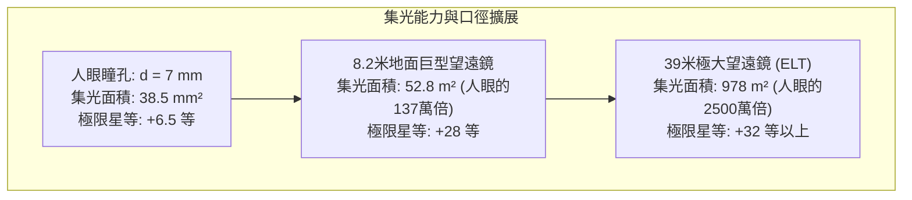

仰望夜空，我們目光所及皆是宇宙的過去：月光來自 1.3 秒前，陽光來自 8 分 20 秒前，仙女座星系的光芒穿越了 250 萬年，而深空星系團投射出的則是 130 億年前宇宙嬰兒時期的微光。

在物理學本質上，望遠鏡絕非簡單的光學放大鏡，而是<strong>一台精密的「光子收集時光機」——它在浩瀚時空中捕獲極度微弱的稀疏光子流，在奈米尺度精準操縱電磁波前，從而重建深邃宇宙的時空圖景</strong>。

從 1609 年伽利略首次將自製折射望遠鏡指向星空，到如今在日地拉格朗日 L2 點巡弋的 6.5 米鍍金鈹鏡詹姆斯·韋伯太空望遠鏡（JWST），再到智利沙漠中利用雷射導引星與壓電自適應光學對抗大氣亂流的 39 米歐洲極大望遠鏡（ELT），人類觀測宇宙的能力經歷了翻天覆地的物理跨越。

---

### 1. 為什麼人類需要聚光：人眼的生理光學瓶頸

理解望遠鏡的物理必要性，首先必須量化人眼作為光電感測器的物理極限：
- <strong>有效通光口徑極其微小</strong>：人眼瞳孔在暗適應下的最大散大直徑 $d_{eye}$ 僅約 $7\,\mathrm{mm}$（面積約 $38.5\,\mathrm{mm}^2$）；
- <strong>無法實現長時間曝光積分</strong>：人眼視網膜神經元信號積分時間 $\tau_{int}$ 僅約 $0.1\,\mathrm{s}$，無法對光子進行累加計數；
- <strong>遙遠天體的光子通量衰減</strong>：天體到達地球表面的光子通量遵循距離平方反比定律 $F = L / (4\pi d^2)$。百億光年外的原初星系到達地球的可見光光子每平方米每小時僅有零星數個，射入人眼瞳孔的機率趨近於零。

望遠鏡的第一核心物理功能是<strong>集光力（Light Gathering Power）</strong>。集光面積 $A$ 與口徑 $D$ 的平方成正比：

$$A = \frac{\pi}{4} D^2$$

一台口徑 8.2 米的地面望遠鏡，其集光面積是人眼的 <strong>137 萬倍</strong>。搭配量子效率超過 90% 的冷卻天文 CCD/CMOS 感測器進行長達數十小時的曝光累加，人類得以觀測到比肉眼極限暗數十億倍的宇宙最深處天體。

---

### 2. 折射式與反射式：幾何光學演進與玻璃的物理極限

望遠鏡發展史是透鏡折射與凹面鏡反射兩種技術路徑的博弈史。

#### 色差（Chromatic Aberration）的不可逆物理宿命
在透明介質（如玻璃）中，光的相速度 $v(\lambda) = c/n(\lambda)$ 取決於波長。根據柯西色散公式：

$$n(\lambda) \approx A + \frac{B}{\lambda^2} + \frac{C}{\lambda^4}$$

藍光波長較短，折射率更大；紅光波長較長，折射率更小。白色星光穿過單片物鏡後，無法聚焦於同一焦點，形成嚴重的色差彌散斑與彩色光暈。

儘管後世發明了消色差雙合透鏡（Achromatic Doublet）與三合複消色差透鏡，但折射望遠鏡的尺寸受制於不可逾越的工程物理壁壘：
1. <strong>重力下垂變形</strong>：透鏡必須透光，只能在機械外圍進行固定。當玻璃口徑超過 1 米時，數噸重的透鏡在自身重力下發生物理下垂變形，嚴重破壞光學面型；
2. <strong>光線內吸收與氣泡缺陷</strong>：超厚大透鏡對短波長紫外與藍光產生嚴重吸收，且澆鑄數噸絕對無氣泡雜質的光學玻璃在工藝上是不可能的；
3. <strong>雙表面精密研磨困難</strong>：透鏡的前後兩個光學曲面均需達到奈米級面型精度。

1897 年建成的美國葉凱士天文台 40 英吋（1.02 米）折射鏡成為了人類折射望遠鏡的歷史絕唱。

#### 反射望遠鏡的全面統治
1668 年牛頓發明的反射望遠鏡徹底改寫了光學史。<strong>光的反射定律（$\theta_i = \theta_r$）完全與光波波長無關！</strong>
- 凹面反射鏡將所有波長的光線匯聚於<strong>完全同一幾何焦點，幾何色差在原理上嚴格為零（0）</strong>；
- 鏡片背面可由數十乃至數百個氣動/電動促動器全面支撐，徹底免除重力變形；
- 現代主流的<strong>里奇-克萊琴（Ritchey-Chrétien, RC）光學系統</strong>透過雙曲面主鏡與雙曲面副鏡的精妙匹配，同時徹底消除了球差與彗差，成為哈伯太空望遠鏡與各大地面 8 米旗艦天文台的標準構型。

---

### 3. 口徑與波動光學：繞射極限與艾里斑（Airy Disk）

望遠鏡追求更大口徑的第二大驅動力是<strong>角解析度（Angular Resolution）</strong>。

在波動光學框架下，光線穿過有限圓形孔徑時必然發生夫朗和斐繞射。點光源在焦平面上形成的繞射光斑並非幾何奇點，而是具有同心明暗圓環的<strong>艾里斑（Airy Disk）</strong>。

其歸一化光強分佈由一階貝索函數 $J_1(x)$ 嚴格描述：

$$I(\theta) = I_0 \left( \frac{2 J_1(x)}{x} \right)^2, \quad x = \frac{\pi D}{\lambda} \sin\theta$$

第一暗環的角半徑對應於貝索函數的首個零點（$x_1 \approx 3.8317$），由此導出著名的<strong>瑞利解析度準則（Rayleigh Criterion）</strong>：

$$\theta_{\text{diff}} \approx 1.22 \frac{\lambda}{D} \quad \text{[弧度]}$$

換算為角秒（arcsecond）：

$$\theta_{\text{arcsec}} \approx 2.52 \times 10^5 \times \frac{\lambda}{D} \quad [\text{角秒}]$$

在波長 $\lambda = 550\,\mathrm{nm}$ 時：
- 人眼瞳孔（$D=7\,\mathrm{mm}$）：理論繞射極限約 $20''$（受視網膜受體間距限制實際約 $60''$）；
- 哈伯望遠鏡（$D=2.4\,\mathrm{m}$）：理論繞射極限約 $0.058''$；
- 39 米 ELT 望遠鏡：理論繞射極限達到驚人的 <strong>$0.0035''$（3.5毫角秒）</strong>，足以在地球上看清月球表面僅 6.5 米大小的物體！

---

### 4. 地面之牆：大氣亂流、視寧度與弗里德參數（Fried Parameter）

然而，在 20 世紀末之前，地面大口徑望遠鏡從未達到理論繞射極限。地球大氣層是阻礙地面觀測的巨大光學屏障。

大氣層內部因風切變與溫差形成劇烈的對流亂流渦旋，導致空氣密度與折射率 $n$ 呈現隨機微小起伏。戴維·弗里德（David Fried）定義的大氣相干長度——<strong>弗里德參數（$r_0$）</strong>，在可見光波段通常僅為 <strong>$10\,\mathrm{cm}$ 至 $20\,\mathrm{cm}$</strong>！

這帶來了極為殘酷的物理現實：<strong>未經修正的地面大型望遠鏡，無論口徑建到 8 米還是 30 米，其長時間曝光影像解析度均被鎖死在 $D = r_0 \approx 15\,\mathrm{cm}$ 的小型望遠鏡水準，即角直徑約 $0.5'' \sim 1.0''$ 的模糊「視寧度圓盤（Seeing Disk）」</strong>。

---

### 5. 馴服大氣波動：自適應光學（Adaptive Optics: AO）

為了奪回被大氣剝奪的理論解析度，天文學家發明了<strong>自適應光學（AO）技術</strong>。

自適應光學系統必須在千赫茲（$1\sim 2\,\mathrm{kHz}$）的超高速閉環下即時運行：
1. <strong>夏克-哈特曼波前感測器（Shack-Hartmann WFS）</strong>：利用微透鏡陣列即時測量波前斜率；
2. <strong>即時控制器（RTC）</strong>：在 500 微秒內計算出抵消大氣畸變的反相矩陣；
3. <strong>可形變鏡（Deformable Mirror: DM）</strong>：由數千個壓電促動器即時精確微調鏡面曲率。

搭配<strong>鈉雷射導引星（Laser Guide Star: LGS）</strong>技術，激發高空 90 公里處的鈉原子發光作為人工參考點，使得地面大望遠鏡得以在全天區展現媲美甚至超越太空望遠鏡的驚人解析度。

---

### 6. 揭示宇宙成分的密碼：天文光譜學

天體物理學 70% 以上的科學內涵來源於<strong>光譜學（Spectroscopy）</strong>：
1. <strong>夫琅和斐吸收線</strong>：恒星大氣原子吸收特定能量光子（$\Delta E = h\nu$），形成元素光譜條碼，精確揭示天體化學成分；
2. <strong>都卜勒效應與紅移</strong>：譜線波長偏移 $\Delta \lambda / \lambda_0 \approx v/c$ 揭示天體運動與宇宙膨脹（哈伯定律）；
3. <strong>系外行星偵測</strong>：高色散階梯光柵光譜儀（Echelle）能測量每秒數十公分的恆星視向速度擺動，從而確認系外行星的存在。

---

### 7. 躍出大氣牢籠：太空望遠鏡與詹姆斯·韋伯（JWST）

2021 年發射的<strong>詹姆斯·韋伯太空望遠鏡（JWST）</strong>是人類航太工程的巔峰代表：
- <strong>紅外觀測的物理必要性</strong>：宇宙紅移將遠古第一代星系的紫外光拉伸至紅外波段，且紅外光能穿透致密宇宙塵埃；
- <strong>6.5 米鍍金鈹鏡</strong>：18 片六邊形鏡片採用超低溫不變形的鈹金屬，表面蒸鍍 100 奈米純金薄膜，提供 98% 以上的紅外反射率；
- <strong>日地 L2 點與五層遮陽罩</strong>：在距離地球 150 萬公里的軌道上，五層遮陽罩實現了 300 度的極端溫差，並配合封閉氦循環冷卻器將中紅外儀器冷卻至 <strong>$6.7\,\mathrm{K}$（$-266.45^\circ\mathrm{C}$）</strong>，消除了自體熱雜訊。

---

### 8. 總結：人類視野的物理延伸

望遠鏡的四百年演進，是幾何光學、波動光學、自適應控制與航太工程共同譜寫的壯麗篇章。它不僅是集光儀器，更是人類智慧向未知時空延伸的最深邃之眼。
